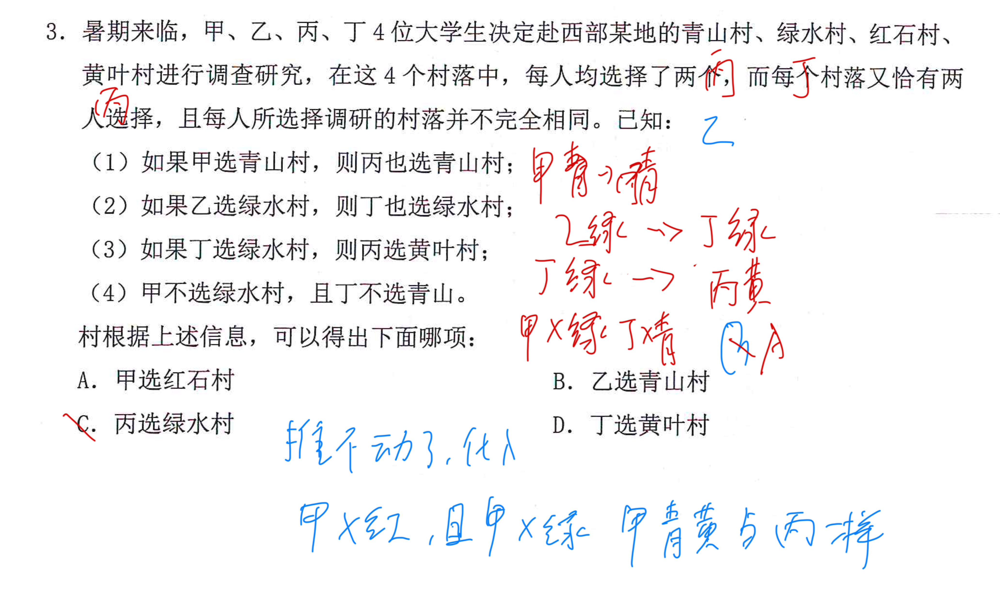

---
tags:
  - 判断
  - 形式推理
  - 错题
  - S3-组合排列
  - 公务员考试
---

## Card
<!-- hyz-card-id: 01a1169b-7a58-75d2-8da2-37b7ea208408 -->

### Front

暑期来临，甲、乙、丙、丁 4 位大学生决定赴西部某地的青山村、绿水村、红石村、黄叶村进行调查研究。在这 4 个村落中，每人均选择了两个，而每个村落又恰有两人选择，且每人所选择调研的村落并不完全相同。已知：

1. 如果甲选青山村，则丙也选青山村；
2. 如果乙选绿水村，则丁也选绿水村；
3. 如果丁选绿水村，则丙选黄叶村；
4. 甲不选绿水村，且丁不选青山村。

根据上述信息，可以得出下面哪项：

A. 甲选红石村

B. 乙选青山村

C. 丙选绿水村

D. 丁选黄叶村

### Back

推不动了就代入，证明为真就取反，证明为假直接代

---
