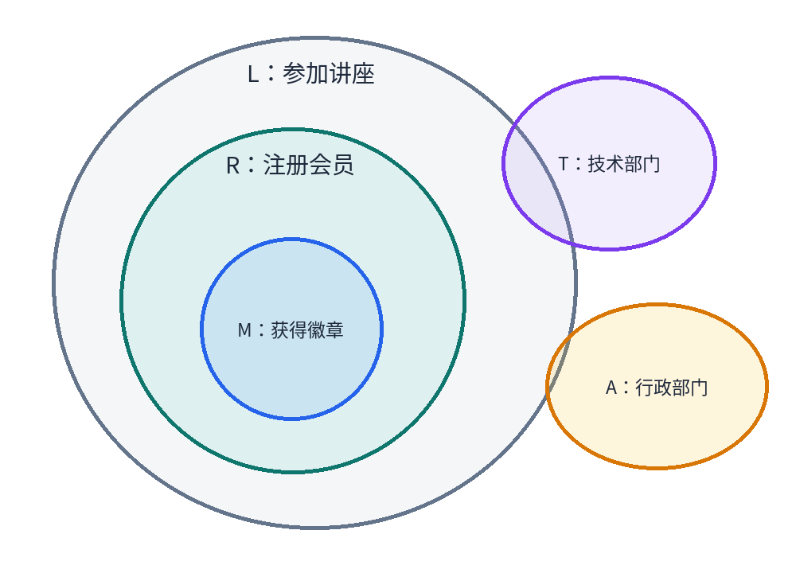
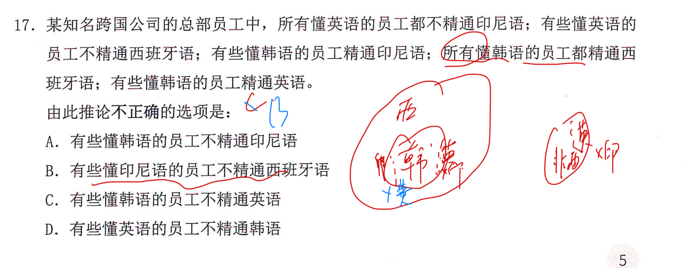

---
tags:
  - 判断
  - 形式推理
  - 错题
  - 直言命题
  - 公务员考试
---

## Card
<!-- hyz-card-id: 01a14a81-f309-7130-898f-1e9af2ab9f8e -->

### Front

集合推理：如何用欧拉图表示以下条件？

1. 所有注册会员都参加讲座。
2. 所有非注册会员都没有徽章。
3. 行政部门所有员工都不是注册会员。
4. 技术部门有的员工没有参加讲座。

### Back

答案：A

- 「所有 A 都是 B」：A 圈完全包含在 B 圈内。
- 「所有 A 都不是 B」：A、B 两圈不相交。
- 「有的 A 是 B」：A、B 至少存在一个共同元素。
- 「有的 A 不是 B」：A 至少有一部分在 B 圈外。
- 「非 A 都不是 B」：逆否得到 B 包含于 A。

所有非注册会员都没有获得纪念徽章。得到获得纪念徽章 → 一定是注册会员。

**核心技巧：先画包含链，再处理排斥和部分交叉；有的不能扩大成所有。**

---

## Card
<!-- hyz-card-id: 01a1166a-90f7-7d00-869f-2af741382ba9 -->

### Front

某知名跨国公司的总部员工中，所有懂英语的员工都不精通印尼语；有些懂英语的员工不精通西班牙语；有些懂韩语的员工精通印尼语。所有懂韩语的员工都精通西班牙语；有些懂韩语的员工精通英语。

由此推论不正确的选项是：

A. 有些懂韩语的员工不精通印尼语

B. 有些懂印尼语的员工不精通西班牙语

C. 有些懂韩语的员工不精通英语

D. 有些懂英语的员工不精通韩语

### Back

所有懂英语的员工都**不精通**印尼语，逆否可推出：**精通印尼语**的员工不懂英语。

注意原题区分「懂印尼语」和「精通印尼语」，不能擅自把二者当作同一个条件。

本题应选 **B**：已有条件无法推出「有些懂印尼语的员工不精通西班牙语」。

不一定要画完整欧拉图，画出实线框，矛盾关系就可

---
