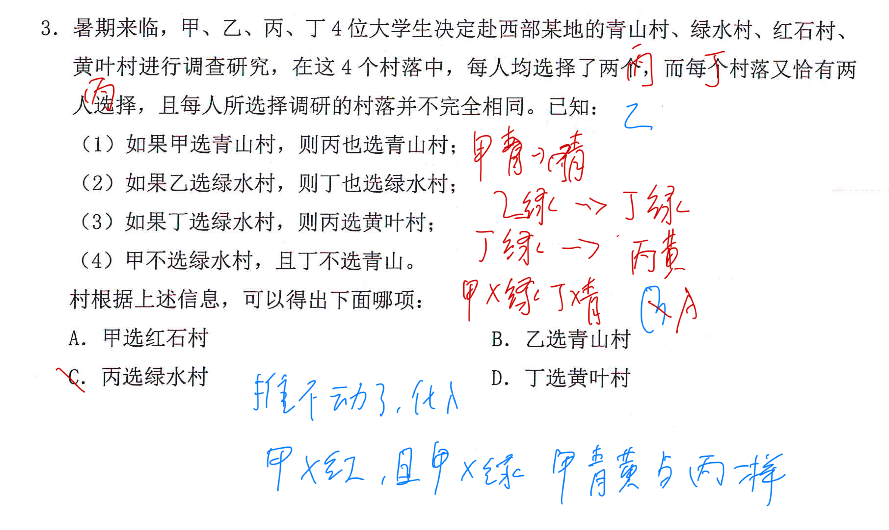

---
tags:
  - 判断
  - 形式推理
  - 错题
  - 组合排列
  - 公务员考试
---

## Card
<!-- hyz-card-id: 01a1169b-7a58-75d2-8da2-37b7ea208408 -->

### Front

暑期来临，甲、乙、丙、丁 4 位大学生决定赴西部某地的青山村、绿水村、红石村、黄叶村进行调查研究。在这 4 个村落中，每人均选择了两个，而每个村落又恰有两人选择，且每人所选择调研的村落并不完全相同。已知：

1. 如果甲选青山村，则丙也选青山村；
2. 如果乙选绿水村，则丁也选绿水村；
3. 如果丁选绿水村，则丙选黄叶村；
4. 甲不选绿水村，且丁不选青山村。

根据上述信息，可以得出下面哪项：

A. 甲选红石村

B. 乙选青山村

C. 丙选绿水村

D. 丁选黄叶村

### Back

推不动了就代入，证明为真就取反，证明为假直接代

能利用题目隐藏条件，就是单选题只能一个选项对，推出两个对也矛盾

---

## Card

### Front

【形式推理｜组合排列·间隔限制】

甲、乙、丙、丁、戊、己、庚7人安排朗诵顺序。

已知：
1. 甲在第1或第7位。
2. 乙、丙之间有3人。
3. 丁、戊之间有3人，且丁在前。
4. 丁在乙之前。

问：以下哪项可能为真？

A. 丙第2位  
B. 乙第4位  
C. 庚第2位  
D. 丁第4位

**如何用小P的「多限制条件优先＋排位置」快速解题？**

### Back

**答案：A（丙第2位）**

**核心套路：先锁间隔位置 → 利用首尾限制 → 排除不可能 → 正面验证。**

### ① 间隔三人＝位置差4

7个位置只有三组：

$$
(1,5),\quad(2,6),\quad(3,7)
$$

乙丙占一组，丁戊占一组。

### ② 利用甲在首尾，锁定第2位

- 甲在第1位：$(1,5)$ 不能用。
- 甲在第7位：$(3,7)$ 不能用。

无论哪种情况，乙丙、丁戊都需要两组位置。

因此：

**$(2,6)$ 必须被使用。**

第2位必然是乙、丙、丁、戊之一。

### ③ 排除选项

- B：乙第4位 ❌（无法满足间隔4位）
- C：庚第2位 ❌（第2位必须被乙丙或丁戊占用）
- D：丁第4位 ❌（无法满足间隔4位）

剩下A，构造验证。

### ④ 验证A可能成立

| 位置 | 1 | 2 | 3 | 4 | 5 | 6 | 7 |
|---|---|---|---|---|---|---|---|
| 人员 | 甲 | 丙 | 丁 | 己 | 庚 | 乙 | 戊 |

全部条件满足，因此选A。

### 复盘

**小P组合排列方法：**

1. 多限制条件优先，间隔越大，可选位置越少。
2. 遇到「中间隔N人」，直接转换成位置差N+1。
3. 结合固定位置，锁定必然被占用的位置。
4. 「可能为真」用正面代入，一种合法排列即可证明。
5. 不必排出所有排列，能排除就直接排除。

**考场口诀：**

间隔先定位置组，首尾限制再排除。

**注意：一种可能只能证明「可能为真」，不能证明「必然为真」。**

---

## Card

### Front

【形式推理｜组合排列＋假言命题】

张、王、李、赵、钱、孙6人申报甲、乙、丙、丁4种奖项。

每人只能申报1种，每种奖项有1～2人。

已知：
1. 乙奖人数比甲奖多。
2. 丁奖人数比丙奖多。
3. 若李、赵至少1人申报甲，则王申报丙。
4. 若张、李、赵至少1人申报乙，则只有钱申报丁。
5. 孙申报丙。

问：能推出谁申报什么奖项？

**如何利用小P的「数量限制＋否后推否前」快速破题？**

### Back

**核心套路：先确定人数 → 否后推否前 → 锁定人员。**

**① 利用数量限制，确定各奖项人数**

6人分4种奖项，每种1～2人。

又因为乙＞甲、丁＞丙，所以：

| 奖项 | 甲 | 乙 | 丙 | 丁 |
|---|---|---|---|---|
| 人数 | 1 | 2 | 1 | 2 |

**② 条件（4）：否后推否前**

若张、李、赵至少1人报乙，则只有钱报丁。

但丁奖必须有2人，说明「只有钱报丁」为假。

因此否定前件：

$$
\neg(A\lor B\lor C)
=\neg A\land\neg B\land\neg C
$$

得到：张、李、赵均不报乙。

乙奖需要2人，孙已报丙。

因此：

**王、钱必然报乙。**

**③ 条件（3）：再次否后推否前**

若李、赵至少1人报甲，则王报丙。

王已经报乙，因此王报丙为假。

否后推否前：

**李、赵均不报甲。**

李、赵同时满足：
- 不报乙
- 不报甲
- 丙奖已由孙占满

因此李、赵只能报丁。

**④ 最终结果**

| 人员 | 张 | 王 | 李 | 赵 | 钱 | 孙 |
|---|---|---|---|---|---|---|
| 奖项 | 甲 | 乙 | 丁 | 丁 | 乙 | 丙 |

**答案：D，李、赵申报丁奖。**

**复盘**

小P组合排列方法：

**找确定信息 → 能推则推 → 推不动再假设代入。**

本题破题关键：

1. 人数限制先确定甲1、乙2、丙1、丁2。
2. 「只有钱报丁」与「丁必须2人」矛盾。
3. 利用否后推否前，排除张、李、赵报乙。
4. 锁定王、钱报乙后，再次否后推否前。
5. 通过排除剩余奖项，锁定李、赵报丁。

**考场口诀：**

数量限制先破题，后件为假否前件。

注意：

假言命题：

$$
A\rightarrow B
$$

只有以下推理必然成立：

$$
\neg B\rightarrow\neg A
$$

**不能通过否前件推出否后件。**

---

## Card

### Front

**【例10｜点菜｜组合排列＋假言命题＋数量约束】**

某餐馆有芹菜肉丝、清蒸鲈鱼、毛豆仔鸡、糖醋排骨4道菜。甲、乙、丙、丁每人恰好点其中2道；没有一道菜4人都点，也没有一道菜4人都不点。

已知：
1. 只有甲点清蒸鲈鱼，丁才点芹菜肉丝。
2. 若丙点清蒸鲈鱼，则乙、丁也点清蒸鲈鱼。
3. 若乙在芹菜肉丝和清蒸鲈鱼中至少点一道，则乙也点毛豆仔鸡。
4. 若丙在芹菜肉丝和毛豆仔鸡中至少点一道，则丙也点清蒸鲈鱼。

哪项必然成立？

- A. 甲在芹菜肉丝和毛豆仔鸡中至少点一道
- B. 乙在芹菜肉丝和糖醋排骨中至少点一道
- C. 丙在毛豆仔鸡和糖醋排骨中至少点一道
- D. 丁在芹菜肉丝和毛豆仔鸡中至少点一道

**如何从“每人点2道”和“没有4人全点”找确定信息？**

### Back

**答案：A。核心：假设代入 → 数量矛盾 → 假言串联。**

**① 先推出丙必点清蒸鲈鱼。**

条件4：丙点芹菜肉丝或毛豆仔鸡 → 丙点鱼。

假设丙不点鱼，否后必否前，丙也不能点芹菜肉丝和毛豆仔鸡，那么只剩糖醋排骨1道菜，违反每人恰好点2道。

所以**丙点鱼**。

**② 串联条件2。**

丙点鱼 → 乙、丁也点鱼。于是乙、丙、丁三人都点鱼。

由于不能4人全点同一道菜，**甲不点鱼**。

**③ 三选二锁定A。**

甲必须从【芹菜肉丝、毛豆仔鸡、糖醋排骨】中选2道。

可选组合只有：芹＋鸡、芹＋排、鸡＋排。每种都包含芹或鸡。

所以甲至少点芹菜肉丝或毛豆仔鸡，选 **A**。

**复盘：** 当3项中必须选2项时，指定其中任意2项，至少会命中1项。人数限制既可以制造矛盾，也能提供假言命题的确定前件。

---

## Card

### Front

**【例11｜滑雪项目｜组合排列＋假言命题＋人数上下限】**

石、方、白、于、叶5人参加单板滑雪、跳台滑雪、越野滑雪、高山滑雪4个项目。每人只参加1项，每项有1～2人参加。

已知：
1. 若石和白至少1人参加高山滑雪，则方参加单板滑雪，且于参加高山滑雪。
2. 若于和方至少1人参加高山滑雪，则白和叶都参加单板滑雪。

如果叶未参加高山滑雪，可以推出哪项？

- A. 方参加越野滑雪
- B. 叶未参加单板滑雪
- C. 石参加高山滑雪
- D. 白未参加跳台滑雪

**怎样同时用好“最多2人”和“至少1人”？**

### Back

**答案：D。核心：上限排除 → 下限锁定。**

**① 假设石或白参加高山滑雪。**

由条件1，方参加单板、于参加高山；由于于参加高山，又由条件2，白和叶都参加单板。

于是单板有**方、白、叶3人**，与每项最多2人矛盾。

故**石、白都不参加高山**。

**② 利用高山至少1人。**

石、白、叶都不参加高山（叶不参加是题干直接给出的）。所以高山项目至少1名参加者只能在**于、方**中产生：

$$
于高\lor 方高
$$

**③ 触发条件2。**

于或方参加高山 → 白、叶都参加单板。

白只参加1个项目，所以**白不参加跳台滑雪**，选 **D**。

**复盘：** “每项至多2人”可用3人同项制造矛盾；“每项至少1人”可在排除其他人员后推出剩余人员中必有人参加。注意“或”表示至少一个，不等于只有一个。

---

## Card

### Front

**【例12｜乐器表演｜组合排列＋假言命题＋恰好缺一】**

甲、乙、丙、丁4人分别表演古琴、二胡、笛子、箫4种乐器中的3种；每种乐器恰好有1人不表演。

已知：
1. 若乙、丁至少1人表演二胡，则丙表演笛子。
2. 若甲表演笛子，则乙、丁也表演笛子。
3. 若乙表演古琴，则丙、丁表演箫。

可以得出哪项？

- A. 甲、乙中恰有1人表演古琴
- B. 甲、丁中恰有1人表演箫
- C. 乙、丙中恰有1人表演笛子
- D. 丙、丁中恰有1人表演二胡

**如何把“每人缺1种、每种缺1人”转成确定信息？**

### Back

**答案：D。核心：恰好缺一＋假言命题＋反证。**

**① 乙、丁至少1人表演二胡。**

每种乐器恰有1人不表演，所以乙、丁不能同时不表演二胡。由条件1，得到**丙表演笛子**。

**② 甲不表演笛子。**

若甲表演笛子，由条件2可知乙、丁也表演，再加上丙，4人全表演笛子，违背每种乐器恰有1人不表演。

因此甲不表演笛子。甲只缺这1种，所以**甲表演古琴、二胡、箫**。

**③ 乙必须表演二胡。**

若乙不表演二胡，乙就必须表演其余3种，包括古琴、箫。

条件3：乙表演古琴 → 丙、丁也表演箫。

于是甲乙丙丁4人全表演箫，矛盾。所以**乙表演二胡**。

**④ 锁定人数。**

二胡已有甲、乙2人表演，每种乐器恰好有3人表演，因此**丙、丁中恰有1人表演二胡**，选 **D**。

**复盘：** “每人选3缺1”可从一项不选推其余全选；“每项4人缺1”可用4人全选制造矛盾。别把“恰有1人”误读成“至少1人”。

---

## Card

### Front

**【例13｜经典阅读｜组合排列＋捆绑对象＋人数上下限】**

甲、乙、丙、丁、戊、己6人从《论语》《史记》《唐诗三百首》《古文观止》中各选2部。**甲与丙选书完全相同；丁与己选书完全相同。**每部书至少2人、至多4人选择。

已知：
1. 若丁选《论语》，则甲、乙都选《史记》。
2. 若甲或乙至少1人选《论语》，则丁也选《论语》。
3. 若丁或丙至少1人选《唐诗三百首》，则己选《史记》。

可以推出哪项？

- A. 甲选《史记》《论语》
- B. 乙选《史记》《唐诗三百首》
- C. 丁选《论语》《唐诗三百首》
- D. 戊选《唐诗三百首》《古文观止》

**如何利用捆绑对象，分别制造“不够2人”和“超过4人”的矛盾？**

### Back

**答案：B。核心：捆绑对象 → 下限反证 → 上限反证 → 否后推否前。**

**① 先推丁选《论语》。**

假设丁不选《论语》。条件2否后推否前，则甲、乙均不选《论语》；甲＝丙、丁＝己，因此甲乙丙丁己5人都不选《论语》，只剩戊可能选，少于至少2人，矛盾。

故**丁选《论语》**。

**② 由条件1：甲、乙选《史记》，甲＝丙，所以丙也选《史记》。**

《史记》已确定甲乙丙3人选。若丁选，丁＝己会额外增加2人，共5人，超过最多4人。因此**丁、己不选《史记》**。

**③ 用条件3否后推否前。**

$$
(丁唐\lor 丙唐)\rightarrow 己史
$$

既然己不选《史记》，就能推出丁、丙不选《唐诗三百首》；丁＝己、甲＝丙，故甲、丙、丁、己4人都不选《唐诗三百首》。

**④ 下限锁定乙、戊。**

只剩乙、戊可能选《唐诗三百首》，又要求至少2人，因此乙、戊必选。

乙此前已选《史记》，故乙的2本书是**《史记》《唐诗三百首》**，选 **B**。

**复盘：** 捆绑对象会让人数一次增减2；下限用来排除“不够人”，上限用来排除“人太多”，最后利用剩余人数反向锁定。

---

## Card

### Front

**【例15｜研发团队｜组合排列＋可能为真＋捆绑名额】**

甲、乙为文科生；丙、丁、戊为理科生；己、庚、辛为工科生。甲、丙、己为女士。8人中选5人组成研发团队，文、理、工至少各1人，且至少1名女士。

限制：
1. 丙和庚至多1人参加。
2. 若乙参加，则丁也参加。
3. 戊和辛要么都参加，要么都不参加。

**已知甲不参加**，以下哪项可能为真？

- A. 理科生只有戊参加
- B. 工科生只有己参加
- C. 3名理科生都参加
- D. 3名工科生都参加

**“可能为真”怎样从确定信息出发，直接构造合法的5人组合？**

### Back

**答案：C。核心：先找必选人员 → 捆绑人数 → 正面代入构造。**

**① 甲不参加，但团队必须有文科生。**

文科只有甲、乙，因此**乙必须参加**。

条件2：乙参加 → **丁参加**。5个名额已锁定【乙、丁】，剩下3个名额。

**② 戊与辛是捆绑的。**

两人要么都参加，要么都不参加。若选戊，必须同时给辛留名额。

**③ 构造C。**

C说丙、丁、戊3名理科生都参加。已确定乙、丁，补上丙、戊；戊参加则辛也参加。

得到合法5人：

| 乙 | 丙 | 丁 | 戊 | 辛 |
|---|---|---|---|---|
| 文科 | 理科、女 | 理科 | 理科 | 工科 |

满足5人、三类专业齐全、至少1名女士、丙庚不同时参加、乙→丁、戊辛同进同出。因此 **C可能为真**。

**④ 其他选项为什么不行？**

- A：理科只有戊，意味着丁不参加；但乙必参加且乙→丁，矛盾。
- B：工科只有己，即庚、辛不参加；戊也不能参加，甲又不参加，最多只能选乙丙丁己4人。
- D：己庚辛都参加，而戊必须与辛同进同出，再加必选乙丁，至少6人，超出5人。

**复盘：** “可能为真”只需构造一组合法情况；“必然为真”才须覆盖所有可能。要先扣除必选名额，再计算捆绑对象占几个位置。

---
