---
tags:
  - 数量关系
  - 几何数推与特殊题
  - 错题
---

## Card
<!-- hyz-card-id: 01a1dfe6-e81a-7600-8d76-610655f67339 -->
<!-- hyz-source-question-id: 01a1af25-d031-7ee1-9282-b6018a77b4d1 -->
<!-- hyz-correct-answer: [] -->
### Front

B 地在 A 地正北方向 3 千米处，C 地在 A 地正西方向 4 千米处。直线甲连接 B、C 两地，从 A 地出发的直线乙正好经过直线甲的中点。张某从 C 地出发，直线行走了 2.6 千米后正好到直线乙上的某一点，则他到达的位置与直线甲、乙交点的最短距离为多少千米？

- A. 0.3
- B. 0.4
- C. 0.5
- D. 0.6

### Back

## 答案

**A．0.3 千米。**

## 判型与所用套路

这是**平面几何中的直角三角形与距离最值题**。

按照“先看图形关系，再求长度”的思路：先利用直角三角形斜边中线的性质，再作垂线，把题目转化为两个直角三角形，用勾股定理求距离。

## 关键条件

设直线甲、乙的交点为 **M**，从 C 向直线乙作垂线，垂足为 **H**。张某走到直线乙上的位置可能有两个，记为 **P、Q**。

```svg
<svg xmlns="http://www.w3.org/2000/svg" viewBox="0 0 520 370">
  <title>直角三角形与两个可能的到达点</title>
  <desc>三角形ABC在A处为直角，M为BC中点，CH垂直于直线AM，P和Q是距C为2.6千米的两个可能位置。</desc>
  <polygon points="400,300 400,60 80,300" fill="none" stroke="#222222" stroke-width="2"/>
  <line x1="85" y1="64" x2="400" y2="300" stroke="#2456a6" stroke-width="2"/>
  <line x1="80" y1="300" x2="195" y2="146" stroke="#c04432" stroke-width="2"/>
  <line x1="80" y1="300" x2="259" y2="194" stroke="#777777" stroke-width="1"/>
  <line x1="80" y1="300" x2="131" y2="98" stroke="#777777" stroke-width="1"/>
  <polyline points="385,300 385,285 400,285" fill="none" stroke="#222222" stroke-width="2"/>
  <polyline points="185,139 178,149 188,156" fill="none" stroke="#c04432" stroke-width="2"/>
  <circle cx="400" cy="300" r="4" fill="#222222"/>
  <circle cx="400" cy="60" r="4" fill="#222222"/>
  <circle cx="80" cy="300" r="4" fill="#222222"/>
  <circle cx="240" cy="180" r="4" fill="#222222"/>
  <circle cx="195" cy="146" r="4" fill="#c04432"/>
  <circle cx="259" cy="194" r="4" fill="#2456a6"/>
  <circle cx="131" cy="98" r="4" fill="#2456a6"/>
  <text x="410" y="316" font-family="sans-serif" fill="#222222">A</text>
  <text x="410" y="65" font-family="sans-serif" fill="#222222">B</text>
  <text x="62" y="317" font-family="sans-serif" fill="#222222">C</text>
  <text x="235" y="169" font-family="sans-serif" fill="#222222">M</text>
  <text x="197" y="135" font-family="sans-serif" fill="#c04432">H</text>
  <text x="264" y="192" font-family="sans-serif" fill="#2456a6">P</text>
  <text x="113" y="92" font-family="sans-serif" fill="#2456a6">Q</text>
  <text x="225" y="324" font-family="sans-serif" fill="#222222">4 千米</text>
  <text x="410" y="185" font-family="sans-serif" fill="#222222">3 千米</text>
  <text x="105" y="224" font-family="sans-serif" fill="#c04432">垂线</text>
  <text x="275" y="235" font-family="sans-serif" fill="#2456a6">直线乙</text>
</svg>
```

- 正北、正西说明 \(AB\perp AC\)，且 \(AB=3\)、\(AC=4\)。
- \(M\) 是斜边 \(BC\) 的中点。
- \(CP=CQ=2.6\) 千米；题目要求的是两个可能距离中较短的一个。

## 按套路分步求解

### 1. 先找中线关系

由 \(3\text{-}4\text{-}5\) 直角三角形，得 \(BC=5\) 千米。

直角三角形的斜边中线等于斜边的一半，所以：

\[
AM=BM=CM=2.5\text{ 千米}
\]

### 2. 用面积求垂线 \(CH\)

因为 \(M\) 是 \(BC\) 的中点，三角形 \(ACM\) 的面积是三角形 \(ABC\) 面积的一半：

\[
S_{ACM}=\frac12\times\frac{3\times4}{2}=3
\]

以 \(AM\) 为底、\(CH\) 为高：

\[
CH=\frac{2S_{ACM}}{AM}=\frac{6}{2.5}=2.4\text{ 千米}
\]

### 3. 求出 H 到各点的距离

在直角三角形 \(CHM\) 中：

\[
HM=\sqrt{2.5^2-2.4^2}
=\sqrt{0.49}=0.7\text{ 千米}
\]

同理，张某到达的两个位置距离 C 都是 2.6 千米，因此：

\[
HP=HQ=\sqrt{2.6^2-2.4^2}
=\sqrt{1}=1\text{ 千米}
\]

图中 \(H、M、P\) 在同一侧，故较短距离为：

\[
\boxed{MP=HP-HM=1-0.7=0.3\text{ 千米}}
\]

## 快速验算与排除干扰项

另一种可能位置是 \(Q\)，它在 \(H\) 的另一侧：

\[
MQ=MH+HQ=0.7+1=1.7\text{ 千米}
\]

因此两个可能距离分别为 **0.3 千米和 1.7 千米**，最短是 **0.3 千米**，选 A。B、C、D 均不满足计算结果。

## 与原卷参考对照

原卷的 **Answer 和 Explanation 均为空**。以上为独立求解，未经原卷答案核对。

## 复盘提醒

看到“**直角三角形＋斜边中点**”，先想到中线等于斜边一半；看到“到某点距离固定，终点在一条直线上”，要想到通常可能有**两个交点**，最后比较距离。

---

## Card
<!-- hyz-card-id: 01a1dff0-7971-7133-a240-98d0e5884197 -->
<!-- hyz-source-question-id: 01a1af25-d031-7ee1-9282-b62f93c46bff -->
<!-- hyz-correct-answer: [] -->
### Front

一艘非法渔船作业时发现其正右方有海上执法船，于是沿下图所示方向左转后，立即以 15 节（1 节=1 海里/小时）的速度逃跑，同时执法船沿某一直线方向匀速追赶，并正好在某一点追上。已知渔船在被追上前逃跑的距离刚好与其发现执法船时与执法船的距离相同，问执法船的速度为多少节？
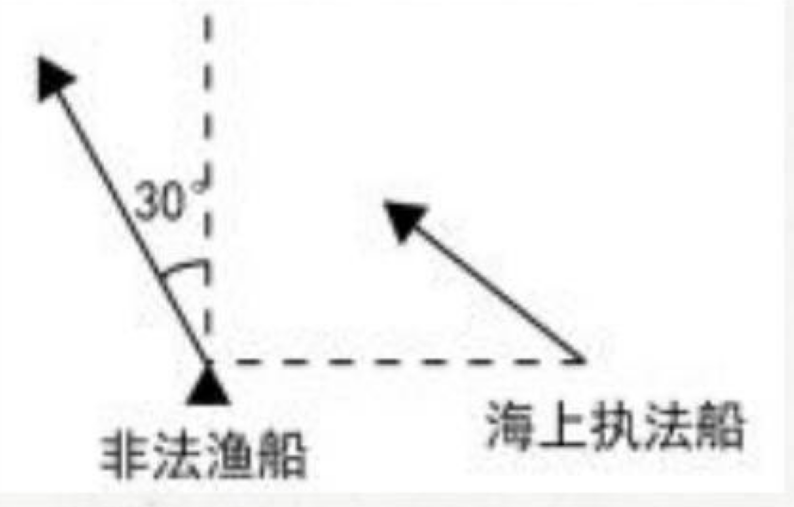

- A. 20
- B. 30
- C. 10√3
- D. 15√3

### Back

可以。下面用同一个单位圆，把两个对称关系都画出来。设图中的 \(\alpha\) 是锐角：

```svg
<svg xmlns="http://www.w3.org/2000/svg" viewBox="0 0 620 430">
  <title>用单位圆证明三角恒等式</title>
  <desc>单位圆上，P 的坐标为余弦和正弦；关于 y 轴对称得到 R，关于 y 等于 x 对称得到 Q。</desc>
  <circle cx="280" cy="215" r="160" fill="none" stroke="#333333" stroke-width="2"/>
  <line x1="80" y1="215" x2="500" y2="215" stroke="#333333" stroke-width="2"/>
  <line x1="280" y1="405" x2="280" y2="20" stroke="#333333" stroke-width="2"/>
  <line x1="145" y1="350" x2="415" y2="80" stroke="#888888" stroke-width="1"/>
  <line x1="280" y1="215" x2="408" y2="119" stroke="#2456a6" stroke-width="2"/>
  <line x1="280" y1="215" x2="376" y2="87" stroke="#a1451a" stroke-width="2"/>
  <line x1="280" y1="215" x2="152" y2="119" stroke="#16804b" stroke-width="2"/>
  <line x1="152" y1="119" x2="408" y2="119" stroke="#16804b" stroke-width="1"/>
  <line x1="408" y1="119" x2="408" y2="215" stroke="#2456a6" stroke-width="1"/>
  <line x1="376" y1="87" x2="376" y2="215" stroke="#a1451a" stroke-width="1"/>
  <path d="M 320 215 A 40 40 0 0 0 312 191" fill="none" stroke="#2456a6" stroke-width="2"/>
  <circle cx="408" cy="119" r="4" fill="#2456a6"/>
  <circle cx="376" cy="87" r="4" fill="#a1451a"/>
  <circle cx="152" cy="119" r="4" fill="#16804b"/>
  <circle cx="280" cy="215" r="3" fill="#333333"/>
  <text x="505" y="220" font-family="sans-serif" fill="#333333">x</text>
  <text x="286" y="25" font-family="sans-serif" fill="#333333">y</text>
  <text x="263" y="232" font-family="sans-serif" fill="#333333">O</text>
  <text x="322" y="205" font-family="sans-serif" fill="#2456a6">α</text>
  <text x="420" y="115" font-family="sans-serif" fill="#2456a6">P</text>
  <text x="385" y="79" font-family="sans-serif" fill="#a1451a">Q</text>
  <text x="125" y="110" font-family="sans-serif" fill="#16804b">R</text>
  <text x="415" y="155" font-family="sans-serif" fill="#2456a6">sin α</text>
  <text x="315" y="232" font-family="sans-serif" fill="#a1451a">sin α</text>
  <text x="425" y="69" font-family="sans-serif" fill="#666666">y = x</text>
  <text x="90" y="255" font-family="sans-serif" fill="#333333">半径 = 1</text>
  <text x="90" y="285" font-family="sans-serif" fill="#16804b">P、R 关于 y 轴对称</text>
  <text x="90" y="310" font-family="sans-serif" fill="#a1451a">P、Q 关于 y = x 对称</text>
</svg>
```

单位圆上，点的**横坐标是余弦，纵坐标是正弦**。因此角 \(\alpha\) 对应的点是

\[
P=(\cos\alpha,\ \sin\alpha)
\]

**看第一组对称：\(P\) 和 \(Q\) 关于 \(y=x\) 对称。**

对称后横、纵坐标交换，所以 \(Q=(\sin\alpha,\cos\alpha)\)；同时 \(Q\) 对应的角是 \(90^\circ-\alpha\)。看 \(Q\) 的横坐标：

\[
\boxed{\cos(90^\circ-\alpha)=\sin\alpha}
\]

**看第二组对称：\(P\) 和 \(R\) 关于 \(y\) 轴对称。**

\(R\) 对应的角是 \(180^\circ-\alpha\)，而 \(P\)、\(R\) 的纵坐标相同。看纵坐标就得到：

\[
\boxed{\sin(180^\circ-\alpha)=\sin\alpha}
\]

所以图片中的三个式子相等。图中画的是锐角情形；用同样的坐标与对称关系，也可以推广到任意角。

---

## Card
<!-- hyz-card-id: 01a1dfff-9e76-78e3-bc10-54e362231037 -->
<!-- hyz-source-question-id: 01a1af25-d031-7ee1-9282-b61be72b4713 -->
<!-- hyz-correct-answer: [] -->
### Front

如下图所示，甲和乙在面积为 54π 的半圆形游泳池内游泳，他们分别从位置 A 和 B 同时出发，沿直线同时游到位置 C。若甲的速度为乙的 2 倍，则原来甲、乙两人相距：
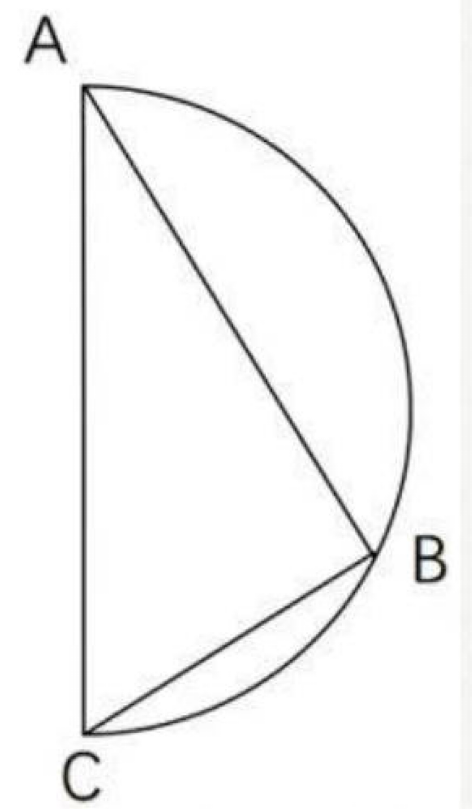

- A. 9√2
- B. 15
- C. 9√3
- D. 18

### Back

## 答案

**D．18。** 原卷未提供答案，以下是独立求解。

## 判型与所用套路

这是**平面几何中的直角三角形与长度比例题**。

按“先看图形关系，再求长度”的思路：

1. 利用直径所对的圆周角是直角，找到直角三角形；
2. 利用同一时间内的速度比，得到路程比；
3. 用勾股定理求两人的原始距离。

## 关键条件

- \(AC\) 是半圆的直径，\(B\) 在半圆弧上，所以 \(\angle ABC=90^\circ\)。
- 甲从 \(A\) 到 \(C\)，乙从 \(B\) 到 \(C\)。两人同时出发、同时到达，所用时间相同，因此
  \[
  AC:BC=2:1
  \]
- \(54\pi\) 是**半圆面积**。

## 按套路分步求解

### 1. 根据半圆面积求直径

设半径为 \(r\)，则

\[
\frac12\pi r^2=54\pi
\quad\Rightarrow\quad
r^2=108
\quad\Rightarrow\quad
r=6\sqrt3
\]

所以直径

\[
AC=2r=12\sqrt3
\]

### 2. 根据速度比求 \(BC\)

两人用时相同，路程比等于速度比：

\[
AC:BC=2:1
\quad\Rightarrow\quad
BC=\frac12AC=6\sqrt3
\]

### 3. 利用勾股定理求 \(AB\)

因为 \(\angle ABC=90^\circ\)，所以

\[
AB^2=AC^2-BC^2
=(12\sqrt3)^2-(6\sqrt3)^2
=432-108=324
\]

因此：

\[
\boxed{AB=18}
\]

## 为什么直径所对的圆周角是 \(90^\circ\)？

先理解一个关系：**同一条弧所对的圆心角，等于圆周角的 2 倍。**

先证明你图中最右边的情形：\(AB\) 是直径，\(O\) 是圆心，\(C\) 在圆周上。对于弧 \(AC\)，圆心角是 \(\angle AOC\)，圆周角是 \(\angle ABC\)。

连接 \(OC\)。因为 \(OB=OC\) 都是半径，\(\triangle BOC\) 是等腰三角形。设 \(\angle ABC=y\)，则：

\[
\angle OBC=\angle BCO=y
\]

由三角形内角和：

\[
\angle BOC=180^\circ-2y
\]

又因为 \(A、O、B\) 在一条直线上，\(\angle AOC\) 与 \(\angle BOC\) 之和为 \(180^\circ\)，所以：

\[
\angle AOC
=180^\circ-(180^\circ-2y)
=2y
=2\angle ABC
\]

这就证明了图中这一情形下的两倍关系。圆周角的一条边不经过圆心时，也可作经过圆心的直径，将角拆开或作差，得到同样的关系。

回到本题：\(AC\) 是直径，圆心 \(O\) 在 \(AC\) 上，弧 \(AC\) 所对的圆心角 \(\angle AOC=180^\circ\)。因此：

\[
\angle ABC=\frac12\angle AOC=90^\circ
\]

## 快速验算与排除干扰项

在直角三角形 \(ABC\) 中，\(BC=\frac12AC\)，所以 \(BC\) 所对的角为 \(30^\circ\)。利用 \(30^\circ\) 直角三角形的边长比：

\[
AB=AC\times\frac{\sqrt3}{2}
=12\sqrt3\times\frac{\sqrt3}{2}=18
\]

只有 **D** 符合。

## 与原卷参考对照

原卷的 **Answer 和 Explanation 均为空**。以上结果为独立求解，未经原卷答案核对。

## 复盘提醒

你的图中标出的半径 \(6\sqrt3\)、直径 \(12\sqrt3\) 和 \(BC=6\sqrt3\) 都与计算一致。右侧有一处看起来像“\(r^2=54\)”，手写符号不够清晰；如果确实如此，应改为 \(r^2=108\)，因为 \(54\pi\) 是半圆面积。

考场上记住两个入口：**见直径，找直角；见同时到达，用速度比换路程比。**

---

## Card
<!-- hyz-card-id: 01a1e206-ea16-78c0-97b3-bae76102d134 -->
<!-- hyz-source-question-id: 01a1af25-d031-7ee1-9282-b633a785574e -->
<!-- hyz-correct-answer: [] -->
### Front

楼道上方有一盏灯，小刘径直走向这盏灯。一开始，他发现自己影子的长度为 3.2 米，前进 1 米后，发现影子缩短为 1.6 米。已知小刘身高为 1.6 米，则这盏灯的高度约为（ ）米。
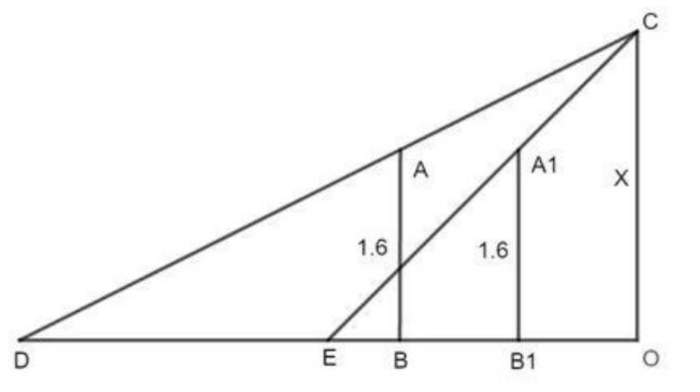

- A. 2.6
- B. 2.8
- C. 3.2
- D. 3.4

### Back

## 答案

**A．2.6 米。**这是独立计算结果，原卷答案和解析均为空。

## 判型与所用套路

这是**平面几何中的影长问题**。结合你上传的笔记，主线是：

> **找平行＋共角 → 判定相似三角形 → 对应边列比例。**

本题中，人的身高和灯高都垂直地面，因此相互平行；光线经过人的头顶和影子末端，形成两组相似三角形。

## 关键条件

沿用原题图的字母：

- \(C\)：灯；\(O\)：灯在地面上的对应点。
- \(AB\)：前进前的身高；\(A_1B_1\)：前进后的身高，均为 **1.6 米**。
- \(DB=3.2\) 米，\(EB_1=1.6\) 米，分别是前后两次的影长。
- \(BB_1=1\) 米，是人前进的距离。

```svg
<svg xmlns="http://www.w3.org/2000/svg" viewBox="0 0 620 390">
<title>灯光下的人和影子</title>
<desc>人从B走到B1，影子末端从D移到E，灯位于C。</desc>
<line x1="30" y1="300" x2="580" y2="300" stroke="#222222" stroke-width="3"/>
<line x1="30" y1="300" x2="550" y2="40" stroke="#555555" stroke-width="2"/>
<line x1="290" y1="300" x2="550" y2="40" stroke="#555555" stroke-width="2"/>
<line x1="350" y1="300" x2="350" y2="140" stroke="#1763a6" stroke-width="4"/>
<line x1="450" y1="300" x2="450" y2="140" stroke="#1763a6" stroke-width="4"/>
<line x1="550" y1="300" x2="550" y2="40" stroke="#b13727" stroke-width="4"/>
<text x="23" y="324" fill="#222222" font-family="sans-serif">D</text>
<text x="280" y="324" fill="#222222" font-family="sans-serif">E</text>
<text x="340" y="324" fill="#222222" font-family="sans-serif">B</text>
<text x="437" y="324" fill="#222222" font-family="sans-serif">B₁</text>
<text x="544" y="324" fill="#222222" font-family="sans-serif">O</text>
<text x="355" y="139" fill="#1763a6" font-family="sans-serif">A</text>
<text x="456" y="139" fill="#1763a6" font-family="sans-serif">A₁</text>
<text x="555" y="40" fill="#b13727" font-family="sans-serif">C（灯）</text>
<text x="174" y="350" fill="#222222" text-anchor="middle" font-family="sans-serif">DB＝3.2 米</text>
<text x="370" y="375" fill="#222222" text-anchor="middle" font-family="sans-serif">EB₁＝1.6 米</text>
<text x="400" y="285" fill="#222222" text-anchor="middle" font-family="sans-serif">1 米</text>
<text x="360" y="220" fill="#1763a6" font-family="sans-serif">1.6 米</text>
<text x="459" y="220" fill="#1763a6" font-family="sans-serif">1.6 米</text>
<text x="558" y="185" fill="#b13727" font-family="sans-serif">灯高</text>
</svg>
```

## 按套路分步求解

**第一步：由平行与共角找相似。**

因为 \(AB\parallel CO\)、\(A_1B_1\parallel CO\)，所以

\[
\triangle DAB\sim\triangle DCO，
\qquad
\triangle EA_1B_1\sim\triangle ECO。
\]

两次的人高相等，因此两次“灯高与人高之比”相同：

\[
\frac{DO}{DB}=\frac{EO}{EB_1}。
\]

**第二步：用影长比求地面大线段的比例。**

\[
\frac{DO}{EO}=\frac{DB}{EB_1}
=\frac{3.2}{1.6}=2。
\]

即 \(DO=2EO\)，而 \(DO-EO=DE\)，所以 **\(EO=DE\)**。

**第三步：求影子末端移动的距离。**

人向前走了 1 米，影长缩短了 \(3.2-1.6=1.6\) 米，因此

\[
DE=1+1.6=2.6\text{ 米}。
\]

于是 \(EO=2.6\) 米。

**第四步：利用第二组相似求灯高。**

\[
\frac{CO}{A_1B_1}=\frac{EO}{EB_1}
=\frac{2.6}{1.6}，
\]

所以

\[
CO=1.6\times\frac{2.6}{1.6}
=\boxed{2.6\text{ 米}}。
\]

## 快速验算与排除干扰项

若灯高为 2.6 米，人高为 1.6 米，则“灯高超出人高的部分”为 1 米。由相似关系，两次人到灯正下方的距离分别为 2 米、1 米，恰好相差题给的 **1 米**；对应影长也分别为 3.2 米、1.6 米。

因此 A 符合全部条件；B、C、D 都不能同时满足上述影长变化和前进距离。

## 与原卷参考对照

原卷的 **Answer 和 Explanation 均为空**，因此没有参考答案可对照。

## 复盘提醒

- **先找竖直线平行，再找光线上的共角**，不要仅凭图形“看起来像”就判相似。
- 区分三段距离：**人前进 1 米、影长缩短 1.6 米、影子末端前进 2.6 米**。
- 列比例时，对应的是“灯高／人高”和“灯到影子末端／影长”，不要把人到灯的距离误当作整条底边。

上传笔记的主体可以直接辨认；本地 OCR 本次未能返回结果，手写公式中有歧义的部分未用于推导。

## 相似三角形：六种常见构造

判断相似时，优先找两组相等的角：**平行找等角、共角找另一角、垂直找直角、交叉找对顶角**。

### ① 平行线：三角形里的“小三角形”

```svg
<svg xmlns="http://www.w3.org/2000/svg" viewBox="0 0 400 235">
<title>平行线构造相似三角形</title>
<polygon points="200,25 50,190 350,190" fill="none" stroke="#222222" stroke-width="3"/>
<line x1="125" y1="107" x2="275" y2="107" stroke="#1763a6" stroke-width="3"/>
<text x="200" y="18" text-anchor="middle" fill="#222222" font-family="sans-serif">A</text>
<text x="35" y="202" fill="#222222" font-family="sans-serif">B</text>
<text x="354" y="202" fill="#222222" font-family="sans-serif">C</text>
<text x="105" y="107" fill="#1763a6" font-family="sans-serif">D</text>
<text x="280" y="107" fill="#1763a6" font-family="sans-serif">E</text>
<text x="200" y="225" text-anchor="middle" fill="#222222" font-family="sans-serif">DE ∥ BC</text>
</svg>
```

- **找角**：共用 \(\angle A\)；由平行线得到 \(\angle ADE=\angle ABC\)。
- **结论**：\(\triangle ADE\sim\triangle ABC\)。
- **口诀**：**平行截一刀，小三角形和大三角形相似。**

### ② 平行线：交叉形中的两个三角形

```svg
<svg xmlns="http://www.w3.org/2000/svg" viewBox="0 0 400 250">
<title>平行线与交叉形构造相似三角形</title>
<line x1="135" y1="35" x2="265" y2="35" stroke="#1763a6" stroke-width="3"/>
<line x1="50" y1="195" x2="350" y2="195" stroke="#1763a6" stroke-width="3"/>
<line x1="135" y1="35" x2="350" y2="195" stroke="#222222" stroke-width="3"/>
<line x1="265" y1="35" x2="50" y2="195" stroke="#222222" stroke-width="3"/>
<text x="120" y="31" fill="#222222" font-family="sans-serif">E</text>
<text x="270" y="31" fill="#222222" font-family="sans-serif">D</text>
<text x="30" y="207" fill="#222222" font-family="sans-serif">B</text>
<text x="355" y="207" fill="#222222" font-family="sans-serif">C</text>
<text x="208" y="90" fill="#222222" font-family="sans-serif">O</text>
<text x="200" y="237" text-anchor="middle" fill="#222222" font-family="sans-serif">DE ∥ BC</text>
</svg>
```

- **找角**：交点 \(O\) 处的对顶角相等；平行线再提供一组等角。
- **结论**：\(\triangle EOD\sim\triangle COB\)。
- **口诀**：**交叉先看对顶角，平行再找对应角。**

### ③ 共角＋给定等角

```svg
<svg xmlns="http://www.w3.org/2000/svg" viewBox="0 0 400 245">
<title>共角和给定等角构造相似三角形</title>
<polygon points="270,25 50,190 330,190" fill="none" stroke="#222222" stroke-width="3"/>
<line x1="160" y1="107" x2="300" y2="108" stroke="#1763a6" stroke-width="3"/>
<text x="270" y="18" text-anchor="middle" fill="#222222" font-family="sans-serif">A</text>
<text x="30" y="202" fill="#222222" font-family="sans-serif">B</text>
<text x="335" y="202" fill="#222222" font-family="sans-serif">C</text>
<text x="140" y="104" fill="#1763a6" font-family="sans-serif">E</text>
<text x="305" y="108" fill="#1763a6" font-family="sans-serif">D</text>
<text x="200" y="229" text-anchor="middle" fill="#222222" font-family="sans-serif">已知 ∠ADE＝∠B</text>
</svg>
```

- **找角**：两个三角形共用 \(\angle A\)，题目又给出 \(\angle ADE=\angle B\)。
- **结论**：\(\triangle ADE\sim\triangle ABC\)。
- **注意对应**：\(D\leftrightarrow B\)，因此 \(E\leftrightarrow C\)。

### ④ 共角＋给定等角：换一种连线

```svg
<svg xmlns="http://www.w3.org/2000/svg" viewBox="0 0 400 245">
<title>共角和给定等角的另一种构造</title>
<polygon points="270,25 50,190 330,190" fill="none" stroke="#222222" stroke-width="3"/>
<line x1="160" y1="107" x2="330" y2="190" stroke="#1763a6" stroke-width="3"/>
<text x="270" y="18" text-anchor="middle" fill="#222222" font-family="sans-serif">A</text>
<text x="30" y="202" fill="#222222" font-family="sans-serif">B</text>
<text x="335" y="202" fill="#222222" font-family="sans-serif">C</text>
<text x="140" y="105" fill="#1763a6" font-family="sans-serif">D</text>
<text x="200" y="229" text-anchor="middle" fill="#222222" font-family="sans-serif">已知 ∠ACD＝∠B</text>
</svg>
```

- **找角**：小、大三角形共用 \(\angle A\)，再利用题给的 \(\angle ACD=\angle B\)。
- **结论**：\(\triangle ACD\sim\triangle ABC\)。
- **注意对应**：这里是 \(C\leftrightarrow B\)、\(D\leftrightarrow C\)，不要按图上位置直接对应。

### ⑤ 垂直：直角三角形斜边上的高

```svg
<svg xmlns="http://www.w3.org/2000/svg" viewBox="0 0 400 250">
<title>直角三角形斜边上的高构造相似三角形</title>
<polygon points="50,190 230,40 355,190" fill="none" stroke="#222222" stroke-width="3"/>
<line x1="230" y1="40" x2="230" y2="190" stroke="#1763a6" stroke-width="3"/>
<polyline points="215,190 215,175 230,175" fill="none" stroke="#1763a6" stroke-width="2"/>
<polyline points="218,50 228,62 240,52" fill="none" stroke="#222222" stroke-width="2"/>
<text x="30" y="205" fill="#222222" font-family="sans-serif">A</text>
<text x="359" y="205" fill="#222222" font-family="sans-serif">B</text>
<text x="230" y="30" text-anchor="middle" fill="#222222" font-family="sans-serif">C</text>
<text x="230" y="210" text-anchor="middle" fill="#1763a6" font-family="sans-serif">D</text>
<text x="200" y="239" text-anchor="middle" fill="#222222" font-family="sans-serif">∠ACB＝90°，CD ⟂ AB</text>
</svg>
```

- **找角**：两个小三角形与原三角形都是直角三角形；再利用共角或“同角的余角相等”。
- **结论**：

\[
\triangle ACD\sim\triangle CBD\sim\triangle ABC。
\]

- **口诀**：**直角顶点向斜边作高，三个三角形相似。**

你笔记中的思路也可以这样理解：\(\angle ACD\) 和 \(\angle B\) 都与同一个锐角互余，所以二者相等。

### ⑥ 交叉形：对顶角＋给定等角

```svg
<svg xmlns="http://www.w3.org/2000/svg" viewBox="0 0 400 245">
<title>对顶角和给定等角构造相似三角形</title>
<line x1="60" y1="35" x2="330" y2="145" stroke="#222222" stroke-width="3"/>
<line x1="310" y1="55" x2="50" y2="195" stroke="#222222" stroke-width="3"/>
<line x1="60" y1="35" x2="310" y2="55" stroke="#1763a6" stroke-width="3"/>
<line x1="50" y1="195" x2="330" y2="145" stroke="#1763a6" stroke-width="3"/>
<text x="40" y="34" fill="#222222" font-family="sans-serif">E</text>
<text x="315" y="53" fill="#222222" font-family="sans-serif">D</text>
<text x="30" y="208" fill="#222222" font-family="sans-serif">B</text>
<text x="335" y="153" fill="#222222" font-family="sans-serif">C</text>
<text x="207" y="110" fill="#222222" font-family="sans-serif">A</text>
<text x="200" y="232" text-anchor="middle" fill="#222222" font-family="sans-serif">已知 ∠D＝∠C</text>
</svg>
```

- **找角**：交点 \(A\) 处的对顶角相等；题目再给出 \(\angle D=\angle C\)。
- **结论**：\(\triangle EDA\sim\triangle BCA\)。
- **口诀**：**交叉找对顶角，再找一组等角。**

## 三种判定方法

| 方法 | 判定条件 | 考场提醒 |
|---|---|---|
| **AA** | 两组对应角分别相等 | 图形题优先找角 |
| **SAS** | 两组对应边成比例，且夹角相等 | 等的是这两组边的**夹角** |
| **SSS** | 三组对应边分别成比例 | 比的是对应边 |

判定相似后，**先按对应角排顶点顺序，再列对应边比例**。例如图①：

\[
\triangle ADE\sim\triangle ABC
\quad\Longrightarrow\quad
\frac{AD}{AB}=\frac{AE}{AC}=\frac{DE}{BC}。
\]

上一道影子题用的就是图①的思路：**人和灯柱平行，配合光线与地面的共角，得到大小三角形相似**。

---

## Card
<!-- hyz-card-id: 01a1e237-1719-7c41-9fec-e9d56452c62b -->
<!-- hyz-source-question-id: 01a1af25-d031-7ee1-9282-b65eee4b7416 -->
<!-- hyz-correct-answer: [] -->
### Front

某社区进行更新改造，要在雨季前完成社区内一条主干道 AC 的维修（见下方示意图）。在 BC 路段设置临时通道分流点 D，BD：DC=2：1；在 AD 路段设置指挥点 E，AE：ED=1：2。若从社区服务中心 B 经指挥点 E 向主干道 AC 引一条物资运输线与 AC 交于 F 点，则 AF 段与 FC 段的长度之比是（ ）。
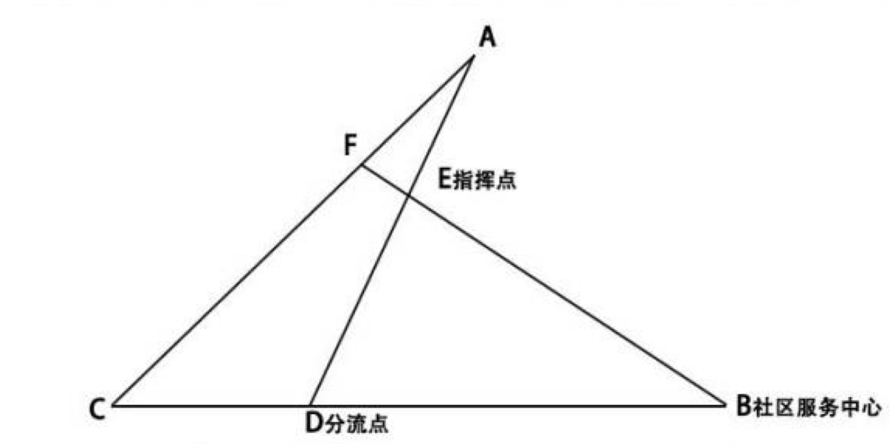

- A. 1：2
- B. 1：3
- C. 1：4
- D. 1：5

### Back

## 答案

**B．\(1:3\)**。这是独立求解的结果。

## 判型与所用套路

这是**平面几何中的线段比例题**。按“先看图形关系，尝试把长度比转化为面积比”的套路，利用三角形**等高时面积比等于底边比**，逐步传递比例。

## 关键条件

- \(D\) 在 \(BC\) 上，\(BD:DC=2:1\)。
- \(E\) 在 \(AD\) 上，\(AE:ED=1:2\)。
- \(B、E、F\) 三点共线，\(F\) 在 \(AC\) 上。

## 按套路分步求解

**第一步：由 \(BD:DC\) 分配面积。**

三角形 \(BDE\) 和 \(CDE\) 的底边分别为 \(BD、DC\)，从 \(E\) 到直线 \(BC\) 的高相同，因此

\[
S_{BDE}:S_{CDE}=BD:DC=2:1。
\]

设 \(S_{BDE}=2\) 份，则 \(S_{CDE}=1\) 份。

**第二步：由 \(AE:ED\) 求出另一块面积。**

三角形 \(ABE\) 和 \(BDE\) 的底边分别为 \(AE、ED\)，从 \(B\) 到直线 \(AD\) 的高相同，所以

\[
S_{ABE}:S_{BDE}=AE:ED=1:2。
\]

因此 \(S_{ABE}=1\) 份。

**第三步：把面积比转回所求线段比。**

三角形 \(BCE\) 由三角形 \(BDE\) 和 \(CDE\) 组成，所以

\[
S_{BCE}=2+1=3\text{ 份}。
\]

三角形 \(ABE\) 和 \(CBE\) 以 \(BE\) 为共同底边，故它们的面积之比等于 \(A、C\) 到直线 \(BE\) 的距离之比。又因 \(A、F、C\) 共线，这两个距离之比就是 \(AF:FC\)。

因此：

\[
AF:FC=S_{ABE}:S_{CBE}=\boxed{1:3}。
\]

## 快速验算与排除干扰项

沿直线 \(BE\) 分成的两部分面积之比为 \(1:3\)，所以 \(F\) 将 \(AC\) 分成的两段也为 \(1:3\)。对应 **B**；其余选项比例均不符。

## 与原卷参考对照

原卷的 **Answer 和 Explanation 均为空**，以上结果未经原卷答案核对。

## 复盘提醒

遇到交叉线段上的比例，先找**同高三角形**，把线段比变成面积比；合并面积后，再用共同底边把面积比转回目标线段比。注意 \(S_{BCE}\) 要把 \(BDE\) 和 \(CDE\) 两块都算进去。

---

## Card
<!-- hyz-card-id: 01a1e25a-10a4-7591-8588-7a858ac120be -->
<!-- hyz-source-question-id: 01a1af25-d031-7ee1-9282-b673c633441e -->
<!-- hyz-correct-answer: [] -->
### Front

一块长方形土地 ABCD 中绘有 3 条测绘线如图所示。已知 AE 和 CF 垂直于对角线 BD，AE、EF 分别长 8 米和 12 米。问整块土地的面积为多少平方米？
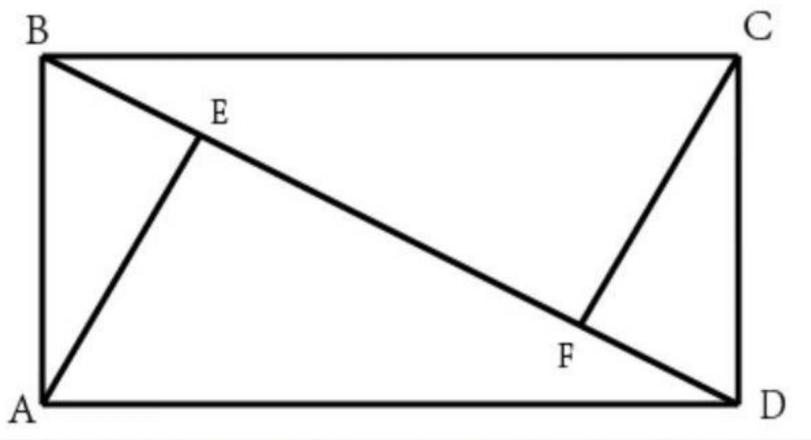

- A. 96
- B. 156
- C. 160
- D. 240

### Back

**是的，面积为 160 平方米，选 C。** 这是独立计算的结果。

### 判型与所用套路

这是平面几何中的**直角三角形斜边上的高**问题。按“先找相似，再求长度”的套路：斜边上的高把原直角三角形分成两个相似的小直角三角形；求出对角线后，再用面积公式。

### 关键条件

- \(AE\perp BD\)，\(AE=8\) 米，\(EF=12\) 米。
- 矩形关于两条对角线的交点中心对称，因此 \(BE=FD\)。
- 图中线段顺序为 \(B-E-F-D\)。

### 按套路分步求解

1. 设 \(BE=FD=x\)，则

   \[
   ED=EF+FD=12+x。
   \]

2. 在直角三角形 \(ABD\) 中，\(AE\) 是斜边 \(BD\) 上的高。由两个小直角三角形相似，得

   \[
   AE^2=BE\times ED。
   \]

   代入：

   \[
   8^2=x(x+12)，\qquad x=4。
   \]

3. 对角线

   \[
   BD=BE+EF+FD=4+12+4=20\text{ 米}。
   \]

   对角线将矩形分成面积相等的两个三角形，所以矩形面积为

   \[
   2\times\frac12\times BD\times AE
   =20\times8
   =\boxed{160\text{ 平方米}}。
   \]

### 快速验算与排除干扰项

代回验证：\(BE=4\)、\(ED=16\)，有 \(4\times16=64=8^2\)，符合斜边高关系。因此面积唯一对应 **C 项 160**，其余选项排除。

### 与原卷参考对照

原卷的 Answer 和 Explanation 均为空，**没有参考答案可供核对**。

### 复盘提醒

关键是先认出 **\(BE=FD\)**，再用“斜边上的高的平方＝斜边两段的乘积”。求面积时，直接用 **对角线 × 对应高**，不用再求矩形的长和宽。

---

## Card
<!-- hyz-card-id: 01a1e269-9345-7043-9769-a9f4fc768bdc -->
<!-- hyz-source-question-id: 01a1af25-d031-7ee1-9282-b69833dbab78 -->
<!-- hyz-correct-answer: [] -->
### Front

A、B 两村在一条笔直公路的同侧，到公路的垂直距离分别是 3 公里和 7 公里，两村相距 8.5 公里。现需在公路边建一个物资集散中心，为节约物资配送成本，集散中心到两个村的直线路程之和应尽可能小。若货车的速度约为 60 公里／小时，那么货车从集散中心出发，到两村送货后返回中心，路途所花费的最少时间为：
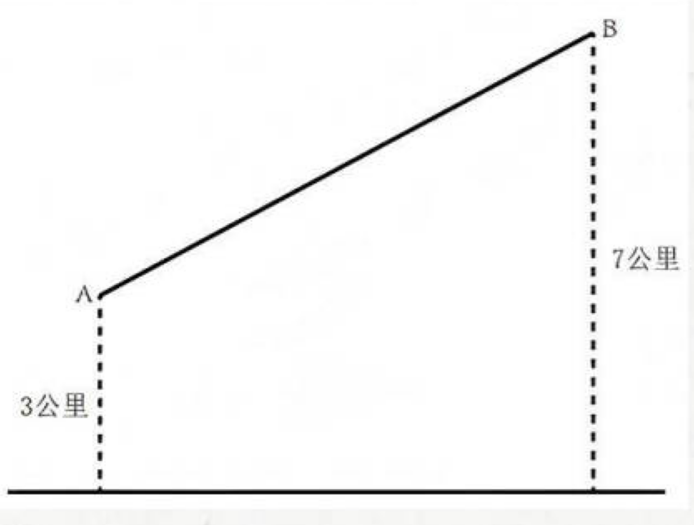

- A. 18 分钟
- B. 21 分钟
- C. 24 分钟
- D. 27 分钟

### Back

## 答案

**B．21 分钟。** 这是独立求解的结果，原卷未给出答案。

## 判型与所用套路

这是平面几何中的**最短路径问题**，适合用“将军饮马”的**对称法**：把公路同侧的一个村庄沿公路对称到另一侧，将经过公路的折线路程转化为直线距离。

## 关键条件

- A、B 到公路的垂直距离分别为 **3 公里、7 公里**，两村相距 **8.5 公里**。
- 集散中心设在公路上，且到两村的直线距离之和最小。
- 货车送完两村后还要返回中心，全程包括“中心→一村→另一村→中心”。

## 按套路分步求解

### 1. 求两村在公路方向上的距离

两村到公路的距离之差为 \(7-3=4\) 公里。根据勾股定理，两村沿公路方向的距离为

\[
\sqrt{8.5^2-4^2}
=\sqrt{56.25}
=7.5\text{ 公里}
\]

### 2. 对称构造，确定集散中心

将 A 关于公路对称到 \(A'\)，连接 \(A'B\)，与公路交于 \(P\)。这个交点就是集散中心的位置。

```svg
<svg xmlns="http://www.w3.org/2000/svg" viewBox="0 0 600 460">
  <title>将军饮马对称构造</title>
  <desc>将 A 关于公路对称到 A 撇，连接 A 撇和 B，交公路于 P，P 到两村的距离之和最小。</desc>
  <line x1="35" y1="310" x2="555" y2="310" stroke="#333333" stroke-width="3"/>
  <text x="485" y="300" font-family="sans-serif" fill="#333333">公路</text>
  <line x1="100" y1="190" x2="100" y2="430" stroke="#888888" stroke-width="2"/>
  <line x1="400" y1="30" x2="400" y2="310" stroke="#888888" stroke-width="2"/>
  <line x1="100" y1="430" x2="400" y2="30" stroke="#2456a6" stroke-width="3"/>
  <line x1="100" y1="190" x2="190" y2="310" stroke="#b33b2e" stroke-width="3"/>
  <line x1="100" y1="190" x2="400" y2="30" stroke="#555555" stroke-width="2"/>
  <circle cx="100" cy="190" r="5" fill="#333333"/>
  <circle cx="400" cy="30" r="5" fill="#333333"/>
  <circle cx="100" cy="430" r="5" fill="#333333"/>
  <circle cx="190" cy="310" r="5" fill="#333333"/>
  <text x="75" y="180" font-family="sans-serif" fill="#333333">A</text>
  <text x="410" y="35" font-family="sans-serif" fill="#333333">B</text>
  <text x="70" y="440" font-family="sans-serif" fill="#333333">A′</text>
  <text x="198" y="330" font-family="sans-serif" fill="#333333">P（中心）</text>
  <text x="42" y="255" font-family="sans-serif" fill="#333333">3 公里</text>
  <text x="410" y="180" font-family="sans-serif" fill="#333333">7 公里</text>
  <text x="112" y="380" font-family="sans-serif" fill="#333333">3 公里</text>
  <text x="218" y="95" font-family="sans-serif" fill="#333333">8.5 公里</text>
</svg>
```

因为 A 与 \(A'\) 关于公路对称，对公路上的任意点 \(P\)，都有 \(PA=PA'\)。所以：

\[
PA+PB=PA'+PB\geq A'B
\]

当 \(A'\)、\(P\)、\(B\) 三点共线时取等号。此时 A′ 和 B 的垂直距离为 \(3+7=10\) 公里，水平距离仍为 7.5 公里，因此

\[
PA+PB=A'B
=\sqrt{7.5^2+10^2}
=12.5\text{ 公里}
\]

### 3. 加上两村之间的路程，换算时间

货车走“中心→A→B→中心”，总路程最少为

\[
PA+AB+BP=12.5+8.5=21\text{ 公里}
\]

速度为 60 公里／小时，即 **1 公里／分钟**，所以最少用时为 **21 分钟**。

## 快速验算与排除干扰项

\(7.5、10、12.5\) 是 \(3、4、5\) 的 2.5 倍，故最小的 \(PA+PB\) 确为 12.5 公里。再加上固定的 \(AB=8.5\) 公里，总路程为 21 公里，对应 **B**。

只算出 12.5 分钟会漏掉两村之间的路程；本题也不能把中心到两村的距离之和直接乘 2，因为货车是依次送两村后返回。

## 与原卷参考对照

原卷的 **Answer 和 Explanation 均为空**，因此 **B 是独立求解结果，未经原卷答案核对**。

## 复盘提醒

看到“两点在直线同侧，直线上选一点使两段距离之和最小”，优先想到**作对称点、化折为直**。本题最后还要检查行车路线：**两段中心距离之和 + 两村之间的固定距离**。

---

## Card
<!-- hyz-card-id: 01a1e26f-7c03-7110-aa6f-4455ac5b649b -->
<!-- hyz-source-question-id: 01a1af25-d031-7ee1-9282-b6a31294dfa0 -->
<!-- hyz-correct-answer: [] -->
### Front

一个 300 米×200 米的池塘 ABCD，如下图所示。甲从 A 点划船出发依次经过 CD 边上的一点、AB 边上的一点后，最终到达 C 点。问最短行进距离在以下哪个范围内？
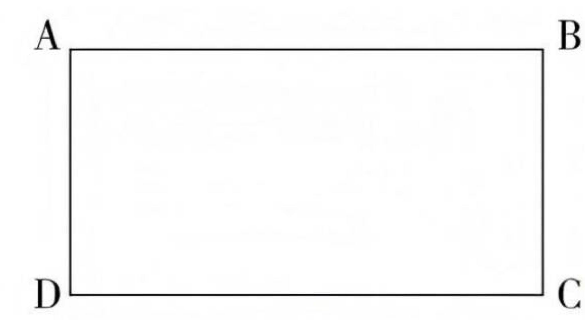

- A. 不到 690 米
- B. 690-720 米之间
- C. 720-750 米之间
- D. 超过 750 米

### Back

## 答案

**A．不到 690 米。** 最短距离为 \(300\sqrt5\) 米，约 **671 米**。

## 判型与所用套路

这是平面几何中的**最短路径问题**，使用“将军饮马”的**对称法**：将经过边界的折线路径展开成直线，再用勾股定理计算。

本题依次经过两条边，因此需要连续展开两次。

## 关键条件

- 根据图形，矩形的长边 \(AB=CD=300\) 米，短边 \(AD=BC=200\) 米。
- 路线依次为：\(A\) → \(CD\) 上一点 → \(AB\) 上一点 → \(C\)。
- 展开后的直线必须依次穿过这两条**线段**，才能取得最短距离。

## 按套路分步求解

**第一步：连续展开，把折线拉直。**

沿 \(CD\)、\(AB\) 所在边依次展开，得到三个上下排列的相同矩形。蓝色直线折回原池塘后，就是符合题目要求的路线。

```svg
<svg xmlns="http://www.w3.org/2000/svg" viewBox="0 0 560 560">
  <title>池塘最短路线的对称展开</title>
  <desc>三个相同矩形上下排列，直线从A到C的展开点，依次穿过CD和AB的展开位置。</desc>
  <rect x="100" y="50" width="300" height="400" fill="#ffffff" stroke="#333333" stroke-width="2"/>
  <line x1="100" y1="183" x2="400" y2="183" stroke="#333333" stroke-width="2"/>
  <line x1="100" y1="317" x2="400" y2="317" stroke="#333333" stroke-width="2"/>
  <line x1="100" y1="50" x2="400" y2="450" stroke="#2456a6" stroke-width="4"/>
  <circle cx="100" cy="50" r="4" fill="#2456a6"/>
  <circle cx="200" cy="183" r="4" fill="#2456a6"/>
  <circle cx="300" cy="317" r="4" fill="#2456a6"/>
  <circle cx="400" cy="450" r="4" fill="#2456a6"/>
  <text x="80" y="45" font-family="sans-serif" fill="#333333">A</text>
  <text x="410" y="188" font-family="sans-serif" fill="#333333">经过 CD</text>
  <text x="410" y="322" font-family="sans-serif" fill="#333333">经过 AB</text>
  <text x="410" y="455" font-family="sans-serif" fill="#333333">C 的展开点</text>
  <text x="250" y="485" text-anchor="middle" font-family="sans-serif" fill="#333333">横向 300 米</text>
  <text x="25" y="255" font-family="sans-serif" fill="#333333">纵向</text>
  <text x="25" y="280" font-family="sans-serif" fill="#333333">600 米</text>
  <text x="250" y="525" text-anchor="middle" font-family="sans-serif" fill="#2456a6">最短距离 = √(300² + 600²) = 300√5 米</text>
</svg>
```

展开后，起点和终点横向相距 \(300\) 米，纵向跨过三个池塘的宽：

\[
200+200+200=600\text{ 米}
\]

**第二步：用勾股定理计算。**

\[
\text{最短距离}
=\sqrt{300^2+600^2}
=300\sqrt5
\approx670.8\text{ 米}
\]

**第三步：检查路径是否可行。**

展开直线在两条边界处，分别经过距左端 \(100\) 米和 \(200\) 米的位置，都在线段上。因此这条直线路径折回后满足题意，最短距离可以取到。

## 快速验算与排除干扰项

\[
300\sqrt5\approx300\times2.24=672\text{ 米}<690\text{ 米}
\]

故选 **A**，排除 B、C、D。

## 与原卷参考对照

原卷的 **Answer 和 Explanation 均为空**。A 是独立求解结果，未经原卷答案核对。

## 复盘提醒

遇到“依次碰到两条边再到终点”的最短路，优先想到**对称展开、化折为直**。算完后要检查直线与边界的交点是否落在题目要求的线段上。

---

## Card
<!-- hyz-card-id: 01a1e272-d6fd-7452-a6b4-778c237ed6a6 -->
<!-- hyz-source-question-id: 01a1af25-d031-7ee1-9282-b6b77c9f79f7 -->
<!-- hyz-correct-answer: [] -->
### Front

A、B 两个乡镇分布于山谷两侧，山谷间有一条宽为 2km 的河道（如下图所示）。当地政府决定在两个乡镇间修建一条跨河公路促进旅游发展。由于架桥费用高昂，所以要求跨河公路中的桥梁路段长度最短。那么根据图中数据，从 A 镇前往 B 镇的最短距离为：
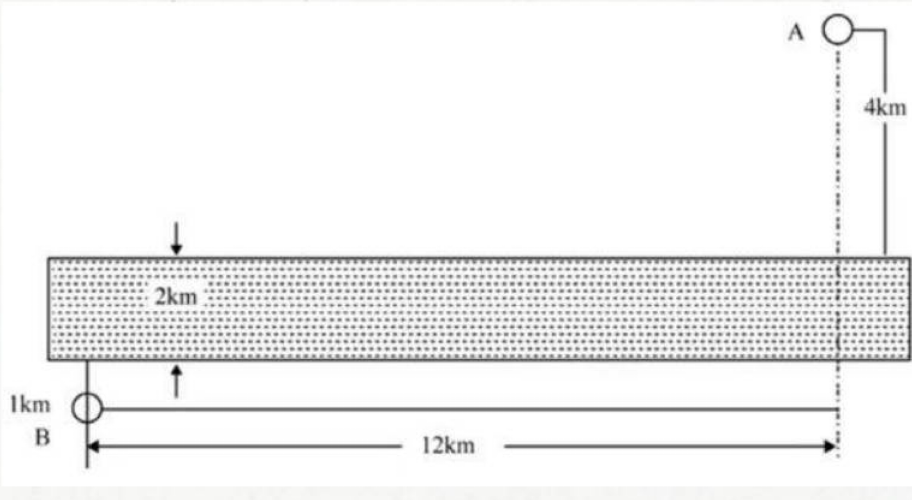

- A. 17km
- B. 15km
- C. 19km
- D. 20km

### Back

## 答案

**B．15 km。** 这是独立求解的结果，原卷未给出答案。

## 判型与所用套路

这是平面几何中的**最短路径问题**。沿用“将军饮马”中把折线路径展开成直线的思路：先确定最短桥梁，再通过平移消去河宽，求两段陆路之和的最小值。

## 关键条件

- 河宽为 **2 km**。桥梁最短时，桥与河岸垂直，桥长为 **2 km**。
- A、B 到各自近岸的垂直距离分别为 **4 km、1 km**。
- A、B 的水平距离为 **12 km**。

## 按套路分步求解

设最短桥梁的两端分别为 \(P、Q\)，则 \(PQ=2\) km。将 A 连同靠近 A 的陆路向 B 方向平移 2 km，得到 \(A'\)；此时桥两端 \(P、Q\) 重合，两段陆路首尾相接。

```svg
<svg xmlns="http://www.w3.org/2000/svg" viewBox="0 0 650 350">
  <title>平移展开跨河最短路径</title>
  <desc>左图是原路径，桥梁垂直河岸。右图将 A 向下平移河宽后，陆路展开为一条直线。</desc>
  <text x="155" y="25" text-anchor="middle" font-family="sans-serif" font-weight="bold" fill="#222222">原路径</text>
  <line x1="35" y1="135" x2="285" y2="135" stroke="#555555" stroke-width="2"/>
  <line x1="35" y1="185" x2="285" y2="185" stroke="#555555" stroke-width="2"/>
  <text x="43" y="165" font-family="sans-serif" fill="#333333">河宽 2 km</text>
  <circle cx="260" cy="45" r="4" fill="#222222"/>
  <text x="269" y="49" font-family="sans-serif" fill="#222222">A</text>
  <circle cx="55" cy="235" r="4" fill="#222222"/>
  <text x="38" y="250" font-family="sans-serif" fill="#222222">B</text>
  <polyline points="260,45 96,135 96,185 55,235" fill="none" stroke="#174a7e" stroke-width="3"/>
  <text x="105" y="130" font-family="sans-serif" fill="#174a7e">P</text>
  <text x="105" y="202" font-family="sans-serif" fill="#174a7e">Q</text>
  <text x="215" y="105" font-family="sans-serif" fill="#333333">4 km</text>
  <text x="64" y="223" font-family="sans-serif" fill="#333333">1 km</text>
  <line x1="55" y1="285" x2="260" y2="285" stroke="#555555" stroke-width="1"/>
  <text x="157" y="307" text-anchor="middle" font-family="sans-serif" fill="#333333">水平距离 12 km</text>
  <text x="480" y="25" text-anchor="middle" font-family="sans-serif" font-weight="bold" fill="#222222">平移展开后</text>
  <line x1="345" y1="185" x2="610" y2="185" stroke="#555555" stroke-width="2"/>
  <circle cx="575" cy="95" r="4" fill="#222222"/>
  <text x="584" y="99" font-family="sans-serif" fill="#222222">A′</text>
  <circle cx="370" cy="235" r="4" fill="#222222"/>
  <text x="352" y="250" font-family="sans-serif" fill="#222222">B</text>
  <line x1="370" y1="235" x2="575" y2="95" stroke="#174a7e" stroke-width="3"/>
  <circle cx="443" cy="185" r="4" fill="#174a7e"/>
  <text x="450" y="204" font-family="sans-serif" fill="#174a7e">P、Q 重合</text>
  <line x1="370" y1="235" x2="575" y2="235" stroke="#777777" stroke-width="1"/>
  <line x1="575" y1="95" x2="575" y2="235" stroke="#777777" stroke-width="1"/>
  <text x="468" y="257" text-anchor="middle" font-family="sans-serif" fill="#333333">12 km</text>
  <text x="583" y="165" font-family="sans-serif" fill="#333333">5 km</text>
  <text x="447" y="145" font-family="sans-serif" fill="#174a7e">13 km</text>
</svg>
```

平移不改变陆路长度，因此原来的两段陆路之和变成 \(A'Q+QB\)。当 \(A'、Q、B\) 三点共线时，这个和最小，等于直线距离 \(A'B\)。

平移后，\(A'\) 与 B 的水平距离仍为 12 km，垂直距离为 \(4+1=5\) km。由勾股定理：

\[
A'B=\sqrt{12^2+5^2}=13\text{ km}
\]

最后加回桥长：

\[
\boxed{13+2=15\text{ km}}
\]

## 快速验算与排除干扰项

展开后的陆路构成 **5、12、13** 直角三角形；再加桥长 2 km，得到 **15 km**，对应 B。其余选项均不等于这个可达到的最短总路程。

## 与原卷参考对照

原卷的 Answer 和 Explanation 均为空，**本题结果未经原卷答案核对**。

## 复盘提醒

先区分“**桥梁最短**”和“**总路程最短**”：桥先垂直河岸，长度固定为 2 km；随后再优化两段陆路。平移消去河宽后，最后别忘了把桥长加回去。

---

## Card
<!-- hyz-card-id: 01a1e2fe-734d-7461-a265-1ee690e6cf2a -->
<!-- hyz-source-question-id: 01a1af25-d031-7ee1-9282-b70652e483a9 -->
<!-- hyz-correct-answer: [] -->
### Front

A、B 两地分别与某个半径 150 米的圆形池塘边缘相距 100 米，AB 的连线经过池塘的圆心。张某从 A 地出发以 1 米/秒的速度匀速行走。全程除转向 1 次外均保持直线行进。问他从 A 地到 B 地的最短用时在以下哪个范围内？
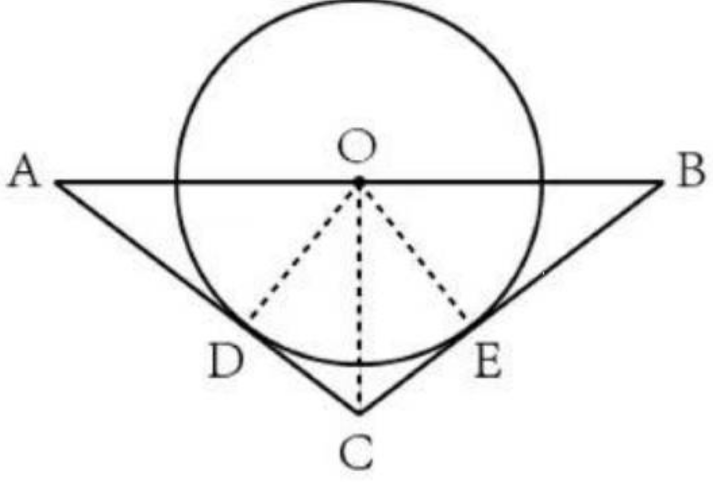

- A. 不到 9 分 30 秒
- B. 9 分 30 秒~10 分之间
- C. 10 分~10 分 30 秒之间
- D. 10 分 30 秒以上

### Back

## 答案

**C．10 分至 10 分 30 秒之间。**

最短路程为 **625 米**，用时 **625 秒，即 10 分 25 秒**。这是独立求解的结果，原卷未提供答案。

## 判型与所用套路

这是**平面几何中的线圆相切与最短路径题**。按照“先找图形关系，再利用直角三角形和相似比求长度”的套路，先确定最短路线，再计算。

## 关键条件

- 池塘半径 \(OD=150\) 米。
- A、B 在圆心 O 两侧，且到池塘边缘均为 100 米，因此
  \[
  AO=BO=150+100=250\text{ 米}。
  \]
- 只能转向一次，路线是两条线段组成的折线。最短时，折线的两段分别与池塘相切，如原图中的 \(AC\)、\(BC\)。

## 按套路分步求解

**1. 找到最短折线。** 若某一段离池塘仍有余地，就可以向池塘方向收紧折线，缩短路程；收紧到不能再收紧时，两段分别与圆相切。由左右对称，转向点 C 在圆心 O 的正下方，且 \(AC=BC\)。

**2. 求切线段 \(AD\)。** 半径垂直于切线，所以 \(\triangle AOD\) 是直角三角形：

\[
AD=\sqrt{AO^2-OD^2}
=\sqrt{250^2-150^2}
=200\text{ 米}。
\]

**3. 利用相似求 \(AC\)。** 在直角三角形 \(AOC\) 中，\(OD\) 是斜边 \(AC\) 上的高，由相似三角形可得：

\[
AD\cdot AC=AO^2。
\]

因此

\[
AC=\frac{250^2}{200}=312.5\text{ 米}。
\]

最短总路程为

\[
AC+BC=2\times312.5=625\text{ 米}。
\]

速度为 1 米/秒，所以最短用时为 **625 秒，即 10 分 25 秒**。

## 快速验算与排除干扰项

\(625\) 秒介于 \(600\) 秒和 \(630\) 秒之间，正好对应 **C**；A、B 的上限不足 625 秒，D 要求超过 630 秒。

## 与原卷参考对照

原卷的 **Answer 和 Explanation 均为空**，因此无法与原卷参考答案核对。

## 复盘提醒

看到“绕圆形障碍物且只转向一次”，先想到**两段切线组成的折线**；切点处半径与切线垂直，再找直角三角形和相似关系。不要把两切点间的圆弧算进路线：沿圆弧行走会持续改变方向。

---

## Card
<!-- hyz-card-id: 01a1e302-cd9c-73a2-8217-84160deb915e -->
<!-- hyz-source-question-id: 01a1af25-d031-7ee1-9282-b710bbcd30a2 -->
<!-- hyz-correct-answer: [] -->
### Front

已知易拉罐的直径为 8cm，现将 7 个易拉罐如图捆扎在一起，那么需要（ ）cm 长的绳子。（仅计算一圈的绳长）
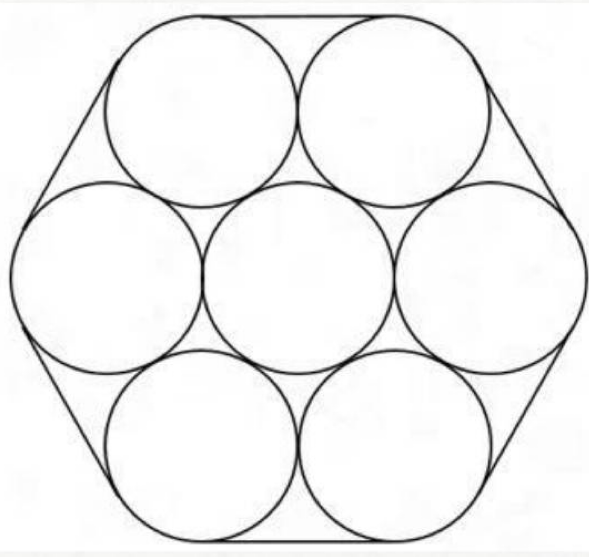

- A. 4π+24
- B. 4π+48
- C. 8π+24
- D. 8π+48

### Back

## 答案

**D．\(8\pi+48\) cm。** 这是独立求解的结果。

## 判型与所用套路

这是**平面几何中的线圆相切与周长问题**。按照“先找图形关系，再求长度”的思路，把绳子分成两部分：

- **直线段**：连接外层圆心，借助相切关系求长度；
- **圆弧段**：把外层六段圆弧合起来，看它们相当于多少个整圆。

## 关键条件

每个易拉罐的直径是 **8 cm**，半径是 **4 cm**。7 个罐子中，1 个在中间，6 个围在外层；相邻罐子互相接触。

下图中，**红色是绳子，蓝色线段连接外层圆心**：

```svg
<svg xmlns="http://www.w3.org/2000/svg" viewBox="0 0 600 460">
  <title>七个易拉罐的捆扎示意图</title>
  <circle cx="240" cy="126" r="60" fill="none" stroke="#777777" stroke-width="2"/>
  <circle cx="360" cy="126" r="60" fill="none" stroke="#777777" stroke-width="2"/>
  <circle cx="180" cy="230" r="60" fill="none" stroke="#777777" stroke-width="2"/>
  <circle cx="300" cy="230" r="60" fill="none" stroke="#777777" stroke-width="2"/>
  <circle cx="420" cy="230" r="60" fill="none" stroke="#777777" stroke-width="2"/>
  <circle cx="240" cy="334" r="60" fill="none" stroke="#777777" stroke-width="2"/>
  <circle cx="360" cy="334" r="60" fill="none" stroke="#777777" stroke-width="2"/>
  <polygon points="240,126 360,126 420,230 360,334 240,334 180,230" fill="none" stroke="#2255aa" stroke-width="3"/>
  <path d="M 240 66 L 360 66 A 60 60 0 0 1 412 96 L 472 200 A 60 60 0 0 1 472 260 L 412 364 A 60 60 0 0 1 360 394 L 240 394 A 60 60 0 0 1 188 364 L 128 260 A 60 60 0 0 1 128 200 L 188 96 A 60 60 0 0 1 240 66" fill="none" stroke="#c62828" stroke-width="4"/>
  <text x="300" y="112" fill="#2255aa" font-family="sans-serif" text-anchor="middle">8 cm</text>
  <text x="300" y="30" fill="#c62828" font-family="sans-serif" text-anchor="middle">红色：绳子</text>
  <text x="300" y="438" fill="#2255aa" font-family="sans-serif" text-anchor="middle">蓝色：连接外层圆心</text>
</svg>
```

## 按套路分步求解

**第一步：求六段直绳。**

相邻两个外层罐子相切，圆心距等于一个直径，即 \(8\) cm。连接它们的圆心，得到一个**正六边形**。

每段直绳都是相邻两个等圆的公切线，长度等于对应的圆心距，所以六段直绳总长为：

\[
8\times6=48\text{ cm}
\]

**第二步：拼合六段圆弧。**

绳子在每个外层罐子上绕过一段圆弧。沿绳子绕一周，方向总共转过 \(360^\circ\)；六段圆弧对应的圆心角合起来也是 \(360^\circ\)。

因此，**六段圆弧合起来恰好是一个整圆的周长**：

\[
\pi\times8=8\pi\text{ cm}
\]

**第三步：直线段加圆弧段。**

\[
\boxed{48+8\pi\text{ cm}}
\]

所以选 **D**。

## 快速验算与排除干扰项

正六边形有 **6 条边**，每条对应一段长 \(8\) cm 的直绳，直线部分必为 \(48\) cm，排除 **A、C**。

圆弧拼成一个**直径为 8 cm** 的整圆，周长为 \(8\pi\) cm，排除 **B**。

## 与原卷参考对照

原卷的 **Answer 和 Explanation 均为空**，因此上述结论未经原卷答案核对。

## 复盘提醒

遇到多个**等圆捆扎**，记住两步：**连外层圆心，算直线；拼外侧圆弧，凑整圆**。本题中间的罐子没有接触绳子，不另算它的周长。

---

## Card
<!-- hyz-card-id: 01a1e311-198e-7ca3-a077-fb10a506c7a7 -->
<!-- hyz-source-question-id: 01a1af25-d031-7ee1-9282-b72fc0902928 -->
<!-- hyz-correct-answer: [] -->
### Front

一个半径 300 米的圆形湖泊中有一个半径 100 米的圆形人工岛，该人工岛的中心在湖泊中心的正西方 150 米处。甲从湖正北的 A 点开船出发，绕行人工岛西侧到达正南的 B 点。如果保持最短路线行驶，那么行驶多少米后甲到达人工岛的岸边？
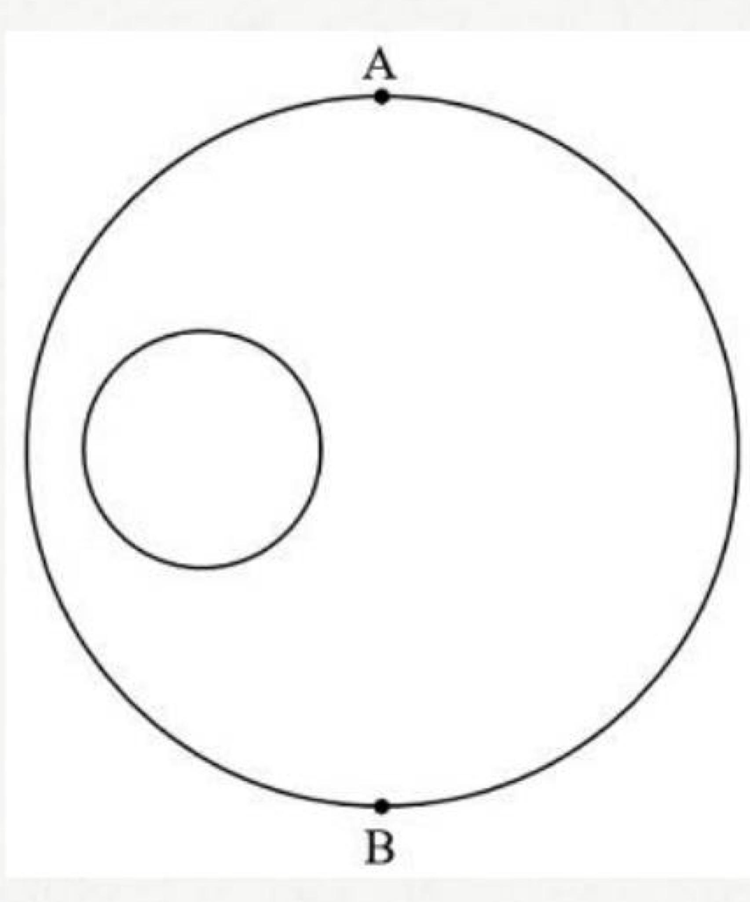

- A. 150√5-100
- B. 300
- C. 50√41
- D. 200√3

### Back

## 答案

**选 C，\(50\sqrt{41}\) 米，约 320 米。**这是独立求解的结果，原卷没有提供答案。

你图中画出了从 A 到湖最西端的直线。关键差别在于：**那条线穿过了人工岛，不是绕岛的最短路线；真正的路线从 A 出发，要先与人工岛相切。**

## 判型与所用套路

这是**平面几何中的圆形障碍物最短路径**。沿用“先找图形关系，再用直角三角形求长度”的套路：

> 绕过圆形障碍物，最短路线在首次到达圆边时与圆相切；连接圆心和切点，得到直角三角形。

## 关键条件

设湖心为 \(O\)，岛心为 \(P\)，首次到达岛岸的切点为 \(T\)。

- \(AO=300\) 米；
- \(OP=150\) 米，且 \(AO\perp OP\)；
- 岛的半径 \(PT=100\) 米；
- \(AT\) 与岛相切，所以 **\(PT\perp AT\)**。

```svg
<svg xmlns="http://www.w3.org/2000/svg" viewBox="0 0 500 520">
  <title>绕人工岛西侧的最短路线示意图</title>
  <circle cx="330" cy="260" r="220" fill="none" stroke="#777777" stroke-width="2"/>
  <circle cx="220" cy="260" r="73.3" fill="#f2f2f2" stroke="#333333" stroke-width="2"/>
  <line x1="330" y1="40" x2="167.2" y2="209.1" stroke="#c62828" stroke-width="4"/>
  <path d="M 167.2 209.1 A 73.3 73.3 0 0 0 167.2 310.9" fill="none" stroke="#c62828" stroke-width="4"/>
  <line x1="167.2" y1="310.9" x2="330" y2="480" stroke="#c62828" stroke-width="4"/>
  <line x1="330" y1="40" x2="220" y2="260" stroke="#2255aa" stroke-width="2"/>
  <line x1="220" y1="260" x2="167.2" y2="209.1" stroke="#2255aa" stroke-width="2"/>
  <line x1="220" y1="260" x2="330" y2="260" stroke="#555555" stroke-width="2"/>
  <line x1="330" y1="40" x2="330" y2="260" stroke="#555555" stroke-width="2"/>
  <circle cx="330" cy="40" r="4" fill="#222222"/>
  <circle cx="330" cy="480" r="4" fill="#222222"/>
  <circle cx="330" cy="260" r="4" fill="#222222"/>
  <circle cx="220" cy="260" r="4" fill="#222222"/>
  <circle cx="167.2" cy="209.1" r="4" fill="#c62828"/>
  <text x="340" y="38" fill="#222222" font-family="sans-serif">A</text>
  <text x="340" y="490" fill="#222222" font-family="sans-serif">B</text>
  <text x="338" y="278" fill="#222222" font-family="sans-serif">O 湖心</text>
  <text x="207" y="282" fill="#222222" font-family="sans-serif">P 岛心</text>
  <text x="143" y="204" fill="#c62828" font-family="sans-serif">T</text>
  <text x="265" y="251" fill="#222222" font-family="sans-serif">150</text>
  <text x="338" y="150" fill="#222222" font-family="sans-serif">300</text>
  <text x="158" y="249" fill="#2255aa" font-family="sans-serif">100</text>
  <text x="18" y="25" fill="#c62828" font-family="sans-serif">红色：绕西侧路线</text>
</svg>
```

红线从 A 到 T 的这一段，就是题目问的“到达人工岛岸边”之前的路程。到 T 之后还要沿岛岸绕行，但**后半程不用算**。

## 按套路分步求解

**第一步：先求 A 到岛心的距离。**

在直角三角形 \(AOP\) 中：

\[
AP^2=AO^2+OP^2
=300^2+150^2=112500
\]

所以 \(AP=150\sqrt5\)。你图中写的这个长度，如果指的是 **A 到岛心**，这一步是对的。

**第二步：用切点处的直角，求 \(AT\)。**

在直角三角形 \(APT\) 中，\(AP\) 是斜边，\(PT=100\) 是半径：

\[
\begin{aligned}
AT^2&=AP^2-PT^2\\
&=112500-10000\\
&=102500
\end{aligned}
\]

因此：

\[
\boxed{AT=\sqrt{102500}=50\sqrt{41}\text{ 米}}
\]

## 快速验算与排除干扰项

\(AP=150\sqrt5\approx335\) 米，而切线段 \(AT\) 应比斜边 \(AP\) 短；\(50\sqrt{41}\approx320\) 米，符合。

- **A 项 \(150\sqrt5-100\)**：相当于从 \(AP\) 中直接减去半径，得到的是 A 朝岛心直走时到岛岸的距离；但那不是绕西侧所需的切线路线。
- **B 项 300**：只是湖的半径 \(AO\)，不是要求的切线段。
- **D 项 \(200\sqrt3\approx346\)**：比斜边 \(AP\) 还长，不可能是直角三角形的直角边。

## 与原卷参考对照

原卷的 **Answer 和 Explanation 均为空**，所以 C 是独立计算结果，无法与原卷参考答案核对。

## 复盘提醒

你思路中连接圆心、寻找直角三角形的方向是对的。**差的关键一步是确定切点的位置，以及把直角放在切点 \(T\)**：不能把湖最西端或岛最西端直接当作首次接触点。图中其他红色手写数字有些难以辨认，因此不能确定你具体在哪一步算错；但只要回到“切线垂直半径”，就能接上正确计算。

---

## Card
<!-- hyz-card-id: 01a1e4ad-5488-73a2-9b72-bb7a43c3d988 -->
<!-- hyz-source-question-id: 01a1af25-d036-7523-9552-d228e72e4688 -->
<!-- hyz-correct-answer: [] -->
### Front

一只闹钟的秒针顶点距离表盘圆心 4 厘米，分针顶点距离表盘圆心 3 厘米。小王烧开一壶水的时间内，秒针顶点累计移动了 40π 厘米。那么这一时间段内，分针顶点与表盘圆心的连线扫过的扇形面积为多少平方厘米？

- A. 0.5π
- B. 0.75π
- C. π
- D. 1.5π

### Back

## 答案

**B．\(0.75\pi\) 平方厘米。**

## 判型与所用套路

这是**钟表转动与扇形面积**问题。按“先求时间，再求份额”的思路：

**秒针弧长 → 秒针圈数 → 经过时间 → 分针转过的份额 → 扇形面积。**

## 关键条件

- 秒针长 4 厘米，**1 分钟转一圈**；其顶点累计移动了 \(40\pi\) 厘米。
- 分针长 3 厘米，**60 分钟转一圈**。
- 扇形面积等于整圆面积乘它占整圆的份额。

## 按套路分步求解

### 第一步：利用 \(40\pi\) 求时间

秒针顶点走一圈的路程是半径为 4 厘米的圆周长：

\[
2\pi\times4=8\pi\text{ 厘米}
\]

因此秒针走了：

\[
40\pi\div8\pi=5\text{ 圈}
\]

秒针 1 分钟走一圈，所以烧水用了 **5 分钟**。

### 第二步：求分针扫过的份额

分针 60 分钟转一圈，5 分钟转过整圈的：

\[
\frac{5}{60}=\frac1{12}
\]

也就是扫过 \(360^\circ\times\frac1{12}=30^\circ\) 的扇形。

### 第三步：求扇形面积

分针长 3 厘米，以它为半径的整圆面积为：

\[
\pi r^2=\pi\times3^2=9\pi
\]

分针扫过整圆的 \(\frac1{12}\)，所以扇形面积为：

\[
S=9\pi\times\frac1{12}
=\boxed{0.75\pi\text{ 平方厘米}}
\]

## 为什么扇形面积要乘 \(\frac1{12}\)？

一整圈是 \(360^\circ\)。如果把圆从圆心切成 12 个相同的扇形，每个扇形的圆心角都是 \(30^\circ\)，面积也都是整圆的 \(\frac1{12}\)。

因此，图片中的公式

\[
S_{\text{扇形}}=\frac{n}{360^\circ}\times\pi r^2
\]

就是用**圆心角占整圈的份额**，乘以整圆面积。本题 \(n=30^\circ\)，所以份额是 \(\frac{30^\circ}{360^\circ}=\frac1{12}\)。

## 快速验算与排除干扰项

图片还给出公式 \(S_{\text{扇形}}=\frac{lr}{2}\)，其中 \(l\) 是**这个扇形的弧长**。

分针扫过的弧长为：

\[
l=\frac1{12}\times2\pi\times3=\frac{\pi}{2}
\]

代入可得：

\[
S=\frac{lr}{2}
=\frac{\frac{\pi}{2}\times3}{2}
=0.75\pi
\]

与前面的结果一致，唯一对应 **B 项**。

## 与原卷参考对照

原卷的答案和解析均为空；以上是**独立求解，未经原始答案核对**。

## 复盘提醒

题干的 \(40\pi\) 是**秒针顶点的累计路程**，作用是求时间；面积公式中的弧长 \(l\) 则是**分针扫过的弧长**。两个量属于不同的圆，不能直接混用。

---

## Card
<!-- hyz-card-id: 01a1e4b9-c7cb-7843-9a92-f66ec4022dd1 -->
<!-- hyz-source-question-id: 01a1af25-d036-7523-9552-d23e391180b0 -->
<!-- hyz-correct-answer: [] -->
### Front

有一个花坛的形状是一个直角扇形，由三个半径分别为 1、2、3 米的圆弧构成，现用两条线段将此扇形圆心角平均分割成三部分。（如图）设计者在阴影部分和空白部分分别种上不同的花卉，那么阴影部分花卉的种植面积为多少平方米？

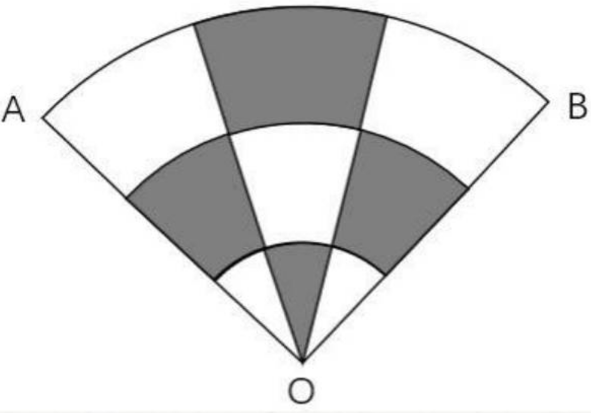

- A. π/3
- B. π/2
- C. π
- D. 2π

### Back

## 答案

**是的，选 C，阴影面积为 \(\pi\) 平方米。** 这是独立计算的结果。

## 判型与所用套路

这是**扇形和圆环的面积问题**。按“先看面积比例，再割补”的套路：利用圆心角三等分，把每一层看成面积相等的三份，再将阴影拼起来。

## 关键条件

- 整个扇形的圆心角是 \(90^\circ\)，三等分后每份是 \(30^\circ\)。
- 从内到外，三层的阴影分别占该层的 \(\frac13\)、\(\frac23\)、\(\frac13\)。
- 三条圆弧的半径分别为 \(1、2、3\) 米。

## 按套路分步求解

每个 \(30^\circ\) 扇形占整圆的 \(\frac1{12}\)。

把中间圆环的两块阴影中的一块，移到中间的空白位置，就拼成了一个**半径为 2 米、圆心角为 \(30^\circ\) 的完整扇形**；剩下的一块则与最外层阴影拼成一个**半径从 1 米到 3 米的 \(30^\circ\) 圆环扇形**。

因此阴影面积为：

\[
S=\frac{\pi\times 2^2}{12}
+\frac{\pi(3^2-1^2)}{12}
=\frac{4\pi+8\pi}{12}
=\boxed{\pi\text{ 平方米}}
\]

## 快速验算与排除干扰项

直接按三层计算：

\[
S=\frac{\pi}{12}
+2\times\frac{(2^2-1^2)\pi}{12}
+\frac{(3^2-2^2)\pi}{12}
=\frac{(1+6+5)\pi}{12}
=\pi。
\]

对应 **C 项**，其余选项均不符。

## 与原卷参考对照

原卷的 Answer 和 Explanation 均为空，以上结论**未经原卷答案核对**。

## 复盘提醒

圆环面积要用**半径的平方作差**，例如中间一层是 \(2^2-1^2=3\)，不是 \(2-1=1\)。同时注意中间层有**两块阴影**，不能漏算。

---

## Card
<!-- hyz-card-id: 01a1e4c0-00a6-7621-bfa4-122a30186988 -->
<!-- hyz-source-question-id: 01a1af25-d036-7523-9552-d25548e53c0e -->
<!-- hyz-correct-answer: [] -->
### Front

一个正三角形和一个正六边形周长相等，则正六边形面积为正三角形的：

- A. √2 倍
- B. 1.5 倍
- C. √3 倍
- D. 2 倍

### Back

## 答案：B，1.5 倍

你的图示思路是对的：把正三角形面积设为 \(x\)，正六边形分成 6 个小等边三角形，每个面积为 \(\frac{x}{4}\)，所以正六边形面积为 \(\frac32x\)。

## 判型与所用套路

这是**等周长图形的面积比**问题。先用周长相等求边长比，再通过分割正六边形，利用相似三角形的面积比求解。

## 关键条件

正三角形有 3 条等边，正六边形有 6 条等边。两者周长相等，所以：

\[
\text{正三角形边长}:\text{正六边形边长}=2:1
\]

## 按套路分步求解

```svg
<svg xmlns="http://www.w3.org/2000/svg" viewBox="0 0 600 270">
  <title>正三角形与正六边形的面积比较</title>
  <polygon points="130,35 30,208 230,208" fill="none" stroke="#223344" stroke-width="3"/>
  <text x="130" y="190" text-anchor="middle" font-family="sans-serif" font-size="18" fill="#223344">面积 x</text>
  <text x="130" y="238" text-anchor="middle" font-family="sans-serif" fill="#223344">边长 2</text>
  <polygon points="350,120 400,33 500,33 550,120 500,207 400,207" fill="none" stroke="#223344" stroke-width="3"/>
  <line x1="450" y1="120" x2="350" y2="120" stroke="#223344" stroke-width="2"/>
  <line x1="450" y1="120" x2="400" y2="33" stroke="#223344" stroke-width="2"/>
  <line x1="450" y1="120" x2="500" y2="33" stroke="#223344" stroke-width="2"/>
  <line x1="450" y1="120" x2="550" y2="120" stroke="#223344" stroke-width="2"/>
  <line x1="450" y1="120" x2="500" y2="207" stroke="#223344" stroke-width="2"/>
  <line x1="450" y1="120" x2="400" y2="207" stroke="#223344" stroke-width="2"/>
  <text x="450" y="82" text-anchor="middle" font-family="sans-serif" fill="#223344">x/4</text>
  <text x="450" y="238" text-anchor="middle" font-family="sans-serif" fill="#223344">边长 1，共 6 份</text>
</svg>
```

1. 设正三角形面积为 \(x\)。连接正六边形的中心与各顶点，得到 **6 个全等的等边三角形**。
2. 每个小三角形的边长是原正三角形的 \(\frac12\)。它们相似，因此面积是原正三角形的 \(\left(\frac12\right)^2=\frac14\)，即 \(\frac{x}{4}\)。
3. 正六边形的面积为：

   \[
   \frac{x}{4}\times 6=\frac32x=1.5x
   \]

所以正六边形面积是正三角形的 **1.5 倍**。

## 快速验算与排除干扰项

正六边形相当于 **6 个**小等边三角形；原正三角形边长是小三角形的 2 倍，面积相当于 **4 个**小三角形。因此面积比为 \(6:4=1.5:1\)，排除 A、C、D。

## 与原卷参考对照

原卷答案和解析均为空，以上是独立求解结果，无法与原卷答案核对。

## 复盘提醒

先把正六边形拆成等边三角形，再使用“**边长比平方＝面积比**”。平方关系用在相似的三角形之间，不能直接把正三角形和正六边形当作相似图形。

---

## Card
<!-- hyz-card-id: 01a1e4d5-bc01-7bd0-8b99-e510d4a92389 -->
<!-- hyz-source-question-id: 01a1af25-d036-7523-9552-d26131b6028f -->
<!-- hyz-correct-answer: [] -->
### Front

如下图所示，在三角形工地 ABC 中 CD=3AD，EC=2BE，阴影部分三角形 ADE 的面积是 15 平方米。三角形工地 ABC 的面积是（）平方米？

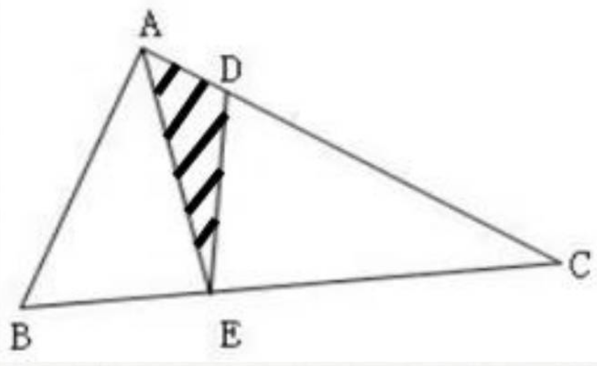

- A. 90
- B. 70
- C. 60
- D. 45

### Back

## 答案

**选 A，90 平方米。** 这是独立计算的结果。

你图中标的 \(BE=y、EC=2y\) 是对的，所以 **\(EC\) 占整个 \(BC\) 的 \(\frac23\)**。差别在于：这个 \(\frac23\) 对应的是 **\(\triangle AEC\) 占 \(\triangle ABC\) 的面积比例**，不能直接当成阴影占大三角形的比例。

## 判型与所用套路

这是**平面几何面积比例题**。用“等高的三角形，面积比等于底边比”，把线段比例一步步转成面积比例。

## 关键条件

- \(CD=3AD\)，所以 \(AD:AC=1:4\)。
- \(EC=2BE\)，所以 \(EC:BC=2:3\)。
- 阴影 \(\triangle ADE\) 的面积为 \(15\)。

```svg
<svg xmlns="http://www.w3.org/2000/svg" viewBox="0 0 600 300">
<title>三角形面积比例示意图</title>
<polygon points="160,35 30,255 560,255" fill="white" stroke="#243447" stroke-width="3"/>
<polygon points="160,35 260,90 207,255" fill="#b7d9ee" stroke="#243447" stroke-width="2"/>
<line x1="207" y1="255" x2="560" y2="255" stroke="#243447" stroke-width="3"/>
<line x1="260" y1="90" x2="207" y2="255" stroke="#243447" stroke-width="2"/>
<text x="150" y="25" font-family="sans-serif" fill="#172536">A</text>
<text x="265" y="85" font-family="sans-serif" fill="#172536">D</text>
<text x="15" y="278" font-family="sans-serif" fill="#172536">B</text>
<text x="200" y="278" font-family="sans-serif" fill="#172536">E</text>
<text x="565" y="270" font-family="sans-serif" fill="#172536">C</text>
<text x="104" y="278" font-family="sans-serif" fill="#172536">y</text>
<text x="375" y="278" font-family="sans-serif" fill="#172536">2y</text>
<text x="193" y="115" font-family="sans-serif" fill="#172536">15</text>
</svg>
```

## 按套路分步求解

**第一步：从阴影求 \(\triangle AEC\)。**

\(\triangle ADE\) 与 \(\triangle AEC\) 的底分别是 \(AD、AC\)，从 \(E\) 到直线 \(AC\) 的高相同。因此：

\[
S_{ADE}:S_{AEC}=AD:AC=1:4
\]

所以：

\[
S_{AEC}=15\times4=60
\]

**第二步：从 \(\triangle AEC\) 求整个 \(\triangle ABC\)。**

\(\triangle AEC\) 与 \(\triangle ABC\) 的底分别是 \(EC、BC\)，从 \(A\) 到直线 \(BC\) 的高相同。因此：

\[
S_{AEC}:S_{ABC}=EC:BC=2:3
\]

所以：

\[
S_{ABC}=60\div\frac23=\boxed{90\text{ 平方米}}
\]

## 快速验算与排除干扰项

阴影占整体的比例是两步比例相乘：

\[
\frac{S_{ADE}}{S_{ABC}}
=\frac14\times\frac23
=\frac16
\]

因此整体面积 \(15\div\frac16=90\)，其余选项均不符合。

如果你的 \(\frac23\) 是指 \(\triangle AEC\) 占整体的比例，那这一步正确；**还需要补上阴影占 \(\triangle AEC\) 的 \(\frac14\)**。图中红色辅助线和标注没有显示完整计算，不能仅凭图片断定你具体哪一步算错。

## 与原卷参考对照

原卷的 Answer 和 Explanation 均为空，**没有参考答案可供对照**；A 是以上独立求解的结果。

## 复盘提醒

每写一个面积比例，先说清楚“**哪两个三角形等高、哪两条边是底**”。尤其注意 \(CD=3AD\) 给出的是 **\(AD:CD=1:3\)**，换成整体时才是 **\(AD:AC=1:4\)**。

---

## Card
<!-- hyz-card-id: 01a1e4d7-0460-7391-a44c-3999fcfbf7ac -->
<!-- hyz-source-question-id: 01a1af25-d036-7523-9552-d270edc2480c -->
<!-- hyz-correct-answer: [] -->
### Front

如图，一个矩形分割成 4 个不同颜色的三角形。绿色三角形面积占矩形面积的 15%，黄色三角形的面积是 21 平方厘米。问矩形面积是多少平方厘米？

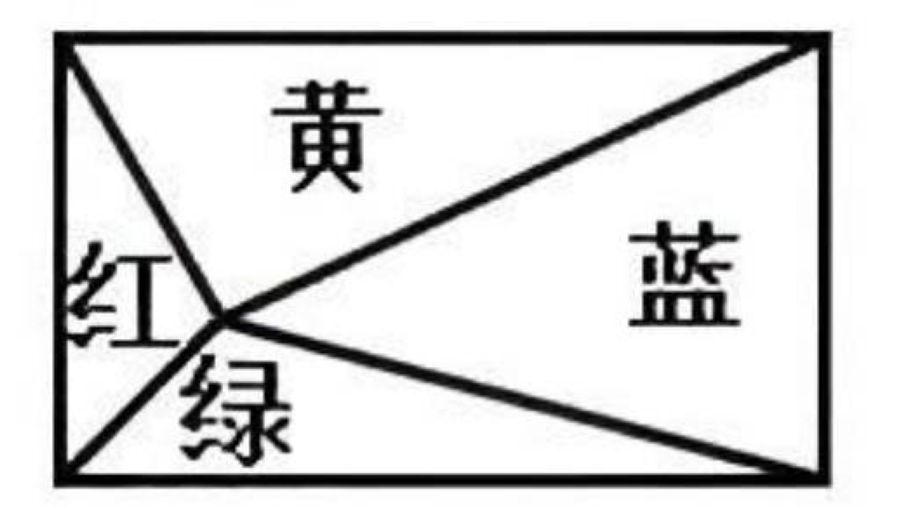

- A. 56
- B. 60
- C. 70
- D. 140

### Back

## 答案

**B．60 平方厘米。** 这是独立求解的结果，原卷没有给出答案。

## 判型与所用套路

这是平面几何中的**三角形面积比例题**。按“先看图形关系，再用面积割补”的套路，寻找两块面积与矩形总面积的关系，无须求矩形的长和宽。

## 关键条件

黄色、绿色三角形分别以矩形的上边、下边为底，共用内部顶点。矩形的上、下边等长，两个三角形的高之和等于矩形的高。

因此：

\[
S_{\text{黄}}+S_{\text{绿}}=\frac12S_{\text{矩形}}
\]

## 按套路分步求解

1. 绿色面积占矩形的 \(15\%\)，所以黄色面积占：

   \[
   50\%-15\%=35\%
   \]

2. 黄色面积是 21 平方厘米，矩形面积为：

   \[
   21\div35\%=\boxed{60\text{ 平方厘米}}
   \]

## 快速验算与排除干扰项

若矩形面积为 60，绿色面积为 \(60\times15\%=9\)；黄色加绿色为 \(21+9=30\)，正好是矩形面积的一半。由 \(21\div35\%=60\) 唯一确定，其他选项均不符。

## 与原卷参考对照

原卷的 **Answer** 和 **Explanation** 均为空，无法与原卷答案或解析对照。

## 复盘提醒

看到矩形内一点连接四个顶点，优先找**相对的两个三角形**：它们的面积之和等于矩形面积的一半。这里用的是“等底、高之和等于矩形的高”，不能误认为黄色与绿色面积相等。

---

## Card
<!-- hyz-card-id: 01a1e4e6-6c1a-78d0-8f7f-4c194a284d45 -->
<!-- hyz-source-question-id: 01a1af25-d036-7523-9552-d28e7f4a670b -->
<!-- hyz-correct-answer: [] -->
### Front

某矩形农场 ABCD 如图所示，矩形区域 ADEF 为生产区，矩形区域 BCEF 为休闲区。现连接 BD 将两区域打通，与 EF 相交于 O 点。已知 AF 和 FE 的长度分别为 600 米和 400 米，问 COD 围成的三角形阴影区域面积为多少万平方米？

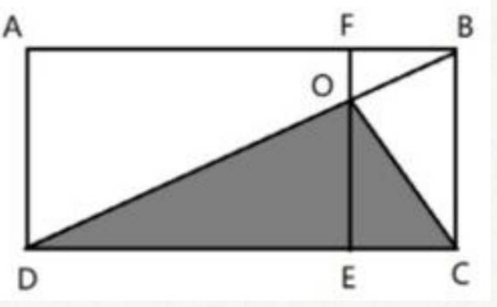

- A. 12
- B. 15
- C. 16
- D. 18

### Back

## 答案

**A．12 万平方米。** 这是独立计算的结果。

## 判型与所用套路

这是**平面几何中的三角形面积题**。采用“**平行截一刀，找相似三角形**”的套路：先利用对应边比例，再代入三角形面积公式，消去未知的矩形总长。

## 关键条件

- 矩形 \(ADEF\) 中，\(DE=AF=600\) 米，\(EF=400\) 米。
- 大矩形中，\(BC=EF=400\) 米。
- \(OE\parallel BC\)，且 \(D、O、B\) 共线，因此 \(\triangle DOE\sim\triangle DBC\)。

## 按套路分步求解

由相似三角形的对应边成比例：

\[
\frac{OE}{BC}=\frac{DE}{DC}
\]

交叉相乘得：

\[
DC\times OE=DE\times BC=600\times400
\]

阴影 \(\triangle COD\) 以 \(DC\) 为底、\(OE\) 为高，所以：

\[
S_{\triangle COD}
=\frac12 DC\times OE
=\frac12\times600\times400
=120000\text{ 平方米}
\]

换算单位：

\[
120000\text{ 平方米}=\boxed{12\text{ 万平方米}}
\]

## 快速验算与排除干扰项

相似关系表明，虽然 \(DC\) 和 \(OE\) 各自未知，但它们的乘积固定等于 \(600\times400\)。因此阴影面积唯一为 **12 万平方米**，排除 B、C、D。

## 与原卷参考对照

原卷的 **Answer 和 Explanation 均为空**，因此本题为独立求解，未经原卷答案核对。

## 复盘提醒

看到矩形被竖线分割、对角线穿过分割线，先找“**平行线＋共角**”构成的相似三角形。题目求面积时，留意是否能**直接求出底与高的乘积**，不必分别求出两条未知线段。

---

## Card
<!-- hyz-card-id: 01a1e528-d66e-76c2-b20e-a20aa2d1388f -->
<!-- hyz-source-question-id: 01a1af25-d036-7523-9552-d2cfc87cb97c -->
<!-- hyz-correct-answer: [] -->
### Front

如下图，把三角形 ABC 的三边分别延长 1、2、3 倍，得到一个新的三角形，则新三角形的面积是原三角形 ABC 面积的几倍？

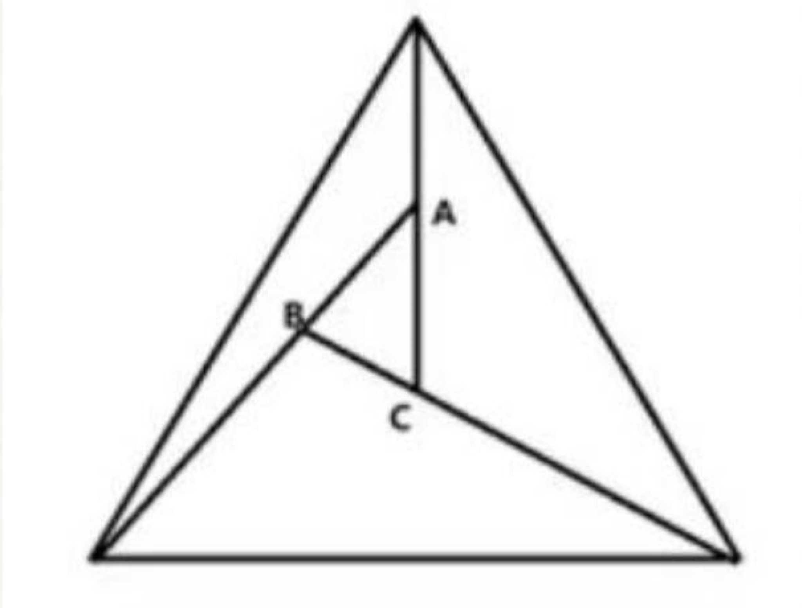

- A. 15
- B. 16
- C. 17
- D. 18

### Back

## 答案

**D．18 倍。**这是独立求解的结果，原卷未给出答案和解析。

## 判型与所用套路

这是**平面几何中的面积比问题**。采用面积割补：把大三角形拆成原三角形和周围三个三角形，再利用**同高三角形的面积比等于底边比**，逐块计算。

## 关键条件

将图中上方、左下方、右下方的大三角形顶点分别记为 \(D、E、F\)。则：

- \(D\) 在 \(CA\) 的延长线上，\(E\) 在 \(AB\) 的延长线上，\(F\) 在 \(BC\) 的延长线上；
- 三段延长线分别为对应原边长的 \(1、2、3\) 倍，但题图未标明各自对应哪一倍。下面先分别记为 \(x、y、z\)，最后会看到结果与分配顺序无关。

这里“延长 1 倍”指**增加的线段**等于原边长，而不是延长后的整段等于原边长。

## 按套路分步求解

设原三角形 \(ABC\) 的面积为 \(1\)，且

\[
AD=x\cdot AC,\qquad BE=y\cdot AB,\qquad CF=z\cdot BC。
\]

大三角形 \(DEF\) 可拆成 \(ABC\)、\(DAE\)、\(EBF\)、\(FCD\) 四部分。

1. 对三角形 \(DAE\)，底 \(AD\) 是 \(AC\) 的 \(x\) 倍；点 \(E\) 到直线 \(AC\) 的距离是点 \(B\) 到该直线距离的 \(1+y\) 倍。因此其面积为 \(x(1+y)\)。

2. 同理，三角形 \(EBF\) 的面积为 \(y(1+z)\)，三角形 \(FCD\) 的面积为 \(z(1+x)\)。

3. 所求面积倍数为

\[
\begin{aligned}
1+x(1+y)+y(1+z)+z(1+x)
&=1+(x+y+z)+(xy+yz+zx)\\
&=1+(1+2+3)+(1\times2+2\times3+3\times1)\\
&=\boxed{18}。
\end{aligned}
\]

式子对 \(x、y、z\) 完全对称，所以 \(1、2、3\) 分别对应哪条边，不影响结果。

## 快速验算与排除干扰项

把 \(x、y、z\) 依次取为 \(1、2、3\)，四块面积分别为

\[
1,\quad 1(1+2)=3,\quad 2(1+3)=8,\quad 3(1+1)=6。
\]

相加得 \(1+3+8+6=18\)，因此排除 A、B、C。

## 与原卷参考对照

原卷的 **Answer 和 Explanation 均为空**，无法与参考答案核对；上述 D 项由独立计算得到。

## 复盘提醒

遇到“边延长若干倍”，先区分**新增长度**和**延长后的总长度**。面积比题优先找同底、同高关系；只有确认三角形相似后，才能使用“面积比等于边长比的平方”。

---

## Card
<!-- hyz-card-id: 01a1e535-541f-7650-a39f-164ab4b9321c -->
<!-- hyz-source-question-id: 01a1af25-d036-7523-9552-d29fc3716c81 -->
<!-- hyz-correct-answer: [] -->
### Front

如图，ABCD、AEFG 是并排正方形，连接 FB 与正方形 ABCD 对角线 AC 交于点 P。已知 △APB 面积为 12，那么 △DFP 面积为？

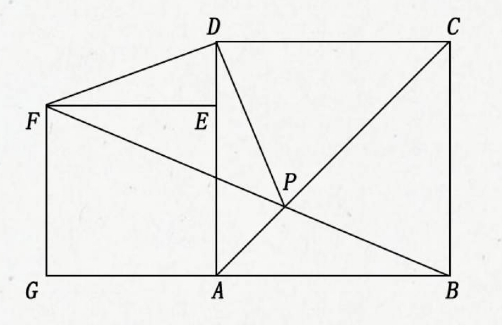

- A. 12
- B. 18
- C. 24
- D. 30

### Back

## 答案

**C．24。** 这是独立求解的结果，原卷答案与解析均为空。

## 判型与所用套路

这是**平面几何面积题**。按照“先找等面积图形，再用面积割补”的套路，利用正方形的边长关系和对角线性质，直接比较三角形面积。

## 关键条件

设 \(FB\) 与 \(AD\) 交于 \(Q\)。图中 \(A、Q、E、D\) 依次排列。

```svg
<svg xmlns="http://www.w3.org/2000/svg" viewBox="0 0 600 370">
<title>正方形组合面积示意图</title>
<desc>两个正方形并排，FB与AD交于Q，与对角线AC交于P；连接DP。</desc>
<rect x="50" y="180" width="150" height="150" fill="none" stroke="#243447" stroke-width="2"/>
<rect x="200" y="55" width="275" height="275" fill="none" stroke="#243447" stroke-width="2"/>
<line x1="50" y1="180" x2="475" y2="330" stroke="#2456a6" stroke-width="2"/>
<line x1="200" y1="330" x2="475" y2="55" stroke="#a23b31" stroke-width="2"/>
<line x1="200" y1="55" x2="279" y2="251" stroke="#243447" stroke-width="2"/>
<circle cx="200" cy="233" r="4" fill="#243447"/>
<circle cx="279" cy="251" r="4" fill="#243447"/>
<text x="200" y="350" text-anchor="middle" font-family="sans-serif" fill="#222222">A</text>
<text x="485" y="345" font-family="sans-serif" fill="#222222">B</text>
<text x="485" y="55" font-family="sans-serif" fill="#222222">C</text>
<text x="190" y="48" font-family="sans-serif" fill="#222222">D</text>
<text x="207" y="175" font-family="sans-serif" fill="#222222">E</text>
<text x="35" y="180" font-family="sans-serif" fill="#222222">F</text>
<text x="35" y="345" font-family="sans-serif" fill="#222222">G</text>
<text x="182" y="236" font-family="sans-serif" fill="#222222">Q</text>
<text x="286" y="251" font-family="sans-serif" fill="#222222">P</text>
<text x="335" y="310" font-family="sans-serif" fill="#a23b31">面积 12</text>
</svg>
```

- 小正方形中，\(FE=AE\)；大正方形中，\(AB=AD\)。
- \(P\) 在对角线 \(AC\) 和线段 \(FB\) 上。
- \(S_{\triangle APB}=12\)。

## 按套路分步求解

### 1. 证明两个大三角形面积相等

因为 \(FE\parallel AB\)，有

\[
\triangle FEQ\sim\triangle BAQ.
\]

设大、小正方形的边长分别为 \(a、b\)，则

\[
AD=AB=a,\qquad AE=FE=b.
\]

由相似三角形：

\[
\frac{QE}{AQ}=\frac{b}{a}.
\]

又因为 \(AE=AQ+QE=b\)，所以

\[
AQ=\frac{ab}{a+b},
\qquad
DQ=AD-AQ=\frac{a^2}{a+b}.
\]

于是

\[
\frac{DQ}{AQ}=\frac{a}{b}.
\]

比较 \(\triangle DFQ\) 和 \(\triangle ABQ\)：以 \(DQ、AQ\) 为底时，它们对应的高分别是 \(FE=b\)、\(AB=a\)。因此

\[
\frac{S_{\triangle DFQ}}{S_{\triangle ABQ}}
=\frac{DQ}{AQ}\times\frac{FE}{AB}
=\frac{a}{b}\times\frac{b}{a}=1.
\]

所以这两个三角形等面积。各加上公共的 \(\triangle DBQ\)，得到

\[
\boxed{S_{\triangle DFB}=S_{\triangle DAB}}.
\]

### 2. 扣去公共部分

因为 \(P\) 在 \(FB\) 上：

\[
S_{\triangle DFB}
=S_{\triangle DFP}+S_{\triangle DPB}.
\]

而 \(P\) 在 \(\triangle DAB\) 内：

\[
S_{\triangle DAB}
=S_{\triangle DAP}+S_{\triangle APB}+S_{\triangle DPB}.
\]

两个大三角形面积相等，扣掉共同的 \(\triangle DPB\)，得

\[
S_{\triangle DFP}
=S_{\triangle DAP}+S_{\triangle APB}.
\]

### 3. 利用正方形对角线

\(P\) 在对角线 \(AC\) 上，到 \(AD\) 和 \(AB\) 的距离相等；又 \(AD=AB\)，因此

\[
S_{\triangle DAP}=S_{\triangle APB}=12.
\]

于是

\[
S_{\triangle DFP}=12+12=\boxed{24}.
\]

## 快速验算与排除干扰项

关键面积关系是

\[
S_{\triangle DFP}
=2S_{\triangle APB}
=2\times12=24.
\]

因此选择 **C**，其余选项不符合。

## 与原卷参考对照

原卷的 **Answer 和 Explanation 均为空**，没有可供对照的参考答案或解析。

## 复盘提醒

看到交点分割的几何图形，先找**等面积的大三角形**，再扣掉公共部分；看到正方形对角线上的点，注意它到两条邻边的距离相等。

前面解析中写过 \(DQ=AD-AE-EQ\)，那一步有误；正确关系是 **\(DQ=AD-AQ\)**，上面的计算已修正。

---

## Card
<!-- hyz-card-id: 01a1e759-ebca-79f0-8137-74f358a2fea4 -->
<!-- hyz-source-question-id: 01a1af25-d036-7523-9552-d2dbf3f24988 -->
<!-- hyz-correct-answer: [] -->
### Front

一块种植花卉的矩形土地如图所示，AD 边长是 AB 的 2 倍，E 是 CD 的中点，甲、乙、丙、丁、戊区域分别种植白花、红花、黄花、紫花、白花。则种植白花的面积占矩形土地面积的：

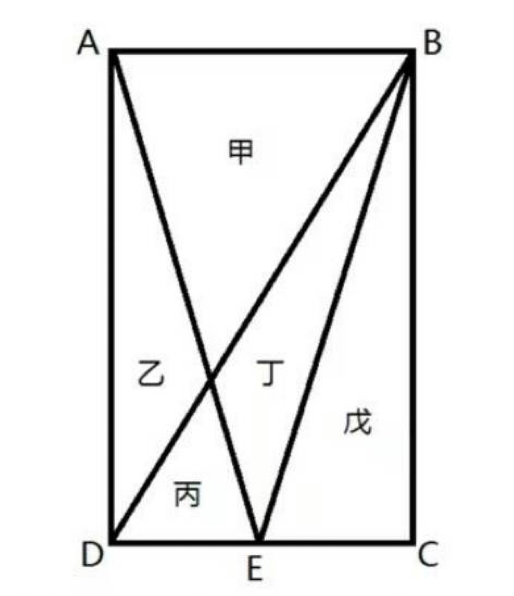

- A. 3/4
- B. 2/3
- C. 7/12
- D. 1/2

### Back

## 答案

**C．\(\dfrac{7}{12}\)**。这是独立求解的结果。

## 判型与所用套路

这是**平面几何面积比例题**。图中的平行线与交叉线构成了**蝴蝶模型**：先用相似三角形求交点分割线段的比例，再利用同高三角形的面积关系求白花面积。

## 关键条件

设 \(AE\) 与 \(BD\) 交于点 \(O\)。

- \(E\) 是 \(CD\) 的中点，所以 \(DE=\dfrac12CD\)。
- 矩形中 \(AB=CD\)、\(AB\parallel DE\)，因此 \(AB:DE=2:1\)。
- 白花区域是甲、戊，即 \(\triangle AOB\) 和 \(\triangle EBC\)。

## 按套路分步求解

### 1. 用蝴蝶模型求交点处的线段比

由于 \(AB\parallel DE\)，结合交点处的对顶角，可得

\[
\triangle AOB\sim\triangle EOD。
\]

因此对应边成比例：

\[
BO:OD=AB:DE=2:1。
\]

于是 \(BD\) 共分为 \(3\) 份，其中 \(BO\) 占 \(2\) 份：

\[
\frac{BO}{BD}=\frac23。
\]

### 2. 求甲区域面积

\(\triangle AOB\) 和 \(\triangle ABD\) 以 \(BO\)、\(BD\) 为底，具有相同的高，所以面积比等于底边比：

\[
S_{\text{甲}}=\frac23S_{\triangle ABD}。
\]

矩形的对角线将矩形分成面积相等的两部分，因此

\[
S_{\text{甲}}
=\frac23\times\frac12S_{\text{矩形}}
=\frac13S_{\text{矩形}}。
\]

### 3. 求戊区域面积

戊是 \(\triangle EBC\)，其底 \(EC\) 是矩形底边 \(DC\) 的一半，高等于矩形的高。因此

\[
S_{\text{戊}}=\frac14S_{\text{矩形}}。
\]

### 4. 合并白花面积

\[
\frac{S_{\text{白花}}}{S_{\text{矩形}}}
=\frac13+\frac14
=\boxed{\frac7{12}}。
\]

## 快速验算与排除干扰项

把矩形面积看作 \(12\) 份，甲占 \(4\) 份，戊占 \(3\) 份，白花共占 \(7\) 份，因此选 **C**。

## 与原卷参考对照

原卷的 **Answer 和 Explanation 均为空**，上述结果未经原卷答案核对。

## 复盘提醒

蝴蝶模型的入口是**两条平行线＋交叉线**。本题中，\(\triangle AOB\) 与 \(\triangle EOD\) 相似，有：

\[
\frac{AO}{OE}
=\frac{BO}{OD}
=\frac{AB}{DE}。
\]

若要求这两个相似三角形的面积比，才把边长比平方；本题先求线段比，再用同高三角形求甲的面积，更直接。

另外，题目给出的 \(AD=2AB\) 不影响这道题的面积占比，无需代入计算。

---

## Card
<!-- hyz-card-id: 01a1e788-d73b-7c93-8450-ee5032770117 -->
<!-- hyz-source-question-id: 01a1af25-d036-7523-9552-d2ea59348f10 -->
<!-- hyz-correct-answer: [] -->
### Front

如图所示，在长方形 ABCD 中，E、F 为 AB 的三等分点，G 为 CD 的中点，连接 EC、FG 相交于 O 点。已知四边形 FOCB 的面积为 16 平方米，则五边形 ADGOE 的面积为多少平方米？

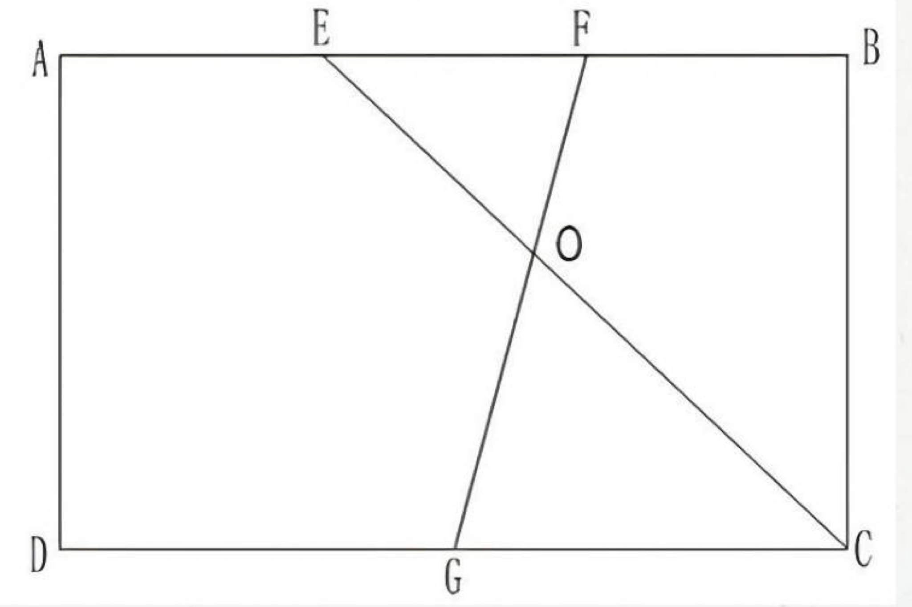

- A. 20
- B. 29
- C. 31
- D. 60

### Back

这样做可以，而且比上一种分成 60 份的方法更直接：**用大三角形 \(\triangle EBC\)，减去小三角形 \(\triangle EFO\)，就得到已知的四边形 \(FOCB\)。**

如果你设矩形的长、宽分别为 \(x、y\)，那么矩形面积就是 \(xy\)。你图中写的这两项是对的：

\[
S_{\triangle EBC}=\frac13xy
\]

\[
S_{\triangle EFO}
=\frac12\times\frac{x}{3}\times\frac{2y}{5}
=\frac1{15}xy
\]

其中 \(\frac{2y}{5}\) 是点 \(O\) 到上边 \(AB\) 的距离：蝴蝶模型得 \(FO:OG=2:3\)，因此它占矩形高的 \(\frac25\)。

把你这一步接下去：

\[
\underbrace{S_{\triangle EBC}}_{\frac13xy}
-\underbrace{S_{\triangle EFO}}_{\frac1{15}xy}
=\underbrace{S_{FOCB}}_{16}
\]

\[
\frac13xy-\frac1{15}xy=16
\quad\Longrightarrow\quad
\frac4{15}xy=16
\quad\Longrightarrow\quad
xy=60
\]

也就是矩形面积为 **60 平方米**。

接着求左边五边形：从矩形中减去 \(\triangle EBC\) 和 \(\triangle OGC\)。

\[
S_{\triangle EBC}=\frac13xy=20
\]

而 \(\triangle OGC\) 的底 \(GC=\frac{x}{2}\)，高是 \(\frac{3y}{5}\)，所以：

\[
S_{\triangle OGC}
=\frac12\times\frac{x}{2}\times\frac{3y}{5}
=\frac3{20}xy=9
\]

因此：

\[
S_{ADGOE}=60-20-9=\boxed{31\text{ 平方米}}
\]

**你这次的思路和图中可辨认的两个面积式都没有错**，关键是继续用“大三角形减小三角形”列出已知的 16，再求矩形面积。图中个别手写标记的含义我无法完全确认，本地 OCR 也没有返回结果，所以不把那些不确定的标记当作错误来判断。

---

## Card
<!-- hyz-card-id: 01a1e854-3d31-7d41-b5f0-1c97d0300a4c -->
<!-- hyz-source-question-id: 01a1af25-d036-7523-9552-d2f08134a92e -->
<!-- hyz-correct-answer: [] -->
### Front

如图三角形中，A、B 分别为两条边的中点，则图中阴影部分面积为三角形总面积的（ ）

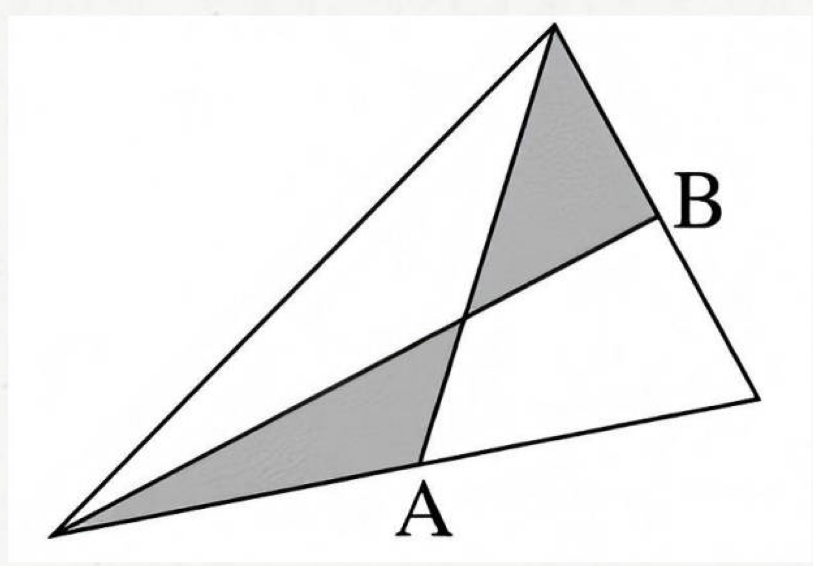

- A. 1/3
- B. 1/4
- C. 2/7
- D. 3/8

### Back

## 答案

**A．\(\dfrac13\)**。这是独立求解的结果。

## 判型与所用套路

这是**平面几何中的面积比例题**。图中两条中线交叉，形成蝴蝶形；适合用**面积割补＋同高三角形面积比**，不必求具体边长。

## 关键条件

给原图中未标字母的三个顶点分别标为 \(P、Q、R\)，两条线交于 \(O\)，再补一条辅助线 \(RO\)：

```svg
<svg xmlns="http://www.w3.org/2000/svg" viewBox="0 0 620 370">
<title>三角形中线与阴影面积</title>
<desc>A是PR中点，B是QR中点，QA与PB交于O。连接RO后，阴影三角形POA和QOB各占一份。</desc>
<polygon points="60,300 300,300 320,220" fill="#a9c9e8"/>
<polygon points="360,60 450,180 320,220" fill="#a9c9e8"/>
<polygon points="60,300 360,60 540,300" fill="none" stroke="#222222" stroke-width="3"/>
<line x1="360" y1="60" x2="300" y2="300" stroke="#222222" stroke-width="2"/>
<line x1="60" y1="300" x2="450" y2="180" stroke="#222222" stroke-width="2"/>
<line x1="540" y1="300" x2="320" y2="220" stroke="#b34b35" stroke-width="2"/>
<text x="40" y="325" fill="#222222" font-family="sans-serif">P</text>
<text x="355" y="45" fill="#222222" font-family="sans-serif">Q</text>
<text x="545" y="325" fill="#222222" font-family="sans-serif">R</text>
<text x="294" y="325" fill="#222222" font-family="sans-serif">A</text>
<text x="457" y="180" fill="#222222" font-family="sans-serif">B</text>
<text x="305" y="210" fill="#222222" font-family="sans-serif">O</text>
<text x="235" y="205" fill="#222222" font-family="sans-serif">2份</text>
<text x="225" y="275" fill="#222222" font-family="sans-serif">1份</text>
<text x="365" y="155" fill="#222222" font-family="sans-serif">1份</text>
<text x="350" y="275" fill="#222222" font-family="sans-serif">1份</text>
<text x="430" y="235" fill="#222222" font-family="sans-serif">1份</text>
<text x="310" y="350" text-anchor="middle" fill="#a13a28" font-family="sans-serif">红线 RO 为辅助线</text>
</svg>
```

其中 \(A\) 是 \(PR\) 的中点，\(B\) 是 \(QR\) 的中点；阴影是 \(\triangle POA\) 和 \(\triangle QOB\)。

## 按套路分步求解

**第一步：用中点找等面积。**

因为 \(PA=AR\)，\(\triangle POA\) 与 \(\triangle ROA\) **等底、同高**，所以面积相等。

同理，因为 \(QB=BR\)，\(\triangle QOB\) 与 \(\triangle ROB\) 也等面积。

**第二步：证明两块阴影等面积。**

\(QA\) 和 \(PB\) 都是大三角形的中线，各自把大三角形分成面积相等的两半，因此：

\[
S_{\triangle PQA}=S_{\triangle PQB}
\]

这两个三角形都有公共部分 \(\triangle PQO\)，分别减去公共部分，就得到：

\[
S_{\triangle POA}=S_{\triangle QOB}
\]

因此，图中除 \(\triangle PQO\) 以外的四个小三角形，面积都相等。设每个都是 **1 份**。

**第三步：求总份数。**

\(QA\) 把大三角形面积平分：

- 左半边 \(\triangle PQA\)：\(\triangle PQO+1\) 份；
- 右半边 \(\triangle QAR\)：\(1+1+1=3\) 份。

所以 \(\triangle PQO\) 是 \(3-1=2\) 份。大三角形共 \(3+3=6\) 份，两块阴影共 \(1+1=2\) 份。

\[
\boxed{\frac{S_{\text{阴影}}}{S_{\triangle PQR}}
=\frac26=\frac13}
\]

## 快速验算与排除干扰项

图中两块阴影各占总面积的 \(\frac16\)，合起来为 \(\frac13\)，对应 **A**；B、C、D 均不符。

## 与原卷参考对照

原卷的 **Answer 和 Explanation 均为空**，以上结果未经原卷答案核对。

## 复盘提醒

遇到“**三角形两边中点＋连线相交**”，先找中线平分面积；需要比较交点附近的区域时，可以连接**第三个顶点与交点**，再用等底同高把面积分成份数。注意题目要求的是**两块阴影之和**。

---
