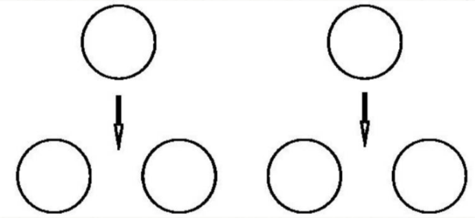

---
tags:
  - 数量关系
  - 计数概率与最值
  - 错题
---

## Card
<!-- hyz-card-id: 01a1cf41-8df0-7c51-9a7f-44b8102e40f5 -->
<!-- hyz-source-question-id: 01a1af25-d006-7da3-8ff9-0db74a1f3d4b -->
<!-- hyz-correct-answer: [] -->
### Front

一个班级组织跑步比赛，共设 100 米、200 米、400 米三个项目。班级有 50 人，报名参加 100 米比赛的有 38 人，参加 200 米比赛的有 14 人，参加 400 米比赛的有 20 人。如果每人最多只能报名参加 2 项比赛，那么该班最多有多少人未报名参赛？（ ）

- A. 11
- B. 12
- C. 13
- D. 14

### Back

**答案：12 人，选 B。**

这道题和 flashcard 那题都用“**人次与人数分开，尽量重叠**”的套路：想让未报名人数最多，就要让报名人数最少，让同一个人尽量多报项目。

### 按套路求解

**第一步，算总报名人次。**

\[
38+14+20=72\text{ 人次}
\]

每人最多报 2 项，因此报名人数至少为：

\[
72÷2=36\text{ 人}
\]

注意：**36 人只是根据总人次得到的下限，还要检查能否实现。**

**第二步，检查各项目人数。**

100 米这一项就有 38 个不同的人报名，因此报名人数至少是 **38 人**，不可能只有 36 人。

**第三步，验证 38 人能否实现。**

从报 100 米的 38 人中：

- 让 14 人兼报 200 米；
- 另外 20 人兼报 400 米；
- 剩下 4 人只报 100 米。

这样各项目人数都满足，且每人最多报 2 项。所以最少报名人数确实是 38 人，最多未报名人数为：

\[
50-38=\boxed{12\text{ 人}}
\]

### 和 flashcard 那题对比

| 检查步骤 | flashcard 那题 | 本题 |
|---|---:|---:|
| 总报名人次 | \(27+25+21=73\) | \(38+14+20=72\) |
| 按每人最多 2 项算人数下限 | \(73÷2\) 向上取整，得 37 人 | \(72÷2=36\) 人 |
| 检查单项人数 | 最大单项人数 27，小于 37 | 100 米有 38 人，大于 36 |
| 验证能否实现 | 37 人可以实现 | 至少要 38 人，且可以实现 |
| 最多未报名 | \(50-37=13\) 人 | \(50-38=12\) 人 |

**复盘口诀：先用总人次除以每人最多报的项数，向上取整；再看最大单项人数；最后构造验证。** 本题容易误选 14，就是算出 36 人后，没有检查 100 米已有 38 人报名。

原卷答案和解析均为空；以上为独立求解。

---

## Card
<!-- hyz-card-id: 01a1cf45-0d6c-7123-8210-d2afea3d8bac -->
<!-- hyz-source-question-id: 01a1af25-d006-7da3-8ff9-0dc4b3d4f1b2 -->
<!-- hyz-correct-answer: [] -->
### Front

阅览室有 100 本杂志。小赵借阅过其中 75 本，小王借阅过 70 本，小刘借阅过 60 本，则三人共同借阅过的杂志最少有（ ）本。

- A. 5
- B. 10
- C. 15
- D. 30

### Back

## 答案

是的，最少 **5 本，选 A**。你的“三层尽可能铺满”思路可以用：先让每本杂志都尽可能承担两人借阅，剩下的借阅次数才放到第三层。

## 判型与所用套路

这是**三集合交集最小值**问题。用容斥极值摆放：想让三人共同借阅的杂志尽可能少，就先让借阅次数分散到不同杂志上，尽量不出现三人都借过的情况。

## 关键条件

- 杂志共 **100 本**。
- 三人的借阅量合计为 **75＋70＋60＝205 本次**。
- 同一本杂志最多被三人各借过一次；“本次”是借阅次数，同一本可以算多次。

## 按套路分步求解

把 100 本杂志看成横向排列的 100 个位置。每一列代表同一本杂志，每层的一格代表一个人借过它。

先铺满前两层，每本都由两人借过，可以容纳：

\[
100\times2=200\text{ 本次}
\]

还剩：

\[
205-200=5\text{ 本次}
\]

这 5 本次必须放到第三层，因此至少有 **5 本**被三人共同借过。

下面是一种能实际达到的摆法。横轴按杂志编号分组，每组上下对齐的是同一批杂志：

```svg
<svg xmlns="http://www.w3.org/2000/svg" viewBox="0 0 720 250">
  <rect x="150" y="45" width="35" height="150" fill="#fce8cf" stroke="#555555"/>
  <rect x="185" y="45" width="175" height="150" fill="#ffffff" stroke="#555555"/>
  <rect x="360" y="45" width="210" height="150" fill="#ffffff" stroke="#555555"/>
  <rect x="570" y="45" width="105" height="150" fill="#ffffff" stroke="#555555"/>
  <line x1="150" y1="95" x2="675" y2="95" stroke="#555555"/>
  <line x1="150" y1="145" x2="675" y2="145" stroke="#555555"/>
  <text x="12" y="74" font-family="sans-serif" fill="#222222">第一层</text>
  <text x="12" y="124" font-family="sans-serif" fill="#222222">第二层</text>
  <text x="12" y="174" font-family="sans-serif" fill="#222222">第三层</text>
  <text x="167" y="29" text-anchor="middle" font-family="sans-serif" fill="#222222">5本</text>
  <text x="272" y="29" text-anchor="middle" font-family="sans-serif" fill="#222222">25本</text>
  <text x="465" y="29" text-anchor="middle" font-family="sans-serif" fill="#222222">30本</text>
  <text x="622" y="29" text-anchor="middle" font-family="sans-serif" fill="#222222">40本</text>
  <text x="167" y="74" text-anchor="middle" font-family="sans-serif" fill="#222222">赵</text>
  <text x="272" y="74" text-anchor="middle" font-family="sans-serif" fill="#222222">王</text>
  <text x="465" y="74" text-anchor="middle" font-family="sans-serif" fill="#222222">赵</text>
  <text x="622" y="74" text-anchor="middle" font-family="sans-serif" fill="#222222">赵</text>
  <text x="167" y="124" text-anchor="middle" font-family="sans-serif" fill="#222222">王</text>
  <text x="272" y="124" text-anchor="middle" font-family="sans-serif" fill="#222222">刘</text>
  <text x="465" y="124" text-anchor="middle" font-family="sans-serif" fill="#222222">刘</text>
  <text x="622" y="124" text-anchor="middle" font-family="sans-serif" fill="#222222">王</text>
  <text x="167" y="174" text-anchor="middle" font-family="sans-serif" fill="#222222">刘</text>
  <text x="272" y="174" text-anchor="middle" font-family="sans-serif" fill="#555555">空</text>
  <text x="465" y="174" text-anchor="middle" font-family="sans-serif" fill="#555555">空</text>
  <text x="622" y="174" text-anchor="middle" font-family="sans-serif" fill="#555555">空</text>
  <text x="150" y="225" font-family="sans-serif" fill="#222222">橙色部分：三人共同借阅的 5 本</text>
</svg>
```

## 快速验算与排除干扰项

图中小赵借了 \(5+30+40=75\) 本，小王借了 \(5+25+40=70\) 本，小刘借了 \(5+25+30=60\) 本，全部符合题意，所以 **5 本确实能达到**。

B、C、D 都可能比 5 大，但题目求的是**最少**，既然 5 已能达到，就选 A。

## 与原卷参考对照

原卷的 Answer 和 Explanation 均为空；本答案是独立求解，未经原卷答案核对。

## 复盘提醒

“三层”表示每本杂志被借阅的**次数层**，不是把三个人各固定在一层。先铺满两层得到 200 本次，再看超出的 5 本次；最后要检查能否按三人的各自借阅量摆出来，才能确认最小值可达到。

---

## Card
<!-- hyz-card-id: 01a1d039-db46-7e22-8b1b-4a013c84fadb -->
<!-- hyz-source-question-id: 01a1af25-d006-7da3-8ff9-0dde634d2a42 -->
<!-- hyz-correct-answer: [] -->
### Front

营养专家提出，鉴别奶粉优劣，主要看 OPO 结构脂、乳铁蛋白、叶黄素、牛磺酸、酪蛋白磷酸肽等几项指标，符合三项及以上指标要求的奶粉品牌可以认定为合格。某次对一批奶粉品牌进行抽检发现符合上述各项指标要求的品牌数量分别占抽检总量的 82%、78%、73%、90%、57%，那么此次抽检的奶粉品牌的合格率至少是（ ）。

- A. 70%
- B. 66%
- C. 62%
- D. 58%

### Back

## 答案

**严格按题意，合格率最低为 61.5%，四个选项均不正确。**

如果额外假设抽检了 **100 个品牌**，最低合格率才是 **62%，选 C**。但题干没有给出抽检总数，不能直接作此假设。

## 判型与所用套路

这是**多集合容斥最值题**。采用“人数与人次分开、构造极端分布”的套路：

- 把每个品牌符合的一项指标记为 1 次，先算总次数；
- 为使合格品牌尽可能少，让不合格品牌尽量符合两项、合格品牌尽量符合五项；
- 再检查每项指标的具体比例，确认极端分布是否真正可行。

## 关键条件

五项指标的符合率之和为：

\[
82\%+78\%+73\%+90\%+57\%=380\%
\]

即平均每 100 个品牌共产生 **380 次指标符合记录**。

- 符合至少三项才合格；
- 不合格品牌最多符合两项；
- 第五项指标仅有 57% 的品牌符合。

## 按套路分步求解

**第一步：先算一个宽松下界。**

设合格率为 \(x\)。如果每个合格品牌都符合五项，每个不合格品牌都符合两项，则：

\[
380\%\leq 5x+2(100\%-x)
\]

解得：

\[
x\geq 60\%
\]

但这个下界取等时，60% 的品牌都必须符合五项，其中也必须符合第五项；而第五项符合率只有 57%，所以 **60% 无法达到**。

**第二步：利用第五项修正。**

在合格品牌中，至少有 \(x-57\%\) 的品牌不符合第五项。它们最多只能符合四项，比刚才按五项计算的上限各少一次。因此：

\[
380\%\leq 5x+2(100\%-x)-(x-57\%)
\]

整理得：

\[
380\%\leq 257\%+2x
\quad\Rightarrow\quad
x\geq 61.5\%
\]

**第三步：验证 61.5% 可以达到。**

例如抽检 **200 个品牌**，按下表安排；第一至第五项依次对应题干中的五项指标：

| 品牌数 | 符合的指标 |
|---:|---|
| 114 | 第一至第五项全部符合 |
| 9 | 第一至第四项 |
| 22 | 第一、第四项 |
| 20 | 第二、第四项 |
| 15 | 第三、第四项 |
| 12 | 第一、第二项 |
| 7 | 第一、第三项 |
| 1 | 第二、第三项 |

其中合格品牌为 \(114+9=123\) 个，合格率为：

\[
\frac{123}{200}=61.5\%
\]

因此，**61.5% 既是下界，又可以达到**。

## 快速验算与排除干扰项

上表五项指标的符合数量依次为 **164、156、146、180、114**，除以 200 后恰好是题给的 **82%、78%、73%、90%、57%**。

- **D（58%）**低于已证明的下界，不可能。
- **A（70%）、B（66%）、C（62%）**都高于可以实际达到的 61.5%，因此都不是严格意义上的最低合格率。
- 题给百分比确实要求抽检总数是 100 的倍数，但可以是 100、200 等，不能据此认定总数就是 100。

## 与原卷参考对照

原卷的 **Answer 和 Explanation 均为空**。以上是独立求解结果，未经原卷答案核对。

## 复盘提醒

先用“合格者最多五项、不合格者最多两项”快速求下界，再检查**单项比例是否限制了极端分布**。本题最容易漏掉的是第五项只有 57%：它使得初步算出的 60% 无法取到。最值题最后还要验证能否构造出来，并留意不能把“总数为 100 的倍数”误当成“总数为 100”。

---

## Card
<!-- hyz-card-id: 01a1d080-dedf-76f0-a223-432213bb5887 -->
<!-- hyz-source-question-id: 01a1af25-d00b-79c1-8062-26e8b475acf1 -->
<!-- hyz-correct-answer: [] -->
### Front

5个人平均年龄为 29，且没有小于 24 岁的，那么年龄最大的人至多为多少岁？

- A. 46
- B. 48
- C. 50
- D. 49

### Back

## 答案

**49 岁，选 D。** 33 岁可以是年龄最大者的年龄，但不是他能达到的最大值。

## 判型与所用套路

这是**构造类最值题**：总年龄固定，要让一个人的年龄尽可能大，就让其他人的年龄尽可能小。

## 关键条件

- 5 人平均年龄为 29 岁，所以总年龄固定。
- 没有人小于 24 岁，即每个人都**可以是 24 岁**。
- 题目没有要求年龄互不相同。

## 按套路分步求解

1. 5 人的总年龄为：

   \[
   29\times5=145\text{ 岁}
   \]

2. 让年龄最大的人尽可能大，其余 4 人都取下限 24 岁：

   \[
   145-24\times4=\boxed{49\text{ 岁}}
   \]

3. 构造的年龄为 **24、24、24、24、49**，满足全部条件，所以 49 岁可以达到。

## 快速验算与排除干扰项

如果最大年龄是 **33 岁**，例如 **28、28、28、28、33**，平均年龄确实是 29 岁。但这个方案里其他人还可以更小，从而让最大者更大，所以 **33 不是“至多”**。

A、B、C 中的 46、48、50 岁：46 和 48 虽可构造，但都小于 49；50 则会使其余 4 人总年龄为 95 岁，低于最低的 \(24\times4=96\) 岁，不可能。

## 与原卷参考对照

原卷的 Answer 和 Explanation 均为空；**49 岁是独立求解结果，未经原卷答案核对**。

## 复盘提醒

求一个人的最大值时，先固定总量，再把**其他人压到下限**。不要默认大家的年龄必须接近平均数；题目也没有要求年龄各不相同。

---

## Card
<!-- hyz-card-id: 01a1d094-dd72-7f52-ab60-d1435f0ac16c -->
<!-- hyz-source-question-id: 01a1af25-d00b-79c1-8062-272eb60cb845 -->
<!-- hyz-correct-answer: [] -->
### Front

某机关20人参加百分制的普法考试，及格线为60分，20人的平均成绩为88分，及格率为95%。所有人得分均为整数，且彼此得分不同。问成绩排名第十的人最低考了多少分？

- A. 88
- B. 89
- C. 90
- D. 91

### Back

## 答案

**B．89 分。**这是独立求解的结果，原卷未提供答案。

## 判型与所用套路

这是**构造类最值题**：总分固定，求第十名的最低分。

按“目标尽量小，其他人尽量大”的套路，先构造其余人的最高可能成绩，求出第十名的下界，再检查这个下界能否实际取到。

## 关键条件

- 总分为 \(20\times88=1760\) 分。
- 及格率为 95%，因此 **19 人及格、1 人不及格**。
- 成绩均为整数且互不相同；百分制下最高为 100 分，不及格者最高为 59 分。

## 按套路分步求解

设第十名为 \(x\) 分。为了让 \(x\) 尽可能小，将其他人的成绩尽量取大：

1. 前 9 名最高可依次为 \(100、99、\ldots、92\)，总分为 \(864\)。
2. 第 11 至第 19 名比第十名低，且成绩互不相同，最高依次为 \(x-1、x-2、\ldots、x-9\)，总分为 \(9x-45\)。
3. 第 20 名不及格，最高为 59 分。

因此，总分最多为

\[
864+x+(9x-45)+59=10x+878。
\]

实际总分为 1760，所以

\[
10x+878\ge1760，\qquad x\ge88.2。
\]

成绩为整数，故第十名**至少 89 分**。

再验证能否取到：前 9 名取 **92～100 分**，第十名取 **89 分**，第 11 至第 19 名取 **80～88 分**，最后一名取 **51 分**。总分为

\[
864+89+756+51=1760。
\]

所有分数互不相同，恰有 19 人及格，条件全部满足。因此最低确实是 **89 分**。

## 快速验算与排除干扰项

如果第十名是 88 分，即使其他人都按上述方式尽量取高，总分也最多为

\[
10\times88+878=1758<1760。
\]

所以 A 不可能；89 分可以取到，C、D 虽更高，却不是最低值。

## 与原卷参考对照

原卷的 **Answer 和 Explanation 均为空**，因此上述结论未经原卷答案核对。

## 复盘提醒

求排名最值时，不能把其他人成绩都设成 100 分：成绩**互不相同**，要构造连续递减的整数。算出下界后，还要实际构造一组成绩，确认它满足总分和及格人数条件。

---

## Card
<!-- hyz-card-id: 01a1d295-99b7-7ab2-be48-565d5c226451 -->
<!-- hyz-source-question-id: 01a1af25-d00b-79c1-8062-273f457bb32e -->
<!-- hyz-correct-answer: [] -->
### Front

将 400 个玩具分给若干个小朋友，每人都能分到，但都不超过 11 个，则得到相同玩具的个数的小朋友人数最大值至少为（ ）。

- A. 6
- B. 7
- C. 8
- D. 9

### Back

## 答案

**B．7。** 这是独立求解的结果，原卷没有给出答案。

## 判型与所用套路

这是**最值问题**，结合抽屉原理和极端构造求解：先限制每组人数，计算能分出的玩具总数上限，确定人数最大值的下界；再构造分配方案，验证这个下界能否达到。

## 关键条件

每人至少分到 1 个，至多分到 11 个，因此可按每人得到的玩具数分为 **1～11 共 11 组**。题目问的是：这 11 组中人数最多的一组，其人数最少能是多少。

## 按套路分步求解

1. **先判断最多的一组能否只有 6 人。**

   如果每组都不超过 6 人，玩具总数最多为

   \[
   6\times(1+2+\cdots+11)
   =6\times66=396。
   \]

   396 小于 400，无法分完全部玩具，所以至少有一组人数达到 **7 人**。

2. **再验证 7 人能否实现。**

   先让得到 1～11 个玩具的每组各有 6 人，共分出 396 个；再增加一名得到 4 个玩具的小朋友，恰好分出 400 个。

   此时得到 4 个玩具的有 7 人，其余各组均有 6 人，人数最多的一组恰为 **7 人**。

因此，人数最大值至少为 **7**，选 **B**。

## 快速验算与排除干扰项

6 人的上限只能分出 396 个，故 A 不足；上面的方案已经达到 7 人，故 8、9 虽然也是可能出现的人数，但不是所求的最小保证值，排除 C、D。

## 与原卷参考对照

原卷的 **Answer 和 Explanation 均为空**，因此本题结论为独立求解，未经原卷答案核对。

## 复盘提醒

这里的“抽屉”是**每人得到的玩具数**，而不是玩具本身。各组对玩具总数的贡献不同，得到 \(k\) 个玩具的一组有 \(n\) 人时，贡献的是 \(kn\) 个。算出下界后，还要构造恰好分完 400 个的方案，确认下界可以达到。

---

## Card
<!-- hyz-card-id: 01a1d29a-667e-7df3-9877-ea0d09f42458 -->
<!-- hyz-source-question-id: 01a1af25-d00b-79c1-8062-274c2f4c3789 -->
<!-- hyz-correct-answer: [] -->
### Front

将 75 人分为 3 队，其中人数最多的队的人数是人数最少的队的 2.5 倍。问人数第 2 多的队最少有多少人？

- A. 19
- B. 21
- C. 25
- D. 33

### Back

## 答案

**A．19 人。**

你的问题出在设第 2 多的队为 **\(x+1\)**：题目只说它的人数介于最少和最多的队之间，并没有说它一定比最少的队多 1 人。这个设法限制得太死，可能把符合条件的最优方案排除掉。

## 判型与所用套路

这是**构造类最值题**。用“让目标尽量小，把其他量推到允许的边界，再检查整数和大小关系”的套路。

## 关键条件

- 三队总人数为 75 人，人数均为整数。
- 最多队是最少队的 \(2.5\) 倍，所以最少队和最多队的人数之比为 **2∶5**。
- 第 2 多的队人数不能少于最少队，也不能超过最多队；题目没有要求相邻两队人数相差 1 人。

## 按套路分步求解

1. 根据 \(2∶5\)，设最少队为 \(2k\) 人，最多队为 \(5k\) 人，其中 \(k\) 是正整数。

2. 第 2 多的队为：

   \[
   75-2k-5k=75-7k
   \]

   要使它尽量少，就让 \(k\) 尽量大。

3. 第 2 多的队不能少于最少队：

   \[
   75-7k\ge 2k
   \quad\Rightarrow\quad
   k\le\frac{75}{9}
   \]

   因此正整数 \(k\) 最大取 **8**。

4. 此时三队人数分别为：

   \[
   16、19、40
   \]

   所以第 2 多的队最少为 **19 人**。

## 快速验算与排除干扰项

\(16+19+40=75\)，且 \(40=16\times2.5\)，排序也成立，19 人可以达到。

比 19 更小的选项只有 19 之前的情况；上面的边界已证明，第 2 多的队不可能少于 19 人。其余选项虽更大，但题目求的是最少人数。

你图中的 \(4.5x+1=75\) 是沿着“中间队为 \(x+1\)”列出的；即使计算无误，得到非整数也只能说明**这个特定假设不可行**，不能说明原题无解。

## 与原卷参考对照

原卷的 Answer 和 Explanation 均为空。以上是**独立求解，未经原始答案核对**。

## 复盘提醒

构造最值时，先区分：

- “人数不同”不等于“人数相差 1”；
- “取边界”要由总量、大小关系和整数条件共同决定。

这题先用比例把两端设成 \(2k、5k\)，再让 \(k\) 取允许的最大整数，既保留你的设元思路，也避免对中间队多加条件。

---

## Card
<!-- hyz-card-id: 01a1d2a2-8c36-7cd2-8cb4-c98d0cff52e8 -->
<!-- hyz-source-question-id: 01a1af25-d00b-79c1-8062-275294468e61 -->
<!-- hyz-correct-answer: [] -->
### Front

总公司选派110多名员工到5家分公司进行基层锻炼，每个分公司分到的人数均不同。已知选派人数第二多的分公司选派人数比第四多的多10人，选派人数最多的分公司选派人数占总选派人数的1/3，但未超过最少人数的3倍。那么选派人数最少的分公司选派人数至多可能是多少人？（ ）

- A. 13
- B. 14
- C. 15
- D. 16

### Back

## 答案

**D．16 人。**这是独立求解的结果。

## 判型与所用套路

这是**构造数列最值题**。采用“目标尽量大，其余人数取允许的边界”的套路：先确定最少人数的上界，再构造一组人数，检查上界能否达到。

## 关键条件

将五家分公司的人数从少到多排列：

\[
a<b<c<d<e
\]

它们均为正整数，且：

- 第二多比第四多 10 人，即 \(d=b+10\)；
- 最多人数 \(e\) 占总人数的 \(\frac13\)，所以**其余四家人数之和为 \(2e\)**；
- 总人数为 110 多人，且能被 3 整除，因此 \(e\leq39\)。

## 按套路分步求解

**第一步：确定最少人数的上界。**

假设最少人数 \(a\geq17\)，由于人数互不相同：

\[
b\geq18,\qquad c\geq19,\qquad d=b+10\geq28
\]

那么其余四家人数之和至少为：

\[
17+18+19+28=82
\]

但其余四家之和等于 \(2e\)，而 \(e\leq39\)，所以：

\[
2e\leq78
\]

这与至少为 82 矛盾。因此，最少人数**不可能达到 17 人及以上**，即 \(a\leq16\)。

**第二步：构造 16 人能否成立。**

从少到多取：

\[
\boxed{16,\ 17,\ 18,\ 27,\ 39}
\]

四家较少人数之和为 \(16+17+18+27=78=2\times39\)，满足总人数与最多人数的比例。因此，最少人数可以达到 **16 人**。

## 快速验算与排除干扰项

这组人数的总和是 \(117\) 人，最多的 39 人占总数的 \(\frac13\)；第二多的 27 人比第四多的 17 人多 10 人；且 \(39\leq3\times16=48\)，所有人数也互不相同。

13、14、15 均小于已经构造出的 16，不可能是“至多可能”的答案，排除 A、B、C。

## 与原卷参考对照

原卷的 **Answer 和 Explanation 均为空**。以上是独立求解，未经原卷答案核对。

## 复盘提醒

求最大值要完成两步：先证明**再大不可能**，再构造方案证明**这个值确实能达到**。本题还要注意，“人数互不相同”要求严格递增，而“第二多比第四多 10 人”对应的是 \(d-b=10\)。

---

## Card
<!-- hyz-card-id: 01a1d2b9-5128-7e10-a94e-67a6dc6dfa38 -->
<!-- hyz-source-question-id: 01a1af25-d00b-79c1-8062-27600a372e51 -->
<!-- hyz-correct-answer: [] -->
### Front

某新能源汽车企业计划在A、B、C、D四个城市建设72个充电站，其中在B市建设的充电站数量占总数的1/3，在C市建设的充电站数量比A市多6个，在D市建设的充电站数量少于其他任一城市。问至少要在C市建设多少个充电站？

- A. 20
- B. 18
- C. 22
- D. 21

### Back

## 答案

不是 22 个，最少是 **21 个，选 D**。

## 判型与所用套路

这是**构造最值**题：总数固定，求 C 的最小值。按照“边界构造”套路，先利用数量关系缩小范围，再构造一组满足所有条件的整数，确认最小值能够取到。

## 关键条件

- B 市：\(72÷3=24\) 个。
- C 市比 A 市多 6 个。
- D 市严格少于其他任一城市，尤其是 **D＜A**。

## 按套路分步求解

设 A 市建 \(a\) 个，D 市建 \(d\) 个，则 C 市建 \(a+6\) 个。扣除 B 市的 24 个：

\[
a+(a+6)+d=48
\]

即你图中列出的关系：

\[
d+2a+6=48
\]

因为 \(d<a\)，所以 \(48=2a+6+d<3a+6\)，得到：

\[
a>14
\]

充电站数量为整数，因此 \(a\) 最小为 15，C 市最少为：

\[
15+6=\boxed{21}
\]

## 快速验算与排除干扰项

取 A、B、C、D 分别为 **15、24、21、12**，总数为 72，且 D 少于另外三个城市，成立。

- 20 个：A 为 14，D 也为 14，不满足 D **少于** A。
- 18 个：A 为 12，D 为 18，也不满足 D＜A。
- 22 个：A 为 16，D 为 10，虽然可行，但 **21 个也可行**，所以不是最小值。

你图中后两行有涂改，具体数字无法确定；不过中间列出的方程思路是对的，接下来要结合 \(d<a\) 判断边界。

## 与原卷参考对照

原卷的 Answer 和 Explanation 均为空。以上是独立求解，未经原卷答案核对。

## 复盘提醒

求最小值时，找到一个可行值还不够：要同时证明**更小的不行**。本题最容易漏掉的是“少于”不能取等号。

---

## Card
<!-- hyz-card-id: 01a1d2cb-ced4-72a1-836a-559a8c210d2a -->
<!-- hyz-source-question-id: 01a1af25-cfdf-7c61-b504-ef6c3001b36e -->
<!-- hyz-correct-answer: [] -->
### Front

A、B 两地分别有 10 台和 6 台型号相同的机器，准备配送到 E、F 两地，其中 E 地 11 台，F 地 5 台。若每台机器从 A 到 E 和 F 的物流费用分别为 350 元和 550 元，从 B 到 E 和 F 的物流费用分别为 600 元和 900 元，则配送这 16 台机器的总物流费用最少为（ ）。

- A. 7850
- B. 8100
- C. 8400
- D. 8700

### Back

## 答案

**C. 8400 元。**这是独立求解的结果，未经原卷答案核对。

## 判型与所用套路

这是**统筹规划中的费用最小值问题**。采用“比较单位费用差，再做差额替换”的思路：先找出哪个来源运往 F 地的额外费用更低，再检查数量限制。

## 关键条件

- A 地有 10 台，B 地有 6 台；E 地需要 11 台，F 地需要 5 台。
- 从 E 改运到 F，每台费用增加：
  - A 地：\(550-350=200\) 元；
  - B 地：\(900-600=300\) 元。
- 因此，把 F 地的需求优先分配给 A 地，每台可以少增加 \(100\) 元。

## 按套路分步求解

先假设 16 台都运到 E 地，作为计算基准：

\[
10\times350+6\times600=7100\text{ 元}
\]

实际需要将其中 **5 台改运到 F 地**。A 地改运的额外费用较低，而且 A 地有 10 台，足够满足 F 地的 5 台需求，所以全部从 A 地调往 F：

\[
7100+5\times200=\boxed{8400\text{ 元}}
\]

此时配送方案为：A→F 5 台、A→E 5 台、B→E 6 台，B→F 0 台。

## 快速验算与排除干扰项

各地数量均满足：E 地收到 \(5+6=11\) 台，F 地收到 5 台；A、B 两地的机器也恰好全部送出。

若改由 B 地多运 1 台到 F，同时由 A 地多运 1 台到 E，供需数量不变，但总费用增加：

\[
(900-600)-(550-350)=100\text{ 元}
\]

因此任何含 B→F 的可行方案都比 8400 元贵，8400 元确为最小值，排除其他选项。

## 与原卷参考对照

原卷的 **Answer 和 Explanation 均为空**，因此没有参考答案或解析可供对照。

## 复盘提醒

不能只看单条路线哪个便宜：A 地运往两地都比 B 地便宜，但 A 地数量有限。应比较的是**同一来源从 E 改运到 F 的费用增量**，再把需求分配给增量较小的一方。

---

## Card
<!-- hyz-card-id: 01a1d2d1-9b3e-7ab2-96c5-2a9e1ee004fa -->
<!-- hyz-source-question-id: 01a1af25-cfdf-7c61-b504-ef3f81d96511 -->
<!-- hyz-correct-answer: [] -->
### Front

原油 A 每吨的价格为 0.3 万元，可提炼苯乙烯 0.5 吨，提炼过程中每吨原油产生的废气量为 0.4 吨；原油 B 每吨的价格为 0.4 万元，可提炼苯乙烯 0.7 吨，提炼过程中每吨原油产生的废气量为 0.3 吨。若要提炼至少 1.9 吨的苯乙烯且产生的废气量不超过 1 吨，且两种原油只能按整吨购买，则购买原油的最低费用为多少万元？

- A. 1
- B. 1.1
- C. 1.2
- D. 1.3

### Back

## 答案

**B．1.1 万元。** 购买原油 A、B 分别 **1 吨、2 吨**，恰好满足苯乙烯产量和废气量的要求。

## 判型与所用套路

这是**整数约束下的最小费用统筹问题**。采用最值题的**边界构造法**：先确定至少购买多少吨，再从费用较低的组合开始尝试，最后证明更便宜的方案不可行。

## 关键条件与模型

设购买原油 A、B 分别为 \(x\)、\(y\) 吨。目标是：

\[
\boxed{\min Z=0.3x+0.4y}\qquad（万元）
\]

约束条件：

\[
\begin{cases}
0.5x+0.7y\ge 1.9 & \text{苯乙烯产量至少 1.9 吨}\\
0.4x+0.3y\le 1 & \text{废气量不超过 1 吨}\\
x,y\in\mathbb Z_{\ge 0} & \text{只能按非负整吨购买}
\end{cases}
\]

将前两个不等式乘以 10，便于画图和计算：

\[
\boxed{5x+7y\ge 19,\qquad 4x+3y\le 10}
\]

## 按套路分步求解

**第一步：确定购买吨数下限。**

B 的苯乙烯产量较高，但即使买 2 吨 B，产量也只有 \(2\times0.7=1.4\) 吨，不足 1.9 吨。因此至少要购买 **3 吨**。

**第二步：3 吨时，从费用较低的组合开始尝试。**

| A 的吨数 | B 的吨数 | 苯乙烯产量 | 判断 |
|---:|---:|---:|---|
| 3 | 0 | \(1.5\) 吨 | 不足 |
| 2 | 1 | \(1.7\) 吨 | 不足 |
| 1 | 2 | \(1.9\) 吨 | 达标 |

对 \(x=1、y=2\) 再检查废气：

\[
0.4+2\times0.3=1.0\text{ 吨}
\]

恰好不超过上限。费用为：

\[
0.3+2\times0.4=\boxed{1.1\text{ 万元}}
\]

**第三步：确认更多吨数不会更便宜。**

购买 4 吨或以上，即使全部按较便宜的 A 计算，费用也至少为 \(4\times0.3=1.2\) 万元，高于已找到的方案。因此最低费用为 **1.1 万元**。

## 图示与快速验算

图中蓝色区域同时满足产量和废气约束；由于只能整吨购买，只有区域内的**整数坐标点**才是可行方案。

```svg
<svg xmlns="http://www.w3.org/2000/svg" viewBox="0 0 620 420">
  <title>原油购买量的约束图</title>
  <desc>蓝色区域同时满足产量和废气约束，整数可行点为一吨A两吨B，以及零吨A三吨B。</desc>
  <rect x="0" y="0" width="620" height="420" fill="white"/>
  <polygon points="80,80 80,126.4 200,180" fill="#b8daf5" fill-opacity="0.7"/>
  <line x1="80" y1="330" x2="480" y2="330" stroke="#222222" stroke-width="2"/>
  <polygon points="480,330 470,325 470,335" fill="#222222"/>
  <line x1="80" y1="330" x2="80" y2="35" stroke="#222222" stroke-width="2"/>
  <polygon points="80,35 75,45 85,45" fill="#222222"/>
  <line x1="80" y1="126.4" x2="400" y2="269.3" stroke="#bc4545" stroke-width="2"/>
  <line x1="80" y1="80" x2="380" y2="330" stroke="#28679a" stroke-width="2"/>
  <line x1="200" y1="325" x2="200" y2="335" stroke="#222222" stroke-width="2"/>
  <line x1="320" y1="325" x2="320" y2="335" stroke="#222222" stroke-width="2"/>
  <line x1="75" y1="255" x2="85" y2="255" stroke="#222222" stroke-width="2"/>
  <line x1="75" y1="180" x2="85" y2="180" stroke="#222222" stroke-width="2"/>
  <line x1="75" y1="105" x2="85" y2="105" stroke="#222222" stroke-width="2"/>
  <circle cx="200" cy="180" r="6" fill="#175c38"/>
  <circle cx="80" cy="105" r="6" fill="#175c38"/>
  <text x="70" y="350" font-family="sans-serif" font-size="16" fill="#222222">0</text>
  <text x="195" y="350" font-family="sans-serif" font-size="16" fill="#222222">1</text>
  <text x="315" y="350" font-family="sans-serif" font-size="16" fill="#222222">2</text>
  <text x="58" y="260" font-family="sans-serif" font-size="16" fill="#222222">1</text>
  <text x="58" y="185" font-family="sans-serif" font-size="16" fill="#222222">2</text>
  <text x="58" y="110" font-family="sans-serif" font-size="16" fill="#222222">3</text>
  <text x="400" y="365" font-family="sans-serif" font-size="16" fill="#222222">A：x 吨</text>
  <text x="95" y="42" font-family="sans-serif" font-size="16" fill="#222222">B：y 吨</text>
  <text x="210" y="175" font-family="sans-serif" font-size="16" fill="#175c38">（1，2）：1.1 万元</text>
  <text x="98" y="101" font-family="sans-serif" font-size="16" fill="#175c38">（0，3）：1.2 万元</text>
  <text x="315" y="230" font-family="sans-serif" font-size="15" fill="#bc4545">产量边界</text>
  <text x="315" y="250" font-family="sans-serif" font-size="15" fill="#bc4545">5x＋7y＝19</text>
  <text x="380" y="294" font-family="sans-serif" font-size="15" fill="#28679a">废气边界</text>
  <text x="380" y="314" font-family="sans-serif" font-size="15" fill="#28679a">4x＋3y＝10</text>
</svg>
```

两个整数可行点分别为 \((1,2)\) 和 \((0,3)\)，费用分别是 **1.1 万元**和 **1.2 万元**，前者更便宜。

## 与原卷参考对照

原卷的 Answer 和 Explanation 均为空，因此本答案为**独立求解，未经原卷答案核对**。

## 复盘提醒

这道题的关键是同时检查**产量下限、废气上限和整吨约束**。求最小值时，找到可行方案后，还要证明更便宜的方案不可能。

---

## Card
<!-- hyz-card-id: 01a1d2d1-f472-7130-9b18-beef21da4c5b -->
<!-- hyz-source-question-id: 01a1af25-cfdf-7c61-b504-ef77b1e95c41 -->
<!-- hyz-correct-answer: [] -->
### Front

某工厂生产 A、B 两种商品，需要用到猪肉和土豆两种原材料。已知生产 100 份 A 食品需要猪肉 50 公斤，土豆 50 公斤，利润为 500 元。生产 100 份 B 食品需要猪肉 20 公斤，土豆 75 公斤，利润 400 元。目前猪肉和土豆只能进货 500 公斤和 600 公斤，则生产 A、B 两种食品最大利润为：

- A. 5272 元
- B. 5313 元
- C. 5363 元
- D. 5432 元

### Back

## 答案

**C．5363 元。**按食品只能生产整数份计算，这是独立求解的结果。

## 判型与所用套路

这是**双原料约束下的利润最值题**。采用“先找边界，再检查整数与可行性”的套路：先看猪肉、土豆都恰好用完时的利润上界，再在附近寻找实际可行的整数方案。

## 关键条件

| 食品 | 每份耗猪肉 | 每份耗土豆 | 每份利润 |
|---|---:|---:|---:|
| A | 0.5 公斤 | 0.5 公斤 | 5 元 |
| B | 0.2 公斤 | 0.75 公斤 | 4 元 |

猪肉最多 500 公斤，土豆最多 600 公斤。

## 按套路分步求解

设生产 A、B 分别为 \(x\)、\(y\) 份，两种原料的限制为：

\[
0.5x+0.2y\leq500,\qquad
0.5x+0.75y\leq600。
\]

化简得：

\[
5x+2y\leq5000,\qquad
2x+3y\leq2400。
\]

把两种原料恰好用完的边界画出来：

```svg
<svg xmlns="http://www.w3.org/2000/svg" viewBox="0 0 650 455">
  <title>两种食品的原料约束与利润最值</title>
  <desc>蓝色区域表示满足两种原料限制的生产方案，两条边界交点附近有整数方案 A 927 份、B 182 份。</desc>
  <rect x="0" y="0" width="650" height="455" fill="white"/>
  <polygon points="60,380 460,380 431,307 60,60" fill="#cce8ff"/>
  <line x1="60" y1="380" x2="570" y2="380" stroke="#222222" stroke-width="2"/>
  <line x1="60" y1="380" x2="60" y2="20" stroke="#222222" stroke-width="2"/>
  <polygon points="570,380 560,375 560,385" fill="#222222"/>
  <polygon points="60,20 55,30 65,30" fill="#222222"/>
  <line x1="316" y1="20" x2="460" y2="380" stroke="#c0392b" stroke-width="3"/>
  <line x1="60" y1="60" x2="540" y2="380" stroke="#2471a3" stroke-width="3"/>
  <line x1="431" y1="307" x2="431" y2="380" stroke="#555555" stroke-width="1"/>
  <line x1="60" y1="307" x2="431" y2="307" stroke="#555555" stroke-width="1"/>
  <circle cx="431" cy="307" r="5" fill="#222222"/>
  <text x="576" y="385" font-family="sans-serif" fill="#222222">A（份）</text>
  <text x="65" y="23" font-family="sans-serif" fill="#222222">B（份）</text>
  <text x="44" y="402" font-family="sans-serif" fill="#222222">0</text>
  <text x="422" y="402" font-family="sans-serif" fill="#222222">927</text>
  <text x="22" y="312" font-family="sans-serif" fill="#222222">182</text>
  <text x="448" y="420" font-family="sans-serif" fill="#c0392b">1000</text>
  <text x="525" y="402" font-family="sans-serif" fill="#2471a3">1200</text>
  <text x="21" y="65" font-family="sans-serif" fill="#2471a3">800</text>
  <text x="115" y="260" font-family="sans-serif" fill="#154360">原料允许的方案</text>
  <text x="447" y="285" font-family="sans-serif" fill="#222222">交点约为</text>
  <text x="447" y="307" font-family="sans-serif" fill="#222222">（927.27，181.82）</text>
  <text x="322" y="40" font-family="sans-serif" fill="#c0392b">猪肉用完</text>
  <text x="125" y="90" font-family="sans-serif" fill="#2471a3">土豆用完</text>
</svg>
```

蓝色区域内的方案满足两种原料限制。将两条边界联立，得到交点：

\[
x=\frac{10200}{11}\approx927.27,\qquad
y=\frac{2000}{11}\approx181.82。
\]

这个交点给出利润上界：

\[
5x+4y=\frac{59000}{11}\approx5363.64\text{ 元}。
\]

食品按整份生产，\(x、y\) 均为整数，利润 \(5x+4y\) 也必为整数，因此最多为 **5363 元**。

在交点附近取 \(x=927\)、\(y=182\)，利润恰好为：

\[
927\times5+182\times4=\boxed{5363\text{ 元}}。
\]

## 快速验算与排除干扰项

该方案消耗：

- 猪肉：\(927\times0.5+182\times0.2=499.9\) 公斤；
- 土豆：\(927\times0.5+182\times0.75=600\) 公斤。

两种原料都没有超限，所以 5363 元可以达到。A、B 小于这个可行利润；D 超过约 5363.64 元的上界，无法达到。

## 与原卷参考对照

原卷的 **Answer 和 Explanation 均为空**。以上是独立求解，未经原卷答案核对。

## 复盘提醒

最值题不能只算出边界交点：还要检查**结果是否满足整数条件，以及能否实际构造**。本题交点的产量不是整数，但附近恰好存在利润为 5363 元的可行方案。

若允许生产非整数份，连续模型的最大利润约为 **5363.64 元**，与选项不完全一致。

---

## Card
<!-- hyz-card-id: 01a1d2d5-5e93-79e0-9a00-cc4ab0c9be9e -->
<!-- hyz-source-question-id: 01a1af25-d00b-79c1-8062-2789f065eb31 -->
<!-- hyz-correct-answer: [] -->
### Front

某商店决定改变销售策略，将球衣打九折出售，结果销售数量比原来增加了 50 件，但是销售收入减少了200 元，则原来的销售数量至少有（ ）件。

- A. 301
- B. 351
- C. 401
- D. 451

### Back

## 答案

**D．451 件。**这是独立求解的结果。

## 判型与所用套路

这是一道**销售收入与整数最值**问题。使用“收入＝单价×销量”，比较打折前后的收入差，先求销量的下界，再检查整数边界能否取到。

## 关键条件

- 折后单价是原价的 \(90\%\)。
- 折后销量比原来多 50 件。
- 折后收入比原来**少** 200 元，销量为整数。

## 按套路分步求解

设原价为 \(p\) 元，原销量为 \(x\) 件。打折后，原来卖出的 \(x\) 件每件少收 \(0.1p\) 元，而多卖出的 50 件共收入 \(50×0.9p=45p\) 元。

收入最终减少 200 元，因此：

\[
0.1px-45p=200
\]

因为价格 \(p>0\)，所以：

\[
0.1x-45>0，\qquad x>450
\]

销量是整数，因此原销量**至少为 451 件**。

再检查是否能取到：当 \(x=451\) 时，上式得 \(p=2000\) 元，满足题目条件，所以最小值确实是 **451 件**。

## 快速验算与排除干扰项

当原价为 2000 元、原销量为 451 件时：

- 原收入：\(2000×451=902000\) 元；
- 折后收入：\(1800×501=901800\) 元。

收入恰好减少 200 元。A、B、C 都小于 451，不满足 \(x>450\)。

## 与原卷参考对照

原卷的 Answer 和 Explanation 均为空，以上结论**未经原卷答案核对**。

## 复盘提醒

先把收入变化拆成“原销量因降价少收的钱”和“新增销量带来的收入”。算出 \(x>450\) 后，要注意严格大于以及销量的整数约束，最后代回确认边界可以取到。

---

## Card
<!-- hyz-card-id: 01a1d2e1-b1b1-7e31-bb2a-4ad40365e03f -->
<!-- hyz-source-question-id: 01a1af25-d00b-79c1-8062-27961e567964 -->
<!-- hyz-correct-answer: [] -->
### Front

希望中学为三个特困学生发放课外读本。甲发到的读本数与乙发到的读本数的 2倍之和比丙发到的读本数多 6 本；甲发到的读本数与丙发到的读本数的 2 倍之和比乙发到的读本数多 3 本，则三个学生发到的读本数的平方和最小值为：

- A. 14
- B. 28
- C. 24
- D. 20

### Back

## 答案

**A．14**。这是独立求解的结果，原卷答案为空，未经原始答案核对。

## 判型与所用套路

这是**整数约束下的平方和最小值**问题。采用最值题的“先找关系、缩小可行范围，再构造并验证”的套路：先用两个等量关系减少未知数，再寻找平方和的最小值，最后代回题干验证。

## 关键条件

设甲、乙、丙分别得到 \(a、b、c\) 本读本，它们都是非负整数。根据题意：

\[
a+2b-c=6,\qquad a+2c-b=3
\]

## 按套路分步求解

**第一步：消元，找出数量关系。**

两式相减：

\[
3b-3c=3，\qquad b=c+1
\]

代入第一式：

\[
a+2(c+1)-c=6，\qquad a=4-c
\]

**第二步：将平方和化为一个变量。**

\[
\begin{aligned}
a^2+b^2+c^2
&=(4-c)^2+(c+1)^2+c^2\\
&=3(c-1)^2+14
\end{aligned}
\]

因为 \((c-1)^2\geqslant 0\)，所以平方和至少为 **14**。

**第三步：构造并检查能否取到。**

当 \(c=1\) 时，\(b=2\)，\(a=3\)，均为符合题意的整数。因此最小值能够取到，为 **14**。

## 快速验算与排除干扰项

把甲、乙、丙分别取 \(3、2、1\) 本代入：

- \(3+2\times2=7\)，比丙的 1 本多 6 本；
- \(3+2\times1=5\)，比乙的 2 本多 3 本。

平方和为 \(3^2+2^2+1^2=14\)。既已证明不可能小于 14，又构造出了取到 14 的方案，其余选项均不是最小值。

## 与原卷参考对照

原卷的 **Answer 和 Explanation 均为空**，因此没有参考答案或解析可供对照。

## 复盘提醒

最值题要同时完成两步：先证明“不能更小”，再构造满足所有条件的方案，证明这个值**确实能取到**。

---

## Card
<!-- hyz-card-id: 01a1d2e8-4837-74c3-b42c-259b5c0ddea8 -->
<!-- hyz-source-question-id: 01a1af25-d00b-79c1-8062-27a18c9760e8 -->
<!-- hyz-correct-answer: [] -->
### Front

小华参加知识竞赛。他在第4场、第5场比赛中分别获得了82分、98分，且比赛获得的分数皆为整数分。已知小华前5场的平均得分高于前3场的平均得分，如果小华6场比赛的平均得分超过88分，那么他在第6场比赛中至少得了（ ）分。

- A. 79
- B. 80
- C. 83
- D. 85

### Back

## 答案

**B．80 分。**这是独立求解的结果，未经原卷答案核对。

## 判型与所用套路

这是**整数条件下的构造类最值题**。采用“目标尽量小，其他量取允许的最大值，再验证边界能否达到”的套路。

## 关键条件

- 第 4、5 场总分为 \(82+98=180\) 分。
- 前 5 场平均分**高于**前 3 场平均分。
- 6 场平均分**超过** 88 分，且各场得分均为整数。

## 按套路分步求解

**第一步：求前三场总分的最大值。**

设前三场总分为 \(S\)。由平均分关系：

\[
\frac{S+180}{5}>\frac{S}{3}
\]

化简得：

\[
S<270
\]

因为 \(S\) 是整数，所以最大为 **269 分**。

**第二步：让第六场尽可能少。**

6 场平均分超过 88 分，因此总分超过：

\[
88\times6=528
\]

总分是整数，故至少为 **529 分**。让前五场总分取最大，则第六场至少得：

\[
529-269-180=\boxed{80\text{ 分}}
\]

## 快速验算与排除干扰项

构造前三场分别得 **89、90、90 分**，总分为 269 分；第六场得 80 分。此时：

- 前三场平均分为 \(269/3\)，前五场平均分为 \(449/5\)，后者更高；
- 六场总分为 529 分，平均分超过 88 分。

因此 80 分可以达到。**A 的 79 分**会使总分最多只有 528 分，不满足超过 88 分；C、D 虽高于 80 分，但不是所求的最小值。

## 与原卷参考对照

原卷的 **Answer 和 Explanation 均为空**，因此没有原卷答案或解析可供对照。

## 复盘提醒

注意两处严格不等号：前三场总分是 **小于 270，最多 269**；六场总分是 **大于 528，至少 529**。求出边界后，还要构造一组成绩，确认最小值确实能取到。

---

## Card
<!-- hyz-card-id: 01a1d302-efca-7db1-ad2c-814b2ca6aaff -->
<!-- hyz-source-question-id: 01a1af25-d00b-79c1-8062-27ba4e1ceeb3 -->
<!-- hyz-correct-answer: [] -->
### Front

已知正月初六从某火车站乘车出行旅客人数恰好是正月初五的 8.5 倍，且恰好比正月初七少 9%，则正月初七从该火车站乘车出行的旅客人数至少是：

- A. 850 人
- B. 1300 人
- C. 1700 人
- D. 3400 人

### Back

## 答案

**C．1700 人。**这是独立求解的结果，未经原卷答案核对。

## 判型与所用套路

这是一道**比例关系与整数最值**题。用份数法统一初六的人数，再利用人数必须是整数，找满足条件的最小倍数。

## 关键条件

- 初六人数是初五的 \(8.5=\frac{17}{2}\) 倍，因此初五∶初六＝\(2:17\)。
- 初六人数比初七少 \(9\%\)，即初六是**初七**的 \(91\%\)，所以初六∶初七＝\(91:100\)。
- 三天的人数都是整数，且求的是初七人数的最小值。

## 按套路分步求解

先统一两个比例中的初六人数：

\[
\text{初五}:\text{初六}=2:17
\]

\[
\text{初六}:\text{初七}=91:100
\]

初六的份数必须同时对应 17 和 91。两数互质，取最小公倍数 \(17\times91=1547\)，得到：

\[
\text{初五}:\text{初六}:\text{初七}
=182:1547:1700
\]

这三个数的最大公约数为 1，已是最简整数比。因此初七人数最少为 **1700 人**。

## 快速验算与排除干扰项

取初五、初六、初七分别为 182、1547、1700 人：

\[
1547\div182=8.5，\qquad
(1700-1547)\div1700=9\%
\]

两个条件均满足，说明 1700 人既是下界，也确实可以达到。

初七人数必须是 1700 的正整数倍，所以 **A、B** 不满足；**D 的 3400 人**虽满足比例，却不是最小值。

## 与原卷参考对照

原卷的 **Answer 和 Explanation 均为空**，没有可供对照的参考答案或解析。

## 复盘提醒

“比初七少 \(9\%\)”的分母是**初七人数**。把比例串起来后，不能只让某一天的人数为整数，还要检查三天的人数都为整数；求最小值时，再验证最小整数比能否实际取到。

---

## Card
<!-- hyz-card-id: 01a1d30c-694f-78e1-a111-aaf89e200170 -->
<!-- hyz-source-question-id: 01a1af25-d00b-79c1-8062-27cb6abef436 -->
<!-- hyz-correct-answer: [] -->
### Front

为实现产业振兴，农科院对某县的所有自然村进行了调研，结果发现，适合种植A作物的自然村占4/13。适合种植B作物的自然村有25个，同时适合种植两种作物的自然村占总数的1/14，则在该县，不适合种植两种作物的自然村至少有多少个？

- A. 57
- B. 67
- C. 114
- D. 134

### Back

## 答案

**C．114 个。**这是独立求解的结果，未经原卷答案核对。

## 判型与所用套路

这是**两集合容斥与整数最值**问题。先用分数条件确定总数的公倍数，再用容斥求“至少适合一种”的村庄数，最后取补集。

## 关键条件

设自然村总数为 \(N\)：

- 适合 A 作物的有 \(\frac{4}{13}N\) 个；
- 适合 B 作物的有 25 个；
- 两种都适合的有 \(\frac{1}{14}N\) 个。

这些数量均为整数，且“两种都适合”的数量不能超过适合 B 的 25 个。

## 按套路分步求解

**第一步：由整数条件确定总数。**

\(N\) 必须同时是 13 和 14 的倍数，所以设：

\[
N=182k\quad(k为正整数)
\]

两种都适合的村庄有：

\[
\frac{N}{14}=13k
\]

因为它们包含在适合 B 的 25 个村庄中，所以 \(13k\leq25\)，只能取 \(k=1\)。因此总数为 **182 个**。

**第二步：容斥去重，求两种都不适合的数量。**

适合 A 的有 \(182\times\frac4{13}=56\) 个，两种都适合的有 \(182\div14=13\) 个。

至少适合一种的有：

\[
56+25-13=68\text{ 个}
\]

因此，两种都不适合的有：

\[
182-68=\boxed{114\text{ 个}}
\]

## 快速验算与排除干扰项

四个互不重叠的区域分别为：仅适合 A 的 43 个、仅适合 B 的 12 个、两种都适合的 13 个、两种都不适合的 114 个，合计 \(43+12+13+114=182\)。

总数已被条件唯一确定，所以 A、B、D 均不符合。

## 与原卷参考对照

原卷 **Answer 和 Explanation 均为空**；上述结论为独立求解，未经原卷答案核对。

## 复盘提醒

看到多个分数，先用整数条件找总数的公倍数；但**最小公倍数只是候选起点**，还要检查实际数量限制。本题利用“交集不超过适合 B 的总数”，直接确定了总数。容斥时别忘了减去被重复计算的交集。

---

## Card
<!-- hyz-card-id: 01a1d310-9784-71b2-a5cf-5f32a837344e -->
<!-- hyz-source-question-id: 01a1af25-d00b-79c1-8062-27da70397f9f -->
<!-- hyz-correct-answer: [] -->
### Front

市场某水果摊共售卖单价各不相同的5种水果，它们的单价总和为80元。且每种水果的单价都是整数元。已知单价最贵的两种水果的平均单价与单价最便宜的两种水果的单价之和相等，则单价排名第三的水果可能的最低单价金额为（ ）元。

- A. 14
- B. 12
- C. 21
- D. 30

### Back

## 答案

**A．14 元。**你的等式思路是对的，差在最后一步：把中间价 \(c\) 和最便宜两种水果的平均价比较时，**不等号方向写反了**；而且算出界限后，还要检查整数条件和能否构造出来。

## 判型与所用套路

这是**整数排序的构造类最值题**。先利用等量关系缩小第三名的范围，再结合整数条件筛选，最后构造一组价格验证最小值能否取到。

## 关键条件

沿用你图中的记号：设 \(e、f\) 是最便宜的两种水果，\(c\) 排名第三，\(a、b\) 是最贵的两种。那么：

\[
e<f<c<a<b
\]

且五个价格都是整数。由题意，你写出的两步都是对的：

\[
a+b=2(e+f)
\]

\[
3(e+f)+c=80
\]

## 按套路分步求解

因为 \(c\) 比 \(e、f\) **都大**，所以也比它们的平均数大：

\[
c>\frac{e+f}{2}
\]

代入总价关系：

\[
80=3(e+f)+c>3.5(e+f)
\]

也就是：

\[
e+f<\frac{80}{3.5}
\]

图中最后一行的不等号看起来是“\(\geqslant\)”；如果是这个意思，方向就反了。不过，前面字母和等式的含义能够从原图及上下文核对，最后一行的手写符号略有歧义。

接下来更直接地用 \(c\) 表示：

\[
80=3(e+f)+c<3(2c)+c=7c
\]

所以：

\[
c>\frac{80}{7}\approx11.43
\]

\(c\) 是整数，暂时只能得到 \(c\geqslant12\)。再看

\[
80-c=3(e+f)
\]

因此 \(80-c\) 必须是 3 的倍数：

- \(c=12\)：\(80-12=68\)，不是 3 的倍数；
- \(c=13\)：\(80-13=67\)，不是 3 的倍数；
- \(c=14\)：\(80-14=66\)，可以。

所以候选最小值是 **14**，还需验证能否取到。

## 快速验算与排除干扰项

构造五个价格：

\[
10、12、14、21、23
\]

总和为 \(80\)，互不相同，且最贵两种的平均价为

\[
\frac{21+23}{2}=22=10+12
\]

第三名确实是 **14 元**。因此 B 的 12 元不可能；C、D 即使作为候选，也都大于已经实现的 14 元，不是最低值。

## 与原卷参考对照

原卷的 Answer 和 Explanation 均为空。**14 元是独立求解结果，未经原卷答案核对。**

## 复盘提醒

你前面的合并关系已经抓住了突破口。这里要记住两个收尾动作：

1. **比较大小时先看谁更大**：第三名 \(c\) 大于最便宜两项的平均数，因此 \(80>3.5(e+f)\)。
2. **下界不等于答案**：先用整除条件排除 12、13，再构造一组价格，证明 14 确实能取到。

---

## Card
<!-- hyz-card-id: 01a1d319-f610-78a0-8536-c59ee9a63de6 -->
<!-- hyz-source-question-id: 01a1af25-d00b-79c1-8062-27e5b01e0c77 -->
<!-- hyz-correct-answer: [] -->
### Front

有5支足球队进行单循环比赛。每场比赛胜者得3分，负者不得分，平局双方各得1分。比赛结束后，若5支球队的总得分为25分，冠军得12分，则亚军得：

- A. 5分
- B. 6分
- C. 7分
- D. 8分

### Back

## 答案

**A．5 分。** 你算出单循环共有 10 场，这一步是对的；差在后面不能把 25 分全部按“每场 3 分”分配：**平局一场，两队合计只得 2 分。**

## 判型与所用套路

这是**比赛积分问题**。用“差额替换”找平局场数：先假设每场都分出胜负，再看实际总分少了多少。

## 关键条件

- 5 支队伍单循环，共 \(C_5^2=10\) 场。
- 分胜负的一场合计得 3 分；平局的一场合计得 2 分。
- 冠军踢 4 场得 12 分，说明**冠军四场全胜**。

## 按套路分步求解

1. 如果 10 场全部分出胜负，总分是 \(10×3=30\) 分。

2. 实际总分是 25 分，每出现一场平局就比假设少 1 分，所以共有

   \[
   30-25=5\text{ 场平局}
   \]

3. 冠军四场全胜，**这 5 场平局都发生在另外 4 队之间**。另外 4 队之间一共踢 \(C_4^2=6\) 场，因此其中 5 场平局、1 场分出胜负。

4. 那场胜负的胜者，在其余 3 场对阵中有 2 场平局，再加上输给冠军，得分为

   \[
   3+1+1=5\text{ 分}
   \]

   所以亚军得 **5 分**。

## 快速验算与排除干扰项

其余三队分别得 4、4、3 分，五队总分：

\[
12+5+4+4+3=25
\]

符合题意。亚军固定为 5 分，排除 6、7、8 分。

你图中写的“\(3×7=21\)”等式本身没有算错，但**一场平局只贡献 2 分**，也不能把每场都当作 3 分来凑总分。图里涂改处的具体数字无法确定，因此不能判断你原本准备怎样分配每场结果。

## 与原卷参考对照

原卷的 Answer 和 Explanation 均为空；**A 是独立求解结果，未经原卷答案核对**。

## 复盘提醒

先用“全分胜负的总分 − 实际总分”求平局场数，再用冠军满分锁定其比赛结果。最后一定回到**每两队之间只能比赛一场**，检查积分分配是否可实现。

---

## Card
<!-- hyz-card-id: 01a1d328-aedc-7af0-8f57-5c02c7fab4f3 -->
<!-- hyz-source-question-id: 01a1af25-d00b-79c1-8062-27fc191a2bf3 -->
<!-- hyz-correct-answer: [] -->
### Front

某公司开展爱心捐款活动，50名员工人均捐款81.5元。已知任意2名员工捐款金额相差不超过10元，问该公司捐款83元及以上的员工最多可能有多少人？

- A. 40
- B. 42
- C. 44
- D. 46

### Back

## 答案

**B．42 人。**这是独立求解的结果，原卷没有给出答案。

## 判型与所用套路

这是**总量固定、金额差受限的构造类最值题**。按“让目标尽可能大，其他量取允许的边界”的套路，先求人数上界，再构造方案验证能否达到。

## 关键条件

- 捐款总额：\(50\times81.5=4075\) 元。
- 只要有人捐了至少 83 元，由任意两人金额相差不超过 10 元可知，**每个人至少捐了 73 元**。
- 人数必须是整数。

## 按套路分步求解

假设 50 人都捐 83 元，总额为：

\[
50\times83=4150\text{ 元}
\]

这比实际总额多了：

\[
4150-4075=75\text{ 元}
\]

要让捐款 83 元及以上的人尽可能多，就让其余人尽可能少。每个不足 83 元的人，最低可捐 73 元，相当于最多减少 \(83-73=10\) 元。

因此至少需要：

\[
75\div10=7.5
\]

人数取整，至少要有 **8 人**捐款不足 83 元，所以达标人数最多为：

\[
50-8=\boxed{42\text{ 人}}
\]

再验证能否达到：让 42 人各捐 83 元，7 人各捐 73 元，1 人捐 78 元。总额为：

\[
42\times83+7\times73+78=4075\text{ 元}
\]

最高与最低相差 10 元，满足条件，所以 **42 人可以达到**。

## 快速验算与排除干扰项

若有 43 人达标，其余 7 人即使都取最低的 73 元，总额也至少是：

\[
43\times83+7\times73=4080>4075
\]

因此 43 人及以上都不可能，排除 C、D；A 的 40 人小于可达到的 42 人，不是最大值。

你图中最后一行看起来是 **\(49x+y=4075\)**；OCR 对手写式子未能可靠识别，因此这里按原图作不确定判断。若 \(x\) 表示 49 人相同的捐款额，这个设法可以描述一种分配，但题目没有要求 49 人捐款相同，不能仅凭它确定人数最大值。

## 与原卷参考对照

原卷 **Answer 和 Explanation 均为空**，所以 42 人是独立求解结果，未经原卷答案核对。

## 复盘提醒

以 **83 元为统一基准**，把总额的 75 元差额交给不足 83 元的人承担；每人最多承担 10 元。求出人数边界后，别忘了构造实际方案，确认总额和任意两人的金额差都满足条件。

---

## Card
<!-- hyz-card-id: 01a1da93-f4e9-7210-86a5-1f56932ffb95 -->
<!-- hyz-source-question-id: 01a1af25-d00b-79c1-8062-280bf7c64d16 -->
<!-- hyz-correct-answer: [] -->
### Front

甲、乙两人对 100 个家庭进行电话调查。若甲、乙完成对 1 个家庭的调查需要的时间分别是 12 分钟和 20 分钟，则他们完成这次电话调查需要的时间至少是：

- A. 12 小时 28 分钟
- B. 12 小时 32 分钟
- C. 12 小时 36 分钟
- D. 12 小时 40 分钟

### Back

## 答案

**C. 12 小时 36 分钟。**这是独立求解的结果，未经原卷答案核对。

## 判型与所用套路

这是**工程效率与时间最值**问题。先用效率比求出理想的任务分配，再检查家庭数必须为整数，并构造可达到的最短时间。

## 关键条件

- 甲调查 1 户需 12 分钟，乙需 20 分钟；两人同时调查不同家庭。
- 每户由一人完成，因此分给甲、乙的家庭数都必须是整数。
- 总完成时间取决于**最后完成任务的人**。

## 按套路分步求解

1. **求效率比。** 同样调查 1 户，时间比为 \(12:20=3:5\)，所以效率比为：

   \[
   甲:乙=5:3
   \]

2. **按效率比分配 100 户。** 理想情况下，甲、乙应分别调查：

   \[
   100\times\frac58=62.5\text{ 户}，\qquad
   100\times\frac38=37.5\text{ 户}
   \]

   家庭数不能拆分，因此在附近检查整数分配。

3. **构造可行方案。** 甲调查 63 户，乙调查 37 户：

   \[
   甲：63\times12=756\text{ 分钟}
   \]
   \[
   乙：37\times20=740\text{ 分钟}
   \]

   最后由甲完成，总用时 **756 分钟，即 12 小时 36 分钟**。

## 快速验算与排除干扰项

要比 756 分钟更早完成，甲至多完成 62 户，乙至多完成 37 户，合计只有 **99 户**，因此更短时间不可行。

A、B 比 12 小时 36 分钟短，无法完成；D 虽然可行，但不是最短时间。

## 与原卷参考对照

原卷的 Answer 和 Explanation 均为空，因此没有可供对照的原卷答案或解析。

## 复盘提醒

效率比分配得到的 **62.5 户、37.5 户**只是理想分配，不能直接作为实际方案。遇到不可拆分的任务，先取附近整数构造方案，再证明更短时间无法完成，才能确定最值。

---

## Card
<!-- hyz-card-id: 01a1dabf-31fa-7751-a7fc-8386cd344b7e -->
<!-- hyz-source-question-id: 01a1af25-d00b-79c1-8062-28291e5228f9 -->
<!-- hyz-correct-answer: [] -->
### Front

两人要到沙漠中探险，他们每天向沙漠深入，已知每人最多可以携带一个人24天的食物和水，如果不准在途中存放食物，且要求二人最后都要返回出发地，那么其中一人最远可以深入沙漠多少天（指单程数）？

- A. 8
- B. 16
- C. 24
- D. 32

### Back

## 答案

独立计算得到最远单程 **20 天**，四个选项中没有对应答案。

这里按通常的补给题理解：两人可以随身转移食物和水，行进速度及每日消耗相同；不能在途中留下补给。

## 判型与所用套路

这是**行程与补给约束下的构造类最值题**。采用“先找上界，再构造方案验证能否达到”的套路：先看同行者返程和深入者携带上限，再检查全部补给是否够用。

## 关键条件

- 每人最多携带 **24 人天**的补给，两人出发时合计最多携带 **48 人天**。
- 同行阶段，每走一天，两人合计消耗 **2 人天**。
- 一人折返时，必须带够自己回到出发地的补给；另一人继续前进时，身上最多只能带 **24 人天**。
- 深入者不仅要到达最远处，还要从那里返回出发地。

## 按套路分步求解

设两人同行 **\(x\) 天**后，一人折返；另一人最远单程深入 **\(D\) 天**。

**第一步：利用深入者的携带上限。**

分开后，深入者还要前进 \(D-x\) 天，并从最远处返回 \(D\) 天，共需 \(2D-x\) 人天补给。因为他最多携带 24 人天：

\[
2D-x\leq 24
\]

**第二步：利用两人的补给总量。**

深入者往返共消耗 \(2D\) 人天，折返者往返共消耗 \(2x\) 人天，因此：

\[
2D+2x\leq 48
\]

即

\[
D+x\leq 24
\]

两式合并可得：

\[
2D-x+D+x\leq24+24
\]

\[
D\leq16
\]

**第三步：构造达到上界的方案。**

两人各带满 24 人天补给，同行 **8 天**，共消耗 16 人天，还剩 32 人天。

在第 8 天分开时，一人带 **8 人天**补给返回；另一人带 **24 人天**补给，继续前进 **8 天**，到达距离出发地 16 天路程的位置，再用剩下的 **16 人天**返回出发地。

携带上限、两人返程和不能途中存放补给的条件都满足。因此最大值可达到，选 **B. 16**。

## 快速验算与排除干扰项

在最优方案中：

- 同行者：去 8 天、回 8 天，消耗 **16 人天**；
- 深入者：去 16 天、回 16 天，消耗 **32 人天**；
- 合计消耗 \(16+32=48\) 人天，恰好等于出发时的总补给。

上面的不等式已经证明单程不能超过 16 天，因此 C、D 不可行；A 虽然可以做到，但不是最远距离。

## 与原卷参考对照

原卷的 **Answer 和 Explanation 均为空**。上述答案为独立求解，未经原卷答案核对。

## 复盘提醒

这类题要同时守住两个边界：**每个人的携带上限**和**两人的补给总量**。还要把深入者从最远处返回出发地的整段路程算进去，不能只计算分开后的往返。最后用具体分配方案验证上界确实能达到。

---

## Card
<!-- hyz-card-id: 01a1dac3-3536-7fa1-aafa-116a7311c060 -->
<!-- hyz-source-question-id: 01a1af25-d00b-79c1-8062-283959bf9bfd -->
<!-- hyz-correct-answer: [] -->
### Front

在边长为2正方形中投入若干石子（石子大小忽略不计），问至少投几个石子才能使这些石子中一定存在距离不超过 √2 的两个石子？

- A. 5
- B. 6
- C. 7
- D. 8

### Back

## 答案

是的，至少投 **5 颗石子，选 A**。

## 判型与所用套路

这是**保证类最值问题**，用**抽屉原理**，也叫鸽巢原理：

> 把 5 个物体放入 4 个抽屉，无论怎么放，至少有一个抽屉里有 2 个或更多物体。

本题要把正方形划分成合适的“抽屉”。

## 关键条件

大正方形的边长为 2；题目要求两颗石子的距离**不超过** \(\sqrt2\)，等于 \(\sqrt2\) 也符合条件。

## 按套路分步求解

1. 将大正方形平均分成 **4 个边长为 1 的小正方形**。每个小正方形的对角线长为：

   \[
   \sqrt{1^2+1^2}=\sqrt2
   \]

   因此，同一个小正方形内任意两点的距离都不超过 \(\sqrt2\)。

2. 把 4 个小正方形看作 4 个“抽屉”，投入 5 颗石子。若石子落在分界线上，就任选一个相邻的小正方形归入。

3. 根据抽屉原理，必有一个小正方形内至少有 2 颗石子，它们之间的距离一定不超过 \(\sqrt2\)。

## 快速验算与排除干扰项

**4 颗不够**：将 4 颗石子分别放在大正方形的四个顶点，任意两颗的距离至少为 2，大于 \(\sqrt2\)。

因此，5 颗能保证满足条件，4 颗不能；6、7、8 颗虽然也能保证，但不是最少数量。

## 与原卷参考对照

原卷的 Answer 和 Explanation 均为空。以上是独立求解，未经原卷答案核对。

## 复盘提醒

遇到“**至少多少才能保证**”，先想抽屉原理。本题的关键是把区域分成 4 个小正方形，使每个区域内的**最大距离**恰好符合要求；最后再用 4 个顶点验证，证明答案确实是最小值。

---

## Card
<!-- hyz-card-id: 01a1dad9-2271-7f92-9bc5-f4bb0a7e0777 -->
<!-- hyz-source-question-id: 01a1af25-d00b-79c1-8062-28458dfed35d -->
<!-- hyz-correct-answer: [] -->
### Front

某城市规划馆有一个边长为40米的正三角形数字展厅，展厅中布置有5台投影设备，用于展示城市的过去、现在以及畅想城市的未来。每台投影设备的尺寸忽略不计，则任意两台设备之间的最小距离：

- A. 小于10米
- B. 不超过16米
- C. 不超过20米
- D. 在23～28米之间

### Back

## 答案

选 **C：不超过 20 米**。

题目更清楚的问法应是：**无论 5 台设备怎么摆放，一定存在两台设备，它们之间的距离不超过多少？**

## 判型与套路

这是几何最值中的**抽屉原理**：把展厅分成 4 个大小合适的区域，5 台设备放进去，必有两台处在同一区域。

## 画出四个小正三角形

连接大正三角形三边的中点，得到 4 个边长都是 **20 米**的小正三角形：

```svg
<svg xmlns="http://www.w3.org/2000/svg" viewBox="0 0 600 390">
  <title>正三角形展厅的四个小正三角形</title>
  <polygon points="300,30 100,350 500,350" fill="#f7f9fc" stroke="#263238" stroke-width="3"/>
  <line x1="200" y1="190" x2="400" y2="190" stroke="#263238" stroke-width="3"/>
  <line x1="200" y1="190" x2="300" y2="350" stroke="#263238" stroke-width="3"/>
  <line x1="400" y1="190" x2="300" y2="350" stroke="#263238" stroke-width="3"/>
  <text x="300" y="150" text-anchor="middle" font-family="sans-serif" font-weight="bold" fill="#174b78">①</text>
  <text x="200" y="305" text-anchor="middle" font-family="sans-serif" font-weight="bold" fill="#174b78">②</text>
  <text x="400" y="305" text-anchor="middle" font-family="sans-serif" font-weight="bold" fill="#174b78">③</text>
  <text x="300" y="245" text-anchor="middle" font-family="sans-serif" font-weight="bold" fill="#174b78">④</text>
  <text x="300" y="378" text-anchor="middle" font-family="sans-serif" fill="#263238">大三角形边长 40 米</text>
  <text x="440" y="185" font-family="sans-serif" fill="#263238">每个小三角形</text>
  <text x="440" y="210" font-family="sans-serif" fill="#263238">边长 20 米</text>
</svg>
```

## 分步求解

1. 把这 4 个小三角形看作 **4 个抽屉**。
2. 5 台设备放进 4 个抽屉，必有至少两台放在同一个小三角形中。落在分界线上的设备，任选一个相邻区域归入即可。
3. 同一个边长为 20 米的正三角形内，任意两点间的距离都不超过 20 米。

因此，无论怎样摆放，**一定存在两台设备，相距不超过 20 米**。

## 快速验算与排除干扰项

在大三角形的 3 个顶点和任意 2 个边中点各放一台设备，这时两两距离的最小值恰好是 **20 米**。所以不能保证最小距离小于 10 米或不超过 16 米，排除 A、B；D 的 23～28 米也与上述保证上界矛盾。

你说的“全摆在一起”也对：若允许重合，最小距离是 **0 米**，同样满足“不超过 20 米”。**20 米是对所有摆法都成立的上界，不是每种摆法的实际最小距离。**

## 原卷参考与复盘

原卷答案和解析均为空；以上是独立求解。

复盘时抓住一句话：**5 个点、4 个区域，必有两点同区；再看同一区域内两点最远能相距多少。**

---

## Card
<!-- hyz-card-id: 01a1dd45-01b7-7061-a72e-200d31e2096d -->
<!-- hyz-source-question-id: 01a1af25-d02c-77f2-9994-9c4ddc45e255 -->
<!-- hyz-correct-answer: [] -->
### Front

某支部的每名党员均以 5 天为周期，在每个周期的最后 1 天内提交 1 篇学习心得。某年的 1 月 1 日是周日，在 1 月 1 日—5 日的 5 天内，支部分别收到 2 篇、3 篇、3 篇、1 篇和 1 篇学习心得。问当年前 12 周（每周从周日开始计算）内，支部共收到多少篇学习心得？

- A. 170
- B. 169
- C. 120
- D. 119

### Back

## 答案

**B．169 篇。** 这是独立求解的结果，原卷没有给出答案。

## 判型与所用套路

这是**循环周期问题**。采用“找完整周期 → 扣完整周期 → 用余数定位”的套路。

## 关键条件

- 每名党员每隔 5 天提交 1 篇，因此每天收到的篇数也按 **5 天循环**。
- 1 月 1 日是周日，且每周从周日开始，前 12 周从 1 月 1 日起共 \(12\times7=84\) 天。
- 一个周期的篇数依次为 2、3、3、1、1，合计 10 篇。

## 按套路分步求解

先划分完整周期：

\[
84=5\times16+4
\]

前 16 个完整周期收到：

\[
16\times10=160\text{ 篇}
\]

剩余 4 天对应周期中的前 4 天，收到：

\[
2+3+3+1=9\text{ 篇}
\]

所以共收到：

\[
160+9=\boxed{169\text{ 篇}}
\]

## 快速验算与排除干扰项

也可以补足到 85 天：17 个完整周期共 \(17\times10=170\) 篇。第 85 天对应周期第 5 天，收到 1 篇，因此前 84 天为 \(170-1=169\) 篇，排除 A。

C、D 与完整周期及剩余天数的计算结果不符。

## 与原卷参考对照

原卷的 Answer 和 Explanation 均为空，**无法与原卷答案核对**。

## 复盘提醒

余数 4 表示剩下的是周期的**前 4 天**；用补足法时，则要减去多算的**第 5 天**。周日条件用来确定前 12 周从 1 月 1 日开始，无须逐周计算。

---

## Card
<!-- hyz-card-id: 01a1dd4b-dfad-7cc2-9fd1-eaa722d48fe7 -->
<!-- hyz-source-question-id: 01a1af25-d02c-77f2-9994-9c56e1f06593 -->
<!-- hyz-correct-answer: [] -->
### Front

公司的门卫岗与消防岗均采用轮班制，门卫岗每隔两天值一天班，消防岗每 4 天值一天班，节假日无休息。小张是门卫，小王是消防员，则小张和小王在 2019 年中一个自然月里同时上班最多有（ ）天。

- A. 8
- B. 4
- C. 3
- D. 2

### Back

## 答案

不是 8 天，独立计算得到 **C．3 天**。

## 判型与所用套路

这是**循环周期问题**。先分别确定两人的上班周期，再取最小公倍数，最后结合自然月的天数和首尾日期求最大值。

## 关键条件

- 小张**每隔两天**值一天班：上 1 天、隔 2 天，周期是 **3 天**。
- 小王**每 4 天**值一天班，周期是 **4 天**。
- 自然月最多有 **31 天**。

## 按套路分步求解

1. 两人一旦在某天同时上班，下一次同时上班要等：

   \[
   \operatorname{最小公倍数}(3,4)=12\text{ 天}
   \]

2. 要使同一个自然月内的次数最多，可以让他们在月初就同时上班。例如在一个 31 天的月份，分别在 **1 日、13 日、25 日**同时上班，共 **3 天**。

3. 再下一次是下个月的 6 日，已超出该自然月。因此最多是 **3 天**。

## 快速验算与排除干扰项

若要在同一月内同时上班 4 次，首次与末次之间至少相隔 \(12\times3=36\) 天，而一个自然月最多只有 31 天，所以 **B．4 天和 A．8 天都不可能**；3 天可以达到，故排除 D．2 天。

## 与原卷参考对照

原卷的 Answer 和 Explanation 均为空；上面是**独立求解，未经原卷答案核对**。

## 复盘提醒

注意“**每隔两天**”中间有两天不上班，周期是 **3 天**；同时发生的间隔取最小公倍数后，还要检查首次和末次是否都在同一个月内。

---

## Card
<!-- hyz-card-id: 01a1dd9a-69f1-7722-9635-3ae71ac2e8fe -->
<!-- hyz-source-question-id: 01a1af25-d02c-77f2-9994-9c7a4139996c -->
<!-- hyz-correct-answer: [] -->
### Front

N 为自然数，被 9 除余数是 8，被 7 除余数是 6，被 5 除余数是 4，已知 100 < N < 1000，则这样的数有（ ）个

- A. 1
- B. 2
- C. 3
- D. 4

### Back

## 答案

**选 C，3 个。**独立求解得到的数是 **314、629、944**。

## 判型与所用套路

这是**余数问题**。三个余数都比对应除数小 1，可先把 \(N\) 加 1，转化为同时整除的问题，再用最小公倍数确定间隔。

## 关键条件

- \(N\) 分别除以 9、7、5，余数分别是 8、6、4，都差 1 就能整除。
- 范围是 \(100<N<1000\)，最后要检查符合范围的数有几个。

## 按套路分步求解

1. **统一补 1。**  
   \(N+1\) 同时是 9、7、5 的倍数。

2. **求共同周期。**  
   9、7、5 两两互质，因此最小公倍数为：

   \[
   9\times7\times5=315
   \]

   所以 \(N=315k-1\)，其中 \(k\) 是整数。

3. **结合范围计数。**  
   315 的倍数依次为 315、630、945、1260……减 1 后，处于 \(100\) 到 \(1000\) 之间的数是：

   \[
   314、629、944
   \]

   共 **3 个**。

## 快速验算与排除干扰项

三个数加 1 后分别是 \(315\)、\(630\)、\(945\)，均为 315 的倍数，因此都满足三个余数条件。前一个候选为 \(-1\)，后一个为 \(1259\)，均不在题目范围内。

所以共有 3 个，排除 A、B、D。

## 与原卷参考对照

原卷的 **Answer 和 Explanation 均为空**；以上是独立求解结果，未经原卷答案核对。

## 复盘提醒

看到“余数都比除数小同一个数”，先尝试把这个差补上。本题补的是 **1**：先找 \(N+1\) 的公倍数，最后别忘了**减回 1**，并按 \(N\) 的实际范围计数。

---

## Card
<!-- hyz-card-id: 01a1ddaa-7bbf-7442-aa5a-1fa21dc6d07e -->
<!-- hyz-source-question-id: 01a1af25-d02c-77f2-9994-9c84805bfecc -->
<!-- hyz-correct-answer: [] -->
### Front

一个三位数除以 9 余 6，除以 5 余 1，除以 4 余 2，这样的三位数共有（ ）

- A. 5 个
- B. 6 个
- C. 7 个
- D. 8 个

### Back

## 答案

**A．5 个。** 这是独立求解的结论，原卷未提供答案。

## 判型与所用套路

这是一道**余数计数问题**。采用“先筛出一个满足所有条件的数，再按最小公倍数确定间隔”的套路。

## 关键条件

三位数 \(N\) 除以 9、5、4 的余数分别为 6、1、2。

## 按套路分步求解

**第一步：先结合除以 5 和除以 4 的条件。**

除以 5 余 1，个位只能是 1 或 6；除以 4 余 2，说明这个数是偶数，所以个位是 6。

符合这两个条件的数依次为：

\[
6、26、46、66、86、106、126、146、166、186……
\]

它们相差 20。

**第二步：筛出一个满足第三个条件的数。**

其中：

\[
186=9\times20+6
\]

所以 186 除以 9 余 6，同时也满足另外两个余数条件。

**第三步：确定符合条件的数之间的间隔。**

设另一个符合条件的数为 \(N\)。因为 \(N\) 和 186 分别除以 9、5、4 的余数都相同，所以它们的差 \(N-186\) 能被 9、5、4 同时整除。

而：

\[
\operatorname{lcm}(9,5,4)=180
\]

因此，**两个符合条件的数之差是 180 的整数倍**，即：

\[
N=186+180k\quad(k\text{ 为整数})
\]

在三位数范围内，符合条件的数为：

\[
186、366、546、726、906
\]

共 **5 个**。

## 快速验算与排除干扰项

186 除以 9、5、4 的余数分别是 6、1、2；每次加 180，三个余数都不变。

检查两端：\(186-180=6\)，不是三位数；\(906+180=1086\)，超过三位数。因此没有遗漏，排除 B、C、D。

## 与原卷参考对照

原卷的 **Answer 和 Explanation 均为空**，本结论未经原卷答案核对。

## 复盘提醒

- **先找起点，再找间隔**：先找一个同时满足所有余数条件的数，再用除数的最小公倍数确定间隔。
- **注意对象**：是符合条件的两个数的**差**为 180 的整数倍，不是说这些数本身为 180 的倍数。
- **计数查两端**：确认前一个太小、后一个太大，才不会漏数。

---

## Card
<!-- hyz-card-id: 01a1ddb7-1441-70b1-ae47-06200ec2dfc5 -->
<!-- hyz-source-question-id: 01a1af25-d02c-77f2-9994-9c905845f4c7 -->
<!-- hyz-correct-answer: [] -->
### Front

某地政府为了关爱渔民打渔安全，专门采购了一批救生衣打算发放给当地渔民，如果每名渔民发放 2 件，则多出 13 件；如果每名渔民发放 3 件，则还少 5 名渔民的量。请问这批救生衣一共多少件？（ ）

- A. 69 件
- B. 57 件
- C. 71 件
- D. 66 件

### Back

## 答案

不是 C，选 **A，69 件**。这是独立计算结果，原卷未给出答案。

## 判型与所用套路

这是一道**盈亏与差额问题**。救生衣总数和渔民人数都不变，比较两种发放方案，用“总差额 ÷ 每人增加的量”求人数。

## 关键条件

- 每人发 2 件，多出 **13 件**。
- 每人发 3 件，少 5 名渔民的量，即少 **5 × 3 = 15 件**。

## 按套路分步求解

1. 从每人发 2 件改为每人发 3 件，每人多需要 **1 件**。
2. 总需求从“多 13 件”变为“少 15 件”，增加了 **13 + 15 = 28 件**。
3. 因为每人多需要 1 件，所以有 **28 名渔民**。
4. 救生衣总数为：

   \[
   28\times2+13=69\text{ 件}
   \]

## 快速验算与排除干扰项

每人发 3 件，需要 \(28\times3=84\) 件；实际有 69 件，恰好少 15 件，也就是 5 名渔民的量。

C 项 71 件不符合第一条件：\(71-13=58\)，意味着有 29 人；但 \(29\times3-71=16\) 件，并非少 15 件。其余选项也不等于计算所得的 69 件。

## 与原卷参考对照

原卷的 Answer 和 Explanation 均为空，**没有原卷答案可供核对**。

## 复盘提醒

“少 5 名渔民的量”不是少 5 件，而是按第二种方案每人 3 件，少 \(5\times3=15\) 件。盈余转为不足时，两者要**相加**。

---

## Card
<!-- hyz-card-id: 01a1ddc4-19f8-77d3-9109-5b7cd85f2107 -->
<!-- hyz-source-question-id: 01a1af25-d02c-77f2-9994-9ca09d4579f8 -->
<!-- hyz-correct-answer: [] -->
### Front

某单位将 100 多名实习生分配到 2 个不同的部门中。如果要按照 5:9 的比例分配，则需要额外招 4 个实习生才能按要求比例分配。如要按照 7:11 的比例分配，最后会多出 2 个人。问该单位至少需要再招几个实习生才能按照 3:7 的比例分配给 2 个部门？

- A. 2
- B. 4
- C. 6
- D. 8

### Back

## 答案

**C．6 人。** 独立求解得到原有实习生 164 人，再招 6 人即可按 3∶7 分配。

## 判型与所用套路

这是**比例与余数问题**。采用“先固定一个条件列候选，再筛选另一个条件”的套路；比例的两项之和，就是总人数应满足的倍数。

## 关键条件

设原有实习生 \(N\) 人：

- 按 5∶9 分配，**再招 4 人**后总人数是 \(5+9=14\) 的倍数。
- 按 7∶11 分配，**多出 2 人**，所以 \(N\) 除以 \(7+11=18\) 余 2。
- \(N\) 是 100 多，即在 100 至 199 人之间。

## 按套路分步求解

**第一步：由除以 18 余 2 列出候选。**

100 多的人数中，符合条件的有：

\[
110、128、146、164、182
\]

**第二步：筛选加 4 后是 14 倍数的人数。**

逐个加 4，其中：

\[
164+4=168=14\times12
\]

其余候选加 4 后均不是 14 的倍数，因此原有 **164 人**。

**第三步：按 3∶7 分配。**

总人数须是 \(3+7=10\) 的倍数。164 往上最近的 10 的倍数是 170，所以至少再招：

\[
170-164=\boxed{6\text{ 人}}
\]

## 快速验算与排除干扰项

- \(164+4=168=14\times12\)，可分为 \(60\) 人和 \(108\) 人，比例为 5∶9。
- \(164=18\times9+2\)，分配 \(63\) 人和 \(99\) 人后，恰好多出 2 人。
- \(164+6=170\)，可分为 \(51\) 人和 \(119\) 人，比例为 3∶7。

选项 A、B、D 分别使总人数为 166、168、172，都不能被 10 整除，故排除。

## 与原卷参考对照

原卷的 **Answer 和 Explanation 均为空**。以上为独立求解，未经原卷答案核对。

## 复盘提醒

“**需要额外招 4 人**”对应 \(N+4\) 能整除；“**多出 2 人**”对应 \(N-2\) 能整除。先分清加减，再用人数范围筛选，最后找比原人数大的最近目标倍数。

---

## Card
<!-- hyz-card-id: 01a1dde7-785c-7212-a35c-18a6355bd2e8 -->
<!-- hyz-source-question-id: 01a1af25-d02c-77f2-9994-9cb3e2394242 -->
<!-- hyz-correct-answer: [] -->
### Front

某年份的 2 月有五个星期天，问下一年的五一劳动节是星期几：

- A. 星期一
- B. 星期三
- C. 星期五
- D. 星期日

### Back

**是星期天，选 D。** 你的推算结果是对的。

### 判型与所用套路

这是**日期周期问题**：以 7 天为一个周期，先确定起始日期的星期，再扣除完整的 7 天，用余数定位。

### 关键条件

2 月有五个星期天，说明这个 2 月至少有 29 天，因此是闰年；五个星期天分别是 **2 月 1 日、8 日、15 日、22 日和 29 日**。

### 按套路分步求解

1. 当年 **2 月 29 日是星期日**。下一年是平年，从当年 2 月 29 日到下一年 2 月 28 日经过 365 天。

2. \(365=7\times52+1\)，星期往后推一天，所以**下一年 2 月 28 日是星期一，3 月 1 日是星期二**。

3. 从下一年 3 月 1 日到 5 月 1 日经过 \(31+30=61\) 天，且 \(61=7\times8+5\)。从星期二往后推 5 天，得到**星期日**。

### 快速验算与排除干扰项

下一年 2 月 28 日是星期一，经过 3 月、4 月共 61 天，加上到 3 月 1 日的 1 天，合计 62 天，余数为 6：星期一往后推 6 天也是星期日。因此排除星期一、星期三和星期五。

### 与原卷参考对照

原卷的 Answer 和 Explanation 均为空；以上是**独立求解，未经原卷答案核对**。

### 复盘提醒

你纸上用的“\(365÷7\) 余 1”以及“\(61=7\times8+5\)”思路都可以。数日期间隔时，记住从 3 月 1 日到 5 月 1 日是经过 61 天，不要把起始日再多算一天。

---

## Card
<!-- hyz-card-id: 01a1dded-a344-7873-8445-b52659542ea7 -->
<!-- hyz-source-question-id: 01a1af25-d02c-77f2-9994-9cc61f8c0909 -->
<!-- hyz-correct-answer: [] -->
### Front

甲、乙、丙三人都报名去摄影馆学习摄影技术，甲每隔 4 天去一次，乙每隔 5 天去一次，丙每隔 6 天去一次，三人在星期四第一次相遇，下次相遇的日期为：

- A. 星期一
- B. 星期三
- C. 星期四
- D. 星期五

### Back

## 答案

不是星期一。按“每隔 4 天”表示中间空 4 天理解，下次相遇是 **星期四，选 C**。这是独立求解的结果。

## 判型与所用套路

这是**周期与星期问题**：先求三人再次相遇的共同周期，再扣除完整的 7 天，用余数确定星期。

## 关键条件

“每隔几天去一次”，要把中间空出的天数加上去的那一天：

- 甲的周期：\(4+1=5\) 天；
- 乙的周期：\(5+1=6\) 天；
- 丙的周期：\(6+1=7\) 天。

三人已在星期四相遇，所以共同周期从这一天开始计算。

## 按套路分步求解

1. 三人下次相遇经过的天数是 5、6、7 的最小公倍数：

   \[
   \operatorname{最小公倍数}(5,6,7)=210\text{ 天}
   \]

2. 一个星期是 7 天，而：

   \[
   210=7\times30
   \]

   恰好经过 30 个完整星期，所以仍是**星期四**。

## 快速验算与排除干扰项

210 能同时被 5、6、7 整除，三人那天都会去；又因为余数是 0，星期不变，排除星期一、星期三和星期五。

看图片，你似乎用了 \(4\times5\times3=60\)，再算出 \(60=56+4\)，从星期四往后推 4 天得到星期一。**60 除以 7 余 4 这一步是对的**；关键在前面，“每隔 4、5、6 天”应先换成 5、6、7 天的周期。图片中的部分手写符号不够清晰，这里只按能辨认的计算复盘。

## 与原卷参考对照

原卷的 **Answer 和 Explanation 均为空**，因此上述结论未经原卷答案核对。

## 复盘提醒

先区分“每 4 天”和“每隔 4 天”：后者中间空 4 天，两次去的时间相差 **5 天**。再取共同周期，最后看除以 7 的余数；余数为 0，就和起始日是同一个星期。

---

## Card
<!-- hyz-card-id: 01a1ddfb-4955-73f1-bcf5-3ec9c529b6c4 -->
<!-- hyz-source-question-id: 01a1af25-d02c-77f2-9994-9cdfd5ca1b7b -->
<!-- hyz-correct-answer: [] -->
### Front

为维护办公环境，某办公室四人在工作日每天轮流打扫卫生。每周一打扫卫生的人给植物浇水。7 月 5 日周五轮到小玲打扫卫生，下一次小玲给植物浇水是哪天？

- A. 7 月 15 日
- B. 7 月 22 日
- C. 7 月 29 日
- D. 8 月 5 日

### Back

## 答案

**C．7 月 29 日。** 这是独立求解的结果。

## 判型与所用套路

这是**工作日轮流与星期重合的周期问题**。按“找完整周期 → 确定起点 → 定位重合日期”的套路，先统一用**工作日**计数，再换算成日期。

## 关键条件

- 四人轮流打扫，每经过 **4 个工作日**，再次轮到小玲。
- 每周一才给植物浇水；从一个周一到下一个周一，经过 **5 个工作日**。
- 7 月 5 日周五是已知起点。按题意作答，假设期间周一至周五均为工作日，没有额外调休或放假。

## 按套路分步求解

1. 从 7 月 5 日周五开始，依次数 **4 个工作日**：7 月 8 日周一、9 日周二、10 日周三、**11 日周四**。因此，小玲下一次打扫是 7 月 11 日周四。

2. 此后每轮经过 4 个工作日，而一个星期有 5 个工作日。小玲打扫的星期依次向前移动一天：

   | 打扫日期 | 星期 |
   |---|---|
   | 7 月 5 日 | 周五 |
   | 7 月 11 日 | 周四 |
   | 7 月 17 日 | 周三 |
   | 7 月 23 日 | 周二 |
   | **7 月 29 日** | **周一** |

3. 第一次轮到周一，就是下一次给植物浇水：**7 月 29 日**。

## 快速验算与排除干扰项

从 7 月 5 日之后到 7 月 29 日，共经过 **16 个工作日**，正好是 \(4\times4\)，因此当天轮到小玲，且恰逢周一。

7 月 15 日、22 日分别是前面的周一，还没轮到小玲，排除 A、B；8 月 5 日在 7 月 29 日之后，排除 D。

## 与原卷参考对照

原卷的 **Answer 和 Explanation 均为空**，以上答案未经原卷参考核对。

## 复盘提醒

图片中似乎是在按星期向后推，但部分手写内容无法确认；本地 OCR 也未能可靠识别完整过程，因此不能据此判断你的具体计算步骤。

这题最容易错在**把周末也算进四人的轮班**。每经过 4 个工作日，小玲的打扫日才回到一次；它在星期上的位置从周五依次移到周四、周三、周二、周一。

---

## Card
<!-- hyz-card-id: 01a1df66-9e35-7723-abf5-cc5c2d44ae9d -->
<!-- hyz-source-question-id: 01a1af25-d02c-77f2-9994-9da20d5a2189 -->
<!-- hyz-correct-answer: [] -->
### Front

小明用石子摆了一个实心方阵，若再给方阵加上一行一列要多用 17 颗石子，则新添加后的方阵总共有（ ）颗石子。

- A. 49
- B. 64
- C. 81
- D. 100

### Back

**答案：C，81 颗。** 这道题可以用公式 \(2n+1\)，但要记清楚：这里的 \(n\) 是**原方阵每边的颗数**。

### 判型与所用套路

这是**实心方阵增加一行一列**的问题。设原方阵每边有 \(n\) 颗，则：

\[
\boxed{\text{新增颗数}=2n+1}
\]

### 关键条件

新增部分可以看成：沿原方阵的两边各加 \(n\) 颗，再补上拐角处的 1 颗，因此共增加 \(n+n+1=2n+1\) 颗。

### 按套路分步求解

由新增 17 颗可得：

\[
2n+1=17
\quad\Rightarrow\quad n=8
\]

原方阵每边有 8 颗，新方阵每边有 \(8+1=9\) 颗，所以新方阵共有：

\[
9^2=\boxed{81\text{ 颗}}
\]

### 快速验算与排除干扰项

原方阵有 \(8^2=64\) 颗，新方阵有 \(9^2=81\) 颗，确实增加了 \(81-64=17\) 颗。

**B 项 64** 是原方阵的总数；题目问的是添加后的总数，因此选 **C**。

### 与原卷参考对照

原卷答案和解析均为空；以上是独立求解结果，未经原卷答案核对。

### 复盘提醒

两个公式都可以用，关键是看 \(n\) 表示什么：

| \(n\) 的含义 | 新增颗数 |
|---|---|
| 原方阵的边长 | \(2n+1\) |
| 新方阵的边长 | \(2n-1\) |

---

## Card
<!-- hyz-card-id: 01a1df6e-85f4-7c73-a18f-43287a359e53 -->
<!-- hyz-source-question-id: 01a1af25-d02c-77f2-9994-9dbf5bc464e6 -->
<!-- hyz-correct-answer: [] -->
### Front

某次运动会需组织长宽相等的方阵。组织方安排了一个鲜花方阵和一个彩旗方阵，两个方阵分别入场完毕后又会成一个方阵，鲜花方阵的人恰好组成新方阵的最外圈。已知彩旗方阵比鲜花方阵多 28 人，则新方阵的总人数为（ ）。

- A. 100
- B. 144
- C. 196
- D. 256

### Back

## 答案

**A．100 人**。这是独立求解的结果，未经原卷答案核对。

## 判型与所用套路

这是**方阵问题**。利用方阵的平方关系，先根据选项确定新方阵的每边人数，再用“总人数减去内部人数”求最外圈人数，代入人数差检验。

## 关键条件

- 鲜花方阵的人恰好组成新方阵的**最外圈**，彩旗方阵的人组成内部方阵。
- 去掉最外圈后，内部方阵每边比新方阵少 **2 人**。
- 彩旗方阵比鲜花方阵多 **28 人**。

## 按套路分步求解

先看 A 项：新方阵共 \(100=10^2\) 人，每边 10 人。

去掉最外圈后，内部彩旗方阵每边有 \(10-2=8\) 人，共：

\[
8^2=64\text{ 人}
\]

最外圈鲜花方阵有：

\[
100-64=36\text{ 人}
\]

两者相差：

\[
64-36=28\text{ 人}
\]

恰好满足题意，因此选 **A**。

## 快速验算与排除干扰项

| 新方阵总人数 | 彩旗人数 | 鲜花人数 | 人数差 |
|---|---:|---:|---:|
| A．100 | 64 | 36 | 28 |
| B．144 | 100 | 44 | 56 |
| C．196 | 144 | 52 | 92 |
| D．256 | 196 | 60 | 136 |

只有 A 项符合人数差为 28 的条件。

## 与原卷参考对照

原卷的 **Answer 和 Explanation 均为空**，因此无法与参考答案或解析对照。

## 复盘提醒

去掉一圈时，每边是左右各少 1 人，合计少 **2 人**；外圈人数则用“新方阵总人数－内部方阵人数”计算。

---

## Card
<!-- hyz-card-id: 01a1df7e-90a3-7bb0-9bc8-39e61b58f707 -->
<!-- hyz-source-question-id: 01a1af25-d02c-77f2-9994-9dc47fd94fef -->
<!-- hyz-correct-answer: [] -->
### Front

有一队士兵排成若干层的中空方阵，外层人数共有 60 人，中间一层共 44 人，则该方阵士兵的总人数是：

- A. 156 人
- B. 210 人
- C. 220 个
- D. 280 个

### Back

## 答案

**C．220 人。**这是独立求解的结果，原卷答案空白，未经原始答案核对。

## 判型与所用套路

这是**中空方阵问题**。各层人数从外向内依次减少，构成等差数列。先用相邻层的人数差求层数，再用“中间层人数 × 总层数”求总人数。

## 关键条件

- 外层有 60 人，中间一层有 44 人。
- 中间层两侧的层数相同。
- 相邻两层相差 **8 人**。

为什么不是少 4 人？因为往里缩一层时，方阵的每条边两端各缩进一个位置，**每边少 2 个位置**。设外层每边有 \(n\) 人，则内一层每边有 \(n-2\) 人：

\[
\text{外层人数}=4n-4
\]

\[
\text{内一层人数}=4(n-2)-4
\]

每层都减去 4，是为了扣除四个被重复计算的角。两式相减，得到相邻两层人数差为 **8 人**。

## 按套路分步求解

**第一步：求外层到中间层的间隔数。**

\[
(60-44)\div8=2
\]

即从外层向内经过 2 个间隔，到达中间层。

**第二步：求总层数。**

中间层外侧有 2 层，内侧也有 2 层，加上中间层：

\[
2+1+2=5\text{ 层}
\]

**第三步：求总人数。**

各层人数成等差数列，中间层人数等于各层的平均人数，因此：

\[
44\times5=\boxed{220\text{ 人}}
\]

## 快速验算与排除干扰项

由外向内，各层人数依次为：

\[
60、52、44、36、28
\]

相加得 \(220\) 人，故排除 A、B、D。选项 C 原文单位写作“个”，根据题意应为“人”。

## 与原卷参考对照

原卷 **Answer 和 Explanation 均为空**，没有提供参考答案或解析。

## 复盘提醒

中空方阵相邻两层少 **8 人**；“外层到中间层相差 2 层”说的是 **2 个间隔**，求总层数时还要算上中间层及其内侧的 2 层。

---

## Card
<!-- hyz-card-id: 01a1df81-099f-7ba2-9792-5de21b462a2f -->
<!-- hyz-source-question-id: 01a1af25-d02c-77f2-9994-9dd8a4dd7e10 -->
<!-- hyz-correct-answer: [] -->
### Front

某市举行庆典活动，将依次升空 105 架无人机，升空方式如下：每架无人机间距均相等，第一次升空 n 架，第二次升空 n-1 架，以此类推，最终在夜空中组成一个近似等边三角形背景的灯光秀，那么第 10 次升空的无人机数量是：

- A. 3 架
- B. 5 架
- C. 8 架
- D. 10 架

### Back

## 答案

**B．5 架。**

你图中列出的 \(n(n+1)=210\) 是对的，差在**解出 \(n\) 后，还要找到第 10 次对应哪一项**：第 10 次是 \(n-9\)，不是 \(n-10\)。

## 判型与所用套路

这是**三角形排列、等差数列求和**问题。按“先找总量关系，再利用整数和相邻数筛选”的方法，沿用你图中的列式即可。

## 关键条件

每次比前一次少 1 架，组成三角形，因此各次数量依次为：

\[
n,\ n-1,\ n-2,\ \ldots,\ 1
\]

总数为 105 架。

## 按套路分步求解

**第一步：沿用你的求和式。**

\[
\frac{n(n+1)}{2}=105
\quad\Rightarrow\quad
n(n+1)=210
\]

图中这一步没有问题。手写部分有少量符号不够清晰，我能确认的核心列式就是上面这一式。

**第二步：找相邻整数。**

\[
14\times15=210
\]

所以 \(n=14\)，第一次升空 14 架。

**第三步：求第 10 次。**

从第 1 次到第 10 次，一共减少了 **9 次**：

\[
14-9=\boxed{5\text{ 架}}
\]

## 快速验算与排除干扰项

\[
1+2+\cdots+14=\frac{14\times15}{2}=105
\]

第 10 次往后数：第 1 次 14 架，第 2 次 13 架，……第 10 次 5 架，选 **B**。其余选项均不符合第 10 次的数量。

## 与原卷参考对照

原卷的 Answer 和 Explanation 均为空。以上是**独立求解，未经原卷答案核对**。

## 复盘提醒

你已经把最关键的方程列出来了，接下来直接找乘积为 210 的相邻整数即可。注意：\(n\) 是**第一次的数量**；问第 \(k\) 次，要减去 \(k-1\)。

---

## Card
<!-- hyz-card-id: 01a1df8b-9d3e-7df1-b87a-736e5fa8d594 -->
<!-- hyz-source-question-id: 01a1af25-d02c-77f2-9994-9de14de1d762 -->
<!-- hyz-correct-answer: [] -->
### Front

500 个同学从前往后排成一列，按下面的规则报数：如果某个同学报的数是一位数，后面的同学就要报出这个数与 7 的和，如果某个同学报的数是两位数，后面的同学就要报出这个数的个位数与 4 的和。现在让第一位同学报 1，问：最后一个同学报的是几？（ ）

- A. 8
- B. 9
- C. 10
- D. 11

### Back

## 答案

**C．10。** 这是独立求解的结果，原卷未给出答案。

## 判型与所用套路

这是**枚举型周期问题**。按照“找完整循环 → 扣除完整周期 → 用余数定位”的套路求解。

## 关键条件

- 报一位数时，下一位报“这个数＋7”。
- 报两位数时，下一位报“个位数＋4”。
- 第一位报 1；要注意循环节是否从第一位就开始。

## 按套路分步求解

1. 从第一位开始依次枚举：

   \[
   1,\ \boxed{8、15、9、16、10、4、11、5、12、6、13、7、14}，8……
   \]

   报到 14 后，下一位报 \(4+4=8\)，回到之前的 8。由于后续报数由当前数唯一决定，从 8 开始重复。

2. 方框内是一个完整循环，共 **13 个数**。第一位的 1 不在循环节内，先扣掉：

   \[
   500-1=499=13\times38+5
   \]

3. 因此第 500 位对应循环节的**第 5 个数**：

   \[
   8、15、9、16、\boxed{10}
   \]

   所以选 **C**。

## 快速验算与排除干扰项

扣掉第一位后，38 个完整循环结束于第 \(1+13\times38=495\) 位。接下来的第 496 至 500 位依次报：

\[
8、15、9、16、10
\]

故排除 A、B、D。

## 与原卷参考对照

原卷的 Answer 和 Explanation 均为空；以上结论**未经原卷答案核对**。

## 复盘提醒

找到重复数字后，要确认**循环从哪一位开始**。本题的 1 是循环前的一项，不能直接用 \(500\div13\) 的余数去对应从 8 开始的循环节。

---

## Card
<!-- hyz-card-id: 01a1df94-725b-7552-9467-cfd07540fade -->
<!-- hyz-source-question-id: 01a1af25-d02c-77f2-9994-9df3bcc8681f -->
<!-- hyz-correct-answer: [] -->
### Front

产品出货前需要在仓库堆放成一排贴标签。小王从左侧第一个开始贴黄色标签，之后每隔 2 件产品贴一个黄色标签；小李从右侧第一个开始贴红色标签，之后每隔 3 件产品贴一个红色标签。最终这批产品有 11 件产品两种标签都有，则这批产品最少有多少件？

- A. 132
- B. 66
- C. 120
- D. 121

### Back

## 答案

选 **D．121 件**。

## 判型与所用套路

这是**首尾周期问题**：先确定两种标签各自的间隔，再取最小公倍数，找到重合位置的间隔，最后核对首尾。

## 关键条件

- 黄色标签每隔 2 件贴一个，位置间隔是 **3**。
- 红色标签每隔 3 件贴一个，位置间隔是 **4**。
- 有 **11 件**同时贴了两种标签，求产品总数最少。

## 按套路分步求解

1. **求重合间隔。**  
   两种标签重合的位置，每隔最小公倍数

   \[
   \operatorname{lcm}(3,4)=12
   \]

   出现一次。

2. **算首尾距离。**  
   11 个重合位置之间有 **10 个间隔**，所以首尾两个重合位置相距：

   \[
   12\times(11-1)=120
   \]

3. **确定最少件数。**  
   让第一件和最后一件恰好都是重合位置，产品最少有：

   \[
   120+1=\boxed{121\text{ 件}}
   \]

## 快速验算与排除干扰项

121 件时，重合位置是第 \(1、13、25、\ldots、121\) 件，共：

\[
\frac{121-1}{12}+1=11\text{ 件}
\]

两端相距 120，既是 3 的倍数，也是 4 的倍数，符合两人分别从两端开始贴的条件。

你的思路中，**\(3\times4=12\) 是对的**；问题在于用 \(132\div12=11\) 时，把 11 个重合位置当成了 11 个间隔。实际上，第一个重合位置已经占了一个，后面只需再经过 10 个间隔。

因此 **132 件不是最少**；66、120 件则不足以容纳 11 个相距 12 的重合位置。

## 与原卷参考对照

原卷答案和解析均为空；D 是独立求解结果，未经原卷答案核对。

## 复盘提醒

记住两句话：**“每隔 2 件”，位置相差 3；11 个点之间，只有 10 个间隔。**

---

## Card
<!-- hyz-card-id: 01a1dfc0-12be-7e22-9356-b01869c1dac5 -->
<!-- hyz-source-question-id: 01a1af25-d02c-77f2-9994-9e04b8df966e -->
<!-- hyz-correct-answer: [] -->
### Front

100 本书叠放起来，先从上往下数一遍，数到 6 的倍数在该书上做一个标识，一直数完。再从下往上数一遍，每数到 7 的倍数在该书上做一个标识，一直数完。问没被标识的书一共有多少本？

- A. 70
- B. 71
- C. 72
- D. 73

### Back

## 答案

**C．72 本。**这是独立求解结果，原卷未提供答案。

## 判型与所用套路

这是**首尾周期问题**，结合**容斥计数**。

先统一两次计数的方向，找到一个重合位置；再用最小公倍数确定其他重合位置，最后计算没有被标记的书。

## 关键条件

设某本书从上数是第 \(k\) 本，那么它从下数就是第 \(101-k\) 本。

同一本书被标记两次，需要同时满足：

\[
k是6的倍数，\qquad 101-k是7的倍数。
\]

## 按套路分步求解

**第一步：分别计算两次标记的本数。**

从上往下数，标记了：

\[
100\div6=16\text{ 余 }4，即16本。
\]

从下往上数，标记了：

\[
100\div7=14\text{ 余 }2，即14本。
\]

**第二步：找到一个重合位置。**

在从上数的 6 的倍数中筛选，发现第 **24 本**从下数是第：

\[
101-24=77\text{ 本}。
\]

24 是 6 的倍数，77 是 7 的倍数，所以这本书被标记了两次。

**第三步：确定其他重合位置。**

两个重合位置之间的距离，既要是 6 的倍数，也要是 7 的倍数。因此重合间隔为：

\[
\operatorname{lcm}(6,7)=42。
\]

从第 24 本出发，每隔 42 本再次重合。100 本书的范围内，重合位置是：

\[
24、66。
\]

共 **2 本**。

**第四步：容斥去重，求没有标记的本数。**

至少被标记一次的书有：

\[
16+14-2=28\text{ 本}。
\]

没被标记的书有：

\[
100-28=\boxed{72\text{ 本}}。
\]

## 快速验算与排除干扰项

第 66 本从下数是第 \(101-66=35\) 本，66 是 6 的倍数，35 是 7 的倍数，确实被标记了两次。

再往前或往后相隔 42 本，都会超出第 1～100 本的范围，所以重合位置恰好有 2 个。答案是 **C**，排除 A、B、D。

## 与原卷参考对照

原卷的 **Answer 和 Explanation 均为空**；C 是独立计算结果，未经原卷答案核对。

## 复盘提醒

**42 是 6 和 7 的最小公倍数**，表示重合位置之间的间隔；它不是 \(k\) 和 \(101-k\) 的公倍数。

最小公倍数只能告诉我们“隔多远再次重合”，要先找到一个实际重合位置，才能确定后续位置。

---

## Card
<!-- hyz-card-id: 01a1ea13-9336-75f1-b946-f961cc490ed3 -->
<!-- hyz-source-question-id: 01a1af25-d012-7490-b39f-1fffcc55a885 -->
<!-- hyz-correct-answer: [] -->
### Front

将5个不同颜色的锦囊放入4个不同的锦盒里，如果允许锦盒是空的，则所有可能的放置方法有：

- A. 5种
- B. 4^5种
- C. 5^4种
- D. 120种

### Back

## 答案

选 **B．\(4^5=1024\) 种**。

## 判型与所用套路

这是**不同物品放入不同盒子、允许空盒**的计数问题，适用“**分类加、分步乘**”中的乘法原理：逐个确定锦囊放在哪个盒子。

## 关键条件

- 5 个锦囊颜色不同，彼此可区分。
- 4 个锦盒不同，彼此可区分。
- **允许空盒**，也没有每盒容量限制，所以每个锦囊始终都有 4 种选择。
- 只计算放入哪个盒子，不计算盒内排列顺序。

## 按套路分步求解

把放置过程分为 5 步，每步放一个指定颜色的锦囊：

第一个有 4 种选择，第二个仍有 4 种选择，……第五个也有 4 种选择。

完成全部放置需要这五步同时完成，因此相乘：

\[
\underbrace{4\times4\times4\times4\times4}_{5个锦囊各选一次}
=\boxed{4^5=1024\text{ 种}}。
\]

按固定的颜色顺序记录每个锦囊的去向，每条记录都唯一对应一种放法，没有重复计数。

## 快速验算与排除干扰项

**底数是每次的选择数，指数是需要选择的次数**：4 个盒子供选择，共为 5 个锦囊选择，所以是 \(4^5\)。

- **A．5**：没有计算全部锦囊去向的组合。
- **C．\(5^4\)**：把物品数与选择数颠倒了。
- **D．120**：是 \(5!\)，对应 5 个不同对象排成一列，不符合本题。

## 与原卷参考对照

原卷 **Answer、Explanation 均为空**。以上为独立求解，未经原卷答案核对。

## 复盘提醒

记住：**不同物品逐个选盒，允许空盒就直接乘。**  
\(n\) 个不同物品放入 \(m\) 个不同盒子，允许空盒且无容量限制，共有 \(m^n\) 种；不要套用于相同物品的隔板法。

---

## Card
<!-- hyz-card-id: 01a1ea1a-f428-7273-baac-65b3225eb9e0 -->
<!-- hyz-source-question-id: 01a1af25-d012-7490-b39f-20244d7a10f9 -->
<!-- hyz-correct-answer: [] -->
### Front

小明、小红、小王、小李4位毕业生去甲、乙、丙3个单位报道，每个单位至少1位毕业生，有多少种报道方式


### Back

## 答案

**思路对，但图中的“＋”应改成“×”**：

\[
C_3^1\times C_4^2\times A_2^2
=3\times6\times2
=\boxed{36\text{ 种}}。
\]

## 判型与所用套路

这是**不同人员分配到不同单位、每个单位非空**的排列组合题，采用“**先定名额，再挑对象；分步相乘**”的套路。

## 关键条件

4 位毕业生去 3 个不同单位，每个单位至少 1 人，所以人数分配只能是 **2、1、1**。同一单位内不区分人员顺序。

## 按套路分步求解

沿着你的式子：

1. **选哪个单位接收 2 人**：\(C_3^1=3\) 种。
2. **从 4 人中选出这 2 人**：\(C_4^2=6\) 种。
3. **剩下 2 人分到剩下 2 个单位**：\(A_2^2=2\) 种。

三步必须全部完成，才能得到一种完整的报到方式，因此相乘：

\[
C_3^1C_4^2A_2^2=36。
\]

## 快速验算与排除干扰项

也可以先选结伴的两人，再把“两人组、单人、单人”分给三个单位：

\[
C_4^2\times A_3^3=6\times6=36。
\]

若按图片中的加号计算，会得到 \(3\times6+2=20\)，错误在于：**最后分配剩余两人也是必需步骤，并不是另一类方案。**

原题未提供选项。

## 与原卷参考对照

原卷 **Answer、Explanation 均为空**。36 种是独立求解结果，未经原卷答案核对。

## 复盘提醒

**分类才相加，分步要相乘。** 你这里选单位、选两人、安排剩余两人，都是同一个方案的组成步骤。

---

## Card
<!-- hyz-card-id: 01a1ea1f-f935-7b82-be94-88ad47df1fcb -->
<!-- hyz-source-question-id: 01a1af25-d012-7490-b39f-20327e731585 -->
<!-- hyz-correct-answer: [] -->
### Front

小明、小红、小王、小李、小胡5位毕业生去甲、乙、丙3个单位报道，每个单位至少1位毕业生，有多少种报道方式？


### Back

### 答案

**是的，你图中的分类和列式是对的，共 \(150\) 种。**

按原图辨读，你写的是：
\[
C_3^1C_5^1C_4^2C_2^2
+
C_3^1C_5^3C_2^1C_1^1
=90+60=150。
\]

本地 OCR 请求未能完成，已中止；以下按原图核对。

### 判型与所用套路

这是**不同人员分配到不同单位、每个单位非空**的排列组合题。

采用对应方法文档中的“**分类加、分步乘**”：先确定人数分布，再逐步选单位、选人。当前无可读取的对应个人卡，沿用你图中的思路。

### 关键条件

- 5 位毕业生彼此不同，甲、乙、丙三个单位也不同。
- 每人去一个单位，每个单位至少 1 人。
- 人数分布只有 **\(2+2+1\)**、**\(3+1+1\)** 两类。

### 按套路分步求解

**① \(2+2+1\)：你的第一项正确。**

\[
C_3^1\times C_5^1\times C_4^2\times C_2^2=90。
\]

依次表示：

1. 选哪个单位接收 1 人；
2. 选谁去该单位；
3. 剩余两个单位按固定顺序，给第一个选 2 人；
4. 最后 2 人去另一个单位。

**这里不需要除以 \(2!\)**：剩下的两个单位有区别，交换两组人的去向，就是另一种报到方式。

**② \(3+1+1\)：你的第二项也正确。**

\[
C_3^1\times C_5^3\times C_2^1\times C_1^1=60。
\]

先选接收 3 人的单位及这 3 人，再按固定顺序给剩余两个单位各分 1 人。

两类互斥，相加：
\[
\boxed{90+60=150\text{ 种}}。
\]

### 快速验算与排除干扰项

用容斥验算：
\[
3^5-3\times2^5+3
=243-96+3
=150。
\]

原题未列选项。你这里容易犹豫的是相同人数的两组是否要去重；**按有名称的单位依次选人，已经区分去向，不应额外乘除 \(2!\)。**

### 与原卷参考对照

原卷的 Answer、Explanation 均为空。上述结果为**独立求解，未经原卷答案核对**。

### 复盘提醒

记住你这套方法：**先选特殊人数的单位，再给剩余单位按固定顺序分人。**这样两类都能直接相乘，不易重复或漏算。

---

## Card
<!-- hyz-card-id: 01a1ea29-0e5f-7711-9d83-be2eca38a7af -->
<!-- hyz-source-question-id: 01a1af25-d012-7490-b39f-205b7d1a8799 -->
<!-- hyz-correct-answer: [] -->
### Front

从六本不同的书里分别取两本给小明和小红用来上午和下午各看一本，共有几种方案？

- A. 90种
- B. 360种
- C. 180种
- D. 270种

### Back

### 答案

**是的，你图中的列式正确，选 B：360 种。**

\[
C_6^4\times C_4^2\times A_2^2\times A_2^2
=15\times6\times2\times2=360。
\]

### 判型与所用套路

这是**排列组合中的分步计数**，使用“分步乘，先选后排”的套路，沿用你的思路即可。

### 关键条件

原题：从六本不同的书里分别取两本给小明和小红，用来上午和下午各看一本。

- 六本书互不相同，共取四本。
- 小明、小红有区别。
- 上午、下午有区别，每个人拿到的两本书还要安排阅读顺序。

### 按套路分步求解

1. **选出四本书**：\(C_6^4\)。
2. **从四本中选两本给小明**：\(C_4^2\)，剩下两本自动给小红。
3. **安排小明上午、下午的书**：\(A_2^2\)。
4. **安排小红上午、下午的书**：\(A_2^2\)。

四步共同组成一个完整方案，所以相乘。**不需要再乘或除 \(2!\)**，因为第二步已经明确给谁。

### 快速验算与排除干扰项

直接把书放进“小明上午、小明下午、小红上午、小红下午”四个不同位置：

\[
6\times5\times4\times3=360。
\]

与原式一致。

- **90 种**：只分书，漏掉两人的上午、下午顺序。
- **180 种**：只计入一人的阅读顺序，或多除了一次 \(2\)。
- **270 种**：不符合上述完整计数。

### 与原卷参考对照

原卷 **Answer、Explanation 均为空**。本题为独立求解，未经原始答案核对；计算结果对应 **B**。

### 复盘提醒

**“给谁”要区分，“什么时候看”也要区分。** 你式子后面的两个 \(A_2^2\)，分别对应两人的阅读顺序，添得正确。

---

## Card
<!-- hyz-card-id: 01a1ea2c-e2a9-7a30-9a6e-a480e8ff33d2 -->
<!-- hyz-source-question-id: 01a1af25-d012-7490-b39f-20665a25a924 -->
<!-- hyz-correct-answer: [] -->
### Front

从六本不同的书里分别取三本给小明和小红，共有几种方案？

- A. 10种
- B. 20种
- C. 40种
- D. 30种

### Back

### 答案

**选 B，20 种。** 你写的 \(C_6^3\times A_2^2\) 多乘了一个 \(2\)，正确列式为：

\[
C_6^3=20。
\]

### 判型与所用套路

这是**不同物品分给不同对象、每人数量固定**的排列组合题。使用“**分步乘，先明确给谁，再检查重复计数**”的套路。

### 关键条件

原题：从六本不同的书里分别取三本给小明和小红，共有几种方案？

- 六本书不同，每人三本，全部分完。
- 小明、小红有区别。
- 题目没有要求阅读顺序，每人拿到的三本书内部不排列。

### 按套路分步求解

1. **给小明选三本**：有 \(C_6^3\) 种。
2. **给小红剩余三本**：只有 \(1\) 种。

所以：

\[
C_6^3\times1
=\frac{6\times5\times4}{3\times2\times1}
=\boxed{20}。
\]

**为什么不能再乘 \(A_2^2\)？**

把六本书记为 ABCDEF：

- 选 ABC 给小明，得到“小明 ABC、小红 DEF”；
- 选 DEF 给小明，得到“小明 DEF、小红 ABC”。

这两种交换后的方案，**已经包含在 \(C_6^3\) 中**。再安排两组给谁，会把每种最终方案算两次。

### 快速验算与排除干扰项

沿用你“先分组、再分给两人”的想法也可以，但要先去重：

\[
\underbrace{\frac{C_6^3}{2!}}_{\text{分成两个无标签的三本组}}
\times
\underbrace{A_2^2}_{\text{分给小明、小红}}
=10\times2=20。
\]

- **A：10 种**，只计算分成两组，漏了给谁。
- **C：40 种**，就是 \(C_6^3A_2^2\)，重复计数。
- **D：30 种**，不符合上述计数。

### 与原卷参考对照

原卷 **Answer、Explanation 均为空**。以上为独立求解，未经原卷答案核对。

### 复盘提醒

**“选三本给小明”已经确定了分配对象，不必再排列两人。** 若先分成两个无标签的等量组，则先除以 \(2!\)，再安排给谁。

---

## Card
<!-- hyz-card-id: 01a1ea33-a9c1-7f42-ade2-5f99528a33aa -->
<!-- hyz-source-question-id: 01a1af25-d012-7490-b39f-208f086ffdea -->
<!-- hyz-correct-answer: [] -->
### Front

某企业最近招聘了5名新员工，女员工比男员工多一名，现随机分配到三个部门学习，每个部门至少分配一名员工，而且最多不能超过两名员工。同一个部门分配到的员工性别不能相同。请问共有（ ）种分配结果。

- A. 18
- B. 20
- C. 25
- D. 36

### Back

## 答案

**“2、2、1”分组正确，但若你下方写的是 \(C_3^1A_2^2A_2^2\)，还漏了一个因子 \(3\)。正确答案为 D，36 种。**

本地 OCR 请求未完成，已中止；上述列式按原图辨认，首项上下标仍有不确定。

## 判型与所用套路

这是**不同人员分到不同部门的限制性排列组合**。用“**先定名额，再挑对象，分步相乘**”的套路，沿用你的“2、2、1”思路。

## 关键条件

- 共 5 人，女比男多 1 人，所以是 **3 女、2 男**。
- 三个部门各有 1～2 人，只能分成 **2、2、1**。
- 两个双人部门都必须是 **一男一女**，因此单人部门必定是一名女性。

## 按套路分步求解

1. **选单人部门**：三个部门中选一个，有 \(C_3^1=3\) 种。
2. **选独处的女员工**：三名女性中选一名，有 \(C_3^1=3\) 种。
3. **安排剩下两名女性**到两个双人部门：\(A_2^2=2\) 种。
4. **安排两名男性**到两个双人部门：\(A_2^2=2\) 种。

所以：

\[
C_3^1\times C_3^1\times A_2^2\times A_2^2
=3\times3\times2\times2
=\boxed{36}。
\]

**你若只写一个 \(C_3^1\)，就只完成了“选单人部门”或“选单独女性”中的一件事，另一件还没算。**

## 快速验算与排除干扰项

换个角度：三名女性必须各去一个部门，有 \(A_3^3=6\) 种；两名男性分别去不同部门，有 \(A_3^2=6\) 种。

\[
6\times6=36。
\]

每个部门都有女性，两个部门再各进一名男性，全部条件满足，排除 A、B、C。

## 与原卷参考对照

原卷 **Answer、Explanation 均为空**。D 为独立求解结果，未经原卷答案核对。

## 复盘提醒

**人数结构确定，不代表具体人员和部门已经确定。** 对“2、2、1”，要分别检查：**谁单独？在哪个部门单独？其余人如何分配？**

---

## Card
<!-- hyz-card-id: 01a1ea3f-4694-7401-8091-f6dda5883d1a -->
<!-- hyz-source-question-id: 01a1af25-d012-7490-b39f-20c7ab2263e6 -->
<!-- hyz-correct-answer: [] -->
### Front

为了加强某社区消防安全意识，某消防支队对该社区的4栋居民楼开展消防安全检查，该支队6名消防员负责此次安全检查，规定任一栋居民楼保证至少一名消防员前往。若同时开始检查，问共有多少种检查方式？（ ）

- A. 1560
- B. 3240
- C. 6300
- D. 7200

### Back

### 答案

**是的，你图中的分类和列式是对的，选 A，1560 种。**

按原图，你写的是：
\[
C_4^2C_6^4C_4^2C_2^1+C_4^1C_6^3A_3^3。
\]
本地 OCR 请求未完成，已中止；以上按原图辨认。

### 判型与所用套路

这是**不同人员分配到不同楼栋、每栋非空**的排列组合题。

使用“**先定人数结构，再挑对象；分类加、分步乘**”的套路，沿用你的思路。

### 关键条件

- 6 名消防员不同，4 栋居民楼也不同。
- 所有人参与，每栋至少 1 人。
- 同时检查，不计算先后顺序。
- 人数结构只有 **\(2、2、1、1\)** 和 **\(3、1、1、1\)**。

### 按套路分步求解

**① \(2、2、1、1\)：你的第一项正确。**

先选出两栋双人楼，再按楼号顺序分配人员：

| 步骤 | 种数 |
|---|---:|
| 选两栋双人楼 | \(C_4^2\) |
| 选出前往这两栋楼的 4 人 | \(C_6^4\) |
| 从这 4 人中选 2 人去其中楼号较小的一栋，余下去另一栋 | \(C_4^2\) |
| 剩余 2 人中选 1 人去单人楼中楼号较小的一栋 | \(C_2^1\) |

因此：
\[
N_1=C_4^2C_6^4C_4^2C_2^1
=6\times15\times6\times2
=1080。
\]

**这里不用再除以 \(2!\)**：两栋双人楼有区别，\(C_4^2\) 已经明确选出的两个人去哪栋楼。

**② \(3、1、1、1\)：你的第二项也正确。**

- 选三人楼：\(C_4^1\)；
- 选去该楼的 3 人：\(C_6^3\)；
- 剩余 3 人分到另外三栋楼：\(A_3^3\)。

\[
N_2=C_4^1C_6^3A_3^3
=4\times20\times6
=480。
\]

两类互不重叠：
\[
N=N_1+N_2=1080+480=\boxed{1560}。
\]

### 快速验算与排除干扰项

第一类也可直接给选好的两栋双人楼依次选人：
\[
C_4^2C_6^2C_4^2A_2^2
=6\times15\times6\times2
=1080。
\]

与你的算法一致；加上第二类 480，只有 **A** 符合，排除 B、C、D。

### 与原卷参考对照

原卷 **Answer、Explanation 均为空**。以上为独立求解，未经原始答案核对。

### 复盘提醒

**人数相同不等于要除以阶乘。** 关键看组有没有明确去向：你这里按具体楼栋分配，去向已经区分，不需要再除以 \(2!\)。

---

## Card
<!-- hyz-card-id: 01a1ea42-34a0-7261-b82b-0fa545118355 -->
<!-- hyz-source-question-id: 01a1af25-d012-7490-b39f-20dfe1505fc6 -->
<!-- hyz-correct-answer: [] -->
### Front

扶贫攻坚期间，某单位将5户不同贫困程度的贫困户分给3位帮扶干部，要求每名干部最多分到2户，其中老王主动要求结对帮扶最困难的一户，则剩余4户共有多少种不同的分配方案？

- A. 18种
- B. 24种
- C. 30种
- D. 36种

### Back

## 答案

**选 C，30种。你的“2、2、1”和按老王分到2户、1户分类的思路是对的，但图片中的列式需要调整。**

本地 OCR 请求长时间未返回，已中止。按原图辨认，你两行组合式的下标看起来是5；以下直接说明每一步应从几户中选。

## 判型与所用套路

这是**不同对象分给不同干部的限制性排列组合**。

沿用你的方法：**先定名额，特殊对象优先固定；分类相加，分步相乘。**

## 关键条件

- 5户全部分给3人，每人最多2户，所以只能是 **2、2、1**。
- 最困难的一户已经确定归老王，**待分配的只有剩余4户**。
- 另外两位干部记为甲、乙，两人有区别。

## 按套路分步求解

### ① 老王共分到2户

老王已有最困难户，再从剩余4户中选1户：

\[
C_4^1=4
\]

剩下3户，甲、乙分别分到2户和1户：

- 先选谁分到2户：2种；
- 再从3户中选2户给他：\(C_3^2=3\)种。

这一类共有：

\[
C_4^1\times2\times C_3^2
=4\times2\times3=24
\]

### ② 老王共分到1户

老王只帮扶最困难户，剩余4户给甲、乙各2户。

选2户给甲，剩余自动归乙：

\[
C_4^2=6
\]

两类相加：

\[
\boxed{24+6=30\text{种}}
\]

## 快速验算与排除干扰项

暂不限制最困难户归谁：

\[
3\times C_5^1\times C_4^2=90
\]

分别表示选单户干部、选他的那一户、给另一个指定干部选2户。三位干部地位对称，最困难户归老王的方案占三分之一：

\[
90\div3=30
\]

因此排除 A、B、D。

## 与原卷参考对照

原卷 **Answer、Explanation均为空**。C为独立求解结果，未经原卷答案核对。

## 复盘提醒

你分类的方向正确，重点检查两件事：

- **最困难户已固定，后续从4户中选，不再从5户中自由选。**
- 老王拿2户时，要算甲、乙谁拿另外的2户；老王拿1户时，\(C_4^2\)已指定给甲，**不用再乘2**。

---

## Card
<!-- hyz-card-id: 01a1ea4c-0bce-7370-b3bd-5baed510f404 -->
<!-- hyz-source-question-id: 01a1af25-d012-7490-b39f-20ebd2bfb3b3 -->
<!-- hyz-correct-answer: [] -->
### Front

某高校开设A类选修课四门、B类选修课三门。小刘从中选取四门课程，若要求两类课程各至少选一门，则选法有：

- A. 18种
- B. 22种
- C. 26种
- D. 34种

### Back

### 答案

**选 D，34 种。** 你提出的 \(C_4^1C_3^1C_5^2\) 会重复计数。

### 判型与所用套路

这是**限制性组合计数**，选课不考虑顺序。

使用**补集法：总选法－不符合条件的选法**。“两类各至少一门”，反面就是只选其中一类。

### 关键条件

- A 类 4 门，B 类 3 门，共 7 门。
- 选出 4 门，两类各至少选 1 门。
- B 类只有 3 门，不可能选出“全是 B 类”的四门课。

### 按套路分步求解

**① 先不管类别，从 7 门中选 4 门：**

\[
C_7^4=35。
\]

**② 减去不符合条件的情况：**

只有“A 类 4 门全选”这一种：

\[
35-C_4^4=35-1=\boxed{34}。
\]

**③ 你的算式为什么重复？**

“先从 A、B 各选一门，再从剩余五门选两门”，确实能保证两类都有，但**同一组课程，可以通过不同的选择过程得到**。

例如：

| 选择过程 | 先各选一门 | 再选两门 | 最终结果 |
|---|---|---|---|
| 第一种 | \(A_1、B_1\) | \(A_2、B_2\) | \(A_1、A_2、B_1、B_2\) |
| 第二种 | \(A_2、B_1\) | \(A_1、B_2\) | \(A_1、A_2、B_1、B_2\) |

你的算式把这两种过程分别算了一次，但题目只看最终选了哪些课程，**它们只能算一种选法**。

而且，重复次数还不一样：

| 最终课程构成 | “先各选一门”的选择数 | 同一结果被算几次 |
|---|---:|---:|
| 1A＋3B | \(1×3\) | 3 次 |
| 2A＋2B | \(2×2\) | 4 次 |
| 3A＋1B | \(3×1\) | 3 次 |

所以，\(C_4^1C_3^1C_5^2\) 既有重复，也不能统一除以一个数修正。

### 快速验算与排除干扰项

正面分类，按两类课程各选几门计算：

\[
\begin{aligned}
1A+3B &: C_4^1C_3^3=4；\\
2A+2B &: C_4^2C_3^2=18；\\
3A+1B &: C_4^3C_3^1=12。
\end{aligned}
\]

合计：

\[
4+18+12=\boxed{34}。
\]

A 项 18 只计算了“两类各选两门”，遗漏另外两类；B、C 均不符合完整计数。

### 与原卷参考对照

原卷答案、解析均为空。以上为**独立求解，未经原始答案核对**。

### 复盘提醒

**“各至少一个”优先考虑补集。**

采用“先各选一个保底”时，要检查：**换一组先选的对象，会不会得到完全相同的最终结果？** 如果会，就存在重复计数。

---

## Card
<!-- hyz-card-id: 01a1ec1c-c17c-7c92-b961-a934125c34da -->
<!-- hyz-source-question-id: 01a1af25-d012-7490-b39f-20fdd15f93c3 -->
<!-- hyz-correct-answer: [] -->
### Front

院长要从4位外科医生和4位内科医生中选出4人去甲医院进行学习交流，要求外科医生和内科医生均至少要选1人，则共有（ ）种不同的选法。（其中没有人既是外科医生又是内科医生）

- A. 56
- B. 60
- C. 65
- D. 68

### Back

### 答案

**正面、反面两种思路都对，答案是 D，68种。**

图中顶部总选法的下标不太清楚：**这里应写 \(C_8^4\)**；若你写的是 \(C_4^4\)，需改正。

### 判型与所用套路

这是**限制性组合计数**，选人不考虑顺序。按“计数概率与最值”套路，**两类各至少1人，优先用补集法**；你的正面分类也成立。

### 关键条件

外科、内科各4人，从8人中选4人，两类都要有。合法人数构成为：

\[
(外科,内科)=(2,2)、(3,1)、(1,3)。
\]

### 按套路分步求解

**反面：总数减去全选同一科的情况。**

\[
C_8^4-2C_4^4=70-2=\boxed{68}
\]

减去的两种分别是“4人全是外科”和“4人全是内科”，两者不重叠。

**正面：你的“2＋2”和“3＋1”分类正确。**

- **2＋2**：两科各选2人，有 \(C_4^2C_4^2=36\) 种。
- **3＋1**：先选哪个科出3人，再分别选人，有
  \[
  C_2^1C_4^3C_4^1=2\times4\times4=32。
  \]

最后两类相加：

\[
36+32=\boxed{68}
\]

### 快速验算与排除干扰项

展开为三个明确的类别：

\[
\underbrace{16}_{外1内3}
+\underbrace{36}_{外2内2}
+\underbrace{16}_{外3内1}
=68。
\]

因此排除 A、B、C。

### 与原卷参考对照

原卷 Answer、Explanation 均为空。以上为**独立求解，未经原卷答案核对**。

### 复盘提醒

你的正面式中，**3＋1要乘2，2＋2不用乘2**：前者需要区分哪个科出3人；后者已经分别从外科、内科选人，再乘2就重复了。

---

## Card
<!-- hyz-card-id: 01a1ec22-8e98-71d3-817c-fede94f02336 -->
<!-- hyz-source-question-id: 01a1af25-d012-7490-b39f-210ddf5f3906 -->
<!-- hyz-correct-answer: [] -->
### Front

单位3个科室分别有7名、9名和6名职工。现抽调2名来自不同科室的职工参加调研活动，问有多少种不同的挑选方式？

- A. 146
- B. 159
- C. 179
- D. 286

### Back

### 答案

**是的，你的正面、反面两种思路都成立，选 B，159 种。** 图片中反面列式第一个组合数的下标不够清楚，那里应为总人数 **22**。

### 判型与所用套路

这是**限制性组合计数**，选人不区分顺序。采用“**补集法：总选法－不合条件的选法**”；再用你的正面分类验算。

### 关键条件

三个科室分别有 **7、9、6 人**，共 **22 人**。选出的两人必须来自不同科室，其反面恰好是“两人来自同一科室”。

### 按套路分步求解

先从所有人中任选两人，再减去同科室的选法：

\[
C_{22}^{2}-C_7^{2}-C_9^{2}-C_6^{2}
=231-21-36-15
=\boxed{159}
\]

三种同科室情况互不重叠，直接相减即可。

### 快速验算与排除干扰项

你写的正面列式正确：

\[
C_7^1C_9^1+C_7^1C_6^1+C_9^1C_6^1
=63+42+54
=\boxed{159}
\]

分别对应“第一、第二科室”“第一、第三科室”“第二、第三科室”。分类不重不漏，结果唯一对应 **B**，排除 A、C、D。

**这里不用再乘 2，也不用除以 2**：每一对职工只被所属科室的那一项计算一次。

### 与原卷参考对照

原卷 **Answer、Explanation 均为空**。以上为独立求解，未经原卷答案核对。

### 复盘提醒

**两人不同组：正面算各组人数两两乘积之和；反面算总选法减各组内部选法。** 本题正面只有三项，直接算 \(7\times9+7\times6+9\times6\) 更省事。

---

## Card
<!-- hyz-card-id: 01a1ec27-2130-7511-9f3c-9856ebd7136f -->
<!-- hyz-source-question-id: 01a1af25-d012-7490-b39f-211306508f84 -->
<!-- hyz-correct-answer: [] -->
### Front

甲、乙、丙、丁四个班级分别派出两个代表参加羽毛球比赛。要求任意两个人之间比赛一场，并且同一个班级的两个代表之间不比赛，则一共需要安排（ ）场比赛。

- A. 16
- B. 24
- C. 30
- D. 32

### Back

### 答案

**选 B，共 24 场。正面、反面都可以。**

### 判型与所用套路

这是**限制性组合计数、两两比赛问题**。

- **反面补集**：全部两两比赛－同班比赛。
- **正面分步**：先选两个班，再从两班各选一人。

### 关键条件

四个班各有2名代表，共8人。不同班的任意两人比赛一场，同班两人不比赛。**一场比赛不区分双方先后。**

### 按套路分步求解

**方法一：反面——总数减去不符合条件的场数。**

8人全部两两比赛有 \(C_8^2=28\) 场；每班两人之间有1场不应安排，四个班共减4场：

\[
C_8^2-4C_2^2=28-4=\boxed{24\text{ 场}}
\]

**方法二：正面——先选班级，再选选手。**

四个班任选两个班，有 \(C_4^2=6\) 对；每对班级之间，从两班各选一人，有 \(2\times2=4\) 场：

\[
C_4^2\times2\times2=6\times4=\boxed{24\text{ 场}}
\]

这里**不用再除以2**：\(C_4^2\) 已保证每对班级只算一次。

### 快速验算与排除干扰项

每人都要和其他三个班的6人比赛。按人统计，每场被双方各算一次：

\[
\frac{8\times6}{2}=24
\]

唯一对应 **B**。全部两两比赛也只有28场，C项30、D项32可直接排除。

### 与原卷参考对照

原卷 **Answer、Explanation 均为空**。以上为独立求解，未经原卷答案核对。

### 复盘提醒

**两人不同组：正面选组后各选一人；反面用全部配对减去组内配对。**

是否除以2，要看有没有重复计数：**组合选班不重复；按每个人的参赛场数累加会重复。**

---

## Card
<!-- hyz-card-id: 01a1ec2e-e2c8-7bf2-ad95-df8e5e0a5648 -->
<!-- hyz-source-question-id: 01a1af25-d012-7490-b39f-2129d85a3abb -->
<!-- hyz-correct-answer: [] -->
### Front

某公司推出4款杯子，分别为陶瓷杯、玻璃杯、木质杯和不锈钢杯，现将4个杯子放进展柜排成一排展示，要求玻璃杯不能放在两端，木质杯和不锈钢杯不能相邻，那么可能会出现多少种排列方式？（ ）

- A. 8
- B. 12
- C. 16
- D. 20

### Back

**答案：A，8种。是的，若你图中的列式是 \(2\times C_2^1\times A_2^2\)，思路和结果都对。**末尾另一个 \(A_2\) 的上标不够清楚；如果还要额外乘一个 \(A_2^2\)，就重复计数了。

### 判型与所用套路

限制排列，采用“**特殊位置优先，再分类、分步相乘**”，结合不相邻条件判断。对应方法文档中的“分类加、分步乘”；当前未找到对应个人卡片。

### 关键条件

四种杯子各一个，位置从左到右记为1—4：

- 玻璃杯只能放第2或第3位。
- 木质杯与不锈钢杯不能相邻。

### 按套路分步求解

沿着你图中“先放玻璃杯”的思路：

1. **玻璃杯选位置：2种。**

2. 假设玻璃杯在第2位，剩余位置为1、3、4。  
   第3、4位相邻，因此**陶瓷杯必须占其中一个位置**，否则木质杯和不锈钢杯就会相邻。陶瓷杯有 \(C_2^1=2\) 种放法。

3. 剩下两个位置放木质杯、不锈钢杯，有 \(A_2^2=2\) 种。

玻璃杯在第3位时完全对称，所以：

\[
2\times C_2^1\times A_2^2
=2\times2\times2
=\boxed{8}
\]

**陶瓷杯的位置一旦选定，就只剩木、不锈钢两个杯子需要排列，不能再多乘一次全排列。**

### 快速验算与排除干扰项

先满足玻璃杯不在两端，共：

\[
2\times3!=12
\]

再扣除木、不锈钢相邻的情况：玻璃杯位置2种、相邻两杯内部顺序2种，共4种。

\[
12-4=8
\]

所以B项12漏掉了“不相邻”限制；如果多乘一个 \(A_2^2\)，会误得C项16。

### 与原卷参考对照

原卷 Answer、Explanation 均为空。本题为**独立求解，未经原始答案核对**。

### 复盘提醒

你的“先定玻璃杯，再处理剩余位置”可行。关键是：**每乘一个因子，都要明确它在安排哪个尚未确定的对象，避免同一自由度算两次。**

---

## Card
<!-- hyz-card-id: 01a1ec33-8e9b-7f50-8ba1-0c5c2c1511e9 -->
<!-- hyz-source-question-id: 01a1af25-d012-7490-b39f-2135419aebd9 -->
<!-- hyz-correct-answer: [] -->
### Front

某企业从10名高级管理人员中选出3人参加国际会议。在10名高级管理人员中，有一线生产经验的有6人、有研发经验的有5人，另有2人既无一线生产经验也无研发经验。如果要求选出的人中，具备一线生产经验的人和具备研发经验的人都必须有，问有多少种不同的选择方式？

- A. 96
- B. 100
- C. 106
- D. 112

### Back

## 答案

**选 C，106 种。**（独立求解）

## 判型与所用套路

这是**限制性组合计数**，选人不区分顺序。

采用数量关系方法中的**补集法＋容斥**：两类经验都至少有人具备，反面就是“无人有生产经验，或无人有研发经验”。

## 关键条件

- 共10人，选3人。
- 有生产经验的6人，因此**无生产经验的4人**。
- 有研发经验的5人，因此**无研发经验的5人**。
- 两种经验都没有的2人。
- **同一人可以同时具备两种经验**，不要求由不同的人分别满足。

## 按套路分步求解

**第一步：计算全部选法。**

\[
C_{10}^{3}=\frac{10\times9\times8}{6}=120
\]

**第二步：扣除缺少某类经验的选法。**

- 无人有生产经验：只能从无生产经验的4人中选3人，有 \(C_4^3=4\) 种。
- 无人有研发经验：只能从无研发经验的5人中选3人，有 \(C_5^3=10\) 种。

**第三步：检查是否重复扣除。**

同时属于上述两类，意味着选出的3人**两种经验都没有**。但这样的人只有2人，凑不够3人，因此重复扣除为0。

所以：

\[
C_{10}^{3}-C_4^{3}-C_5^{3}
=120-4-10
=\boxed{106}
\]

## 快速验算与排除干扰项

两种经验都有的人数为：

\[
6+5-(10-2)=3
\]

因此四类人数为：**仅生产3人、仅研发2人、两者都有3人、两者都无2人**。

按是否选到“两者都有”的人验算：

- 至少选到1名“两者都有”的人，自动满足要求：
  \[
  C_{10}^{3}-C_7^{3}=120-35=85
  \]
- 没选到这类人，必须从“仅生产”和“仅研发”中各选至少1人：
  \[
  C_3^2C_2^1+C_3^1C_2^2+C_3^1C_2^1C_2^1
  =6+3+12=21
  \]

合计 \(85+21=106\)，唯一对应 **C**，排除 A、B、D。

## 与原卷参考对照

原卷 **Answer、Explanation 均为空**。以上为独立求解，未经原卷答案核对。

## 复盘提醒

**“两类都要有”的反面是“至少缺一类”，不是“两类都没有”。**

反面容斥要检查的是**不合格选法是否重叠**：本题两种经验都没有的人虽然有2名，但不足以组成3人队伍，所以不用加回。

---

## Card
<!-- hyz-card-id: 01a1ec3d-8330-7d30-92ed-fa29d6ed16e0 -->
<!-- hyz-source-question-id: 01a1af25-d012-7490-b39f-2148906c45f6 -->
<!-- hyz-correct-answer: [] -->
### Front

某三甲医院派甲乙丙丁四名医生到ABCD四个社区义诊，每个医生只负责一个社区。已知甲不去A社区，且如果丙去C社区，那么丁去D社区，则不同的派法共有：

- A. 15种
- B. 18种
- C. 21种
- D. 24种

### Back

## 答案

**选 A，15 种。你图中若写的是 \(A_4^4-A_3^3-1\)，最后的“减1”需要改成“减3”。**

正确算式：
\[
A_4^4-A_3^3-3=24-6-3=\boxed{15}
\]

## 判型与所用套路

这是**限制性排列＋反面容斥**，采用技能文档中的“总数减去不合格情况，再加回重复扣除”的套路。

## 关键条件

按四名医生与四个社区一一对应的派法理解：

- 甲不去A。
- “如果丙去C，那么丁去D”的**违规情况只有：丙去C，且丁不去D**。
- 丙不去C时，这条条件不限制丁。

## 按套路分步求解

**① 全部派法：**
\[
4!=24
\]

**② 扣除甲去A：**

固定甲去A，其他三人任意排列：
\[
3!=6
\]

**③ 扣除“丙去C、丁不去D”：**

固定丙去C，其他三人有 \(3!=6\) 种；其中丁去D的有 \(2!=2\) 种，因此违规的有：
\[
6-2=4
\]

**④ 加回重复扣除：**

同时满足“甲去A、丙去C、丁不去D”，只能是：

> 甲→A、乙→D、丙→C、丁→B。

共1种。于是：
\[
24-6-4+1=\boxed{15}
\]

所以，**这个“1”是重复扣除后要加回的数量，不能直接作为第二类违规情况去减。**

## 快速验算与排除干扰项

先满足甲不去A，共 \(24-6=18\) 种。

在这18种里，固定丙去C：

- 丁去A：甲可去B或D，有2种；
- 丁去B：甲只能去D，有1种。

因此还要扣除 \(2+1=3\) 种，得到：
\[
18-3=15
\]

B项18只处理了甲的限制；D项24没有处理限制；C项21大于满足甲条件后的18种，也可排除。

## 与原卷参考对照

原卷 Answer、Explanation 均为空。以上为**独立求解，未经原始答案核对**。

## 复盘提醒

**“如果P，那么Q”的违规情况是“P发生、Q不发生”。**  
你的反面扣除方向可用，关键是把违规派法数清楚，并检查是否重复扣除。

---

## Card
<!-- hyz-card-id: 01a1ec46-4931-7013-ad22-f7f33cb38941 -->
<!-- hyz-source-question-id: 01a1af25-d012-7490-b39f-2154bf26b215 -->
<!-- hyz-correct-answer: [] -->
### Front

5名公司职员坐在圆桌上吃饭，问共有多少种不同的坐法？

- A. 24
- B. 48
- C. 60
- D. 120

### Back

## 答案

**选 A，24 种。**  
原题按普通圆桌排列理解：**整体旋转算同一种坐法**，因此是 \((5-1)!=24\)。

## 判型与所用套路

**数量关系—排列组合—环形排列。**

使用行测方法文档中的套路：**固定一人，其余人按线性排列**。

## 关键条件

原题是“5 名公司职员坐在圆桌上吃饭”，没有指定编号座位、主位等位置区别。

**不是不考虑位置，而是只区分人与人之间的相对位置，不区分整桌转到了哪里。**

| 计数口径 | 整体挪动一个座位 | 结果 |
|---|---|---|
| 普通圆桌，座位不作区别 | 算同一种坐法 | \(4!=24\) |
| 固定编号座位，编号参与区分 | 算不同坐法 | \(5!=120\) |

**临时给图上的座位标号，只是为了描述；只有题目要求按这些固定位置区分，才算 \(120\) 种。**

## 按套路分步求解

### ① 先理解：为什么整体转动不增加坐法？

下图中，两桌所有人都顺时针挪了一位，但人的相对顺序仍是“甲→乙→丙→丁→戊”。

```svg
<svg xmlns="http://www.w3.org/2000/svg" viewBox="0 0 680 310">
<rect x="0" y="0" width="680" height="310" fill="white"/>
<text x="170" y="28" text-anchor="middle" font-family="sans-serif" font-weight="bold" fill="#172033">原来的坐法</text>
<circle cx="170" cy="145" r="70" fill="#eff6ff" stroke="#334155" stroke-width="2"/>
<text x="170" y="54" text-anchor="middle" font-family="sans-serif" fill="#172033">甲</text>
<text x="260" y="123" text-anchor="middle" font-family="sans-serif" fill="#172033">乙</text>
<text x="225" y="233" text-anchor="middle" font-family="sans-serif" fill="#172033">丙</text>
<text x="115" y="233" text-anchor="middle" font-family="sans-serif" fill="#172033">丁</text>
<text x="80" y="123" text-anchor="middle" font-family="sans-serif" fill="#172033">戊</text>
<line x1="285" y1="145" x2="395" y2="145" stroke="#334155" stroke-width="2"/>
<polygon points="395,145 384,139 384,151" fill="#334155"/>
<text x="340" y="118" text-anchor="middle" font-family="sans-serif" fill="#334155">各挪一位</text>
<text x="510" y="28" text-anchor="middle" font-family="sans-serif" font-weight="bold" fill="#172033">整体转动后的坐法</text>
<circle cx="510" cy="145" r="70" fill="#eff6ff" stroke="#334155" stroke-width="2"/>
<text x="510" y="54" text-anchor="middle" font-family="sans-serif" fill="#172033">戊</text>
<text x="600" y="123" text-anchor="middle" font-family="sans-serif" fill="#172033">甲</text>
<text x="565" y="233" text-anchor="middle" font-family="sans-serif" fill="#172033">乙</text>
<text x="455" y="233" text-anchor="middle" font-family="sans-serif" fill="#172033">丙</text>
<text x="420" y="123" text-anchor="middle" font-family="sans-serif" fill="#172033">丁</text>
<text x="340" y="278" text-anchor="middle" font-family="sans-serif" font-weight="bold" fill="#b45309">无固定座位区别：两图算同一种；固定位置参与区分：算两种</text>
</svg>
```

### ② 图片里的“拉直”，为什么要除以 5？

**同一个圆环，统一按顺时针方向，选不同的人作为起点，就有 5 种线性写法：**

| 起点 | 拉直后的顺序 |
|---|---|
| 甲 | 甲乙丙丁戊 |
| 乙 | 乙丙丁戊甲 |
| 丙 | 丙丁戊甲乙 |
| 丁 | 丁戊甲乙丙 |
| 戊 | 戊甲乙丙丁 |

这 5 排首尾接起来，都是同一种圆桌坐法。因此：

\[
\text{环形排列数}\times5=\text{线性排列数}=5!
\]

\[
\boxed{\text{环形排列数}=\frac{5!}{5}=4!=24}
\]

### ③ 考场直接用“固定一人”

让甲始终作为起点，再顺时针安排剩下 4 人：

\[
4\times3\times2\times1=24。
\]

**固定甲是在消除整体旋转的重复，没有漏掉任何相对坐法。**

由此得到：

\[
\boxed{n\text{ 个不同对象的环形排列数}=(n-1)!}
\]

这只是**方案数等于 \(n-1\) 个对象的线性排列数**，不是实际删掉一个人。

## 快速验算与排除干扰项

\[
24\times5=120=5!
\]

每种圆桌坐法对应 5 个不同起点的线性排列，验算吻合。

- **D．120**：适用于固定编号座位参与区分的情况。
- **B．48、C．60**：均不符合本题消除 5 次旋转重复的计数关系。

## 与原卷参考对照

原卷答案与解析均为空。本题独立求解为 **A，24 种**，未经原卷答案核对。

## 复盘提醒

**先问“位置是否有区别”，再选公式：**

- **固定位置参与区分**：\(n!\)。
- **整体旋转算相同**：固定一人，\((n-1)!\)。

普通圆桌排列仍区分顺时针与逆时针顺序，**不要再除以 2**。

---

## Card
<!-- hyz-card-id: 01a1ec4f-d0db-73c1-8e6f-f437adde8165 -->
<!-- hyz-source-question-id: 01a1af25-d012-7490-b39f-218b52b0df41 -->
<!-- hyz-correct-answer: [] -->
### Front

有5对夫妇参加一场婚宴，他们被安排在一张10个座位的圆桌就餐，问5对夫妇恰好都被安排在一起相邻而坐的情况有多少种

- A. 384种
- B. 768种
- C. 3840种
- D. 7680种

### Back

## 答案

**不是 \(A_2^2\times A_8^8\)，应选 B，768 种：**

\[
\boxed{(A_2^2)^5\times A_4^4=2^5\times24=768}
\]

## 判型与所用套路

**排列组合：相邻捆绑＋环形排列。**  
按方法文档的“相邻先捆绑”，结合已有圆桌错题卡的“固定一个对象，其余全排列”。

## 关键条件

- 5 对夫妇，**每一对都必须相邻**。
- 圆桌没有指定编号座位，整体旋转算同一种坐法。
- 每对夫妻内部交换位置，算不同坐法。

## 按套路分步求解

1. **先捆绑**：把每对夫妻看作一个整体，10 人变为 **5 个夫妻块**。
2. **排圆桌**：固定其中一个夫妻块，其余 4 块排列，有
   \[
   A_4^4=24。
   \]
3. **排块内**：每对都有“夫—妻、妻—夫”两种顺序，5 对独立选择，有
   \[
   (A_2^2)^5=32。
   \]

分步相乘：\(24\times32=768\)。

**你写的 \(A_2^2\times A_8^8\)，如果是先安排一对、再任意排列剩余8人，就只保证了这一对相邻，剩下4对可能被拆开。**

## 快速验算与排除干扰项

先把5个夫妻块排成一排，再消除圆桌旋转重复：

\[
\frac{5!}{5}\times2^5=768。
\]

C 项 \(3840=5!\times2^5\)，恰好多算了5倍，漏除了整体旋转的重复。

## 与原卷参考对照

原卷 **Answer、Explanation 均为空**。以上为独立求解，未经原始答案核对。

## 复盘提醒

**几对必须相邻，就捆成几个块；块外排圆桌，块内各自排。** 这题记成：

\[
\boxed{4!\times2^5}
\]

---

## Card
<!-- hyz-card-id: 01a1ec55-773c-76f1-83b9-96fbd9791722 -->
<!-- hyz-source-question-id: 01a1af25-d019-7303-b667-eb682d82ce26 -->
<!-- hyz-correct-answer: [] -->
### Front

6人放学排成1列，其中小明、小王吵架了不愿意排在一起，有多少种排法？




### Back

## 答案

**480 种。**（独立求解；原题未提供参考答案。）

## 判型与所用套路

这是**排列组合中的“不相邻”问题**。

采用行测技能中“计数概率与最值”的**插空法：先排其他人，再把不能相邻的人插入不同空位**。现有个人卡中未检索到适配的插空套路，按题型方法文档求解。

## 关键条件

- 6 人排成一列，每个人都不同。
- 只有小明、小王不能相邻，其余人没有限制。
- 队首、队尾都可以站人，插空时必须算上两端。

原题配图为圆圈和插入箭头的示意，没有额外数值条件。

## 按套路分步求解

**① 先排其余 4 人。**

共有：

\[
4!=24\text{ 种}
\]

**② 找空位。**

4 人排好后，共形成 **5 个空位**：

\[
\boxed{\text{空}}\ 甲\ \boxed{\text{空}}\ 乙\ \boxed{\text{空}}\ 丙\ \boxed{\text{空}}\ 丁\ \boxed{\text{空}}
\]

**③ 小明、小王插入不同空位。**

小明有 5 个空位可选，小王只能选剩下的 4 个：

\[
5\times4=20\text{ 种}
\]

两人处于不同空位，中间就至少隔着一名其他人，保证不相邻。

因此：

\[
\boxed{4!\times5\times4=24\times20=480\text{ 种}}
\]

## 快速验算与排除干扰项

用**总数减去相邻数**验算：

- 全部排法：\(6!=720\)。
- 两人相邻：把他们捆成一块，与其余 4 人组成 5 个对象；块内有两种顺序，共 \(5!\times2=240\) 种。

所以：

\[
720-240=\boxed{480}
\]

原题没有选项。常见误算是：

- \(4!\times\binom52=240\)：只选了两个空位，漏算小明、小王互换。
- 只数中间 3 个空位：漏掉队首、队尾。

## 与原卷参考对照

原卷 **Answer、Explanation 均为空，Options 也未提供选项**。本题独立求解得到 **480 种**，插空法与补集法验算一致。

## 复盘提醒

记住：**不相邻，先排其他人；线性排列，空位比人数多一个；人有区别，选空之后还要排列。**

本题速记：

\[
\boxed{4!\times A_5^2=480}
\]

---


## Card
<!-- hyz-card-id: 01a1ec79-86c0-7461-9424-e242db75f4c6 -->
<!-- hyz-source-question-id: 01a1af25-d019-7303-b667-eba6001dd2fd -->
<!-- hyz-correct-answer: [] -->
### Front

某庆典仪式上准备表彰5位先进工作者。5人排成一排依次上台，张洁不能排在最后一个，李豪不能和张洁相邻，问可能有多少种上台顺序？

- A. 18
- B. 30
- C. 42
- D. 54

### Back

## 答案

**是的，你图中的算式正确，选 D，54 种：**

\[
A_3^3\times4\times3-A_3^3\times3
=72-18=\boxed{54}
\]

## 判型与所用套路

**排列组合：不相邻用插空法，再扣除位置不合法的情况。** 与已有插空法错题卡的套路一致。

## 关键条件

- 5 人各不相同，排成一列。
- 张洁、李豪不能相邻。
- 张洁不能排在最后。

## 按套路分步求解

**① 先排另外 3 人：**有 \(A_3^3=6\) 种。

他们排好后形成 4 个空位：

\[
\text{空}\quad甲\quad\text{空}\quad乙\quad\text{空}\quad丙\quad\text{空}
\]

**② 张洁、李豪插入不同空位：**张洁有 4 种选择，李豪有剩余 3 种选择，保证两人不相邻：

\[
A_3^3\times4\times3=72
\]

**③ 扣掉张洁在最后的情况：**张洁固定在最右空位，李豪可选其余 3 个空位，另外 3 人仍有 \(A_3^3\) 种排法：

\[
A_3^3\times3=18
\]

所以你的减法正好是：

\[
\underbrace{72}_{\text{两人不相邻}}
-\underbrace{18}_{\text{不相邻，但张洁在最后}}
=\boxed{54}
\]

## 快速验算与排除干扰项

也可以直接限制张洁只选前 3 个空位；李豪再选剩余 3 个：

\[
A_3^3\times3\times3=54
\]

只有 D 符合。A 项的 18 只是需要扣除的违规情况数。

## 与原卷参考对照

原卷 **Answer、Explanation 均为空**。以上为独立求解，两种计数方式一致。

## 复盘提醒

你的思路成立。关键是：**扣除“张洁最后”时，也要继续保证两人不相邻，因此李豪只有 3 个空位可选。**

---

## Card
<!-- hyz-card-id: 01a1ec87-865d-7980-9faf-c1964d16c975 -->
<!-- hyz-source-question-id: 01a1af25-d019-7303-b667-ebbc87b3ba4e -->
<!-- hyz-correct-answer: [] -->
### Front

某篮球队12个人的球衣号码是从4到15的自然数，如从中任意选出3个人参加三对三篮球赛，则选出的人中至少有两人的球衣号码是相邻自然数的情况为多少：

- A. 90
- B. 100
- C. 120
- D. 130

### Back

## 答案

**B，100种。**（独立求解）

## 判型与所用套路

**排列组合：至少相邻用补集，互不相邻用插空。**

\[
\text{至少两号相邻}=\text{全部选法}-\text{三号互不相邻}
\]

## 关键条件

- 球衣号码4～15，共12个连续号码。
- 选出3人组成队伍，**只看选了谁，不区分先后顺序**，所以用组合。
- “至少两号相邻”也包含三个号码连续的情况。

## 按套路分步求解

**① 全部选法。**

从12人中选3人：

\[
\binom{12}{3}=220
\]

例如选中4、5、8号，无论先选谁，都是同一支队伍，不能按排列重复计算。

**② 插空求三个号码互不相邻。**

将号码始终按 **4、5、6、……、15** 的固定顺序看待，选中标“●”，未选中标“○”。

先放9个未选中的“○”，包括两端共有10个空位：

\[
\_\,○\,\_\,○\,\_\,○\,\_\,○\,\_\,○\,\_\,○\,\_\,○\,\_\,○\,\_\,○\,\_
\]

从10个空位中选3个不同空位，各插入一个“●”，就保证选中号码互不相邻：

\[
\binom{10}{3}=120
\]

**为什么不排列9名未选队员？**

这里的9个“○”只是**未选中位置的标记**，没有让9名队员排队。标记排好后，与4～15依次对应，每个人是否入选就确定了。

例如：

\[
●\ ○\ ●\ ○\ ●\ ○\ ○\ ○\ ○\ ○\ ○\ ○
\]

对应选中4、6、8号，其余9人自然确定。再乘 \(9!\) 只会重复计数；三个“●”也不需要乘 \(3!\)。

**③ 用总数减去反面。**

\[
\binom{12}{3}-\binom{10}{3}
=220-120
=\boxed{100}
\]

## 快速验算与排除干扰项

直接数相邻对：

- 共有11对相邻号码；
- 选定一对后，第三人有10种选择，初计 \(11\times10=110\)；
- 三连号共10组，每组因含两对相邻号码而被重复算一次。

因此：

\[
110-10=\boxed{100}
\]

C项120是“三号互不相邻”的数量，是所求的反面。

## 与原卷参考对照

原卷 **Answer、Explanation均为空**。独立求解得到 **B，100种**，两种算法一致，未经原始答案核对。

## 复盘提醒

**插空不等于一定要排列，关键看题目是否区分顺序。**

- **排队题**：其余人交换位置会产生新队列，需要排列。
- **本题选人**：号码顺序固定，只确定哪些位置被选中，用组合。

本题记成：

\[
\boxed{\text{至少相邻}=\text{全部组合}-\text{不相邻插空组合}}
\]

---

## Card
<!-- hyz-card-id: 01a1eca5-840d-7413-b346-e5b84d01e6db -->
<!-- hyz-source-question-id: 01a1af25-d019-7303-b667-ebd8464ac155 -->
<!-- hyz-correct-answer: [] -->
### Front

某车库有10个并排的车位，有3辆不同的车要停进这10个车位之中，而且彼此不能相邻，则有多少种不同的停放方法？

- A. 336
- B. 246
- C. 156
- D. 66

### Back

## 答案

**A，336种。**（独立求解）

## 判型与所用套路

排列组合中的**不相邻停车问题**，采用题型文档和已有错题卡中的**插空法**：

**先排空车位，再将车辆插入不同的空隙；车辆不同，还要计算排列。**

## 关键条件

- 10个车位并排，属于线性排列，两端都可以停车。
- 停入3辆车，剩下 **7个空车位**。
- 车辆彼此不能相邻，即任意两辆车之间至少隔一个空车位。
- **3辆车不同**，交换所停车位会产生新方案。

## 按套路分步求解

**① 先放7个空车位，形成8个空隙。**

用“○”表示空车位：

\[
\_\,○\,\_\,○\,\_\,○\,\_\,○\,\_\,○\,\_\,○\,\_\,○\,\_
\]

两端也算，因此有 \(7+1=8\) 个空隙。每个空隙最多插入一辆车，就能保证车辆互不相邻。

**② 从8个空隙中选3个，再安排3辆不同的车。**

\[
\binom83\times3!
=\frac{8\times7\times6}{3\times2\times1}\times6
=\boxed{336}
\]

也可直接算：

\[
A_8^3=8\times7\times6=336
\]

7个空车位只是相同的占位标记，**不需要乘 \(7!\)**。

## 快速验算与排除干扰项

用“压缩间隔”验算：设三辆车从左到右占据的位置为 \(x_1,x_2,x_3\)，不相邻要求位置之差至少为2。

将它们对应为：

\[
x_1,\quad x_2-1,\quad x_3-2
\]

就变成从1～8中任选3个不同位置，共 \(\binom83=56\) 种；再安排车辆：

\[
56\times6=336
\]

因此选A，B、C、D均不符。注意：四个选项都能被6整除，仅凭整除性不能排除。

## 与原卷参考对照

原卷 **Answer、Explanation均为空**。本题独立求解得到 **A，336种**，插空法与压缩间隔验算一致，未经原始答案核对。

## 复盘提醒

记住：**不相邻先插空，两端空隙别漏；先选位置，再看对象是否需要排列。**

本题最关键的是：**7个空车位形成8个空隙，3辆不同的车要乘 \(3!\)。**

---

## Card
<!-- hyz-card-id: 01a1ecb4-634a-74b2-846b-b884f9e9c9c0 -->
<!-- hyz-source-question-id: 01a1af25-d019-7303-b667-ebe6763b88e4 -->
<!-- hyz-correct-answer: [] -->
### Front

小区内空着一排相邻的8个车位，现有4辆车随机停进车位，恰好没有连续空位的停车方式共有多少种？

- A. 48
- B. 120
- C. 360
- D. 1440

### Back

**答案：B，120 种。你写的 \(C_5^4\) 对，但还要乘 \(4!\)。**

**判型与所用套路**

排列组合中的“不相邻插空法”。注意：题目限制的是**空车位不相邻**，不是车辆不相邻。

**关键条件**

8 个车位停入4辆车，剩下4个空车位；这4个空车位之间不能相邻。车辆按不同车辆计数。

**按套路分步求解**

1. 先排列4辆车，有 \(4!\) 种顺序。
2. 四辆车前后形成5个空隙：

   \[
   \_\,车\,\_\,车\,\_\,车\,\_\,车\,\_
   \]

3. 为避免连续空位，每个空隙最多放1个空车位。从5个空隙选4个，正是你写的 \(C_5^4\)。

因此：

\[
\boxed{4!\times C_5^4=24\times5=120}
\]

**快速验算与排除干扰项**

只看“有车／空位”的分布，共5种；每种分布中的4辆车可以交换位置，有24种，所以是120种。只算 \(C_5^4=5\)，漏算了车辆互换产生的不同停车方式。

**与原卷参考对照**

原卷 Answer、Explanation 均为空。本答案为独立求解，未经原始答案核对。

**复盘提醒**

你的插空方向正确。记住：**空位相同，只选空隙；车辆不同，还要排列。**

---

## Card
<!-- hyz-card-id: 01a1ecc1-756f-7c83-8c04-6aaf648662a6 -->
<!-- hyz-source-question-id: 01a1af25-d019-7303-b667-ec0ab07a9f34 -->
<!-- hyz-correct-answer: [] -->
### Front

如果是10个对象，小明小王中间起码要隔3个对象，有多少种排法？


### Back

## 答案

**共有 \(\boxed{1\,693\,440}\) 种排法。**

前面的**插空法**和你的**补集＋捆绑法**都能得到这个结果。

## 判型与所用套路

这是排列组合中的**间隔限制问题**。

按方法文档和已有插空法卡片，主线用“**先排其他对象，再筛选空位**”；同时保留你的“**总数减去隔 0、1、2 人**”思路，用捆绑法展开。

## 关键条件

- 10 个不同对象排成一列，包含小明、小王。
- 两人中间**至少隔 3 个对象**，包括隔 3、4……8 个。
- 反面情况恰好是隔 **0、1、2 个**，三类互不重叠。

## 按套路分步求解

### 方法一：插空法

**① 先排其余 8 人。**

共有 \(8!\) 种排法，排好后形成 **9 个空位**，包括两端。

给空位编号 \(0、1、2……8\)。小明、小王放入两个不同空位时，**空位编号之差，就是两人中间的人数**。

例如，放入空位 0 和空位 3，中间就隔着 3 人。

**② 筛选编号差至少为 3 的空位对。**

| 空位编号之差 | 可选空位对数 |
|---|---:|
| 3 | 6 |
| 4 | 5 |
| 5 | 4 |
| 6 | 3 |
| 7 | 2 |
| 8 | 1 |

共：

\[
6+5+4+3+2+1=21\text{ 对}
\]

**③ 安排小明、小王。**

每对空位有 2 种安排，因此：

\[
\boxed{8!\times21\times2=1\,693\,440}
\]

### 方法二：你的补集＋捆绑法

**全部排法，减去两人中间隔 0、1、2 人的排法：**

\[
\boxed{
A_{10}^{10}
-2A_9^9
-A_8^1A_2^2A_8^8
-A_8^2A_2^2A_7^7
}
\]

逐项解释如下。

**① 全部排法：\(A_{10}^{10}\)。**

10 个不同对象任意排列，共 \(10!\) 种。

**② 隔 0 人：\(2A_9^9\)。**

把小明、小王捆成一块：

\[
[\text{明王}]\quad\text{或}\quad[\text{王明}]
\]

块内有 2 种顺序；这个块与其余 8 人，共 **9 个单位**，外部有 \(A_9^9\) 种排列。

**③ 隔 1 人：\(A_8^1A_2^2A_8^8\)。**

捆成：

\[
[\text{明—甲—王}]
\]

- 从其余 8 人中选中间的人：\(A_8^1\)。
- 小明、小王安排在两端：\(A_2^2\)。
- 这个块与剩余 7 人，共 **8 个单位**：\(A_8^8\)。

**④ 隔 2 人：\(A_8^2A_2^2A_7^7\)。**

捆成：

\[
[\text{明—甲—乙—王}]
\]

- 从其余 8 人中，按顺序安排中间两人：\(A_8^2\)。
- 小明、小王安排在两端：\(A_2^2\)。
- 这个块与剩余 6 人，共 **7 个单位**：\(A_7^7\)。

这里 **\(A_8^2\) 已包含中间两人的交换**，不用再乘 \(2!\)。

合并计算：

\[
\begin{aligned}
N
&=10!-2\times9!-8\times2\times8!
-8\times7\times2\times7!\\
&=10!-2(9+8+7)\times8!\\
&=(90-48)\times8!\\
&=\boxed{1\,693\,440}.
\end{aligned}
\]

## 快速验算与排除干扰项

直接按**最终站位**验算：

两人至少隔 3 人，位置编号之差就至少为 **4**。位置差为 \(4、5、6、7、8、9\) 时，位置对分别有 \(6、5、4、3、2、1\) 对。

所以：

\[
(6+5+4+3+2+1)\times2\times8!
=\boxed{1\,693\,440}.
\]

注意区分：

- **普通人排好后的空位编号差至少为 3**。
- **最终队列的位置编号差至少为 4**。

原题未提供选项，无需排除具体选项。

## 与原卷参考对照

原卷 **Answer、Explanation 均为空**。以上为独立求解，插空法与补集捆绑法结果一致，未经原始答案核对。

## 复盘提醒

**插空法：先排其余人，再筛合法空位对，最后安排两人的顺序。**

**补集法：至少隔 3 人，就扣隔 0、1、2 人；块内先排，块外再排。**

---

## Card
<!-- hyz-card-id: 01a1eccb-f363-78b2-8042-134cb162e9e8 -->
<!-- hyz-source-question-id: 01a1af25-d019-7303-b667-ec2c622e249c -->
<!-- hyz-correct-answer: [] -->
### Front

某单位组织员工参加业务培训，小王和小李所在部门员工10人在同一排就坐，一排正好10个座位，假设座位是随机安排的。问小王和小李之间相隔人数小于等于3人的概率为多少？

- A. 1/3
- B. 1/2
- C. 8/15
- D. 2/3

### Back

**答案：D，\(\frac23\)。你图中按“中间隔 \(0、1、2、3\) 人”分类的方向是对的，但各类计数还漏了捆绑整体的位置安排。**

### 判型与所用套路

这是**排列组合中的间隔概率题**。采用方法文档中的“分类加、分步乘＋捆绑法”，沿用你的分类思路。当前没有可读取的对应个人方法卡。

### 关键条件

- 10个人各不相同，随机坐满一排10个座位。
- “相隔人数小于等于3”包含**相邻，即中间隔0人**。
- 全部等可能排列有 \(10!\) 种。

### 按套路分步求解

设小王、小李中间恰好隔 \(k\) 人，\(k=0、1、2、3\)。

1. 从其余8人中选出中间的 \(k\) 人：\(C_8^k\)。
2. 排好这 \(k\) 人：\(k!\)。
3. 小王、小李放在两端，可以互换：\(2\)。
4. 将这 \(k+2\) 人捆成一块，与外面的 \(8-k\) 人一起排列：\((9-k)!\)。

因此：

\[
N_k=C_8^k\,k!\times2\times(9-k)!
\]

**对应你图中的写法：**

| 中间人数 | 正确计数 |
|---|---|
| 0人 | \(A_9^9A_2^2\) |
| 1人 | \(C_8^1A_8^8A_2^2\) |
| 2人 | \(C_8^2A_2^2A_7^7A_2^2\) |
| 3人 | \(C_8^3A_3^3A_6^6A_2^2\) |

图中这几行可辨认为依次用了 \(A_8^8、A_7^7、A_6^6、A_5^5\)，都少计了一个参与整体排列的对象——**捆绑块本身**。

化简更快：

\[
N_k
=\frac{8!}{k!(8-k)!}\,k!\times2\times(9-k)!
=2\times8!\times(9-k)
\]

所以：

\[
P=\frac{2\times8!\times(9+8+7+6)}{10!}
=\frac{2\times30}{10\times9}
=\boxed{\frac23}
\]

### 快速验算与排除干扰项

只看两人的座位即可：从10个座位选两个，共 \(C_{10}^2=45\) 对。

中间隔 \(0、1、2、3\) 人，分别有 \(9、8、7、6\) 对座位，因此：

\[
P=\frac{9+8+7+6}{45}=\frac{30}{45}=\frac23
\]

与捆绑法一致，选D，排除A、B、C。

### 与原卷参考对照

原卷 **Answer、Explanation 均为空**。以上为独立求解，未经原始答案核对。

### 复盘提醒

**捆绑后，排列对象数＝外面人数＋1个捆绑块。**  
你这次分类没有问题，漏点就在这个“＋1”。

---

## Card
<!-- hyz-card-id: 01a1ecce-0ec1-7c90-ab9a-cb1550702bdc -->
<!-- hyz-source-question-id: 01a1af25-d019-7303-b667-ec11024a9ca2 -->
<!-- hyz-correct-answer: [] -->
### Front

甲到飞机场坐飞机，飞机场的十二个登机口排成一条直线，相邻两个登机口之间相距50米。甲在登机口等待时被告知登机口更改了，那么甲走到新登机口的距离不超过200米的概率是：

- A. 1/2
- B. 4/11
- C. 8/11
- D. 19/33

### Back

## 答案

**选 D，\(\boxed{\frac{19}{33}}\)**（独立求解）。

**是的，flashcard 里有类似题**：就是“**10 个对象排成一列，小明、小王中间起码隔 3 个对象，有多少种排法？**”这张[间隔限制错题卡](flashcards/用户整理/数量关系/计数概率与最值/错题/cards.md:5059)。

两题共通的核心是：**把位置编号，按编号差统计位置对数。**当前未找到登机口这道题本身的卡片。

## 判型与所用套路

这是**古典概率＋直线位置间隔计数**。

采用行测技能中相关卡片的“**按编号差筛选位置对**”套路。本题无需排列其余对象，只需数出符合距离限制的登机口对。

## 关键条件

- 12 个登机口排成直线，相邻相距 50 米。
- 已经更改登机口，所以新旧登机口**不同**。
- 不超过 200 米，即编号差为 **1、2、3、4**，等于 4 也算。
- 按此类题通常的等可能模型：原登机口等可能，新登机口从其余 11 个中等可能选取。题面未明确写出这一随机假设。

## 按套路分步求解

**① 给登机口编号 \(1～12\)，先数不区分方向的位置对。**

全部位置对：

\[
\binom{12}{2}=66
\]

**② 像类似卡片一样，按编号差分类。**

编号差为 \(d\) 时，共有 \(12-d\) 对：

| 编号差 | 距离 | 位置对数 |
|---|---:|---:|
| 1 | 50 米 | 11 |
| 2 | 100 米 | 10 |
| 3 | 150 米 | 9 |
| 4 | 200 米 | 8 |

符合条件的共：

\[
11+10+9+8=38
\]

**③ 求概率。**

\[
P=\frac{38}{66}=\boxed{\frac{19}{33}}
\]

虽然更改登机口有方向，但每对登机口都有两个方向，分子、分母同时乘 2，概率不变。

## 快速验算与排除干扰项

用反面验算：超过 200 米，即编号差为 \(5～11\)，共有：

\[
7+6+5+4+3+2+1=28\text{ 对}
\]

因此：

\[
P=1-\frac{28}{66}=\frac{19}{33}
\]

**C 项 \(\frac8{11}\)**容易误选：只有原登机口在第 5～8 号时，左右才各有 4 个合格新登机口。靠近两端时数量更少，不能统一按 8 个算。A、B 均与分类计数不符。

## 与原卷参考对照

原卷 **Answer、Explanation 均为空**。本题独立求解得到 **D**，正面计数与补集验算一致，未经原始答案核对。

## 复盘提醒

把类似卡片迁移过来，记住：

> **一排 \(n\) 个位置，编号差为 \(d\) 的位置对有 \(n-d\) 对。**

同时区分：旧卡数的是**两人中间隔几个人**；本题数的是**两个登机口之间跨几段距离**。例如 1 号到 5 号跨 4 段、走 200 米，中间只有 3 个登机口。

---

## Card
<!-- hyz-card-id: 01a1ece4-c25e-7043-94c9-a3c30a5067dc -->
<!-- hyz-source-question-id: 01a1af25-d019-7303-b667-ec335e72d5f3 -->
<!-- hyz-correct-answer: [] -->
### Front

办公室8名员工围着一张圆桌就座准备用餐，此时又有3名加完班的员工在已就座的员工中间加座并参加用餐。已知加座后，3名加完班的员工彼此都不相邻，且8名已就座的员工最多与1名加完班的员工相邻。问有多少种不同的加座方式？

- A. 336
- B. 96
- C. 48
- D. 30

### Back

## 答案

**B，96 种。**（独立求解）

## 判型与所用套路

**排列组合：圆桌插空＋不相邻限制。**

采用插空法套路：**固定已经就座的老员工 → 筛选合法空隙 → 安排新人。** 将圆桌按一个空隙是否被选分类后，再用**线性插空法**计数。

## 关键条件

8 名老员工已经坐好，形成 **8 个环形空隙**。题目有两层限制：

1. **新人彼此不相邻**：每个空隙最多插入一名新人。
2. **每名老员工最多挨着一名新人**：老员工左右两个空隙不能同时加座。

第二条为什么意味着“选中的空隙不能相邻”？看下面：

```svg
<svg xmlns="http://www.w3.org/2000/svg" viewBox="0 0 640 180">
  <rect x="0" y="0" width="640" height="180" fill="white"/>
  <text x="320" y="28" text-anchor="middle" font-family="sans-serif" font-weight="bold" fill="#222">相邻两个空隙同时加座，会出现这种情况</text>
  <line x1="80" y1="90" x2="560" y2="90" stroke="#555" stroke-width="2"/>
  <circle cx="100" cy="90" r="28" fill="#e2e8f0" stroke="#475569"/>
  <circle cx="210" cy="90" r="28" fill="#ffedd5" stroke="#c2410c"/>
  <circle cx="320" cy="90" r="28" fill="#e2e8f0" stroke="#475569"/>
  <circle cx="430" cy="90" r="28" fill="#ffedd5" stroke="#c2410c"/>
  <circle cx="540" cy="90" r="28" fill="#e2e8f0" stroke="#475569"/>
  <text x="100" y="96" text-anchor="middle" font-family="sans-serif" fill="#222">老甲</text>
  <text x="210" y="96" text-anchor="middle" font-family="sans-serif" fill="#9a3412">新①</text>
  <text x="320" y="96" text-anchor="middle" font-family="sans-serif" fill="#222">老乙</text>
  <text x="430" y="96" text-anchor="middle" font-family="sans-serif" fill="#9a3412">新②</text>
  <text x="540" y="96" text-anchor="middle" font-family="sans-serif" fill="#222">老丙</text>
  <text x="320" y="153" text-anchor="middle" font-family="sans-serif" fill="#b91c1c">老乙同时挨着两名新人，违反条件</text>
</svg>
```

所以，**不仅新人不能相邻，选中的空隙也不能相邻。**

## 按套路分步求解

### ① 给圆桌的 8 个空隙编号

下面是一种合法选法：选空隙 **1、3、5**。灰色圆点代表已经就座的老员工。

```svg
<svg xmlns="http://www.w3.org/2000/svg" viewBox="0 0 600 350">
  <rect x="0" y="0" width="600" height="350" fill="white"/>
  <circle cx="290" cy="175" r="115" fill="none" stroke="#64748b" stroke-width="2"/>
  <circle cx="290" cy="60" r="10" fill="#475569"/>
  <circle cx="371" cy="94" r="10" fill="#475569"/>
  <circle cx="405" cy="175" r="10" fill="#475569"/>
  <circle cx="371" cy="256" r="10" fill="#475569"/>
  <circle cx="290" cy="290" r="10" fill="#475569"/>
  <circle cx="209" cy="256" r="10" fill="#475569"/>
  <circle cx="175" cy="175" r="10" fill="#475569"/>
  <circle cx="209" cy="94" r="10" fill="#475569"/>
  <circle cx="334" cy="69" r="19" fill="#ffedd5" stroke="#c2410c" stroke-width="2"/>
  <circle cx="396" cy="219" r="19" fill="#ffedd5" stroke="#c2410c" stroke-width="2"/>
  <circle cx="246" cy="281" r="19" fill="#ffedd5" stroke="#c2410c" stroke-width="2"/>
  <text x="334" y="75" text-anchor="middle" font-family="sans-serif" fill="#9a3412">1</text>
  <text x="425" y="134" text-anchor="middle" font-family="sans-serif" fill="#334155">2</text>
  <text x="396" y="225" text-anchor="middle" font-family="sans-serif" fill="#9a3412">3</text>
  <text x="344" y="316" text-anchor="middle" font-family="sans-serif" fill="#334155">4</text>
  <text x="246" y="287" text-anchor="middle" font-family="sans-serif" fill="#9a3412">5</text>
  <text x="155" y="225" text-anchor="middle" font-family="sans-serif" fill="#334155">6</text>
  <text x="155" y="134" text-anchor="middle" font-family="sans-serif" fill="#334155">7</text>
  <text x="236" y="43" text-anchor="middle" font-family="sans-serif" fill="#334155">8</text>
  <text x="290" y="164" text-anchor="middle" font-family="sans-serif" font-weight="bold" fill="#222">圆桌的 8 个空隙</text>
  <text x="290" y="192" text-anchor="middle" font-family="sans-serif" fill="#9a3412">橙色：选中并加座</text>
  <text x="290" y="220" text-anchor="middle" font-family="sans-serif" fill="#334155">注意：8 和 1 也相邻</text>
</svg>
```

### ② 按空隙 1“选或不选”，把圆环拆成直线

**情况一：不选空隙 1。**

剩下空隙 **2～8**，成为 7 个线性位置，要从中选 3 个互不相邻的位置。

这里用到**线性插空**：“线性”就是排成一条直线，首尾不相接；“插空”就是先摆其他对象，再把不能相邻的对象插进不同空隙。

用 **● 表示选中，○ 表示未选中**。7 个位置选 3 个，意味着有 3 个 ●、4 个 ○。

先摆好 4 个 ○，形成 **5 个空隙，包含两端**：

\[
\boxed{\text{空}}\ \circ\
\boxed{\text{空}}\ \circ\
\boxed{\text{空}}\ \circ\
\boxed{\text{空}}\ \circ\
\boxed{\text{空}}
\]

从这 5 个空隙中选 3 个，各放一个 ●，就能保证 ● 互不相邻。例如：

\[
\bullet\ \circ\ \circ\ \bullet\ \circ\ \circ\ \bullet
\]

因此，这一类共有：

\[
\boxed{\binom53=10\text{ 种}}
\]

**情况二：选空隙 1。**

与它相邻的 **2、8 都不能选**，只能从 **3～7** 这 5 个线性位置中，再选 2 个互不相邻的位置。

同样先摆 3 个 ○，形成 4 个空隙：

\[
\boxed{\text{空}}\ \circ\
\boxed{\text{空}}\ \circ\
\boxed{\text{空}}\ \circ\
\boxed{\text{空}}
\]

选其中 2 个空隙放 ●，共有：

\[
\boxed{\binom42=6\text{ 种}}
\]

两类相加，合法空隙组合共有：

\[
10+6=16\text{ 组}
\]

### ③ 将 3 名不同的新员工安排进去

每组空隙都有 \(3!=6\) 种人员安排，因此：

\[
\boxed{16\times3!=16\times6=96\text{ 种}}
\]

## 快速验算与排除干扰项

沿圆桌顺时针看，3 名新人把 8 名老员工分成三段，**每段至少有 2 名老员工**，否则会出现“新—老—新”。

先给每段 2 人，剩余 2 人分到三段，有 \(\binom42=6\) 种。固定一名新人，他可插入 8 个原有空隙，其余两名新人有 \(2!\) 种顺时针顺序：

\[
8\times6\times2=96
\]

**A 项 336** 来自：

\[
\binom83\times3!=336
\]

它只要求插入不同空隙，漏掉了“所选空隙也不能相邻”的条件。C、D 均与完整计数不符。

## 与原卷参考对照

原卷 **Answer、Explanation 均为空**。本题独立求解得到 **B，96 种**，两种计数方法一致，未经原始答案核对。

## 复盘提醒

**本题的转化链：**

\[
\text{不能出现“新—老—新”}
\;\Rightarrow\;
\text{选中的空隙不能相邻}
\;\Rightarrow\;
\text{圆环分类拆成直线}
\;\Rightarrow\;
\text{线性插空}
\]

线性插空的一般形式是：**\(n\) 个位置选 \(k\) 个互不相邻的位置**，先摆 \(n-k\) 个未选位置，形成 \(n-k+1\) 个空隙，再选其中 \(k\) 个：

\[
\boxed{\binom{n-k+1}{k}}
\]

**圆桌不能直接套这个公式；两端相接的问题要先处理。** 另外，老员工已经坐好，不再乘他们的排列数。

---

## Card
<!-- hyz-card-id: 01a1ed19-adcd-7541-b222-f1230c99598a -->
<!-- hyz-source-question-id: 01a1af25-d019-7303-b667-ec4f2630c431 -->
<!-- hyz-correct-answer: [] -->
### Front

①10个苹果平均分给4个组，每个组至少1个，有多少种分法？


### Back

## 答案

**按“每组至少 1 个、无需各组相等”的分配题理解，答案为 \(\boxed{84}\) 种。**

但原题确实写的是“**平均分给**”：若要求每组数量相等，且苹果不可切分，则 \(10÷4=2.5\)，**没有可行分法**。题面存在歧义，不能无条件认定答案为 84。

## 判型与所用套路

这是**相同物品分给不同组、每组非空**的计数问题，适用「行测做题」数量关系文档中的**隔板法**：

\[
m\text{ 个相同物品分给 }k\text{ 个不同组，每组至少一个}
\quad\Rightarrow\quad
\binom{m-1}{k-1}
\]

原题虽标为“插空法”，这里更准确的操作是**在物品间的空隙中插隔板**。当前未找到对应个人方法卡，按题型文档解题。

## 关键条件

原题：“①10个苹果平均分给4个组，每个组至少1个，有多少种分法？”

以下按隔板法对应的条件求解：

- 10 个苹果全部分完，苹果按相同物品处理，只区分各组所得数量。
- 4 个组彼此不同。
- 每组至少 1 个，数量不要求相等。

本题没有选项，也没有引用图片或共用材料。

## 按套路分步求解

**第一步：把 10 个苹果排成一行。**

相邻苹果之间共有 \(10-1=9\) 个空隙。

**第二步：分成 4 组，需要 3 块隔板。**

从 9 个内部空隙中选 3 个，各放一块隔板，就得到 4 个非空段。例如：

\[
●●\mid●\mid●●●\mid●●●●
\]

对应四组依次得到 \(2、1、3、4\) 个苹果。

**第三步：选空隙，不计隔板顺序。**

每组选定一个固定顺序，各段直接对应各组，不需要额外排列：

\[
\binom{9}{3}
=\frac{9×8×7}{3×2×1}
=\boxed{84}
\]

## 快速验算与排除干扰项

固定前三组的苹果总数为 \(s\)。因为第四组至少 1 个，所以 \(s=3,\ldots,9\)。前三组的正整数分配数依次为：

\[
1、3、6、10、15、21、28
\]

相加得到 \(84\)，与隔板法一致。

本题无选项，重点排除两种误算：

- **不能选两端空隙**：否则会出现某组分到 0 个。
- **不能再乘 \(4!\)**：四个段已经依次对应四个组，再排列会重复计数。

## 与原卷参考对照

原卷 **Answer、Explanation 均为空**，没有参考答案可核对。上述结果为**独立求解，未经原始答案核对**。

“84 种”依赖于“不要求平均”的解释；严格保留“平均分给”且按整苹果分配时，应为 **0 种**。

## 复盘提醒

记住：**同物、异组、每组非空 → 内部 \(m-1\) 个空隙，选 \(k-1\) 个插隔板。**

先检查“平均”是否要求数量相等，再决定能否套隔板法；不能为了套公式而忽略题面条件。

---

## Card
<!-- hyz-card-id: 01a1ed1e-a9a7-70a3-a733-eb4c38f8076f -->
<!-- hyz-source-question-id: 01a1af25-d019-7303-b667-ec5e7e0e8771 -->
<!-- hyz-correct-answer: [] -->
### Front

②10个苹果平均分给4个组，有多少种分法？


### Back

## 答案

**按“10 个相同苹果分给 4 个不同组，允许有组分到 0 个、不要求均分”理解，答案是 \(\boxed{286}\) 种。**

原题写了“平均分给”：若严格要求各组数量相等，且苹果不可切分，则没有可行分法。下面按这组练习对应的**允许空组分配**来推导。

## 判型与所用套路

**相同物品分给不同组，用隔板法。**沿用已有卡片“每组非空”的套路，先把允许空组转成每组非空。

## 关键条件

- 10 个苹果全部分完，只计各组分到的数量。
- 4 个组有区别，例如 \((10,0,0,0)\) 与 \((0,10,0,0)\) 不同。
- 本题没有“每组至少 1 个”的限制，按允许空组处理。

## 按套路分步求解

**① 给每组临时补 1 个苹果。**

原来允许分到 \(0\) 个，补后就变成每组至少 \(1\) 个；总数变为：

\[
10+4=14
\]

这是一个一一对应：补后每组再减去 1 个，就能还原原分法。

**② 在 14 个苹果的内部空隙中插 3 块隔板。**

14 个苹果有 13 个内部空隙，分成 4 段需选 3 个：

\[
\boxed{\binom{13}{3}
=\frac{13\times12\times11}{6}
=286}
\]

**③ 你图里的式子为什么不够？**

按原图辨认，你写的是：

\[
1+\binom91+\binom92+\binom93
\]

OCR 未能完整识别上下标，以下按这个读法解释。

这可以理解为按“有几个组拿到苹果”分类，但**漏了选哪些组拿苹果**：

| 非空组数 | 先选哪些组非空 | 再把苹果分给这些组 | 分法数 |
|---|---:|---:|---:|
| 1 | \(\binom41\) | \(1\) | \(4\) |
| 2 | \(\binom42\) | \(\binom91\) | \(54\) |
| 3 | \(\binom43\) | \(\binom92\) | \(144\) |
| 4 | \(1\) | \(\binom93\) | \(84\) |

因此，沿着你的式子补全就是：

\[
\boxed{
\binom41
+\binom42\binom91
+\binom43\binom92
+\binom93
=286
}
\]

其中，恰有 \(k\) 个组非空时，10 个苹果之间有 9 个内部空隙，选 \(k-1\) 个插隔板，所以是 \(\binom9{k-1}\)。

## 快速验算与排除干扰项

分类求和：

\[
4+54+144+84=286
\]

与你前面的补苹果隔板法一致。

- \(\binom93=84\)：只算了**四组都非空**。
- 你写的和为 \(130\)：漏掉了非空组的选择。例如只有一组拿到苹果，也有甲、乙、丙、丁 **4 种**，不是 1 种。

## 与原卷参考对照

原卷没有选项，**Answer、Explanation 均为空**。以上为独立求解，未经原始答案核对；\(286\) 依赖于“不要求均分、允许空组”的解释。

## 复盘提醒

**允许空组：每组补 1 个，再隔板。**

若按非空组数分类，记住两步：**先选哪些组非空，再给这些组分苹果。**

---

## Card
<!-- hyz-card-id: 01a1ed2c-6151-7e80-b7fb-ccf4d8e1c5ea -->
<!-- hyz-source-question-id: 01a1af25-d019-7303-b667-ec6ad78cf369 -->
<!-- hyz-correct-answer: [] -->
### Front

③10个苹果平均分给4个组，每个组至少2个，有多少种分法？


### Back

### 答案

按“**10个相同苹果分给4个不同的组，每组至少2个**”理解，共有 **10种分法**。

### 判型与所用套路

属于**相同物品分给不同组，有最低数量限制**，采用“**先预留，再隔板**”。

与前两题的区别：

| 条件 | 处理 | 结果 |
|---|---|---:|
| 每组至少1个 | 在10个苹果的9个内部空隙中选3个放隔板 | \(\binom93=84\) |
| 允许有组分不到 | 10个苹果与3块隔板排在一起 | \(\binom{13}3=286\) |
| **每组至少2个** | **先每组给2个，剩余2个允许自由分配** | \(\binom53=10\) |

### 关键条件

- **苹果相同**：只看各组拿到几个，不看具体拿到哪个。
- **组不同**：甲拿4个与乙拿4个，是不同分法。
- **每组至少2个**：先满足最低配额，剩余部分允许有组分不到。

原题“平均分给”措辞有歧义；这里按“不要求各组等量”理解。若严格要求等量且苹果不可切分，则无法分配。

### 按套路分步求解

**第一步：每组先给2个。**

用掉 \(4\times2=8\) 个，还剩：

\[
10-8=2\text{个}。
\]

**第二步：把剩余2个分给4组，允许某组不再增加。**

用 `●` 表示苹果，3块隔板 `｜` 分出甲、乙、丙、丁4组：

| 排列示例 | 剩余部分的分配 | 最终分配 |
|---|---|---|
| `●●｜｜｜` | \(2,0,0,0\) | \(4,2,2,2\) |
| `●｜●｜｜` | \(1,1,0,0\) | \(3,3,2,2\) |
| `｜●｜｜●` | \(0,1,0,1\) | \(2,3,2,3\) |

隔板相邻或放在两端，表示某组没有分到**剩余苹果**，但该组已有预留的2个，仍符合题意。

现在共有：

\[
2\text{个苹果}+3\text{块隔板}=5\text{个符号}。
\]

从5个位置中选3个放隔板，其余位置放苹果：

\[
\boxed{\binom53=10}。
\]

### 快速验算与排除干扰项

沿用你图中的分类：

- **\(4,2,2,2\)**：选哪个组拿4个，\(\binom41=4\) 种。
- **\(3,3,2,2\)**：选哪两个组拿3个，\(\binom42=6\) 种。

合计：

\[
4+6=\boxed{10}。
\]

**你的分类是对的，错误在于分类之后又挑具体苹果。**  
例如甲拿4个、其他组各拿2个，交换甲乙两组中的苹果，各组数量没有变化，仍是同一种分法。因此不能再乘“从10个中选4个”等组合数；那适用于**苹果彼此不同**的题目。

### 与原卷参考对照

原卷未提供答案和解析。以上为**独立求解，未经原始答案核对**，且以相同苹果、不要求等量为前提。

### 复盘提醒

**先看物品是否相同，再看每组至少几个。**

相同物品只数“各组数量”；最低配额先给够，剩余部分再隔板。你的分类法已经足够简洁，做到 **\(4+6=10\)** 就应停止。

---

## Card
<!-- hyz-card-id: 01a1ed51-36dd-7b72-9653-88935fed64cc -->
<!-- hyz-source-question-id: 01a1af25-d019-7303-b667-ecb551020b00 -->
<!-- hyz-correct-answer: [] -->
### Front

有5个运动员名额，分给4个班，有多少种分配方案？

- A. 24
- B. 28
- C. 48
- D. 56

### Back

**对，就是这个思路。**不过这里是 **5个相同的名额**，不是5个不同运动员。

5个名额符号＋3块隔板，共 **8个位置**，选3个位置放隔板：

\[
C_8^3=56
\]

**隔板可以相邻，也可以放在两端**，表示某个班分到0个名额。例如：

`｜●●｜｜●●●` → 四个班分别分到 \(0、2、0、3\) 个。

---

## Card
<!-- hyz-card-id: 01a1ed68-7fb8-76d0-ab43-d24753f53ae5 -->
<!-- hyz-source-question-id: 01a1af25-d019-7303-b667-ece29bf50e01 -->
<!-- hyz-correct-answer: [] -->
### Front

某学院由行政教辅和三个不同的教学研究室构成，现引进8台相同教学设备，每个教学研究室至少分2台，行政教辅无要求。问一共有多少种不同分法（ ）。

- A. 6
- B. 8
- C. 10
- D. 12

### Back

### 答案

对，**应该用隔板思想**，结果是 \(C_5^3=C_5^2=10\)，选 C。

### 判型与所用套路

相同物品分给不同部门，先满足最低配额，再隔板。

### 关键条件

先给3个研究室各2台，剩下2台，分给包含行政教辅在内的 **4个部门，允许分0台**。

### 按套路分步求解

剩余2台用两个“●”表示，4个部门需要3块隔板：

\[
\underbrace{\text{2个●＋3块板}}_{\text{共5个位置}}
\]

允许某部门分0台，所以**隔板可以相邻，也可以放在两端**。从5个位置选3个放板：

\[
\boxed{C_5^3=10}
\]

例如 `｜●｜｜●` 表示4个部门依次多分 \(0、1、0、1\) 台。

### 快速验算与排除干扰项

两台给同一部门有4种，给不同部门有 \(C_4^2=6\) 种，共10种。

### 与原卷参考对照

原卷答案、解析为空；以上为独立求解。

### 复盘提醒

**允许空组时，不能只在物品之间的空隙插板；应把物品与隔板一起排列。**

---

## Card
<!-- hyz-card-id: 01a1ed97-598f-71c3-ad0d-3dd15feebd86 -->
<!-- hyz-source-question-id: 01a1af25-d019-7303-b667-ed0ddd0a8a52 -->
<!-- hyz-correct-answer: [] -->
### Front

有20颗苹果，打算全部分发给A、B、C三人，每人最多拿8个，则有（ ）种分发方式。

- A. 3
- B. 15
- C. 21
- D. 36

### Back

### 答案

**“减 4 个”的思路对，但不是 \(C_7^3\)，而是 \(C_6^2=15\)，选 B。**

### 判型与所用套路

排列组合中的**反向分堆＋允许空组的隔板法**：从“每人最多拿 8 个”，转为“每人比 8 个少拿多少”。

### 关键条件

20 颗苹果全部分给 A、B、C，每人最多 8 个。若三人都拿满，需要 \(3\times8=24\) 个，因此总共要减：

\[
24-20=4\text{ 个}
\]

**有人可以不减**，即仍拿 8 个，所以减去的数量允许为 0。

### 按套路分步求解

设三人分别减去 \(x、y、z\) 个，则：

\[
x+y+z=4,\qquad x,y,z\ge0
\]

把 4 个相同的“减量”分给 3 人，允许空组，方法数为：

\[
C_{4+3-1}^{3-1}=C_6^2=15
\]

你写的 \(C_7^3\)，问题在于：**分给 3 人只需要 2 块隔板，不是 3 块。**4 个减量加 2 块隔板，共 6 个位置，选 2 个放隔板。

### 快速验算与排除干扰项

按减量分类：

| 减量组合（暂不分人） | 分给不同人的方式数 |
|---|---:|
| \(4,0,0\) | 3 |
| \(3,1,0\) | 6 |
| \(2,2,0\) | 3 |
| \(2,1,1\) | 3 |

合计 \(3+6+3+3=15\)，只有 B 符合。

### 与原卷参考对照

原卷 Answer、Explanation 均为空。以上为**独立求解，未经原始答案核对**。

### 复盘提醒

记住：**减量允许为 0；分成 3 份用 2 块隔板。**本题就是“4 个减量＋2 块板”，所以 \(C_6^2\)。

---

## Card
<!-- hyz-card-id: 01a1eda3-0df6-7933-b97f-b6144a8cda28 -->
<!-- hyz-source-question-id: 01a1af25-d019-7303-b667-ed183b1f1f5a -->
<!-- hyz-correct-answer: [] -->
### Front

某人有一个保险箱，密码由三位1~9的数组成，某天他忘记了密码是多少，但是他记得各个位数上数字之和为16，则密码有多少种可能？

- A. 60
- B. 84
- C. 105
- D. 120

### Back

**你的 \(C_{15}^{2}\) 就是隔板法，但它还包含数字超过9的情况，要扣掉。**

把16个相同的小球排成一排，在中间的 **15个空隙里选2个插板**，就分成了三段：

```text
●●●● | ●●●●● | ●●●●●●●
  4       5         7
```

三段依次代表密码的第一、第二、第三位，所以上图对应 **457**。板插在球之间，保证每段至少1个，因此先得到：
\[
C_{15}^{2}=105。
\]

但这些分法里也有：
```text
●●●●●●●●●● | ●●● | ●●●
    10          3     3
```
**10不是一位数字**，这种要扣掉。

怎么算第一段至少10个的分法？先从第一段拿走9个，它仍至少剩1个。于是剩下：
\[
16-9=7\text{个球}
\]
再分成三段、每段至少1个，共：
\[
C_6^2=15。
\]

三个位置都可能超限，所以扣掉 \(3\times15\)。两段同时至少10个需要至少20个球，不可能，因此没有重复扣除。

\[
\boxed{C_{15}^{2}-3C_6^{2}=105-45=60}
\]

记住：**隔板保证“每段至少1个”；题目还有“每段最多9个”，需要另扣超限。**

---

## Card
<!-- hyz-card-id: 01a1edb2-d379-7a93-af47-8919111bdcf8 -->
<!-- hyz-source-question-id: 01a1af25-d019-7303-b667-ed272a7a96d6 -->
<!-- hyz-correct-answer: [] -->
### Front

有一批长度分别为3、4、5、6和7厘米的细木条，它们的数量足够多，从中适当选取3根木条作为三角形的三条边，可能围成多少个不同的三角形？

- A. 25个
- B. 28个
- C. 30个
- D. 32个

### Back

## 答案

**D，32个。**

## 判型与所用套路

采用 **隔板法＋补集**：先算允许重复的全部边长搭配，再扣掉不能组成三角形的情况。

## 关键条件

- 有3、4、5、6、7厘米共 **5种长度**，每种都可以重复选。
- 总共选 **3根**，同一种长度可以不选。
- 三边顺序不影响三角形；两条短边之和必须 **大于** 最长边。

## 按套路分步求解

**第一步：用隔板法算全部搭配。**

把5种长度看成固定的5个盒子，依次代表：

\[
3厘米、4厘米、5厘米、6厘米、7厘米
\]

用3个“●”表示要选的3根木条，用 **4块隔板**分出5个盒子。

例如：

`●●｜｜●｜｜`

分出的五组分别有 \(2、0、1、0、0\) 个●，表示选 **两根3厘米、一根5厘米**。

因为某种长度可以不选，所以**隔板允许相邻，也允许放在两端**。

3个●加4块隔板，共7个位置，选4个位置放隔板：

\[
C_7^4=C_7^3=35
\]

这35种包括所有边长搭配，暂时没有检查能否组成三角形。

**第二步：扣掉不能组成三角形的搭配。**

把三边从小到大排列，只需找“两短边之和不大于最长边”的情况。

两短边之和最小是 \(3+3=6\)，所以最长边为3、4、5时一定合格，只需检查6和7：

| 最长边 | 不合格搭配 | 原因 |
|---|---|---|
| 6 | \((3,3,6)\) | \(3+3=6\) |
| 7 | \((3,3,7)\) | \(3+3<7\) |
| 7 | \((3,4,7)\) | \(3+4=7\) |

共3种，因此：

\[
\boxed{35-3=32}
\]

## 快速验算与排除干扰项

不合格情况已经穷尽：最长边最多为7，而除 \(3+3\)、\(3+4\) 外，其余两短边之和至少为8，必定合格。因此选 **D**。

## 与原卷参考对照

原卷答案和解析均为空；以上为**独立求解，未经原始答案核对**。

## 复盘提醒

**3根木条是3个●，5种长度是5个盒子，需要4块隔板。**允许某种长度不选，所以隔板可以相邻、可以放两端。

---

## Card
<!-- hyz-card-id: 01a1edb6-27b9-7543-b179-410411069b8f -->
<!-- hyz-source-question-id: 01a1af25-d019-7303-b667-ed3bb30af2b5 -->
<!-- hyz-correct-answer: [] -->
### Front

7人排队，其中甲、乙、丙三人顺序固定，这7人有多少种排列可能？

- A. 420
- B. 840
- C. 1260
- D. 2520

### Back

\(C_7^3\) 是**从 7 个位置中，选出 3 个位置留给甲、乙、丙**，有 35 种选法。

选好后，因为三人顺序固定，他们只能按从前到后的顺序依次入座，**不用再乘 \(3!\)**。其余 4 人仍可自由排列，所以：

\[
\boxed{C_7^3\times4!=35\times24=840}
\]

它与“定序消序”完全等价：

\[
C_7^3\times4!
=\frac{7!}{3!\,4!}\times4!
=\frac{7!}{3!}
\]

**只算 \(C_7^3\)，就漏算了其余 4 人的排列。**

---

## Card
<!-- hyz-card-id: 01a1edbb-ab0f-7f12-a345-952fc9190466 -->
<!-- hyz-source-question-id: 01a1af25-d019-7303-b667-ed51f282f10b -->
<!-- hyz-correct-answer: [] -->
### Front

某部门里身高各不相同的8人一起排练合唱节目。合唱要求8人排成两排，前后人员对齐，但要求后排的每个人要比站其前面的那个人高，以不被挡住。则这8人的站位方法有（ ）种。

- A. 980
- B. 1260
- C. 1860
- D. 2520

### Back

**答案：D，2520 种。你的“逐次选两人配对”思路能用，但需要从 8 人开始，并区分四列的位置。**

### 判型与所用套路

排列组合中的**定序消序**：每列两人，矮的站前、高的站后，列内只有一种合法顺序。按数量关系套路，先明确“选人”还是“安排位置”，再分步相乘。

### 关键条件

- 8 人身高各不相同，排成前后对齐的 **4 列**。
- 每列必须前矮后高。
- 四列左右位置不同；题目没有要求每排从左到右按身高排序。

### 按套路分步求解

沿着你的组合式，**从左到右逐列选两人**：

\[
\binom82\binom62\binom42\binom22
=28\times15\times6\times1
=\boxed{2520}.
\]

每次选出的两个人，前后位置由身高唯一确定，所以不再乘 \(2!\)。

你图中首个下标看起来像“10”，第二个下标有涂改，无法完全确认；OCR 也未能有效识别这些公式。**如果你写的是 \(C_{10}^2C_8^2C_6^2C_4^2\)，就不对：本题只有8人，应改为上式。**若原意是 \(C_8^2C_6^2C_4^2\)，则正确，最后的 \(C_2^2=1\) 可以省略。

### 快速验算与排除干扰项

不考虑身高要求，共 \(8!\) 种站法。每列两人交换前后，只有一种满足条件，四列分别消去一个 \(2!\)：

\[
\frac{8!}{(2!)^4}=\frac{40320}{16}=2520.
\]

因此选 D。B 项1260比正确结果少一半；四列位置有区别，没有再除以2的依据。

### 与原卷参考对照

原卷 **Answer、Explanation 均为空**。以上为独立求解，未经原始答案核对。

### 复盘提醒

**按固定列依次选人，不除以 \(4!\)；先分成四个无标号小组，才需要先除 \(4!\)，再乘 \(4!\) 安排列位置。**两种口径不要混用。

---

## Card
<!-- hyz-card-id: 01a1edc0-fb20-7872-be7f-bccf1b2825b7 -->
<!-- hyz-source-question-id: 01a1af25-d019-7303-b667-ed6586cc65c1 -->
<!-- hyz-correct-answer: [] -->
### Front

712934856是一个包含1至9每个数字恰好一次的九位数，它具有以下特征：数字1至6在其中是从小到大排列的，但是数字1至7不是从小到大排列的。则符合这种特征的九位数共有多少个？

- A. 12
- B. 336
- C. 432
- D. 504

### Back

## 答案

**C．432 个。**（独立求解）

## 判型与所用套路

排列组合中的**定序问题**，采用方法文档中的“定序消序”，结合补集：

**1～6 按序的总数 − 1～7 也按序的数量。**

## 关键条件

- 1～9 每个数字恰好出现一次，无首位为零的问题。
- “1～6 从小到大排列”只要求**相对顺序**，不要求连续相邻。
- 在此基础上，1～7 不按升序，等价于 **7 出现在 6 前面**，不必出现在 1 前面。

## 按套路分步求解

**① 数出 1～6 按序的情况。**

9 个不同数字共有 \(9!\) 种排列。1～6 的相对顺序共有 \(6!\) 种，只有一种是升序，因此：

\[
N_6=\frac{9!}{6!}=9\times8\times7=504。
\]

**② 减去 1～7 也按序的情况。**

同理：

\[
N_7=\frac{9!}{7!}=9\times8=72。
\]

这 72 种全部包含在前面的 504 种中，且恰好违反“1～7 不是从小到大排列”。

**③ 相减。**

\[
N=504-72=\boxed{432}。
\]

## 快速验算与排除干扰项

换成插入法验算：

先写出固定顺序 \(123456\)。插入 7 时有 7 个空位，只有末尾那个空位会让 1～7 仍然升序，因此有 **6 个有效空位**。

再插入 8、9，分别有 8、9 个空位：

\[
6\times8\times9=432。
\]

每个最终排列都能唯一反向删除 9、8、7，没有重复计数。

- **D．504**：只满足了 1～6 按序，漏减 72 种。
- **B．336、A．12**：均与上述两种计数结果不符。

## 与原卷参考对照

原卷 **Answer、Explanation 均为空**。本题结论为独立计算得到的 **C．432**，未经原始答案核对。

## 复盘提醒

记住这个破口：**“前 \(k\) 个按序，但前 \(k+1\) 个不按序”→ 两层定序计数相减。**

尤其别把“7 不在 6 后面”误读为“7 必须在 1 前面”；7 插在 1～6 中间，也符合条件。

---

## Card
<!-- hyz-card-id: 01a1edc8-e14b-7dc0-9a92-60cc96657408 -->
<!-- hyz-source-question-id: 01a1af25-d01f-7921-b061-ee72437f9c3c -->
<!-- hyz-correct-answer: [] -->
### Front

某国际会议需要翻译人员服务，现有翻译人员11人，其中5人只会英语，4人只会日语，另外2人不仅会英语也会日语。现从这11人中选4人当英语翻译，再从其余人中选4人当日语翻译，则不同的安排方法共有（ ）种。

- A. 145
- B. 160
- C. 185
- D. 190

### Back

## 答案

**选 C，185 种。**（独立求解）

## 判型与所用套路

这是**排列组合中的多面手问题**：有些人能承担两类工作，但每人只能分到一组。

采用行测方法文档中的“**先定名额，再挑对象；分类加、分步乘**”。

这类题的核心是：**按多面手的去向分类，再用专才补足名额。** 本题按“英语组用了几个双语人员”分类，最省事。

## 关键条件

- 只会英语：5 人；只会日语：4 人；双语：2 人。
- 英语组、日语组各选4人，**人员不能重复**。
- 双语人员可以进英语组、进日语组，也可以不入选。
- 组内不区分顺序，用组合数，不用排列数。

## 按套路分步求解

设英语组使用的双语人员为 \(k\)，只能是 **0、1、2** 人。

**先选英语组；选完后，从剩余会日语的人中选4人。**

| 英语组使用双语人数 | 英语组的选法 | 剩余会日语人数 | 日语组的选法 | 本类合计 |
|---|---:|---:|---:|---:|
| 0 人 | \(\binom54=5\) | \(4+2=6\) | \(\binom64=15\) | 75 |
| 1 人 | \(\binom21\binom53=20\) | \(4+1=5\) | \(\binom54=5\) | 100 |
| 2 人 | \(\binom22\binom52=10\) | 4 | \(\binom44=1\) | 10 |

三类互不重叠，相加：

\[
N=75+100+10=\boxed{185}。
\]

**为什么不必再细分日语组用几个双语人员？**  
因为剩下的人里，4名日语专才和未被选走的双语人员都能做日语翻译，直接从中选4人，已经包含所有情况。

## 快速验算与排除干扰项

反过来，按**日语组选用了几个双语人员**分类：

\[
\begin{aligned}
0人：&\quad \binom44\binom74=35；\\
1人：&\quad \binom21\binom43\binom64=120；\\
2人：&\quad \binom22\binom42\binom54=30。
\end{aligned}
\]

合计 \(35+120+30=185\)，与前面一致，排除 A、B、D。

不能直接算 \(\binom74\binom64\)：这样可能把同一个双语人员同时选进两组。

## 与原卷参考对照

原卷 **Answer、Explanation 均为空**。本题结论为独立求解，未经原始答案核对。

## 复盘提醒

多面手题记住一句话：

**先看能否兼任，再按多面手在一组中的人数分类，最后让专才补位。**

尤其注意：**“两种工作都会”不等于“必须入选”，也不等于“可以同时占两组名额”。** 本题“再从其余人中选”已经明确禁止兼任。

---
