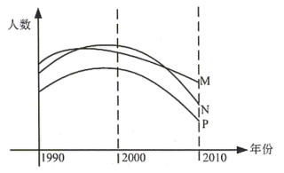

# 练习题2

## Question 1

```yaml
module: 逻辑判断
answer_type: objective
grading_mode: exact
```

### Stem

有人提出过，为什么不能给民航客机上的每个座位配备一个小型降落伞，发生意外时每个人都能有求生的机会。实际上，这种做法的可行性很低。以下各项如果为真，最不能支持上述观点的是：

### Options
- A. 求生的本能会让机组人员放弃排除事故，而选择弃机跳伞
- B. 民航飞行环境中的高度、温度、气压条件不符合跳伞要求
- C. 飞机从发现故障到出事的时间一般很短，没有足够时间组织乘客跳伞
- D. 飞机载客数量会因为配备了降落伞而减少，航空公司不愿因此降低收益

### Answer

D

## Question 2

```yaml
module: 逻辑判断
answer_type: objective
grading_mode: exact
```

### Stem

据某知名房产中介机构统计，2010年9月份第二周全国十大城市的商品房成交量总体呈上涨趋势，并且与8月份第二周相比上涨幅度更明显。如果没有其他因素抑制，按照这种趋势发展，9月份或将创新政以来成交量最高水平，虽然现在还不能明确楼市完全回暖，但未来楼价调控的压力还是很大的。下列最有可能是上述论证前提假设的是：

### Options
- A. 炒房者将大量资金投入楼市
- B. 国家对楼价的调控手段不足
- C. 消费者对房子的购买热情没有减退
- D. 楼市成交量的增长会带动楼价的上涨

### Answer

D

## Question 3

```yaml
module: 逻辑判断
answer_type: objective
grading_mode: exact
```

### Stem

暑期来临，甲、乙、丙、丁4位大学生决定赴西部某地的青山村、绿水村、红石村、黄叶村进行调查研究，在这4个村落中，每人均选择了两个，而每个村落又恰有两人选择，且每人所选择调研的村落并不完全相同。已知：（1）如果甲选青山村，则丙也选青山村；(2）如果乙选绿水村，则丁也选绿水村；（3）如果丁选绿水村，则丙选黄叶村；(4）甲不选绿水村，且丁不选青山。村根据上述信息，可以得出下面哪项：

### Options
- A. 甲选红石村
- B. 乙选青山村
- C. 丙选绿水村
- D. 丁选黄叶村

### Answer

A

## Question 4

```yaml
module: 逻辑判断
answer_type: objective
grading_mode: exact
```

### Stem

S市规定，适龄儿童须接种麻疹疫苗，适龄儿童必须接受义务教育，下图表示：



1990年到2010年间S市儿童数量的一些统计，其中M表示接受义务教育的儿童总数，N表示新生儿总数，P表示接种麻疹疫苗的儿童总数，下面哪一项最能解释2000年到2010年间S市接受义务教育的儿童总数与接种麻疹疫苗的儿童总数下降程度的不同：

### Options
- A. 2000年至2010年间，有部分在S市接种麻疹疫苗的儿童没有在S市入学
- B. 2000年至2010年间，约有20%的父母没有按照S市的规定让他们的孩子接种麻疹疫苗
- C. 2000年至2010年间，每年都有不在S市出生但已接种了麻疹疫苗的儿童在S市入学
- D. 2000年至2010年间，S市新生儿总数下降，因此入学儿童总数和接种麻疹疫苗的儿童总数也随之下降

### Answer

C

## Question 5

```yaml
module: 逻辑判断
answer_type: objective
grading_mode: exact
```

### Stem

近来网上出现了一则有关“公务员绿色出行”的报道，即A市教育局通过添置公务自行车，使得较近距离的公务活动不再派汽车，从而大幅降低了公务汽车使用率。B市环保局负责人看了这则报道，认为引进公务自行车能缩减财政开支，于是决定也采取这种做法。以下哪项如果为真，不能构成上述决定的前提条件：

### Options
- A. 自行车出行的方式结合B城市的地理环境以及道路交通状况是可行又可取的
- B. B市环保局的办公人员规模和已有公车数量与A市教育局相近
- C. 较近距离的公务活动用自行车取代汽车不会影响办公效率
- D. B市环保局原来的公务活动主要采取汽车出行的方式

### Answer

B

## Question 6

```yaml
module: 逻辑判断
answer_type: objective
grading_mode: exact
```

### Stem

王涛的好朋友都喜欢歌手周某的歌。王涛在某咨询公司工作的同学都不喜欢歌手周某的歌。丽莎既是王涛的同学，也是他的好朋友，米蓝是王涛的同学但不在该咨询公司工作，贺宇是王涛的同学但不喜欢歌手周某的歌。根据以上陈述，一定可以得出以下哪项：。

### Options
- A. 米蓝喜欢歌手周某的歌
- B. 王涛不在该咨询公司工作
- C. 贺宇在该咨询公司工作
- D. 丽莎不在该咨询公司工作

### Answer

D

## Question 7

```yaml
module: 逻辑判断
answer_type: objective
grading_mode: exact
```

### Stem

美国斯坦福大学的研究人员对130名同时患有血脂异常、高血压（并未服用降压药）的患者进行了长达12年的试验。在试验中，研究人员将这130名研究对象随机分成人数相等的两组，并让其中的一组研究对象服用松树皮提取物（每天服用的剂量为200毫克），另一组研究对象服用安慰剂。在这12年中，研究人员每6周测量1次研究对象的血压、血糖、胆固醇及C反应蛋白的水平。试验结果显示，服用松树皮提取物人员的上述各项指标与服用安慰剂人员的上述各项指标并无明显的差别。由此可知，松树皮提取物无降血压、降血糖、降血脂以及预防心血管疾病等功效。以下各项如果为真，最能反驳上述结论的是：

### Options
- A. 两组试验患者仅人数相等，其血压和血脂等的原始指标差异较大
- B. 对照组服用安慰剂，对高血压和高血脂患者有心理暗示作用
- C. 12年的实验时间太长，这有可能使一些重要的实验数据失真
- D. 参加实验的患者人数仅130人，样本太小，代表性不够

### Answer

A

## Question 8

```yaml
module: 逻辑判断
answer_type: objective
grading_mode: exact
```

### Stem

研究人员研究了13只克隆绵羊，其中4只是世界上第一只体细胞克隆羊“多莉”的复制品。研究者检测了这些克隆羊的肌肉骨骼、新陈代谢和血压情况。结果发现，与对照组羊对比，这些克隆羊仅患轻度骨关节炎，只有一只为中度。它们没有新陈代谢疾病的症状，血压也正常，相对健康。因此，研究人员指出，克隆动物的衰老过程正常。以下哪项如果为真，最能削弱上述论证：

### Options
- A. 研究中对照组羊的年龄比实验组羊的年龄小
- B. 世界上第一只克隆羊“多莉”仅仅存活了6年
- C. 目前的体细胞克隆技术还远远没达到完善地步
- D. 研究人员没有检测与衰老相关的主要分子标记

### Answer

D

## Question 9

```yaml
module: 逻辑判断
answer_type: objective
grading_mode: exact
```

### Stem

自由基是人类机体在消耗氧气时产生的一种有时会有害的自由分子，很多人相信自由基是机体衰老背后的罪魁祸首。因为有研究人员发现，人类在衰老的过程中自由基的数量在不断上升。以下除哪项外，均能削弱上述结论：

### Options
- A. 关于人类衰老的具体过程还存在着很多的争议
- B. 自由基在对抗机体衰老的过程中数量会上升
- C. 通过人工提升自由基的数量可延长机体的寿命
- D. 染色体结构失去稳定性是导致人类衰老的原因

### Answer

A

## Question 10

```yaml
module: 逻辑判断
answer_type: objective
grading_mode: exact
```

### Stem

截至2011年底某市常住人口1100万人，其中本地人口800万人，外来人口300万人。常住人口的男、女比例为1.03：1。该市高校众多，教育水平远高于全国平均水平。常住人口中具有大学本科及以上学历的超过20%。根据以上陈述，一定可以推出的是：

### Options
- A. 本地本科及以上人口超过外来本科及以上人口
- B. 本地女性人口超过外来女性人口
- C. 本地男性人口超过外来女性人口
- D. 本地男性人口超过外来男性人口

### Answer

C

## Question 11

```yaml
module: 逻辑判断
answer_type: objective
grading_mode: exact
```

### Stem

一般来说，动物的蛋会通过土壤中微生物和堆肥分解有机物时产生的热量来孵化，但这些微生物（包含细菌）也会穿透蛋壳、感染胚胎，自然情况下这一比例高于20%。然而，在澳洲有一种名为丛冢雉的鸟类，其蛋发生感染的几率仅为9%，研究者发现其蛋壳中含有溶酶酵素，研究者据此认为这种物质很可能就是抵御细菌侵扰的关键因素。以下哪项如果为真，没有削弱上述结论：

### Options
- A. 丛冢雉的蛋壳中所含的溶酶酵素量，与其他动物相比，含量大抵相当
- B. 丛冢雉的蛋壳被一层纳米级的碳酸钙层包裹，拥有了更强的防水性和抗细菌入侵能力
- C. 丛冢雉蛋散发一种特殊气味，会使附着在其蛋壳上的细菌数减少
- D. 与其他动物的蛋壳相比，丛冢雉的蛋壳要薄三分之一，更易受到微生物的入侵

### Answer

D

## Question 12

```yaml
module: 逻辑判断
answer_type: objective
grading_mode: exact
```

### Stem

新冠疫情给经济社会生活造成了严重影响，也使得无接触经济浮现在人们眼前，直播带货、远程会议等新事物迅速涌进日常生活。经济活动的参与者在空间隔离的条件下，通过网络等平台间接接触，实现人与物之间、人与人之间经济交往。这种方式得到了消费者的高度认可。有专家就此断言，无接触经济会因新冠疫情而在未来得到快速发展。以下哪项如果为真，最能支持上述专家的断言：

### Options
- A. 目前线上支付的安全性，及线上交易的企业与个人信用度均略有不足
- B. 相对于无接触经济，“面对面”经济交往活动仍具有较低的交易成本
- C. 如果新冠病毒传播具有长期性和反复性，人们仍会坚持“云端生活”
- D. 人们注重生命健康，“无接触”消费习惯一经养成就会形成路径依赖

### Answer

D

## Question 13

```yaml
module: 逻辑判断
answer_type: objective
grading_mode: exact
```

### Stem

全球范围内的森林是一个巨大的碳汇，它们通过光合作用和林木生产所吸收的碳多于其通过呼吸和腐烂所释放的碳。与此同时，在森林环境中，树木生长相对较快，蒸发掉大量会形成云的水分，从而使气候冷却。这就意味着森林具有降温作用，还吸收了更多的导致全球变暖的二氧化碳，所以说森林是显而易见的气候“冷却器”。以下哪项如果为真，没有质疑上述观点：

### Options
- A. 近十几年，一些地区不断增加林木植被，扩大森林覆盖率，但当地气候变暖并未改善
- B. 高纬度的北方森林会产生萜烯，萜烯形成气溶胶后会阻挡阳光、形成云粒
- C. 在山区或干燥地区，森林会降低地球的表面反射率，让地球反射回太空的入射光减少
- D. 树木释放的有机化合物中，包含一种名为异戊二烯的化合物，它能够与空气中的氮氧化物发生反应，形成强大的升温作用

### Answer

B

## Question 14

```yaml
module: 逻辑判断
answer_type: objective
grading_mode: exact
```

### Stem

随着生活节奏的加快，很多人都会用时间管理软件来规划自已的时间，以提升工作效率。这一做法是可行的。因为大脑的“提醒功能”不够准确，很少能在正确的时间做出正确的提醒，而外部提醒可以让人更好地掌握时间。以下选项中最能削弱上述论断的是：

### Options
- A. 时间管理软件会让人压力增大，影响工作效率
- B. 时间管理软件质量参差不齐，人们难以辨别优劣
- C. 时间管理软件会使人们的生活节奏进一步加快
- D. 时间管理软件难以适用所有工作、生活事项

### Answer

A

## Question 15

```yaml
module: 逻辑判断
answer_type: objective
grading_mode: exact
```

### Stem

科学家去非洲考察，发现非洲沙漠的眼镜蛇数量锐减，但几乎同时胡狼的数量却明显增加。有人认为是胡狼导致了眼镜蛇的减少。但这种说法难以成立，因为胡狼很少以眼镜蛇为食。以下哪项如果为真，最能削弱上述论证：

### Options
- A. 眼镜蛇只吃沙鼠，而沙鼠也是胡狼的主要食物
- B. 干旱缺水对眼镜蛇造成的影响比对胡狼造成的影响更加严重
- C. 在胡狼的数量增加以前，非洲沙漠的眼镜蛇数量就已经减少了
- D. 尽管眼镜蛇数量锐减，胡狼数量增加，但非洲沙漠里胡狼的数量仍少于眼镜蛇

### Answer

A

## Question 16

```yaml
module: 逻辑判断
answer_type: objective
grading_mode: exact
```

### Stem

某实验室一共有3种类型的机器人，C型能识别颜色、S型能识别形状、X型既不能识别颜色也不能识别形状。3类机器人都能根据简单命令拿起实验品。实验室对1号机器人和2号机器人进行实验，当命令它们拿起红球时，1号拿起的是红方块，2号拿起的是蓝球。最新完整资料、更新进度添加：563514744根据上述实验，以下哪项断定一定为真：

### Options
- A. 1号和2号都是X型
- B. 1号和2号都不是X型
- C. 1号是C型且2号是S型
- D. 1 号不是S型且 2 号不是 C 型

### Answer

D

## Question 17

```yaml
module: 逻辑判断
answer_type: objective
grading_mode: exact
```

### Stem

某单位组织职工进行体检，职工可自愿报名参加。老王碰到新来的小李，聊起此事，老王提醒小李说：“单位组织体检呢，赶紧报名去吧。”小李说：“我身体健康着呢，不用报了。”以下除哪项外，都可以作为小李的回答所包含的假设：

### Options
- A. 如果身体不健康，则要报名参加体检
- B. 只要我身体健康，我就不必参加体检
- C. 凡是报名参加体检的，都是身体不健康的
- D. 只有身体不健康的人，才报名参加体检

### Answer

A

## Question 18

```yaml
module: 逻辑判断
answer_type: objective
grading_mode: exact
```

### Stem

统计表明，某国的火车事故多发生在南部地区，因此在北部地区坐火车更安全。以下哪项最能反驳上述论证：

### Options
- A. 该国北部的火车车速较慢
- B. 该国南部的火车线路比北部多得多
- C. 该国南部的许多线路已经使用动车组了
- D. 该国北部大部分地区为山区，更适合汽车行驶

### Answer

B

## Question 19

```yaml
module: 逻辑判断
answer_type: objective
grading_mode: exact
```

### Stem

有两种农产品甲和乙，甲不能生长在干旱的气候里，乙不能生长在寒冷的气候里。在某个国家的大部分地区，或者可以种植农产品甲，或者可以种植农产品乙。如果以上陈述为真，则以下哪项一定为假：

### Options
- A. 这个国家有一半地区的气候既干旱又寒冷
- B. 这个国家大部分地区的气候是非常寒冷的
- C. 这个国家根本不种植农产品甲
- D. 这个国家只能种植农产品甲### Answer

A

## Question 20

```yaml
module: 逻辑判断
answer_type: objective
grading_mode: exact
```

### Stem

某企业计划组织员工参观文化馆、档案馆和博物馆，但由于时间有限，这三个场馆不能都去。因此，有3名员工提出了以下建议：甲：文化馆和档案馆之间距离很远，最多只去其中一个。乙：档案馆和博物馆都有主题展览，两个都应该参观。丙：去年已经组织参观过文化馆，今年就不去了。结果发现，只有1名员工的建议被采纳，则下列判断必然正确的是：

### Options
- A. 该企业一定去了档案馆
- B. 该企业一定没去档案馆
- C. 该企业一定去了博物馆
- D. 该企业一定没去博物馆

### Answer

B
