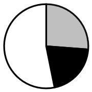
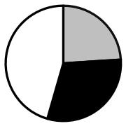

# 套题训练10

## Material M1

根据国家统计局数据表示，2017年，全国酿酒行业规模以上企业完成酿酒总产量7077.41万千升，同比增长3.31%。全国规模以上按行业分：2017年，全国规模以上白酒企业完成酿酒总产量1198.06万千升，同比增长6.86%；全国规模以上啤酒企业完成酿酒总产量4401.49万千升，同比下降0.66%；全国规模以上葡萄酒生产企业完成酿酒总产量100.11万千升，同比下降5.25%；全国规模以上酒精生产企业完成总产量1027.29万千升，同比增长19.63%。

2017年，主要经济效益汇总的全国酿酒行业规模以上企业总计2781家，酿酒行业规模以上企业累计完成产品销售收入9239.57亿元，与上年同期相比增长10.45%；累计实现利润总额1314.03亿元，与上年同期相比增长27.24%。按行业分，2017年，纳入到国家统计局范畴的规模以上白酒企业1593家，累计完成销售收入5654.42亿元，与上年同期相比增长14.42%；累计实现利润总额1028.48亿元，与上年同期相比增长35.79%；纳入到国家统计局范畴的规模以上啤酒企业447家，累计完成销售收入1766.45亿元，与上年同期相比增长2.30%；累计实现利润总额129.15亿元，与上年同期相比下降9.83%。纳入到国家统计局范畴的规模以上葡萄酒企业244家，累计完成销售收入421.37亿元，与上年同期相比下降9.00%；累计实现利润总额42.28亿元，与上年同期相比下降11.55%；纳入到国家统计局范畴的规模以上酒精企业131家，累计完成销售收入801.16亿元，与上年同期增14.98%；累计实现利润总额46.94亿元，与上年同期相比增长83.30%。

表2017年全国酿酒行业规模以上各行业进出口情况

| 种类 | 进口量（万千升） | 同比（%） | 进口额（亿美元） | 同比（%） | 出口量（万千升） | 同比（%） | 出口额（亿美元） | 同比（%） |
| --- | ---: | ---: | ---: | ---: | ---: | ---: | ---: | ---: |
| 白酒 | 0.24 | 27.60 | 0.70 | −1.86 | 1.66 | 3.09 | 4.70 | 0.35 |
| 啤酒 | 71.62 | 10.80 | 7.50 | 12.73 | 36.10 | 23.79 | 2.28 | 18.10 |
| 葡萄酒 | 73.27 | 17.13 | 27.14 | 17.58 | 0.92 | −7.31 | 4.35 | −19.61 |
| 发酵酒精 | 2.50 | −97.10 | 0.14 | −96.57 | 13.32 | 297.61 | 0.69 | 176.00 |

## Material M2

2022年，全国居民人均可支配收入36883元，同比增长5.0%。分城乡看，城镇居民人均可支配收入49283元，同比增长3.9%；农村居民人均可支配收入20133元，同比增长6.3%。

按收入来源分，2022年，全国居民人均工资性收入同比增长4.9%，占可支配收入的比重为55.8%；人均经营净收入同比增长4.8%，占可支配收入的比重为16.7%；人均财产净收入同比增长4.9%，占可支配收入的比重为8.8%；人均转移净收人同比增长5.5%，占可支配收入的比重为18.7%。

表2022年全国居民人均消费支出及同比增速

单位：元（支出）、%（增速）

|  | 支出 | 增速 |
| --- | ---: | ---: |
| 全国 | 24539 | 1.8 |
| 城镇居民 | 30391 | 0.3 |
| 农村居民 | 16632 | 4.5 |
| 食品烟酒 | 7481 | 4.2 |
| 衣着 | 1365 | −3.8 |
| 居住 | 5882 | 4.3 |
| 生活用品及服务 | 1432 | 0.6 |
| 交通通信 | 3195 | 1.2 |
| 教育文化娱乐 | 2469 | −5.0 |
| 医疗保健 | 2120 | 0.2 |
| 其他用品及服务 | 595 | 4.6 |

## Material M3

2017年，M省固定资产投资（不含农户）31328.1亿元，比上年增长13.1%。其中，民间投资18759.6亿元，增长14.5%，占固定资产投资的比重为59.9%。分经济类型看，国有投资10395.0亿元，增长12.3%；非国有投资20933.0亿元，增长13.6%。分投资方向看，民生投资3015.9亿元，增长12.8%；生态投资1402.5亿元，增长12.5%；基础设施投资8517.4亿元，增长15.9%；高新技术产业投资2213.0亿元，增长24.7%；工业技改投资6130.2亿元，增长3.9%；战略性新兴产业投资7258.4亿元，增长13.5%。分区域看，A地区投资12395.3亿元，增长13.2%；B地区投资7110.4亿元，增长13.5%；C地区投资5232.7亿元，增长13.8%；D地区投资6429.4亿元，增长14.0%。施工项目共有58178个，比上年增长16.4%。其中，新开工项目43966个，增长7.5%。投产项目42862个，增长28.4%。2017年，M省房地产开发投资3426.1亿元，比上年增长15.9%，其中，住宅投资2194.4亿元，增长17.3%。商品房销售面积8532.3万平方米，增长5.5%，其中，住宅销售面积7368.3万平方米，增长2.5%。商品房销售额4460.7亿元，增长18.9%，其中，住宅销售额3570.8亿元，增长14.7%。年末商品房待售面积2015.5万平方米，下降30.5%，比上年末减少886.0万平方米。

## Material M4

2021年12月，我国原煤产量3.8亿吨，同比增长7.2%；原油产量1647万吨，同比增长1.7%；天然气产量192亿立方米，同比增长2.3%；发电量7234亿千瓦时，同比下降2.1%。

表1 2016～2021年我国主要能源品种生产总量

| 年份 | 原煤产量（亿吨） | 原油产量（亿吨） | 天然气产量（亿立方米） | 发电量（万亿千瓦时） |
| ---: | ---: | ---: | ---: | ---: |
| 2016 | 33.8 | 2.00 | 1369 | 6.14 |
| 2017 | 35.0 | 1.92 | 1480 | 6.50 |
| 2018 | 36.5 | 1.89 | 1602 | 6.80 |
| 2019 | 38.1 | 1.91 | 1754 | 7.14 |
| 2020 | 38.6 | 1.95 | 1897 | 7.50 |
| 2021 | 40.7 | 1.99 | 2053 | 8.11 |

表2 2016～2021年我国一次能源生产总量（亿吨标准煤）及生产结构（%）

| 年份 | 一次能源生产总量 | 原煤占比 | 原油占比 | 天然气占比 | 非化石能源占比 |
| ---: | ---: | ---: | ---: | ---: | ---: |
| 2016 | 34.6 | 69.8% | 8.3% | 5.2% | 16.7% |
| 2017 | 35.9 | 69.6% | 7.6% | 5.4% | 17.4% |
| 2018 | 37.7 | 69.2% | 7.2% | 5.4% | 18.2% |
| 2019 | 39.7 | 68.5% | 6.9% | 5.6% | 19.0% |
| 2020 | 40.8 | 67.6% | 6.8% | 6.0% | 19.6% |
| 2021 | 43.3 | 67.0% | 6.6% | 6.1% | 20.3% |

注：原煤、原油、天然气等能源的单位可按一定比例换算成标准煤单位

## Question 1

```yaml
module: 资料分析
materials:
- M1
```

### Stem

2017年，全国酿酒行业规模以上企业完成酿酒总产量同比增长了多少万千升：

### Options
- A. 216.26
- B. 226.76
- C. 236.54
- D. 241.21

### Answer

B

## Question 2

```yaml
module: 资料分析
materials:
- M1
```

### Stem

2017年纳入到国家统计局范畴的规模以上的白酒企业均收入占啤酒企业均收入的比例为：

### Options
- A. 38%
- B. 21.61%
- C. 33%
- D. 89.82%

### Answer

D

## Question 3

```yaml
module: 资料分析
materials:
- M1
```

### Stem

下列全国酿酒行业规模以上各行业中，2016年进口单价最低的是：

### Options
- A. 白酒
- B. 啤酒
- C. 葡萄酒
- D. 发酵酒精

### Answer

D

## Question 4

```yaml
module: 资料分析
materials:
- M1
```

### Stem

2016年，全国规模以上葡萄酒生产企业完成酿酒总产量比白酒企业完成酿酒总产量：

### Options
- A. 多了90.58%
- B. 少了90.58%
- C. 多了88.68%
- D. 少了88.68%

### Answer

B

## Question 5

```yaml
module: 资料分析
materials:
- M1
```

### Stem

根据上述材料，下列说法正确的是：

### Options
- A. 2017年出口单价最高的是白酒行业
- B. 2017年纳入到国家统计局范畴的规模以上葡萄酒企业的平均成本为1.72亿元
- C. 2016年酿酒行业规模以上企业累计完成产品的总成本约为7333亿元
- D. 2016年纳入到国家统计局范畴的规模以上酒精企业的收入为710.68亿元

### Answer

C

## Question 6

```yaml
module: 资料分析
materials:
- M2
```

### Stem

2022年，全国居民人均工资性收入同比增加了：

### Options
- A. 不到800元
- B. 800～1200元之间
- C. 1200～1600元
- D. 1600元以上

### Answer

B

## Question 7

```yaml
module: 资料分析
materials:
- M2
```

### Stem

2022年在全国①城镇居民收支差（收入-支出）和②农村居民收支差中，高于2021年水平的有哪些项：

### Options
- A. 仅①高于2021年水平
- B. 仅②高于2021年水平
- C. ①和②均高于2021年水平
- D. ①和②均不高于2021年水平

### Answer

C

## Question 8

```yaml
module: 资料分析
materials:
- M2
```

### Stem

2022年全国居民8类人均消费支出中，人均支出额超过人均总支出额10%的有多少类：

### Options
- A. 2
- B. 3
- C. 4
- D. 5

### Answer

C

## Question 9

```yaml
module: 资料分析
materials:
- M2
```

### Stem

假设城镇居民和农村居民各类人均消费支出占其总体人均消费支出的比重是相同的，则2022年全国

农村居民人均衣着、食品烟酒和居住类支出之和约为多少万元：

### Options
- A. 0.6
- B. 0.8
- C. 1.0
- D. 1.3

### Answer

C

## Question 10

```yaml
module: 资料分析
materials:
- M2
```

### Stem

以下饼图中，能够准确反映2022年全国居民人均消费支出总额中，人均食品烟酒支出（灰色）、人

均居住支出（黑色）以及剩余各项人均支出之和（白色）占比关系的是：

### Options
- A. 
- B. 
- C. 
- D. 

### Answer

D

## Question 11

```yaml
module: 资料分析
materials:
- M3
```

### Stem

2016年M省固定资产投资（不含农户）约为多少亿元：

### Options
- A. 27699.5
- B. 31328.1
- C. 27712.2
- D. 28233.6

### Answer

A

## Question 12

```yaml
module: 资料分析
materials:
- M3
```

### Stem

2016年M省固定资产投资（不含农户）中，民间投资占比约为：

### Options
- A. 59.76%
- B. 62.18%
- C. 59.15%
- D. 33.58%

### Answer

C

## Question 13

```yaml
module: 资料分析
materials:
- M3
```

### Stem

2017年M省固定资产投资（不含农户）中，基础设施投资同比增量约为多少亿元：

### Options
- A. 1150
- B. 1168
- C. 1263
- D. 1190

### Answer

B

## Question 14

```yaml
module: 资料分析
materials:
- M3
```

### Stem

2017年M省固定资产投资（不含农户）中，从投资方向看，下列增幅最小的是：

### Options
- A. 民生投资
- B. 生态投资
- C. 基础设施投资
- D. 工业技改投资

### Answer

D

## Question 15

```yaml
module: 资料分析
materials:
- M3
```

### Stem

以下描述中不正确的个数有多少：

（1）2017年M省房地产开发投资增量比住宅投资增量多100亿元以上

（2）2016年M省固定资产投资（不含农户）中，高新技术产业投资增速最大

（3）2017年M省固定资产投资（不含农户）中，分区域看，A地区投资增长率最快

（4）2017年M省每平方米商品房销售均价低于6000元

### Options
- A. 1个
- B. 2个
- C. 3个
- D. 4个

### Answer

B

## Question 16

```yaml
module: 资料分析
materials:
- M4
```

### Stem

2021年12月，我国日均原煤产量是日均原油产量的多少倍：

### Options
- A. 18
- B. 21
- C. 23
- D. 25

### Answer

C

## Question 17

```yaml
module: 资料分析
materials:
- M4
```

### Stem

2020年12月，我国原煤产量约占当年原煤总产量的：

### Options
- A. 9%
- B. 11%
- C. 12%
- D. 13%

### Answer

A

## Question 18

```yaml
module: 资料分析
materials:
- M4
```

### Stem

将我国主要能源按2021年产量的同比增速从高到低排列，正确的是：

### Options
- A. 电＞天然气＞原煤＞原油
- B. 天然气＞电＞原煤＞原油
- C. 电＞原油＞天然气＞原煤
- D. 天然气＞原油＞电＞原煤

### Answer

B

## Question 19

```yaml
module: 资料分析
materials:
- M4
```

### Stem

2016～2021年，我国一次能源生产总量中，非化石能源产量年均增长约多少亿吨标准煤：

### Options
- A. 0.50
- B. 0.60
- C. 0.63
- D. 0.71

### Answer

B

## Question 20

```yaml
module: 资料分析
materials:
- M4
```

### Stem

根据所给材料，下列说法错误的是：

### Options
- A. 2018～2021年我国年均一次能源产量超40亿吨标准煤
- B. 2021年，我国发电量增速比上年提高约3个百分点
- C. 2021年我国非化石能源产量约为原煤产量的三成
- D. 2021年12月，我国发电量低于当年月均发电量

### Answer

D
