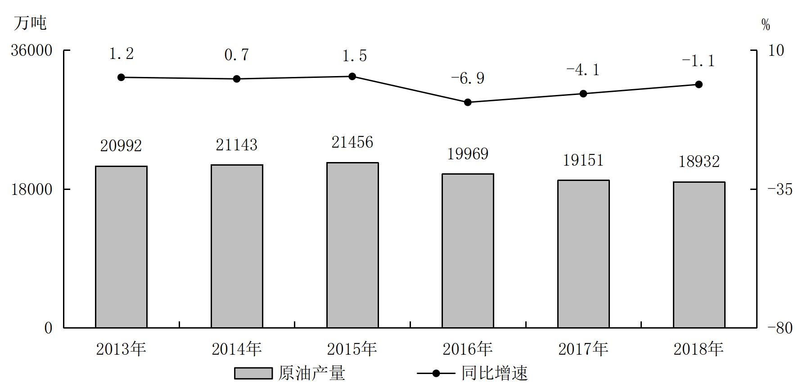
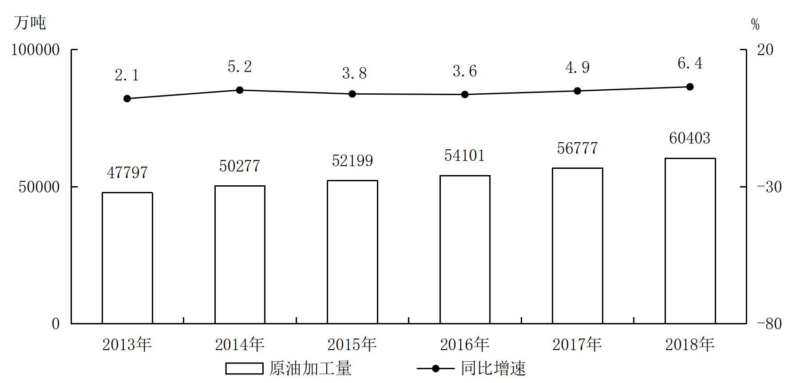
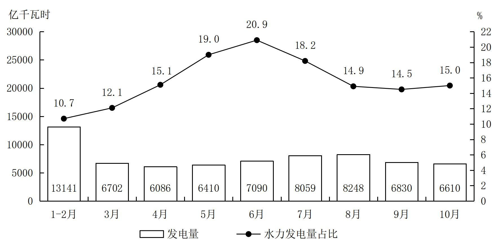
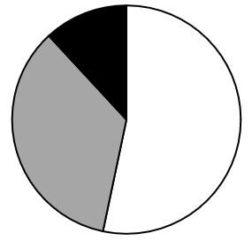
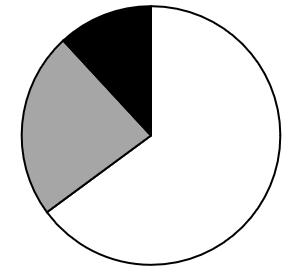

<!-- hyz-paper-id: 01a1e4f7-7bb2-7430-bfd1-ba0113c52fdd -->

# 套题训练11

## Material M1

<!-- hyz-material-id: 01a1e4f7-7bb2-7430-bfd1-ba1d23b58065 -->



图1 2013～2018年我国原油生产情况



图2 2013～2018年我国原油加工情况

## Material M2

<!-- hyz-material-id: 01a1e4f7-7bb2-7430-bfd1-ba2f6d42f905 -->

2023年前三季度。S省1627家规模以上文化及相关产业企业（以下简称“文化企业”）实现营业收入862.76亿元，比上年同期增长7.0%，低于全国总体水平0.7个百分点，增速较第一季度和上半年分别回落3.8和1.9个百分点。

分产业类型看，文化服务业企业共1076家，实现营业收入409.84亿元，比上年同期增长6.7%。文化批发和零售业企业共321家，实现营业收入190.49亿元，比上年同期增长27.6%，文化制造业企业共230家，实现营业收入262.42亿元，比上年同期下降3.9%。

分领域看，文化核心领域实现营业收入533.10亿元。比上年同期增长13.0%，增速高于上年同期4.3个百分点；文化相关领域实现营业收入329.66亿元，比上年同期下降1.6%。

在文化核心领域中，文化传播渠道，创意设计服务，新闻信息服务，文化娱乐休闲服务，内容创作生产和文化投资运营6个行业营业收入分别为172.24亿元、132.86亿元、104.88亿元、32.66亿元、81.03亿元和9.43亿元，分别比上年同期增长28.2%、8.3%、3.0%、12.6%、9.3%和-2.1%。在文化相关领域中，文化装备生产，文化消费终端生产，文化辅助生产和中介服务3个行业营业收入分别为99.45亿元、92.78亿元和137.43亿元，分别比上年同期增长19.6%、0.1%和-13.6%。

## Material M3

<!-- hyz-material-id: 01a1e4f7-7bb2-7430-bfd1-ba3897bbcbd9 -->



图2022年1～10月H国发电量及水力发电量占发电量比重

## Material M4

<!-- hyz-material-id: 01a1e4f7-7bb2-7430-bfd1-ba4a533544ff -->

2021年1～5月，我国企业承接服务外包合同额6491亿元人民币（币种下同），执行额4069亿元，分别同比增长39.0%和30.8%，比2019年同期分别增长34.7%和42.9%。其中，承接离岸服务外包合同额3648亿元，执行额2376亿元，分别同比增长25.9%和24.4%。

从结构看，1～5月，我国企业承接离岸信息技术外包（ITO）、业务流程外包（BPO）和知识流程外包（KPO）执行额分别为1104亿元、428亿元和844亿元，分别同比增长31.0%、17.0%和20.3%。

从地域看，1～5月，全国31个服务外包示范城市总计承接离岸服务外包合同额3046亿元，执行额2042亿元，分别同比增长23.0%和23.0%，占全国总额的83.5%和85.9%，长三角地区承接离岸服务外包合同额1656亿元，执行额1214亿元，分别同比增长13.5%和20.9%。

从市场看，1～5月，我国承接美国、中国香港、欧盟离岸外包执行额分别为523亿元、467亿元和300亿元，合计占我国离岸服务外包执行额的54.3%，分别同比增长24.6%、31.9%和14.3%，我国承接“一带一路”国家离岸外包合同额714亿元，执行额424亿元，分别同比增长61.0%和24.6%。

从就业看，截至5月，我国服务外包累计吸纳从业人员达1326万人。2021年1～5月，服务外包新增从业人员35.3万人。

## Question 1

<!-- hyz-question-id: 01a1e4f7-7bb2-7430-bfd1-ba53d7651eaa -->

```yaml
module: 资料分析
materials:
- M1
```

### Stem

与2013年相比，2018年我国原油产量增幅较原油加工量增幅小多少个百分点：

### Options
- A. 16.6
- B. 36.2
- C. 39.4
- D. 41.5

### Answer

B

## Question 2

<!-- hyz-question-id: 01a1e4f7-7bb2-7430-bfd1-ba6af4cf07d1 -->

```yaml
module: 资料分析
materials:
- M1
```

### Stem

2014～2018年，原油产量和原油加工量的同比增速均高于上年的年份有多少个：

### Options
- A. 1
- B. 2
- C. 3
- D. 4

### Answer

B

## Question 3

<!-- hyz-question-id: 01a1e4f7-7bb2-7430-bfd1-ba787327eadf -->

```yaml
module: 资料分析
materials:
- M1
```

### Stem

2013～2018年，我国原油年均产量约为多少万吨：

### Options
- A. 19825
- B. 19981
- C. 20163
- D. 20274

### Answer

D

## Question 4

<!-- hyz-question-id: 01a1e4f7-7bb2-7430-bfd1-ba84f65168cb -->

```yaml
module: 资料分析
materials:
- M1
```

### Stem

2015～2018年，我国原油加工量年均增长约百分之多少：

### Options
- A. 3.0%
- B. 4.1%
- C. 5.0%
- D. 6.2%

### Answer

C

## Question 5

<!-- hyz-question-id: 01a1e4f7-7bb2-7430-bfd1-ba92a4d9f1f4 -->

```yaml
module: 资料分析
materials:
- M1
```

### Stem

根据上图，下列说法正确的是哪一项：

### Options
- A. 2015～2018年，我国原油产量同比降幅逐年收窄
- B. 2013～2018年，我国原油产量与原油加工量相差最少的年份是2013年
- C. 2013～2018年，我国原油产量与原油加工量呈负相关
- D. 2018年，我国原油产量为原油加工量的35%

### Answer

B

## Question 6

<!-- hyz-question-id: 01a1e4f7-7bb2-7430-bfd1-baa76852c960 -->

```yaml
module: 资料分析
materials:
- M2
```

### Stem

2023年前三季度，S省平均每家文化企业实现营业收入在以下哪个范围内：

### Options
- A. 不到0.5亿元
- B. 0.5亿元～1亿元之间
- C. 1亿元～1.5亿元之间
- D. 超过1.5亿元

### Answer

B

## Question 7

<!-- hyz-question-id: 01a1e4f7-7bb2-7430-bfd1-bab4b797d2c9 -->

```yaml
module: 资料分析
materials:
- M2
```

### Stem

2022年前三季度，S省文化相关领域实现营业收入比文化核心领域：

### Options
- A. 低不到50%
- B. 低50%以上
- C. 高不到50%
- D. 高50%以上

### Answer

A

## Question 8

<!-- hyz-question-id: 01a1e4f7-7bb2-7430-bfd1-bacee3bf1dc5 -->

```yaml
module: 资料分析
materials:
- M2
```

### Stem

将S省①创意设计服务、②文化装备生产、③文化消费终端生产和④文化辅助生产和中介服务，按2022

年前三季度营业收入从高到低排列，以下正确的是：

### Options
- A. ①②④③
- B. ①④②③
- C. ④①②③
- D. ④①③②

### Answer

D

## Question 9

<!-- hyz-question-id: 01a1e4f7-7bb2-7430-bfd1-bade20f1892b -->

```yaml
module: 资料分析
materials:
- M2
```

### Stem

以下饼图中，最能准确反映2023年前三季度S省文化企业营业收入中三个产业类型占比情况的是哪

一项：

### Options
- A. 
- B. 
- C. 
- D. 

### Answer

C

## Question 10

<!-- hyz-question-id: 01a1e4f7-7bb2-7430-bfd1-bae313d57930 -->

```yaml
module: 资料分析
materials:
- M2
```

### Stem

以下信息中，能够从上述材料中推出的有多少项：

①2021年前三季度S省文化核心领域实现营业收入

②2023年上半年S省文化企业实现营业收入同比增速

③2023年前三季度全国文化企业实现营业收入同比增速

### Options
- A. 0
- B. 1
- C. 2
- D. 3

### Answer

D

## Question 11

<!-- hyz-question-id: 01a1e4f7-7bb2-7430-bfd1-baff305c9ae1 -->

```yaml
module: 资料分析
materials:
- M3
```

### Stem

2022年3月，H国发电量比同年1～2月月均发电量：

### Options
- A. 低不到200亿千瓦时
- B. 低200亿千瓦时以上
- C. 高不到200亿千瓦时
- D. 高200亿千瓦时以上

### Answer

C

## Question 12

<!-- hyz-question-id: 01a1e4f7-7bb2-7430-bfd1-bb0469df5391 -->

```yaml
module: 资料分析
materials:
- M3
```

### Stem

以下月份中，除水力发电量以外的H国其他类型总发电量最高的月份是哪个月：

### Options
- A. 6月
- B. 7月
- C. 8月
- D. 9月

### Answer

C

## Question 13

<!-- hyz-question-id: 01a1e4f7-7bb2-7430-bfd1-bb1efa209e70 -->

```yaml
module: 资料分析
materials:
- M3
```

### Stem

2022年4～10月，H国发电量环比增速大于10%的月份有多少个：

### Options
- A. 1
- B. 2
- C. 3
- D. 4

### Answer

B

## Question 14

<!-- hyz-question-id: 01a1e4f7-7bb2-7430-bfd1-bb26d79dd3e7 -->

```yaml
module: 资料分析
materials:
- M3
```

### Stem

2022年第二季度各月，H国水力发电量：

### Options
- A. 持续上升
- B. 持续下降
- C. 先升后降
- D. 先降后升

### Answer

A

## Question 15

<!-- hyz-question-id: 01a1e4f7-7bb2-7430-bfd1-bb3b724678bd -->

```yaml
module: 资料分析
materials:
- M3
```

### Stem

2022年，H国累计水力发电量第一次超过5000亿千瓦时是在哪个月：

### Options
- A. 5月
- B. 6月
- C. 7月
- D. 8月

### Answer

B

## Question 16

<!-- hyz-question-id: 01a1e4f7-7bb2-7430-bfd1-bb479372a77a -->

```yaml
module: 资料分析
materials:
- M4
```

### Stem

2021年1～5月，我国承接非“一带一路”国家离岸外包合同额同比增速约为：

### Options
- A. 19.6%
- B. 24.6%
- C. 43.5%
- D. 61.0%

### Answer

A

## Question 17

<!-- hyz-question-id: 01a1e4f7-7bb2-7430-bfd1-bb5b7338ea04 -->

```yaml
module: 资料分析
materials:
- M4
```

### Stem

2021年1～5月，下列项目对我国承接离岸服务外包执行额增长的贡献率最大的是：

### Options
- A. 我国承接美国离岸外包
- B. 长三角地区承接的离岸服务外包
- C. 我国企业承接离岸信息技术外包（ITO）
- D. 31个服务外包示范城市承接离岸服务外包

### Answer

D

## Question 18

<!-- hyz-question-id: 01a1e4f7-7bb2-7430-bfd1-bb66128836d4 -->

```yaml
module: 资料分析
materials:
- M4
```

### Stem

2019年1～5月，我国企业承接服务外包合同额与执行额之差：

### Options
- A. 不超过1500亿元
- B. 在1500～1800亿元之间
- C. 在1800～2100亿元之间
- D. 超过2100亿元

### Answer

C

## Question 19

<!-- hyz-question-id: 01a1e4f7-7bb2-7430-bfd1-bb7df9696824 -->

```yaml
module: 资料分析
materials:
- M4
```

### Stem

2021年1～5月，我国承接下列国家或地区离岸外包执行额同比增量从高到低排序正确的是：

### Options
- A. 美国、中国香港、欧盟
- B. 美国、中国香港、“一带一路”国家
- C. 中国香港、美国、“一带一路”国家
- D. 美国、欧盟，“一带一路”国家

### Answer

C

## Question 20

<!-- hyz-question-id: 01a1e4f7-7bb2-7430-bfd1-bb8e105cd8b3 -->

```yaml
module: 资料分析
materials:
- M4
```

### Stem

能够从上述材料中推出的是：

### Options
- A. 2021年1～5月，我国企业承接服务外包合同额同比增速比上年提高了4.3个百分点
- B. 2021年1～5月，我国服务外包业从业人员人均承接服务外包合同额约为4.9万元
- C. 2021年1～5月，我国服务外包累计吸纳从业人员中只有2.6%的人是非新增从业人员
- D. 2021年1～5月，31个服务外包示范城市总计承接离岸服务外包合同额、执行额占全国总额的比重均不高于上年同期水平

### Answer

D
