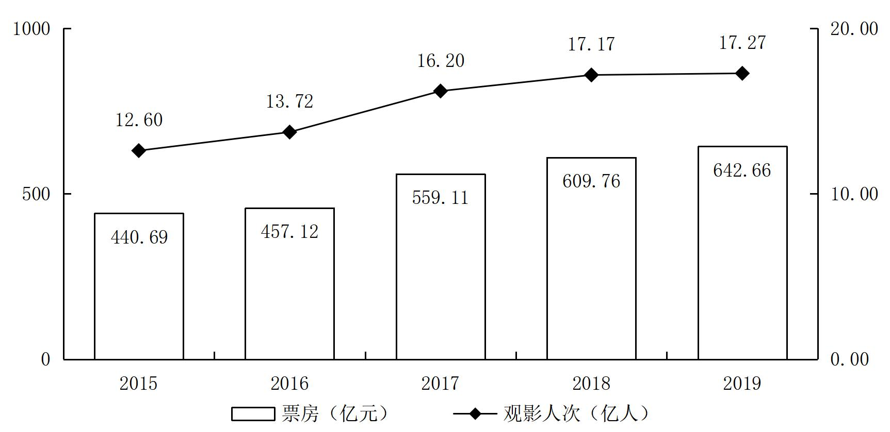
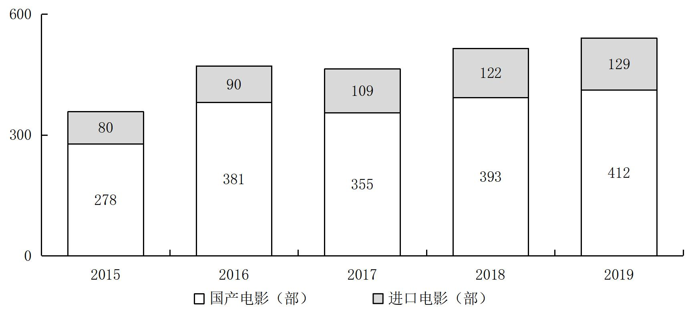
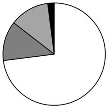
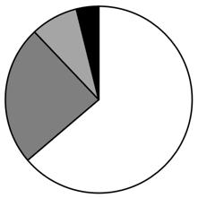
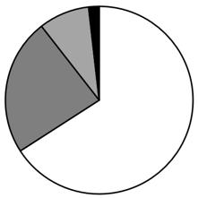
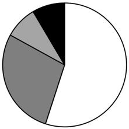

# 套题训练12

## Material M1



图1 2015～2019年我国电影票房及观影人次



图2 2015～2019年我国上映电影构成

## Material M2

2021年1～8月，我国进出口总值24.78万亿元人民币，同比增长23.7%，比2019年同期增长22.8%。其中，出口13.56万亿元，同比增长23.2%，比2019年同期增长23.8%；进口11.22万亿元，同比增长24.4%，比2019年同期增长21.8%。

8月份，我国进出口总值3.43万亿元，同比增长18.9%，环比增长5%，比2019年同期增长26.1%。其中，出口1.9万亿元，同比增长15.7%，环比增长4.9%，比2019年同期增长28.6%；进口1.53万亿元，同比增长23.1%，环比增长5.1%，比2019年同期增长23.1%。

2021年1～8月，我国一般贸易进出口15.36万亿元，同比增长26.9%，比去年同期提升1.6个百分点。其中，出口8.3万亿元，增长26.3%；进口7.06万亿元，增长27.7%。同期，加工贸易进出口5.29万亿元，增长13%，下滑2个百分点。其中，出口3.3万亿元，增长10.9%；进口1.99万亿元，增长16.6%。此外，我国以保税物流方式进出口3.07万亿元，增长28.4%。其中，出口1.11万亿元，增长37.7%；进口1.96万亿元，增长23.6%。

2021年1～8月，东盟为我第一大贸易伙伴，我国与东盟贸易总值3.59万亿元，增长22.8%。其中，对东盟出口1.98万亿元，增长21.3%；自东盟进口1.61万亿元，增长24.8%。

## Material M3

表1 2016年广东各区域主要经济总量指标

| 指标 | 珠三角 | 东翼 | 西翼 | 粤北山区 |
| --- | ---: | ---: | ---: | ---: |
| 地区生产总值（亿元） | 67841.85 | 5893.19 | 6491.93 | 5328.69 |
| 地方一般公共预算收入（亿元） | 6923.98 | 285.92 | 292.35 | 412.47 |
| 固定资产投资（亿元） | 22321.24 | 4172.14 | 3298.27 | 3217.21 |
| 房地产开发投资（亿元） | 8601.17 | 478.40 | 434.43 | 793.80 |
| 社会消费品零售总额（亿元） | 25048.68 | 3522.33 | 3407.67 | 2767.44 |
| 进出口总额（亿美元） | 9101.75 | 218.54 | 82.81 | 149.76 |

表2 2012～2018年广东珠三角与粤东西北地区生产总值

| 区域 | 2012年 | 2013年 | 2014年 | 2015年 | 2016年 | 2017年 | 2018年 |
| --- | ---: | ---: | ---: | ---: | ---: | ---: | ---: |
| 珠三角（亿元） | 47824.18 | 53307.67 | 57650.02 | 62267.78 | 67841.85 | 75809.75 | 81048.50 |
| 粤东西北（亿元） | 12650.41 | 14149.40 | 15470.76 | 15416.71 | 17713.81 | 19345.38 | 19977.45 |

注：粤东西北地区指广东省除珠三角地区之外的所有地区，包括东翼、西翼、粤北山区

## Material M4

2023年，全国软件和信息技术服务业规模以上企业超3.8万家，累计完成软件业务收入123258亿元，同比增长13.4%，较上年同期增长2.2个百分点。

四个领域分别由软件产品、信息技术服务、信息安全产品和服务、嵌入式系统软件组成。软件产品实现收入29030亿元，同比增长11.1%，较上年同期增长1.2个百分点。其中，工业软件产品实现收入2824亿元，同比增长12.3%。

信息技术服务收入81226亿元，同比增长14.7%，其中云服务、大数据服务共实现收入12470亿元，同比增长15.4%；集成电路设计收入3069亿元，同比增长6.4%；电子商务平台技术服务收入11789亿元，同比增长9.6%。

信息安全产品实现收入2232亿元，同比增长12.4%，较上年同期增长2.0个百分点。

嵌入式系统软件产品实现收入10770亿元，同比增长10.6%，较上年同期下降0.7个百分点。

## Question 1

```yaml
module: 资料分析
materials:
- M1
```

### Stem

若电影票房按“观影人次×平均票价”计算，则2019年电影平均票价比2015年：

### Options
- A. 高2.2元
- B. 高3.9元
- C. 低2.2元
- D. 低3.9元

### Answer

A

## Question 2

```yaml
module: 资料分析
materials:
- M1
```

### Stem

2016～2019年，电影票房同比增幅最低的年份，当年观影人次的同比增幅为：

### Options
- A. 0.6%
- B. 6.9%
- C. 8.9%
- D. 18.1%

### Answer

C

## Question 3

```yaml
module: 资料分析
materials:
- M1
```

### Stem

2016～2019年，上映电影数同比增幅超过10%的年份有几个：

### Options
- A. 1
- B. 2
- C. 3
- D. 4

### Answer

B

## Question 4

```yaml
module: 资料分析
materials:
- M1
```

### Stem

2016～2019年，下列指标中，与下方折线图的变化趋势最相符的是：


### Options
- A. 上映国产电影数
- B. 电影观影人次同比增量
- C. 电影平均票价
- D. 上映进口电影数同比增量

### Answer

B

## Question 5

```yaml
module: 资料分析
materials:
- M1
```

### Stem

根据上图，下列说法正确的是：

### Options
- A. 2015～2019年，上映电影数与电影票房的变化趋势一致
- B. 2016～2019年，观影人次同比增长最快的一年，其电影票房及上映电影数均同比增长最快
- C. 2015～2019年，上映电影平均票房均超1亿元/部
- D. 2015～2019年，当年电影票房超过五年年均电影票房的年份有3个

### Answer

D

## Question 6

```yaml
module: 资料分析
materials:
- M2
```

### Stem

2019年1～8月，我国贸易顺差在以下哪个范围内：

### Options
- A. 不到0.5万亿元
- B. 0.5～1.0万亿元
- C. 1.0～1.5万亿元
- D. 1.5万亿元以上

### Answer

D

## Question 7

```yaml
module: 资料分析
materials:
- M2
```

### Stem

2021年上半年，我国进出口总值约为多少万亿元：

### Options
- A. 18.1
- B. 18.9
- C. 19.3
- D. 20.4

### Answer

A

## Question 8

```yaml
module: 资料分析
materials:
- M2
```

### Stem

2020年1～8月，我国一般贸易出口额约是加工贸易的多少倍：

### Options
- A. 1.5
- B. 1.9
- C. 2.2
- D. 2.5

### Answer

C

## Question 9

```yaml
module: 资料分析
materials:
- M2
```

### Stem

2021年1～8月，我国对东盟出口额占出口总额的比重比上年约：

### Options
- A. 增加了2个百分点
- B. 减少了2个百分点
- C. 增加了0.2个百分点
- D. 减少了0.2个百分点

### Answer

D

## Question 10

```yaml
module: 资料分析
materials:
- M2
```

### Stem

能够从上述材料中推出的是：

### Options
- A. 2021年8月，我国贸易顺差比7月略有减小
- B. 2020年1～8月，我国进出口贸易总值同比有所下降
- C. 2019年1～8月，我国一般贸易进出口总值超过13万亿元
- D. 2021年1～8月，我国以保税物流方式进出口总值同比增量是加工贸易同比增量的2倍以上

### Answer

B

## Question 11

```yaml
module: 资料分析
materials:
- M3
```

### Stem

2018年，广东省生产总值同比增长：

### Options
- A. 6.2%
- B. 6.8%
- C. 7.2%
- D. 7.7%

### Answer

A

## Question 12

```yaml
module: 资料分析
materials:
- M3
```

### Stem

2016年，珠三角地区下列经济指标占全省总额的比重，与珠三角地区生产总值占全省生产总值的比重

最接近的是：

### Options
- A. 固定资产投资
- B. 房地产开发投资
- C. 社会消费品零售总额
- D. 进出口总额

### Answer

B

## Question 13

```yaml
module: 资料分析
materials:
- M3
```

### Stem

2013～2018年，粤东西北地区生产总值同比增速最快的年份是哪年：

### Options
- A. 2013
- B. 2014
- C. 2017
- D. 2018

### Answer

A

## Question 14

```yaml
module: 资料分析
materials:
- M3
```

### Stem

2016年，广东各区域按社会消费品零售总额与地区生产总值的比值由大到小排列，依次为：

### Options
- A. 珠三角＞粤北山区＞东翼＞西翼
- B. 珠三角＞粤北山区＞西翼＞东翼
- C. 东翼＞西翼＞珠三角＞粤北山区
- D. 东翼＞西翼＞粤北山区＞珠三角

### Answer

D

## Question 15

```yaml
module: 资料分析
materials:
- M3
```

### Stem

根据上表，下列说法正确的是：

### Options
- A. 2016年，珠三角地方一般公共预算收入比粤东西北地区多7.0倍
- B. 2012～2018年，珠三角与粤东西北地区生产总值的差距逐年缩小
- C. 按2018年珠三角地区生产总值的同比增速，预计2020年珠三角地区生产总值将突破9万亿元
- D. 2016年，广东省固定资产投资30008.86亿元

### Answer

C

## Question 16

```yaml
module: 资料分析
materials:
- M4
```

### Stem

2021年，全国软件和信息技术服务业规模以上企业的软件业务收入约为：

### Options
- A. 不到9万亿元
- B. 9万亿～10万亿元
- C. 10万亿～11万亿元
- D. 11万亿元以上

### Answer

B

## Question 17

```yaml
module: 资料分析
materials:
- M4
```

### Stem

2023年工业软件产品实现收入占软件产品收入的比重比上一年：

### Options
- A. 上升不到0.12个百分点
- B. 上升0.12个百分点以上
- C. 下降不到0.12个百分点
- D. 下降0.12个百分点以上

### Answer

A

## Question 18

```yaml
module: 资料分析
materials:
- M4
```

### Stem

以下饼图中能准确反映2023年软件业务四个领域收入占比情况的是：

### Options
- A. 
- B. 
- C. 
- D. 

### Answer

C

## Question 19

```yaml
module: 资料分析
materials:
- M4
```

### Stem

2022年，云服务、大数据服务共实现收入是集成电路设计收入的：

### Options
- A. 不到3倍
- B. 3～3.5倍
- C. 3.5～4倍
- D. 4倍以上

### Answer

C

## Question 20

```yaml
module: 资料分析
materials:
- M4
```

### Stem

以下信息，可以推出的是：

①2022年，信息技术服务收入同比增长11.2%以上

②2023年，电子商务平台技术服务收入同比增长1200亿元以上

③2023年，嵌入式系统软件产品实现收入同比增量大于2022年水平

### Options
- A. 0项
- B. 1项
- C. 2项
- D. 3项

### Answer

C
