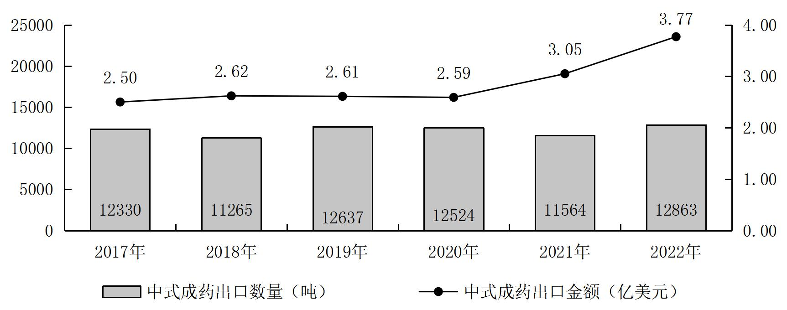

# 套题训练13

## Material M1

表A省本月金融机构存款贷款

| 指标名称 | 本月（亿元） | 比年初增减（亿元） |
| --- | ---: | ---: |
| 金融机构人民币存款余额 | 119919.39 | 12046.4 |
| 境内存款 | 119629.80 | 12021.0 |
| 住户存款 | 43313.71 | 2750.7 |
| 非金融企业存款 | 45047.05 | 6113.7 |
| 广义政府存款 | 23861.36 | 3118.0 |
| 非银行业金融机构存款 | 7407.67 | 38.6 |
| 境外存款 | 289.60 | 25.3 |
| 金融机构人民币贷款余额 | 87478.20 | 8608.8 |
| 境内贷款 | 87414.56 | 8634.0 |
| 住户贷款 | 24279.75 | 4079.6 |
| 短期贷款 | 4877.97 | 70.3 |
| 中长期贷款 | 19401.78 | 4009.3 |
| 非金融业及机关团体贷款 | 63131.64 | 4554.1 |
| 短期贷款 | 25706.37 | −207.1 |
| 中长期贷款 | 31120.97 | 3809.0 |
| 票据融资 | 5537.55 | 762.0 |
| 各项垫款 | 140.89 | 8.1 |
| 非银行金融机构贷款 | 3.17 | 0.3 |
| 境外贷款 | 63.64 | −25.2 |

## Material M2

2021年上半年，湖北省规模以上信息传输、软件和信息技术服务业（以下简称“规上信息软件业”）保持较快增长，推动全省规上服务业稳步发展。

2021年上半年，湖北省676家规上信息软件业企业中营业收入前20的企业共实现营业收入355.46亿元，同比增长8.3%，拉动规上服务业营业收入增长1.1个百分点。

表2021年上半年湖北省规上信息软件业主要细分行业发展情况

| 行业 | 营业收入（亿元） | 同比增长（%） | 拉动规上服务业增长（百分点） |
| --- | ---: | ---: | ---: |
| 信息传输、软件和信息技术服务业 | 744.27 | 19.7 | 4.9 |
| 电信、广播电视和卫星传输服务 | 305.13 | 11.6 | 1.3 |
| 互联网和相关服务业 | 109.23 | 23.5 | 0.8 |
| #互联网其他信息服务 | 89.51 | 16.9 | 0.5 |
| 软件和信息技术服务业 | 329.91 | 26.8 | 2.8 |
| #应用软件开发 | 191.59 | 33.2 | 1.9 |

表2021年上半年全国及部分省市规上信息软件业发展情况

|  | 营业收入（亿元） | 占规上服务业比重（%） | 同比增长（%） | 拉动规上服务业增长（百分点） |
| --- | ---: | ---: | ---: | ---: |
| 全国 | 39271.6 | 29 | 25.7 | 7.7 |
| 上海 | 4678.99 | 23 | 30.5 | 7.2 |
| 北京 | 9751.1 | 41 | 34.1 | 13.2 |
| 浙江 | 5586.62 | 45.9 | 28.8 | 13.7 |
| 广东 | 6611.73 | 34.5 | 20.2 | 7.3 |
| 江苏 | 2202.2 | 22.9 | 25.1 | 6.2 |
| 湖北 | 744.27 | 20.6 | 19.7 | 4.9 |
| 河南 | 639.54 | 17.4 | 18.4 | 3.4 |
| 安徽 | 555.5 | 25.7 | 15.8 | 4.5 |
| 江西 | 378.19 | 23 | 13.7 | 3.7 |

## Material M3

2016年1月1日，我国废除了推行30多年的一胎化政策，改而实行“全面二孩”政策，以缓解人口增长放慢，人口老年化等结构问题，“全面二孩”政策实施满一周年后，国家统计局对外公布的数据显示：2016年中国出生人口达1786万人，比上年多131万人，人口出生率为12.95‰。

从年龄构成看，2016年末，16周岁以上至60周岁以下（不含60周岁）的劳动年龄人口90747万人，60周岁及以上人口23086万人，占总人口的16.7%，65周岁及以上人口15003万人，占总人口的10.85%。

2021年5月11日公布的第七次人口普查结果显示：2020年（截至2020年11月1日）全国出生人口1200万人。从年龄构成看，劳动年龄人口为89438万人，占63.35%；60周岁及以上人口为26402万人，占18.7%（其中，65周岁及以上人口为19064万人，占13.5%）。

表出生人口和老龄人口情况表

| 年份 | 2015 | 2016 | 2017 | 2018 | 2019 | 2020 |
| --- | ---: | ---: | ---: | ---: | ---: | ---: |
| 出生人口总数（万人） | 1655 | 1786 | 1723 | 1523 | 1465 | 1200 |
| 人口出生率（‰） | 12.07 | 12.95 | 12.43 | 10.94 | 10.5 | 8.5 |
| 65岁及以上人口（万人） | 14386 | 15003 | 15831 | 16658 | 17603 | 19064 |
| 65岁及以上老人占比（%） | 10.465 | 10.85 | 11.419 | 11.961 | 12.615 | 13.5 |

## Material M4



表2022年我国中式成药出口数量和金额

| 时间 | 出口数量（吨） | 同比增长（%） | 出口金额（万美元） | 同比增长（%） |
| --- | ---: | ---: | ---: | ---: |
| 2022年1～2月 | 1741 | 0.5 | 5910 | 27.9 |
| 2022年3月 | 1427 | 83.9 | 6470 | 202.9 |
| 2022年4月 | 739 | −18.5 | 2070 | −35.2 |
| 2022年5月 | 897 | −7.3 | 2760 | 15.7 |
| 2022年6月 | 1128 | 52.9 | 3480 | 87.6 |
| 2022年7月 | 1112 | 9.1 | 2290 | 9.3 |
| 2022年8月 | 1100 | 8.4 | 3150 | 19.5 |
| 2022年9月 | 1197 | −1.4 | 2840 | −4 |
| 2022年10月 | 1019 | 2.9 | 2010 | −29.8 |
| 2022年11月 | 1259 | 31.9 | 3390 | 48.4 |
| 2022年12月 | 1242 | −0.5 | 3390 | −1.6 |

## Question 1

```yaml
module: 资料分析
materials:
- M1
```

### Stem

该省年初金融机构人民币贷款余额占存款余额的比重约为：

### Options
- A. 73.1%
- B. 80.5%
- C. 90.3%
- D. 95.1%

### Answer

A

## Question 2

```yaml
module: 资料分析
materials:
- M1
```

### Stem

该省本月金融机构人民币存贷款的下列项目中，余额比年初增加最少的是：

### Options
- A. 境内存款中的非金融企业存款
- B. 境内住户贷款中的短期贷款
- C. 金融机构人民币贷款
- D. 非金融企业及机关团体贷款中的各项垫款

### Answer

D

## Question 3

```yaml
module: 资料分析
materials:
- M1
```

### Stem

该省本月下列项目在金融机构人民币存款余额中的占比较年初增长最小的是：

### Options
- A. 境内存款
- B. 住户存款
- C. 非金融企业存款
- D. 广义政府存款

### Answer

B

## Question 4

```yaml
module: 资料分析
materials:
- M1
```

### Stem

该省本月金融机构人民币境内住户存贷款之差相比年初约：

### Options
- A. 减少了1329亿元
- B. 增加了1329亿元
- C. 减少了1903亿元
- D. 增加了1903亿元

### Answer

A

## Question 5

```yaml
module: 资料分析
materials:
- M1
```

### Stem

该省本月非银行业金融机构贷款余额同比增长：

### Options
- A. 10.5%
- B. 10.0%
- C. 9.5%
- D. 不知道

### Answer

D

## Question 6

```yaml
module: 资料分析
materials:
- M2
```

### Stem

2021年上半年湖北省规上信息软件业中营业收入前20的企业，平均每家每月营业收入约为多少亿元：

### Options
- A. 1.18
- B. 2.25
- C. 2.32
- D. 2.96

### Answer

D

## Question 7

```yaml
module: 资料分析
materials:
- M2
```

### Stem

2020年上半年湖北省规上信息软件业主要细分行业营业收入中，应用软件开发占软件和信息技术服务

业的比例比互联网其他信息服务占互联网和相关服务业的比例约低多少个百分点：

### Options
- A. 17
- B. 26
- C. 31
- D. 45

### Answer

C

## Question 8

```yaml
module: 资料分析
materials:
- M2
```

### Stem

2021年上半年，湖北、河南、安徽、江西四省规上信息软件业营业收入占规上服务业比重由高到低的

排名与拉动规上服务业增长由高到低的排名相同的有几个省份：

### Options
- A. 1
- B. 2
- C. 3
- D. 4

### Answer

A

## Question 9

```yaml
module: 资料分析
materials:
- M2
```

### Stem

以下四组地区中，哪组2021年上半年规上服务业营业收入之差最小：

### Options
- A. 北京和上海
- B. 浙江和广东
- C. 河南和江西
- D. 湖北和安徽

### Answer

D

## Question 10

```yaml
module: 资料分析
materials:
- M2
```

### Stem

下列说法不正确的是：

### Options
- A. 2021年上半年，北京规上服务业营业收入占全国的比例比上海多5个百分点以内
- B. 2020年上半年，江苏、湖北、河南、安徽、江西五省规上信息软件业企业营业收入之和比上海低
- C. 2021年上半年湖北比河南规上信息软件业营业收入多，规上服务业营业收入少
- D. 2020年上半年湖北省规上信息软件业企业中营业收入前20的企业总营业收入，与2021年上半年湖北省规上信息软件业中软件和信息技术服务业营业收入的差在5亿元以内

### Answer

B

## Question 11

```yaml
module: 资料分析
materials:
- M3
```

### Stem

2016～2020年，我国65岁以上人口增幅从大到小的排序为：

### Options
- A. 2020＞2019＞2017＞2018＞2016
- B. 2020＞2019＞2018＞2017＞2016
- C. 2020＞2017＞2018＞2019＞2016
- D. 2020＞2018＞2019＞2017＞2016

### Answer

A

## Question 12

```yaml
module: 资料分析
materials:
- M3
```

### Stem

与2016年比，2020年的劳动年龄人口占比减少了约：

### Options
- A. 2.29个百分点
- B. 3.63个百分点
- C. 4.13个百分点
- D. 5.45个百分点

### Answer

A

## Question 13

```yaml
module: 资料分析
materials:
- M3
```

### Stem

与2016年相比，2020年的60周岁（含）至65周岁（不含）的人数减少了：

### Options
- A. 8083万人
- B. 7338万人
- C. 1467万人
- D. 745万人

### Answer

D

## Question 14

```yaml
module: 资料分析
materials:
- M3
```

### Stem

“十三五”时期，65岁及以上人口年均增长率约为：

### Options
- A. 4.1%
- B. 4.9%
- C. 5.8%
- D. 6.9%

### Answer

C

## Question 15

```yaml
module: 资料分析
materials:
- M3
```

### Stem

下列说法正确的是：

### Options
- A. 2016～2020年，我国的出生人口的增长率是先降后升
- B. 2016～2020年，我国的出生人口的增长率是一直是负值
- C. 2016～2020年，我国的出生人口的增长率在2017年达到最高
- D. 2016～2020年，我国的出生人口的增长率在2020年达到最低

### Answer

D

## Question 16

```yaml
module: 资料分析
materials:
- M4
```

### Stem

2017～2022年，我国中式成药年均出口数量约为多少万吨：

### Options
- A. 1.18
- B. 1.22
- C. 1.25
- D. 1.27

### Answer

B

## Question 17

```yaml
module: 资料分析
materials:
- M4
```

### Stem

2017～2022年，我国中式成药出口平均价格第三高的年份是：

### Options
- A. 2018
- B. 2019
- C. 2021
- D. 2022

### Answer

A

## Question 18

```yaml
module: 资料分析
materials:
- M4
```

### Stem

2022年第四季度，我国中式成药出口金额同比增速约为：

### Options
- A. -6%
- B. -2%
- C. 2%
- D. 6%

### Answer

C

## Question 19

```yaml
module: 资料分析
materials:
- M4
```

### Stem

下列折线图准确反映了2021年4～6月我国中式成药出口数量变化趋势的是：

### Options
- A. 
- B. 
- C. 
- D. 

### Answer

D

## Question 20

```yaml
module: 资料分析
materials:
- M4
```

### Stem

根据材料，可以推出的是：

### Options
- A. 2022年我国每月中式成药出口金额均不低于2000万美元
- B. 2021年6月，我国中式成药出口数量低于当年的月均出口数量
- C. 2022年2～4季度，我国中式成药出口数量环比减少的月份有4个
- D. 2018～2022年，我国中式成药出口数量和金额同比均增长的年份有2个

### Answer

B
