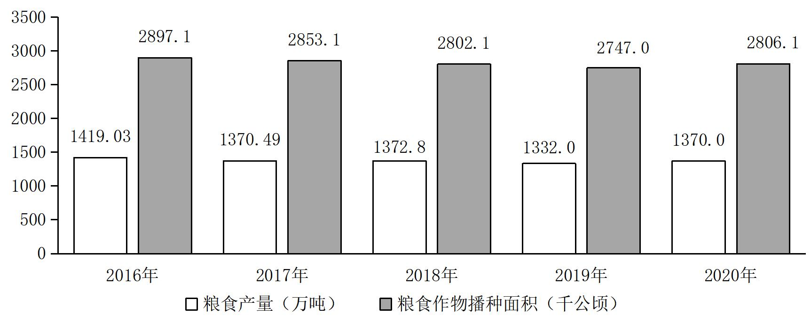
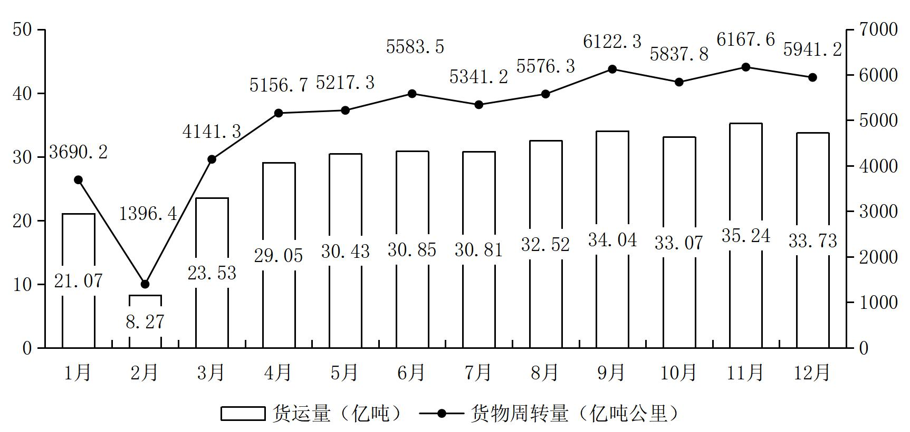

<!-- hyz-paper-id: 01a1e4f7-7bbf-7923-afb8-a6f90e1e3187 -->

# 套题训练14

## Material M1

<!-- hyz-material-id: 01a1e4f7-7bbf-7923-afb8-a70513ff8272 -->

2020年全年，汽车产销降幅收窄至2%以内。汽车产量为2522.5万辆，销量为2531.1万辆，同比分别下降2.0%和1.9%，降幅分别比2020年上半年收窄14.8和15.0个百分点。2020年全年，新能源汽车销量为136.7万辆，同比增长10.9%。

2020年全年，汽车进口93.0万辆，同比下降11.4%，降幅较2020年上半年收窄21.1个百分点；进口金额467.0亿美元，同比下降4.2%，降幅较2020年上半年收窄25.8个百分点。全年汽车出口108万辆，同比下降13.2%，降幅较2020年上半年收窄10.4个百分点；出口金额157.4亿美元，同比下降3.6%，降幅较2020年上半年收窄8.3个百分点。

## Material M2

<!-- hyz-material-id: 01a1e4f7-7bbf-7923-afb8-a71e2ad2b322 -->

2020年全年广西全区粮食种植面积2806千公顷，比上年增加59千公顷，甘蔗种植面积874.83千公顷，减少15.4千公顷，油料种植面积262.2千公顷，增加8.56千公顷。蔬菜种植面积1535.92千公顷，增加50.76千公顷。木薯种植面积173.77千公顷，减少4.28千公顷。果园面积1352.57千公顷，增加20.76千公顷，桑园面积198.81千公顷，增加了1.92千公顷。

2020年全年全区粮食总产量1370万吨，比上年增加38万吨，增长2.9%。其中，春收粮食产量26.0万吨，增长30.0%；早稻产量476.8万吨，增长5.3%；秋粮产量867.3万吨，增长0.9%。全年谷物产量1290.9万吨，增长2.5%，其中，稻谷产量1013.8万吨，增长2.2%；玉米产量273.3万吨，增长4.6%。

2020年全年全区油料产量73.88万吨，比上年增长3.2%。甘蔗产量7412.47万吨，下降1.0%，蔬菜产量（含食用菌）3830.77万吨，增长5.4%，园林水果产量2461.11万吨，增长15.0%。

2020年全年全区猪牛羊禽肉产量371.3万吨，与上年基本持平，其中，猪肉产量174.1万吨，下降9.4%；牛肉产量13.6万吨，增长9.7%；羊肉产量3.6万吨，增长5.3%；禽肉产量179.9万吨，增长10.5%；禽蛋产量26.7万吨，增长6.4%；牛奶产量11.2万吨，增长28.4%。全年生猪出栏2281.2万头，比上年下降9.0%，年末生猪存栏1828.3万头，比上年末增长14.3%。全年蚕茧产量37.4万吨，比上年下降0.6%。

2020年全年全区水产品产量343.96万吨，比上年增长1.1%。其中，海水产品产量199.07万吨，增长0.7%。

2020年全年全区木材产量3600万立方米，比上年增长2.9%，天然松脂72.41万吨，增长0.4%，油茶籽29.94万吨，增长14.5%。



图2016～2020年广西粮食产量、粮食作物播种面积

## Material M3

<!-- hyz-material-id: 01a1e4f7-7bbf-7923-afb8-a72dc3484987 -->



注：货物平均运输距离＝货物周转量/货运量

图2020年1～12月全国公路货物运输情况

## Material M4

<!-- hyz-material-id: 01a1e4f7-7bbf-7923-afb8-a73130653149 -->

2016年全国粮食情况如下：

全国粮食总产量61623.9万吨（12324.8亿斤），比2015年减少520.1万吨（104.0亿斤），减少0.8%。其中谷物产量56516.5万吨（11303.3亿斤），比2015年减少711.5万吨（142.3亿斤），减少1.2%。

全国粮食播种面积113028.2千公顷（169542.3万亩），比2015年减少314.7千公顷（472.1万亩），减少0.3%。其中谷物播种面积94370.8千公顷（141556.2万亩），比2015年减少1265.1千公顷（1897.7万亩），减少1.3%。

对此，国家统计局解读称，2016年粮食产量下降同时受到播种面积减少和单产下降的影响。2016年，全国粮食播种面积比上年减少了472万亩，因播种面积减少而减产34亿斤，占粮食减产总量的33.2%；全国粮食产量因单产下降而减产70亿斤，占粮食减产总量的66.8%。

粮食单产下降的主要原因：

一是高产作物面积减少。按可食用的籽粒玉米统计，玉米播种面积5.51亿亩，比上年减少2039万亩，减少3.6%。低产作物大豆播种面积1.08亿亩，比上年增加1046万亩，增长10.7%。2016年，玉米平均亩产398.2公斤，是大豆的3.3倍，仅玉米改种大豆就可拉低粮食亩产约1.7公斤。

二是全国农业气象灾害较上年偏重，部分地区受灾较重。夏粮、早稻因灾减产。秋粮生长前期，南方多地遭受强降水，湖北、安徽等地受灾较重，部分农田反复受淹，作物倒伏严重。7月下旬至8月中下旬，南方一些地区又遭受持续高温天气，导致水稻空壳率增加；东北、西北部分地区出现不同程度旱情，对玉米后期生产和灌浆不利。据民政部统计，今年1～10月份，全国农作物受灾面积3.97亿亩，比上年同期增加5410万亩；绝收面积6218万亩，增加1719万亩。

## Question 1

<!-- hyz-question-id: 01a1e4f7-7bbf-7923-afb8-a747bdfbcd12 -->

```yaml
module: 资料分析
materials:
- M1
```

### Stem

2020年上半年汽车销量降幅估计在：

### Options
- A. 10个百分点以内
- B. 10～12个百分点
- C. 12～14个百分点
- D. 15个百分点以上

### Answer

D

## Question 2

<!-- hyz-question-id: 01a1e4f7-7bbf-7923-afb8-a75450f98acf -->

```yaml
module: 资料分析
materials:
- M1
```

### Stem

2019年汽车产量约为：

### Options
- A. 2548万辆
- B. 2354万辆
- C. 2563万辆
- D. 2574万辆

### Answer

D

## Question 3

<!-- hyz-question-id: 01a1e4f7-7bbf-7923-afb8-a7607461f4f8 -->

```yaml
module: 资料分析
materials:
- M1
```

### Stem

2019年新能源汽车销量占汽车总销量的比重为：

### Options
- A. 不超过3%
- B. 4%左右
- C. 5%左右
- D. 大于6%

### Answer

C

## Question 4

<!-- hyz-question-id: 01a1e4f7-7bbf-7923-afb8-a7712640ccaa -->

```yaml
module: 资料分析
materials:
- M1
```

### Stem

根据上述材料可推出：

### Options
- A. 2019年上半年出口汽车70.9万辆
- B. 2020年生产的汽车在当年内全部售完
- C. 2020年上半年汽车产销降幅大致相同
- D. 2020年汽车进口量与进口金额的变化幅度基本一致

### Answer

C

## Question 5

<!-- hyz-question-id: 01a1e4f7-7bbf-7923-afb8-a784c9d11d35 -->

```yaml
module: 资料分析
materials:
- M1
```

### Stem

下列选项说法错误的是：

### Options
- A. 2020年全年汽车产销降幅要小于2019年的降幅
- B. 2020年全年汽车的产量减少量要小于销量的减少量
- C. 从增长率上看，2020年全年新能源汽车的销售要好于其它类型汽车的销售
- D. 总体而言，2020年进口汽车平均价格要高于出口汽车平均价格

### Answer

B

## Question 6

<!-- hyz-question-id: 01a1e4f7-7bbf-7923-afb8-a797df8dde05 -->

```yaml
module: 资料分析
materials:
- M2
```

### Stem

2019年，我区稻谷产量约为多少万吨：

### Options
- A. 989.1
- B. 992.0
- C. 995.1
- D. 1259.4

### Answer

B

## Question 7

<!-- hyz-question-id: 01a1e4f7-7bbf-7923-afb8-a7a4bbe44bf6 -->

```yaml
module: 资料分析
materials:
- M2
```

### Stem

2020年，我区平均每公顷油料的产量与上年相比：

### Options
- A. 减少1.2%左右
- B. 减少2%以上
- C. 增长1.5%以上
- D. 基本一致

### Answer

D

## Question 8

<!-- hyz-question-id: 01a1e4f7-7bbf-7923-afb8-a7bf0358ce40 -->

```yaml
module: 资料分析
materials:
- M2
```

### Stem

从2017年到2020年，我区粮食作物播种面积同比变化超过2%的年份有多少个：

### Options
- A. 0
- B. 1
- C. 2
- D. 3

### Answer

B

## Question 9

<!-- hyz-question-id: 01a1e4f7-7bbf-7923-afb8-a7c71a53a27d -->

```yaml
module: 资料分析
materials:
- M2
```

### Stem

2019年，我区猪肉产量约比禽肉产量：

### Options
- A. 多29.4万吨
- B. 多25.8万吨
- C. 多13.3万吨
- D. 少5.8万吨

### Answer

A

## Question 10

<!-- hyz-question-id: 01a1e4f7-7bbf-7923-afb8-a7d5b48505af -->

```yaml
module: 资料分析
materials:
- M2
```

### Stem

根据以上材料，下列说法正确的是：

### Options
- A. “十三五”期间，我区粮食产量逐年减少的趋势直至2020年才得到遏制
- B. 2020年全年，我区海水产品产量占全区水产品产量六成以上
- C. 2017年，我区单位面积粮食产量约为4.8吨/公顷
- D. 按照2020年的增速，2021年我区油茶籽的产量将超过35万吨

### Answer

C

## Question 11

<!-- hyz-question-id: 01a1e4f7-7bbf-7923-afb8-a7e31a747c6f -->

```yaml
module: 资料分析
materials:
- M3
```

### Stem

2020年下半年，全国公路货运量高于上月水平的月份有多少个：

### Options
- A. 2
- B. 3
- C. 4
- D. 5

### Answer

B

## Question 12

<!-- hyz-question-id: 01a1e4f7-7bbf-7923-afb8-a7f269d1cd71 -->

```yaml
module: 资料分析
materials:
- M3
```

### Stem

2020年第二季度，全国货物周转量约比第一季度增长了：

### Options
- A. 40%
- B. 51%
- C. 62%
- D. 73%

### Answer

D

## Question 13

<!-- hyz-question-id: 01a1e4f7-7bbf-7923-afb8-a8070522473b -->

```yaml
module: 资料分析
materials:
- M3
```

### Stem

2020年，我国公路货物周转量累计达1万亿吨公里、2万亿吨公里、3万亿吨公里分别在：

### Options
- A. 3月、5月、7月
- B. 4月、6月、8月
- C. 4月、6月、7月
- D. 3月、5月、8月

### Answer

C

## Question 14

<!-- hyz-question-id: 01a1e4f7-7bc0-7c92-9d92-01799683204a -->

```yaml
module: 资料分析
materials:
- M3
```

### Stem

2020年各季度公路货物平均运输距离最高的季度是：

### Options
- A. 第一季度
- B. 第二季度
- C. 第三季度
- D. 第四季度

### Answer

B

## Question 15

<!-- hyz-question-id: 01a1e4f7-7bc0-7c92-9d92-018fd079bd2e -->

```yaml
module: 资料分析
materials:
- M3
```

### Stem

关于2020年全国公路货物运输情况的描述，可以推出的是：

### Options
- A. 2月份货运平均运输距离在170～175公里
- B. 全年日均货运量多于1亿吨的月份有6个
- C. 3月份货物周转量比2月份多200%以上
- D. 全年月均货运量超过30亿吨

### Answer

B

## Question 16

<!-- hyz-question-id: 01a1e4f7-7bc0-7c92-9d92-019e10271fa3 -->

```yaml
module: 资料分析
materials:
- M4
```

### Stem

2015年我国粮食非谷物播种面积占全国的比重约为：

### Options
- A. 8%
- B. 16%
- C. 84%
- D. 92%

### Answer

B

## Question 17

<!-- hyz-question-id: 01a1e4f7-7bc0-7c92-9d92-01a74d222150 -->

```yaml
module: 资料分析
materials:
- M4
```

### Stem

2015年我国玉米播种面积约是大豆的多少倍：

### Options
- A. 5.1
- B. 5.9
- C. 7
- D. 4.3

### Answer

B

## Question 18

<!-- hyz-question-id: 01a1e4f7-7bc0-7c92-9d92-01be333e4528 -->

```yaml
module: 资料分析
materials:
- M4
```

### Stem

2016年，我国谷物产量占粮食总产量的比重比上年约：

### Options
- A. 提高0.37个百分点
- B. 提高2.08个百分点
- C. 降低0.37个百分点
- D. 降低2.08个百分点

### Answer

C

## Question 19

<!-- hyz-question-id: 01a1e4f7-7bc0-7c92-9d92-01c3da3db2e6 -->

```yaml
module: 资料分析
materials:
- M4
```

### Stem

2016年我国粮食单位面积产量约同比：

### Options
- A. 增长0.56%
- B. 增长1.12%
- C. 减少0.56%
- D. 减少1.12%

### Answer

C

## Question 20

<!-- hyz-question-id: 01a1e4f7-7bc0-7c92-9d92-01d55de701fa -->

```yaml
module: 资料分析
materials:
- M4
```

### Stem

以下说法正确的是：

### Options
- A. 2016年，除谷物外我国其他粮食播种面积之和有所增加
- B. 假设粮食总产量以每年10%的速度增长，2019年将首次突破7万万吨
- C. 2016年粮食产量下降主要是播种面积减少造成的
- D. 2016年全国农作物受灾面积同比增长约为16%

### Answer

A
