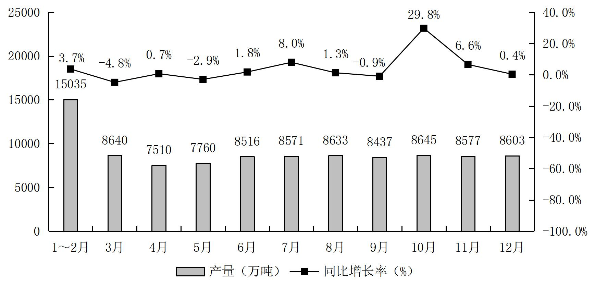
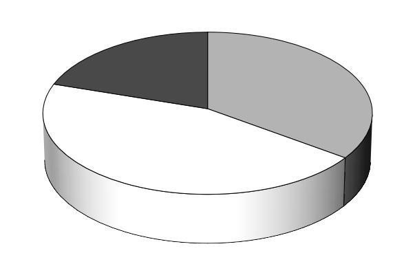
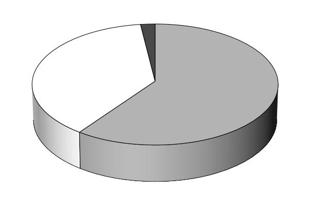
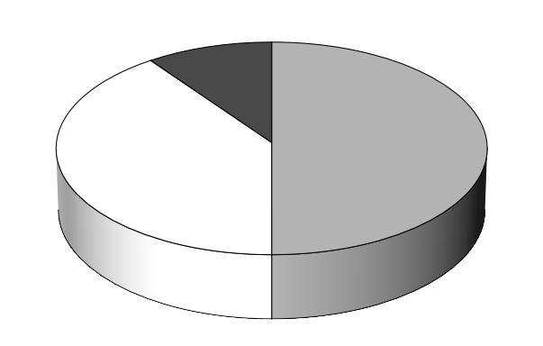
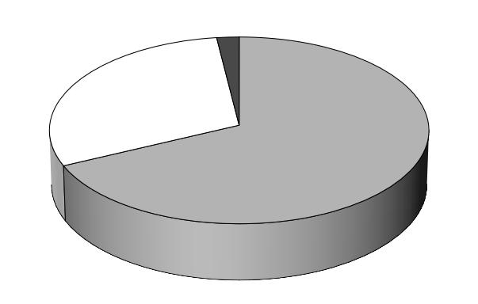

<!-- hyz-paper-id: 01a1e4f7-7bc4-7993-a2f7-a92cae8701be -->

# 套题训练15

## Material M1

<!-- hyz-material-id: 01a1e4f7-7bc4-7993-a2f7-a93d7b036092 -->

2024年江苏省外贸规模再创新高，进出口总额5.62万亿元，比上年增长7.0%。从贸易方式看，加工贸易进出口总额1.81万亿元，占全省进出口总额比重32.2%。从经营主体看，民营企业进出口总额2.55万亿元，比上年增长7.3%。从主要市场看，对东盟、韩国、非洲的进口额、出口额均实现增长，进出口总额增长率均达10%以上。2020～2024年江苏省对东盟、韩国、非洲进出口情况见下表。

表2020～2024年江苏省对东盟、韩国、非洲进出口情况

单位：亿元

| 年份 | 东盟出口额 | 东盟进口额 | 韩国出口额 | 韩国进口额 | 非洲出口额 | 非洲进口额 |
| ---: | ---: | ---: | ---: | ---: | ---: | ---: |
| 2020 | 3820.3 | 2406.6 | 1838.1 | 2949.6 | 722.0 | 218.8 |
| 2021 | 4419.2 | 2989.1 | 2085.4 | 3345.3 | 996.5 | 331.4 |
| 2022 | 5095.6 | 3205.8 | 2418.2 | 3260.9 | 1051.6 | 405.1 |
| 2023 | 5003.0 | 3141.5 | 2304.6 | 2770.3 | 1212.4 | 360.8 |
| 2024 | 5816.9 | 3237.5 | 2455.3 | 3272.1 | 1466.9 | 457.9 |

## Material M2

<!-- hyz-material-id: 01a1e4f7-7bc4-7993-a2f7-a94dae0c8d37 -->

表2018、2019全国体育产业状况

| 分类名称 | 总量（亿元）总产出2018年 | 总量（亿元）总产出2019年 | 总量（亿元）增加值2018年 | 总量（亿元）增加值2019年 |
| --- | ---: | ---: | ---: | ---: |
| 体育产业 | 26579.0 | 29483.4 | 10078.0 | 11248.1 |
| 体育服务业 | 12732.0 | 14929.5 | 6530.0 | 7615.1 |
| 体育管理活动 | 747.0 | 866.1 | 390.0 | 451.9 |
| 体育竞赛表演活动 | 292.0 | 308.5 | 103.0 | 122.3 |
| 体育健身休闲活动 | 1028.0 | 1796.6 | 477.0 | 831.9 |
| 体育场地和设施管理 | 2632.0 | 2748.9 | 855.0 | 1012.2 |
| 体育经纪与代理、广告与会展、表演与设计服务 | 317.0 | 392.9 | 106.0 | 117.8 |
| 体育教育与培训 | 1722.0 | 1909.4 | 1425.0 | 1524.9 |
| 体育传媒与信息服务 | 500.0 | 705.6 | 230.0 | 285.1 |
| 体育用品及相关产品销售、出租与贸易代理 | 4116.0 | 4501.2 | 2327.0 | 2562.0 |
| 其他体育服务 | 1377.0 | 1700.2 | 616.0 | 707.0 |
| 体育用品及相关产品制造 | 13201.0 | 13614.1 | 3399.0 | 3421.0 |
| 体育场地设施建设 | 646.0 | 939.8 | 150.0 | 211.9 |

表格中数据分项合计与总值不等，是由于数值修约误差所致。

## Material M3

<!-- hyz-material-id: 01a1e4f7-7bc4-7993-a2f7-a9590816b918 -->



图2023年1～12月全国铁矿石产量及增长率

## Material M4

<!-- hyz-material-id: 01a1e4f7-7bc4-7993-a2f7-a9602618e837 -->

2020年，我国规模以上互联网和相关服务企业（以下简称互联网企业）业务收入12838亿元，同比增长12.5%，增速低于上年同期8.9个百分点。

2020年，互联网企业实现营业利润1187亿元，同比增长13.2%，增速低于上年同期3.7个百分点；得益于成本控制较好，营业成本仅增长2.4%，行业营业利润高出同期收入增速0.7个百分点。

2020年，互联网企业信息服务收入共7068亿元，同比增长11.5%，增速低于上年同期11.2个百分点。互联网接入及相关服务收入447.5亿元，同比增长11.5%，增速低于上年同期20.8个百分点；互联网数据服务（包括云服务、大数据服务等）收入199.8亿元，同比增长29.5%，增速较上年同期提高3.9个百分点。

2020年，东部地区互联网业务收入11227亿元，同比增长14.8%，增速较上年同期回落9个百分点，中部地区互联网业务收入448.1亿元，同比增长3.4%，增速较上年同期回落53.1个百分点。西部地区互联网业务收入497.2亿元，同比增长6.9%，增速较上年同期回落15.2个百分点。东北地区互联网业务收入47.1亿元，同比增长9.1%。

2020年，互联网业务累计收入居前5名的广东（增长5.2%）、北京（增长21.5%）、上海（增长20.9%）、浙江（增长24.4%）和江苏（增长8.0%）共完成互联网业务收入10706亿元，同比增长15.1%，增速超过全国平均水平2.6个百分点，占全国（扣除跨地区企业）比重达87.6%，占比较上年同期提高0.8个百分点。

## Question 1

<!-- hyz-question-id: 01a1e4f7-7bc4-7993-a2f7-a975d6d73873 -->

```yaml
module: 资料分析
materials:
- M1
```

### Stem

2024年江苏省对东盟、韩国、非洲的净出口总额是：

### Options
- A. 2771.6亿元
- B. 2817.9亿元
- C. 15687.5亿元
- D. 16706.6亿元

### Answer

A

## Question 2

<!-- hyz-question-id: 01a1e4f7-7bc4-7993-a2f7-a98e7698889d -->

```yaml
module: 资料分析
materials:
- M1
```

### Stem

与上年相比，在2024年江苏省对东盟、韩国、非洲的进口额、出口额中，增长率最高的是：

### Options
- A. 东盟出口额
- B. 韩国进口额
- C. 非洲进口额
- D. 非洲出口额

### Answer

C

## Question 3

<!-- hyz-question-id: 01a1e4f7-7bc4-7993-a2f7-a9972cd1cd5b -->

```yaml
module: 资料分析
materials:
- M1
```

### Stem

2024年江苏省对非洲的进出口总额增长率是：

### Options
- A. 11.2%
- B. 14.9%
- C. 18.8%
- D. 22.3%

### Answer

D

## Question 4

<!-- hyz-question-id: 01a1e4f7-7bc4-7993-a2f7-a9a3e7bd2d35 -->

```yaml
module: 资料分析
materials:
- M1
```

### Stem

2024年江苏省对韩国的出口额占进出口总额的比重比2020年：

### Options
- A. 下降了2.2个百分点
- B. 下降了0.5个百分点
- C. 上升了2.1个百分点
- D. 上升了4.5个百分点

### Answer

D

## Question 5

<!-- hyz-question-id: 01a1e4f7-7bc4-7993-a2f7-a9b9e77343c0 -->

```yaml
module: 资料分析
materials:
- M1
```

### Stem

关于江苏省对外贸易，下列选项中能由所给材料推出的是：

### Options
- A. 2024年进出口总额比上年增加3900多亿元
- B. 2024年民营企业进出口总额占全省比重达45.4%
- C. 2024年加工贸易进出口总额占全省比重进一步增加
- D. 2021～2024年对东盟、韩国、非洲的出口总额逐年增加

### Answer

B

## Question 6

<!-- hyz-question-id: 01a1e4f7-7bc4-7993-a2f7-a9c3a1f03474 -->

```yaml
module: 资料分析
materials:
- M2
```

### Stem

2019年体育产业总产出增速比增加值增速：

### Options
- A. 低7个百分点
- B. 低0.7个百分点
- C. 高0.7个百分点
- D. 高7个百分点

### Answer

B

## Question 7

<!-- hyz-question-id: 01a1e4f7-7bc4-7993-a2f7-a9da89d104b4 -->

```yaml
module: 资料分析
materials:
- M2
```

### Stem

在2019年体育服务业上，总产出增速低于10%的有：

### Options
- A. 1个
- B. 2个
- C. 3个
- D. 4个

### Answer

C

## Question 8

<!-- hyz-question-id: 01a1e4f7-7bc4-7993-a2f7-a9efcaf390f3 -->

```yaml
module: 资料分析
materials:
- M2
```

### Stem

下列饼图中，可表现2019年体育服务业、体育用品及相关产品制造、体育场地设施建设在全国体育

产业增加值中所占比重情况的是：

### Options
- A. 
- B. 
- C. 
- D. 

### Answer

D

## Question 9

<!-- hyz-question-id: 01a1e4f7-7bc4-7993-a2f7-a9f8d70dbaff -->

```yaml
module: 资料分析
materials:
- M2
```

### Stem

2019年，在体育服务业中，对体育产业增加值增长贡献最大的是：

### Options
- A. 体育教育与培训
- B. 体育健身休闲活动
- C. 体育场地和设施管理
- D. 体育用品及相关产品销售、出租与贸易代理

### Answer

B

## Question 10

<!-- hyz-question-id: 01a1e4f7-7bc4-7993-a2f7-aa09facb9997 -->

```yaml
module: 资料分析
materials:
- M2
```

### Stem

能够从上述材料中推出的是：

### Options
- A. 2019年，体育的三大产业中总产出金额最大的同比增速最快
- B. 2019年，体育服务业的总产出与增加值在体育产业中的比重均超过50%
- C. 与2018年相比，2019年体育服务业中各类业务在体育产业增加值中比重均有提升
- D. 若2019年后体育产业增加值同比增速保持不变，到2024年体育产业增加值将突破2万亿

### Answer

B

## Question 11

<!-- hyz-question-id: 01a1e4f7-7bc4-7993-a2f7-aa1bd5f362a8 -->

```yaml
module: 资料分析
materials:
- M3
```

### Stem

2023年，平均每个月铁矿石产量约为：

### Options
- A. 7600万吨以下
- B. 7600万吨～8000万吨
- C. 8000万吨～8400万吨
- D. 8400万吨以上

### Answer

C

## Question 12

<!-- hyz-question-id: 01a1e4f7-7bc4-7993-a2f7-aa2aaf5ad716 -->

```yaml
module: 资料分析
materials:
- M3
```

### Stem

2022年4月，全国铁矿石产量比上月减少：

### Options
- A. 500万吨以下
- B. 500万吨～1000万吨
- C. 1000万吨～1500万吨
- D. 1500万吨以上

### Answer

D

## Question 13

<!-- hyz-question-id: 01a1e4f7-7bc4-7993-a2f7-aa3a93abdabe -->

```yaml
module: 资料分析
materials:
- M3
```

### Stem

以下折线图中，能准确反映2022年第四季度各月全国铁矿石的环比增长率变化趋势的是：

### Options
- A. 
- B. 
- C. 
- D. 

### Answer

A

## Question 14

<!-- hyz-question-id: 01a1e4f7-7bc4-7993-a2f7-aa492154df99 -->

```yaml
module: 资料分析
materials:
- M3
```

### Stem

2022年下半年，全国铁矿石产量超过8000万吨的月份有：

### Options
- A. 3个
- B. 4个
- C. 5个
- D. 6个

### Answer

B

## Question 15

<!-- hyz-question-id: 01a1e4f7-7bc4-7993-a2f7-aa5261fc2153 -->

```yaml
module: 资料分析
materials:
- M3
```

### Stem

从上述材料不能推出的是：

### Options
- A. 2022年第二季度，全国铁矿石月产量呈上升趋势
- B. 2023年至少有8个月的铁矿石数量较上一年呈正增长
- C. 2023年7月，全国铁矿石产量环比增长率较上年同期有所下降
- D. 2023年四个季度中，第一季度全国铁矿石产量最低，第四季度最高

### Answer

C

## Question 16

<!-- hyz-question-id: 01a1e4f7-7bc4-7993-a2f7-aa6d887430d9 -->

```yaml
module: 资料分析
materials:
- M4
```

### Stem

2020年，互联网企业收入同比约增长了：

### Options
- A. 1187亿元
- B. 1309亿元
- C. 1426亿元
- D. 1605亿元

### Answer

C

## Question 17

<!-- hyz-question-id: 01a1e4f7-7bc4-7993-a2f7-aa78ea8a762a -->

```yaml
module: 资料分析
materials:
- M4
```

### Stem

2019年，互联网企业互联网接入及相关服务收入同比增速比同年信息服务收入同比增速：

### Options
- A. 高不到10个百分点
- B. 高10个百分点以上
- C. 低不到10个百分点
- D. 低10个百分点以上

### Answer

A

## Question 18

<!-- hyz-question-id: 01a1e4f7-7bc4-7993-a2f7-aa8c64214fab -->

```yaml
module: 资料分析
materials:
- M4
```

### Stem

在东部、中部、西部和东北四个地区中，2019年和2020年互联网业务收入占全国比重均高于上年水

平的地区有几个：

### Options
- A. 0
- B. 1
- C. 2
- D. 3

### Answer

B

## Question 19

<!-- hyz-question-id: 01a1e4f7-7bc4-7993-a2f7-aa93265262cb -->

```yaml
module: 资料分析
materials:
- M4
```

### Stem

2020年，东部地区除广东、北京、上海、浙江和江苏之外的省市互联网业务收入约比2019年：

### Options
- A. 增长9%
- B. 增长19%
- C. 减少9%
- D. 减少19%

### Answer

A

## Question 20

<!-- hyz-question-id: 01a1e4f7-7bc4-7993-a2f7-aaab5d66a1e5 -->

```yaml
module: 资料分析
materials:
- M4
```

### Stem

关于我国互联网企业业务状况，能够从上述资料中推出的有几条：

①2019年实现利润超过1000亿元

②2020年，互联网数据服务收入比2018年增长了不到70%

③2018年及2019年，中部地区互联网业务收入均低于西部地区

### Options
- A. 0
- B. 1
- C. 2
- D. 3

### Answer

D
