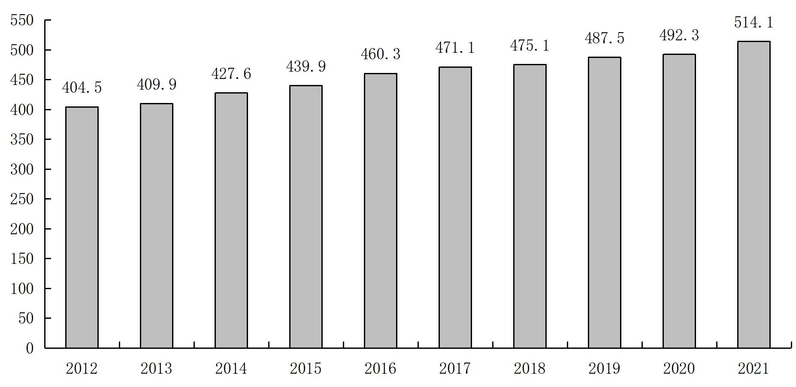
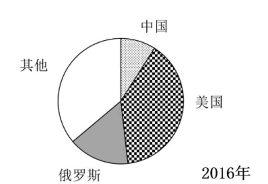
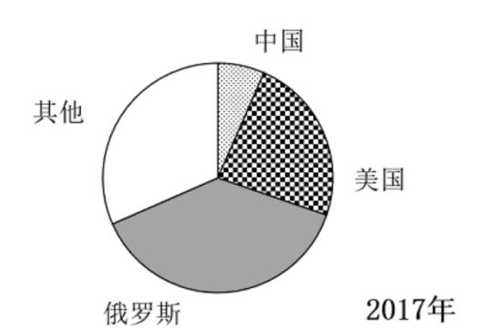
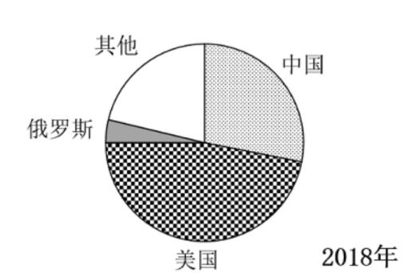
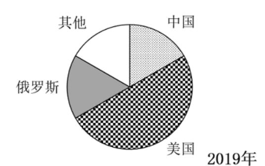

# 套题训练16

## Material M1



图2012～2021年全国羊肉产量年度变化情况（万吨）

表2012～2021年全国主要畜禽产品批发与零售价格年度变化情况（元/公斤）

| 年份 | 猪肉批发价格 | 猪肉零售价格 | 牛肉批发价格 | 牛肉零售价格 | 羊肉批发价格 | 羊肉零售价格 | 鸡肉批发价格 | 鸡肉零售价格 | 鸡蛋批发价格 | 鸡蛋零售价格 |
| ---: | ---: | ---: | ---: | ---: | ---: | ---: | ---: | ---: | ---: | ---: |
| 2012 | 21.15 | 33.22 | 39.30 | 48.12 | 46.06 | 54.15 | 14.14 | 18.56 | 8.11 | 9.06 |
| 2013 | 21.05 | 35.21 | 51.71 | 59.59 | 53.34 | 60.25 | 14.26 | 18.70 | 8.43 | 9.53 |
| 2014 | 18.94 | 34.97 | 54.33 | 62.76 | 55.40 | 62.37 | 14.61 | 19.42 | 9.57 | 10.62 |
| 2015 | 20.80 | 27.64 | 53.96 | 70.87 | 49.39 | 60.30 | 14.70 | 19.99 | 8.11 | 9.57 |
| 2016 | 24.87 | 28.46 | 53.24 | 72.86 | 45.05 | 55.59 | 14.90 | 20.11 | 7.49 | 8.91 |
| 2017 | 21.24 | 25.98 | 53.82 | 72.08 | 47.49 | 55.48 | 13.93 | 20.19 | 6.92 | 8.28 |
| 2018 | 18.66 | 28.01 | 57.46 | 71.94 | 55.76 | 60.90 | 15.00 | 21.89 | 8.55 | 9.67 |
| 2019 | 28.51 | 50.81 | 63.85 | 74.60 | 63.81 | 69.47 | 17.55 | 25.55 | 9.26 | 10.52 |
| 2020 | 45.22 | 69.51 | 73.03 | 86.81 | 69.27 | 77.01 | 16.82 | 26.66 | 7.53 | 8.79 |
| 2021 | 28.53 | 54.71 | 77.08 | 89.48 | 73.65 | 81.40 | 17.14 | 25.71 | 9.51 | 10.72 |

## Material M2

2021年我国机器人销售额839.0亿元，比上年增长18.0%。其中，工业机器人销售额445.7亿元、增长5.5%，产量36.6万套、增长67.9%；服务机器人销售额302.6亿元、增长36.2%，产量921.4万套、增长48.9%；特种机器人销售额90.7亿元、增长36.4%，产量2.5万套、增长22.4%。

2021年三季度我国工业机器人、服务机器人产量分别为9.3万套、197.8万套，四季度分别为9.6万套、251.5万套。2022年一季度我国工业机器人、服务机器人产量分别为12.1万套、177.4万套，二季度分别为11.5万套、148.9万套，三季度分别为12.3万套、157.4万套。

表2015～2020年我国机器人销售额（单位：亿元）

| 年份 | 工业机器人 | 服务机器人 | 特种机器人 |
| ---: | ---: | ---: | ---: |
| 2015 | 186.9 | 39.9 | 18.7 |
| 2016 | 271.1 | 64.8 | 26.9 |
| 2017 | 353.1 | 87.6 | 35.9 |
| 2018 | 389.6 | 117.8 | 44.1 |
| 2019 | 355.5 | 150.8 | 52.9 |
| 2020 | 422.5 | 222.2 | 66.5 |

## Material M3

表2016～2020年全球及主要国家或地区航天发射次数和航天器发射数量情况

| 年份 | 全球次数（次） | 全球数量（枚） | 中国次数（次） | 中国数量（枚） | 美国次数（次） | 美国数量（枚） | 俄罗斯次数（次） | 俄罗斯数量（枚） | 欧洲次数（次） | 欧洲数量（枚） |
| ---: | ---: | ---: | ---: | ---: | ---: | ---: | ---: | ---: | ---: | ---: |
| 2016 | 85 | 209 | 22 | 40 | 22 | 72 | 19 | 27 | 9 | 20 |
| 2017 | 91 | 443 | 18 | 34 | 30 | 152 | 21 | 116 | 9 | 18 |
| 2018 | 114 | 461 | 39 | 95 | 31 | 212 | 20 | 21 | 8 | 9 |
| 2019 | 102 | 492 | 34 | 81 | 27 | 252 | 25 | 77 | 6 | 10 |
| 2020 | 114 | 1277 | 39 | 77 | 44 | 1099 | 17 | 23 | 5 | 36 |

## Material M4

2022年1～4月，珠江水系四省累计完成水路客运量499万人次、旅客周转量12785万人公里，同比分别下降47.6%、53.9%；水路货运量4.25亿吨、货物周转量8045亿吨公里，同比分别增长-2.5%、0.4%，其中，珠江水系内河货运量2.39亿吨、货物周转量613亿吨公里，同比分别增长1.9%、5.8%。4月，珠江水系四省完成水路客运量197万人次、旅客周转量5142万人公里，同比分别下降41.2%、49.7%；水路货运量1.22亿吨、货物周转量1989亿吨公里，同比分别增长0.9%、1.1%，其中，珠江水系内河货运量7149万吨、货物周转量178亿吨公里，同比分别增长3.3%、5.2%。

2022年1～4月，珠江水系港口全港累计完成货物吞吐量5.55亿吨，同比下降5.1%；外贸货物吞吐量1.54亿吨，同比下降9.4%；集装箱吞吐量2074万吨，同比下降5.6%。其中，珠江水系内河港口完成货物吞吐量2.12亿吨、外贸货物吞吐量2386万吨、集装箱吞吐量392万吨，同比分别下降3.3%、8.4%、4.7%。4月，珠江水系港口全港完成货物吞吐量1.61亿吨，同比下降2.4%；外贸货物吞吐量4081万吨，同比下降8.8%；集装箱吞吐量581万吨，同比下降3.5%。其中，珠江水系内河港口完成货物吞吐量6635万吨、外贸货物吞吐量718万吨、集装箱吞吐量120万吨，同比分别增长0.7%、−2.8%、−2.3%。

## Question 1

```yaml
module: 资料分析
materials:
- M1
```

### Stem

2013～2020年，全国羊肉产量同比增长率超过3%的年份有：

### Options
- A. 1个
- B. 2个
- C. 3个
- D. 4个

### Answer

C

## Question 2

```yaml
module: 资料分析
materials:
- M1
```

### Stem

2012～2021年，最接近全国羊肉年平均产量的是：

### Options
- A. 2015年
- B. 2016年
- C. 2017年
- D. 2018年

### Answer

B

## Question 3

```yaml
module: 资料分析
materials:
- M1
```

### Stem

表所列的主要畜禽产品中，相较于2012年，2021年零售价格增长幅度超过50%的是：

### Options
- A. 猪肉、牛肉、羊肉
- B. 猪肉、羊肉、鸡肉
- C. 牛肉、羊肉、鸡肉
- D. 羊肉、鸡肉、鸡蛋

### Answer

A

## Question 4

```yaml
module: 资料分析
materials:
- M1
```

### Stem

假设羊肉每年以零售价格全部售罄，那么，2021年羊肉销售收入同比增长约：

### Options
- A. 5.2%
- B. 10.4%
- C. 17.6%
- D. 22.7%

### Answer

B

## Question 5

```yaml
module: 资料分析
materials:
- M1
```

### Stem

不能从上述材料推出的是：

### Options
- A. 2012～2021年，全国羊肉产量逐年增长
- B. 2020年，牛肉批发价格不足零售价格的90%
- C. 2020年，鸡肉零售价格与批发价格之比大于牛肉
- D. 2012～2021年，鸡蛋批发价格同比增速最快的年份是2018年

### Answer

D

## Question 6

```yaml
module: 资料分析
materials:
- M2
```

### Stem

2022年三季度，我国工业机器人产量同比增加了：

### Options
- A. 3.0万套
- B. 2.3万套
- C. 1.8万套
- D. 0.8万套

### Answer

A

## Question 7

```yaml
module: 资料分析
materials:
- M2
```

### Stem

“十三五”时期，我国服务机器人与工业机器人销售额相差最大的年份是：

### Options
- A. 2017年
- B. 2018年
- C. 2019年
- D. 2020年

### Answer

B

## Question 8

```yaml
module: 资料分析
materials:
- M2
```

### Stem

2021年我国特种机器人销售额占机器人销售额的比重比上年提高：

### Options
- A. 0.4个百分点
- B. 0.8个百分点
- C. 1.5个百分点
- D. 2.6个百分点

### Answer

C

## Question 9

```yaml
module: 资料分析
materials:
- M2
```

### Stem

关于2021年我国机器人产量的增长率，下列算式正确的是：

### Options
- A. $\frac{0.679+0.489+0.224}{3} \times 100\%$
- B. $\left(\sqrt[3]{1.679 \times 1.489 \times 1.224}-1\right) \times 100\%$
- C. $\frac{36.6 \times 0.679+921.4 \times 0.489+2.5 \times 0.224}{36.6+921.4+2.5} \times 100\%$
- D. $\left(\frac{36.6+921.4+2.5}{\frac{36.6}{1.679}+\frac{921.4}{1.489}+\frac{2.5}{1.224}}-1\right) \times 100\%$

### Answer

D

## Question 10

```yaml
module: 资料分析
materials:
- M2
```

### Stem

能够从上述材料中推出的是：

### Options
- A. 2020年我国服务机器人销售额占机器人销售额的比重超过30.0%
- B. 2022年三季度，我国工业机器人产量环比增速慢于服务机器人
- C. “十三五”时期，我国服务机器人销售额年平均增加31.5亿元
- D. 2015～2021年，我国机器人销售额每年都在增加

### Answer

A

## Question 11

```yaml
module: 资料分析
materials:
- M3
```

### Stem

“十三五”时期，我国航天发射次数占全球的比重为：

### Options
- A. 15%
- B. 20%
- C. 25%
- D. 30%

### Answer

D

## Question 12

```yaml
module: 资料分析
materials:
- M3
```

### Stem

下列国家或地区中，2017～2020年发射数量年均增速为负的是：

### Options
- A. 中国
- B. 美国
- C. 俄罗斯
- D. 欧洲

### Answer

C

## Question 13

```yaml
module: 资料分析
materials:
- M3
```

### Stem

2016～2020年全球主要国家或地区单次发射航天器的最大数量：

### Options
- A. 大于24枚
- B. 大于16枚且不大于24枚
- C. 小于11枚
- D. 不小于11枚且不大于16枚

### Answer

A

## Question 14

```yaml
module: 资料分析
materials:
- M3
```

### Stem

下列饼图中，能正确反映对应年份中国、美国、俄罗斯及其他国家和地区航天器发射数量占比关系的是：

### Options
- A. 
- B. 
- C. 
- D. 

### Answer

D

## Question 15

```yaml
module: 资料分析
materials:
- M3
```

### Stem

不能从上述材料中推出的是：

### Options
- A. 2017～2020年全球航天器发射数量增速最慢的年份是2018年
- B. 2017～2020年俄罗斯与美国发射航天器的数量差距逐年增大
- C. 2016～2020年中国单次发射航天器的平均数量大于2枚
- D. 2019年全球主要国家或地区中发射航天器数量增速最快的是俄罗斯

### Answer

B

## Question 16

```yaml
module: 资料分析
materials:
- M4
```

### Stem

2022年1～4月，珠江水系四省累计完成水路客运量与去年相比减少约多少万人次：

### Options
- A. 395
- B. 436
- C. 453
- D. 514

### Answer

C

## Question 17

```yaml
module: 资料分析
materials:
- M4
```

### Stem

2021年1～4月，珠江水系内河货物周转量占珠江水系四省货物周转量的比重约为：

### Options
- A. 7.2%
- B. 7.4%
- C. 7.6%
- D. 7.8%

### Answer

A

## Question 18

```yaml
module: 资料分析
materials:
- M4
```

### Stem

2021年1～4月，珠江水系港口全港完成外贸货物吞吐量比集装箱吞吐量约多多少倍：

### Options
- A. 5.4
- B. 6.4
- C. 6.7
- D. 7.4

### Answer

C

## Question 19

```yaml
module: 资料分析
materials:
- M4
```

### Stem

2022年4月，珠江水系港口全港完成货物吞吐量占同年1～4月份的比重比去年约：

### Options
- A. 多1个百分点
- B. 少1个百分点
- C. 多3个百分点
- D. 少3个百分点

### Answer

A

## Question 20

```yaml
module: 资料分析
materials:
- M4
```

### Stem

下列说法正确的是：

### Options
- A. 2022年1～4月，珠江水系四省累计完成旅客周转量与去年相比增加约14928万人公里
- B. 2021年4月，珠江水系内河货运量占水路货运量的比重约为49.6%
- C. 2022年4月，珠江水系外贸货物吞吐减少量比集装箱吞吐减少量多264万吨
- D. 2021年4月，珠江水系四省货物周转量约是珠江水系内河货物周转量的12倍

### Answer

D
