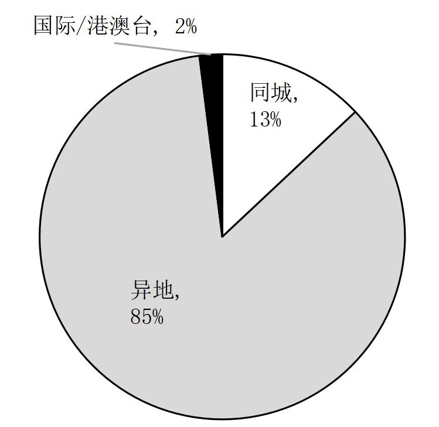
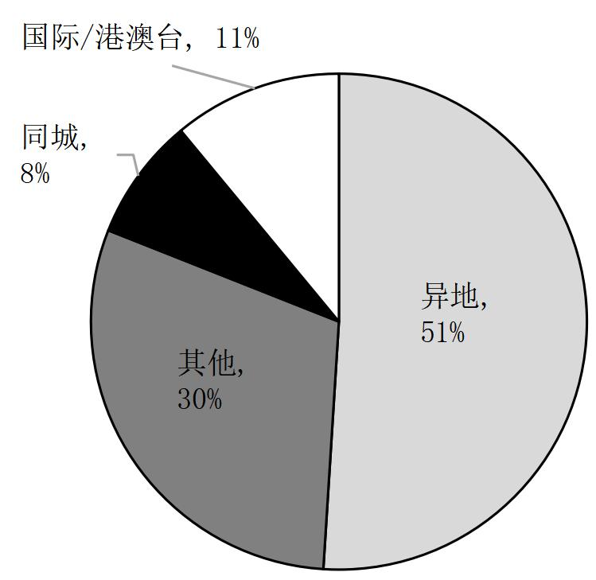
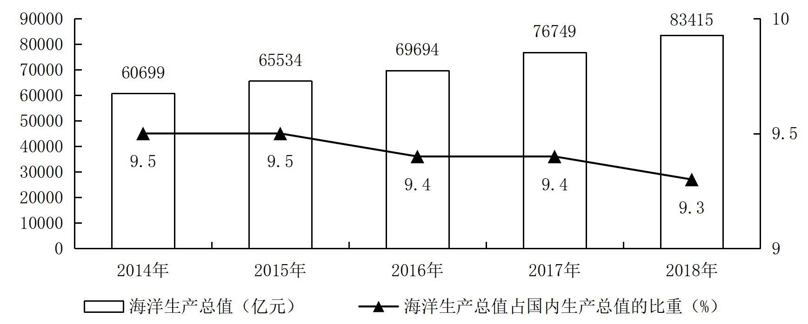
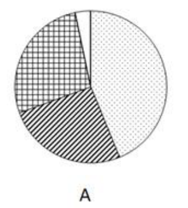
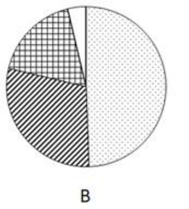
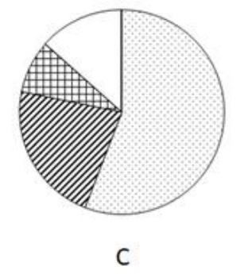
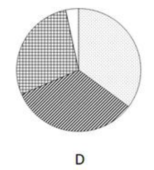

<!-- hyz-paper-id: 01a1e4f7-7bce-79d3-8cf2-9a006d86daf7 -->

# 套题训练17

## Material M1

<!-- hyz-material-id: 01a1e4f7-7bce-79d3-8cf2-9a132aad4a90 -->

2024年，全国农民工29973万人，比上年增长0.7%。其中，本地农民工12102万人，增长0.2%；外出农民工17871万人，增长1.2%。

在外出农民工中，跨省流动6840万人，占比为38.3%；省内流动10317万人，占比为61.7%。东部地区跨省活动的占本地区外出农民工的13.4%，中部地区占51.8%，西部地区44.6%，东北地区占33.6%。

从输出地看，东部地区农民工10529万人，比上年增长0.4%；中部地区10012万人，增长1.1%；西部地区8414万人，增长0.6%；东北地区1018万人，增长2.0%。从输入地看，在东部地区就业的农民工15423万人，比上年增长0.6%；在中部地区就业7058万人，增长0.8%；在西部地区就业6603万人，增长0.8%；在东北地区就业889万人，增长0.9%。在全部农民工中，女性占37.6%。其中，本地农民工中女性占44.2%，外出农民工中女性占31.7%。全部农民工中女性占比较上年提高0.3个百分点。本地农民工有配偶的占90.3%，外出农民工有配偶占68.8%。本地农民工平均年龄46.8岁，外出农民工平均年纪39.0岁。

## Material M2

<!-- hyz-material-id: 01a1e4f7-7bce-79d3-8cf2-9a26b88190f2 -->

2018年，广东实现地区生产总值97277.77亿元，按可比价格计算，同比增长6.8%，人均生产总值为86412元，比全国平均水平多21891元，按年平均汇率折算，达到13058.30美元。全省经济运行保持在合理区间。

表2018年全国与广东主要经济指标情况

| 指标 | 全国绝对量（万亿元） | 全国同比增长（%） | 广东绝对量（万亿元） | 广东同比增长（%） |
| --- | ---: | ---: | ---: | ---: |
| GDP | 90.03 | 6.6 | 9.73 | 6.8 |
| 规模以上工业增加值 | 30.52 | 6.2 | 3.23 | 6.3 |
| 固定资产投资 | 63.56 | 5.9 | 3.53 | 10.7 |
| 社会消费品零售总额 | 38.10 | 9.0 | 3.95 | 8.8 |
| 进出口总额 | 30.51 | 9.7 | 7.16 | 5.1 |

分产业看，广东省第一产业实现生产值3831.44亿元，同比增长4.2%，增幅同比提高0.7个百分点；第二产业实现生产值40695.15亿元，同比增长5.9%，增幅同比回落0.8个百分点；第三产业实现生产值52751.18亿元，同比增长7.8%，增幅同比回落0.8个百分点。三大产业结构约为4.0∶41.8∶54.2。

## Material M3

<!-- hyz-material-id: 01a1e4f7-7bce-79d3-8cf2-9a37a94daadb -->

表2021年全国邮政行业发展情况

| 指标名称 | 单位 | 12月份累计 | 12月份当月 | 比去年同期增长（%）累计 | 比去年同期增长（%）当月 |
| --- | --- | ---: | ---: | ---: | ---: |
| 一、邮政行业业务收入 | 亿元 | 12642.3 | 1013.8 | 14.5 | −8.6 |
| 1.邮政寄递服务 | 亿元 | 394.4 | 37.2 | −2.9 | 8.8 |
| 2.快递业务 | 亿元 | 10332.3 | 917.6 | 17.5 | −0.9 |
| 二、邮政行业业务总量 | 亿元 | 13698.3 | 1289.0 | 25.1 | 11.9 |
| 1.邮政寄递服务 | 万件 | 2715646.5 | 265297.3 | 6.2 | 15.2 |
| 其中：函件 | 万件 | 108787.7 | 7484.0 | −23.3 | −31.6 |
| 包裹 | 万件 | 1823.2 | 165.3 | −10.2 | −18.3 |
| 订销报纸累计数 | 万份 | 1638844.9 | 141910.6 | −1.0 | −1.9 |
| 订销杂志累计数 | 万份 | 68550.0 | 5594.9 | −4.2 | −4.1 |
| 汇兑 | 万笔 | 646.0 | 53.0 | −32.8 | −38.0 |
| 2.快递业务 | 万件 | 10829641.3 | 1024834.3 | 29.9 | 10.7 |
| 其中：同城 | 万件 | 1411121.4 | 134757.6 | 16.0 | 19.1 |
| 异地 | 万件 | 9208130.1 | 872508.2 | 32.8 | 10.0 |
| 国际/港澳台 | 万件 | 210387.8 | 17566.5 | 14.6 | −8.8 |





图1快递业务量结构

图2快递业务收入结构

## Material M4

<!-- hyz-material-id: 01a1e4f7-7bce-79d3-8cf2-9a48e2e861b7 -->

近年来，我国海洋经济呈现总体平稳的发展态势，总量再上新台阶，产业结构不断优化，新兴产业和新业态快速成长。



图2014～2018年全国海洋生产总值情况

2018年，我国主要海洋产业保持稳步增长，全年实现产值33609亿元，比上年增长4.0%。滨海旅游业、海洋交通运输业和海洋渔业作为海洋经济发展的支柱产业，其产值占主要海洋产业产值的比重分别为47.8%、19.4%和14.3%。海洋生物医药业、海洋电力业这两个新兴产业产值增速领先，分别达9.6%、12.8%。

表2018年全国海洋产业产值情况

| 指标 | 总量（亿元） | 增速（%） |
| --- | ---: | --- |
| 海洋生产总值 | 83415 | 8.7 |
| 海洋产业 | 52965 | 6.2 |
| 主要海洋产业 | 33609 | 4.0 |
| 海洋渔业 | 4801 | −0.2 |
| 海洋油气业 | 1477 | 3.3 |
| 海洋矿业 | 71 | 0.5 |
| 海洋盐业 | 39 | −16.6 |
| 海洋化工业 | 1119 | 3.1 |
| 海洋生物医药业 | 413 | 9.6 |
| 海洋电力业 | 172 | 12.8 |
| 海水利用业 | 17 | 7.9 |
| 海洋船舶工业 | 997 | −9.8 |
| 海洋工程建筑业 | 1905 | −3.8 |
| 海洋交通运输业 | 6522 | 5.5 |
| 滨海旅游业 | 16078 | 8.3 |
| 海洋科研教育管理服务业 | 19356 | 10.2 |
| 海洋相关产业 | 30449 | —— |
| 注释：部分数据因四舍五入，存在着总计与分项合计不等的情况。 |  |  |

## Question 1

<!-- hyz-question-id: 01a1e4f7-7bce-79d3-8cf2-9a5b68588085 -->

```yaml
module: 资料分析
materials:
- M1
```

### Stem

2024年在我国西部地区就业的农民工比上年增加：

### Options
- A. 50.95万人
- B. 52.40万人
- C. 52.8万人
- D. 53.25万人

### Answer

B

## Question 2

<!-- hyz-question-id: 01a1e4f7-7bce-79d3-8cf2-9a639f632e7e -->

```yaml
module: 资料分析
materials:
- M1
```

### Stem

2024年我国本地农民工男性人数比女性多：

### Options
- A. 23.5%
- B. 24.8%
- C. 26.2%
- D. 28.7%

### Answer

C

## Question 3

<!-- hyz-question-id: 01a1e4f7-7bce-79d3-8cf2-9a7ee721f136 -->

```yaml
module: 资料分析
materials:
- M1
```

### Stem

2024年我国农民工平均年纪是：

### Options
- A. 40.8岁
- B. 42.1岁
- C. 42.9岁
- D. 43.7岁

### Answer

B

## Question 4

<!-- hyz-question-id: 01a1e4f7-7bce-79d3-8cf2-9a8a3a6b15d3 -->

```yaml
module: 资料分析
materials:
- M1
```

### Stem

下图中能准确展示2024我国东，中，西和东北地区输出农民工人数分别占全部农民工人数的比重大

小关系的是：

### Options
- A. 
- B. 
- C. 
- D. 

### Answer

D

## Question 5

<!-- hyz-question-id: 01a1e4f7-7bce-79d3-8cf2-9a950d8b1e6a -->

```yaml
module: 资料分析
materials:
- M1
```

### Stem

能从所给材料推出的是：

### Options
- A. 2024年我国女性农民工人数的年增速快于男性农民工人数
- B. 2024年我国中部地区跨省流动农民工人数多于西部地区
- C. 2024年我国中西部输出农民工人数之和比去年增长0.85%
- D. 2024年在我国东北地区就业的农民工人数占全部农民工的比重较上年有所下降

### Answer

A

## Question 6

<!-- hyz-question-id: 01a1e4f7-7bce-79d3-8cf2-9aad9be4a8be -->

```yaml
module: 资料分析
materials:
- M2
```

### Stem

2017年广东规模以上工业增加值约占全国的：

### Options
- A. 6.6%
- B. 8.6%
- C. 10.6%
- D. 12.6%

### Answer

C

## Question 7

<!-- hyz-question-id: 01a1e4f7-7bce-79d3-8cf2-9abedc91e55e -->

```yaml
module: 资料分析
materials:
- M2
```

### Stem

2018年，广东社会消费品零售总额同比增幅较全国平均水平约：

### Options
- A. 高0.1个百分点
- B. 低0.2个百分点
- C. 低4.6个百分点
- D. 高4.8个百分点

### Answer

B

## Question 8

<!-- hyz-question-id: 01a1e4f7-7bce-79d3-8cf2-9ac3dfa1bce4 -->

```yaml
module: 资料分析
materials:
- M2
```

### Stem

2018年全国进出口总额较2017年增加约多少万亿元：

### Options
- A. 1.2
- B. 2.7
- C. 4.2
- D. 5.7

### Answer

B

## Question 9

<!-- hyz-question-id: 01a1e4f7-7bce-79d3-8cf2-9ad6b2bbfb9e -->

```yaml
module: 资料分析
materials:
- M2
```

### Stem

2016年广东省三大产业结构约为：

### Options
- A. 4.2∶42.6∶53.2
- B. 4.1∶41.6∶54.3
- C. 3.9∶42.2∶53.9
- D. 无法推测

### Answer

A

## Question 10

<!-- hyz-question-id: 01a1e4f7-7bce-79d3-8cf2-9aecc038d0b8 -->

```yaml
module: 资料分析
materials:
- M2
```

### Stem

①②③④描述的均为客观事实，其中能够从材料中得出的有：

①2018年广东省GDP占全国比重较2017年有所增加

②2018年全年人民币兑美元平均汇率约为6.6

③2018年中国总人口约为13.95亿

④以可比价格计算，2017年广东省GDP同比增长率达7.5%

### Options
- A. ①
- B. ①③
- C. ①②③
- D. ①②③④

### Answer

D

## Question 11

<!-- hyz-question-id: 01a1e4f7-7bce-79d3-8cf2-9aff35e9d672 -->

```yaml
module: 资料分析
materials:
- M3
```

### Stem

2021年1～12月邮政行业累计业务收入同比增加约多少亿元：

### Options
- A. 1601.0
- B. 1833.1
- C. 2134.2
- D. 2603.5

### Answer

A

## Question 12

<!-- hyz-question-id: 01a1e4f7-7bce-79d3-8cf2-9b0a6871d68d -->

```yaml
module: 资料分析
materials:
- M3
```

### Stem

2021年12月，邮政寄递服务中业务量高于当年月平均服务值的业务有：

### Options
- A. 1个
- B. 2个
- C. 3个
- D. 4个

### Answer

B

## Question 13

<!-- hyz-question-id: 01a1e4f7-7bce-79d3-8cf2-9b11943fbc63 -->

```yaml
module: 资料分析
materials:
- M3
```

### Stem

与去年同期相比，2021年同城快递业务量占快递业务的比重：

### Options
- A. 下降1.6个百分点
- B. 上升1.6个百分点
- C. 下降2.6个百分点
- D. 上升2.6个百分点

### Answer

A

## Question 14

<!-- hyz-question-id: 01a1e4f7-7bcf-7d62-acf1-c3b9716067b7 -->

```yaml
module: 资料分析
materials:
- M3
```

### Stem

2021年，下列邮政行业业务中整体单价（元/件）最小的是：

### Options
- A. 异地快递业务
- B. 同城快递业务
- C. 邮政快递业务
- D. 国际/港澳台快递业务

### Answer

A

## Question 15

<!-- hyz-question-id: 01a1e4f7-7bcf-7d62-acf1-c3c9b08092be -->

```yaml
module: 资料分析
materials:
- M3
```

### Stem

根据上述材料，下列该法错误的是：

### Options
- A. 从业务收入看，2021年邮政寄递服务同比下降，占行业整体的比重不到1/30
- B. 从业务收入看，2021年12月邮政快递业务同比略微下降，但仍高于当年月平均水平
- C. 从业务量看，2021年邮政快递业务同比增长较快，成为拉动行业整体增长的主动力
- D. 从业务量看，2021年有三项邮政寄递服务同比存在不同程度下降，拉动其整体低于去年同期

### Answer

D

## Question 16

<!-- hyz-question-id: 01a1e4f7-7bcf-7d62-acf1-c3dde5598dd0 -->

```yaml
module: 资料分析
materials:
- M4
```

### Stem

2018年我国海洋生产总值较2015年增加了约：

### Options
- A. 8.7%
- B. 19.7%
- C. 27.3%
- D. 37.4%

### Answer

C

## Question 17

<!-- hyz-question-id: 01a1e4f7-7bcf-7d62-acf1-c3eff3a1e583 -->

```yaml
module: 资料分析
materials:
- M4
```

### Stem

2018年，我国海洋经济发展支柱产业产值约为多少万亿元：

### Options
- A. 1.61
- B. 2.36
- C. 2.74
- D. 3.32

### Answer

C

## Question 18

<!-- hyz-question-id: 01a1e4f7-7bcf-7d62-acf1-c3f63b832f20 -->

```yaml
module: 资料分析
materials:
- M4
```

### Stem

2017年，我国海洋船舶工业产值约比海洋化工业产值：

### Options
- A. 少50亿元
- B. 少20亿元
- C. 多50亿元
- D. 多20亿元

### Answer

D

## Question 19

<!-- hyz-question-id: 01a1e4f7-7bcf-7d62-acf1-c405e64260f7 -->

```yaml
module: 资料分析
materials:
- M4
```

### Stem

如果2019年我国海洋新兴产业保持2018年的增速，则2019年我国海洋新兴产业产值将比2017年多约：

### Options
- A. 22%
- B. 27%
- C. 32%
- D. 37%

### Answer

A

## Question 20

<!-- hyz-question-id: 01a1e4f7-7bcf-7d62-acf1-c41afc3e8631 -->

```yaml
module: 资料分析
materials:
- M4
```

### Stem

以下说法正确的是：

### Options
- A. 2017年，我国主要海洋产业中产值最小的是海洋盐业
- B. 2015～2018年，我国海洋生产总值增量最少的是2016年
- C. 2014～2018年，我国海洋经济在国民经济中的比重越来越大
- D. 2018年，我国海洋科研教育管理服务业产值比上年增长超过0.2万亿元

### Answer

B
