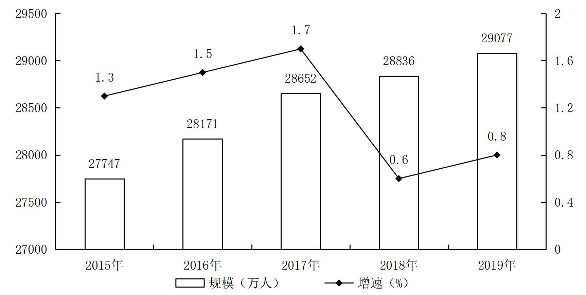

<!-- hyz-paper-id: 01a1e4f7-7bd3-7c13-8308-577f02a57ed4 -->

# 套题训练18

## Material M1

<!-- hyz-material-id: 01a1e4f7-7bd3-7c13-8308-578ca793bf47 -->

表1 2021年1～7月东部、中部、西部和东北地区房地产开发投资情况

| 地区 | 投资额（亿元） | 投资额（亿元）住宅 | 同比增长（%） | 同比增长（%）住宅 |
| --- | ---: | ---: | ---: | ---: |
| 全国总计 | 84895 | 63980 | 12.7 | 14.9 |
| 东部地区 | 45306 | 33231 | 11.5 | 13.3 |
| 中部地区 | 17720 | 14330 | 20.0 | 23.7 |
| 西部地区 | 18717 | 14002 | 10.0 | 11.8 |
| 东北地区 | 3152 | 2417 | 8.1 | 7.6 |

表2 2021年1～7月东部、中部、西部和东北地区房地产销售情况

| 地区 | 商品房销售面积绝对数（万平方米） | 商品房销售面积同比增长（%） | 商品房销售额绝对数（亿元） | 商品房销售额同比增长（%） |
| --- | ---: | ---: | ---: | ---: |
| 全国总计 | 101648 | 21.5 | 106430 | 30.7 |
| 东部地区 | 42841 | 24.1 | 61943 | 36.7 |
| 中部地区 | 28359 | 27.1 | 21422 | 33.4 |
| 西部地区 | 26965 | 14.3 | 20156 | 16.3 |
| 东北地区 | 3483 | 8.8 | 2909 | 6.9 |

## Material M2

<!-- hyz-material-id: 01a1e4f7-7bd3-7c13-8308-5793a3666afe -->

2021年3～5月某市共享单车使用情况如下：

2021年3～5月全市共投入120万辆共享单车，其维修率约为10%。维修量同比减少5%，其平均使用率为92%，同比增长2个百分点。

2021年3月，甲公司共投入12万辆共享单车，其占全市当月投入共享单车总量的比率比乙公司的高3个百分点；甲公司当月投入共享单车的使用率为90%，比乙公司的低2个百分点。

2021年4月，乙公司当月投入的共享单车维修了0.9万辆，其维修率为9%，环比减少了2个百分点。甲公司当月投入的共享单车维修了1.1万辆，其维修率为12%，环比增长了4个百分点。

2021年5月，乙公司当月投入共享单车13.5万辆，占全市当月投入共享单车总量的30%，环比增长1个百分点，乙公司当月投入共享单车的使用率为95%，环比增长3个百分点。

## Material M3

<!-- hyz-material-id: 01a1e4f7-7bd3-7c13-8308-57ab4902dfe9 -->

2019年农民工总量达到29077万人，比上年增加241万人，增长0.8%。其中，本地农民工11652万人，比上年增加82万人，增长0.7%：外出农民工17425万人，比上年增加159万人，增长0.9%。在外出农民工中，年末在城镇居住的进城农民工13500万人，与上年基本持平。



图2015～2019年我国农民工规模及增速

在外出农民工中，在省内流动的农民工9917万人，比上年增加245万人，增长2.5%；跨省流动农民工7508万人，比上年减少86万人，下降1.1%。省内流动农民工占外出农民的56.9%，所占比重比上年提高0.9个百分点。分地区看，除东北地区省内流动农民工占外出农民工的比重比上年下降3.4个百分点以外，东部、中部和西部地区省内流动农民工占比分别比上年提高0.1、1.4和1.2个百分点。

表2019年外出农民工地区分布及构成

单位：万人、%

| 按输出地分 | 外出农民工总量外出农民工 | 外出农民工总量外出农民工跨省流动 | 外出农民工总量外出农民工省内流动 | 构成外出农民工 | 构成外出农民工跨省流动 | 构成外出农民工省内流动 |
| --- | ---: | ---: | ---: | ---: | ---: | ---: |
| 合计 | 17425 | 7508 | 9917 | 100.00 | 43.1 | 56.9 |
| 东部地区 | 4792 | 821 | 3971 | 100.00 | 17.1 | 82.9 |
| 中部地区 | 6427 | 3802 | 2625 | 100.00 | 59.2 | 40.8 |
| 西部地区 | 5555 | 2691 | 2864 | 100.00 | 48.4 | 51.6 |
| 东北地区 | 651 | 194 | 457 | 100.00 | 29.8 | 70.2 |

## Material M4

<!-- hyz-material-id: 01a1e4f7-7bd3-7c13-8308-57b0b2b0d5c9 -->

2017年，在校研究生263.9万人，毕业生57.8万人，普通本专科在校生2753.6万人，毕业生735.8万人，中等职业教育在校生1592.5万人，毕业生496.9万人，普通高中在校生2374.5万人，毕业生775.7万人，初中在校生4442.1万人，毕业生1397.5万人，普通小学在校生10093.7万人，毕业生1565.9万人，特殊教育在校生57.9万人，毕业生6.9万人，学前教育在园幼儿4600.1万人，同比增长4.2%。

表2013～2017年全国除学前教育外各类教育招生人数（单位：万人）

| 年份 | 研究生 | 普通本专科 | 中等职业教育 | 普高 | 初中 | 普通小学 | 特殊教育 |
| ---: | ---: | ---: | ---: | ---: | ---: | ---: | ---: |
| 2013 | 61.1 | 700 | 675 | 823 | 1496.1 | 1695.4 | 6.6 |
| 2014 | 62.1 | 721 | 620 | 797 | 1447.8 | 1658.4 | 7.1 |
| 2015 | 64.5 | 738 | 601 | 797 | 1411.0 | 1729.0 | 8.3 |
| 2016 | 66.7 | 749 | 593 | 803 | 1487.2 | 1752.5 | 9.2 |
| 2017 | 80.5 | 761 | 582 | 800 | 1547.2 | 1766.6 | 11.1 |

## Question 1

<!-- hyz-question-id: 01a1e4f7-7bd3-7c13-8308-57c2af2b80e9 -->

```yaml
module: 资料分析
materials:
- M1
```

### Stem

2020年1～7月，中、西部地区住宅开发投资总额约为多少亿元：

### Options
- A. 11584
- B. 11942
- C. 24109
- D. 24671

### Answer

C

## Question 2

<!-- hyz-question-id: 01a1e4f7-7bd3-7c13-8308-57dc9bbaac11 -->

```yaml
module: 资料分析
materials:
- M1
```

### Stem

2021年1～7月，住宅投资额较去年同时期增长量最大的地区是：

### Options
- A. 东部地区
- B. 中部地区
- C. 西部地区
- D. 东北地区

### Answer

A

## Question 3

<!-- hyz-question-id: 01a1e4f7-7bd3-7c13-8308-57e0c1baf333 -->

```yaml
module: 资料分析
materials:
- M1
```

### Stem

2020年1～7月，按照商品房销售面积从大到小的顺序排列，排第1的地区的商品房销售额比第2的

约多：

### Options
- A. 27982亿元
- B. 29255亿元
- C. 40521亿元
- D. 41787亿元

### Answer

A

## Question 4

<!-- hyz-question-id: 01a1e4f7-7bd3-7c13-8308-57f8921b85e9 -->

```yaml
module: 资料分析
materials:
- M1
```

### Stem

2021年1～7月，商品房平均销售单价同比变化幅度在1%～3%区间的地区有多少个：

### Options
- A. 0
- B. 1
- C. 2
- D. 3

### Answer

C

## Question 5

<!-- hyz-question-id: 01a1e4f7-7bd3-7c13-8308-58003286b8ad -->

```yaml
module: 资料分析
materials:
- M1
```

### Stem

能够从上述材料中推出的是：

### Options
- A. 2021年，只有东北地区的房地产开发投资额同比增速大于住宅投资同比增速
- B. 2020年1～7月，2个地区的住宅投资额占房地产开发投资额比重高于全国
- C. 2021年1～7月，西部地区商品房销售面积较去年同时期增长量是东北地区的8倍
- D. 2021年1～7月，全国商品房平均销售单价同比增长11.9%

### Answer

B

## Question 6

<!-- hyz-question-id: 01a1e4f7-7bd3-7c13-8308-581966a50ab5 -->

```yaml
module: 资料分析
materials:
- M2
```

### Stem

2020年3～5月，该市投入的共享单车中维修了约多少万辆：

### Options
- A. 11.4
- B. 12.0
- C. 12.6
- D. 13.0

### Answer

C

## Question 7

<!-- hyz-question-id: 01a1e4f7-7bd3-7c13-8308-582a6d9eb496 -->

```yaml
module: 资料分析
materials:
- M2
```

### Stem

2021年4～5月，乙公司在该市共投入共享单车多少万辆：

### Options
- A. 10.0
- B. 13.5
- C. 21.6
- D. 23.5

### Answer

D

## Question 8

<!-- hyz-question-id: 01a1e4f7-7bd3-7c13-8308-5830f07ae18d -->

```yaml
module: 资料分析
materials:
- M2
```

### Stem

2021年4月，该市当月投入共享单车约为多少万辆：

### Options
- A. 30.0
- B. 34.5
- C. 40.5
- D. 45.0

### Answer

B

## Question 9

<!-- hyz-question-id: 01a1e4f7-7bd3-7c13-8308-584e969280dc -->

```yaml
module: 资料分析
materials:
- M2
```

### Stem

乙公司3月、4月、5月在该市投入共享单车占全市投入共享单车的比重由高到低排序，正确的是：

### Options
- A. 5月，4月，3月
- B. 5月，3月，4月
- C. 3月，5月，4月
- D. 3月，4月，5月

### Answer

A

## Question 10

<!-- hyz-question-id: 01a1e4f7-7bd3-7c13-8308-585188e0310d -->

```yaml
module: 资料分析
materials:
- M2
```

### Stem

能够从上述材料中推出的是：

### Options
- A. 2021年3～5月，甲公司在该市投入的共享单车的数量比乙公司的多
- B. 2020年3～5月，该市约有108万辆共享单车被使用
- C. 2021年3～5月，乙公司投入共享单车的使用率超过全市投入共享单车的平均使用率
- D. 2021年3月，甲公司当月投入共享单车的维修率高于乙公司的

### Answer

C

## Question 11

<!-- hyz-question-id: 01a1e4f7-7bd3-7c13-8308-586379af8b1d -->

```yaml
module: 资料分析
materials:
- M3
```

### Stem

2018年外出农民工中，在省内流动农民工大约是跨省流动农民工的多少倍：

### Options
- A. 1.34
- B. 1.30
- C. 1.27
- D. 1.37

### Answer

C

## Question 12

<!-- hyz-question-id: 01a1e4f7-7bd3-7c13-8308-587fc894bcb2 -->

```yaml
module: 资料分析
materials:
- M3
```

### Stem

2015～2019年期间，共出现几次农民工规模年增长人数高于400万人的情况：

### Options
- A. 0
- B. 1
- C. 2
- D. 3

### Answer

C

## Question 13

<!-- hyz-question-id: 01a1e4f7-7bd3-7c13-8308-588524c520bf -->

```yaml
module: 资料分析
materials:
- M3
```

### Stem

2018年，中部地区外出农民工中，省内流动农民工约占：

### Options
- A. 40.7%
- B. 39.4%
- C. 39.6%
- D. 37.4%

### Answer

B

## Question 14

<!-- hyz-question-id: 01a1e4f7-7bd3-7c13-8308-589935c88759 -->

```yaml
module: 资料分析
materials:
- M3
```

### Stem

2019年，中部地区跨省流动外出农民工数量占跨省流动外出农民工总量的比重比西部地区高多少：

### Options
- A. 14.80%
- B. 15.80%
- C. 14.59%
- D. 15.10%

### Answer

A

## Question 15

<!-- hyz-question-id: 01a1e4f7-7bd3-7c13-8308-58af52f2dacf -->

```yaml
module: 资料分析
materials:
- M3
```

### Stem

下列选项不能够从上述材料中推出的是：

### Options
- A. 2018年，东北地区省内流动农民工数量约占外出农民工总量的73.6%
- B. 2019年，本地农民工比外出农民工少5773万人
- C. 2019年，西部地区外出农民工工人数量比东部地区少763万人
- D. 2018年，跨省流动农民工数量约占外出农民工总量的44%

### Answer

C

## Question 16

<!-- hyz-question-id: 01a1e4f7-7bd3-7c13-8308-58bd8d61f6e9 -->

```yaml
module: 资料分析
materials:
- M4
```

### Stem

2017年全国学前教育在园幼儿人数同比增加多少万人：

### Options
- A. 138
- B. 185
- C. 193
- D. 230

### Answer

B

## Question 17

<!-- hyz-question-id: 01a1e4f7-7bd3-7c13-8308-58ccbcbd07b7 -->

```yaml
module: 资料分析
materials:
- M4
```

### Stem

2017年，全国各类教育在学人数超过多少亿人：

### Options
- A. 2
- B. 3
- C. 4
- D. 5

### Answer

A

## Question 18

<!-- hyz-question-id: 01a1e4f7-7bd3-7c13-8308-58d06c936c68 -->

```yaml
module: 资料分析
materials:
- M4
```

### Stem

2014～2017年，普通本专科招生人数的同比增长率按从大到小排列依次是：

### Options
- A. 2014年，2015年，2016年，2017年
- B. 2014年，2016年，2015年，2017年
- C. 2014年，2015年，2017年，2016年
- D. 2014年，2016年，2017年，2015年

### Answer

C

## Question 19

<!-- hyz-question-id: 01a1e4f7-7bd3-7c13-8308-58edaaeb7d14 -->

```yaml
module: 资料分析
materials:
- M4
```

### Stem

与2013年相比，2017年下列各类教育招生人数的增速最慢的是：

### Options
- A. 研究生
- B. 特殊教育
- C. 普通小学
- D. 初中

### Answer

D

## Question 20

<!-- hyz-question-id: 01a1e4f7-7bd3-7c13-8308-58f8d1148c98 -->

```yaml
module: 资料分析
materials:
- M4
```

### Stem

根据所提供的材料，下列选项不能推出的是：

### Options
- A. 2013～2017年，全国中等职业教育招生人数逐年递减
- B. 2013～2017年，全国普通小学入学率基本上保持不变
- C. 2017年，全国高等教育毕业生人数不超过800万人
- D. 2013～2017年研究生与普通本专科招生人数逐年递增

### Answer

B
