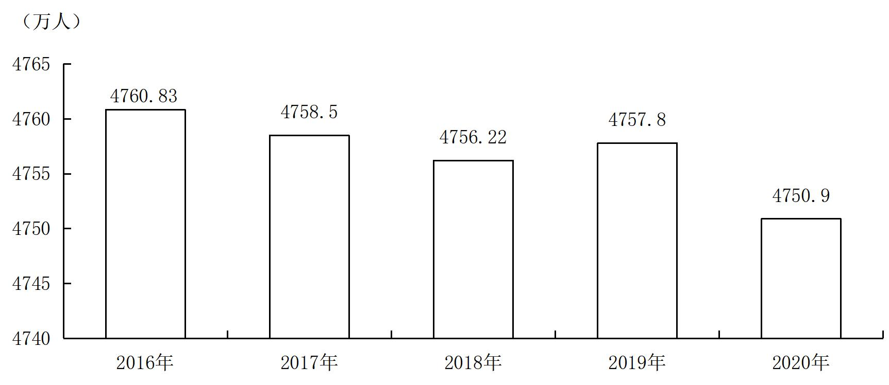

# 套题训练19

## Material M1

2020年末S省就业人口4750.9万人，占常住人口总数的59.01%，与2019年末相比，就业人口占常住人口总数的比重下降0.24个百分点。

2020年末S省第一产业、第二产业和第三产业的就业人口数量分别为764.89万人、2033.39万人、1952.62万人，与2019年末相比，第一、第二产业就业人口比重分别下降0.7个、0.1个百分点，第三产业就业人口比重上升0.8个百分点。



图2016～2020年末S省就业人口数量

## Material M2

2019年A市专利密集型产业实现增加值6918.8亿元，比上年增长9.6%，分别高于战略性新兴产业、高技术产业增加值增速2.3个和1.7个百分点；专利密集型产业增加值占GDP的比重为19.5%，比上年提高0.4个百分点。

2019年专利密集型产业发明专利申请量占专利申请总量的比重为66%，比规模以上重点企业高5.1个百分点。专利密集型产业每亿元R&D经费产生的发明专利申请量为73.1件，比规模以上重点企业高3.6件；企业户均拥有有效发明专利15.6件，是规模以上重点企业的2.2倍。从成果转化看，已被成功实施的发明专利数为5.2万件，占有效发明专利数的58.4%。

在专利密集型产业中，2019年信息通信技术服务业实现营业收入10198.5亿元，增速达41.3%；实现利润197.6亿元，比上年增长1倍；单位企业实现营业收入12亿元，是专利密集型产业平均水平的3.3倍。

在专利密集型产业中，2019年医药医疗产业营业收入、利润分别增长13.7%和5%；收入利润率达到17%，高于专利密集型产业平均水平4.1个百分点；单位企业营业收入、利润分别为4.5亿元和0.76亿元。

## Material M3

2016年全国女性就业人员占全社会就业人员的比重为43.1%，其中城镇单位女性就业人员6518万人，比2010年增加1656万人。

2016年公有制企事业单位中女性专业技术人员1480万人，比2010年增加211万人，所占比重达47.8%，提高2.8个百分点；其中女性高级专业技术人员161万人，比2010年增加59.3万人，所占比重38.3%，提高3个百分点。

2016年企业董事会中女职工董事占职工董事的比重为39.9%，企业监事会中女职工监事占职工监事的比重为40.1%，比2010年分别提高7.2和4.9个百分点；企业职工代表大会中女性代表比重为28.7%，略低于2010年0.3个百分点。

2016年女性参加生育保险的人数达8020万人，比2010年增长49%。2016年，参加城镇职工基本医疗保险的女性1.4亿人，比2011年增长21.5%；参加城镇居民基本医疗保险的女性1.9亿人，比2011年增长了1.5倍。

2016年全国参加城镇职工基本养老保险人数3.8亿人，其中女性1.8亿人，占比比2010年提高3个百分点；2016年，参加城乡居民基本养老保险人数5.1亿人，其中女性超过1.7亿人。

2016年全国参加失业保险的人数超过1.8亿人，其中女性7551万人，分别比2010年增加4713万人和2402万人，增长约35%和47%；参加工伤保险人数2.2亿人，其中女性8129万人，分别比2010年增加5728万人和2429万人，增长约35%和43%。

## Material M4

表辽宁省各类市场主体部分数据表

| 2018年12月末项目 | 2018年12月末绝对量 | 2018年12月末同比增长率（%） | 2018年12月末同比增速（百分点） | 2018年项目 | 2018年绝对量 | 2018年同比增长率（%） | 2018年同比增速（百分点） |
| --- | ---: | ---: | --- | --- | ---: | ---: | --- |
| 市场主体（万户） | 343.8 | 8.2 | 1.1 | 生产总值（亿元） | 25315.4 | 5.7 | — |
| 其中： |  |  |  | 年人均生产总值 |  |  |  |
|  | 90.7 | 12 | −2.9 |  | 58008 | 5.9 | — |
| 企业（万户） |  |  |  | （元） |  |  |  |
| 个体工商户（万户） | 246.5 | 6.9 | — | 规模以上工业主营业务收入（亿元） | 26489.9 | 15.8 | 6.9 |
| 农民专业合作社（万户） | 66.2 | 5.8 | — | 规模以上工业利税总额（亿元） | 2925.1 | 20.7 | −7.5 |
| 注册资本（万亿元） | 129.23 | 27.7 | −2.9 | 其中：利润总额（亿元） | 1460.3 | 41.8 | −51.9 |
| 新登记市场主体（万户） | 66.1 | 5.1 | −25.5 | 税收总额（亿元） | 1464.8 | 5.1 | — |

## Question 1

```yaml
module: 资料分析
materials:
- M1
```

### Stem

2019年末S省常住人口总数约为：

### Options
- A. 7910万人
- B. 8030万人
- C. 8096万人
- D. 8199万人

### Answer

B

## Question 2

```yaml
module: 资料分析
materials:
- M1
```

### Stem

2020年末S省第二产业就业人口在就业人口中的占比比第三产业约高：

### Options
- A. 0.5个百分点
- B. 1.7个百分点
- C. 3.5个百分点
- D. 5.1个百分点

### Answer

B

## Question 3

```yaml
module: 资料分析
materials:
- M1
```

### Stem

2020年末S省第一产业就业人口同比：

### Options
- A. 减少了不到50万人
- B. 减少了50万人以上
- C. 增加了不到50万人
- D. 增加了50万人以上

### Answer

A

## Question 4

```yaml
module: 资料分析
materials:
- M1
```

### Stem

2020年末S省未就业常住人口数量约为第三产业就业人口的多少倍：

### Options
- A. 1.4
- B. 1.5
- C. 1.7
- D. 1.9

### Answer

C

## Question 5

```yaml
module: 资料分析
materials:
- M1
```

### Stem

能够从上述材料中推出的是：

### Options
- A. 2020年末S省第一产业就业人口占就业人口的15%以下
- B. 2018年末S省就业人口同比增量低于上年同期数值
- C. 2019年末S省就业人口数量较上年增长0.1%以上
- D. 2020年末S省第二产业就业人口比上年减少0.1%以上

### Answer

D

## Question 6

```yaml
module: 资料分析
materials:
- M2
```

### Stem

2019年A市专利密集型产业实现增加值比上年约增长：

### Options
- A. 413亿元
- B. 502亿元
- C. 606亿元
- D. 698亿元

### Answer

C

## Question 7

```yaml
module: 资料分析
materials:
- M2
```

### Stem

现已知2019年A市①专利密集型产业专利申请总量、②专利密集型产业R&D经费占专利密集型产业

实现增加值的比重。如果想得到当年A市专利密集型产业发明专利申请量的数值，下列说法正确的是：

### Options
- A. 补充①可以得到，补充②不可以得到
- B. 补充①不可以得到，补充②可以得到
- C. 补充①和②中任一条可以得到
- D. ①和②两条相加才可以得到

### Answer

C

## Question 8

```yaml
module: 资料分析
materials:
- M2
```

### Stem

2019年A市专利密集型产业企业户均拥有已被成功实施的发明专利约：

### Options
- A. 9件
- B. 10件
- C. 11件
- D. 12件

### Answer

A

## Question 9

```yaml
module: 资料分析
materials:
- M2
```

### Stem

在专利密集型产业中，2019年A市信息通信技术服务业单位企业实现利润额约为：

### Options
- A. 0.18亿元
- B. 0.23亿元
- C. 0.35亿元
- D. 0.59亿元

### Answer

B

## Question 10

```yaml
module: 资料分析
materials:
- M2
```

### Stem

关于A市专利密集型产业发展状况，能够从上述材料中推出的是：

### Options
- A. 2018年增加值占全市GDP比重为19.9%
- B. 2019年发明专利申请量比非发明专利申请量高一倍以上
- C. 2018年信息通信技术服务业实现利润超过100亿元
- D. 2019年医药医疗产业利润占营业收入的比重低于上年水平

### Answer

D

## Question 11

```yaml
module: 资料分析
materials:
- M3
```

### Stem

2010～2016年全国城镇单位女性就业人员年均增加约：

### Options
- A. 207万人
- B. 237万人
- C. 276万人
- D. 331万人

### Answer

C

## Question 12

```yaml
module: 资料分析
materials:
- M3
```

### Stem

2016年公有制企事业单位中，高级专业技术人员占专业技术人员的比重约为：

### Options
- A. 7.5%
- B. 13.6%
- C. 22.9%
- D. 36.1%

### Answer

B

## Question 13

```yaml
module: 资料分析
materials:
- M3
```

### Stem

2016年参加城镇职工和城镇居民基本医疗保险的女性比2011年增长了约多少倍：

### Options
- A. 0.7
- B. 1.2
- C. 1.7
- D. 2.2

### Answer

A

## Question 14

```yaml
module: 资料分析
materials:
- M3
```

### Stem

如2017年及以后年份同比增量保持不变，同比增量按照2011-2016年间同比增量的平均值计算，全

国参加失业保险的女性将在哪年超过1.2亿人：

### Options
- A. 2024
- B. 2026
- C. 2028
- D. 2030

### Answer

C

## Question 15

```yaml
module: 资料分析
materials:
- M3
```

### Stem

下列选项中，能够从上述材料推出的是：

### Options
- A. 2016年全国参加工伤保险的人中，女性占比低于2010年水平
- B. 2010年全国参加城镇职工基本养老保险的人中，女性占比低于40%
- C. 2010年女职工董事占职工董事的比重高于女职工监事占职工监事的比重
- D. 2010年公有制企业事业单位中男性高级专业技术人员不到210万人

### Answer

D

## Question 16

```yaml
module: 资料分析
materials:
- M4
```

### Stem

2018年比2016年新登记注册市场主体约增加多少万户：

### Options
- A. 16
- B. 18
- C. 20
- D. 22

### Answer

B

## Question 17

```yaml
module: 资料分析
materials:
- M4
```

### Stem

2016年各类市场主体中企业占比约为：

### Options
- A. 24%
- B. 26%
- C. 27%
- D. 28%

### Answer

A

## Question 18

```yaml
module: 资料分析
materials:
- M4
```

### Stem

2018年规模以上工业主营业务利润总额比2016年增长了约多少亿元：

### Options
- A. 471
- B. 535
- C. 703
- D. 928

### Answer

D

## Question 19

```yaml
module: 资料分析
materials:
- M4
```

### Stem

2017年规模以上工业主营业务利润率约为：

### Options
- A. 4.3%
- B. 4.5%
- C. 4.9%
- D. 5.2%

### Answer

B

## Question 20

```yaml
module: 资料分析
materials:
- M4
```

### Stem

能够从上述材料中推出的是：

### Options
- A. 2018年平均每个新登记市场主体贡献地区生产总值增加额约为360亿元
- B. 2016年农民专业合作社在全部市场主体中的占比高于2018年
- C. 2017年平均约13.8人拥有一户市场主体
- D. 规模以上工业主营业务纳税总额增速低于利润总额增速是因为实行了减税政策

### Answer

C
