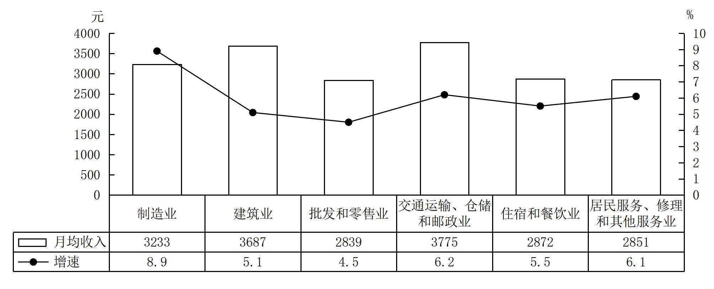
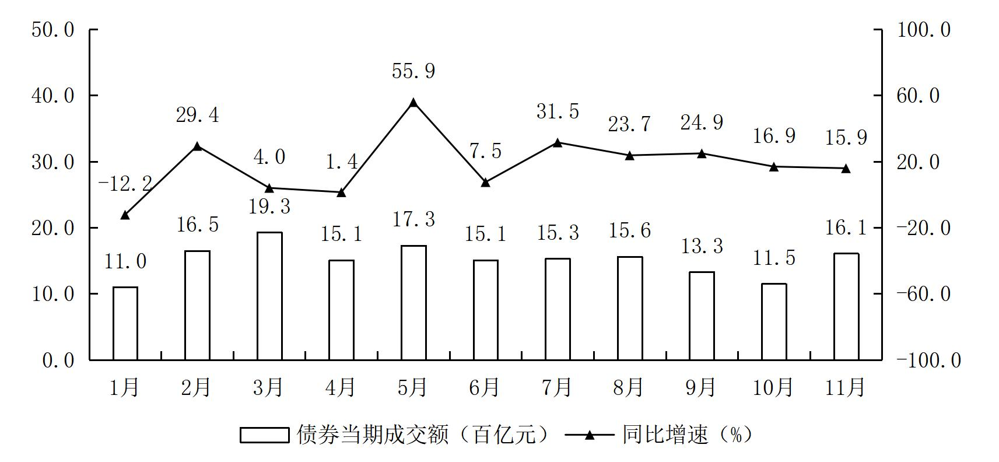

<!-- hyz-paper-id: 01a1e4f7-7bdb-7e30-af23-5c213c7b9dc6 -->

# 套题训练2

## Material M1

<!-- hyz-material-id: 01a1e4f7-7bdb-7e30-af23-5c3e9a5675f7 -->

2023年前三季度，规模以上文化企业（简称文化企业）实现营业收入91619亿元，同比增长7.7%。其中，文化新业态特征较为明显的16个行业小类实现营业收入36870亿元，同比增长15.2%。

分产业类型看，文化制造业实现营业收入29007亿元，同比下降1.0%；文化批发和零售业15024亿元，同比增长5.3%；文化服务业47588亿元，同比增长14.6%。

分领域看，文化核心领域实现营业收入59507亿元，同比增长12.4%；文化相关领域32112亿元，同比下降0.1%。

分行业类别看，新闻信息服务实现营业收入12203亿元，同比增长14.9%；内容创作生产19857亿元，同比增长10.3%；创意设计服务14973亿元，同比增长9.6%；文化传播渠道10712亿元，同比增长12.4%；文化投资运营473亿元，同比增长27.7%；文化娱乐休闲服务1289亿元，同比增长67.2%；文化辅助生产和中介服务10894亿元，同比下降1.5%；文化装备生产4443亿元，同比下降4.3%；文化消费终端生产16775亿元，同比增长2.1%。

分区域看，东部地区实现营业收入71959亿元，同比增长8.1%；中部地区10600亿元，同比增长1.9%；西部地区8196亿元，同比增长12.2%；东北地区864亿元，同比增长7.0%。前三季度，文化企业实现利润总额7508亿元，同比增长31.4%。前三季度末，文化企业资产总计192849亿元，同比增长6.7%。

## Material M2

<!-- hyz-material-id: 01a1e4f7-7bdb-7e30-af23-5c4e243f847a -->

2016年，农民工月均收入3275元，比上年增加203元，增长6.6%，增速比上年回落0.6个百分点。外出务工农民工月均收入3572元，比上年增加213元，增长6.3%；本地务工农民工月均收入2985元，比上年增加204元，增长7.3%。本地务工农民工月均收入比外出务工农民工低587元，但增速比外出务工农民工高1个百分点。

分行业看，制造业收入增速较上年提高；居民服务、修理和其他服务业增速与上年持平；建筑业，批发和零售业，交通运输、仓储和邮政业，住宿和餐饮业农民工月均收入增速分别此上年回落1.5、1.9、1.5和0.7个百分点。



图2016年分行业农民工月均收入及增速图

分地区看，在东部地区务工的农民工月均收入3454元，同比增长7.4%，在中部地区务工的农民工月均收入3132元，增长7.7%；在西部地区务工的农民工月均收入3117元，增长5.2%；在东北地区务工的农民工月均收入3063元，下降1.4%。

## Material M3

<!-- hyz-material-id: 01a1e4f7-7bdb-7e30-af23-5c5b875364c6 -->

2023年一季度我国一般公共预算财政收入累计同比增长0.5%。1～4月累计，全国一般公共预算收入83171亿元，同比增长11.9%。其中，中央一般公共预算收入37561亿元，同比增长8.6%；地方一般公共预算本级收入45610亿元，同比增长14.8%。全国税收收入70379亿元，同比增长12.9%；非税收入12792亿元，同比增长6.8%。1～4月地方财政收入累计完成预算目标的38.9%。

2023年一季度全国政府性基金预算收入10825亿元，同比下降21.8%。1～4月累计，全国政府性基金预算收入14601亿元，同比下降16.9%。分中央和地方看，中央政府性基金预算收入1194亿元，同比增长7.5%；地方政府性基金预算本级收入13407亿元，同比下降18.5%。

2023年一季度，全国一般公共预算支出67915亿元。1～4月累计，全国一般公共预算支出86418亿元。其中，中央一般公共预算本级支出10196亿元，同比增长5.8%；地方一般公共预算支出76222亿元，同比增长6.9%。

2023年一季度，全国政府性基金预算支出21066亿元，同比下降15%。1～4月累计，全国政府性基金预算支出27928亿元，同比下降11.3%。分中央和地方看，中央政府性基金预算本级支出329亿元，同比下降65.6%；地方政府性基金预算支出27599亿元，同比下降9.6%，其中，国有土地使用权出让收入相关支出16106亿元，同比下降17.1%。

2023年一季度一般公共预算财政收支逆差5574亿元，全国政府性基金预算收支逆差10241亿元，两者合计逆差比去年同期扩大3320.0亿元。

## Material M4

<!-- hyz-material-id: 01a1e4f7-7bdb-7e30-af23-5c64706091e3 -->

表2023年1～11月J省深圳证券交易所证券成交金额情况

| 时间 | 证券累计成交金额（百亿元） | 同比增速（%） |
| --- | ---: | ---: |
| 1月 | 32.1 | −34.6 |
| 2月 | 82.2 | −7.7 |
| 3月 | 139.7 | −6.4 |
| 4月 | 192.3 | −0.5 |
| 5月 | 240.6 | 4.7 |
| 6月 | 289.3 | 2.1 |
| 7月 | 335.5 | 0.6 |
| 8月 | 382.7 | −1.5 |
| 9月 | 420.1 | −1.2 |
| 10月 | 456.2 | 0.1 |
| 11月 | 507.9 | 0.4 |



图2023年1～11月J省深圳证券交易所债券成交额情况

## Question 1

<!-- hyz-question-id: 01a1e4f7-7bdb-7e30-af23-5c7c9c583476 -->

```yaml
module: 资料分析
materials:
- M1
```

### Stem

2022年前三季度，文化服务业实现营业收入约是文化批发和零售业营业收入的：

### Options
- A. 不到2.5倍
- B. 2.5～3倍
- C. 3～3.5倍
- D. 3.5倍以上

### Answer

B

## Question 2

<!-- hyz-question-id: 01a1e4f7-7bdb-7e30-af23-5c8916cfac26 -->

```yaml
module: 资料分析
materials:
- M1
```

### Stem

2023年前三季度，营业收入超过1.2万亿元的行业，按同比增速由大到小排序正确的是：

### Options
- A. 内容创作生产、文化消费终端生产、创意设计服务、新闻信息服务
- B. 创意设计服务、文化消费终端生产、文化传播渠道、内容创作生产
- C. 新闻信息服务、内容创作生产、创意设计服务、文化消费终端生产
- D. 创意设计服务、新闻信息服务、文化消费终端生产、内容创作生产

### Answer

C

## Question 3

<!-- hyz-question-id: 01a1e4f7-7bdb-7e30-af23-5c995e9bab54 -->

```yaml
module: 资料分析
materials:
- M1
```

### Stem

2023年前三季度，实现营业收入最高的文化行业，其2022年前三季度的营业收入大约是：

### Options
- A. 不到1.4万亿元
- B. 1.4～1.8万亿元
- C. 1.8～2.2万亿元
- D. 超过2.2万亿元

### Answer

C

## Question 4

<!-- hyz-question-id: 01a1e4f7-7bdb-7e30-af23-5cae43bb96ed -->

```yaml
module: 资料分析
materials:
- M1
```

### Stem

2023年前三季度，文化企业利润总额与营业收入的比值约比上一年：

### Options
- A. 降低了1.8个百分点
- B. 降低了1.5个百分点
- C. 提高了1.8个百分点
- D. 提高了1.5个百分点

### Answer

D

## Question 5

<!-- hyz-question-id: 01a1e4f7-7bdb-7e30-af23-5cb0ac352581 -->

```yaml
module: 资料分析
materials:
- M1
```

### Stem

下列说法错误的是：

### Options
- A. 2022年前三季度，文化新业态特征较为明显的16个行业小类的营业收入占文化企业营业收入比重超过40%
- B. 2023年前三季度，文化核心领域实现营业收入同比增量超过文化企业实现营业收入同比增量
- C. 2022年前三季度，中部地区文化企业实现营业收入比西部地区多3000亿元以上
- D. 2023年前三季度，每百元资产实现营业收入比上一年高

### Answer

A

## Question 6

<!-- hyz-question-id: 01a1e4f7-7bdb-7e30-af23-5cc3dcc69642 -->

```yaml
module: 资料分析
materials:
- M2
```

### Stem

2016年，农民工月均收入比2014年增加多少元：

### Options
- A. 203
- B. 217
- C. 409
- D. 587

### Answer

C

## Question 7

<!-- hyz-question-id: 01a1e4f7-7bdb-7e30-af23-5cd77edb9a88 -->

```yaml
module: 资料分析
materials:
- M2
```

### Stem

2016年，农民工月均收入增额最大的行业是：

### Options
- A. 制造业
- B. 交通运输、仓储和邮政业
- C. 建筑业
- D. 居民服务、修理和其他服务业

### Answer

A

## Question 8

<!-- hyz-question-id: 01a1e4f7-7bdb-7e30-af23-5ced9b34252b -->

```yaml
module: 资料分析
materials:
- M2
```

### Stem

2015年，在哪个地区务工的农民工月均收入最低：

### Options
- A. 东部地区
- B. 中部地区
- C. 西部地区
- D. 东北地区

### Answer

B

## Question 9

<!-- hyz-question-id: 01a1e4f7-7bdb-7e30-af23-5cf712182c0b -->

```yaml
module: 资料分析
materials:
- M2
```

### Stem

根据上述材料，下列说法不正确的是：

### Options
- A. 2016年，农民工月均收入增幅比上年小
- B. 2016年，本地务工农民工月均收入增速比外出务工农民工快
- C. 2016年，居民服务、修理和其他服务业的收入增额与上年持平
- D. 2016年，中部地区务工的农民工月均收入增速比其他三个地区快

### Answer

C

## Question 10

<!-- hyz-question-id: 01a1e4f7-7bdb-7e30-af23-5d0e475117a3 -->

```yaml
module: 资料分析
materials:
- M2
```

### Stem

与上年相比，2016年农民工中外出务工农民工的占比变化是：

### Options
- A. 变大
- B. 变小
- C. 不变
- D. 无法推出

### Answer

B

## Question 11

<!-- hyz-question-id: 01a1e4f7-7bdb-7e30-af23-5d1c5cbe08a1 -->

```yaml
module: 资料分析
materials:
- M3
```

### Stem

2023年4月我国一般公共预算财政收入为：

### Options
- A. 12295亿元
- B. 20830亿元
- C. 62031亿元
- D. 62341亿元

### Answer

B

## Question 12

<!-- hyz-question-id: 01a1e4f7-7bdb-7e30-af23-5d2fc39ce825 -->

```yaml
module: 资料分析
materials:
- M3
```

### Stem

以下指标按2023年1～4月累计量的同比增量从高到低排序正确的是：

### Options
- A. 地方一般公共预算本级收入、非税收入、中央一般公共预算收入
- B. 全国税收收入、中央一般公共预算收入、地方一般公共预算本级收入
- C. 地方一般公共预算本级收入、全国税收收入、中央一般公共预算收入
- D. 全国税收收入、地方一般公共预算本级收入、中央一般公共预算收入

### Answer

D

## Question 13

<!-- hyz-question-id: 01a1e4f7-7bdb-7e30-af23-5d388041e74c -->

```yaml
module: 资料分析
materials:
- M3
```

### Stem

2023年1～4月累计非税收入占全国一般公共预算收入的比重：

### Options
- A. 下降了不到5%
- B. 下降了5%以上
- C. 上升了不到5%
- D. 上升了5%以上

### Answer

A

## Question 14

<!-- hyz-question-id: 01a1e4f7-7bdb-7e30-af23-5d4a83f99a57 -->

```yaml
module: 资料分析
materials:
- M3
```

### Stem

2023年1～4月累计，全国一般公共预算支出同比增速在：

### Options
- A. 6%以下
- B. 6%～6.5%之间
- C. 6.5%～7%之间
- D. 7%以上

### Answer

C

## Question 15

<!-- hyz-question-id: 01a1e4f7-7bdb-7e30-af23-5d53c95976c7 -->

```yaml
module: 资料分析
materials:
- M3
```

### Stem

能够从上述材料推出的是：

### Options
- A. 2023年4月全国政府性基金预算收入同比下降
- B. 2022年地方财政收入预算目标约为117249亿元
- C. 2023年1～4月累计，中央政府性基金预算收入占全国政府性基金预算收入的比重同比上升
- D. 2022年一季度一般公共预算财政收支逆差与全国政府性基金预算收支逆差合计为19135亿元

### Answer

C

## Question 16

<!-- hyz-question-id: 01a1e4f7-7bdb-7e30-af23-5d6bf43fc6aa -->

```yaml
module: 资料分析
materials:
- M4
```

### Stem

2023年11月J省深圳证券交易所债券当期成交额同比增量为：

### Options
- A. 不到2百亿元
- B. 2～2.5百亿元
- C. 2.5～3百亿元
- D. 超过3百亿元

### Answer

B

## Question 17

<!-- hyz-question-id: 01a1e4f7-7bdb-7e30-af23-5d7032b79264 -->

```yaml
module: 资料分析
materials:
- M4
```

### Stem

2023年上半年J省深圳证券交易所债券平均成交额为：

### Options
- A. 不到15百亿元
- B. 15～16百亿元
- C. 16～17百亿元
- D. 超过17百亿元

### Answer

B

## Question 18

<!-- hyz-question-id: 01a1e4f7-7bdb-7e30-af23-5d80865a33fb -->

```yaml
module: 资料分析
materials:
- M4
```

### Stem

2023年1～11月J省深圳证券交易所债券当期成交额占证券当期成交金额的比重超过 $\frac{1}{3}$ 的月份有：

### Options
- A. 3个
- B. 4个
- C. 5个
- D. 6个

### Answer

B

## Question 19

<!-- hyz-question-id: 01a1e4f7-7bdc-70c0-bcf2-04ce2ef4aeff -->

```yaml
module: 资料分析
materials:
- M4
```

### Stem

2023年6月J省深圳证券交易所证券当期成交金额占上半年的比重为：

### Options
- A. 不到15%
- B. 15%～20%
- C. 20%～25%
- D. 超过25%

### Answer

B

## Question 20

<!-- hyz-question-id: 01a1e4f7-7bdc-70c0-bcf2-04d482350537 -->

```yaml
module: 资料分析
materials:
- M4
```

### Stem

下面能够反映2023年J省深圳证券交易所第三季度各月证券当期成交金额环比增速的折线图是：

### Options
- A. 
- B. 
- C. 
- D. 

### Answer

C
