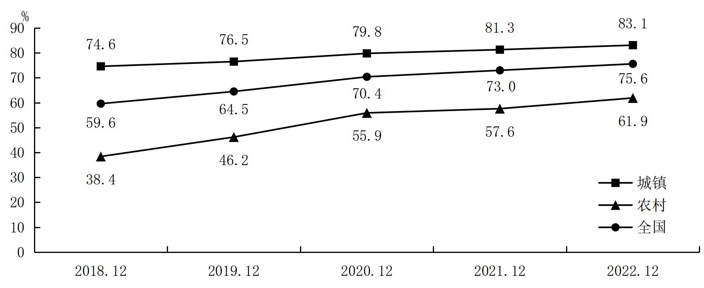
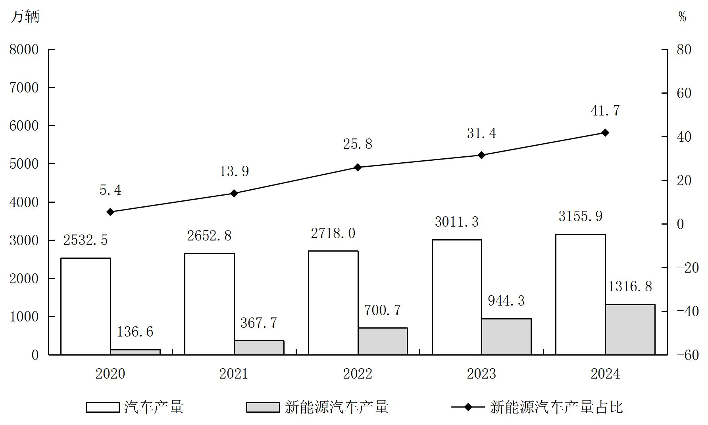
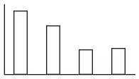
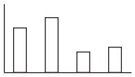
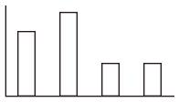
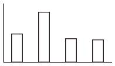

# 套题训练20

## Material M1

表2020年我国第四季度和全年GDP分行业（部分）统计情况表

| 行业 | 第四季度生产值（亿元） | 第四季度同比增速（%） | 全年生产值（亿元） | 全年同比增速（%） |
| --- | ---: | ---: | ---: | ---: |
| 总计 | 296298 | 6.5 | 1015986 | 2.3 |
| 农林牧渔业 | 30824 | 4.2 | 81104 | 3.1 |
| 工业 | 89843 | 6.9 | 313071 | 2.4 |
| 建筑业 | 24654 | 6.6 | 72296 | 3.5 |
| 批发和零售业 | 28279 | 6.3 | 95686 | −1.3 |
| 交通运输、仓储和邮政业 | 12002 | 7.6 | 41562 | 0.5 |
| 住宿和餐饮业 | 5267 | 2.7 | 15971 | −13.1 |
| 金融业 | 20729 | 7.0 | 84070 | 7.1 |
| 房地产业 | 20903 | 6.7 | 74553 | 2.1 |
| 租赁和商务服务业 | 9512 | 2.2 | 31616 | −5.3 |

## Material M2

截止2022年12月，我国网民规模约为10.67亿，较2021年12月新增网民约3549万，互联网普及率达75.6%，较2021年12月提升2.6个百分点。我国网民使用手机上网的比例达99.8%，较2021年12月增加0.1个百分点；使用电视上网的比例为25.9%；使用台式电脑、笔记本电脑、平板电脑上网的比例分别为34.2%、32.8%和28.5%。我国城镇网民规模约为7.59亿，占网民整体的71.1%，农村网民规模约为3.08亿，较2021年12月增长约2371万，占网民整体的28.9%。

2022年12月，20～29岁、30～39岁、40～49岁网民占比分别为14.2%、19.6%和16.7%；50岁及以上网民群体占比由2021年12月的26.8%提升至30.8%，互联网进一步向中老年群体渗透。

2022年12月，线上办公用户规模约达5.4亿，较2021年12月增加7078万户，占整体网民的50.6%。互联网医疗用户规模约达3.63亿，较2021年12月增加约6466万，占网民整体的34%。农村地区在线教育和互联网医疗用户分别占农村网民整体的31%和21.5%，较上年分别增加2.7%和4.1%。



图2018年12月～2022年12月中国互联网普及率

## Material M3

2023年前5个月，天津口岸出口汽车约17.2万辆，同比增长29.5%，总价值约100.1亿元人民币，同比增长40.2%。

2023年前5个月，汽车出口带动天津口岸整体出口同比增加。汽车出口占同期天津口岸出口商品总值的2.2%，较上年同期提升0.3个百分点。1～5月民营企业出口活力明显，民营企业出口约10.6万辆，同比增长64.3%，占同期天津口岸汽车出口总量的61.6%，占比较上年同期提升13个百分点。新能源汽车出口成为新的增长点，出口约11万辆，同比增长50.2%。

表2023年1～5月天津口岸汽车出口月度数据表

| 月份 | 出口车辆数（辆） | 出口车辆数同比增速（%） | 车辆出口值（万元） | 车辆出口值同比增速（%） |
| ---: | ---: | ---: | ---: | ---: |
| 1 | 29105 | 20.1 | 151198.7 | 44.0 |
| 2 | 22785 | 50.1 | 161250.2 | 97.3 |
| 3 | 43361 | 73.4 | 229566.6 | 50.4 |
| 4 | 40437 | 49.6 | 236893.0 | 53.2 |
| 5 | 36519 | −12.1 | 222329.5 | 0.9 |

## Material M4

2024年全国规模以上工业生产增长势头较好，增加值比上年增长5.8%。分三大门类看，采矿业增加值增长3.1%，制造业增长6.1%，电力、热力、燃气及水生产和供应业增长5.3%。装备制造业和高技术制造业增长较快，增加值分别增长7.7%和8.9%。分经济类型看，国有控股企业增加值增长4.2%，股份制企业增长6.1%，外商及港澳台投资企业增长4.0%，私营企业增长5.3%。分产品看，新能源汽车、集成电路、工业机器人产量分别为1316.8万辆、4514.2亿块、55.6万套，分别增长39.4%、22.2%、14.2%，新能源汽车产量占汽车产量比重进一步扩大。

2020～2024年全国规模以上工业汽车及新能源汽车产量见下图。



图2020～2024年全国规模以上工业汽车及新能源汽车产量

## Question 1

```yaml
module: 资料分析
materials:
- M1
```

### Stem

2020年全年我国住宿和餐饮业、金融业生产值之和占总GDP的比重约为：

### Options
- A. 10%
- B. 15%
- C. 17%
- D. 20%

### Answer

A

## Question 2

```yaml
module: 资料分析
materials:
- M1
```

### Stem

上表中，2020年前三季度生产值同比增速低于全年的行业有多少个：

### Options
- A. 6
- B. 7
- C. 8
- D. 9

### Answer

C

## Question 3

```yaml
module: 资料分析
materials:
- M1
```

### Stem

2019年前三季度我国GDP约为多少万亿元：

### Options
- A. 68.3
- B. 71.5
- C. 72.0
- D. 73.8

### Answer

B

## Question 4

```yaml
module: 资料分析
materials:
- M1
```

### Stem

若保持2020年的增速，哪一年建筑业的生产值开始超过房地产业：

### Options
- A. 2021
- B. 2022
- C. 2023
- D. 2024

### Answer

C

## Question 5

```yaml
module: 资料分析
materials:
- M1
```

### Stem

根据以上材料，可以推出：

### Options
- A. 2020年我国租赁和商务服务业月均生产值不足0.25万亿元
- B. 2020年第四季度生产值同比增长最多的行业是交通运输、仓储和邮政业
- C. 虽然受到新冠疫情的影响，但2020年第四季度我国各主要行业均实现了正增长
- D. 2020年金融业每个季度的生产值同比增速均在7.0%左右

### Answer

C

## Question 6

```yaml
module: 资料分析
materials:
- M2
```

### Stem

截至2022年12月，我国20岁以上网民人数是20岁以下网民人数的：

### Options
- A. 不到3倍
- B. 3～4倍之间
- C. 4～5倍之间
- D. 5倍以上

### Answer

C

## Question 7

```yaml
module: 资料分析
materials:
- M2
```

### Stem

截至2022年12月，我国城镇网民规模同比增速约为：

### Options
- A. 1.2%
- B. 1.6%
- C. 2.0%
- D. 2.4%

### Answer

B

## Question 8

```yaml
module: 资料分析
materials:
- M2
```

### Stem

根据上述材料，截止2022年12月我国网民使用上网前3位的设备是：

### Options
- A. 手机、台式电脑、笔记本电脑
- B. 手机、笔记本电脑、平板电脑
- C. 手机、电视、台式电脑
- D. 电视、台式电脑、平板电脑

### Answer

A

## Question 9

```yaml
module: 资料分析
materials:
- M2
```

### Stem

以下柱状图中，最能准确反映2019年12月～2022年12月全国互联网普及率同比增量变化趋势的是

（横轴位置代表增量为0）：

### Options
- A. 
- B. 
- C. 
- D. 

### Answer

C

## Question 10

```yaml
module: 资料分析
materials:
- M2
```

### Stem

以下信息中，能够从上述材料中推出的有几项：

①2022年12月我国手机网民人数同比增量

②2021年12月我国线上办公用户占网民整体的比重

③2022年12月我国城镇地区互联网医疗用户规模

### Options
- A. 0
- B. 1
- C. 2
- D. 3

### Answer

D

## Question 11

```yaml
module: 资料分析
materials:
- M3
```

### Stem

2023年1～5月，天津口岸出口汽车均价同比上涨为：

### Options
- A. 8%
- B. 12%
- C. 16%
- D. 20%

### Answer

A

## Question 12

```yaml
module: 资料分析
materials:
- M3
```

### Stem

2023年1～5月，民营企业出口汽车同比约增加了多少万辆：

### Options
- A. 3
- B. 4
- C. 5
- D. 6

### Answer

B

## Question 13

```yaml
module: 资料分析
materials:
- M3
```

### Stem

2022年1～5月，天津口岸出口新能源汽车约占天津口岸出口汽车的：

### Options
- A. 46%
- B. 50%
- C. 55%
- D. 64%

### Answer

C

## Question 14

```yaml
module: 资料分析
materials:
- M3
```

### Stem

2023年1～5月，天津口岸出口汽车平均单价同比增长率最大的月份是：

### Options
- A. 1月
- B. 2月
- C. 4月
- D. 5月

### Answer

B

## Question 15

```yaml
module: 资料分析
materials:
- M3
```

### Stem

在以下信息中，能够从上述材料中推出的有几项：

①2022年1～5月，天津口岸汽车出口量最大的是3月

②2023年1～5月，民营企业月均通过天津口岸出口汽车2万辆以上

③2023年2月，天津口岸出口汽车平均单价高于1月水平

④2022年1～5月，汽车出口总价值占天津口岸出口商品总值的2%以下

### Options
- A. 1
- B. 2
- C. 3
- D. 4

### Answer

C

## Question 16

```yaml
module: 资料分析
materials:
- M4
```

### Stem

三大工业门类中，2024年规模以上工业增加值占全国规模以上工业增加值的比重较上年有所上升的是：

### Options
- A. 仅采矿业
- B. 采矿业和制造业
- C. 仅制造业
- D. 电力、热力、燃气及水生产和供应业

### Answer

C

## Question 17

```yaml
module: 资料分析
materials:
- M4
```

### Stem

按2024年的增长率推算，全国规模以上工业新能源汽车产量突破3000万辆的年份是：

### Options
- A. 2026年
- B. 2027年
- C. 2028年
- D. 2029年

### Answer

B

## Question 18

```yaml
module: 资料分析
materials:
- M4
```

### Stem

2021～2024年全国规模以上工业新能源汽车产量的年均增速是：

### Options
- A. 50.2%
- B. 61.1%
- C. 76.2%
- D. 92.6%

### Answer

C

## Question 19

```yaml
module: 资料分析
materials:
- M4
```

### Stem

2020～2024年全国规模以上工业汽车总产量是：

### Options
- A. 12637.8万辆
- B. 13025.6万辆
- C. 13686.9万辆
- D. 14070.5万辆

### Answer

D

## Question 20

```yaml
module: 资料分析
materials:
- M4
```

### Stem

关于全国规模以上工业生产，下列选项中不能由所给材料推出的是：

### Options
- A. 2024年股份制企业增加值比国有控股企业多1.9%
- B. 2021～2024年新能源汽车产量占汽车产量比重逐年上升
- C. 2020～2024年新能源汽车产量比上年增加最多的年份是2024年
- D. 2024年高技术制造业增加值增长率比规模以上工业快3.1个百分点

### Answer

A
