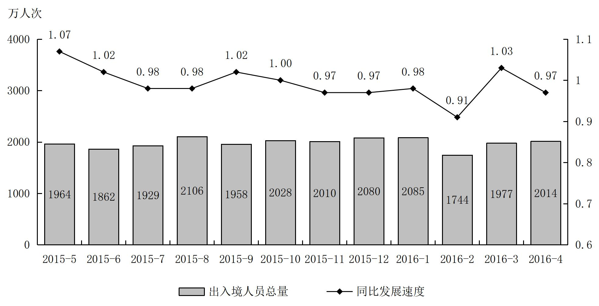

# 套题训练3

## Material M1

2018年1～12月，社会消费品零售总额380987亿元，比上年增长9.0%（扣除价格因素实际增长6.9%，以下除特殊说明外均为名义增长）。其中，限额以上单位消费品零售额145311亿元，增长5.7%。

2018年12月份，社会消费品零售总额35893亿元，同比增长8.2%，增速比11月份提高0.1个百分点。其中，限额以上单位消费品零售额15084亿元，增长2.4%。

表2018年社会消费品零售总额主要数据

| 指标 | 12月绝对量（亿元） | 12月同比增长（%） | 1～12月绝对量（亿元） | 1～12月同比增长（%） |
| --- | --- | --- | ---: | ---: |
| 社会消费品零售总额 | 35893 | 8.2 | 380987 | 9.0 |
| 其中：限额以上单位消费品零售额 | 15084 | 2.4 | 145311 | 5.7 |
| 其中：实物商品网上零售额 | - | - | 70198 | 25.4 |
| 按经营地分 |  |  |  |  |
| 城镇 | 30329 | 8.0 | 325637 | 8.8 |
| 乡村 | 5565 | ？ | 55350 | 10.1 |
| 按消费类型分 |  |  |  |  |
| 餐饮收入 | 4422 | 9.0 | 42716 | 9.5 |
| 其中：限额以上单位餐饮吸入 | 909 | 5.5 | 9236 | 6.4 |
| 商品零售 | 31472 | 8.0 | 338271 | 8.9 |
| 其中：限额以上单位商品零售 | 14175 | 2.2 | 136075 | 5.7 |
| 粮油、食品类 | 1403 | 11.3 | 13776 | 10.2 |
| 饮料类 | 187 | 9.2 | 2040 | 9.0 |
| 烟酒类 | 394 | 8.4 | 3873 | 7.4 |
| 服装鞋帽、针纺织品类 | 1541 | 7.4 | 13707 | 8.0 |
| 化妆品类 | 247 | 1.9 | 2619 | 9.6 |
| 金银珠宝类 | 276 | 2.3 | 2758 | 7.4 |
| 日用品类 | 545 | 16.8 | 5392 | 13.7 |
| 家用电器和音像器材类 | 936 | 13.9 | 8863 | 8.9 |
| 中西药品类 | 574 | 10.6 | 5593 | 9.4 |
| 文化办公用品类 | 386 | −4.0 | 3264 | 3.0 |
| 家具类 | 251 | 12.7 | 2250 | 10.1 |
| 通信器材类 | 406 | −0.9 | 4371 | 7.1 |
| 石油及制品类 | 1736 | 5.8 | 19541 | 13.3 |
| 汽车类 | 4268 | −8.5 | 38948 | −2.4 |
| 建筑及装潢材料类 | 280 | 8.6 | 2498 | 8.1 |

注：1.此表格均为未扣除价格因素的名义增速；

2.此表中部分数据因四舍五入的原因，存在总计与分项合计不等的情况。

## Material M2

表AK制造公司2018年4月订单情况表

| 类别公司 | 磨床 | 铣床 | 钻床 |
| --- | ---: | ---: | ---: |
| Eastlands | 1178 | 35 | 145 |
| Boeing | 574 | 0 | 84 |
| Nipoocar | 0 | 15 | 0 |
| Reassair | 1722 | 6 | 30 |
| Fouthear | 2026 | 45 | 200 |
| 订单单价（英镑） | 405 | 20245 | 287 |

表与英镑的汇率表

| 1英镑= | 4月1日 | 9月1日 | 12月31日 |
| --- | ---: | ---: | ---: |
| 欧元 | 1.04 | 1.47 | 1.11 |
| 日元 | 193.98 | 179.01 | 139.89 |
| 美元 | 1.26 | 1.35 | 1.26 |

## Material M3

2020年末，全国共有艺术表演团体17581个，比上年末减少214个；从业人员43.69万人，增加2.44万人。其中各级文化和旅游部门所属艺术表演团体2060个，占11.7%，从业人员10.75万人，占24.6%。

2020年，全国艺术表演团体共演出225.61万场，比上年下降24.0%；国内观众8.93亿人次，下降27.4%；演出收入86.63亿元，下降31.7%。

2020年，全国文化和旅游部门所属艺术表演团体共组织政府采购公益演出13.38万场，比上年下降14.9%；观众0.86亿人次，下降27.9%。

2020年末，全国公共图书馆实际使用房屋建筑面积1785.77万平方米，比上年末增长12.2%；全国图书总藏量117929.99万册，增长6.1%；阅览室坐席数126.47万个，增长6.2%；计算机226234台，增加419台；其中供读者使用的电子阅览终端143714台，减少2022台。

2020年末，全国共有群众文化机构43687个，比上年末减少386个。其中乡镇综合文化站32825个，减少705个。年末全国群众文化机构从业人员185076人，比上年末减少4992人。其中具有高级职称的人员7075人，具有中级职称人员17969人。

## Material M4

2016年S市口岸通关情况为：4月份口岸出入境车辆131.2万辆次，机场空港口岸出入境旅客24万人次；

1～4月，S市口岸累计出入境车辆495万辆次，机场空港口岸出入境旅客累计90.2万人次。



注：同比发展速度指当期数值与上年同期数值之比

图2015年5月～2016年4月经S市口岸出入境人员月度统计

## Question 1

```yaml
module: 资料分析
materials:
- M1
```

### Stem

2018年12月，下列商品总额增长值最大的是：

### Options
- A. 粮油、食品类
- B. 烟酒类
- C. 中西药品类
- D. 石油及制品类

### Answer

A

## Question 2

```yaml
module: 资料分析
materials:
- M1
```

### Stem

2018年1～12月，实物商品网上零售额占社会消费品零售总额的比重比上一年：

### Options
- A. 增加2.4个百分点
- B. 减少2.4个百分点
- C. 增加4.8个百分点
- D. 减少4.8个百分点

### Answer

A

## Question 3

```yaml
module: 资料分析
materials:
- M1
```

### Stem

表中“？”处的数据为：

### Options
- A. 8.4
- B. 8.9
- C. 9.3
- D. 10.9

### Answer

C

## Question 4

```yaml
module: 资料分析
materials:
- M1
```

### Stem

2018年1～12月的社会消费品零售总额同比增速比2018年1～11月：

### Options
- A. 低0.1个百分点
- B. 高0.1个百分点
- C. 低0.2个百分点
- D. 高0.2个百分点

### Answer

A

## Question 5

```yaml
module: 资料分析
materials:
- M1
```

### Stem

2018年1～12月，下列说法错误的是：

### Options
- A. 从销售方式看，实物商品网上零售额快速增长
- B. 从经营地看，城镇消费品零售额增长量高于乡村
- C. 从消费类型看，餐饮消费品零售额增长量高于商品零售
- D. 从限额以上单位商品零售种类看，日用品类商品零售额增长较快

### Answer

C

## Question 6

```yaml
module: 资料分析
materials:
- M2
```

### Stem

如果Nipoocar公司4月1日同意以英镑标注的铣床订单价格，在9月1日付款，那么9月1日付款

与4月1日付款费用上大约：

### Options
- A. 多付4242455日元
- B. 多付4546015日元
- C. 少付4242455日元
- D. 少付4546015日元

### Answer

D

## Question 7

```yaml
module: 资料分析
materials:
- M2
```

### Stem

如AK制造公司钻床订单数环比增长率为3%，若保持此环比增长率不变，AK公司钻床订单达到500件

的时间应在：

### Options
- A. 2018年7月
- B. 2018年9月
- C. 2018年11月
- D. 2019年1月

### Answer

A

## Question 8

```yaml
module: 资料分析
materials:
- M2
```

### Stem

2018年9月1日磨床的价格比订单价下降了 $\frac{2}{9}$，则下列说法正确的是：

### Options
- A. Reassair公司使用欧元12月31日按订单价支付比9月1日按现价支付更经济
- B. Reassair公司使用欧元9月1日按现价支付比12月31日按订单价支付更经济
- C. Reassair公司使用日元9月1日按现价支付额比12月31日按订单价支付额高
- D. Reassair公司使用美元12月31日按订单价支付比9月1日按现价支付更经济

### Answer

A

## Question 9

```yaml
module: 资料分析
materials:
- M2
```

### Stem

Boeing公司钻床订单价占该公司总订单价约为：

### Options
- A. 8.1%
- B. 9.4%
- C. 14.1%
- D. 18.3%

### Answer

B

## Question 10

```yaml
module: 资料分析
materials:
- M2
```

### Stem

AK制造公司铣床的利润为售价的3.9%，磨床的利润为售价的5.1%，则关于上述所有磨床和铣床订单

按英镑计价的利润额阐述正确的有多少个：

①磨床的利润额比铣床高了约40%左右

②铣床的利润额比磨床低了近30%

③铣床的利润额大约8万元

④磨床的单位成本比铣床的低

### Options
- A. 1
- B. 2
- C. 3
- D. 4

### Answer

C

## Question 11

```yaml
module: 资料分析
materials:
- M3
```

### Stem

2020年末，平均每个各级文化和旅游部门所属艺术表演团体的从业人数约是全国所有艺术表演团体的

多少倍：

### Options
- A. 0.5
- B. 0.8
- C. 1.3
- D. 2.1

### Answer

D

## Question 12

```yaml
module: 资料分析
materials:
- M3
```

### Stem

2020年，全国艺术表演团体平均每场演出创造收入比上年：

### Options
- A. 减少了不到1000元
- B. 减少了1000元以上
- C. 增加了不到1000元
- D. 增加了1000元以上

### Answer

A

## Question 13

```yaml
module: 资料分析
materials:
- M3
```

### Stem

2020年，全国群众文化机构从业人员中，中高级职称从业人员占比约为：

### Options
- A. 8%
- B. 14%
- C. 27%
- D. 38%

### Answer

B

## Question 14

```yaml
module: 资料分析
materials:
- M3
```

### Stem

2020年，全国供读者使用的电子阅览终端数量同比增速约为：

### Options
- A. 3.4%
- B. 2.7%
- C. -1.4%
- D. -2.8%

### Answer

C

## Question 15

```yaml
module: 资料分析
materials:
- M3
```

### Stem

以下信息中，能够从上述材料中推出的有多少条：

①2019年末全国各级文化和旅游部门所属艺术表演团体数

②2019年全国平均每场政府采购公益演出的观众数量

③2019年全国艺术表演团体平均每场演出收入

④2019年末全国群众文化机构个数

### Options
- A. 1
- B. 2
- C. 3
- D. 4

### Answer

C

## Question 16

```yaml
module: 资料分析
materials:
- M4
```

### Stem

2016年1季度，平均每天约有多少车辆经S市口岸出入境：

### Options
- A. 1.0万辆次
- B. 1.5万辆次
- C. 4.0万辆次
- D. 5.5万辆次

### Answer

C

## Question 17

```yaml
module: 资料分析
materials:
- M4
```

### Stem

2014年9～12月间，哪个月经S市口岸出入境人次数最高：

### Options
- A. 9月
- B. 10月
- C. 11月
- D. 12月

### Answer

D

## Question 18

```yaml
module: 资料分析
materials:
- M4
```

### Stem

2015年下半年，有几个月经S市口岸出入境人次数同时低于上月和上年同期水平：

### Options
- A. 3
- B. 2
- C. 1
- D. 0

### Answer

C

## Question 19

```yaml
module: 资料分析
materials:
- M4
```

### Stem

2016年1季度，经S市口岸出入境总人次较上一季度约：

### Options
- A. 增长了0.9%
- B. 增长了1.7%
- C. 降低了2.3%
- D. 降低了5.1%

### Answer

D

## Question 20

```yaml
module: 资料分析
materials:
- M4
```

### Stem

下列关于S市的说法，能够从上述材料中推出的是：

### Options
- A. 2016年4月机场空港口岸出入境旅客人次数约占当月全部经口岸出入境人次数的一成
- B. 2015年四季度经口岸出入境人次数低于上年同期水平
- C. 2014年7月经口岸出入境人次数低于上月水平
- D. 图中经口岸出入境人次数最多和最少的月份在同一个自然年

### Answer

B
