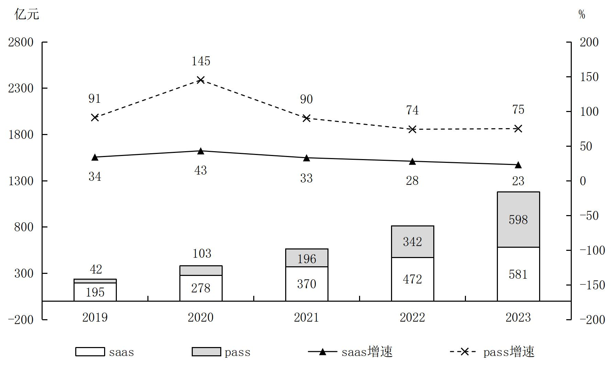
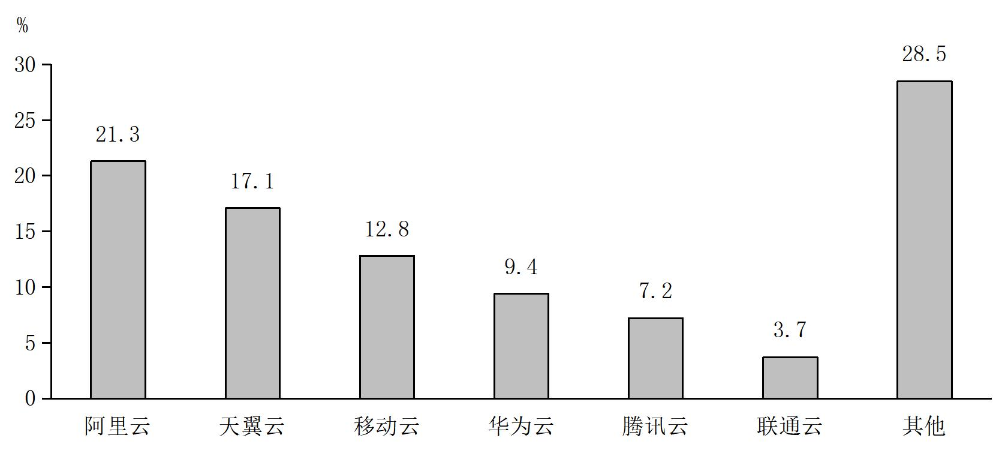
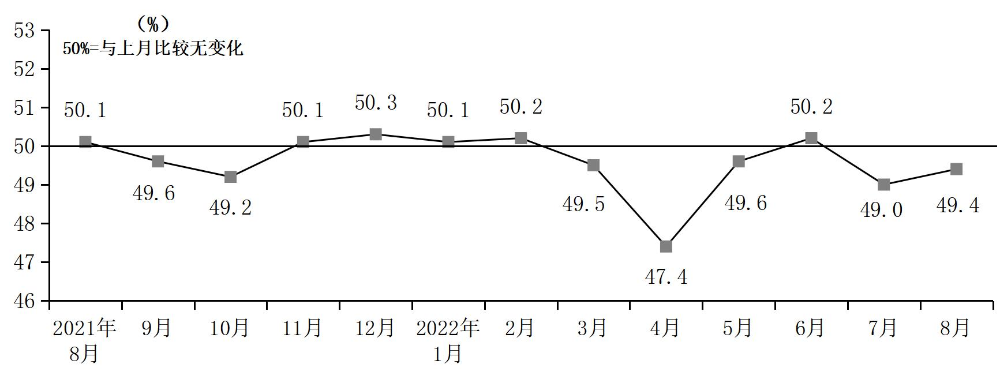
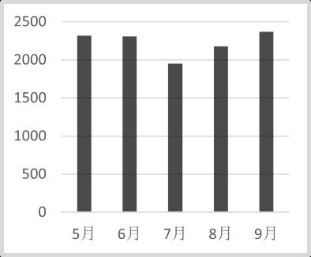
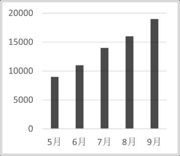
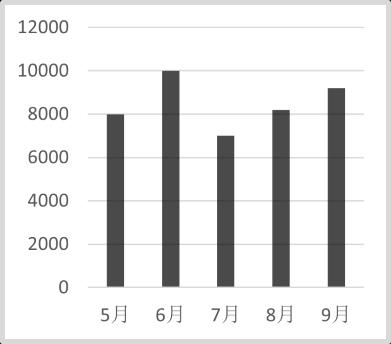
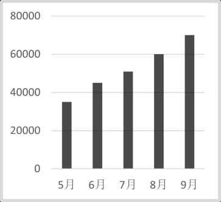

<!-- hyz-paper-id: 01a1e4f7-7bea-7251-8f43-812ce802385a -->

# 套题训练4

## Material M1

<!-- hyz-material-id: 01a1e4f7-7bea-7251-8f43-813365eb75eb -->

2024年江苏省生猪出栏2334.9万头，比上年下降3.1%，家禽出栏8.5亿只，增长8.7%、猪牛羊禽肉产量335.3万吨，增长1.7%，禽蛋产量196.1万吨，下降16.7%，牛奶产量70.5万吨，下降3.3%，水产品（不含远洋捕捞）产量528.4万吨，增长1.4%，其中淡水产品390.3万吨，增长0.9%，海水产品138.1万吨，增长2.7%。

表2024年及2025年1～3月江苏省农村牧渔业总产值变动情况

| 部门 | 2024年1～3月产值（亿元） | 2024年1～3月同比增长（%） | 2024年1～6月产值（亿元） | 2024年1～6月同比增长（%） | 2024年1～9月产值（亿元） | 2024年1～9月同比增长（%） | 2024年1～12月产值（亿元） | 2024年1～12月同比增长（%） | 2025年1～3月产值（亿元） | 2025年1～3月同比增长（%） |
| --- | ---: | ---: | ---: | ---: | ---: | ---: | ---: | ---: | ---: | ---: |
| 种植业 | 587.2 | 3.2 | 1891.3 | 4.9 | 2838.6 | 4.2 | 5001.3 | 3.6 | 589.1 | 0.3 |
| 林业 | 44.3 | 5.5 | 77.7 | 5.7 | 113.1 | 5.9 | 196.4 | 6.3 | 42.2 | −4.7 |
| 牧业 | 240 | 1.8 | 453.2 | −4.3 | 848 | −3.2 | 1238 | −0.3 | 273.9 | 14.1 |
| 渔业 | 219.4 | 2.6 | 589.5 | 3.1 | 1186.1 | 3.4 | 2005.8 | 4.7 | 223.1 | 1.7 |
| 农林牧渔专业及辅助活动 | 156.6 | 9.7 | 323.6 | 9.1 | 507.4 | 9.3 | 843.8 | 9.1 | 165.7 | 5.8 |
| 合计 | 1247.5 | 3.7 | 3335.1 | 3.6 | 5493.2 | 3.3 | 9284.8 | 3.7 | 1294 | 3.7 |

## Material M2

<!-- hyz-material-id: 01a1e4f7-7bea-7251-8f43-8142d7019808 -->

2023年，中国云计算（服务模式分为laas，paas，saas）市场规模4562亿，比上年增长1306亿，规模是2019年的6.61倍。



图1 2019～2023年中国云计算paas和saas市场规模及增速



图2 2023年中国云计算laas市场主要厂商份额占比

## Material M3

<!-- hyz-material-id: 01a1e4f7-7bea-7251-8f43-815de54c5e54 -->

表2021年4月～2021年9月软件业各类月末收入累计值（亿元）

| 行业月份 | 软件业务 | 软件产品 | 信息技术服务 | 嵌入式系统软件 |
| --- | ---: | ---: | ---: | ---: |
| 1月～4月 | 25719 | 6823 | 16222 | 2289 |
| 1月～5月 | 33893 | 9142 | 21314 | 2921 |
| 1月～6月 | 44198 | 11451 | 28319 | 3696 |
| 1月～7月 | 51441 | 13403 | 32744 | 4413 |
| 1月～8月 | 59710 | 15582 | 37951 | 5142 |
| 1月～9月 | 69007 | 17951 | 43980 | 5850 |

## Material M4

<!-- hyz-material-id: 01a1e4f7-7bea-7251-8f43-816f1b47930d -->

制造业采购经理人指数PMI由5个分类指数加权计算而成，5个分类指数及其权数是依据其对经济的先行影响程度确定的。具体包括：新订单指数，权数为30%；生产指数，权数为25%；从业人员指数，权数为20%；供应商配送时间指数，权数为15%；原材料库存指数，权数为10%。其中，供应商配送时间指数为逆指数，在合成制造业PMI指数时进行反向运算，即100%减供应商配送时间指数。

2022年8月份，制造业PMI指数为49.4%，低于PMI指数临界点（50%），比上月上升0.4个百分点，制造业景气水平有所回升。下面给出2021年8月至2022年8月制造业PMI指数走势图及相关分类指数数据。



图制造业采购经理人指数走势图

表制造业采购经理人指数各指标情况（经季节调整）

单位（%）

| 日期 | PMI | 生产 | 新订单 | 原材料库存 | 从业人员 | 供应商配送时间 |
| --- | ---: | ---: | ---: | ---: | ---: | ---: |
| 2021年8月 | 50.1 | 50.9 | 49.6 | 47.7 | 49.6 | 48.0 |
| 2021年9月 | 49.6 | 49.5 | 49.3 | 48.2 | 49.0 | 48.1 |
| 2021年10月 | 49.2 | 48.4 | 48.8 | 47.0 | 48.8 | 46.7 |
| 2021年11月 | 50.1 | 52.0 | 49.4 | 47.7 | 48.9 | 48.2 |
| 2021年12月 | 50.3 | 51.4 | 49.7 | 49.2 | 49.1 | 48.3 |
| 2022年1月 | 50.1 | 50.9 | 49.3 | 49.1 | 48.9 | 47.6 |
| 2022年2月 | 50.2 | 50.4 | 50.7 | 48.1 | 49.2 | 48.2 |
| 2022年3月 | 49.5 | 49.5 | 48.8 | 47.3 | 48.6 | 46.5 |
| 2022年4月 | 47.5 | 44.4 | 42.6 | 46.5 | 47.2 | 37.2 |
| 2022年5月 | 49.6 | 49.7 | 48.2 | 47.9 | 47.6 | 44.1 |
| 2022年6月 | 50.2 | 52.8 | 50.4 | 48.1 | 48.7 | 51.3 |
| 2022年7月 | 49.0 | 49.8 | 48.5 | 47.9 | 48.6 | 50.1 |
| 2022年8月 | 49.4 | 49.8 | 49.2 | 48.0 | 48.9 | 49.5 |

## Question 1

<!-- hyz-question-id: 01a1e4f7-7bea-7251-8f43-817bca89a6e1 -->

```yaml
module: 资料分析
materials:
- M1
```

### Stem

2025年一季度，江苏省种植业产值同比增量比上年同期少：

### Options
- A. 16.3亿元
- B. 16.9亿元
- C. 18.2亿元
- D. 18.8亿元

### Answer

A

## Question 2

<!-- hyz-question-id: 01a1e4f7-7bea-7251-8f43-818b71d269d6 -->

```yaml
module: 资料分析
materials:
- M1
```

### Stem

2024年四季度，江苏省种植业，林业、渔业、牧业、农林牧渔专业及辅助活动部门总产量同比增速分

别快于其1～9月产值同比增速的有：

### Options
- A. 0个
- B. 1个
- C. 2个
- D. 3个

### Answer

D

## Question 3

<!-- hyz-question-id: 01a1e4f7-7bea-7251-8f43-81951e42e8ff -->

```yaml
module: 资料分析
materials:
- M1
```

### Stem

2024年江苏省海水产品产值占水产品（不含远洋捕捞）产量的比重比上年高：

### Options
- A. $\frac{138.1 \times 0.013}{528.4 \times 1.014} \times 100$ 个百分点
- B. $\frac{138.1 \times 0.014}{528.4 \times 1.027} \times 100$ 个百分点
- C. $\frac{138.1 \times 0.013}{528.4 \times 1.027} \times 100$ 个百分点
- D. $\frac{138.1 \times 0.027}{528.4 \times 1.014} \times 100$ 个百分点

### Answer

C

## Question 4

<!-- hyz-question-id: 01a1e4f7-7bea-7251-8f43-81a4ab2f1c22 -->

```yaml
module: 资料分析
materials:
- M1
```

### Stem

2024年下半年，江苏省林业总产值环比增长：

### Options
- A. 32.6%
- B. 52.8%
- C. 132.6%
- D. 152.8%

### Answer

B

## Question 5

<!-- hyz-question-id: 01a1e4f7-7bea-7251-8f43-81b3bc865713 -->

```yaml
module: 资料分析
materials:
- M1
```

### Stem

根据所给材料推出的有：

①2024年江苏省猪牛羊禽肉产量比上年增加6万多吨

②2024年三季度，江苏省渔业总产值占农林牧渔业总产值的比重超过25%

③2024年二季度至2025年第一季度，江苏省牧业增加值平均增量超过10亿元

### Options
- A. 0项
- B. 1项
- C. 2项
- D. 3项

### Answer

B

## Question 6

<!-- hyz-question-id: 01a1e4f7-7bea-7251-8f43-81c3bf61725f -->

```yaml
module: 资料分析
materials:
- M2
```

### Stem

2023年中国lass市场规模较2022年增长了：

### Options
- A. 36.8%
- B. 37.4%
- C. 38.5%
- D. 39.3%

### Answer

C

## Question 7

<!-- hyz-question-id: 01a1e4f7-7bea-7251-8f43-81dcbf0b645d -->

```yaml
module: 资料分析
materials:
- M2
```

### Stem

2023年华为云laas中国市场份额为：

### Options
- A. 318.0亿
- B. 256.6亿
- C. 110.9亿
- D. 56.2亿

### Answer

A

## Question 8

<!-- hyz-question-id: 01a1e4f7-7bea-7251-8f43-81e7a12f4495 -->

```yaml
module: 资料分析
materials:
- M2
```

### Stem

2023年中国saas市场规模占中国云计算市场规模占比重较2019年：

### Options
- A. 上升约23个百分点
- B. 上升约40个百分点
- C. 下降约16个百分点
- D. 下降约33个百分点

### Answer

C

## Question 9

<!-- hyz-question-id: 01a1e4f7-7bea-7251-8f43-81f98b98c21b -->

```yaml
module: 资料分析
materials:
- M2
```

### Stem

设2020～2023年中国laas，paas和saas市场规模的年均增速分别为VI，VP和VS，则三者排序正确

的是：

### Options
- A. VI＞VP＞VS
- B. VP＞VS＞VI
- C. VP＞VI＞VS
- D. VS＞VP＞VI

### Answer

C

## Question 10

<!-- hyz-question-id: 01a1e4f7-7bea-7251-8f43-82088a6c89ea -->

```yaml
module: 资料分析
materials:
- M2
```

### Stem

不能从以上材料推出的是：

### Options
- A. 2023年中国云计算市场规模增长速度
- B. 2023年中国云计算laas市场阿里云超出天翼云140多亿
- C. 2019～2023年中国paas市场规模年均增长量
- D. 2019～2023年中国云计算市场规模年均增速

### Answer

D

## Question 11

<!-- hyz-question-id: 01a1e4f7-7bea-7251-8f43-8214b2ef404b -->

```yaml
module: 资料分析
materials:
- M3
```

### Stem

下图能正确反映2021年5月至9月软件产品收入（亿元）的是：

### Options
- A. 
- B. 
- C. 
- D. 

### Answer

A

## Question 12

<!-- hyz-question-id: 01a1e4f7-7bea-7251-8f43-822dd6b96974 -->

```yaml
module: 资料分析
materials:
- M3
```

### Stem

2021年5月至8月，信息技术服务收入最高的月份是：

### Options
- A. 5月
- B. 6月
- C. 7月
- D. 8月

### Answer

B

## Question 13

<!-- hyz-question-id: 01a1e4f7-7bea-7251-8f43-82325e46e2bc -->

```yaml
module: 资料分析
materials:
- M3
```

### Stem

2021年第三季度，信息技术服务收入约是嵌入式系统软件收入的：

### Options
- A. 7.3倍
- B. 7.5倍
- C. 7.7倍
- D. 7.9倍

### Answer

A

## Question 14

<!-- hyz-question-id: 01a1e4f7-7bea-7251-8f43-8248e2cdd6af -->

```yaml
module: 资料分析
materials:
- M3
```

### Stem

2021年7月至9月软件业务收入最高的月份，嵌入式系统软件收入环比增速约为：

### Options
- A. -1%
- B. -3%
- C. 1%
- D. 3%

### Answer

B

## Question 15

<!-- hyz-question-id: 01a1e4f7-7bea-7251-8f43-825b501cf9c2 -->

```yaml
module: 资料分析
materials:
- M3
```

### Stem

能够从上述材料中得出的是：

### Options
- A. 2021年9月，四类业务中信息技术服务收入占比最高
- B. 2021年8月，软件业务收入是信息技术服务收入的2倍
- C. 2021年6月，四类收入总计超过2万亿元
- D. 2021年上半年，四类业务收入超过10万亿元

### Answer

C

## Question 16

<!-- hyz-question-id: 01a1e4f7-7bea-7251-8f43-826c18bee4d3 -->

```yaml
module: 资料分析
materials:
- M4
```

### Stem

2022年1～8月，PMI指数和新订单指数均在临界点之上的月份有几个：

### Options
- A. 1
- B. 2
- C. 3
- D. 4

### Answer

B

## Question 17

<!-- hyz-question-id: 01a1e4f7-7bea-7251-8f43-827cbd37db88 -->

```yaml
module: 资料分析
materials:
- M4
```

### Stem

2022年8月，哪个分类指数对PMI指数较上月上升的贡献最大：

### Options
- A. 生产
- B. 新订单
- C. 从业人员
- D. 供应商配送时间

### Answer

B

## Question 18

<!-- hyz-question-id: 01a1e4f7-7bea-7251-8f43-828f90943b44 -->

```yaml
module: 资料分析
materials:
- M4
```

### Stem

2022年1～8月，供应商配送时间指数最小的那个月，与去年同期相比下降了23.4%，则去年同期供

应商配送时间指数大约是：

### Options
- A. 37%
- B. 48.6%
- C. 49.6%
- D. 51%

### Answer

B

## Question 19

<!-- hyz-question-id: 01a1e4f7-7bea-7251-8f43-8294aa8e4876 -->

```yaml
module: 资料分析
materials:
- M4
```

### Stem

如果某月PMI指数为49%，而下个月新订单指数增加了1个百分点，供应商配送时间指数增加了3个

百分点，其他分类指数不变，则下个月PMI指数：

### Options
- A. 增加0.15个百分点
- B. 增加0.75个百分点
- C. 减少0.15个百分点
- D. 减少0.75个百分点

### Answer

C

## Question 20

<!-- hyz-question-id: 01a1e4f7-7bea-7251-8f43-82a9cd436a16 -->

```yaml
module: 资料分析
materials:
- M4
```

### Stem

不能从上述材料中推出的是：

### Options
- A. 构成PMI指数的5个分类指数低于临界点，则PMI指数低于临界点
- B. 2022年8月原材料库存指数为48.0%，比上个月上升0.1个百分点
- C. 2022年8月从业人员指数为48.9%，比上个月上升0.3个百分点，说明用工景气度略有回升
- D. 2022年8月供应商配送时间指数为49.5%，比上个月下降0.6个百分点，说明供应商配送时间较上月略有缩短

### Answer

A
