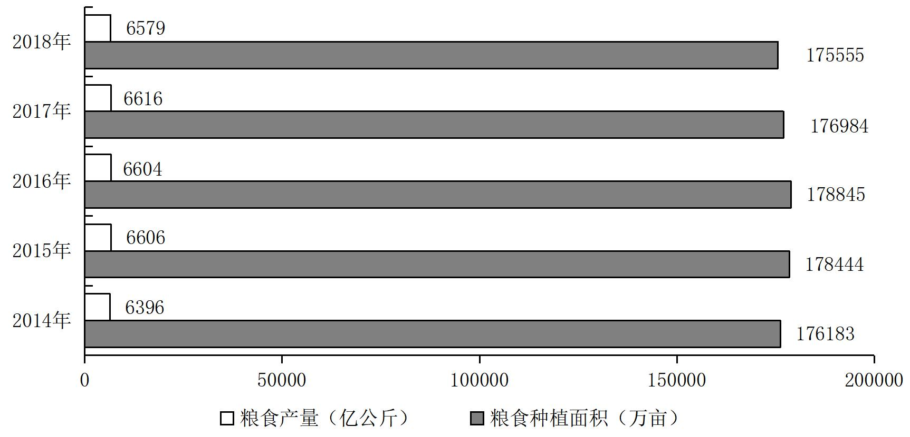
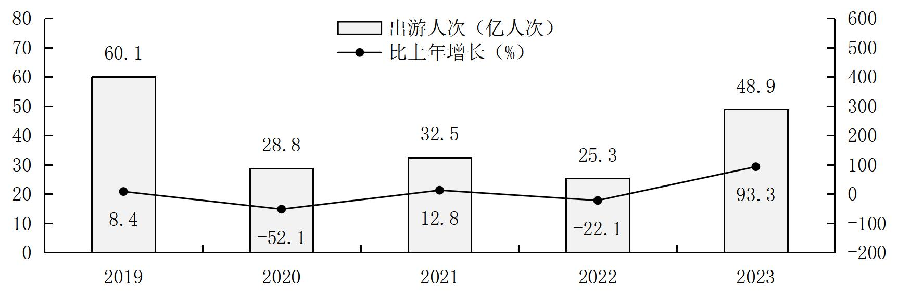
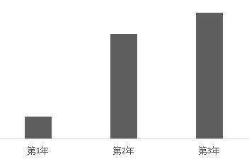

<!-- hyz-paper-id: 01a1e4f7-7bef-77d3-b2d8-6feb9555e74f -->

# 套题训练5

## Material M1

<!-- hyz-material-id: 01a1e4f7-7bef-77d3-b2d8-6ffa755e13e7 -->

国家统计局公布的全国粮食生产数据显示，2018年全国粮食播种面积175555万亩，比2017年下降0.8%。全国粮食单位面积产量375公斤/亩，比2017年增长0.2%。谷物单位面积产量408公斤/亩，比2017年增长0.3%。粮食总产量6579亿公斤，比2017年下降0.6%；其中谷物（包括稻谷，小麦，玉米、大麦、高粱、荞麦、燕麦等）总产量6102亿公斤，比2017年下降0.8%。全年粮食产量虽有所下降，但减幅不大，仍处于高位水平，属于丰收年景。



图2014～2018年全年粮食播种面积及产量数据

表2018年全国粮食种植及产量情况

|  | 播种面积（万亩） | 总产量（亿公斤） | 单位面积产量（公斤/亩） |
| --- | ---: | ---: | ---: |
| 全年粮食 | 175555 | 6579 | 375 |
| 一、分季节 |  |  |  |
| 1、夏粮 | 40055 | 1388 | 346 |
| 2、早稻 | 7186 | 286 | 398 |
| 3、秋粮 | 128314 | 4905 | 382 |
| 二、分品种 |  |  |  |
| 1、谷物 | 149528 | 6102 | 408 |
| 其中：稻谷 | 45284 | 2121 | 468 |
| 小麦 | 36402 | 1314 | 361 |
| 玉米 | 63193 | 2573 | 407 |
| 2、豆类 | 15257 | 191 | 125 |
| 3、薯类 | 10770 | 286 | 265 |

## Material M2

<!-- hyz-material-id: 01a1e4f7-7bef-77d3-b2d8-700fd0f3d1a3 -->

表2008～2022年R、S、T三市技术市场成交额情况（亿元）

| 年份 | R市 | S市 | T市 |
| --- | ---: | ---: | ---: |
| 2008年 | 1027 | 386 | 87 |
| 2009年 | 1236 | 435 | 105 |
| 2010年 | 1580 | 431 | 119 |
| 2011年 | 1890 | 481 | 169 |
| 2012年 | 2459 | 519 | 232 |
| 2013年 | 2852 | 532 | 276 |
| 2014年 | 3137 | 592 | 389 |
| 2015年 | 3454 | 664 | 503 |
| 2016年 | 3941 | 781 | 553 |
| 2017年 | 4487 | 811 | 551 |
| 2018年 | 4958 | 1225 | 686 |
| 2019年 | 5695 | 1422 | 909 |
| 2020年 | 6316 | 1583 | 1090 |
| 2021年 | 7006 | 2545 | 1257 |
| 2022年 | 7948 | 4004 | 1677 |

## Material M3

<!-- hyz-material-id: 01a1e4f7-7bef-77d3-b2d8-701dcbcb67f9 -->

2023年国内出游48.9亿人次，比上年增长93.3%。其中，城镇居民国内出游37.6亿人次，增长94.9%；农村居民国内出游11.3亿人次，增长88.5%。国内出游总花费49133亿元，增长140.3%。其中，城镇居民出游花费41780亿元，增长147.5%；农村居民出游花费7353亿元，增长106.4%。

2023年入境游客8203万人次，总花费530亿美元。其中，外国人1378万人次；港澳台同胞6825万人次。国内居民出境10096万人次。其中，因私出境9684万人次；赴港澳台出境7704万人次。



图2019～2023年国内出游人次及其增长速度

## Material M4

<!-- hyz-material-id: 01a1e4f7-7bef-77d3-b2d8-7022b815592c -->

表2021年全国及部分省级行政区中小学阶段生均一般公共预算教育经费及同比增速

单位：元（金额）、%（增速）

|  |  | 普通小学 | 普通初中 | 普通高中 | 中等职业学校 |
| --- | --- | ---: | ---: | ---: | ---: |
| 全国 | 金额 | 12380.73 | 17772.06 | 18808.71 | 17095.26 |
|  | 增速 | 2.22 | 1.74 | 2.95 | 0.58 |
| 北京 | 金额 | 35473.59 | 64124.46 | 72612.47 | 72116.02 |
|  | 增速 | 0.17 | 0.82 | −7.12 | 0.59 |
| 天津 | 金额 | 20520.01 | 31623.14 | 32285.62 | 25075.91 |
|  | 增速 | 8.85 | 2.65 | 4.00 | 11.40 |
| 河北 | 金额 | 9719.02 | 13870.10 | 15466.87 | 16220.53 |
|  | 增速 | 1.54 | 2.11 | −3.47 | −4.61 |
| 重庆 | 金额 | 13734.17 | 17764.64 | 16567.65 | 14784.31 |
|  | 增速 | 3.59 | 1.14 | 3.03 | 4.56 |
| 四川 | 金额 | 11777.31 | 15612.14 | 14514.94 | 13660.75 |
|  | 增速 | 2.16 | 1.69 | 4.19 | 0.13 |
| 贵州 | 金额 | 11098.27 | 14504.44 | 15359.99 | 8789.75 |
|  | 增速 | −1.18 | 0.76 | 7.07 | −2.92 |
| 云南 | 金额 | 11930.39 | 15062.33 | 15991.56 | 13268.80 |
|  | 增速 | 1.40 | 1.69 | −11.65 | 4.55 |

## Question 1

<!-- hyz-question-id: 01a1e4f7-7bef-77d3-b2d8-703edb16c419 -->

```yaml
module: 资料分析
materials:
- M1
```

### Stem

2015～2017年三年，全国粮食总产量平均增长率约为：

### Options
- A. 0.08%
- B. 1.06%
- C. 1.14%
- D. 3.4%

### Answer

C

## Question 2

<!-- hyz-question-id: 01a1e4f7-7bef-77d3-b2d8-704aa2fc136c -->

```yaml
module: 资料分析
materials:
- M1
```

### Stem

2018年全国谷物总产量占全国粮食总产量的比重，较上一年约：

### Options
- A. 增长0.19个百分点
- B. 减少0.19个百分点
- C. 增长0.26个百分点
- D. 减少0.26个百分点

### Answer

B

## Question 3

<!-- hyz-question-id: 01a1e4f7-7bef-77d3-b2d8-705ccfae5b20 -->

```yaml
module: 资料分析
materials:
- M1
```

### Stem

2018年夏粮的播种面积和总产量分别占全国粮食播种面积和总产量的比重约为：

### Options
- A. 25.1%和22.8%
- B. 25.1%和21.1%
- C. 21.1%和19.6%
- D. 22.8%和21.1%

### Answer

D

## Question 4

<!-- hyz-question-id: 01a1e4f7-7bef-77d3-b2d8-706b2684a1ba -->

```yaml
module: 资料分析
materials:
- M1
```

### Stem

若2018年稻谷的总产量同比增长0.5%，那么稻谷的总产量拉动谷物总产量增长了：

### Options
- A. 0.154个百分点
- B. 0.164个百分点
- C. 0.172个百分点
- D. 0.185个百分点

### Answer

C

## Question 5

<!-- hyz-question-id: 01a1e4f7-7bef-77d3-b2d8-707f77951c1f -->

```yaml
module: 资料分析
materials:
- M1
```

### Stem

2014年粮食播种面积同比增长了1.3%，2018年的粮食播种面积比2013年：

### Options
- A. 增加了约1653亩
- B. 增加了约2260万亩
- C. 下降了约0.94%
- D. 增长了约1%

### Answer

D

## Question 6

<!-- hyz-question-id: 01a1e4f7-7bef-77d3-b2d8-70835c7ec993 -->

```yaml
module: 资料分析
materials:
- M2
```

### Stem

2022年，表中所列三市技术市场成交额之和比上年增长了：

### Options
- A. 不到15%
- B. 15%～20%之间
- C. 20%～25%之间
- D. 超过25%

### Answer

D

## Question 7

<!-- hyz-question-id: 01a1e4f7-7bef-77d3-b2d8-709a40f5811f -->

```yaml
module: 资料分析
materials:
- M2
```

### Stem

2018～2022年，R市技术市场成交额高于三市技术市场成交额总和 $\frac{2}{3}$ 的年份有多少个：

### Options
- A. 1
- B. 2
- C. 3
- D. 4

### Answer

C

## Question 8

<!-- hyz-question-id: 01a1e4f7-7bef-77d3-b2d8-70a7d035c4d1 -->

```yaml
module: 资料分析
materials:
- M2
```

### Stem

2016～2020年期间，R市技术市场年平均成交额比S市约多多少万亿元：

### Options
- A. 0.34万亿元
- B. 0.39万亿元
- C. 0.44万亿元
- D. 0.49万亿元

### Answer

B

## Question 9

<!-- hyz-question-id: 01a1e4f7-7bef-77d3-b2d8-70bd05de94a5 -->

```yaml
module: 资料分析
materials:
- M2
```

### Stem

2009～2022年，技术市场成交额同比增速最大的是哪一项：

### Options
- A. R市，2012年
- B. S市，2021年
- C. T市，2011年
- D. T市，2012年

### Answer

B

## Question 10

<!-- hyz-question-id: 01a1e4f7-7bef-77d3-b2d8-70c2c5b88b5b -->

```yaml
module: 资料分析
materials:
- M2
```

### Stem

以下柱状图反映了哪一时间段内，哪一城市技术市场成交额同比增量的变化情况：



### Options
- A. 2013～2015年，S市
- B. 2015～2017年，T市
- C. 2017～2019年，R市
- D. 2019～2021年，T市

### Answer

A

## Question 11

<!-- hyz-question-id: 01a1e4f7-7bef-77d3-b2d8-70d868e6305e -->

```yaml
module: 资料分析
materials:
- M3
```

### Stem

2023年国内出游平均每人次花费比上年增加多少元：

### Options
- A. 197元
- B. 237元
- C. 276元
- D. 308元

### Answer

A

## Question 12

<!-- hyz-question-id: 01a1e4f7-7bef-77d3-b2d8-70ecaa44f80d -->

```yaml
module: 资料分析
materials:
- M3
```

### Stem

2023年国内居民因私赴港澳台出境人次至少有多少万人：

### Options
- A. 6694万
- B. 6893万
- C. 7025万
- D. 7292万

### Answer

D

## Question 13

<!-- hyz-question-id: 01a1e4f7-7bef-77d3-b2d8-70fdb4ccf152 -->

```yaml
module: 资料分析
materials:
- M3
```

### Stem

2023年国内出游人次比2020～2022年的平均水平多多少：

### Options
- A. 64.1%
- B. 69.4%
- C. 73.5%
- D. 78.9%

### Answer

B

## Question 14

<!-- hyz-question-id: 01a1e4f7-7bef-77d3-b2d8-7100cab34fd9 -->

```yaml
module: 资料分析
materials:
- M3
```

### Stem

按2019年的同比增速推算，未来国内出游人次首次达到或超过2019年水平的年份是哪一年：

### Options
- A. 2024年
- B. 2025年
- C. 2026年
- D. 2027年

### Answer

C

## Question 15

<!-- hyz-question-id: 01a1e4f7-7bef-77d3-b2d8-7116c6f17718 -->

```yaml
module: 资料分析
materials:
- M3
```

### Stem

下列判断错误的是哪一项：

### Options
- A. 2023年入境游客的平均花费是646美元/人次
- B. 2023年港澳台同胞入境旅游人次是外国人的4.95倍
- C. 2019～2023年国内出游人次的年平均增长率是8.1%
- D. 2023年国内出游人次中城镇居民所占比重较上年有所上升

### Answer

C

## Question 16

<!-- hyz-question-id: 01a1e4f7-7bef-77d3-b2d8-712dc46da76f -->

```yaml
module: 资料分析
materials:
- M4
```

### Stem

2021年，全国普通小学生均一般公共预算教育经费比2020年增长了：

### Options
- A. 不到220元
- B. 220～250元之间
- C. 250～280元之间
- D. 280元以上

### Answer

C

## Question 17

<!-- hyz-question-id: 01a1e4f7-7bef-77d3-b2d8-71310542da2c -->

```yaml
module: 资料分析
materials:
- M4
```

### Stem

表中所列7个省级行政区中，2021年4类学校生均一般公共预算教育经费均高于全国平均水平的省级

行政区有多少个：

### Options
- A. 1
- B. 2
- C. 3
- D. 4

### Answer

B

## Question 18

<!-- hyz-question-id: 01a1e4f7-7bef-77d3-b2d8-714604240c09 -->

```yaml
module: 资料分析
materials:
- M4
```

### Stem

将①重庆、②四川、③贵州和④云南按2021年普通高中和中等职业学校生均一般公共预算教育经费

的比值从高到低排列，以下正确的是：

### Options
- A. ①②③④
- B. ②①④③
- C. ④③②①
- D. ③④①②

### Answer

D

## Question 19

<!-- hyz-question-id: 01a1e4f7-7bef-77d3-b2d8-7158d5e472e0 -->

```yaml
module: 资料分析
materials:
- M4
```

### Stem

如2021年之后各年均保持2021年同比增量不变，则2024年重庆普通小学生均一般公共预算教育经费将：

### Options
- A. 低于1.5万元
- B. 在1.5～1.55万元之间
- C. 在1.55～1.6万元之间
- D. 超过1.6万元

### Answer

B

## Question 20

<!-- hyz-question-id: 01a1e4f7-7bef-77d3-b2d8-716abd8288d5 -->

```yaml
module: 资料分析
materials:
- M4
```

### Stem

关于2021年表中7个省级行政区中小学阶段生均一般公共预算教育经费状况，能够从上述材料中推

出的是哪一项：

### Options
- A. 北京普通小学生均经费同比增量高于天津
- B. 河北普通高中生均经费同比下降了1000元以上
- C. 普通初中生均经费同比增速快于普通小学的省级行政区正好有3个
- D. 普通小学生均经费最高和最低的省级行政区生均经费差值不到3万元

### Answer

D
