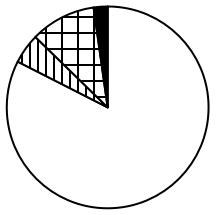

<!-- hyz-paper-id: 01a1e4f7-7bf3-7831-9686-12c7a9d1fb93 -->

# 套题训练6

## Material M1

<!-- hyz-material-id: 01a1e4f7-7bf3-7831-9686-12d4343ea39a -->

2020年，对全国6万家规模以上文化及相关产业企业调查结果显示，全年上述企业实现营业收入98514亿元，比上年增长2.2%，其中，前三季度实现营业收入66119亿元，同比下降0.6%。分领域看，文化核心领域营业收入60295亿元，比上年增长3.8%，增速较前三季度提高2.3个百分点；文化相关领域38220亿元，下降0.1%，降幅收窄3.7个百分点。

表2020年全国规模以上文化及相关产业企业营业收入情况

|  | 营业收入（亿元）全年 | 营业收入（亿元）前三季度 | 同比增速（%）全年 | 同比增速（%）前三季度 |
| --- | ---: | ---: | ---: | ---: |
| 按行业类别分 |  |  |  |  |
| 新闻信息服务 | 9382 | 6434 | 18 | 17 |
| 内容创作生产 | 23275 | 15855 | 4.7 | 4.1 |
| 创意设计服务 | 15645 | 10276 | 11.1 | 9 |
| 文化传播渠道 | 10428 | 6878 | −11.8 | −16.5 |
| 文化投资运营 | 451 | 298 | 2.8 | 0.2 |
| 文化娱乐休闲服务 | 1115 | 683 | −30.2 | −39.9 |
| 文化辅助生产和中介服务 | 13519 | 9171 | −6.9 | −9.5 |
| 文化装备生产 | 5893 | 3975 | 1.1 | −3.4 |
| 文化消费终端生产 | 18808 | 12549 | 5.1 | 0.8 |
| 按区域分 |  |  |  |  |
| 东部地区 | 73943 | 50305 | 2.3 | −0.4 |
| 中部地区 | 14656 | 9385 | 1.4 | −1.5 |
| 西部地区 | 9044 | 5865 | 4.1 | 0.9 |
| 东北地区 | 872 | 564 | −8.6 | −15.9 |

注：（1）表中部分数据存在四舍五入情况；（2）“文化辅助生产和中介服务”、“文化装备生产”和“文化消费终端生产”为文化相关领域行业，其余为文化核心领域行业。

## Material M2

<!-- hyz-material-id: 01a1e4f7-7bf3-7831-9686-12e9430f8146 -->

2019年1～8月，全国房地产开发投资84589亿元，同比增长10.5%，增速比1～7月回落0.1个百分点。其中，住宅投资65187亿元，增长14.9%，增速回落0.2个百分点。

1～8月，东部地区房地产开发投资44857亿元，同比增长8.8%，增速比1～7月回落0.4个百分点；中部地区投资17809亿元，增长9.8%，增速加快0.3个百分点；西部地区投资18506亿元，增长16.0%，增速加快0.9个百分点；东北地区投资3418亿元，增长9.7%，增速回落1.3个百分点。

1～8月，房地产开发企业土地购置面积12236万平方米，同比下降25.6%，每平方米土地价格同比上涨4.5%，土地成交额6374亿元。

1～8月，东部地区商品房销售面积40303万平方米，同比下降3.6%，降幅比1～7月收窄0.6个百分点；销售额50739亿元，增长5.5%，增速加快0.3个百分点。中部地区商品房销售面积28791万平方米，增长0.5%，1～7月为下降；销售额20682亿元，增长7.4%，增速加快0.7个百分点。西部地区商品房销售面积28284万平方米，增长3.8%，增速加快1.0个百分点；销售额20363亿元，增长9.9%，增速加快0.6个百分点。东北地区商品房销售面积4471万平方米，下降6.6%，降幅收窄1.2个百分点；销售额3589亿元，增长2.3%，增速加快1.8个百分点。

## Material M3

<!-- hyz-material-id: 01a1e4f7-7bf3-7831-9686-12f55abf4fbf -->

2022年1～10月，我国软件业务收入84214亿元，同比增长10.0%，增速较前三季度提高0.2个百分点。2022年前三季度，我国软件业务收入74763亿元。2022年1～10月，软件业利润总额10047亿元，同比增长4.5%。软件业务出口427亿美元，同比增长5.1%。

分领域看，2022年1～10月，软件产品收入20737亿元，同比增长9.6%，增速较前三季度提高0.2个百分点。其中，工业软件产品收入1861亿元，同比增长12.8%。1～10月，信息技术服务收入54583亿元，同比增长10.1%，增速与前三季度持平，在全行业收入中占比为64.8%。其中，云计算、大数据服务共实现收入8234亿元，同比增长7.7%；集成电路设计收入2286亿元，同比增长13.0%；电子商务平台技术服务收入8386亿元，同比增长16.5%。1～10月，信息安全产品和服务收入1549亿元，同比增长9.7%。1～10月，嵌入式系统软件收入7344亿元，同比增长9.6%。

分地区看，1～10月，东部地区完成软件业务收入69464亿元，同比增长9.4%；中部地区完成软件业务收入4045亿元，同比增长14.7%；西部地区完成软件业务收入8831亿元，同比增长13.0%；东北地区完成软件业务收入1874亿元，同比增长8.5%。

## Material M4

<!-- hyz-material-id: 01a1e4f7-7bf3-7831-9686-1307813d83f9 -->

2023年，广西进出口总额6936.49亿元，比上年增长7.3%。其中，出口总额3639.49亿元，增长1.5%；进口总额3297.00亿元，增长14.6%；进出口顺差342.49亿元。

表2022、2023年广西对主要国家和地区进出口额

| 国家和地区 | 2022年进口（亿元） | 2022年出口（亿元） | 2023年进口（亿元） | 2023年出口（亿元） |
| --- | ---: | ---: | ---: | ---: |
| 东盟 | 755.98 | 2055.15 | 990.99 | 2403.44 |
| 中国香港 | 21.59 | 450.01 | 1.53 | 272.65 |
| 日本 | 30.43 | 51.99 | 28.62 | 32.21 |
| 韩国 | 94.76 | 47.77 | 91.85 | 51.98 |
| 欧盟 | 45.24 | 145.70 | 74.93 | 134.09 |
| 美国 | 120.56 | 311.01 | 120.45 | 157.18 |
| 大洋洲 | 142.39 | 41.51 | 280.90 | 31.52 |
| 非洲 | 174.62 | 92.29 | 206.43 | 125.33 |

## Question 1

<!-- hyz-question-id: 01a1e4f7-7bf3-7831-9686-131edb7c5634 -->

```yaml
module: 资料分析
materials:
- M1
```

### Stem

2020年第四季度，全国规模以上文化及相关产业企业营业收入比2019年第四季度增加约多少亿元：

### Options
- A. 2500
- B. 3500
- C. 4500
- D. 5500

### Answer

A

## Question 2

<!-- hyz-question-id: 01a1e4f7-7bf3-7831-9686-132f420991c9 -->

```yaml
module: 资料分析
materials:
- M1
```

### Stem

2020年，文化及相关产业营业收入同比上升的企业，营业收入占全国总营业收入的比重：

### Options
- A. 不到60%
- B. 在60%～70%之间
- C. 在70%～80%之间
- D. 超过80%

### Answer

C

## Question 3

<!-- hyz-question-id: 01a1e4f7-7bf3-7831-9686-133f2059ddcb -->

```yaml
module: 资料分析
materials:
- M1
```

### Stem

下列选项最能反映2020年文化辅助生产和中介服务、文化装备生产、文化消费终端生产营业收入占

文化相关领域行业营业收入比重关系的是：

### Options
- A. 
- B. 
- C. 
- D. 

### Answer

A

## Question 4

<!-- hyz-question-id: 01a1e4f7-7bf3-7831-9686-134c373b0a0e -->

```yaml
module: 资料分析
materials:
- M1
```

### Stem

全国东部、中部、西部和东北4个地区中，2020年第四季度规模以上文化企业营业收入超过本地区当

年季度营业收入平均值的地区有多少个：

### Options
- A. 1
- B. 2
- C. 3
- D. 4

### Answer

D

## Question 5

<!-- hyz-question-id: 01a1e4f7-7bf3-7831-9686-135c97b19253 -->

```yaml
module: 资料分析
materials:
- M1
```

### Stem

关于全国规模以上文化及相关产业企业营业收入，能够从上述材料推出的是哪一项：

### Options
- A. 2020年，内容创作生产行业收入占总收入的25%以上
- B. 2020年第四季度，东部地区收入占全国总收入的90%以上
- C. 2020年收入最低的两个行业，其平均收入低于600亿元
- D. 2020年前三季度，收入同比增长的行业数量超过行业总数的一半

### Answer

D

## Question 6

<!-- hyz-question-id: 01a1e4f7-7bf3-7831-9686-1364692ea21f -->

```yaml
module: 资料分析
materials:
- M2
```

### Stem

2018年1～8月，住宅投资占全国房地产开发投资比重约为：

### Options
- A. 65%
- B. 69%
- C. 74%
- D. 77%

### Answer

C

## Question 7

<!-- hyz-question-id: 01a1e4f7-7bf3-7831-9686-137f08ded1b7 -->

```yaml
module: 资料分析
materials:
- M2
```

### Stem

2019年1～8月，西部地区投资比去年同期增加约多少亿元：

### Options
- A. 2812
- B. 2643
- C. 2552
- D. 2313

### Answer

C

## Question 8

<!-- hyz-question-id: 01a1e4f7-7bf3-7831-9686-1382fdb21c0d -->

```yaml
module: 资料分析
materials:
- M2
```

### Stem

2019年1～8月，房地产开发企业土地成交额与去年同期相比增长约：

### Options
- A. -17%
- B. -22%
- C. -27%
- D. 1.2%

### Answer

B

## Question 9

<!-- hyz-question-id: 01a1e4f7-7bf3-7831-9686-1393e0cdc477 -->

```yaml
module: 资料分析
materials:
- M2
```

### Stem

2019年1～8月，下列地区中商品房价格同比增长最慢的是：

### Options
- A. 东部地区
- B. 西部地区
- C. 中部地区
- D. 东北地区

### Answer

B

## Question 10

<!-- hyz-question-id: 01a1e4f7-7bf3-7831-9686-13ac7e02a0c4 -->

```yaml
module: 资料分析
materials:
- M2
```

### Stem

下列说法错误的是：

### Options
- A. 2019年1～8月，全国各地区商品房单价均保持上涨
- B. 2019年1～8月，全国商品房销售额最多的是东部地区
- C. 2018年1～8月，西部地区商品房销售面积约27248万平方米
- D. 2019年1～7月，全国房地产开发投资东部地区增速高于东北地区

### Answer

D

## Question 11

<!-- hyz-question-id: 01a1e4f7-7bf3-7831-9686-13b0c3fda94a -->

```yaml
module: 资料分析
materials:
- M3
```

### Stem

2021年前三季度我国软件业务收入在以下哪个范围内：

### Options
- A. 低于65000亿元
- B. 65000亿元～67000亿元
- C. 67000亿元～69000亿元
- D. 高于69000亿元

### Answer

C

## Question 12

<!-- hyz-question-id: 01a1e4f7-7bf3-7831-9686-13c3e3c9c4d3 -->

```yaml
module: 资料分析
materials:
- M3
```

### Stem

2022年1～10月，云计算、大数据服务占信息技术服务收入的比重为：

### Options
- A. 14%～18%
- B. 18%～22%
- C. 22%～26%
- D. 26%～30%

### Answer

A

## Question 13

<!-- hyz-question-id: 01a1e4f7-7bf4-7fd1-8ddb-6240f45477b2 -->

```yaml
module: 资料分析
materials:
- M3
```

### Stem

2021年1～10月，嵌入式系统软件收入比信息安全产品和服务收入多：

### Options
- A. 4600亿元～5000亿元
- B. 5000亿元～5400亿元
- C. 5400亿元～5800亿元
- D. 5800亿元～6200亿元

### Answer

B

## Question 14

<!-- hyz-question-id: 01a1e4f7-7bf4-7fd1-8ddb-625e353153a2 -->

```yaml
module: 资料分析
materials:
- M3
```

### Stem

以下饼状图中，能准确反映2022年1～10月我国四个地区软件业务收入在全国总收入中占比情况的

是哪一项：

### Options
- A. 
- B. 
- C. 
- D. 

### Answer

D

## Question 15

<!-- hyz-question-id: 01a1e4f7-7bf4-7fd1-8ddb-626c82da0344 -->

```yaml
module: 资料分析
materials:
- M3
```

### Stem

以下条件能够从上述材料中推出的是哪一项：

①2022年1～10月，软件业利润总额同比增量

②2022年1～10月，软件业务出口增速较前三季度的差值

③2021年1～10月，工业软件产品收入占软件业务收入的比重

④2021年1～10月，中部地区完成软件业务收入与东北地区的比值

### Options
- A. 仅②③
- B. 仅②④
- C. 仅①③④
- D. ①②③④

### Answer

C

## Question 16

<!-- hyz-question-id: 01a1e4f7-7bf4-7fd1-8ddb-627d3c58de4a -->

```yaml
module: 资料分析
materials:
- M4
```

### Stem

2022年，广西进出口顺差约为多少亿元：

### Options
- A. 788
- B. 746
- C. 723
- D. 709

### Answer

D

## Question 17

<!-- hyz-question-id: 01a1e4f7-7bf4-7fd1-8ddb-62805730d905 -->

```yaml
module: 资料分析
materials:
- M4
```

### Stem

2023年，广西对表中的国家和地区进出口总额同比增长超过15%的有几个：

### Options
- A. 1
- B. 2
- C. 3
- D. 4

### Answer

C

## Question 18

<!-- hyz-question-id: 01a1e4f7-7bf4-7fd1-8ddb-629d416eb3f8 -->

```yaml
module: 资料分析
materials:
- M4
```

### Stem

2023年，下列哪个国家或地区自广西进口总额同比增长最快：

### Options
- A. 东盟
- B. 欧盟
- C. 大洋洲
- D. 非洲

### Answer

D

## Question 19

<!-- hyz-question-id: 01a1e4f7-7bf4-7fd1-8ddb-62aa73c6a4b9 -->

```yaml
module: 资料分析
materials:
- M4
```

### Stem

2023年，广西自东盟进口额占广西进口总额的比重同比：

### Options
- A. 上升3个百分点以上
- B. 上升6个百分点以上
- C. 下降3个百分点以上
- D. 下降6个百分点以上

### Answer

A

## Question 20

<!-- hyz-question-id: 01a1e4f7-7bf4-7fd1-8ddb-62b073d4b49e -->

```yaml
module: 资料分析
materials:
- M4
```

### Stem

根据以上材料，可以推出：

### Options
- A. 2023年，广西月均进出口额不足550亿元
- B. 2023年，广西对韩国出口额同比增速高于当年出口总额的增速
- C. 2022年，广西对大洋洲进口额占当年进口总额的10%以上
- D. 2022年，广西对日本出口额约为自日本进口额的1.3倍

### Answer

B
