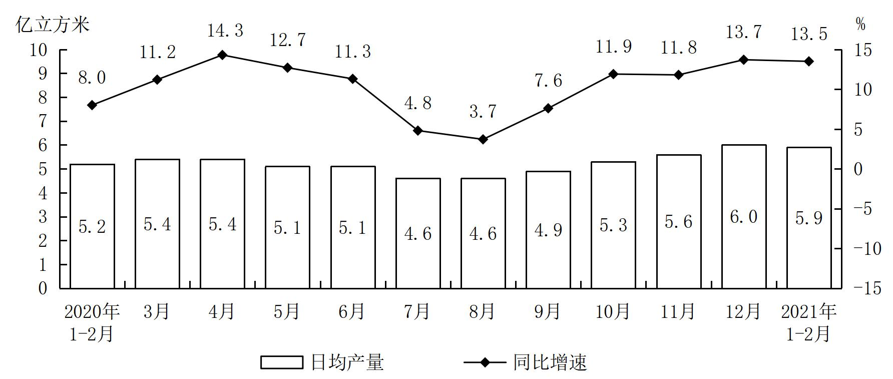
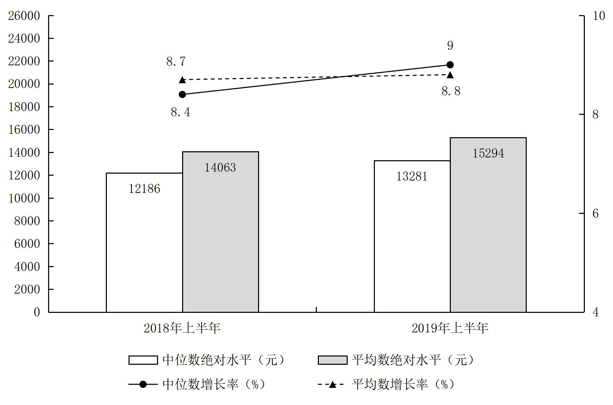

<!-- hyz-paper-id: 01a1e4f7-7bf8-79f0-a968-5dc1a7633727 -->

# 套题训练7

## Material M1

<!-- hyz-material-id: 01a1e4f7-7bf8-79f0-a968-5ddba8df6389 -->

2018年第一季度，共有9586家星级饭店通过省级旅游主管部门审核，全国星级饭店第一季度的营业收入为487.11亿元，同比增长2.43%。餐饮收入为208.24亿元，客房收入为209.12亿元。

第一季度全国50个重点旅游城市共有3636家星级饭店通过省级旅游主管部门数据审核，第一季度全国50个重点旅游城市星级饭店营业收入为320.19亿元。

表2018年第一季度全国星级饭店经营情况统计表

| 星级 | 数量（家） | 营业收入（亿元） | 餐饮收入比重（%） | 客房收入比重（%） |
| --- | ---: | ---: | ---: | ---: |
| 合计 | 9586 | 487.11 | 42.75 | 42.93 |
| 一星级 | 62 | 0.19 | 48.84 | 46.62 |
| 二星级 | 1683 | 20.16 | 30.17 | 37.35 |
| 三星级 | 4613 | 105.76 | 45.93 | 41.58 |
| 四星级 | 2401 | 166.54 | 43.45 | 41.23 |
| 五星级 | 827 | 194.46 | 41.73 | 45.71 |

## Material M2

<!-- hyz-material-id: 01a1e4f7-7bf8-79f0-a968-5dee38a7502a -->

2021年1～2月，全国进口天然气2080万吨，同比增长17.4%。中国天然气进口金额为7312.1百万美元，同比增长3.8%。



图2020年1月～2021年2月各月全国天然气日均产量及同比增速

## Material M3

<!-- hyz-material-id: 01a1e4f7-7bf8-79f0-a968-5df57934d5b3 -->

2019年上半年，全国居民人均可支配收入15294元，比上年同期增长（以下如无特别说明，均为同比名义增长）8.8%，扣除价格因素，实际增长6.5%。其中，城镇居民人均可支配收入21342元，增长8.0%，扣除价格因素，实际增长5.7%；农村居民人均可支配收入7778元，增长8.9%，扣除价格因素，实际增长6.6%。

上半年，全国居民人均可支配收入中位数13281元，增长9.0%，是平均数的86.8%。其中，城镇居民人均可支配收入中位数19536元，增长8.2%，是平均数的91.5%；农村居民人均可支配收入中位数6601元，增长9.2%，是平均数的84.9%。



图2019年上半年居民人均可支配收入平均数和中位数

按收入来源分，上半年，全国居民人均工资性收入8793元，增长8.7%，占可支配收入的比重为57.5%；人均经营净收入2466元，增长8.9%，占可支配收入的比重为16.1%；人均财产净收入1320元，增长13.2%，占可支配收入的比重为8.6%；人均转移净收入2715元，增长6.8%，占可支配收入的比重为17.8%。

## Material M4

<!-- hyz-material-id: 01a1e4f7-7bf8-79f0-a968-5e0d2cc023a7 -->

2018年共进口木材11194.4万立方米（原木锯材合计，原木材积）金额210.9亿美元，同比分别增长3.2%和5.6%。数量增幅比上年同期下降了12.9个百分点，金额增幅下降了17.6个百分点。

2018年进口木材及木制品总金额245.89亿美元（不含纸及纸制品），增长6.3%。出口总金额362.53亿美元，增长2%。2018年进口原木5974.9万立方米，金额101.08亿美元，分别增长7.9%和10.7%；进口锯材3674万立方米，金额101.08亿美元，分别下降1.7%和增长0.4%。

2018年木家具进口金额9.24亿美元，增长3.6%，木框架坐具进口金额3.32亿美元，增长13.8%。刨花板2016年进口增幅41%，2017年增幅21%，2018年进口69.2万吨，为负增长（−2.7%）。2018年木制品出口金额仅增长2%。2018年木家具出口数量增长5.68%，金额负增长1.6%，木地板出口26.6万吨，3.85亿美元，分别下降24.8%和下降25.9%。胶合板出口1137.8万立方米，55.56亿美元，数量增长5%，金额增长9%，纤维板出口179万吨，38.35亿美元，数量下降14.9%，金额增长6.2%。木制品出口企业普遍效益下降。2018年进口针叶原木4159.7万立方米，金额57.86亿美元，同比分别增长8.8%和12.6%。

针叶原木从新西兰进口1729.4万立方米，增长23.2%，俄罗斯795.3万立方米，下降10.1%。美国502.8万立方米，增长2.3%，澳大利亚413.4万立方米，下降3.7%。乌拉圭209万立方米，同比增长175.4%，从日本进口针叶原木92.3万立方米，同比增长23%。2018年进口针叶锯材2488万立方米，金额49.91亿美元，分别下降0.7%和增长2.3%。其中来自俄罗斯针叶锯材1567.4万立方米，增长9.7%，占进口针叶锯材63%，从加拿大进口417.4万立方米，大幅下降18.2%，占进口针叶锯材的17%。

## Question 1

<!-- hyz-question-id: 01a1e4f7-7bf8-79f0-a968-5e1443c76a9e -->

```yaml
module: 资料分析
materials:
- M1
```

### Stem

2018年第一季度，全国哪类星级饭店的营业收入中，餐饮、客房收入占比最低：

### Options
- A. 五星级
- B. 四星级
- C. 三星级
- D. 二星级

### Answer

D

## Question 2

<!-- hyz-question-id: 01a1e4f7-7bf8-79f0-a968-5e2f8e1523f8 -->

```yaml
module: 资料分析
materials:
- M1
```

### Stem

2018年第一季度，平均每家四星级及以上饭店月均营业收入：

### Options
- A. 低于300万元
- B. 在300～500万元之间
- C. 在500～1000万元之间
- D. 超过1000万元

### Answer

B

## Question 3

<!-- hyz-question-id: 01a1e4f7-7bf8-79f0-a968-5e3fcc266a36 -->

```yaml
module: 资料分析
materials:
- M1
```

### Stem

已知2018年一季度全国三星级酒店平均客房收入为260.26元/间夜，问该季度平均每家三星级酒店

订出客房：

### Options
- A. 不到2000间
- B. 2000～5000间之间
- C. 5000～10000间之间
- D. 超过10000间

### Answer

B

## Question 4

<!-- hyz-question-id: 01a1e4f7-7bf8-79f0-a968-5e446fbdc209 -->

```yaml
module: 资料分析
materials:
- M1
```

### Stem

2018年第一季度全国50个重点旅游城市星级饭店营业收入为其他城市星级饭店营业收入的：

### Options
- A. 不到1.1倍
- B. 1.1～1.5倍之间
- C. 1.5～2倍之间
- D. 2倍以上

### Answer

C

## Question 5

<!-- hyz-question-id: 01a1e4f7-7bf8-79f0-a968-5e597b04457e -->

```yaml
module: 资料分析
materials:
- M1
```

### Stem

下列能够从上述材料中推出的是：

### Options
- A. 2017年第一季度，全国星级饭店营业收入超过480亿元
- B. 2018年第一季度，五星级饭店数量占全国星级饭店的一成以上
- C. 2018年第一季度，全国二星级饭店的客房收入比餐饮收入高2亿多元
- D. 2018年第一季度，全国50个重点旅游城市平均每家星级饭店营业收入高于全国平均水平

### Answer

D

## Question 6

<!-- hyz-question-id: 01a1e4f7-7bf8-79f0-a968-5e68ee242810 -->

```yaml
module: 资料分析
materials:
- M2
```

### Stem

2021年1～2月，全国总共生产天然气约多少亿立方米：

### Options
- A. 324
- B. 336
- C. 348
- D. 360

### Answer

C

## Question 7

<!-- hyz-question-id: 01a1e4f7-7bf9-7b30-a218-f99013b04e95 -->

```yaml
module: 资料分析
materials:
- M2
```

### Stem

2020年1～2月，全国月均进口天然气约多少万吨：

### Options
- A. 886
- B. 1040
- C. 1561
- D. 1771

### Answer

A

## Question 8

<!-- hyz-question-id: 01a1e4f7-7bf9-7b30-a218-f9a9a0a4a2ea -->

```yaml
module: 资料分析
materials:
- M2
```

### Stem

将2020年二季度按天然气产量高低进行排列，以下正确的是：

### Options
- A. 4月＞5月＝6月
- B. 4月＞5月＞6月
- C. 5月＞4月＞6月
- D. 5月＞4月＝6月

### Answer

B

## Question 9

<!-- hyz-question-id: 01a1e4f7-7bf9-7b30-a218-f9ba16cde36e -->

```yaml
module: 资料分析
materials:
- M2
```

### Stem

2020年下半年，天然气产量同比增量超过10亿立方米的月份有多少个：

### Options
- A. 1
- B. 2
- C. 3
- D. 4

### Answer

D

## Question 10

<!-- hyz-question-id: 01a1e4f7-7bf9-7b30-a218-f9c40cb1f260 -->

```yaml
module: 资料分析
materials:
- M2
```

### Stem

不能从上述材料中推出的是：

### Options
- A. 2020年四季度，全国天然气产量比三季度增长了10%以上
- B. 2019年1～2月，全国天然气日均产量超过5亿立方米
- C. 2021年1～2月，全国天然气进口金额同比增长额超过200百万美元
- D. 2020年二、三、四季度，全国天然气日均产量同比增速低于上月的月份超过一半

### Answer

B

## Question 11

<!-- hyz-question-id: 01a1e4f7-7bf9-7b30-a218-f9d434866d9d -->

```yaml
module: 资料分析
materials:
- M3
```

### Stem

2019年上半年，全国居民人均可支配收入实际增加多少元：

### Options
- A. 933
- B. 994
- C. 1237
- D. 1346

### Answer

A

## Question 12

<!-- hyz-question-id: 01a1e4f7-7bf9-7b30-a218-f9e5208d27be -->

```yaml
module: 资料分析
materials:
- M3
```

### Stem

按居民人均可支配收入数据估算，2019年上半年农村与城镇居民的人数比例约为：

### Options
- A. 1∶2
- B. 2∶3
- C. 3∶4
- D. 4∶5

### Answer

D

## Question 13

<!-- hyz-question-id: 01a1e4f7-7bf9-7b30-a218-f9f9de89e9ca -->

```yaml
module: 资料分析
materials:
- M3
```

### Stem

2017年上半年，全国居民人均可支配收入中位数为多少元：

### Options
- A. 9234
- B. 11242
- C. 12186
- D. 13281

### Answer

B

## Question 14

<!-- hyz-question-id: 01a1e4f7-7bf9-7b30-a218-fa08dc012f47 -->

```yaml
module: 资料分析
materials:
- M3
```

### Stem

2018年上半年，全国居民人均财产净收入占可支配收入的比重为：

### Options
- A. 5.7%
- B. 8.3%
- C. 8.6%
- D. 12.3%

### Answer

B

## Question 15

<!-- hyz-question-id: 01a1e4f7-7bf9-7b30-a218-fa1516e2435b -->

```yaml
module: 资料分析
materials:
- M3
```

### Stem

根据给定材料，不能推出的是：

### Options
- A. 2019上半年，农村居民人均可支配收入实际增长比城镇居民快0.9个百分点
- B. 2019年上半年，与农村居民人均可支配收入相比城镇居民人均可支配收入更稳定
- C. 2019年上半年，全国居民人均财产净收入与人均转移净收入之和占可支配收入的比重超过 $\frac{1}{3}$
- D. 2019年上半年，按收入来源分，全国居民人均工资性收入增加值占人均可支配收入增加值的比重最大

### Answer

C

## Question 16

<!-- hyz-question-id: 01a1e4f7-7bf9-7b30-a218-fa200cb14f8a -->

```yaml
module: 资料分析
materials:
- M4
```

### Stem

2017年，针叶原木进口量排第四的是哪个国家：

### Options
- A. 俄罗斯
- B. 美国
- C. 澳大利亚
- D. 乌拉圭

### Answer

C

## Question 17

<!-- hyz-question-id: 01a1e4f7-7bf9-7b30-a218-fa3e1af6bf26 -->

```yaml
module: 资料分析
materials:
- M4
```

### Stem

2017年进口原木量约是进口锯材量的多少倍：

### Options
- A. 1.48
- B. 1.63
- C. 1.74
- D. 1.85

### Answer

A

## Question 18

<!-- hyz-question-id: 01a1e4f7-7bf9-7b30-a218-fa45cf657df7 -->

```yaml
module: 资料分析
materials:
- M4
```

### Stem

2017年从加拿大进口的针叶锯材占总进口的比重约为：

### Options
- A. 62.70%
- B. 40.25%
- C. 34.68%
- D. 20.37%

### Answer

D

## Question 19

<!-- hyz-question-id: 01a1e4f7-7bf9-7b30-a218-fa50769cf8be -->

```yaml
module: 资料分析
materials:
- M4
```

### Stem

2018年，下列三种产品出口金额增长值从大到小的顺序排列正确的是：

### Options
- A. 木地板、胶合板、纤维板
- B. 胶合板、纤维板、木地板
- C. 木地板、纤维板、胶合板
- D. 胶合板、木地板、纤维板

### Answer

B

## Question 20

<!-- hyz-question-id: 01a1e4f7-7bf9-7b30-a218-fa6eb54e7223 -->

```yaml
module: 资料分析
materials:
- M4
```

### Stem

可以根据上述材料推出的是：

### Options
- A. 2018年进口木材增长量小于340万立方米
- B. 2018年进口原木金额的增长值小于进口锯材金额的增长值
- C. 2018年木框架坐具进口金额占木家具进口金额的35.93%
- D. 2018年刨花板的进口数量比2017年多

### Answer

C
