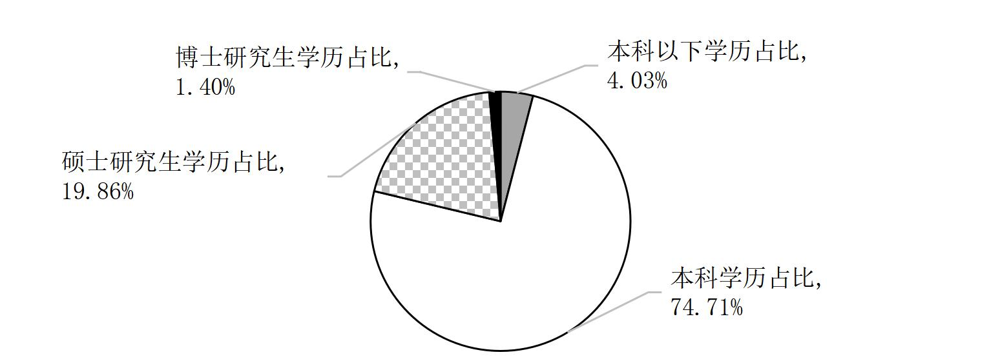
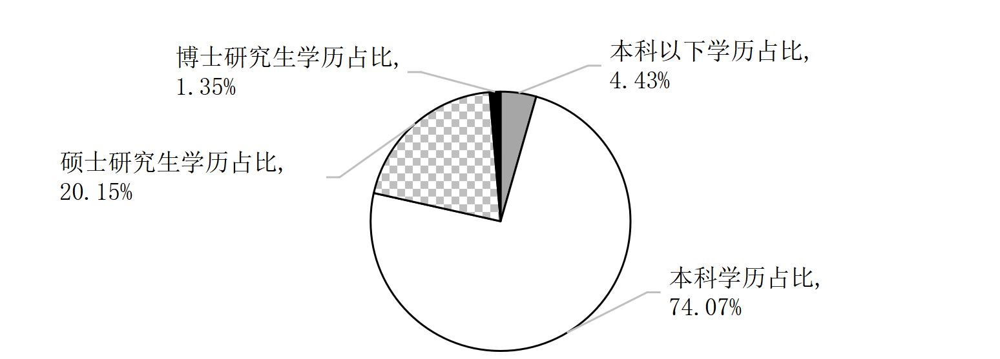
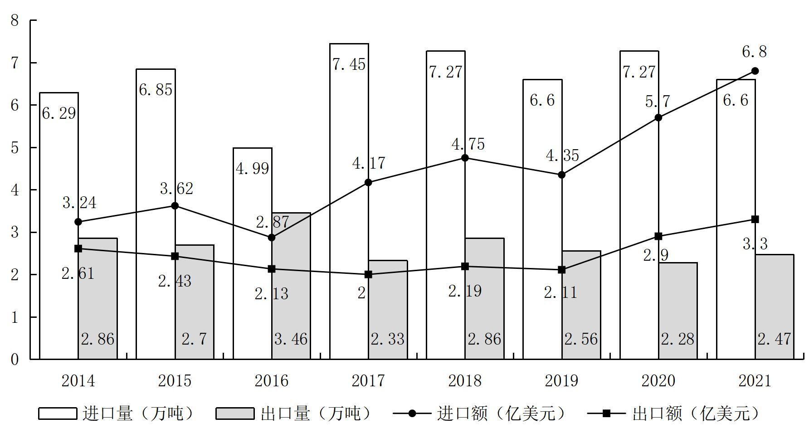

# 套题训练8

## Material M1

2018年我国全年规模以上港口完成货物吞吐量133亿吨，同比增长2.7%，其中外贸货物吞吐量42亿吨，同比增长2.0%。规模以上港口集装箱吞吐量24955万标准箱，同比增长5.2%。

表2018年我国各种运输方式完成货物运输量及其增长速度

| 指标 | 单位 | 绝对数 | 同比增长（%） |
| --- | --- | ---: | ---: |
| 货物运输总量 | 亿吨 | 514.6 | 7.1 |
| 其中：铁路 | 亿吨 | 40.3 | 9.2 |
| 公路 | 亿吨 | 395.9 | 7.4 |
| 水运 | 亿吨 | 69.9 | 4.7 |
| 民航 | 万吨 | 738.5 | 4.6 |
| 管道 | 亿吨 | 8.5 | 5.4 |
| 货物运输周转量 | 亿吨公里 | 205451.5 | 4.1 |
| 其中：铁路 | 亿吨公里 | 28821.0 | 6.9 |
| 公路 | 亿吨公里 | 71202.5 | 6.6 |
| 水运 | 亿吨公里 | 99303.6 | 0.7 |
| 民航 | 亿吨公里 | 262.4 | 7.7 |
| 管道 | 亿吨公里 | 5862.0 | 22.5 |

## Material M2

截至2019年底，全国共有执业律师47.3万人。其中专职律师占84%，兼职律师占2.66%，公职律师占9.17%，公司律师占2.31%，军队律师占0.32%。2019年，全国律师办理各类法律事务1119万件。其中，办理诉讼案件占比54.6%，办理非诉讼法律事务占比11.9%。刑事诉讼辩护及代理占诉讼案件的17.91%；民事诉讼代理占诉讼案件的78.45%；行政诉讼代理占诉讼案件的3.1%；代理申诉占诉讼案件的0.54%。

截至2020年底，全国共有执业律师52.2万人。其中专职律师占81.23%，兼职律师占2.59%，公职律师占11.32%，公司律师占3.09%，军队律师占0.29%。2020年，全国律师办理各类法律事务1114.5万件。其中，办理诉讼案件占比59.3%，办理非诉讼法律事务占比36.0%。刑事诉讼辩护及代理占诉讼案件的15.87%；民事诉讼代理占诉讼案件的80.60%；行政诉讼代理占诉讼案件的3.15%；代理申诉占诉讼案件的0.38%。



图1 2019年全国律师教育程度占比统计



图2 2020年全国律师教育程度占比统计

## Material M3

据国际茶叶委员会最新统计数据显示，2017年，全球茶叶产量568.6万吨，与2016年相比增幅为2.2%。

中国是全球第一大产茶国，茶叶产量255万吨，同比上升6%，占全球茶叶总产量44.8%。印度位居第二，茶叶产量127.8万吨，同比上升0.9%；肯尼亚44万吨，同比下降7%。产量位居前十的其他国家分别为：斯里兰卡30.7万吨、越南17.2万吨、印尼12.5万吨、土耳其10.2万吨、阿根廷8.2万吨、孟加拉国7.9万吨、日本7.7万吨。

2017年，全球茶叶出口总量177.8万吨，比2016年下降1.1%。肯尼亚是世界最大茶叶出口国，2017年出口量41.6万吨，同比下降13.4%。中国出口35.5万吨，同比上升8.1%，稳居世界第二大茶叶出口国。全球茶叶进口总量169.3万吨，同比下降2.2%。其中巴基斯坦是最大茶叶进口国，2017年进口17.5万吨，同比上升0.7%；俄罗斯位居第二，进口16.0万吨，同比持平；美国位居第三，进口12.6万吨，同比下降3.8%。

2017年我国茶出口量为35.52万吨，与去年同期相比，增长了8.09%，去年全年茶出口金额为16.14亿美元，同比增长8.72%，增长速度比出口量快。纵观2013～2017年我国茶出口量呈先降后增的态势运行，2014年我国茶出口量为30.15万吨，为历年来最低值。

从进口来看，2017年全国茶进口量为2.97万吨，同比增长30.8%；进口金额为1.49亿美元，同比增长33.5%。纵观2013～2017年中国茶进口数据来看，2017年是中国茶进口量最多的一年。

表2013～2017年我国茶叶进出口情况

| 年份 | 进口量（吨） | 进口额（万美元） | 出口量（吨） | 出口额（万美元） |
| --- | ---: | ---: | ---: | ---: |
| 2013年 | 19599.1 | 7527.8 | 325774.9 | 124684.2 |
| 2014年 | 22553.4 | 9226.8 | 301484.1 | 127347.2 |
| 2015年 | 22863.9 | 10556.3 | 324948.9 | 138306.2 |
| 2016年 | 22675.8 | 11168.2 | 328692.0 | 148491.4 |
| 2017年 | 2966.09 | 14910.9 | 355279.5 | 161435.6 |

## Material M4

2021年全国共有138个国家级区域性良种繁育基地，其中山东、黑龙江分别有16和12个基地，云南、湖北均以10个居于其后，2021年全国通过国审的水稻品种有677个，其中湖南有169个；玉米通过国审的919个品种中，134个来自北京，其后是吉林99个、河南95个；与水稻、玉米相比，大豆种源高度依赖进口，2021年仅有86个国审品种，其中黑龙江18个、山东14个；棉花39个国审品种中，最多的是新疆，有12个，其次为河南，有6个。

2021年，我国农作物自主选育品种面积占比超95%，水稻、小麦两大口粮作物品种100%自给。大豆种子对外依赖度高达86%，胡萝卜、茄子、菠菜、洋葱、高端品种番茄及甜菜等种子的进口依赖度超过90%。



图2014～2021年中国农作物种子进出口贸易数据

## Question 1

```yaml
module: 资料分析
materials:
- M1
```

### Stem

2017年我国公路货物运输周转量为铁路的：

### Options
- A. 不到100%
- B. 100%～200%之间
- C. 200%～300%之间
- D. 超过300%

### Answer

C

## Question 2

```yaml
module: 资料分析
materials:
- M1
```

### Stem

2018年我国各种运输方式货物运输总量同比增量从高到低排序正确的是：

### Options
- A. 民航、公路、水运、铁路
- B. 公路、铁路、水运、民航
- C. 公路、水运、铁路、民航
- D. 民航、公路、铁路、水运

### Answer

B

## Question 3

```yaml
module: 资料分析
materials:
- M1
```

### Stem

2018年我国全年规模以上港口完成非外贸货物吞吐量同比增速：

### Options
- A. 低于1.5%
- B. 在1.5%～2.5%之间
- C. 在2.5%～3.5%之间
- D. 高于3.5%

### Answer

C

## Question 4

```yaml
module: 资料分析
materials:
- M1
```

### Stem

已知货物平均运输距离（公里）＝货物运输周转量÷货物运输总量。在①铁路、②公路、③水运和④

民航四种运输方式中，2018年我国货物平均运输距离高于2017年水平的是：

### Options
- A. 仅①和②
- B. 仅③和④
- C. 仅①、②和③
- D. 仅④

### Answer

D

## Question 5

```yaml
module: 资料分析
materials:
- M1
```

### Stem

能够从上述材料中推出的是：

### Options
- A. 2017年我国全年货物运输总量大于500亿吨
- B. 2017年我国规模以上港口集装箱吞吐量超过2.2亿标准箱
- C. 2018年我国水运货物运输周转量同比增长超过1000亿吨公里
- D. 2018年我国公路货物运输量占货物运输总量的比重超过八成

### Answer

B

## Question 6

```yaml
module: 资料分析
materials:
- M2
```

### Stem

截至2020年底，我国执业律师中数量最多的是：

### Options
- A. 公职律师
- B. 公司律师
- C. 专职律师
- D. 兼职律师

### Answer

C

## Question 7

```yaml
module: 资料分析
materials:
- M2
```

### Stem

与2019年相比，2020年人数增加最多的是：

### Options
- A. 本科以下学历律师
- B. 本科学历律师
- C. 硕士研究生学历律师
- D. 博士研究生学历律师

### Answer

B

## Question 8

```yaml
module: 资料分析
materials:
- M2
```

### Stem

截至2020年底，民事诉讼代理案件约有：

### Options
- A. 426万件
- B. 533万件
- C. 657万件
- D. 785万件

### Answer

B

## Question 9

```yaml
module: 资料分析
materials:
- M2
```

### Stem

与2019年相比，2020年办理的诉讼案件中，数量均有所增加的是：

### Options
- A. 行政诉讼代理和申诉代理
- B. 民事诉讼代理和行政诉讼代理
- C. 刑事诉讼辩护及代理和行政诉讼代理
- D. 刑事诉讼辩护及代理和民事诉讼代理

### Answer

B

## Question 10

```yaml
module: 资料分析
materials:
- M2
```

### Stem

与2019年相比，下列选项中正确的是：

### Options
- A. 2020年增速最快的是本科学历律师
- B. 2020年公职律师人数下降了2个百分点
- C. 2020年在企业从事法务工作的执业律师人数有所增加
- D. 2020年专职律师占全国执业律师的比重下降，表明专职律师人数有所减少

### Answer

C

## Question 11

```yaml
module: 资料分析
materials:
- M3
```

### Stem

2017年全球茶叶产量的增长量为多少万吨：

### Options
- A. 12.2
- B. 13.1
- C. 11.4
- D. 10.9

### Answer

A

## Question 12

```yaml
module: 资料分析
materials:
- M3
```

### Stem

2017年，位居全球茶叶出口量第二的国家占全球茶叶出口量的比重同比增加了约：

### Options
- A. 0.5个百分点
- B. 1.1个百分点
- C. 1.7个百分点
- D. 2.8个百分点

### Answer

C

## Question 13

```yaml
module: 资料分析
materials:
- M3
```

### Stem

2013～2017年我国出口单价最高的年份是哪一年：

### Options
- A. 2014
- B. 2015
- C. 2016
- D. 2017

### Answer

D

## Question 14

```yaml
module: 资料分析
materials:
- M3
```

### Stem

2016年，肯尼亚月均出口量比月均产量：

### Options
- A. 多1.5%
- B. 少1.5%
- C. 多2.1%
- D. 少2.1%

### Answer

A

## Question 15

```yaml
module: 资料分析
materials:
- M3
```

### Stem

根据上述材料，可以推出的是：

### Options
- A. 2016年，我国茶叶进口单价同比增加了7.1%
- B. 2017年，美国茶叶进口量降低了6000吨
- C. 2016年，印度茶叶产量占全球茶叶产量的比重为55%
- D. 2013～2017年，我国出口额同比增长最高为8.72%

### Answer

D

## Question 16

```yaml
module: 资料分析
materials:
- M4
```

### Stem

2014～2021年间，我国农作物种子进出口贸易逆差超2亿美元的年份有多少个：

### Options
- A. 3
- B. 4
- C. 5
- D. 6

### Answer

C

## Question 17

```yaml
module: 资料分析
materials:
- M4
```

### Stem

2014～2021年间，我国农作物种子贸易进出口总量同比增长的年份有多少个：

### Options
- A. 4
- B. 5
- C. 6
- D. 7

### Answer

A

## Question 18

```yaml
module: 资料分析
materials:
- M4
```

### Stem

如按2021年我国农作物种子出口量同比增速推算，2022年我国农作物种子出口量约为多少万吨：

### Options
- A. 2.58
- B. 2.68
- C. 2.78
- D. 2.88

### Answer

B

## Question 19

```yaml
module: 资料分析
materials:
- M4
```

### Stem

2021年，我国农作物种子出口额占进出口总额的比重较上年：

### Options
- A. 增加了2个百分点以上
- B. 减少了2个百分点以上
- C. 增加了不到2个百分点
- D. 减少了不到2个百分点

### Answer

D

## Question 20

```yaml
module: 资料分析
materials:
- M4
```

### Stem

不能从上述材料推出的是：

### Options
- A. 2021年我国大豆种子自给率不足15%
- B. 2021年棉花国审品种中新疆占比最大
- C. 2021年我国自主甜菜种子占国内市场份额低于10%
- D. 2021年玉米通过国审品种最多，国内玉米需求已能自给

### Answer

D
