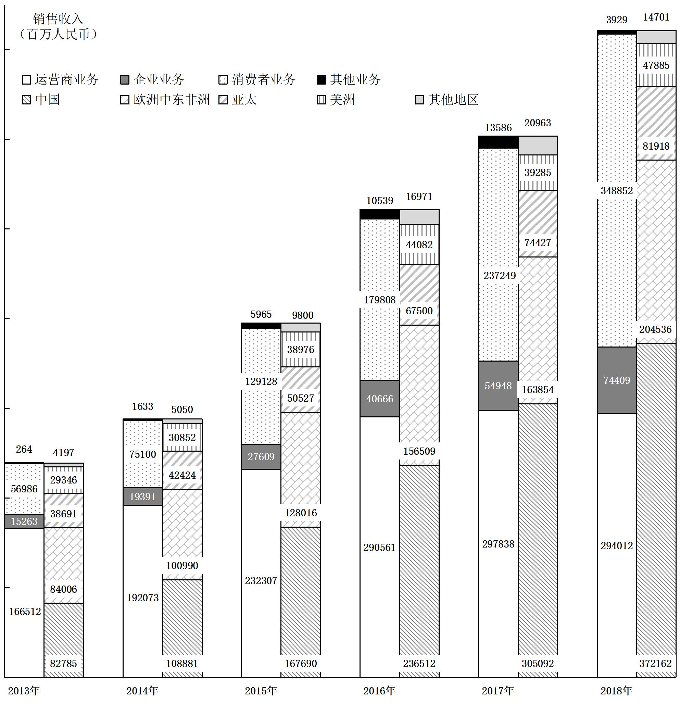
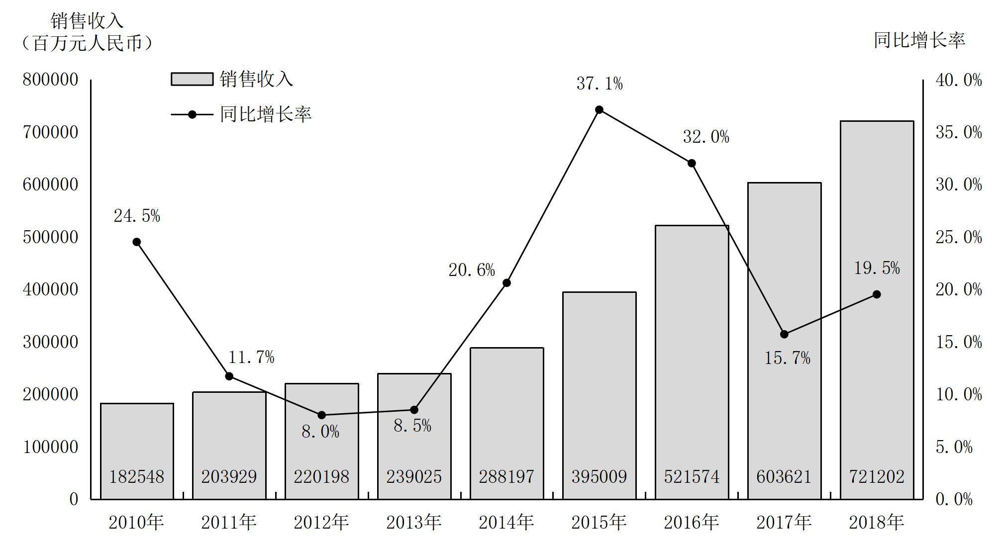

<!-- hyz-paper-id: 01a1e4f7-7c01-7171-a498-4f275b047d01 -->

# 套题训练9

## Material M1

<!-- hyz-material-id: 01a1e4f7-7c01-7171-a498-4f35c70852a2 -->

表2019～2021年中国海洋生态重点监测区域大型底栖生物情况

| 指标监测区域 | 2021年物种数（种） | 2021年密度（个/m3） | 2021年多样性指数 | 2020年物种数（种） | 2020年密度（个/m3） | 2020年多样性指数 | 2019年物种数（种） | 2019年密度（个/m3） | 2019年多样性指数 |
| --- | ---: | ---: | ---: | ---: | ---: | ---: | ---: | ---: | ---: |
| 鸭绿江口 | 83 | 515 | 2.22 | 64 | 217.4 | 1.97 | 31 | 153.9 | 1.11 |
| 双台子河口 | 48 | 95.6 | 1.76 | 31 | 48.9 | 1.21 | 15 | 74.2 | 0.95 |
| 滦河口—北戴河 | 55 | 122.6 | 2.24 | 26 | 70.5 | 0.85 | 67 | 167.1 | 2.62 |
| 黄河口 | 86 | 654.3 | 3.38 | 88 | 849.4 | 3.01 | 68 | 679.4 | 3.14 |
| 长江口 | 54 | 82.4 | 1.58 | 30 | 80.7 | 1.41 | 21 | 43.9 | 1.86 |
| 闽江口 | 42 | 82.5 | 2.24 | 41 | 140 | 1.72 | 44 | 53.2 | 2.37 |
| 珠江口 | 92 | 82.9 | 2.18 | 45 | 51.7 | 1.39 | 37 | 92.7 | 1.61 |
| 渤海湾 | 37 | 122.5 | 2.33 | 23 | 54.4 | 0.72 | 52 | 118.6 | 2.01 |
| 胶州湾 | 90 | 669.2 | 3.68 | 95 | 1468.3 | 3.37 | 88 | 517.5 | 3.4 |
| 杭州湾 | 10 | 6.2 | 0.25 | 9 | 6.4 | 0.47 | 6 | 4.4 | 0.2 |
| 闽东沿岸 | 88 | 90.7 | 2.63 | 68 | 90.3 | 2.33 | 67 | 83.6 | 2.48 |
| 大亚湾 | 50 | 45.3 | 1.84 | 59 | 59.2 | 2.12 | 82 | 175 | 2.51 |
| 北部湾 | 124 | 55.3 | 2.04 | 146 | 87.3 | 2.6 | 176 | 115.8 | 2.78 |
| 苏北浅滩 | 17 | 7.2 | 0.28 | 14 | 4.3 | 1.36 | 21 | 20.5 | 0.81 |

## Material M2

<!-- hyz-material-id: 01a1e4f7-7c01-7171-a498-4f4c4358ea21 -->



图1 2013～2018年华为公司销售收入按业务与地区分类构成情况



图2 2010～2018年华为公司销售收入与同比增长率

## Material M3

<!-- hyz-material-id: 01a1e4f7-7c01-7171-a498-4f50b4ddc90d -->

2020年江苏省第七次全国人口普查结果显示，全省常住人口数为8475万人，与2010年第六次人口普查相比，增长7.74%。全省共有家庭户2991万户，集体户201万户，家庭户人口为7765万人，集体户人口为710万人，平均每个家庭户的人口比2010年减少0.34人，与2010年相比，0～14岁人口的比重上升2.20个百分点，15～59岁人口的比重下降8.05个百分点，60岁及以上人口的比重上升5.85个百分点，65岁及以上人口的比重上升5.32个百分点。

表2020年江苏省各地区人口比重及年龄构成

| 地区 | 比重（%） | 年龄构成（%）0～14岁 | 年龄构成（%）15～59岁 | 年龄构成（%）60岁以上其中：65岁及以上 | 年龄构成（%）60岁以上其中：65岁及以上 |
| --- | ---: | ---: | ---: | ---: | --- |
|  |  |  |  |  | 其中：65岁及以上 |
| 全省 | 100.00 | 15.21 | 62.95 | 21.84 | 16.20 |
| 南京 | 10.99 | 12.75 | 68.27 | 18.98 | 13.70 |
| 无锡 | 8.81 | 12.96 | 67.29 | 19.75 | 14.65 |
| 徐州 | 10.72 | 22.36 | 58.13 | 19.51 | 14.72 |
| 常州 | 6.23 | 13.26 | 66.73 | 20.10 | 14.88 |
| 苏州 | 15.04 | 13.55 | 69.49 | 16.96 | 12.44 |
| 南通 | 9.12 | 10.90 | 59.09 | 30.01 | 22.67 |
| 连云港 | 5.43 | 21.40 | 58.20 | 20.40 | 14.63 |
| 淮安 | 5.38 | 17.70 | 59.50 | 22.79 | 16.42 |
| 盐城 | 7.92 | 15.03 | 57.64 | 27.32 | 19.88 |
| 扬州 | 5.38 | 11.57 | 62.42 | 26.01 | 19.99 |
| 镇江 | 3.79 | 11.89 | 64.55 | 23.56 | 17.51 |
| 泰州 | 5.32 | 12.36 | 59.39 | 28.25 | 22.01 |
| 宿迁 | 5.87 | 23.48 | 57.94 | 18.58 | 13.56 |

## Material M4

<!-- hyz-material-id: 01a1e4f7-7c01-7171-a498-4f6de3629474 -->

2018年，某市实现地区生产总值24221.98亿元，比上年增长7.6%。其中，第一产业增加值22.09亿元，增长3.9%；第二产业增加值9961.95亿元，增长9.3%；第三产业增加值14237.94亿元，增长6.4%。现代产业中，现代服务业增加值10090.59亿元，增长7.1%；先进制造业增加值6564.83亿元，增长12.0%；高技术制造业增加值6131.20亿元，增长13.3%。四大支柱产业中，金融业增加值3067.21亿元，增长3.6%；物流业增加值2541.58亿元，增长9.4%；文化及相关产业（规模以上）增加值1560.52亿元，增长6.3%；高新技术产业增加值8296.63亿元，增长12.7%。七大战略性新兴产业增加值合计9155.18亿元，比上年增长9.5%，占地区生产总值比重37.8%。其中，新一代信息技术产业增加值4772.02亿元，增长10.9%；数字经济产业增加值1240.73亿元，增长3.8%；高端装备制造产业增加值1065.82亿元，增长10.7%；绿色低碳产业增加值990.73亿元，增长11.7%；海洋经济产业增加值421.69亿元，下降11.3%；新材料产业增加值365.61亿元，增长8.6%；生物医药产业增加值298.58亿元，增长22.3%。

全市年末常住人口1302.66万人，其中常住户籍人口454.70万人，增长4.6%，占常住人口比重34.9%；常住非户籍人口847.97万人，增长3.6%，占比重65.1%。年末城镇登记失业率为2.3%。全年居民消费价格比上年上涨2.8%。全年完成一般公共预算收入3538.41亿元，比上年增长6.2%。其中税收收入2899.60亿元，增长9.2%。一般公共预算支出4282.54亿元，下降6.8%。

## Question 1

<!-- hyz-question-id: 01a1e4f7-7c01-7171-a498-4f7bf6047166 -->

```yaml
module: 资料分析
materials:
- M1
```

### Stem

与2019年相比，2021年大型底栖生物物种数增加超出一倍的有多少个：

### Options
- A. 8
- B. 6
- C. 4
- D. 2

### Answer

C

## Question 2

<!-- hyz-question-id: 01a1e4f7-7c01-7171-a498-4f81eeb47a40 -->

```yaml
module: 资料分析
materials:
- M1
```

### Stem

2020年，以下重点监测区域中，大型底栖生物密度同比增幅最大的是：

### Options
- A. 鸭绿江口
- B. 闽江口
- C. 渤海湾
- D. 胶州湾

### Answer

D

## Question 3

<!-- hyz-question-id: 01a1e4f7-7c01-7171-a498-4f9860d77373 -->

```yaml
module: 资料分析
materials:
- M1
```

### Stem

2019～2021年，珠江口大型底栖生物多样性指数年均增长：

### Options
- A. 16.4%
- B. 17.7%
- C. 18.1%
- D. 35.3%

### Answer

A

## Question 4

<!-- hyz-question-id: 01a1e4f7-7c01-7171-a498-4faf5c14156f -->

```yaml
module: 资料分析
materials:
- M1
```

### Stem

2019年，大型底栖生物物种数达到中位数以上的重点监测区域中，其大型底栖生物密度最低的是：

### Options
- A. 北部湾
- B. 闽东沿岸
- C. 渤海湾
- D. 闽江口

### Answer

B

## Question 5

<!-- hyz-question-id: 01a1e4f7-7c01-7171-a498-4fb4fd9c3c4c -->

```yaml
module: 资料分析
materials:
- M1
```

### Stem

根据上表，下列说法错误的是：

### Options
- A. 2020～2021年，大型底栖生物多样性指数连续两年同比下降的重点监测区域有2个
- B. 2019～2021年，黄河口与长江口大型底栖生物多样性指数的差距逐年增大
- C. 2019～2022年，杭州湾大型底栖生物物种数、密度、多样性指数均居末位
- D. 2021年，大型底栖生物密度同比增加的重点监测区域有8个

### Answer

C

## Question 6

<!-- hyz-question-id: 01a1e4f7-7c01-7171-a498-4fc93464f1d5 -->

```yaml
module: 资料分析
materials:
- M2
```

### Stem

“十二五”期间华为销售收入总计达到多少百万元：

### Options
- A. 1,344,565
- B. 1,346,358
- C. 1,348,467
- D. 1,350,118

### Answer

B

## Question 7

<!-- hyz-question-id: 01a1e4f7-7c01-7171-a498-4fd5372a63ae -->

```yaml
module: 资料分析
materials:
- M2
```

### Stem

下面折线图能反映2015～2018年华为在美洲地区销售收入同比增长率趋势的是：

### Options
- A. 
- B. 
- C. 
- D. 

### Answer

A

## Question 8

<!-- hyz-question-id: 01a1e4f7-7c01-7171-a498-4fe374254987 -->

```yaml
module: 资料分析
materials:
- M2
```

### Stem

2010年～2018年华为公司销售收入同比增长低于10%的年份有多少个：

### Options
- A. 2
- B. 3
- C. 4
- D. 5

### Answer

A

## Question 9

<!-- hyz-question-id: 01a1e4f7-7c01-7171-a498-4ffd4fc0c3b3 -->

```yaml
module: 资料分析
materials:
- M2
```

### Stem

2013年～2018年华为公司各类业务销售收入同比增长率最高的是：

### Options
- A. 2018年的运营商业务
- B. 2017年的其他业务
- C. 2016年的企业业务
- D. 2015年的消费者业务

### Answer

D

## Question 10

<!-- hyz-question-id: 01a1e4f7-7c01-7171-a498-50002e8fcbbc -->

```yaml
module: 资料分析
materials:
- M2
```

### Stem

根据上述信息，欧洲中东非洲地区的销售收入占公司总销售收入的说法不正确的是：

### Options
- A. 欧洲中东非洲地区的销售收入占比一直高于亚太与美洲地区之和的占比
- B. 2016年欧洲中东非洲地区的销售收入占比比2015年的下降了约2.4个百分点
- C. 2013年欧洲中东非洲地区的销售收入占比高于2014年
- D. 2017年欧洲中东非洲地区的销售收入占比不到亚太地区的2倍

### Answer

D

## Question 11

<!-- hyz-question-id: 01a1e4f7-7c01-7171-a498-5011047f2cbb -->

```yaml
module: 资料分析
materials:
- M3
```

### Stem

2010年至2020年期间，江苏省常住人口的增加数最接近：

### Options
- A. 600万人
- B. 610万人
- C. 660万人
- D. 710万人

### Answer

B

## Question 12

<!-- hyz-question-id: 01a1e4f7-7c01-7171-a498-502effc069c9 -->

```yaml
module: 资料分析
materials:
- M3
```

### Stem

2020年南京市65岁及以上的常住人口数：

### Options
- A. 不超过120万人
- B. 在120万人～130万人之间
- C. 在130万人～140万人之间
- D. 超过140万人

### Answer

B

## Question 13

<!-- hyz-question-id: 01a1e4f7-7c01-7171-a498-503b71655219 -->

```yaml
module: 资料分析
materials:
- M3
```

### Stem

与2010年相比，2020年江苏省15～64岁人口的比重：

### Options
- A. 下降了7.52个百分点
- B. 下降了2.73个百分点
- C. 下降了2.2个百分点
- D. 上升了2.73个百分点

### Answer

A

## Question 14

<!-- hyz-question-id: 01a1e4f7-7c01-7171-a498-5047317ffe1c -->

```yaml
module: 资料分析
materials:
- M3
```

### Stem

2020年江苏省常住人口数超过500万的地区有：

### Options
- A. 5个
- B. 6个
- C. 7个
- D. 8个

### Answer

C

## Question 15

<!-- hyz-question-id: 01a1e4f7-7c01-7171-a498-50533a9203ff -->

```yaml
module: 资料分析
materials:
- M3
```

### Stem

2010年江苏省平均每个家庭户的人口数为：

### Options
- A. 2.49人
- B. 2.60人
- C. 2.94人
- D. 3.17人

### Answer

C

## Question 16

<!-- hyz-question-id: 01a1e4f7-7c01-7171-a498-506350360961 -->

```yaml
module: 资料分析
materials:
- M4
```

### Stem

2017年，该市第三产业增加值比第二产业增加值约多多少倍：

### Options
- A. 1.43
- B. 1.47
- C. 0.43
- D. 0.47

### Answer

D

## Question 17

<!-- hyz-question-id: 01a1e4f7-7c01-7171-a498-507fa6457e15 -->

```yaml
module: 资料分析
materials:
- M4
```

### Stem

2018年，下列产业对该市地区生产总值增长的贡献率最大的是：

### Options
- A. 第三产业
- B. 现代服务业
- C. 文化及相关产业（规模以上）
- D. 高新技术产业

### Answer

D

## Question 18

<!-- hyz-question-id: 01a1e4f7-7c01-7171-a498-508637b8394a -->

```yaml
module: 资料分析
materials:
- M4
```

### Stem

2018年，从产业增加值的同比增量看，该市七大战略性新兴产业中，高端装备制造产业和什么最接近：

### Options
- A. 新一代信息技术产业
- B. 数字经济产业
- C. 绿色低碳产业
- D. 生物医药产业

### Answer

C

## Question 19

<!-- hyz-question-id: 01a1e4f7-7c01-7171-a498-50970ec3e15f -->

```yaml
module: 资料分析
materials:
- M4
```

### Stem

2018年，该市年末常住人口同比增长约：

### Options
- A. 3.6%
- B. 3.9%
- C. 4.7%
- D. 4.2%

### Answer

B

## Question 20

<!-- hyz-question-id: 01a1e4f7-7c01-7171-a498-50ae8f1135ba -->

```yaml
module: 资料分析
materials:
- M4
```

### Stem

根据上文，下列说法正确的是：

### Options
- A. 2018年，该市第二产业增加值占地区生产总值比重同比下降
- B. 2017年，该市四大支柱产业中，物流业增加值最大
- C. 2018年，该市年末城镇登记失业人口29.96万人
- D. 2018年，该市一般公共预算收入中，非税收收入同比负增长

### Answer

D
