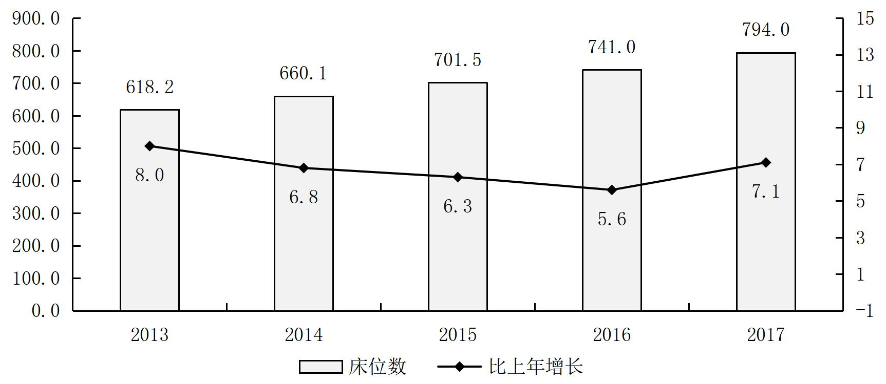
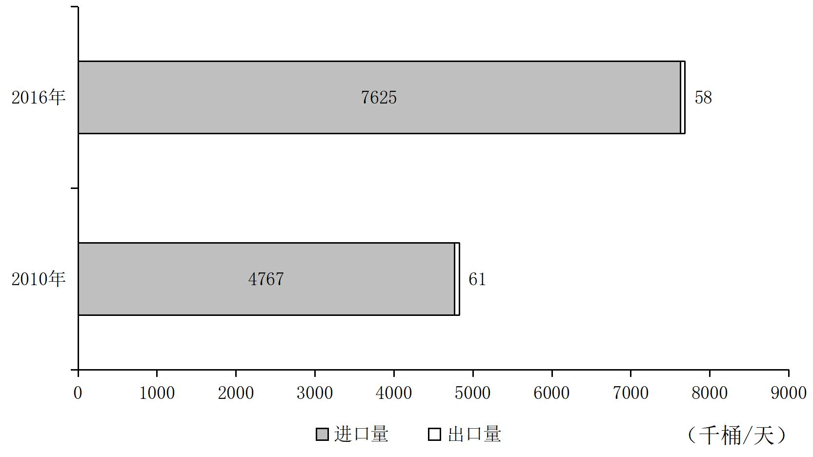
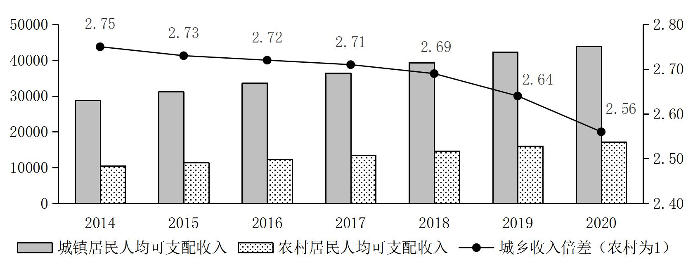
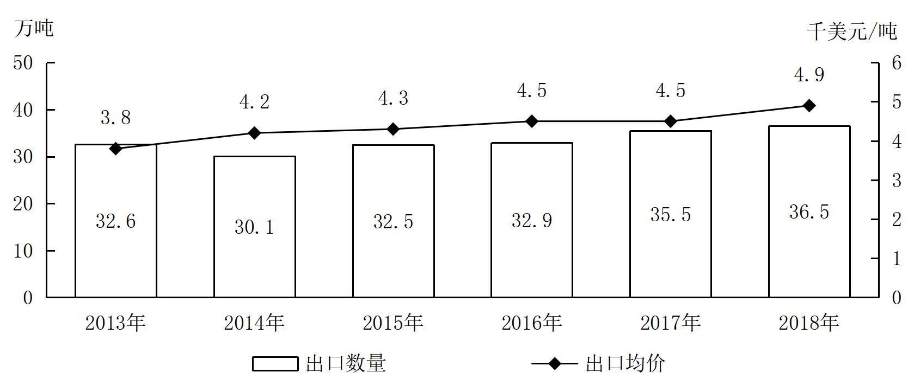
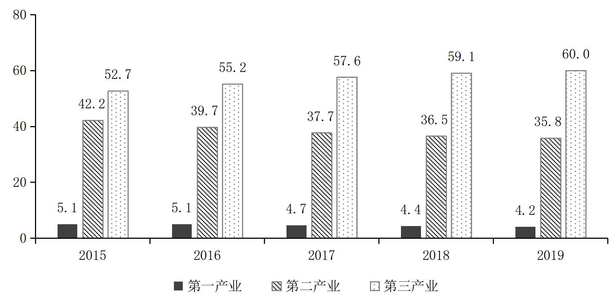
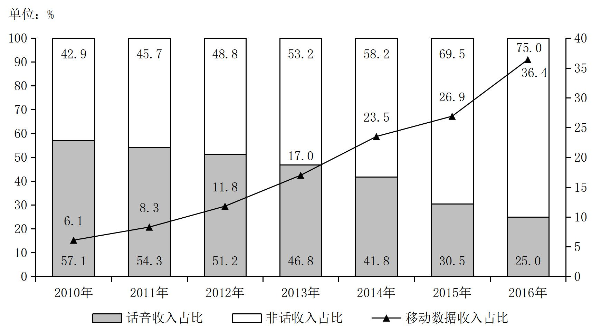
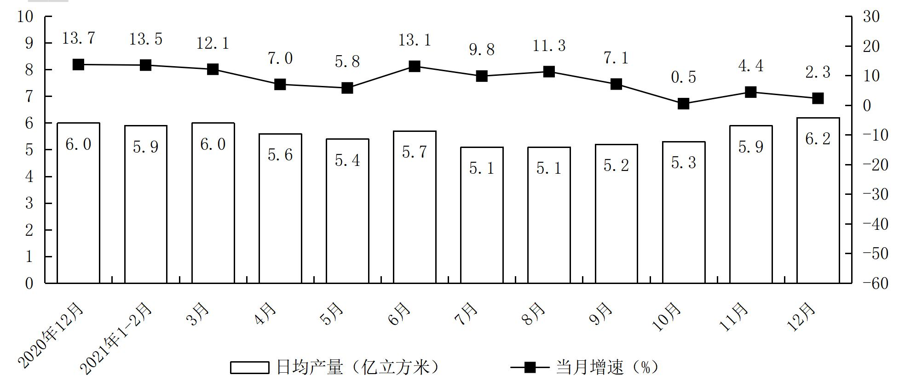
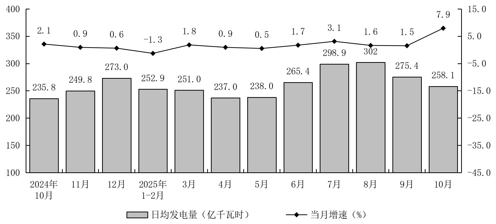

# 考点刷题1

## Question 1

```yaml
module: 资料分析
```

### Stem

| 指标名称 | 2019年8月绝对量（亿元） | 2019年8月同比增长（%） | 1～8月绝对量（亿元） | 1～8月同比增长（%） |
| --- | ---: | ---: | ---: | ---: |
| 社会消费品零售总额 | 1280.7 | 5.73 | 9846.6 | 6 |
| 其中：限额以上单位消费品零售总额 | 280.7 | −4.4 | 2254.6 | −2.3 |
| 按产品类别分： |  |  |  |  |
| 5.日用品类 | 7.1 | 2.1 | 59.2 | −4.2 |
| 8.通讯器材类 | 9.6 | 4.7 | 80 | 2.4 |

2018年8月通讯器材类实现消费品零售额比日用品类约多多少亿元：

### Options
- A. 2.6
- B. 2.4
- C. 2.2
- D. 2.0

### Answer

C

## Question 2

```yaml
module: 资料分析
```

### Stem

2019年江苏省金融信贷规模扩大，保险行业发展较快。全年保费收入3750.2亿元，比上年增长13.1%。其中，财产险收入940.9亿元，增长9.6%；寿险收入2215.3亿元，增长11.6%；健康险收入508.8亿元，增长28.8%；意外伤害险收入85.2亿元，增长9.1%。全年保险赔付998.6亿元，比上年增长0.2%。其中，财产险赔付534.5亿元，增长4.3%；寿险赔付294.3亿元，下降17.3%，健康险赔付144.8亿元，增长38.7%；意外伤害险赔付25.0亿元，增长4.7%。

2018年江苏省财产险收入与赔付之差为多少：

### Options
- A. 346.0亿元
- B. 364.0亿元
- C. 396.6亿元
- D. 406.4亿元

### Answer

A

## Question 3

```yaml
module: 资料分析
```

### Stem

表2022年交通固定资产投资额及同比增长率

|  | 交通固定资产投资额（亿元） | 同比增长率（%） |
| --- | ---: | ---: |
| 铁路 | 7109 | −5.1 |
| 公路 | 28527 | 9.7 |
| 其中：高速公路 | 16262 | 7.3 |
| 普通国省道 | 5973 | 6.5 |
| 农村公路 | 4733 | 15.6 |
| 水路 | 1679 | 10.9 |
| 其中：内河建设 | 867 | 16.7 |
| 沿海建设 | 794 | 9.9 |
| 民航 | 1231 | 0.7 |

2021年公路交通固定资产投资额与铁路交通固定资产投资额共：

### Options
- A. 不到3万亿元
- B. 3～3.5万亿元
- C. 3.5～4万亿元
- D. 超过4万亿元

### Answer

B

## Question 4

```yaml
module: 资料分析
```

### Stem

2019年5月，全国12358价格监管平台受理价格举报、投诉、咨询共计37576件，同比下降40.70%，环比下降9.31%。其中，价格举报4192件，环比下降19.06%；价格投诉2059件，环比下降15.92%；价格咨询31325件，环比下降7.34%。

2019年4月，平台受理的价格咨询比价格举报约多：

### Options
- A. 26146件
- B. 27133件
- C. 28627件
- D. 29614件

### Answer

C

## Question 5

```yaml
module: 资料分析
```

### Stem

2023年10月份，生产天然气190亿立方米，同比增长2.6%，增速比9月份回落6.7个百分点，日均产量6.1亿立方米。进口天然气879万吨，同比增长15.5%，增速比9月份加快15.1个百分点。1～10月份，生产天然气1896亿立方米，同比增长6.1%。进口天然气9651万吨，同比增长8.8%。

2022年1～9月份，全国进口天然气约多少万吨：

### Options
- A. 7893
- B. 8109
- C. 8772
- D. 9013

### Answer

B

## Question 6

```yaml
module: 资料分析
```

### Stem

表2021年1～7月东部、中部、西部和东北地区房地产开发投资情况

| 地区 | 投资额（亿元） | 投资额（亿元）住宅 | 同比增长（%） | 同比增长（%）住宅 |
| --- | ---: | ---: | ---: | ---: |
| 全国总计 | 84895 | 63980 | 12.7 | 14.9 |
| 东部地区 | 45306 | 33231 | 11.5 | 13.3 |
| 中部地区 | 17720 | 14330 | 20.0 | 23.7 |
| 西部地区 | 18717 | 14002 | 10.0 | 11.8 |
| 东北地区 | 3152 | 2417 | 8.1 | 7.6 |

2020年1～7月，东、西部地区房地产开发投资总额约为多少亿元：

### Options
- A. 55328
- B. 57649
- C. 58971
- D. 61634

### Answer

B

## Question 7

```yaml
module: 资料分析
```

### Stem

2021年1～9月，我国机床工具进出口总额242.6亿美元，同比增长32.8%。其中，机床工具商品进口105.2亿美元，同比增长23.7%；出口137.4亿美元，同比增长40.8%。

从进口来源来看，2021年1～9月进口来源前三位分别是：日本34.5亿美元，同比增长37.8%；德国22.2亿美元，同比增长11.0%；中国台湾14.3亿美元，同比增长36.1%。

从出口去向来看，2021年1～9月出口去向前三位分别是：美国17.5亿美元，同比增长27.4%；越南10.5亿美元，同比增长35.4%；印度8.8亿美元，同比增长67.8%。

2020年1～9月，我国机床工具贸易状况为：

### Options
- A. 顺差10亿美元以上
- B. 顺差不到10亿美元
- C. 逆差10亿美元以上
- D. 逆差不到10亿美元

### Answer

A

## Question 8

```yaml
module: 资料分析
```

### Stem

表2021年重庆市居民人均可支配收入结构表

| 指标 | 全市居民绝对量（元） | 全市居民比上年增长（%） | 城镇常住居民绝对量（元） | 城镇常住居民比上年增长（%） | 农村常住居民绝对量（元） | 农村常住居民比上年增长（%） |
| --- | ---: | ---: | ---: | ---: | ---: | ---: |
| 工资性收入 | 18138 | 9.8 | 25396 | 8.7 | 6386 | 11.3 |
| 经营性收入 | 5358 | 9.3 | 4894 | 9.2 | 6110 | 9.8 |
| 财产性收入 | 2090 | 9.6 | 3016 | 8.6 | 447 | 9.9 |
| 转移性收入 | 8217 | 9.5 | 10106 | 8.5 | 5157 | 10.9 |

2020年重庆市农村常住居民工资性收入与财产性收入共约：

### Options
- A. 6144元
- B. 6186元
- C. 6273元
- D. 6419元

### Answer

A

## Question 9

```yaml
module: 资料分析
```

### Stem

2019年某省规模以上企业就业人员年平均工资为62484元，比上年增长10.1%。其中，中层及以上管理人员增长9.7%；专业技术人员增长20.7%；办事人员和有关人员增长5.7%；社会生产服务和生活服务人员增长8.5%；生产制造及有关人员增长9.7%。

表2019年某省部分行业规模以上企业分职业就业人员平均工资

| 指标名称 | 就业人员平均工资（元） | 中层及以上管理人员 | 专业技术人员 | 办事人员和有关人员 | 社会生产服务和生活服务人员 | 生产制造及有关人员 |
| --- | ---: | ---: | ---: | ---: | ---: | ---: |
| 总计 | 62484 | 126154 | 85254 | 55733 | 48570 | 56060 |
| …… |  |  |  |  |  |  |
| 教育 | 76253 | 143992 | 77593 | 74531 | 48871 | 40431 |
| 卫生和社会工作 | 82948 | 158149 | 92472 | 49165 | 44022 | 66310 |
| 文化、体育和娱乐业 | 65048 | 115905 | 100065 | 57706 | 41874 | 38042 |

如2019年该省规模以上企业各行业各职业就业人员平均工资同比增速均与全省规模以上企业同职业人员总体水平相同，则2018年规模以上教育业企业专业技术人员平均工资比该行业办事人员和有关人员：

### Options
- A. 低4000元以上
- B. 低不到4000元
- C. 高不到4000元
- D. 高4000元以上

### Answer

A

## Question 10

```yaml
module: 资料分析
```

### Stem

2022年我国农民工总量29562万人。其中，本地农民工比上年增加293万人，增长2.4%；外出农民工17190万人。

2022年我国在外出农民工中，跨省流动7061万人，比上年减少69万人；省内流动10129万人，比上年增加87万人。从输出地看，2022年我国东部、中部、西部、东北地区跨省流动农民工人数分别为703万人、3511万人、2657万人和190万人，占该地区外出农民工的比重分别为15.0%、55.6%、47.5%和31.4%。

2021年，我国本地农民工人数约为多少万人：

### Options
- A. 11789
- B. 11980
- C. 12134
- D. 12208

### Answer

D

## Question 11

```yaml
module: 资料分析
```

### Stem

2019年，全国棉花产量588.9万吨，比上年减少21.3万吨。其中，新疆棉花产量500.2万吨，比上年减少10.8万吨；全国棉花种植面积为3339.2千公顷，比上年减少15.2千公顷。新疆的棉花种植面积比上年增加49.2千公顷。长江流域棉花种植面积比上年减少32.4千公顷，同比下降8.7%。黄河流域棉花种植面积比上年减少28.1千公顷，同比下降6.2%。

2018年长江流域棉花种植面积约比黄河流域棉花种植面积：

### Options
- A. 多80千公顷
- B. 少80千公顷
- C. 多40千公顷
- D. 少40千公顷

### Answer

B

## Question 12

```yaml
module: 资料分析
```

### Stem

2017年全国棉花播种面积为3229.6千公顷，比2016年减少146.6千公顷。分地区看，我国最大的产棉区新疆棉花播种面积比2016年增加157.9千公顷，增长8.7%；新疆棉花播种面积占全国的比例，从2016年的53.5%进一步扩大到2017年的60.8%，比上年增长7.3个百分点。其他棉区中，2017年黄河流域棉花播种面积减少215.1千公顷，下降24.3%，长江流域棉花播种面积减少97.0千公顷，下降14.9%。

2016年，黄河、长江流域棉区棉花播种面积之和约占全国棉花播种面积的：

### Options
- A. 四成多
- B. 三成多
- C. 两成多
- D. 不到两成

### Answer

A

## Question 13

```yaml
module: 资料分析
```

### Stem

截止2022年12月，我国网民规模约为10.67亿，较2021年12月新增网民约3549万，互联网普及率达75.6%，较2021年12月提升2.6个百分点。我国网民使用手机上网的比例达99.8%，较2021年12月增加0.1个百分点；使用电视上网的比例为25.9%；使用台式电脑、笔记本电脑、平板电脑上网的比例分别为34.2%、32.8%和28.5%。我国城镇网民规模较2021年12月增长约1.58%，农村网民规模较2021年12月增长约2371万。

2021年12月，我国城镇网民规模约为：

### Options
- A. 6.74亿
- B. 7.46亿
- C. 7.93亿
- D. 8.19亿

### Answer

B

## Question 14

```yaml
module: 资料分析
```

### Stem

2021年，全国纺织品服装出口3155亿美元，同比增长8.4%。其中，纺织品出口1452.2亿美元，同比下降5.6%，较2019年增长22.0%；服装出口1702.8亿美元，同比增长24.0%，较2019年增长16.0%。其中，针织服装及衣着附件出口864.8亿美元，同比增长39.0%；梭织服装及衣着附件出口701.2亿美元，同比增长12.6%。

2021年全国针织服装及衣着附件出口额同比增量约为梭织服装及衣着附件出口额同比增量的多少倍：

### Options
- A. 2～3倍
- B. 3～4倍
- C. 4～5倍
- D. 5倍以上

### Answer

B

## Question 15

```yaml
module: 资料分析
```

### Stem

表A地区2019年社会消费品零售总额情况

|  | 1～12月累计金额（亿元） | 1～12月累计同比增速（%） |
| --- | ---: | ---: |
| 社会消费品零售总额 | 6582.85 | 6.7 |
| 其中：批发和零售业 | 5754.74 | 6.1 |
| 住宿和餐饮业 | 828.11 | 11.2 |

2019年A地区住宿和餐饮业社会消费品零售额同比增量约占社会消费品零售总额同比增量的：

### Options
- A. 10%
- B. 20%
- C. 30%
- D. 40%

### Answer

B

## Question 16

```yaml
module: 资料分析
```

### Stem

表2023年全国规模以上文化及相关产业企业相关指标情况

|  | 绝对值（亿元） | 同比增速（%） |
| --- | ---: | ---: |
| 营业收入 | 129515 | 8.2 |
| 其中：文化新业态 | 52395 | 15.3 |
| …… |  |  |
| 按区域分 |  |  |
| 东部地区 | 101223 | 8.7 |
| 中部地区 | 15394 | 3.6 |
| 西部地区 | 11688 | 10.0 |
| 东北地区 | 1210 | 5.4 |

2023年，中部地区规模以上文化及相关产业企业营业收入同比增量约比东北地区多多少倍：

### Options
- A. 7倍多
- B. 8倍多
- C. 9倍多
- D. 10倍多

### Answer

A

## Question 17

```yaml
module: 资料分析
```

### Stem

2021年1～2月，C市天然气用量为19.21亿立方米，同比增长12.8%。其中，中石油供应14.23亿立方米，同比增长18.88%；中石化供应4.98亿立方米，同比下降1.58%。从用气结构看：民用气为7.78亿立方米，同比增长12.75%；CNG用气1.14亿立方米，同比增长44.3%；工业用气10.29亿立方米，同比增长10.17%。

2021年1～2月，C市工业用气量对天然气用量同比增长的贡献率为：

### Options
- A. 27.5%
- B. 33.6%
- C. 43.6%
- D. 53.6%

### Answer

C

## Question 18

```yaml
module: 资料分析
```

### Stem

2021年，我国制作综艺益智类电视节目时长30.0万小时，比上年下降12.2%；播出综艺益智类电视节目时长109.5万小时，下降5.5%。制作广播剧类节目时长22.4万小时，比上年增长2.4%，播出广播剧类节目时长97.8万小时，增长0.4%。

2021年，我国播出综艺益智类电视节目时长同比减少量约比制作综艺益智类电视节目时长多多少倍：

### Options
- A. 0.3
- B. 1.3
- C. 0.5
- D. 1.5

### Answer

C

## Question 19

```yaml
module: 资料分析
```

### Stem

2020年，对全国6万家规模以上文化及相关产业企业调查结果显示，全年上述企业实现营业收入98514亿元，比上年增长2.2%，其中，前三季度实现营业收入66119亿元，同比下降0.6%。分领域看，文化核心领域营业收入60295亿元，比上年增长3.8%，增速较前三季度提高2.3个百分点；文化相关领域38220亿元，下降0.1%，降幅收窄3.7个百分点。

2020年前三季度，全国文化相关领域营业收入与2018年同期相比约：

### Options
- A. 下降4.0%
- B. 下降3.9%
- C. 上升3.6%
- D. 上升3.9%

### Answer

B

## Question 20

```yaml
module: 资料分析
```

### Stem



图全国医疗卫生机构床位数（万张）及增长情况（%）

虽然2014～2016年间全国医疗卫生机构床位数增长速度持续下滑，但2016年床位数仍然比2014年增加了：

### Options
- A. 12.26%
- B. 10.87%
- C. 13.21%
- D. 9.69%

### Answer

A

## Question 21

```yaml
module: 资料分析
```

### Stem

2017年1～2月，全国造船完工936万载重吨，同比增长123%：承接新船订单221万载重吨，同比增长133%。2月末，手持船舶订单9207万载重吨，同比下降22.6%，比2016年末下降7.6%。

2016年末全国手持船舶订单较同年2月末：

### Options
- A. 降低16.2%
- B. 降低2.2%
- C. 增加16.2%
- D. 增加2.2%

### Answer

A

## Question 22

```yaml
module: 资料分析
```

### Stem

表2022年1月～2023年2月全国旅游客车产销量情况

单位：辆（数量）、%（增速）

| 时间 | 产量数量 | 产量增速 | 销量数量 | 销量增速 |
| --- | ---: | ---: | ---: | ---: |
| 2022年1月 | 714 | 93.0 | 581 | 24.2 |
| 2022年2月 | 140 | −51.4 | 196 | −10.5 |
| 2022年3月 | 468 | 2.0 | 492 | 28.5 |
| 2022年4月 | 426 | 8.1 | 372 | −24.5 |
| 2022年5月 | 581 | 7.4 | 613 | 5.9 |
| 2022年6月 | 664 | −33.7 | 516 | −46.1 |
| 2022年7月 | 494 | −11.9 | 314 | −32.9 |
| 2022年8月 | 138 | 1.5 | 260 | 32.0 |
| 2022年9月 | 329 | −15.2 | 325 | 3.2 |
| 2022年10月 | 287 | 7.1 | 291 | −10.2 |
| 2022年11月 | 336 | −24.8 | 285 | −25.2 |
| 2022年12月 | 353 | −68.1 | 331 | −40.5 |
| 2023年1月 | 436 | −38.9 | 284 | −51.1 |
| 2023年2月 | 188 | 34.3 | 275 | 40.3 |

2023年2月，全国旅游客车销量约是2021年2月的：

### Options
- A. 1.3倍
- B. 1.5倍
- C. 1.7倍
- D. 1.9倍

### Answer

A

## Question 23

```yaml
module: 资料分析
```

### Stem

2021年1～2月，全国房地产开发投资13986亿元，同比增长3873亿元，房屋施工面积770629万平方米，同比增长11.0%。其中，住宅542503万平方米，增长11.2%；办公楼31802万平方米，增长7.3%；商业营业用房76346万平方米，增长2.5%；其他类型119978万平方米。房屋新开工面积17037万平方米，增长64.3%，其中，住宅12736万平方米，增长68.5%。商品房销售面积17363万平方米，同比增长1.05倍，比2019年1～2月增长23.3%，商品房销售额19151亿元，同比增长1.33倍，比2019年同期增长49.6%。

2020年1～2月，全国商品房销售面积同比增长：

### Options
- A. -40.0%
- B. -32.5%
- C. 40.0%
- D. 17.2%

### Answer

A

## Question 24

```yaml
module: 资料分析
```

### Stem

2021年，全国房地产开发投资147602亿元，比上年增长4.4%，比2019年增长11.7%，两年平均增长5.7%。其中，住宅投资111173亿元，比上年增长6.4%。

2021年，商品房销售面积179433万平方米，比上年增长1.9%，比2019年增长4.6%，两年平均增长2.3%。其中，住宅销售面积比上年增长1.1%，办公楼销售面积增长。1.2%，商业营业用房销售面积下降2.6%。商品房销售额181930亿元，比上年增长4.8%，比2019年增长13.9%，两年平均增长6.7%。其中，住宅销售额比上年增长5.3%，办公楼销售额下降6.9%，商业营业用房销售额下降2.0%。

2021年，房地产开发企业到位资金201132亿元，比上年增长4.2%，比2019年增长12.6%，两年平均增长6.1%。其中，国内贷款23296亿元，比上年下降12.7%；利用外资107亿元，比上年下降44.1%；自筹资金65428亿元，比上年增长3.2%；定金及预收款73946亿元，比上年增长11.1%；个人按揭贷款32388亿元，比上年增长8.0%。

下列选项中，2020年同比增速最高的是：

### Options
- A. 全国房地产开发投资
- B. 商品房销售面积
- C. 商品房销售额
- D. 房地产开发企业到位资金

### Answer

C

## Question 25

```yaml
module: 资料分析
```

### Stem

2014年1～2月中国出口简况如下：

出口额列前五位的省市中，广东、浙江、上海分别出口857亿美元、364亿美元和309亿美元，同比下降11.8％、2.5％和3.5％，去年同期为增长32.4％、26.8％和7.1％；江苏出口465亿美元，同比增长3％，增速同比回落3.6个百分点；山东出口199亿美元，同比增长7.3％，增速同比提高1.9个百分点。

西部地区出口310亿美元，同比增长26.9％，增速同比回落43.5个百分点。8个省份同比增长，增速较快的宁夏、甘肃分别增长1.6倍和1.4倍。4个省份由去年同期增长转为下降，西藏、贵州分别由增长7.2倍和2.4倍转为下降79.7％和50.2％。

2014年1～2月，西藏自治区出口额约是2012年同期的多少倍：

### Options
- A. 0.2
- B. 0.6
- C. 1.7
- D. 8.2

### Answer

C

## Question 26

```yaml
module: 资料分析
```

### Stem

“十三五”期间，潍坊市城乡居民人均可支配收入增加1万多元，农村居民人均可支配收入年均增长率比城镇居民高1个百分点，城乡收入比由2015年的2.09∶1缩小至2021年上半年的1.65∶1。苏州市2020年城乡居民收入比为1.889∶1。浙江作为建设共同富裕示范区的省域2020年城乡居民收入比为1.96∶1，嘉兴市甚至缩小至1.61∶1。2021年前三季度，苏州农村居民人均可支配收入31205元，同比增长11.05%，两年平均增长8.5%。潍坊市农村居民人均可支配收入20514元，增长12%。

2020年前三季度，苏州农村居民人均可支配收入同比增长约：

### Options
- A. 5%
- B. 6%
- C. 8.5%
- D. 11.05%

### Answer

B

## Question 27

```yaml
module: 资料分析
```

### Stem



图2010年与2016年中国原油进出口量

2016年中国原油进出口总量约比2010年增长了：

### Options
- A. -4.9%
- B. 59.1%
- C. 60%
- D. 60.8%

### Answer

C

## Question 28

```yaml
module: 资料分析
```

### Stem

单位：元

| 时间 | 农村居民人均可支配收入 | 其中工资性收入 | 其中经营性收入 | 其中财产净收入 | 其中转移净收入 |
| --- | ---: | ---: | ---: | ---: | ---: |
| …… |  |  |  |  |  |
| 2018 | 14617.1 | 5996.1 | 5358.4 | 342.1 | 2920.5 |
| 2019 | 16020.8 | 6583.5 | 5762.2 | 377.3 | 3297.8 |
| 2020 | 17131.4 | 6973.9 | 6077.4 | 418.8 | 3661.3 |
| 注：城乡收入倍差＝城镇居民人均可支配收入/农村居民人均可支配收入。 |  |  |  |  |  |



图2014～2020年全国人均可支配收入变化情况（单位：元）

2020年全国城镇居民人均可支配收入与2018年相比约：

### Options
- A. 增长11.6%
- B. 增长13.2%
- C. 下降11.6%
- D. 下降13.2%

### Answer

A

## Question 29

```yaml
module: 资料分析
```

### Stem

2017年全国棉花播种面积为3229.6千公顷，比2016年减少146.6千公顷。分地区看，我国最大的产棉区新疆棉花播种面积比2016年增加157.9千公顷，增长8.7%；新疆棉花播种面积占全国的比例，从2016年的53.5%进一步扩大到2017年的60.8%，比上年增长7.3个百分点。其他棉区中，2017年黄河流域棉花播种面积减少215.1千公顷，下降24.3%，长江流域棉花播种面积减少97.0千公顷，下降14.9%。

2017年全国棉花每公顷单位面积产量为1698.6公斤。其中，新疆棉区每公顷单位面积棉花产量增加88.4公斤，同比增长4.4%；黄河流域棉区每公顷单位面积产量增加22.9公斤，增长2.1%；长江流域棉区每公顷单位面积产量减少39.5公斤，下降3.6%。

2017年，黄河流域棉花总产量同比增速比长江流域：

### Options
- A. 高不到5个百分点
- B. 高5个百分点以上
- C. 低不到5个百分点
- D. 低5个百分点以上

### Answer

C

## Question 30

```yaml
module: 资料分析
```

### Stem

2018年，中国茶叶国内销售量为191万吨，同比增长5.1%，国内销售总额为2661亿元，出口量为36.5万吨，同比增长2.8%，出口总额为17.89亿美元（合人民币120亿元），同比增长（？）。



图2013～2018年我国茶叶出口量及出口均价走势图

资料中“（？）”处应当填入的数值最可能是以下哪一个：

### Options
- A. 12%
- B. 16%
- C. 20%
- D. 24%

### Answer

A

## Question 31

```yaml
module: 资料分析
```

### Stem

表2019年我国海洋生产总值及增速

指标

生产总值（亿元）

增速（%）

海洋生产总值

89415

6.2

海洋产业

57315

7.8

主要海洋产业

35724

7.5

……

海洋科研教育管理服务业

21591

8.3

海洋相关产业

32100

（？）



图2015～2019年我国海洋三次产业增加值占海洋生产总值比重（%）

2019年我国海洋第三产业增加值增长率为：

### Options
- A. 6.4%
- B. 7.1%
- C. 7.8%
- D. 8.5%

### Answer

C

## Question 32

```yaml
module: 资料分析
```

### Stem

2016年电信业务收入完成11893亿元，同比增长5.6%，比上年回升7.6个百分点。电信业务总量完成35948亿元，同比增长54.2%，比上年提高25.5个百分点。2016年，电信业务收入结构继续向互联网接入和移动流量业务倾斜。非话音业务收入占比由上年的69.5%提高至75.0%；移动数据及互联网业务收入占电信业务收入的比重从上年的26.9%提高至36.4%。



图2010～2016年话音业务和非话音业务收入占比变化情况

2016年话音业务收入增速同比降低：

### Options
- A. 9.5%
- B. 10%
- C. 12.9%
- D. 13.4%

### Answer

D

## Question 33

```yaml
module: 资料分析
```

### Stem



图规模以上工业天然气产量月度走势

2021年6月，规模以上工业天然气产量环比约增长：

### Options
- A. 2.2%
- B. 5.6%
- C. 8.9%
- D. 11.4%

### Answer

A

## Question 34

```yaml
module: 资料分析
```

### Stem



图规模以上工业发电量月度走势

2025年9月，规模以上工业发电量环比约下降：

### Options
- A. 8.9%
- B. 11.7%
- C. 14.3%
- D. 15.4%

### Answer

B

## Question 35

```yaml
module: 资料分析
```

### Stem

表2020年7月～2021年6月我国原油日均产量变动情况

| 2020年 | 日均产量（万吨） | 同比增长（%） | 2021年 | 日均产量（万吨） | 同比增长（%） |
| --- | ---: | ---: | --- | --- | --- |
| 7月 | 53.1 | 0.6 | 1～2月 | 54.4 | 0.4 |
| 8月 | 53.7 | 2.3 | 3月 | 55.1 | 3.3 |
| 9月 | 53.7 | 2.4 | 4月 | 54.7 | 3.4 |
| 10月 | 52.9 | 1.4 | 5月 | 54.9 | 3.5 |
| 11月 | 53.2 | 1.2 | 6月 | 55.6 | 2.8 |
| 12月 | 52.5 | 0.9 | 一 | 一 | 一 |

2021年1～2月，我国原油产量同比增长率为：

### Options
- A. -2.4%
- B. -1.3%
- C. 0.4%
- D. 1.3%

### Answer

B
