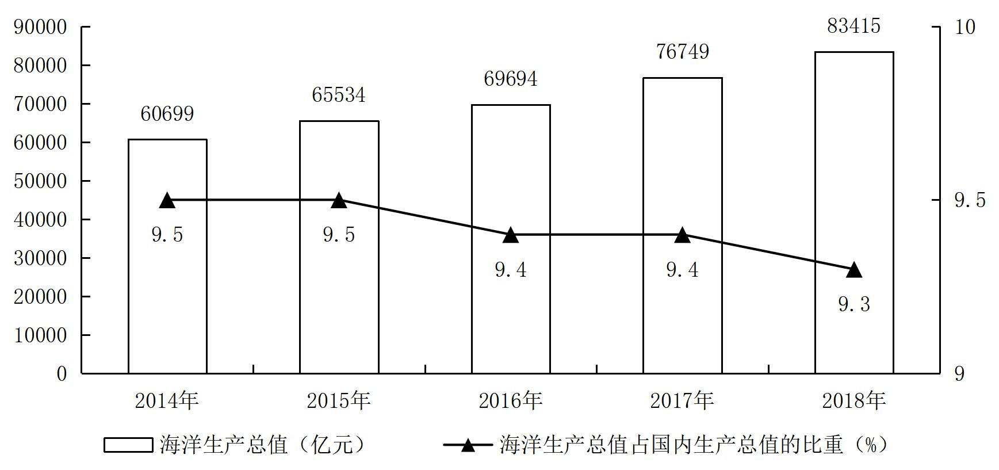

# 考点刷题2

## Question 1

```yaml
module: 资料分析
```

### Stem

2018年全球茶叶产量585.6万吨，同比增长约3%，中国茶叶产量261.6万吨，同比增长0.7万吨。2018年，中国茶叶国内销售量为191万吨，同比增长5.1%，国内销售总额为2661亿元，出口量为36.5万吨，同比增长2.8%，出口总额为17.89亿美元（合人民币120亿元）。

设中国茶叶国内销售量和出口量与当年中国茶叶产量的比值分别为x和y，则2018年的x和y值与2017年分别相比：

### Options
- A. 两者均下降
- B. 两者均上升
- C. 只有x值上升
- D. 只有y值上升

### Answer

B

## Question 2

```yaml
module: 资料分析
```

### Stem

2017年上半年，Y市文化创意产业实现增加值1734.7亿元，同比增长13.0%，占地区生产总值的14.0%；规模以上文创产业法人单位实现收入6902.7亿元，同比增长8.6%，比上年4季度和今年1季度分别提高1.3个和0.2个百分点；实现利润总额349.8亿元，同比增长30.6%。

2017年上半年Y市文化创意产业按照收入计算的利润率：

### Options
- A. 高于上年同期水平
- B. 低于上年同期水平
- C. 与上年同期水平持平
- D. 无法判断

### Answer

A

## Question 3

```yaml
module: 资料分析
```

### Stem

表2018年全国星级饭店经营状况

|  | 五星级 | 四星级 | 三星级 | 二星级 | 一星级 | 合计 | 同比（%） |
| --- | ---: | ---: | ---: | ---: | ---: | ---: | ---: |
| 营业收入总额（亿元） | 796.25 | 785.35 | 430.65 | 58.10 | 0.61 | 2090.97 | 0.36 |
| 客房收入（亿元） | 367.92 | 330.39 | 206.14 | 29.27 | 0.32 | 934.04 | −0.83 |
| 餐饮收入（亿元） | 316.81 | 317.53 | 182.93 | 19.50 | 0.23 | 837.00 | −0.38 |
| 利润总额（亿元） | 75.40 | 1.91 | −1.71 | 2.56 | 0.08 | 78.24 | 32.40 |
| 从业人员（万人） | 27.10 | 38.85 | 31.84 | 4.70 | 0.06 | 102.56 | −8.80 |
| 可供出租间夜数（万间数） | 9521.86 | 16673.14 | 17042.96 | 3412.20 | 46.36 | 46696.52 | −6.69 |
| 实际出租间夜数（万间数） | 5899.95 | 9570.64 | 8950.93 | 1786.27 | 25.12 | 26232.91 | −4.35 |
| 客房数（万间） | 26.62 | 46.79 | 53.22 | 9.79 | 0.13 | 136.55 | −7.13 |

注：客房出租率=实际出租间夜数/可供出租间夜数

平均每名从业人员服务客房数=客房数/从业人员

2018年，①全国星级客房出租率和②平均每名从业人员服务客房数两个指标的同比变化趋势为：

### Options
- A. ①同比上升，②同比下降
- B. ①同比下降，②同比上升
- C. ①和②同比均上升
- D. ①和②同比均下降

### Answer

C

## Question 4

```yaml
module: 资料分析
```

### Stem

2018年1～10月份商品房销售面积133117万平方米，同比增长2.2%，增速比1～9月份回落0.7个百分点。商品房销售额115913亿元，增长12.5%，增速回落0.8个百分点。

1～10月份，东部地区商品房销售面积53545万平方米，同比下降4.7%，降幅比1～9月份扩大0.4个百分点；销售额61680亿元，增长5.4%，增速回落0.6个百分点。中部地区商品房销售面积37733万平方米，增长8.7%，增速回落1.5个百分点；销售额25380亿元，增长21.1%，增速回落1.6个百分点。西部地区商品房销售面积35430万平方米，增长21.1%，增速回落0.3个百分点；销售额24165亿元，增长26%，增速回落0.6个百分点。东北地区商品房销售面积6409万平方米，下降4.7%，降幅扩大1.2个百分点；销售额4688亿元，增长7.2%，增速回落2.5个百分点。

在东部、中部、西部、东北四个地区中，商品房销售单价同比变化趋势与全国相同的有几项：

### Options
- A. 1
- B. 2
- C. 3
- D. 4

### Answer

D

## Question 5

```yaml
module: 资料分析
```

### Stem

2019年，共有29个省（自治区，直辖市）的94家处理企业实际开展了废弃电子电器产品拆解处理活动，共拆解处理废弃电子电器产品8417.0万台（套），同比增长3.9%，拆解量最大的五个省份依次为浙江、河南、四川、安徽、河北，占拆解处理总量的38.2%。

表2019年度废电器处理企业实际拆解处理废电器情况

| 类型 | 拆解量万台（套） | 占比 | 占比同比增长（%） |
| --- | ---: | ---: | ---: |
| 废电视机 | 4355.2 | 51.7 | −0.8 |
| 废电冰箱 | 1084.5 | 12.9 | 1.5 |
| 废洗衣机 | 1582 | 18.8 | 1 |
| 废房间空调器 | 624.9 | 7.4 | 1.2 |
| 废微型计算机 | 770.4 | 9.2 | −2.9 |

2019年，五大类废电子电器产品实际拆解量同比增长超过3.9%的有几项：

### Options
- A. 2
- B. 3
- C. 4
- D. 5

### Answer

B

## Question 6

```yaml
module: 资料分析
```

### Stem

2022年，风电、光伏年发电量首次突破1万亿千瓦时，达到1.19万亿千瓦时，较2021年增加2073亿千瓦时，同比增长21%，占全社会用电量的13.8%，同比提高2个百分点，接近全国城乡居民用电量。2022年，可再生能源发电量达到2.72万亿千瓦时，占全社会用电量的比重为31.6%，较2021年提高1.7个百分点，可再生能源在保障能源供应方面发挥的作用越来越明显。

关于2022年①风电、光伏年发电量同比增速、②可再生能源发电量同比增速与全社会用电量同比增速的大小关系，以下正确的是：

### Options
- A. ①高于全社会用电量；②低于全社会用电量
- B. ①低于全社会用电量；②高于全社会用电量
- C. 均高于全社会用电量
- D. 均低于全社会用电量

### Answer

C

## Question 7

```yaml
module: 资料分析
```

### Stem

2024年邮政行业业务收入（不包括邮政储蓄银行直接营业收入）完成1.7万亿元，同比增长10.7%。其中：快递业务收入完成1.4万亿元，同比增长13.8%（按可比口径计算，下同）。快递业务收入占行业总收入的比重为82.9％，比上年提高了2.3个百分点。

2024年邮政行业寄递业务量完成1936.8亿件，同比增长19.2%。其中，快递业务量完成1750.8亿件，同比增长21.5%。

按区域划分，东、中、西部地区快递业务收入比重分别为74.8%、14.9%和10.3%，快递业务量比重分别为72.4%、18.7%和8.9%。东部地区完成快递业务收入10502.9亿元，同比增长12.2%；完成快递业务量1267.1亿件，同比增长18.1%。中部地区完成快递业务收入2092.8亿元，同比增长18.2%；完成快递业务量328.0亿件，同比增长30.0%。西部地区完成快递业务收入1437.9亿元，同比增长19.5%；完成快递业务量155.8亿件，同比增长34.4%。

2023年，东、中、西部地区快递业务收入比重分别为：

### Options
- A. 75.9%，14.3%，9.8%
- B. 74.8%，14.9%，10.3%
- C. 73.7%，15.5%，10.8%
- D. 无法判断

### Answer

A

## Question 8

```yaml
module: 资料分析
```

### Stem

2018年前三季度，S省社会物流总额35357.26亿元，同比增长6.4%，增速比上半年放缓0.7个百分点。其中，工业品物流总额16636.15亿元，同比增长0.2%，增速比上半年放缓2.1个百分点；外部流入（含进口）货物物流总额17357.31亿元，同比增长12.1%，增速比上半年加快0.8个百分点；农产品物流总额875.06亿元，同比增长11.6%，增速比上半年加快0.5个百分点；单位与居民物品物流总额457.86亿元，同比增长40.7%，增速比上半年放缓3个百分点；再生资源物流总额30.88亿元，同比下降7.0%，降幅比上半年扩大4.3个百分点。

在工业品物流、外部流入（含进口）货物物流、农产品物流、单位与居民物品物流和再生资源物流中，2018年上半年物流总额占社会物流总额的比重高于上年同期水平的有几项：

### Options
- A. 4
- B. 3
- C. 2
- D. 1

### Answer

B

## Question 9

```yaml
module: 资料分析
```

### Stem

2024年G省地区生产总值32612.7亿元，比上年增长5.1%。其中，第一产业增加值2565.7亿元，比上年增长4.2%；第二产业增加值11503.3亿元，增长5.3%；第三产业增加值18543.7亿元，增长5.0%。2024年三大产业增加值占GDP比重分别约为7.86%、35.27%和56.87%。

2023年，G省三大产业增加值占GDP比重约为：

### Options
- A. 7.93%、35.20%、56.92%
- B. 7.91%、36.17%、55.92%
- C. 7.79%、35.89%、56.32%
- D. 无法判断

### Answer

A

## Question 10

```yaml
module: 资料分析
```

### Stem

2016年，某省完成邮政通信业务总量6886.15亿元，同比增长56.6%，增幅比上年提高27.4个百分点。其中，完成邮政业务总量1879.99亿元，增长53.0%，增幅提高11.0个百分点；完成通信业务总量5006.16亿元，增长58.0%，增幅提高33.2个百分点。

2016年，该省完成快递业务量76.72亿件，同比增长53.0%，占全国快递业务量的比重达到24.5%，比排名第二的Z省多16.80亿件。

2016年该省完成的通信业务总量占邮政通信业务总量的比重相比2014年大约：

### Options
- A. 提高了0.6个百分点
- B. 降低了0.6个百分点
- C. 提高了1.9个百分点
- D. 降低了1.9个百分点

### Answer

D

## Question 11

```yaml
module: 资料分析
```

### Stem

2016年，广东民营经济增加值突破四万亿元。经初步核算，全年实现民营经济增加值42578.76亿元，按可比价计算，比上年同期增长7.8%，增幅高于同期GDP增幅0.3个百分点，其中第二产业增幅比同期GDP第二产业增幅高3个百分点。民营经济占GDP的比重为53.6%，比2010年提高3.9个百分点，占比逐年提高；对GDP增长的贡献率为55.5%，同比提高1.3个百分点，拉动GDP增速达4.2个百分点，民营经济的作用不断提升，是广东经济增长的主力军。

表2016年广东民营经济各产业增加值

| 类型 | 增加值（亿元） | 增速（%） |
| --- | ---: | ---: |
| 第一产业 | 3631.01 | 3.0 |
| 第二产业 | 17306.17 | 9.2 |
| 第三产业 | 21641.58 | 7.6 |

2016年广东民营经济中第三产业所占的比重相比2015年大约：

### Options
- A. 提高了0.1个百分点
- B. 降低了0.1个百分点
- C. 提高了0.2个百分点
- D. 降低了0.2个百分点

### Answer

B

## Question 12

```yaml
module: 资料分析
```

### Stem

2016年，J省规模以上工业取水量为86.4亿立方米，比上年增长4.4%。其中，直接采自江、河、淡水湖、水库等的地表淡水68.1亿立方米，比上年增长3.8%，所占比重比上年下降0.4个百分点；自来水取水量15.9亿立方米，同比增长6.0%。

J省2016年规模以上工业自来水取水量占总取水量的比重比上年：

### Options
- A. 提高0.3个百分点
- B. 下降0.3个百分点
- C. 提高4个百分点
- D. 下降4个百分点

### Answer

A

## Question 13

```yaml
module: 资料分析
```

### Stem

2023年，全国软件和信息技术服务业规模以上企业超3.8万家，累计完成软件业务收入123258亿元，同比增长13.4%，较上年同期增长2.2个百分点。

四个领域分别由软件产品、信息技术服务、信息安全产品和服务、嵌入式系统软件组成。软件产品实现收入29030亿元，同比增长11.1%，较上年同期增长1.2个百分点。其中，工业软件产品实现收入2824亿元，同比增长12.3%。

2023年软件产品实现收入占软件业务收入的比重比2021年：

### Options
- A. 上升不到0.1个百分点
- B. 上升0.1个百分点以上
- C. 下降不到0.1个百分点
- D. 下降0.1个百分点以上

### Answer

D

## Question 14

```yaml
module: 资料分析
```

### Stem

2023年三季度，支付系统共处理支付业务3358.88亿笔，金额3151.37万亿元，同比分别增长12.59%和6.97%。

三季度，人民银行清算总中心系统共处理支付业务54.79亿笔，金额2379.52万亿元，同比分别增长0.92%和9.53%，其中，大额实时支付系统处理业务9518.17万笔，同比下降10.39%，金额2254.07万亿元，同比增长9.72%；小额批量支付系统处理业务11.51亿笔，金额46.69万亿元，同比分别增长5.73%和10.03%；网上支付跨行清算系统处理业务42.31亿笔，同比下降0.03%，金额74.66万亿元，同比增长5.38%；境内外币支付系统处理业务134.46万笔，同比增长2.83%，金额5707.35亿美元，同比下降14.63%。

2023年三季度，人民银行清算总中心系统处理支付业务中，大额实时支付系统处理业务笔数的占比同比：

### Options
- A. 下降了1个百分点以上
- B. 下降了不到1个百分点
- C. 上升了1个百分点以上
- D. 上升了不到1个百分点

### Answer

B

## Question 15

```yaml
module: 资料分析
```

### Stem

2017年1～2月累计，全国一般公共预算收入31454亿元，比去年同期增加4069亿元；1～2月累计，全国一般公共预算支出24860亿元，比去年同期增加3689亿元。

在支出中，中央一般公共预算本级支出3403亿元，同比增长8.1%；地方一般公共预算支出21457亿元，同比增长19.1%。

与上年同期相比，2017年1～2月累计，中央一般公共预算本级支出占全国一般公共预算支出的比重约：

### Options
- A. 提高12个百分点
- B. 降低12个百分点
- C. 降低1.2个百分点
- D. 提高1.2个百分点

### Answer

C

## Question 16

```yaml
module: 资料分析
```

### Stem

表社会消费品零售总额中限上企业（2024年5月）

| 指标名称 | 本月 | 本月±% | 本月止累计 | 累计±% |
| --- | ---: | ---: | ---: | ---: |
| 消费品零售额（亿元） | 803.0 | 2.0 | 4087.0 | 47.0 |
| 一、餐饮收入 | 72.4 | 8.8 | 379.2 | 12.2 |
| 其中：通过互联网实现的餐饮收入 | 5.4 | 101.8 | 25.2 | 94.4 |
| 二、商品零售 | 730.6 | 1.4 | 3707.8 | 4.0 |
| 其中：通过互联网实现的商品零售额 | 148.2 | 8.8 | 669.3 | 4.9 |
| （一）粮油、食品、饮料、烟酒类 | 139.3 | 11.5 | 745.4 | 14.8 |
| （二）服装、鞋帽、针纺织品类 | 46.1 | −3.8 | 242.7 | −1.7 |
| （三）化妆品类 | 11.1 | 3.1 | 53.1 | 1.8 |
| （四）金银珠宝类 | 48.0 | −14.8 | 30.4 | 2.8 |
| （五）日用品类 | 31.3 | 13.1 | 160.7 | 8.8 |
| （六）体育、娱乐用品类 | 7.7 | 47.3 | 28.4 | 12.8 |
| （七）书报杂志类 | 13.6 | −4.7 | 53.2 | 1.9 |
| （八）家用电器和音像器材类 | 46.8 | 9.1 | 214.8 | 0.0 |
| （九）中西药品类 | 36.8 | 14.1 | 179.2 | 12.7 |
| （十）文化办公用品类 | 11.8 | 12.3 | 62.5 | 22.0 |
| （十一）家具类 | 9.7 | 24.8 | 45.1 | 1.9 |
| （十二）通讯器材类 | 27.8 | 25.3 | 96.9 | −12.2 |
| （十三）石油及制品类 | 121.0 | −0.4 | 630.0 | 0.8 |
| （十四）建筑及装潢材料类 | 8.0 | 9.6 | 43.5 | 12.5 |
| （十五）汽车类 | 198.1 | −11.6 | 1035.1 | 0.0 |
| （十六）其他类 | 16.8 | 4.3 | 86.8 | 3.8 |

注：表中增长率均为环比增长率

问题日：2024年5月，汽车类商品零售额在商品零售额中的占比较4月：

### Options
- A. 上升了4个百分点
- B. 上升了2个百分点
- C. 下降了4个百分点
- D. 下降了2个百分点

### Answer

C

## Question 17

```yaml
module: 资料分析
```

### Stem

表2024年全国规模以上文化及相关产业企业相关指标情况

|  | 绝对值（亿元） | 比上年增长（%） |
| --- | ---: | ---: |
| 一、营业收入 | 141510 | 6.0 |
| 其中,文化新业态 | 59082 | 9.8 |
| 按产业类型分 |  |  |
| 文化制造业 | 42191 | 4.5 |
| 文化批发和零售业 | 23300 | 3.5 |
| 文化服务业 | 76019 | 7.7 |
| 按领域分 |  |  |
| 文化核心领域 | 92645 | 6.3 |
| 文化相关领域 | 48865 | 5.5 |

2024年，文化相关领域占全国规模以上文化及相关产业企业总营业收入比重较上年约：

### Options
- A. 上升了0.2个百分点
- B. 下降了0.2个百分点
- C. 上升了0.5个百分点
- D. 下降了0.5个百分点

### Answer

B

## Question 18

```yaml
module: 资料分析
```

### Stem

2017年上半年，Y市文化创意产业实现增加值1734.7亿元，同比增长13.0%，占地区生产总值的14.0%；规模以上文创产业法人单位实现收入6902.7亿元，同比增长8.6%，比上年4季度和今年1季度分别提高1.3个和0.2个百分点；实现利润总额349.8亿元，同比增长30.6%。

2017年上半年，Y市地区生产总值同比增长6.8%。该市文化创意产业增加值占地区生产总值比重比上年提高了约多少个百分点：

### Options
- A. 0.2
- B. 0.8
- C. 2.5
- D. 6.2

### Answer

B

## Question 19

```yaml
module: 资料分析
```

### Stem

表2014年全省各种运输方式完成运输量

|  | 货物周转量绝对量（亿吨公里） | 货物周转量同比增长（%） | 货运量绝对量（亿吨） | 货运量同比增长（%） | 旅客周转量绝对量（亿人公里） | 旅客周转量同比增长（%） | 客运量绝对量（万人） | 客运量同比增长（%） |
| --- | --- | --- | ---: | ---: | --- | --- | ---: | ---: |
| 铁路 | 2446.8 | −3.7 | 78000 | 3.7 | 201.9 | 15 | 4796.5 | 8.2 |
| 公路 | 2103.5 | 12.3 | 127000 | 30.5 | 161.4 | −7 | 13495 | −16.6 |
| 民航 | -- | -- | 7.6 | 7.9 | -- | -- | 1491.6 | 6.8 |
| 总计 | 4550.3 | 3.1 | 204000 | 18.9 | 363.3 | 4 | 19783.1 | −10.1 |

2014年铁路旅客平均每人次周转距离比2013年多约多少公里：

### Options
- A. 15
- B. 25
- C. 34
- D. 44

### Answer

B

## Question 20

```yaml
module: 资料分析
```

### Stem

2010年高等学校投入R&D课题的人员为28.9万人，R&D课题经费为467.0亿元，分别比2009年增长5.2%和28.5%。从学科分布来看，自然科学项目经费78.0亿元；农业科学项目36.7亿元；医药科学项目49.9亿元；工程科学与技术项目273.6亿元；人文与社会科学项目28.6亿元。

R&D课题人员2010年人均经费比2009年人均经费增加多少万元：

### Options
- A. 3.2
- B. 2.9
- C. 2.6
- D. 2.3

### Answer

B

## Question 21

```yaml
module: 资料分析
```

### Stem

2019年全国房地产开发投资132194亿元，比上年增长9.9%，增速比上年加快0.4个百分点。其中，住宅投资97071亿元，增长13.9%，增速比上年加快0.5个百分点。2019年，全国商品房销售面积171558万平方米，比上年下降0.1%。其中，住宅销售面积增长1.5%，办公楼销售面积下降14.7%，商业营业用房销售面积下降15%。商品房销售额159725亿元，增长6.5%，增速比上年回落5.7个百分点。

与2018年相比，2019年全国商品房销售均价约：

### Options
- A. 增长580元
- B. 增长710元
- C. 下降580元
- D. 下降710元

### Answer

A

## Question 22

```yaml
module: 资料分析
```

### Stem

2023年三季度，支付系统共处理支付业务3358.88亿笔，金额3151.37万亿元，同比分别增长12.59%和6.97%。

三季度，人民银行清算总中心系统共处理支付业务54.79亿笔，金额2379.52万亿元，同比分别增长0.92%和9.53%，其中，大额实时支付系统处理业务9518.17万笔，同比下降10.39%，金额2254.07万亿元，同比增长9.72%；小额批量支付系统处理业务11.51亿笔，金额46.69万亿元，同比分别增长5.73%和10.03%；网上支付跨行清算系统处理业务42.31亿笔，同比下降0.03%，金额74.66万亿元，同比增长5.38%；境内外币支付系统处理业务134.46万笔，同比增长2.83%，金额5707.35亿美元，同比下降14.63%。

2023年三季度，人民银行清算总中心系统中网上支付跨行清算系统平均每笔支付业务金额比上年同期：

### Options
- A. 下降了不到1000元
- B. 下降了1000元以上
- C. 上升了不到1000元
- D. 上升了1000元以上

### Answer

C

## Question 23

```yaml
module: 资料分析
```

### Stem

我国北方某地区2017年农业发展统计数据：

全年全区粮食种植面积3433万亩，比上年下降5%。其中，小麦种植面积1792万亩，下降7.3%；玉米种植面积1369万亩，下降0.6%。棉花种植面积3326万亩，增长2.9%。油料种植面积361万亩，增长0.1%。甜菜种植面积95万亩，下降5%。

全年粮食产量1448万吨，比上年减产4.3%。夏粮产量652万吨，减产10.4%，其中，小麦产量650万吨，减产10.1%。秋粮产量796万吨，增产1.4%，其中，玉米产量692万吨，增产4.2%。全年棉花产量457万吨，增产8.7%。油料产量71万吨，减产0.3%。甜菜产量475万吨，减产5.0%。

2017年棉花每亩产量相比于上年：

### Options
- A. 下降了10千克以上
- B. 上升了10千克以上
- C. 下降了不到10千克
- D. 上升了不到10千克

### Answer

D

## Question 24

```yaml
module: 资料分析
```

### Stem

表2018年第一季度我国水产品一般贸易主要出口品种

| 出口品种 | 数量及数量（万吨） | 数量及出口额（亿美元） | 同比增速（%）数量 | 同比增速（%）出口额 |
| --- | ---: | ---: | ---: | ---: |
| 头足类 | 13.06 | 8.79 | 21.99 | 24.24 |
| 对虾 | 3.01 | 3.81 | 0.37 | 4.24 |
| 贝类 | 5.74 | 2.77 | −14.61 | −2.45 |
| 罗非鱼 | 8.19 | 2.47 | 1.31 | −1.64 |
| 鳗鱼 | 1.05 | 2.46 | 14.40 | 26.05 |
| 蟹类 | 1.44 | 2.02 | 3.00 | 6.75 |
| 鲭鱼 | 8.67 | 1.70 | −30.71 | −25.02 |
| 大黄鱼 | 1.11 | 0.75 | 71.75 | 60.88 |
| 藻类 | 1.35 | 0.98 | 3.92 | 10.25 |
| 淡水小龙虾 | 0.02 | 0.03 | −88.60 | −88.56 |

2018年第一季度，下列产品平均单价同比下降最多的是：

### Options
- A. 鲭鱼
- B. 罗非鱼
- C. 大黄鱼
- D. 淡水小龙虾

### Answer

C

## Question 25

```yaml
module: 资料分析
```

### Stem

2023年国内出游48.9亿人次，比上年增长93.3%。其中，城镇居民国内出游37.6亿人次，增长94.9%；农村居民国内出游11.3亿人次，增长88.5%。国内出游总花费49133亿元，增长140.3%。其中，城镇居民出游花费41780亿元，增长147.5%；农村居民出游花费7353亿元，增长106.4%。

2023年国内出游平均每人次花费比上年增加：

### Options
- A. 197元
- B. 237元
- C. 276元
- D. 308元

### Answer

A

## Question 26

```yaml
module: 资料分析
```

### Stem

2017年，A省完成客运总量148339万人次，同比增长5.4%，增幅比前三季度提高0.2个百分点，比上年提高0.5个百分点；完成旅客周转总量4143.84亿人公里，增长7.7%，增幅比前三季度提高0.7个百分点，比上年提高1.8个百分点。

2017年前三季度，A省平均每人次客运旅客运输距离（旅客周转量÷客运总量）同比：

### Options
- A. 下降了不到10公里
- B. 上升了不到10公里
- C. 下降了10公里以上
- D. 上升了10公里以上

### Answer

B

## Question 27

```yaml
module: 资料分析
```

### Stem

根据下列统计材料回答问题

2014年某区限额以上第三产业单位共674家，实际收入1059.1亿元，同比增长4.5%；实现利润总额13.5亿元，同比增长11.9%；从业人员达到58631人，同比下降4.3%。

2014年该区限额以上第三产业单位平均每名从业人员创造的利润比上年约：

### Options
- A. 下降了7%
- B. 下降了17%
- C. 上升了7%
- D. 上升了17%

### Answer

D

## Question 28

```yaml
module: 资料分析
```

### Stem

根据下列统计材料回答问题

2016年全国餐饮收入35799亿元，同比增长10.8%，餐饮收入占社会消费品零售总额的比重为10.8%。2016年全社会餐饮业经营单位为365.5万个，同比下降8.2%；从业人数为1846.0万人，同比增长5.7%。

2016年全社会餐饮业平均每个经营单位的从业人数比上年约：

### Options
- A. 减少了2%
- B. 减少了15%
- C. 增加了2%
- D. 增加了15%

### Answer

D

## Question 29

```yaml
module: 资料分析
```

### Stem

2016年全国粮食情况如下：

全国粮食总产量61623.9万吨（12324.8亿斤），比2015年减少520.1万吨（104.0亿斤），减少0.8%。其中谷物产量56516.5万吨（11303.3亿斤），比2015年减少711.5万吨（142.3亿斤），减少1.2%。

全国粮食播种面积113028.2千公顷（169542.3万亩），比2015年减少314.7千公顷（472.1万亩），减少0.3%。其中谷物播种面积94370.8千公顷（141556.2万亩），比2015年减少1265.1千公顷（1897.7万亩），减少1.3%。

2016年我国粮食单位面积产量约同比：

### Options
- A. 增长0.56%
- B. 增长1.12%
- C. 减少0.56%
- D. 减少1.12%

### Answer

C

## Question 30

```yaml
module: 资料分析
```

### Stem

据统计数据显示，2018年上半年，全国快递服务企业业务量累计完成220.8亿件，同比增长27.5%；业务收入累计完成2745亿元，同比增长25.8%。其中，同城业务量累计完成50.9亿件，同比增长26.2%；异地业务量累计完成164.7亿件，同比增长27.5%；国际/港澳台业务量累计完成5.2亿件，同比增长43.1%。国际/港澳台快递业务量占全部快递业务量的2.4%，业务收入占全部快递收入的10.5%。

与上年同期相比，2018年上半年全国快递企业每件业务获得的收入约：

### Options
- A. 上升了1.5%
- B. 下降了1.5%
- C. 上升了1.3%
- D. 下降了1.3%

### Answer

D

## Question 31

```yaml
module: 资料分析
```

### Stem

2017年，全省农业产业化龙头经营组织固定资产净值达到1502.0亿元，比上年增长13.8%；共实现销售收入4299.4亿元，增长7.0%；共实现利润489.0亿元，比上年增长5.0%；上交税金98.1亿元，增长8.5%；从业人员53.5万人，增长0.3%；带动农户1821.9万户，增长10.1%。

2017年，B省农业产业化龙头经营组织平均每名从业人员创造的利润约比上年同期增长了：

### Options
- A. 4.7%
- B. 9.2%
- C. 13.5%
- D. 15.1%

### Answer

A

## Question 32

```yaml
module: 资料分析
```

### Stem

2013年，全省能源消费总量比上年增加390.75万吨标煤，同比增长5.70%，比上年低2.17个百分点。

2013年，全省万元生产总值能耗1.281吨标煤/万元，较上年下降4.56%。规模以上工业万元增加值能耗2.40吨标煤/万元，较上年下降7.25%。

2013年该省生产总值约比去年增加了：

### Options
- A. 5%
- B. 8%
- C. 11%
- D. 15%

### Answer

C

## Question 33

```yaml
module: 资料分析
```

### Stem

截至2022年底，全国共有278家银行机构和29家理财公司有存续的理财产品，共存续产品3.47万只，同比下降4.41%；存续规模27.65万亿元，同比下降4.66%。分机构类型来看，理财公司存续产品13947只，存续规模22.24万亿元，同比增长29.36%。银行机构中，城商行存续产品9064只，存续规模2.45万亿元，同比下降32.34%；农村金融机构存续产品7808只，存续规模1.09万亿元，同比下降2.63%；股份制银行存续产品1208只，存续规模0.88万亿元，同比下降82.99%；大型银行存续产品668只，存续规模0.92万亿元，同比下降49.26%；其他机构存续产品1980只，存续规模0.07万亿元，同比下降13.42%

以存续规模计算市场份额，2022年理财公司存续理财产品的市场份额是2021年理财公司的多少倍：

### Options
- A. 0.45
- B. 0.78
- C. 1.36
- D. 1.56

### Answer

C

## Question 34

```yaml
module: 资料分析
```

### Stem

2023年三季度，支付系统共处理支付业务3358.88亿笔，金额3151.37万亿元，同比分别增长12.59%和6.97%。

三季度，人民银行清算总中心系统共处理支付业务54.79亿笔，金额2379.52万亿元，同比分别增长0.92%和9.53%，其中，大额实时支付系统处理业务9518.17万笔，同比下降10.39%，金额2254.07万亿元，同比增长9.72%；小额批量支付系统处理业务11.51亿笔，金额46.69万亿元，同比分别增长5.73%和10.03%；网上支付跨行清算系统处理业务42.31亿笔，同比下降0.03%，金额74.66万亿元，同比增长5.38%；境内外币支付系统处理业务134.46万笔，同比增长2.83%，金额5707.35亿美元，同比下降14.63%。

将人民银行清算总中心系统中①大额实时支付系统、②小额批量支付系统、③网上支付跨行清算系统和④境内外币支付系统按2023年三季度平均每笔业务金额同比增速从低到高排列，以下正确的是：

### Options
- A. ①②③④
- B. ①③②④
- C. ④③②①
- D. ④②③①

### Answer

D

## Question 35

```yaml
module: 资料分析
```

### Stem

近年来，我国海洋经济呈现总体平稳的发展态势，总量再上新台阶，产业结构不断优化，新兴产业和新业态快速成长。2018年，我国海洋生产总值实现产值83415亿元，比上年增长8.7%。



图2014～2018年全国海洋生产总值情况

2018年，我国国内生产总值同比增长：

### Options
- A. 7.8%
- B. 8.7%
- C. 9.9%
- D. 10.4%

### Answer

C
