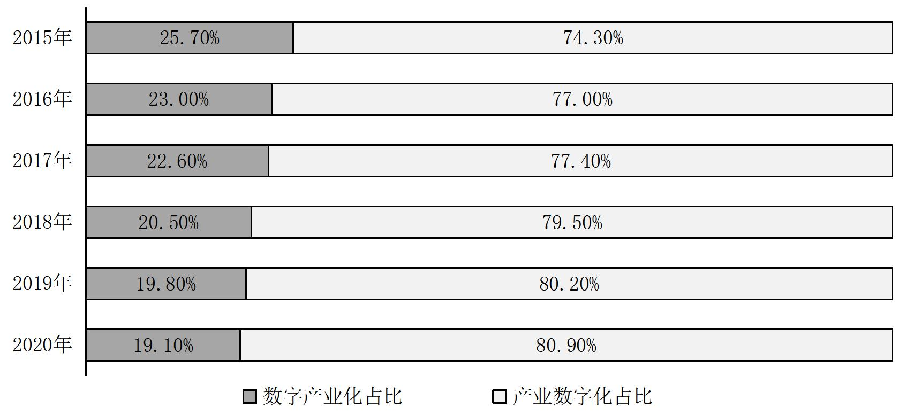
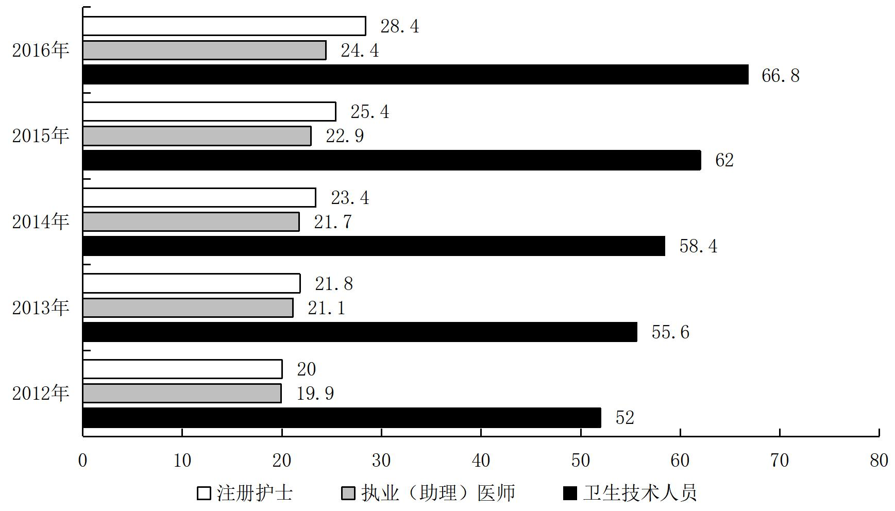
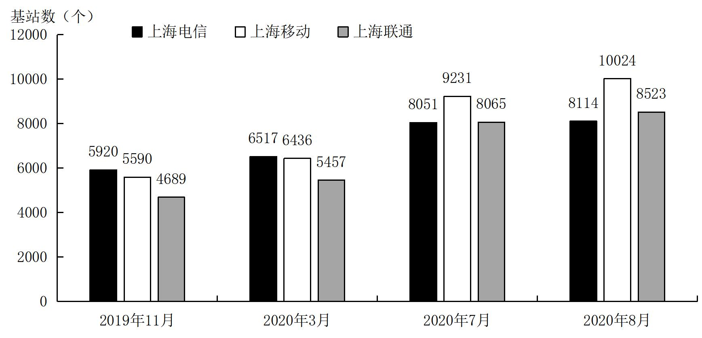
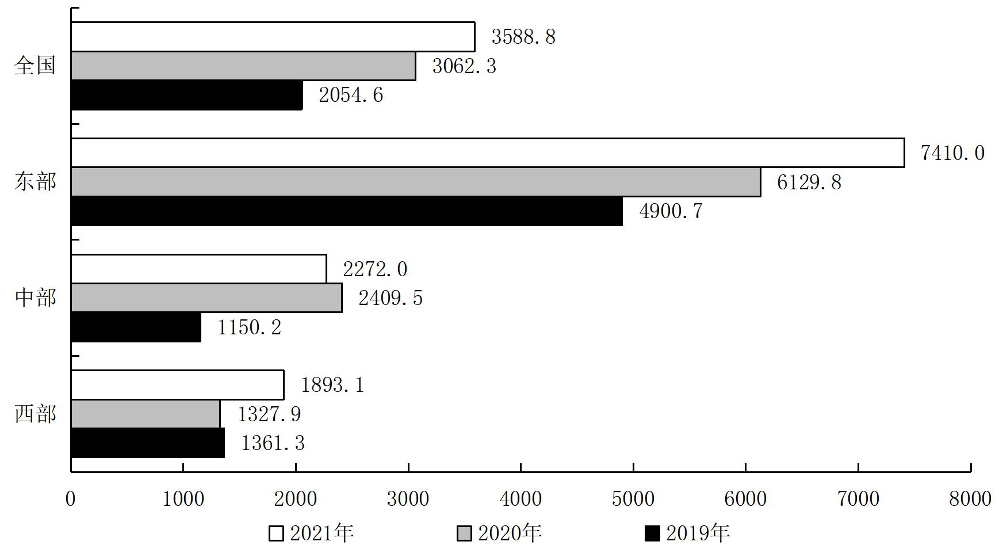
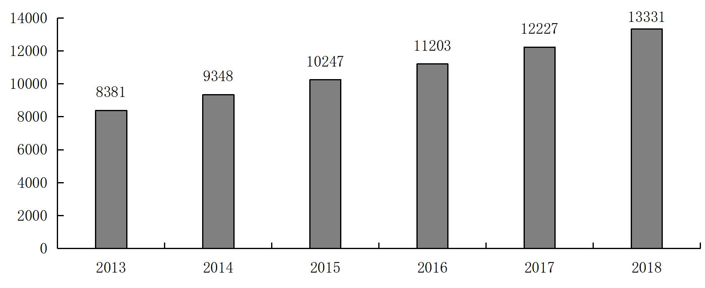
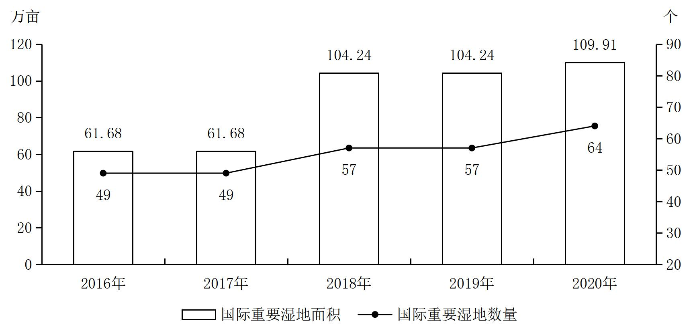
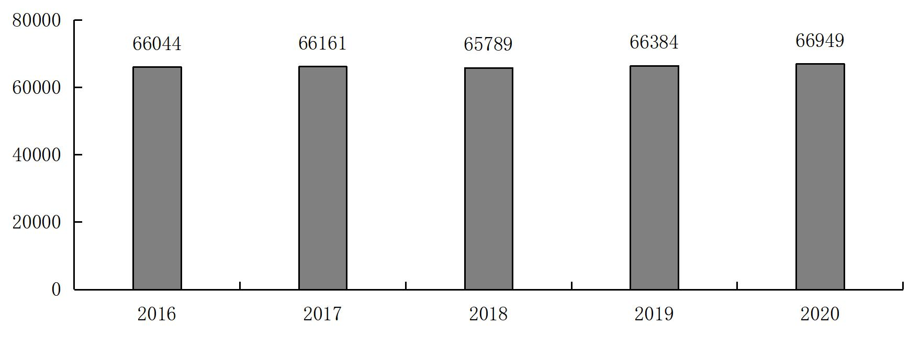
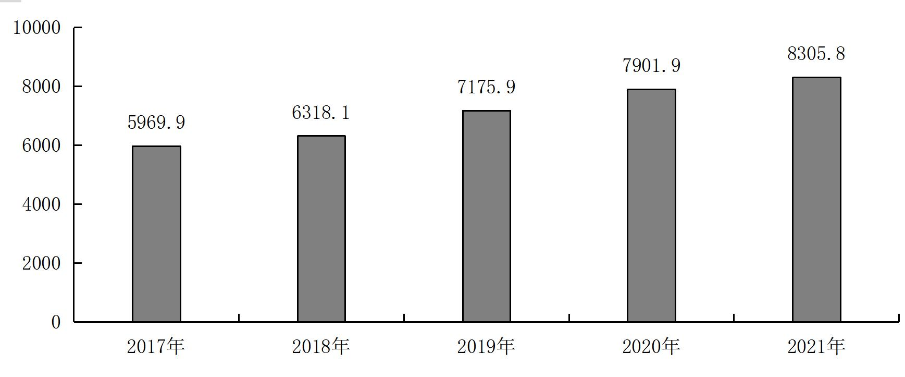
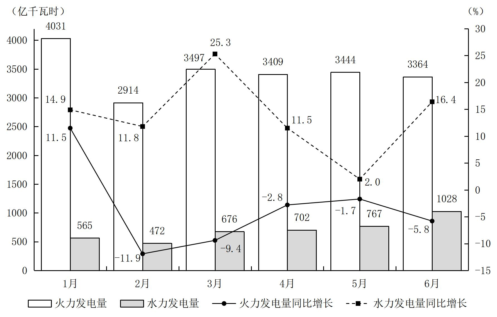

<!-- hyz-paper-id: 01a1e4f7-7c15-7dd2-8506-3798b3019153 -->

# 考点刷题3

## Question 1

<!-- hyz-question-id: 01a1e4f7-7c15-7dd2-8506-37a5a0426f15 -->

```yaml
module: 资料分析
```

### Stem

根据中国汽车工业协会统计，2023年我国新能源汽车保持快速增长，产销量再创历史新高。新能源汽车产销分别完成958.7万辆和949.5万辆，同比分别增长35.8%和37.9%，市场占有率达到31.6%。

表2023年全年新能源汽车销售表

| 月份 | 国内（万辆） | 同比增长（%） | 出口（万辆） | 同比增长（%） |
| --- | ---: | ---: | ---: | ---: |
| 1～12 | 829.2 | 33.5 | 120.3 | 77.6 |

2022年我国新能源汽车国内销量是出口销量的约多少倍：

### Options
- A. 7
- B. 8
- C. 9
- D. 10

### Answer

C

## Question 2

<!-- hyz-question-id: 01a1e4f7-7c15-7dd2-8506-37b159882dcc -->

```yaml
module: 资料分析
```

### Stem

2017年，S市服务业小微样本企业总体营业税金及附加为1.09亿元，同比下降29.5%；缴纳增值税2.30亿元，同比增长11.6%，户均缴纳增值税11.16万元。

2016年，S市服务业小微样本企业缴纳增值税是营业税金及附加的多少倍：

### Options
- A. 不到2倍
- B. 2～3倍
- C. 3～4倍
- D. 4～5倍

### Answer

A

## Question 3

<!-- hyz-question-id: 01a1e4f7-7c15-7dd2-8506-37cec9a75fb4 -->

```yaml
module: 资料分析
```

### Stem

截至2019年3月31日，证券业协会对证券公司2019年第一季度经营数据进行了统计，131家证券公司当期实现营业收入1018.94亿元，同比增长54.47%。

其中，各主营业务收入分别为代理买卖证券业务净收入（含席位租赁）221.49亿元，同比增长13.77%；证券承销与保荐业务净收入66.73亿元，同比增长19.5%；财务顾问业务净收入20.95亿元，同比增长15.17%；投资咨询业务净收入7.15亿元，同比增长5.15%；资产管理业务净收入57.33亿元，同比下降15.43%；证券投资收益（含公允价值变动）514.05亿元，同比增长215.17%；利息净收入69.04亿元，同比增长4.94%；当期实现净利润440.16亿元，同比增长86.83%；119家公司实现盈利，同比增长10.19%。

2018年第一季度，131家证券公司营业收入利润率（净利润/营业收入）约为：

### Options
- A. 35.7%
- B. 39.7%
- C. 43.2%
- D. 45.2%

### Answer

A

## Question 4

<!-- hyz-question-id: 01a1e4f7-7c15-7dd2-8506-37d87e931581 -->

```yaml
module: 资料分析
```

### Stem

2017年1～12月，全国内燃机累计销量5645.38万台，同比增长4.11%，累计完成功率266879.47万千瓦，同比增长9.15%，其中柴油内燃机功率同比增长34%。

2016年，我国销售的内燃机平均功率约为：

### Options
- A. 35千瓦
- B. 45千瓦
- C. 55千瓦
- D. 65千瓦

### Answer

B

## Question 5

<!-- hyz-question-id: 01a1e4f7-7c15-7dd2-8506-37ef5aa0e247 -->

```yaml
module: 资料分析
```

### Stem

2015年全年各类自然灾害造成直接经济损失5340亿元，比上年增加1.1倍，占国内生产总值的1.31%。全年农作物受灾面积3743万公顷，减少20.7%。其中，绝收486万公顷，减少1.1%。全年因洪涝、滑坡和泥石流灾害造成直接经济损失3505亿元，增加4.4倍；死亡3101人。全年因旱灾造成直接经济损失757亿元，下降31.2%。全年因低温冷冻和雪灾造成直接经济损失318亿元，死亡51人。全年因海洋灾害造成直接经济损失149.4亿元，增加49.1%。全年累计发生赤潮面积10892平方公里，减少22.8%。全年大陆地区共发生5级以上地震17次，成灾10次，造成直接经济损失235.7亿元，死亡2705人。全年共发生森林火灾7723起，下降12.8%。

2014年全年因旱灾造成直接经济损失是该年度因海洋灾害造成直接经济损失的多少倍：

### Options
- A. 0.8
- B. 5.0
- C. 7.3
- D. 11.0

### Answer

D

## Question 6

<!-- hyz-question-id: 01a1e4f7-7c15-7dd2-8506-37f16d1e2a3d -->

```yaml
module: 资料分析
```

### Stem

2018年安徽省蔬菜播种面积122.0万公顷，比上年增长1.4%；总产量7902.1万吨，增长2.7%。其中设施蔬菜播种面积38.4万公顷，增长14.2%；产量2584.6万吨，增长15.3%。

2017年安徽省设施蔬菜单位面积产量为：

### Options
- A. 66.7吨/公顷
- B. 68.9吨/公顷
- C. 73.4吨/公顷
- D. 74.6吨/公顷

### Answer

A

## Question 7

<!-- hyz-question-id: 01a1e4f7-7c15-7dd2-8506-3806bac19622 -->

```yaml
module: 资料分析
```

### Stem

表2020年全国规模以上文化及相关产业企业营业收入情况

| 绝对额（亿元） | 绝对额（亿元） | 比上年增长（%）全年 | 比上年增长（%）前三季度 | 所占比重（%） |
| --- | ---: | ---: | ---: | ---: |
| 总计 | 98514 | 2.2 | −0.6 | 100.0 |
| 按行业类别分 |  |  |  |  |
| 新闻信息服务 | 9382 | 18.0 | 17.0 | 9.5 |
| 内容创作生产 | 23275 | 4.7 | 4.1 | 23.6 |
| 创意设计服务 | 15645 | 11.1 | 9.0 | 15.9 |
| 文化传播渠道 | 10428 | −11.8 | −16.5 | 10.6 |
| 文化投资运营 | 451 | 2.8 | 0.2 | 0.5 |
| 文化娱乐休闲服务 | 1115 | −30.2 | −39.9 | 1.1 |
| 文化辅助生产和中介服务 | 13519 | −6.9 | −9.5 | 13.7 |
| 文化装备生产 | 5893 | 1.1 | −3.4 | 6.0 |
| 文化消费终端生产 | 18808 | 5.1 | 0.8 | 19.1 |
| 按产业类型分 |  |  |  |  |
| 文化制造业 | 37378 | −0.9 | −3.8 | 37.9 |
| 文化批发和零售业 | 15173 | −1.5 | −10.0 | 15.4 |
| 文化服务业 | 45964 | 7.5 | 6.0 | 46.7 |
| 按领域分 |  |  |  |  |
| 文化核心领域 | 60295 | 3.8 | 1.5 | 61.2 |
| 文化相关领域 | 38220 | −0.1 | −3.8 | 38.8 |
| 按区域分 |  |  |  |  |
| 东部地区 | 73943 | 2.3 | −0.4 | 75.1 |
| 中部地区 | 14656 | 1.4 | −1.5 | 14.9 |
| 西部地区 | 9044 | 4.1 | 0.9 | 9.2 |
| 东北地区 | 872 | −8.6 | −15.9 | 0.9 |

注：1.表中增速均为未扣除价格因素的名义增速。

2.表中部分数据因四舍五入，存在总计与分项合计不等的情况

2019年全国规模以上文化及相关产业企业营业收入中，文化核心领域收入所占比重区间为：

### Options
- A. 50%～59%
- B. 60%～69%
- C. 70%～79%
- D. 80%～89%

### Answer

B

## Question 8

<!-- hyz-question-id: 01a1e4f7-7c15-7dd2-8506-3814055d69f5 -->

```yaml
module: 资料分析
```

### Stem

截至2019年12月31日，中国共产党党员总数为9191.6万名，同比增长1.46%。在党员的性别、民族和学历上，女党员2559.9万名，少数民族党员680.3万名，大专及以上学历党员4661.5万名。2019年共发展党员234.4万名，比上年增长14.06%。其中，发展女党员99.4万名，占42.4%。

2018年，发展党员数占同期党员总数的比例约为：

### Options
- A. 1.8%
- B. 2.3%
- C. 2.7%
- D. 3.2%

### Answer

B

## Question 9

<!-- hyz-question-id: 01a1e4f7-7c15-7dd2-8506-382ea8db468d -->

```yaml
module: 资料分析
```

### Stem

2021年全年W市猪牛羊肉产量47.7万吨，比上年增长23.0%；禽蛋产量17.9万吨，下降5.9%；生猪存栏量242.6万头，增长7.0%；牛存栏26.0万头，增长11.5%；羊存栏145.9万头，增长2.8%；家禽存栏2688.2万只，下降18.0%；水产品产量109万吨，增长1.1%。

2020年全年W市生猪存栏量约为牛存栏量的多少倍：

### Options
- A. 8.01
- B. 8.67
- C. 9.16
- D. 9.72

### Answer

D

## Question 10

<!-- hyz-question-id: 01a1e4f7-7c15-7dd2-8506-3838249ed28d -->

```yaml
module: 资料分析
```

### Stem

表2022年主要工业产品产量及其增长速度

| 产品名称 | 计量单位 | 产量 | 比上年增长（%） |
| --- | --- | ---: | ---: |
| 手机 | 万台 | 5253.87 | 2.4 |
| 电子计算机整机 | 万台 | 1369.50 | −34.3 |

2021年，H市手机产量约为电子计算机整机产量的多少倍：

### Options
- A. 2.62
- B. 3.75
- C. 3.84
- D. 2.46

### Answer

D

## Question 11

<!-- hyz-question-id: 01a1e4f7-7c15-7dd2-8506-38474316db81 -->

```yaml
module: 资料分析
```

### Stem

数据显示，2023年1～7月，……。中国电池片出口保持增长。数据显示，1～7月，中国电池片出口额为27.26亿美元，同比增长35.42%，出口量为22.65GW，同比增长80.86%。目前，土耳其、印度和柬埔寨成为中国电池片的前三大出口市场。数据显示，1～7月，中国电池片对土耳其出口额为9.04亿美元，同比增长107.74%；对印度出口额为5.81亿美元，同比增长40.13%；对柬埔寨出口额为4.22亿美元，同比增长132.99%。

中国光伏组件出口增速减缓。数据显示，1～7月，中国光伏组件出口额为261.2亿美元，同比增长2.1%；出口量为123GW，同比增长30.4%。荷兰、巴西、西班牙成为中国光伏组件的前三大出口市场。数据显示，1～7月，中国光伏组件对荷兰出口额为72.13亿美元，同比上涨5.08%；对巴西出口额为22.80亿美元，同比下降22.15%；对西班牙出口额为15.39亿美元，同比下降18.18%。

2022年1～7月，光伏组件出口量是光伏电池片的几倍：

### Options
- A. 5.43
- B. 3.91
- C. 9.58
- D. 7.52

### Answer

D

## Question 12

<!-- hyz-question-id: 01a1e4f7-7c15-7dd2-8506-385f38c52b88 -->

```yaml
module: 资料分析
```

### Stem

表2022年交通固定资产投资额及同比增长率

|  | 交通固定资产投资额（亿元） | 同比增长率（%） |
| --- | ---: | ---: |
| 铁路 | 7109 | −5.1 |
| 公路 | 28527 | 9.7 |
| 其中：高速公路 | 16262 | 7.3 |
| 普通国省道 | 5973 | 6.5 |
| 农村公路 | 4733 | 15.6 |
| 水路 | 1679 | 10.9 |
| 其中：内河建设 | 867 | 16.7 |
| 沿海建设 | 794 | 9.9 |
| 民航 | 1231 | 0.7 |

2021年农村公路交通固定资产投资额占公路交通固定资产投资额的比重为：

### Options
- A. 15.7%
- B. 16.5%
- C. 17.4%
- D. 19.5%

### Answer

A

## Question 13

<!-- hyz-question-id: 01a1e4f7-7c15-7dd2-8506-38642c106f76 -->

```yaml
module: 资料分析
```

### Stem

2016年“一带一路”沿线64个国家GDP之和约为12.0万亿美元，占全球GDP的16.0%。

表2016年“一带一路”沿线国家情况

|  | 人口（万人） | GDP（亿美元） | 进口额（亿美元） | 出口额（亿美元） |
| --- | ---: | ---: | ---: | ---: |
| 蒙古 | 301.4 | 116.5 | 38.7 | 45.0 |
| 东南亚11国 | 63852.5 | 25802.2 | 11267.2 | 11798.6 |
| 南亚8国 | 174499.0 | 29146.6 | 4724.1 | 3308.5 |
| 中亚5国 | 6946.7 | 2254.7 | 422.7 | 590.7 |
| 西亚、北非19国 | 43504.6 | 36467.5 | 9675.5 | 8850.7 |
| 东欧20国 | 32161.9 | 26352.1 | 9775.5 | 11388.4 |

2016年，蒙古GDP约占全球总体GDP的：

### Options
- A. 0.61‰
- B. 1.56‰
- C. 0.06‰
- D. 0.16‰

### Answer

D

## Question 14

<!-- hyz-question-id: 01a1e4f7-7c15-7dd2-8506-387a94dc3f3f -->

```yaml
module: 资料分析
```

### Stem

表我国数字经济占GDP的比重

| 年份 | 2015 | 2016 | 2017 | 2018 | 2019 | 2020 |
| --- | ---: | ---: | ---: | ---: | ---: | ---: |
| 百分比 | 27.5 | 30.3 | 32.9 | 34.8 | 36.2 | 38.6 |



图我国数字经济内部结构

数字产业化占GDP比重最大的年份是：

### Options
- A. 2015年
- B. 2017年
- C. 2019年
- D. 2020年

### Answer

B

## Question 15

<!-- hyz-question-id: 01a1e4f7-7c15-7dd2-8506-38851185ddbe -->

```yaml
module: 资料分析
```

### Stem

2020年，信息技术服务实现收入49868亿元，同比增长15.2%，增速高出全行业平均水平1.9个百分点，占全行业收入比重为61.1%。其中，电子商务平台技术服务收入9095亿元，同比增长10.5%；云服务、大数据服务共实现收入4116亿元，同比增长11.1%。

2020年电子商务平台技术服务收入占全行业收入的比重约为：

### Options
- A. 7.6%
- B. 11.1%
- C. 15.3%
- D. 18.2%

### Answer

B

## Question 16

<!-- hyz-question-id: 01a1e4f7-7c15-7dd2-8506-389533feaaa1 -->

```yaml
module: 资料分析
```

### Stem

从数据看，十年来江苏产业转型成就呈现以下几个方面的特点。

一是实体经济根基更加稳固，全省第一、二、三产业增加值依次占GDP比重由2012年的6.0%、50.6%、43.4%调整至2021年的4.1%、44.5%、51.4%。2021年制造业增加值4.17万亿元，占GDP比重达35.8%，与2012年相比，第三产业增加值年均增长8.1%，比GDP年均增速快0.7个百分点。

2021年江苏省制造业增加值占第二产业增加值的比重是：

### Options
- A. 72.4%
- B. 78.7%
- C. 80.4%
- D. 83.3%

### Answer

C

## Question 17

<!-- hyz-question-id: 01a1e4f7-7c15-7dd2-8506-38ac568ca12b -->

```yaml
module: 资料分析
```

### Stem

2016年，我国全年社会消费品零售总额332316亿元。按经营地统计，城镇消费品零售额285814亿元，增长10.4%；乡村消费品零售额46503亿元，增长10.9%。按消费类型统计，商品零售额296518亿元，增长10.4%；餐饮收入额35799亿元，增长10.8%。

全年网上零售额同比增长26.2%，占社会消费品零售总额的比重为15.5%。其中，网上商品零售额增长25.6%，占社会消费品零售总额的比重为12.6%。在网上商品零售额中，吃类商品增长28.5%，穿类商品增长18.1%，用类商品增长28.8%。

2016年我国网上商品零售额占网上零售额的比重：

### Options
- A. 78.7%
- B. 81.3%
- C. 83.4%
- D. 84.1%

### Answer

B

## Question 18

<!-- hyz-question-id: 01a1e4f7-7c15-7dd2-8506-38bc2bfe6435 -->

```yaml
module: 资料分析
```

### Stem



图2012～2016年全省医疗卫生机构卫生技术人员数（单位：万人）

2013～2016年，全省医疗卫生机构平均每年较上一年增加执业（助理）医师约多少万人：

### Options
- A. 0.9
- B. 1.1
- C. 1.7
- D. 2.1

### Answer

B

## Question 19

<!-- hyz-question-id: 01a1e4f7-7c15-7dd2-8506-38c704cd544b -->

```yaml
module: 资料分析
```

### Stem

表2015～2018年A省新登记市场主体情况（单位：万户）

| 项目 | 2018年 | 2017年 | 2016年 | 2015年 |
| --- | ---: | ---: | ---: | ---: |
| 新登记市场主体 | 229.74 | 195.00 | 161.58 | 138.76 |
| 一、新登记企业 | 97.80 | 90.41 | 79.05 | 61.10 |
| 1.第一产业新登记企业 | 0.59 | 0.59 | 0.57 | 0.48 |
| 2.第二产业新登记企业 | 14.42 | 14.42 | 11.40 | 9.20 |
| 3.第三产业新登记企业 | 82.78 | 75.40 | 67.08 | 51.42 |
| 二、新登记个体工商户 | 131.56 | 104.10 | 82.04 | 77.11 |
| 三、新登记农民专业合作社 | 0.38 | 0.49 | 0.49 | 0.55 |

2015～2018年，A省新登记市场主体数年均增长约多少万户：

### Options
- A. 15.1
- B. 23.2
- C. 30.3
- D. 36.4

### Answer

C

## Question 20

<!-- hyz-question-id: 01a1e4f7-7c15-7dd2-8506-38d38b346376 -->

```yaml
module: 资料分析
```

### Stem

表2015～2017年我国旅游业相关指标及同比增速

| 具体分类 | 单位 | 2015年总量 | 2015年增速（%） | 2016年总量 | 2016年增速（%） | 2017年总量 | 2017年增速（%） |
| --- | --- | ---: | ---: | ---: | ---: | ---: | ---: |
| 国内旅游人数 | 亿人次 | 40 | 10.8 | 44.4 | 11 | 50.01 | 12.6 |
| 国内旅游收入 | 万亿元 | 3.42 | 12.9 | 3.94 | 15.2 | 4.57 | 16 |
| 入境旅游人数 | 亿人次 | 1.34 | 4.7 | 1.38 | 3 | 1.39 | 0.7 |
| 实现国际旅游收入 | 亿美元 | 1136.5 | 7.8 | 1200 | 5.6 | 1234 | 2.8 |
| 出境旅游人数 | 亿人次 | 1.17 | 9.3 | 1.22 | 4.3 | 1.31 | 7.4 |
| 出境旅游花费 | 亿美元 | 1045 | 16.6 | 1098 | 5.1 | 1152.9 | 5.0 |
| 全年实现旅游业总收入 | 万亿元 | 4.13 | 10.7 | 4.69 | 13.6 | 5.4 | 15.1 |
| 全国旅游业对GDP的综合贡献 | 万亿元 | 7.34 | 11 | 8.19 | 11.6 | 9.13 | 11.5 |
| 直接就业 | 万人 | 2798 | 0.7 | 2813 | 0.5 | 2825 | 0.4 |
| 直接和间接就业 | 万人 | 7911 | 0.5 | 7962 | 0.6 | 7990 | 0.4 |

2015、2016、2017年，3年旅游总收入同比增量均值：

### Options
- A. 不到4000亿
- B. 4000～6000亿
- C. 6000～8000亿
- D. 超过8000亿

### Answer

B

## Question 21

<!-- hyz-question-id: 01a1e4f7-7c15-7dd2-8506-38ecef37ec07 -->

```yaml
module: 资料分析
```

### Stem



图上海5G室外基站布设情况

2020年3～7月，上海移动5G室外基站的月平均增长量约为多少个：

### Options
- A. 699
- B. 1609
- C. 2212
- D. 2795

### Answer

A

## Question 22

<!-- hyz-question-id: 01a1e4f7-7c15-7dd2-8506-38f930d61be3 -->

```yaml
module: 资料分析
```

### Stem

表2016～2021年我国制作与播出影视剧类电视节目、综艺益智类广播节目时长

单位：万小时

| 年份 | 制作影视剧类电视节目时长 | 播出影视剧类电视节目时长 | 制作综艺益智类广播节目时长 | 播出综艺益智类广播节目时长 |
| ---: | ---: | ---: | ---: | ---: |
| 2016 | 11.9 | 765.2 | 210.4 | 388.3 |
| 2017 | 15.3 | 798.8 | 210.6 | 385.3 |
| 2018 | 11.8 | 822.1 | 208.0 | 384.2 |
| 2019 | 12.0 | 848.5 | 199.5 | 375.8 |
| 2020 | 9.5 | 873.1 | 197.8 | 364.2 |
| 2021 | 7.5 | 884.3 | 193.9 | 354.3 |

2017～2021年我国播出综艺益智类广播节目时长年平均减少：

### Options
- A. 5.7万小时
- B. 6.2万小时
- C. 6.8万小时
- D. 7.8万小时

### Answer

C

## Question 23

<!-- hyz-question-id: 01a1e4f7-7c15-7dd2-8506-390e0a6069f6 -->

```yaml
module: 资料分析
```

### Stem

2017年全年马拉松直接从业人口数72万，间接从业人口数200万。年度产业总规模达700亿元，比去年同期增长约20%，中国田径协会设置的发展目标是到2020年，全国马拉松规模赛事超过1900场，其中中国田径协会认证赛事达到350场，各类赛事参赛人数超过1000万人次，马拉松运动产业规模达到1200亿元。

在2017年马拉松运动年度产业总规模的基础上，从2018年开始，每年需要平均增长多少才能实现中国田径协会设置的2020年马拉松运动产业规模目标：

### Options
- A. 30%
- B. 25%
- C. 20%
- D. 15%

### Answer

C

## Question 24

<!-- hyz-question-id: 01a1e4f7-7c15-7dd2-8506-391552515788 -->

```yaml
module: 资料分析
```

### Stem

表2012～2016年我国单银幕产出情况

|  | 2012年 | 2013年 | 2014年 | 2015年 | 2016年 |
| --- | ---: | ---: | ---: | ---: | ---: |
| 总票房（亿元） | 170.7 | 217.7 | 296.4 | 440.7 | 457.1 |
| 城市院线票房（亿元） | 166.3 | 215.3 | 295.1 | 438.6 | 455.0 |
| 观影人次（亿） | 4.7 | 6.2 | 8.3 | 12.6 | 13.7 |
| 影院数（家） | 3026 | 3849 | 4340 | 6148 | 7730 |
| 影院银幕数（块） | 13118 | 18195 | 23592 | 31627 | 41179 |

2012～2016年，我国单银幕总票房平均每年较上年增长约：

### Options
- A. 13%
- B. 28%
- C. 54%
- D. 67%

### Answer

B

## Question 25

<!-- hyz-question-id: 01a1e4f7-7c15-7dd2-8506-392a65306a69 -->

```yaml
module: 资料分析
```

### Stem

2021年全国用于县域农业农村信息化建设的社会资本投入为954.6亿元，县均社会资本投入3588.8万元、乡村人均社会资本投入135.2元，分别比上年增长17.2%和24.0%。



图2019～2021年县域农业农村信息化建设县均社会资本投入（单位：万元）

2019～2021年，全国县域农业农村信息化建设县均社会资本投入的年均增率约为:

### Options
- A. 10%
- B. 21%
- C. 32%
- D. 43%

### Answer

C

## Question 26

<!-- hyz-question-id: 01a1e4f7-7c15-7dd2-8506-39355c6d4519 -->

```yaml
module: 资料分析
```

### Stem



图2013～2018年A省农村居民人均可支配收入

2013～2018年，A省农村居民人均可支配收入年均增长率约为：

### Options
- A. 9.7%
- B. 11.8%
- C. 12.1%
- D. 13.4%

### Answer

A

## Question 27

<!-- hyz-question-id: 01a1e4f7-7c15-7dd2-8506-394d3c5de389 -->

```yaml
module: 资料分析
```

### Stem

2014年～2018年我国创意企业数量有了大幅度增长，2014年创意企业数量为385915个，2018年增长到699608个，而从社会全行业来看，2014年～2018年企业数量的年平均增长率为11.15%。

2014～2018年，我国创意企业数量年平均增长率约为：

### Options
- A. 10%
- B. 13%
- C. 16%
- D. 17%

### Answer

C

## Question 28

<!-- hyz-question-id: 01a1e4f7-7c15-7dd2-8506-395caa28d150 -->

```yaml
module: 资料分析
```

### Stem

截至2015年末，全国水果（含瓜果，下同）种植总面积1536.71万公顷，较“十二五”（即2011～2015年）期初增加143.38万公顷，增长了约10%。

“十二五”期间全国水果种植面积的年均增长率约为：

### Options
- A. 2.0%
- B. 1.9%
- C. 1.8%
- D. 1.7%

### Answer

A

## Question 29

<!-- hyz-question-id: 01a1e4f7-7c15-7dd2-8506-3965ed07c442 -->

```yaml
module: 资料分析
```

### Stem



图2016～2020年我国国际重要湿地面积变化

2016～2018年，我国国际重要湿地面积的年均增长率约为：

### Options
- A. 30%
- B. 25%
- C. 20%
- D. 15%

### Answer

A

## Question 30

<!-- hyz-question-id: 01a1e4f7-7c15-7dd2-8506-3979e5d2fcfb -->

```yaml
module: 资料分析
```

### Stem

表2011～2018年我国部分财政指标情况

单位：亿元

| 年份指标 | 2011年 | 2012年 | 2013年 | 2014年 | 2015年 | 2016年 | 2017年 | 2018年 |
| --- | ---: | ---: | ---: | ---: | ---: | ---: | ---: | ---: |
| 国家财政收入 | 103874 | 117254 | 129210 | 140370 | 152269 | 159605 | 172593 | 183360 |
| 国家财政支出 | 109248 | 125953 | 140212 | 151786 | 175878 | 187755 | 203089 | 220904 |
| 国家税收收入 | 89738 | 100614 | 110531 | 119175 | 124922 | 130361 | 144370 | 156403 |
| 其中：国内增值税 | 24267 | 26416 | 28810 | 30855 | 31109 | 40712 | 56378 | 61531 |
| 国内消费税 | 6936 | 7876 | 8231 | 8907 | 10542 | 10217 | 10225 | 10632 |
| 关税 | 2559 | 2784 | 2631 | 2843 | 2561 | 2604 | 2998 | 2848 |
| 个人所得税 | 6054 | 5820 | 6532 | 7377 | 8617 | 10089 | 11966 | 13872 |
| 企业所得税 | 16770 | 19655 | 22427 | 24642 | 27134 | 28851 | 32117 | 35324 |
| 中央财政收入 | 51327 | 56175 | 60198 | 64493 | 69267 | 72366 | 81123 | 85456 |
| 中央财政支出 | 16514 | 18765 | 20472 | 22570 | 25542 | 27404 | 29857 | 32708 |
| 中央税收收入 | 48632 | 53295 | 56640 | 60035 | 62260 | 65669 | 75697 | 80448 |

2011～2016年，中央税收收入年均增速约为多少：

### Options
- A. 6.2%
- B. 7.1%
- C. 7.6%
- D. 7.9%

### Answer

A

## Question 31

<!-- hyz-question-id: 01a1e4f7-7c15-7dd2-8506-398f0528251e -->

```yaml
module: 资料分析
```

### Stem



图2016～2020年粮食产量（万吨）

2016～2020年，我国粮食产量年均增长：

### Options
- A. 0.3%
- B. 0.5%
- C. 0.7%
- D. 0.9%

### Answer

A

## Question 32

<!-- hyz-question-id: 01a1e4f7-7c15-7dd2-8506-39988e650516 -->

```yaml
module: 资料分析
```

### Stem



图2017～2021年广东农林牧渔业总产值（亿元）

2018～2021年广东农林牧渔业总产值年均增长率约为：

### Options
- A. 6.8%
- B. 7.1%
- C. 8.6%
- D. 9.7%

### Answer

C

## Question 33

<!-- hyz-question-id: 01a1e4f7-7c15-7dd2-8506-39aeb92d6f19 -->

```yaml
module: 资料分析
```

### Stem

表城镇居民和职工基本医疗保险参保人数（万人）

| 年份 | 合计 | 城镇居民基本医疗保险 | 城镇职工基本医疗保险 | 在岗职工 | 退休人数 |
| --- | ---: | ---: | ---: | ---: | ---: |
| 2013年 | 57073 | 29629 | 27443 | 20501 | 6942 |
| 2014年 | 59747 | 31451 | 28296 | 21041 | 7255 |
| 2015年 | 66582 | 37689 | 28893 | 21362 | 7531 |
| 2016年 | 74392 | 44860 | 29532 | 21720 | 7812 |
| 2017年 | 117681 | 87359 | 30323 | 22288 | 8035 |
| 2018年 | 134459 | 102778 | 31681 | 23308 | 8373 |
| 2019年 | 135407 | 102483 | 32925 | 24225 | 8700 |
| 2020年 | 136131 | 101676 | 34455 | 25429 | 9026 |
| 2021年 | 136297 | 100866 | 35431 | 26107 | 9324 |
| 2022年 | 134570 | 98328 | 36242 | 26607 | 9635 |

若从2023年起，每年均按2018～2022年的平均增速增长，则2027年城镇职工基本医疗保险参保人数将达到：

### Options
- A. 43316万人
- B. 41460万人
- C. 37878万人
- D. 34564万人

### Answer

A

## Question 34

<!-- hyz-question-id: 01a1e4f7-7c15-7dd2-8506-39b9652afe53 -->

```yaml
module: 资料分析
```

### Stem



图2015年1～6月我国火力、水力发电量及其增长情况

如果2015年7～11月我国水力发电量的月平均增速与2015年2～6月保持相同，则2015年11月我国水力发电量可达：

### Options
- A. 1390亿千瓦/小时
- B. 1870亿千瓦/小时
- C. 2063亿千瓦/小时
- D. 2239亿千瓦/小时

### Answer

B

## Question 35

<!-- hyz-question-id: 01a1e4f7-7c15-7dd2-8506-39c3b4295b84 -->

```yaml
module: 资料分析
```

### Stem

据对全国6.4万家规模以上文化及相关产业企业调查，2021年前三季度，上述企业实现营业收入84205亿元，按可比口径计算，同比增长21.8%；两年平均增长10.0%。

分业态营业收入情况：文化新业态特征较为明显的16个行业小类28322亿元，同比增长26.1%；两年平均增长24.0%，高于全部规模以上文化及相关产业企业14.0个百分点。

2020年前三季度，文化新业态特征较为明显的16个行业小类营业收入同比增速：

### Options
- A. 高于2021年同期
- B. 低于2021年同期
- C. 与2021年同期相同
- D. 无法判断

### Answer

B
