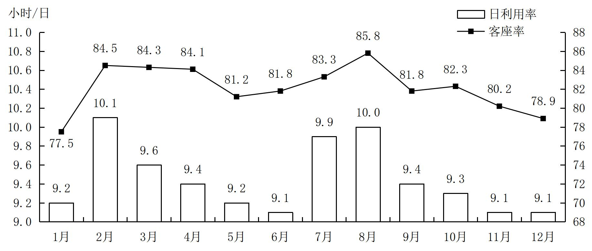
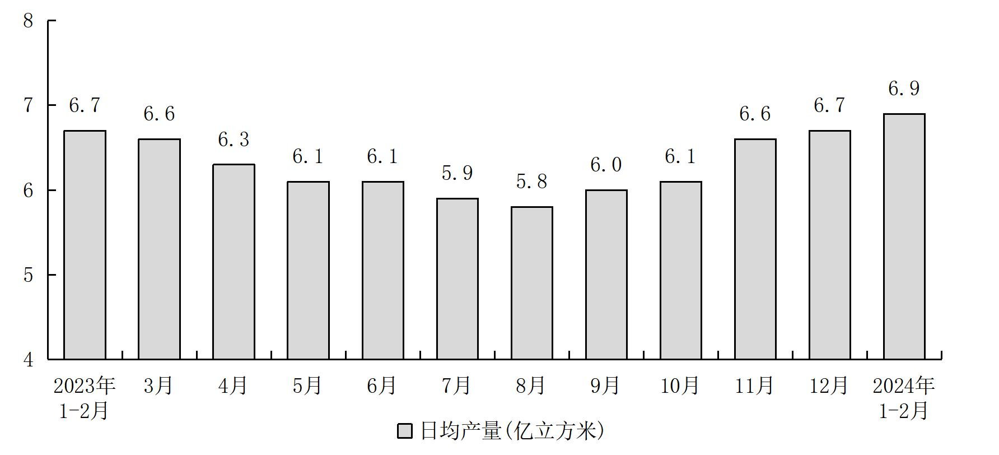
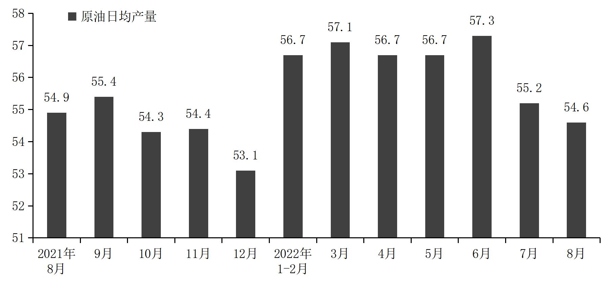
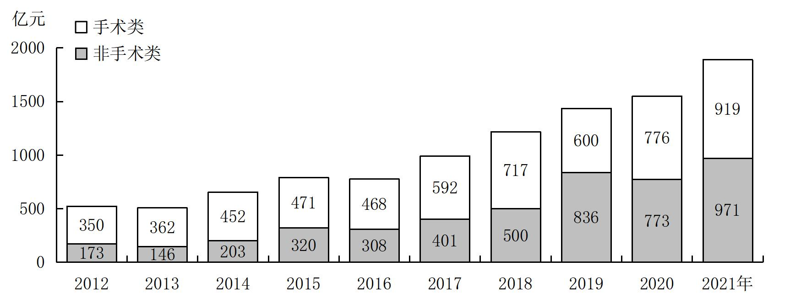
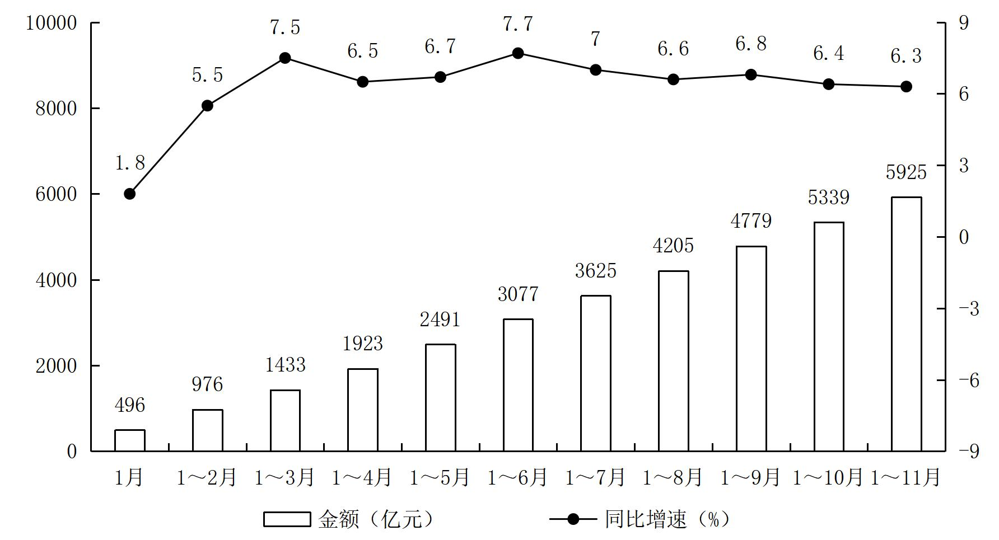
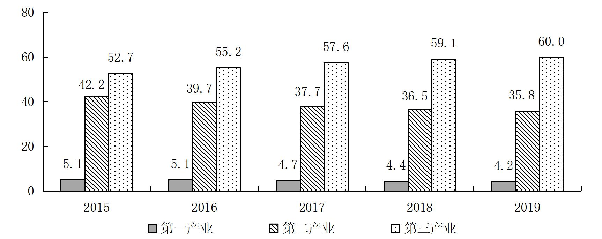
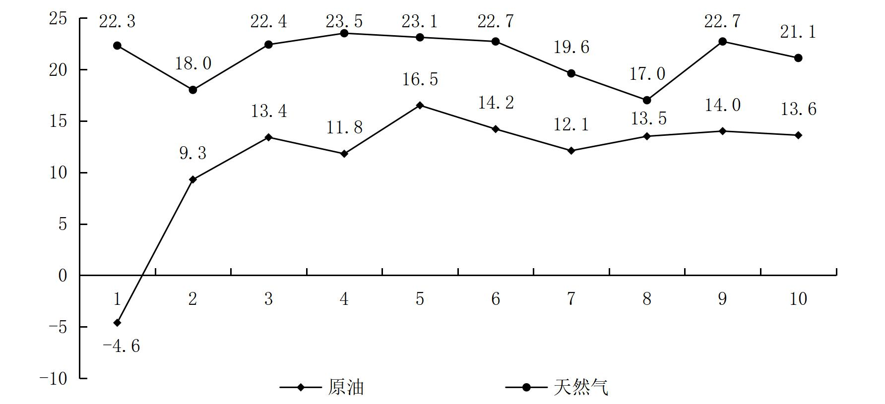

<!-- hyz-paper-id: 01a1e4f7-7c1c-7013-a1de-d0ff86aa3bf5 -->

# 考点刷题4

## Question 1

<!-- hyz-question-id: 01a1e4f7-7c1c-7013-a1de-d1034e80f299 -->

```yaml
module: 资料分析
```

### Stem

2016年（全年366天），全国年轻人人均月收入为6726元。同时，存款额度也在增加，2016年年轻人的人均月存款为2340元，较2015年同比增加15.3%，而2015年的人均月存款较2014年增加32.7%。在贷款方面，月收入4000元以上的办理信用卡比例超过76%，而贷款年龄段比例则为：18～25岁占29.6%、26～35岁占49.1%、36～45岁占21.3%。年轻人每月平均记账次数约为41笔，其中上海以1.672笔的人均日记账次数居榜首。在消费方面，KTV的年人均消费由2014年的699.9元增加到2016年的814.6元；在旅游方面，人均年度交通支出达4985元。年轻人2016年在书本上的人均支出达到168元，相对于2015年的155元，同比增长8.4%。2016年，年轻人与雾霾相关的支出较2015年多出8.7%，人均支出达到998.7元；每日人均食品消费45.9元，比去年增加8.8元，早餐平均花费4.5元。

在2016年，上海年轻人人均全年记账次数多出全国年轻人：

### Options
- A. 118次
- B. 120次
- C. 122次
- D. 124次

### Answer

B

## Question 2

<!-- hyz-question-id: 01a1e4f7-7c1c-7013-a1de-d11095760d58 -->

```yaml
module: 资料分析
```

### Stem



图2015年民航航班日利用率和客座率

日利用率：飞机在一日内平均提供的生产飞行小时数

客座率：承运的旅客数量与飞机可提供的座位数之比

2015年，平均每架民航飞机月飞行时间超过300小时的月份有多少个：

### Options
- A. 1
- B. 2
- C. 3
- D. 4

### Answer

B

## Question 3

<!-- hyz-question-id: 01a1e4f7-7c1c-7013-a1de-d12ef55b1faa -->

```yaml
module: 资料分析
```

### Stem

2016年，全国338个地级及以上城市中，环境空气质量达标城市84个，同比增加11个；优良天数占全年总天数比例为78.8%，同比提高2.1个百分点。

2016年，全国338个地级及以上城市PM2.5平均浓度为47微克/立方米，同比下降6.0%；平均重污染天数比例为2.6%，同比下降0.6个百分点。第一批实施空气质量新标准的74个城市PM2.5平均浓度为50微克/立方米，比2013年下降30.6%；平均优良天数比例为74.2%，比2013年提高13.7个百分点；平均重度及以上污染天数比例为3.0%，比2013年下降5.7个百分点。

2016年，全国338个地级及以上城市全年空气质量优良天数较2015年增加约多少天：

### Options
- A. 7.7
- B. 8.5
- C. 8.8
- D. 9.2

### Answer

B

## Question 4

<!-- hyz-question-id: 01a1e4f7-7c1c-7013-a1de-d13850b107c3 -->

```yaml
module: 资料分析
```

### Stem



图2023年～2024年1-2月规模以上工业天然气月度产量

2024年1～2月，规模以上工业天然气总产量与上年同期相比约高多少亿立方米：

### Options
- A. 11.8
- B. 12
- C. 18.5
- D. 18.7

### Answer

D

## Question 5

<!-- hyz-question-id: 01a1e4f7-7c1c-7013-a1de-d14635c92847 -->

```yaml
module: 资料分析
```

### Stem



图1 2021年8月～2022年8月规模以上工业原油日均产量（万吨）

2022年4～8月，规模以上工业原油产量环比下降的月份有多少个：

### Options
- A. 5
- B. 4
- C. 3
- D. 2

### Answer

B

## Question 6

<!-- hyz-question-id: 01a1e4f7-7c1c-7013-a1de-d15b7269be5b -->

```yaml
module: 资料分析
```

### Stem

表2017～2022年全国粮食产量情况

单位：万吨

| 年份 | 粮食产量 | 夏粮产量 | 秋粮产量 | 早稻产量 |
| --- | ---: | ---: | ---: | ---: |
| 2017年 | 66161 | 14175 | 48999 | 2987 |
| 2018年 | 65789 | 13881 | 49049 | 2859 |
| 2019年 | 66384 | 14160 | 49597 | 2627 |
| 2020年 | 66949 | 14286 | 49934 | 2729 |
| 2021年 | 68285 | 14596 | 50888 | 2802 |
| 2022年 | 68658 | 14740 | 51100 | 2812 |

2022年全国秋粮产量占全国粮食产量的比重较2019年：

### Options
- A. 上升了2个百分点以上
- B. 下降了2个百分点以上
- C. 上升了不到2个百分点
- D. 下降了不到2个百分点

### Answer

D

## Question 7

<!-- hyz-question-id: 01a1e4f7-7c1c-7013-a1de-d162ce9da066 -->

```yaml
module: 资料分析
```

### Stem

表2012～2016年我国单银幕产出情况

|  | 2012年 | 2013年 | 2014年 | 2015年 | 2016年 |
| --- | ---: | ---: | ---: | ---: | ---: |
| 总票房（亿元） | 170.7 | 217.7 | 296.4 | 440.7 | 457.1 |
| 城市院线票房（亿元） | 166.3 | 215.3 | 295.1 | 438.6 | 455.0 |
| 观影人次（亿） | 4.7 | 6.2 | 8.3 | 12.6 | 13.7 |
| 影院数（家） | 3026 | 3849 | 4340 | 6148 | 7730 |
| 影院银幕数（块） | 13118 | 18195 | 23592 | 31627 | 41179 |

2016年我国平均电影票价比上一年约：

### Options
- A. 提高了2.9元
- B. 提高了1.6元
- C. 下降了1.6元
- D. 下降了2.9元

### Answer

C

## Question 8

<!-- hyz-question-id: 01a1e4f7-7c1c-7013-a1de-d17ae4f93cd0 -->

```yaml
module: 资料分析
```

### Stem

表2022～2023年全国茶园面积及干毛茶产量

|  | 面积（万亩）2023年 | 面积（万亩）2022年 | 产量（万吨）2023年 | 产量（万吨）2022年 |
| --- | ---: | ---: | ---: | ---: |
| 全国 | 5149.76 | 4995.40 | 333.95 | 318.10 |
| 江苏 | 49.26 | 51.00 | 1.05 | 1.04 |
| 浙江 | 311.70 | 310.50 | 20.17 | 19.35 |
| 安徽 | 320.00 | 307.52 | 17.32 | 15.41 |

2023年浙江省干毛茶单位面积产量约比安徽省：

### Options
- A. 高不到8千克/亩
- B. 高8千克/亩以上
- C. 低不到8千克/亩
- D. 低8千克/亩以上

### Answer

B

## Question 9

<!-- hyz-question-id: 01a1e4f7-7c1c-7013-a1de-d189151e4d54 -->

```yaml
module: 资料分析
```

### Stem



图2012～2021年我国医疗美容市场规模情况

2021年我国医疗美容手术类市场占比比2019年约：

### Options
- A. 高5.2个百分点
- B. 高5.9个百分点
- C. 高6.8个百分点
- D. 高7.5个百分点

### Answer

C

## Question 10

<!-- hyz-question-id: 01a1e4f7-7c1c-7013-a1de-d19a95bc7f55 -->

```yaml
module: 资料分析
```

### Stem

表2010～2021年全国用水量情况

单位：亿立方米

| 年份 | 用水总量农业生产工业生产生活 | 用水总量农业生产工业生产生活农业生产 | 用水总量农业生产工业生产生活工业生产 | 用水总量农业生产工业生产生活生活 | 用水总量农业生产工业生产生活生态 |
| ---: | ---: | ---: | ---: | ---: | ---: |
| 2010 | 6022 | 3689 | 1447 | 766 | 120 |
| 2011 | 6107 | 3743 | 1462 | 790 | 112 |
| 2012 | 6131 | 3902 | 1381 | 740 | 108 |
| 2013 | 6183 | 3922 | 1406 | 750 | 105 |
| 2014 | 6095 | 3869 | 1356 | 767 | 103 |
| 2015 | 6103 | 3852 | 1335 | 793 | 123 |
| 2016 | 6040 | 3768 | 1308 | 821 | 143 |
| 2017 | 6043 | 3766 | 1277 | 838 | 162 |
| 2018 | 6016 | 3693 | 1262 | 860 | 201 |
| 2019 | 6021 | 3682 | 1217 | 872 | 250 |
| 2020 | 5813 | 3613 | 1030 | 863 | 307 |
| 2021 | 5920 | 3644 | 1050 | 909 | 317 |

2021年全国工业生产用水占用水总量的比重比2011年约：

### Options
- A. 高5.2个百分点
- B. 高6.2个百分点
- C. 低5.2个百分点
- D. 低6.2个百分点

### Answer

D

## Question 11

<!-- hyz-question-id: 01a1e4f7-7c1c-7013-a1de-d1acef133996 -->

```yaml
module: 资料分析
```

### Stem

2017年上半年，信息传输、软件和信息技术服务业实现增加值1319.5亿元，同比增长9.3%；累计完成电信业务量361.1亿元，同比增长38.8%；科学研究和技术服务业实现增加值1211.8亿元，同比增长10.0%，比一季度增幅扩大1.4个百分点。

2017年第二季度，B市科学研究和技术服务业实现增加值的同比增速的范围是：

### Options
- A. 小于8.6%
- B. 等于8.6%
- C. 大于8.6%且小于等于10%
- D. 大于10%

### Answer

D

## Question 12

<!-- hyz-question-id: 01a1e4f7-7c1c-7013-a1de-d1bb72b3f63c -->

```yaml
module: 资料分析
```

### Stem

表A地区2019年社会消费品零售总额情况

|  | 1～12月累计金额（亿元） | 1～12月累计同比增速（%） |
| --- | ---: | ---: |
| 社会消费品零售总额 | 6582.85 | 6.7 |
| 其中：批发和零售业 | 5754.74 | 6.1 |
| 住宿和餐饮业 | 828.11 | 11.2 |



图2019年1～11月A地区社会消费品零售总额各月累计金额及累计同比增速

2019年12月，A地区社会消费品零售总额同比增速约为：

### Options
- A. 3%
- B. 6%
- C. 10%
- D. 15%

### Answer

C

## Question 13

<!-- hyz-question-id: 01a1e4f7-7c1c-7013-a1de-d1c84dac1d7c -->

```yaml
module: 资料分析
```

### Stem

表2019年我国海洋生产总值及增速

| 指标 | 生产总值（亿元） | 增速（%） |
| --- | ---: | --- |
| 海洋生产总值 | 89415 | 6.2 |
| 海洋产业 | 57315 | 7.8 |
| 主要海洋产业 | 35724 | 7.5 |
| 海洋渔业 | 4715 | 4.4 |
| 海洋油气业 | 1541 | 4.7 |
| 海洋矿业 | 194 | 3.1 |
| 海洋盐业 | 31 | 0.2 |
| 海洋化工业 | 1157 | 7.3 |
| 海洋生物医药业 | 443 | 8.0 |
| 海洋电力业 | 199 | 7.2 |
| 海水利用业 | 18 | 7.4 |
| 海洋船舶工业 | 1182 | 11.3 |
| 海洋工程建筑业 | 1732 | 4.5 |
| 海洋交通运输业 | 6427 | 5.8 |
| 滨海旅游业 | 18086 | 9.3 |
| 海洋科研教育管理服务业 | 21591 | 8.3 |
| 海洋相关产业 | 32100 | （？） |



图2015～2019年我国海洋三次产业增加值占海洋生产总值比重（%）

2019年我国海洋相关产业产值增速：

### Options
- A. 低于3.0%
- B. 介于3.0%和4.0%之间
- C. 高于5.0%
- D. 介于4.0%和5.0%之间

### Answer

B

## Question 14

<!-- hyz-question-id: 01a1e4f7-7c1c-7013-a1de-d1d5bac8a33c -->

```yaml
module: 资料分析
```

### Stem

江西省2015年财政总收入3021.5亿元，比上年增长12.7%，财政总收入占生产总值的比重为18.1%，比上年提高1.0个百分点。其中，税收收入2373.0亿元，增长8.9%，占财政总收入比重为78.5%，其他收入648.5亿元。

2015年江西省财政总收入中的其他收入比上年：

### Options
- A. 减少了2.9%
- B. 减少了29.2%
- C. 增加了2.9%
- D. 增加了29.2%

### Answer

D

## Question 15

<!-- hyz-question-id: 01a1e4f7-7c1c-7013-a1de-d1ef9f5ae1c4 -->

```yaml
module: 资料分析
```

### Stem

2019年上半年,我国服务进出口总额达到26124.6亿元,同比增长2.6%。其中,出口总额9333.7亿元,同比增长9.0%；进口总额16790.8亿元,同比下降0.6%。

2019年全年，我国服务进出口总额54152.9亿元，同比增长2.8%。其中，出口总额19564.0亿元，同比增长8.9%；进口总额34588.9亿元，同比减少0.4%。

2019年上半年，我国知识密集型服务进出口额8923.9亿元，同比增长9.4%，其中，知识密集型服务出口额4674.1亿元，同比增长12.1%；进口额4249.8亿元，同比增长6.5%。从具体领域看，知识产权使用费出口同比增长33.0%；电信、计算机和信息服务出口同比增长15.7%，进口同比增长19.6%；其他商业服务（含技术、专业和管理咨询服务、研发成果转让费及委托研发等）出口同比增长10.4%；金融服务出口同比增长13.9%.进口同比增长43.9%。

2019年全年，我国知识密集型服务进出口额18777.7亿元，同比增长10.8%，其中，知识密集型服务出口额9916.8亿元，同比增长13.4%；进口额8860.9亿元，同比增长8.0%。从具体领域看，个人文化娱乐服务，电信、计算机和信息服务，金融服务进出口总额分别同比增长19.4%、18.9%、18.7%。

2019年，我国知识密集型服务出口额占服务出口额比重：

### Options
- A. 仅上半年高于上年同期水平
- B. 仅下半年高于上年同期水平
- C. 上、下半年均高于上年同期水平
- D. 上、下半年均低于上年同期水平

### Answer

C

## Question 16

<!-- hyz-question-id: 01a1e4f7-7c1c-7013-a1de-d1f1fe617bc4 -->

```yaml
module: 资料分析
```

### Stem

2013年二季度，我国税收月收入同比增速逐步提高，分别为7.9%、8.3%和12.9%。截至2013年6月，全国税收总收入完成59260.61亿元，同比增长7.9%，较上年同期回落1.9个百分点。其中，国内增值税、企业所得税同比分别增长6.6%和14.2%，较上年同期增速分别回落1.5和3.1个百分点；房产税同比增长11%，比上年同期增速回落19.1个百分点；进口货物增值税消费税和关税同比分别下降17.1%和16%，比上年同期增速分别回落24.5和22.9个百分点。

2013年第一季度我国税收总收入同比增速在以下哪个范围之内：

### Options
- A. 不到7.9%
- B. 7.9%～8.5%
- C. 超过8.5%
- D. 无法判断

### Answer

A

## Question 17

<!-- hyz-question-id: 01a1e4f7-7c1c-7013-a1de-d20288ad9fda -->

```yaml
module: 资料分析
```

### Stem



图2016年1～10月我国规模以上工业原油、天然气进口量累计增速走势图（%）

下列关于2016年我国规模以上工业天然气进口量同比增速的说法错误的是：

### Options
- A. 第3季度的同比增速为22.7%
- B. 第2季度的同比增速高于第1季度
- C. 2月份的同比增速为18%
- D. 1月份的同比增速为22.3%

### Answer

C

## Question 18

<!-- hyz-question-id: 01a1e4f7-7c1c-7013-a1de-d211787dd0b6 -->

```yaml
module: 资料分析
```

### Stem

表2017年1～4月T地区限额以上商品销售额分类统计

单位：亿元

|  | 1～3月销售额 | 1～3月同比增速 | 销售额 |
| --- | ---: | ---: | ---: |
| 批发业 | 7913 | 12% | 10251 |
| 零售业 | 640 | −7.5% | 856 |

同比增速

11.8%

按业务类型分

−8.1%

2017年4月，T地区限额以上商品批发业销售额同比增速约比当年一季度：

### Options
- A. 高0.5个百分点
- B. 低0.1个百分点
- C. 低0.4个百分点
- D. 低0.9个百分点

### Answer

D

## Question 19

<!-- hyz-question-id: 01a1e4f7-7c1c-7013-a1de-d2256f09d642 -->

```yaml
module: 资料分析
```

### Stem

2016年1～8月累计全国一般公共预算收入110178亿元，同比增长6%。其中，中央一般公共预算收入49711亿元.同比增长4.2%，同口径增长1.5%；地方一般公共预算本级收入60467亿元，同比增长7.6%，同口径增长10.1%。全国一般公共预算收入中的税收收入92637亿元，同比增长7.3%。

2016年1～8月累计，全国一般公共预算收入中非税收入同比：

### Options
- A. 增长0.4%
- B. 下降4%
- C. 下降0.4%
- D. 增长4%

### Answer

C

## Question 20

<!-- hyz-question-id: 01a1e4f7-7c1c-7013-a1de-d2376e85ebd0 -->

```yaml
module: 资料分析
```

### Stem

A市统计局在该市范围内做了一项调查，抽取了5000名18到70周岁且在2015年有过网购经历的居民，结果显示：受访者2015年人均网购次数为19.4次。此外，女性受访者人均网购次数为21.1次，比男性受访者高出3.8次。

受访者中男性所占比例约为：

### Options
- A. 74.3%
- B. 68.6%
- C. 55.3%
- D. 44.7%

### Answer

D

## Question 21

<!-- hyz-question-id: 01a1e4f7-7c1c-7013-a1de-d24a1dfd3097 -->

```yaml
module: 资料分析
```

### Stem

截止2022年12月，我国网民规模约为10.67亿，互联网普及率达75.6%。我国网民使用手机上网的比例达99.8%。我国城镇网民规模约为7.59亿，占网民整体的71.1%；农村新增网民规模占新增网民整体的66.8%。

2022年12月，我国城镇网民规模占网民整体的比重比2021年12月：

### Options
- A. 上升
- B. 不变
- C. 下降
- D. 无法推出

### Answer

C

## Question 22

<!-- hyz-question-id: 01a1e4f7-7c1c-7013-a1de-d25ace64fc9e -->

```yaml
module: 资料分析
```

### Stem

2024年全国粮食总产量70650万吨，比2023年增加1109万吨，增长1.6%。除豆类，其余作物产量均同比增长。其中谷物产量65229万吨，比2023年增加1086万吨，增长1.7%，总产量占比达到92.3%（其中稻谷、小麦和玉米分别占29.4%、19.8%和41.7%），豆类和薯类占比3.3%和4.4%。稻谷、小麦和玉米这三种主要粮食作物对粮食总产量的增长贡献率分别为8.4%、31.6%和54.8%，豆类为-1.9%，薯类为4.0%。

在①稻谷②小麦③玉米④豆类⑤薯类五种作物中，2024年各品种粮食产量占全年粮食总产量的比重低于上一年的有：

### Options
- A. ②③④
- B. ②③
- C. ①④⑤
- D. ①⑤

### Answer

C

## Question 23

<!-- hyz-question-id: 01a1e4f7-7c1c-7013-a1de-d26e1a151219 -->

```yaml
module: 资料分析
```

### Stem

表2018年我国对主要国家和地区货物进出口金额、增长速度及其比重

| 国家和地区 | 出口额（亿元） | 比上年增长（%） | 占全部出口比重（%） | 进口额（亿元） | 比上年增长（%） | 占全部进口比重（%） |
| --- | ---: | ---: | ---: | ---: | ---: | ---: |
| 欧盟 | 26974 | 7.0 | 16.4 | 18067 | 9.2 | 12.8 |
| 美国 | 31603 | 8.6 | 19.2 | 10195 | −2.3 | 7.2 |
| 东盟 | 21066 | 11.3 | 12.8 | 17722 | 11.0 | 12.6 |
| 日本 | 9709 | 4.4 | 5.9 | 11906 | 6.2 | 8.5 |
| 韩国 | 7174 | 3.1 | 4.4 | 13495 | 12.3 | 9.6 |
| 中国香港 | 19966 | 5.7 | 12.2 | 564 | 13.8 | 0.4 |
| 中国台湾 | 3212 | 7.9 | 2.0 | 11714 | 11.0 | 8.3 |
| 巴西 | 2214 | 12.9 | 1.3 | 5119 | 28.2 | 3.6 |
| 俄罗斯 | 3167 | 9.1 | 1.9 | 3909 | 39.4 | 2.8 |
| 印度 | 5054 | 9.5 | 3.1 | 1242 | 12.2 | 0.9 |
| 南非 | 1072 | 6.9 | 0.7 | 1799 | 8.9 | 1.3 |

较上一年相比，2018年我国对主要国家和地区货物进出口额增长超过9%的国家和地区有多少个：

### Options
- A. 2个
- B. 3个
- C. 4个
- D. 5个

### Answer

D

## Question 24

<!-- hyz-question-id: 01a1e4f7-7c1c-7013-a1de-d2757acd007c -->

```yaml
module: 资料分析
```

### Stem

2017年1～12月，全国内燃机累计销量5645.38万台，同比增长4.11%，累计完成功率266879.47万千瓦，同比增长9.15%。其中柴油内燃机功率同比增长34%。

从燃料类型来看，柴油机增幅明显高于汽油机，柴油机累计销量556万台，同比增长13.04%；汽油机累计销量5089万台。

2017年汽油内燃机累计销量同比增速：

### Options
- A. 低于-4%
- B. 在-4%～0%之间
- C. 在0%～4%之间
- D. 超过4%

### Answer

C

## Question 25

<!-- hyz-question-id: 01a1e4f7-7c1c-7013-a1de-d28808b89203 -->

```yaml
module: 资料分析
```

### Stem

国网某省电力有限公司统计，2017年，全社会用电2135.50亿千瓦时，比上年增长4.8%，增速比上年高出2.2个百分点。

2017年1～11月，全社会用电1927.09亿千瓦时，比上年同期增长4.4%。

2017年12月全社会用电同比增长约为：

### Options
- A. 3.6%
- B. 4.1%
- C. 5.2%
- D. 8.7%

### Answer

D

## Question 26

<!-- hyz-question-id: 01a1e4f7-7c1c-7013-a1de-d2910d827454 -->

```yaml
module: 资料分析
```

### Stem

表2017年1～5月部分省份送出电量情况

单位：亿千瓦时

|  | 1～5月送电量 | 1～5月同比增速 | 5月送电量 | 5月同比增速 |
| --- | ---: | ---: | ---: | ---: |
| 全国 | 3843 | 8.6% | 864 | 10.1% |
| 其中：内蒙古 | 589 | 9.1% | 136 | 9.0% |
| 山西 | 316 | 10.6% | 73 | 28.8% |
| 四川 | 308 | 5.0% | 73 | −11.5% |
| 湖北 | 250 | −7.9% | 71 | −7.5% |

2017年1～4月，下列省份中送出电量同比增速最快的两个省份是：

### Options
- A. 山西、四川
- B. 内蒙古、湖北
- C. 山西、湖北
- D. 内蒙古、四川

### Answer

D

## Question 27

<!-- hyz-question-id: 01a1e4f7-7c1c-7013-a1de-d2ac11731c78 -->

```yaml
module: 资料分析
```

### Stem

2018年，S省全年实现国内生产总值76469.7亿元，比上年增长6.4%。……。

市场主体大量涌现，全年新登记注册168.1万户，增长25.7%，其中新登记企业54.5万户，增长38.5%。

2018年，S省全年新登记注册的市场主体中，新登记企业之外的市场主体同比增速在什么范围：

### Options
- A. 5%～10%
- B. 10%～15%
- C. 20%～25%
- D. 25%～30%

### Answer

C

## Question 28

<!-- hyz-question-id: 01a1e4f7-7c1c-7013-a1de-d2b4791eff60 -->

```yaml
module: 资料分析
```

### Stem

2015年上半年，福建省实现生产总值10468.34亿元，按可比价格计算，同比增长8.6%，增幅比一季度提高0.1个百分点，比上年同期回落1.1个百分点。分产业看，第一产业产值696.78亿元，增长3.0%；第二产业产值5842.21亿元，增长9.4%；第三产业值3929.35亿元，同比也呈增长态势。

2015年上半年第三产业产值同比增长为：

### Options
- A. 9.8%
- B. 8.5%
- C. 8.1%
- D. 5.8%

### Answer

B

## Question 29

<!-- hyz-question-id: 01a1e4f7-7c1c-7013-a1de-d2c89317c941 -->

```yaml
module: 资料分析
```

### Stem

2014年，我国轻工工艺品对外贸易总体保持平稳增长，进出口总值达到8322.6亿美元，占全商品贸易总额的19.3%，增长10.0%，增速较全商品高6.6个百分点。其中出口6615.8亿美元，占全商品出口额28.2%，增长7.8%,增速较全商品高1.8个百分点，各月出口增速波动较大;进口1706.8亿美元，占全商品进口额的8.7%，增长19.3%。

2013年，我国轻工工艺品出口总值比进口总值多多少倍：

### Options
- A. 3.2
- B. 4.2
- C. 3.9
- D. 2.9

### Answer

A

## Question 30

<!-- hyz-question-id: 01a1e4f7-7c1c-7013-a1de-d2d3f790b22b -->

```yaml
module: 资料分析
```

### Stem

入境过夜旅游人数6290万人次，比上年同期增长3.6%。其中：外国人2364万人次，增长5.2%；香港同胞2820万人次，增长1.6%；澳门同胞553万人次，增长5.9%；台湾同胞553万人次，增长4.5%。

2018年，我国港澳台同胞入境过夜旅游人数同比增长约为：

### Options
- A. 5.2%
- B. 3.9%
- C. 2.6%
- D. 1.3%

### Answer

C

## Question 31

<!-- hyz-question-id: 01a1e4f7-7c1c-7013-a1de-d2e64d4539fe -->

```yaml
module: 资料分析
```

### Stem

2013年3月末，主要金融机构及小型农村金融机构、外资银行人民币房地产贷款余额12.98万亿元，同比增长16.4%。地产开发贷款余额1.04万亿元，同比增长21.4%。房产开发贷款余额3.2万亿元，同比增长12.3%。个人购房贷款余额8.57万亿元，同比增长17.4%。保障性住房开发贷款余额6140亿元，同比增长42.4%。

2013年3月末，房地产开发贷款余额同比增速约：

### Options
- A. 14.4%
- B. 15.6%
- C. 17.3%
- D. 18.4%

### Answer

A

## Question 32

<!-- hyz-question-id: 01a1e4f7-7c1c-7013-a1de-d2f98cae20f4 -->

```yaml
module: 资料分析
```

### Stem

截至9月末，全国累计快递业务寄递业务量（包括同城、异地、国际/港澳台）1450.8亿件。其中同城快递寄递业务量118.7亿件，占全国累计快递业务寄递业务量8.18%；异地快递寄递业务量1301.7亿件，占全国累计快递业务寄递业务量89.72%；国际/港澳台快递寄递业务量30.4亿件。9月当月新增快递业务寄递量168.8亿件。其中同城快递12.9亿件，占当月全国新增快递业务寄递业务量7.64%；异地快递152.5亿件，占当月全国新增快递业务寄递业务量90.34%。

在①同城快递业务、②异地快递业务、③国际/港澳台快递业务三种不同的快递业务中，9月末累计快递业务寄递业务量占各种快递业务寄递总业务量比重高于8月末累计水平的有：

### Options
- A. 仅①
- B. 仅②
- C. 仅③
- D. ①②

### Answer

B

## Question 33

<!-- hyz-question-id: 01a1e4f7-7c1c-7013-a1de-d300d83cdc48 -->

```yaml
module: 资料分析
```

### Stem

2022年全国居民人均可支配收入36883元，比上年增长5.0%。分城乡看，城镇居民人均可支配收入49283元，增长3.9%，农村居民人均可支配收入20133元，增长6.3%。

2022年全国城镇居民与农村居民人数之比约为：

### Options
- A. 54∶46
- B. 57∶43
- C. 59∶41
- D. 无法判断

### Answer

B

## Question 34

<!-- hyz-question-id: 01a1e4f7-7c1c-7013-a1de-d3128d0e43be -->

```yaml
module: 资料分析
```

### Stem

2022年，D自治州猪牛羊禽肉类产量43.5万吨，比上年增长6.7%。其中，猪肉产量30.4万吨，增长10.0%；牛肉产量5.2万吨，增长3.4%；羊肉产量3.1万吨，增长4.0%。牛奶产量35.4万吨，增长4.9%；禽蛋产量7.1万吨，增长3.7%。

若从2023年开始，D自治州猪肉、羊肉产量保持2022年同比增速不变，则2024年，猪肉、羊肉产量相较于2022年的增长速度约为：

### Options
- A. 9%
- B. 14%
- C. 17%
- D. 20%

### Answer

D

## Question 35

<!-- hyz-question-id: 01a1e4f7-7c1c-7013-a1de-d323075b2dc3 -->

```yaml
module: 资料分析
```

### Stem

2023年前三季度。S省1627家规模以上文化及相关产业企业（以下简称“文化企业”）实现营业收入862.76亿元，比上年同期增长7.0%，低于全国总体水平0.7个百分点，增速较第一季度和上半年分别回落3.8和1.9个百分点。

分领域看，文化核心领域实现营业收入533.10亿元。比上年同期增长13.0%，增速高于上年同期4.3个百分点；文化相关领域实现营业收入329.66亿元，比上年同期下降1.6%。

2022年前三季度，S省文化核心领域实现营业收入约是文化相关领域的多少倍：

### Options
- A. 1.2
- B. 1.3
- C. 1.4
- D. 1.5

### Answer

C
