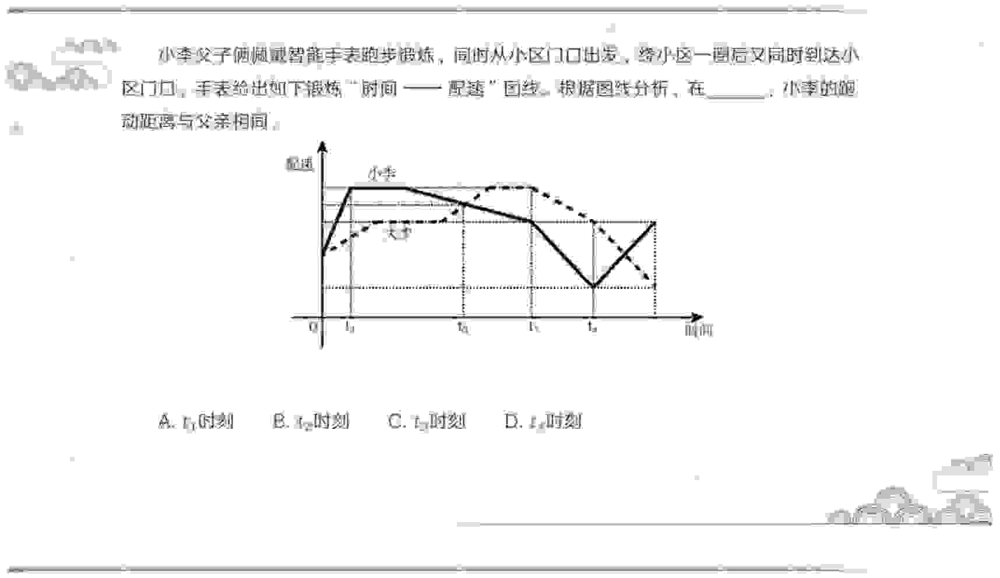

<!-- hyz-paper-id: 01a1af25-cffb-79e3-b257-1c755101aaf4 -->

# 行程问题（二）

## Question 138

<!-- hyz-question-id: 01a1af25-cffb-79e3-b257-1c8029e1b514 -->
```yaml
module: 数量关系
category: "等路程问题"
```
### Stem
小明开车去姐姐家的速度为 30 公里 / 时，开车回家的速度为 60 公里 / 时，则小明开车往返的平均速度是（ ）公里 / 时。

### Options
- A. 50
- B. 45
- C. 30
- D. 40

### Answer

### Explanation

## Question 139

<!-- hyz-question-id: 01a1af25-cffb-79e3-b257-1c988396007c -->
```yaml
module: 数量关系
category: "等路程问题"
```
### Stem
小明从家到学校去上学，先上坡后下坡。到学校后，小明发现没带物理课本，立刻回家拿书，往返共用 36 分钟。假设小伟上坡速度为 80 米 / 分钟，下坡速度为 100 米 / 分钟，小伟家到学校有多远？

### Options
- A. 2400 米
- B. 1720 米
- C. 1600 米
- D. 1200 米

### Answer

### Explanation

## Question 140

<!-- hyz-question-id: 01a1af25-cffb-79e3-b257-1ca048cf9b56 -->
```yaml
module: 数量关系
category: "等路程问题"
```
### Stem
从甲地到乙地 111 千米，其中有 1/4 平路，1/2 上坡路，1/4 下坡路。假定一辆车在平路的速度是 20 千米 / 小时，上坡速度是 15 千米 / 小时，下坡速度是 30 千米 / 小时。则该车由甲地到乙地往返一趟的平均速度是多少千米 / 小时？

### Options
- A. 19
- B. 20
- C. 21
- D. 22

### Answer

### Explanation

## Question 141

<!-- hyz-question-id: 01a1af25-cffb-79e3-b257-1cbe5a4be9bd -->
```yaml
module: 数量关系
category: "等路程问题"
```
### Stem
一条长 146 公里的山区公路分为上坡、平地和下坡三段，其中上下坡的距离相等。某越野车以上坡 20km/h，平地 30km/h，下坡 50km/h 的速度行驶，跑完该条公路正好用时 5 小时，问该公路中的平路路程为多少公里？（ ）

### Options
- A. 40
- B. 55
- C. 66
- D. 75

### Answer

### Explanation

## Question 142

<!-- hyz-question-id: 01a1af25-cffb-79e3-b257-1ccd4a18bb9d -->
```yaml
module: 数量关系
category: "等路程问题"
```
### Stem

A、B 两地之间的公路中有 1/3 的距离为平路，其余为上坡路或下坡路，甲、乙两车从 A 地出发开往 B 地。甲车在平路、上坡路和下坡路的速度相同，而乙车在平路上的速度和甲车相同，在上坡路和下坡路的速度分别为平路的 50% 和 150%，结果甲、乙两车均用 1.5 小时到达 B 地。问甲车从 B 地返回 A 地所用的时间比乙车少多少分钟？（ ）

### Options
- A. 10
- B. 20
- C. 30
- D. 40

### Answer

### Explanation

## Question 143

<!-- hyz-question-id: 01a1af25-cffb-79e3-b257-1cdd17c68c77 -->
```yaml
module: 数量关系
category: "等路程问题"
```
### Stem
甲、乙两人同时从图书馆走向教室，甲一半路程步行，一半路程跑步；乙一半时间步行，一半时间跑步，若两人步行、跑步的速度均相同，则：

### Options
- A. 甲先到教室
- B. 乙先到教室
- C. 甲和乙同时到教室
- D. 我不知道

### Answer

### Explanation

## Question 144

<!-- hyz-question-id: 01a1af25-cffb-79e3-b257-1cedc07be626 -->
```yaml
module: 数量关系
category: "匀变速运动"
```
### Stem
一辆车从甲地行驶到乙地共 20 千米，用时 20 分钟，已知该车在匀加速到最大速度后开始匀减速，到乙地时速度恰好为 0，问该车行驶的最大速度是多少千米 / 小时？

### Options
- A. 100
- B. 108
- C. 116
- D. 120

### Answer

### Explanation

## Question 145

<!-- hyz-question-id: 01a1af25-cffb-79e3-b257-1cf4f318a70a -->
```yaml
module: 数量关系
category: "匀变速运动"
```
### Stem
一辆汽车在高速公路上以 60 公里 / 小时的速度匀速行驶，此时司机开始以固定的加速度进行加速，加速后 50 秒内，汽车行驶了 1 公里。则汽车从开始加速，到加速至高速公路的速度上限 120 公里 / 小时需要多长时间？

### Options
- A. 100 秒
- B. 125 秒
- C. 150 秒
- D. 180 秒

### Answer

### Explanation

## Question 146

<!-- hyz-question-id: 01a1af25-cffb-79e3-b257-1d0845361144 -->
```yaml
module: 数量关系
category: "匀变速运动"
```
### Stem
小李父子俩佩戴智能手表跑步锻炼，同时从小区门口出发，绕小区一圈后又同时到达小区门口。手表给出如下锻炼“时间——配速”图线。根据图线分析，在______，小李的跑动距离与父亲相同。



### Options
- A. $t_1$ 时刻
- B. $t_2$ 时刻
- C. $t_3$ 时刻
- D. $t_4$ 时刻

### Answer

### Explanation

## Question 147

<!-- hyz-question-id: 01a1af25-cffb-79e3-b257-1d1a0bb5d667 -->
```yaml
module: 数量关系
category: "钟面问题"
```
### Stem
现在时间为 4 点 13 分，此时时针与分针成什么角度：

### Options
- A. 30 度
- B. 45 度
- C. 90 度
- D. 120 度

### Answer

### Explanation

## Question 148

<!-- hyz-question-id: 01a1af25-cffb-79e3-b257-1d26136d0837 -->
```yaml
module: 数量关系
category: "钟面问题"
```
### Stem
上午 11 点 40 分，钟表的时针和分针的夹角为（ ）度。

### Options
- A. 110
- B. 90
- C. 105
- D. 95

### Answer

### Explanation

## Question 149

<!-- hyz-question-id: 01a1af25-cffb-79e3-b257-1d343b257f0e -->
```yaml
module: 数量关系
category: "钟面问题"
```
### Stem
小强同学吃完中饭发现他家时钟的时针和分针刚好垂直，且时针刚过 12、分针刚过 3，问时针和分针再次垂直至少要过（ ）小时。

### Options
- A. $\frac{3}{11}$
- B. $\frac{6}{11}$
- C. $\frac{2}{3}$
- D. $\frac{7}{4}$

### Answer

### Explanation

## Question 150

<!-- hyz-question-id: 01a1af25-cffb-79e3-b257-1d446daa47e9 -->
```yaml
module: 数量关系
category: "钟面问题"
```
### Stem
自中午 12 点以后，12 小时内时针与分针会有（ ）次呈直角？

### Options
- A. 23
- B. 22
- C. 12
- D. 11

### Answer

### Explanation

## Question 151

<!-- hyz-question-id: 01a1af25-cffb-79e3-b257-1d5b1ede8e0c -->
```yaml
module: 数量关系
category: "钟面问题"
```
### Stem
某伐木工 6：00 开始工作，将 1 根长木头锯成 6 段，锯完时发现时针、分针第一次重合。若该伐木工工作效率不变，现需将 11 根长木头均锯成 5 段，且 8：00 开始连续工作，则他将这些长木头锯完时的时间是：

### Options
- A. 11：30
- B. 12：48
- C. 13：00
- D. 13：15

### Answer

### Explanation

## Question 152

<!-- hyz-question-id: 01a1af25-cffb-79e3-b257-1d6499b2a4db -->
```yaml
module: 数量关系
category: "间歇行程问题"
```
### Stem
甲、乙从湖边同一地点同时出发沿相反方向绕行。已知湖的周长为 20 千米，甲、乙的速度分别为 4km/h 和 5km/h。若甲每走 1 小时后休息 5 分钟，乙每走 50 分钟后休息 10 分钟，那么两人从出发到再次相遇需用多少分钟（ ）。

### Options
- A. 128
- B. 136
- C. 138
- D. 145

### Answer

### Explanation

## Question 153

<!-- hyz-question-id: 01a1af25-cffb-79e3-b257-1d769522d6ef -->
```yaml
module: 数量关系
category: "间歇行程问题"
```
### Stem
夫妻二人绕周长 400 米的环形操场跑道健步走，从起点按逆时针方向同时出发，丈夫每分钟走 100 米、妻子每分钟走 80 米。两人都是每走 200 米停下休息 1 分钟，丈夫（ ）分钟后可追上妻子并在一起休息 1 分钟。

### Options
- A. 39
- B. 40
- C. 41
- D. 42

### Answer

### Explanation

## Question 154

<!-- hyz-question-id: 01a1af25-cffb-79e3-b257-1d806111d1d8 -->
```yaml
module: 数量关系
category: "发车问题"
```
### Stem
甲、乙两站从上午 6 时开始每隔 8 分钟同时相向发出一辆公共汽车，速度相同。汽车单程运行需 45 分钟。有一名乘客坐 6 点 16 分从甲站开出的汽车，途中他能遇到几辆从乙站开往甲站的公共汽车？

### Options
- A. 6
- B. 8
- C. 11
- D. 12

### Answer

### Explanation

## Question 155

<!-- hyz-question-id: 01a1af25-cffb-79e3-b257-1d90e2fdfa97 -->
```yaml
module: 数量关系
category: "发车问题"
```
### Stem
一条电车线路的起点站和终点站分别是甲站和乙站，距离为 20km，每隔 5 分钟有一辆电车从甲站发出开往乙站，全程要走 20 分钟。王先生从乙站出发，车速为 120km/h，则王先生最多遇见多少次对向开来的电车？

### Options
- A. 4
- B. 5
- C. 7
- D. 10

### Answer

### Explanation

## Question 156

<!-- hyz-question-id: 01a1af25-cffb-79e3-b257-1da5e948d853 -->
```yaml
module: 数量关系
category: "接人问题"
```
### Stem
小李、小王从两地同时相向骑行，小李速度是 25 千米/时，小王速度是 20 千米/时。如果小李提前出发，那么两人提前 20 分钟相遇。请问小李提前多少分钟出发？（ ）

### Options
- A. 30
- B. 36
- C. 38
- D. 40

### Answer

### Explanation

## Question 157

<!-- hyz-question-id: 01a1af25-cffb-79e3-b257-1db6a78fcf8c -->
```yaml
module: 数量关系
category: "接人问题"
```
### Stem
小张家距离工厂 15 千米，乘坐班车 20 分钟可到工厂。一天，他错过班车，改乘出租车上班。出租车出发时间比班车晚 4 分钟，送小张到工厂后出租车马上原路返回，在距离工厂 1.875 千米处与班车相遇。如果班车和出租车都是匀速运动且不计上下车时间，那么小张比班车早多少分钟到达工厂？

### Options
- A. 3
- B. 4
- C. 5
- D. 6

### Answer

### Explanation

## Question 158

<!-- hyz-question-id: 01a1af25-cffb-79e3-b257-1dc0cf0d03c2 -->
```yaml
module: 数量关系
category: "换人坐车问题"
```
### Stem
甲、乙两班学生到离学校 24 千米的飞机场参观。但只有一辆汽车，一次只能乘坐一个班的学生。为了尽快到达飞机场，两个班商定，由甲班先坐车，乙班先步行，同时出发，甲班学生在途中某次下车后再步行去飞机场，汽车则从某地立即返回接在途中步行的乙班学生。如果两班学生步行的速度相同，汽车速度是他们步行速度的 7 倍，那么汽车在距飞机场多少千米处返回接乙班学生，才能使两班学生同时到达飞机场？（ ）

### Options
- A. 1.5
- B. 2.4
- C. 3.6
- D. 4.8

### Answer

### Explanation

## Question 159

<!-- hyz-question-id: 01a1af25-cffb-79e3-b257-1dd8f4347ee4 -->
```yaml
module: 数量关系
category: "换人坐车问题"
```
### Stem
一群人游玩过后准备回家，但乘坐的两辆汽车中一辆突发故障。最后决定，将人分为 A、B 两组，A 组人步行，B 组人乘车，汽车行驶中途将 B 组人放下再返回来接 A 组人。已知路程全长 150 公里，A、B 两组人步行的速度均为 4 公里 / 时，汽车行驶速度为 48 公里 / 时，若要保证全程耗费时间最少，则 A 组人步行的路程应为（ ）公里。

### Options
- A. 12
- B. 15
- C. 18
- D. 20

### Answer

### Explanation

## Question 160

<!-- hyz-question-id: 01a1af25-cffb-79e3-b257-1de91059ee55 -->
```yaml
module: 数量关系
category: "换人坐车问题"
```
### Stem
有两个班的学生从南部校区到北部校区参加活动，但只有一辆车接送，第一班的学生坐车从学校出发的同时，第二班学生开始步行；车到途中某处，让第一班学生下车步行，车立刻返回接第二班学生上车并直接开到北部校区。学生步行速度为每小时 4 公里，载学生时车速每小时 40 公里，空车时车速为每小时 50 公里。问：要使两班学生同时到达北部校区，第二班学生步行全程的______。

### Options
- A. $\frac{1}{6}$
- B. $\frac{1}{7}$
- C. $\frac{1}{10}$
- D. $\frac{1}{8}$

### Answer

### Explanation

## Question 161

<!-- hyz-question-id: 01a1af25-cffb-79e3-b257-1df000be9d13 -->
```yaml
module: 数量关系
category: "换人坐车问题"
```
### Stem
甲班和乙班学生同时从学校出发去某个公园，甲班步行的速度是每小时 4 千米，乙班的速度是每小时 3 千米。学校有一辆汽车，它的速度是每小时 48 千米，这辆汽车恰好能坐一个班的学生。为了使两班学生在最短的时间内达到，那么甲班学生与乙班学生需要步行的距离比是多少？

### Options
- A. 4：3
- B. 12：7
- C. 15：11
- D. 21：17

### Answer

### Explanation

## Question 162

<!-- hyz-question-id: 01a1af25-cffb-79e3-b257-1e0b2fae13be -->
```yaml
module: 数量关系
category: "基本运算"
```
### Stem
含盐10%的盐水50千克要使浓度提高到20%需加盐多少千克？

### Options
- A. 5
- B. 5.5
- C. 6
- D. 6.25

### Answer

### Explanation

## Question 163

<!-- hyz-question-id: 01a1af25-cffb-79e3-b257-1e18f2d55cc1 -->
```yaml
module: 数量关系
category: "基本运算"
```
### Stem
有A、B、C三种浓度不同的溶液，按A与B的质量比为5:3混合，得到的溶液浓度为13.75%；按A与B的质量比为3:5混合，得到的溶液浓度为16.25%；按A、B、C的质量比为1:2:5混合，得到的溶液浓度为31.25%。问溶液C的浓度为多少？

### Options
- A. 35%
- B. 40%
- C. 45%
- D. 50%

### Answer

### Explanation

## Question 164

<!-- hyz-question-id: 01a1af25-cffb-79e3-b257-1e28ec5b7845 -->
```yaml
module: 数量关系
category: "基本运算"
```
### Stem
甲烧杯装有浓度为6%的酒精200克，乙烧杯装有浓度为8%的酒精100克。现向两个烧杯各加入x克水后，两个烧杯中酒精浓度相同。问x的值为：

### Options
- A. 60
- B. 80
- C. 100
- D. 150

### Answer

### Explanation

## Question 165

<!-- hyz-question-id: 01a1af25-cffb-79e3-b257-1e34096f4d6b -->
```yaml
module: 数量关系
category: "蒸发加水问题"
```
### Stem
某种杀虫剂每桶5公斤，浓度为40%，使用时需将浓度稀释到5%，每亩地喷洒60公斤。若某农户家有4亩地，则至少需要该杀虫剂：

### Options
- A. 3桶
- B. 4桶
- C. 5桶
- D. 6桶

### Answer

### Explanation

## Question 166

<!-- hyz-question-id: 01a1af25-cffb-79e3-b257-1e457052f364 -->
```yaml
module: 数量关系
category: "蒸发加水问题"
```
### Stem
一种溶液，蒸发掉一定量的水后，溶液的浓度为10%；再蒸发掉同样多的水后，溶液的浓度变为12%；第三次蒸发掉同样多的水后，溶液的浓度将变为多少？

### Options
- A. 14%
- B. 17%
- C. 16%
- D. 15%

### Answer

### Explanation

## Question 167

<!-- hyz-question-id: 01a1af25-cffb-79e3-b257-1e5a96100eaf -->
```yaml
module: 数量关系
category: "蒸发加水问题"
```
### Stem
某种溶液的浓度为20%，加入水后溶液的浓度变为15%，如果再加入同样多的水，则溶液浓度变为：

### Options
- A. 13%
- B. 12.5%
- C. 12%
- D. 10%

### Answer

### Explanation

## Question 168

<!-- hyz-question-id: 01a1af25-cffb-79e3-b257-1e65057df20d -->
```yaml
module: 数量关系
category: "蒸发加水问题"
```
### Stem
一份溶液，加入一定量的水后，浓度降到3%，再加入同样多的水，浓度降为2%。该溶液未加水时浓度是：

### Options
- A. 6%
- B. 4%
- C. 5%
- D. 4.5%

### Answer

### Explanation

## Question 169

<!-- hyz-question-id: 01a1af25-cffb-79e3-b257-1e7af9dff1b7 -->
```yaml
module: 数量关系
category: "蒸发加水问题"
```
### Stem
有一批新鲜水母重100公斤，含水量为98%。后经过盐渍，该批水母的含水量变为90%，求在盐渍过程中失去的水的重量是（ ）公斤。

### Options
- A. 80
- B. 32
- C. 10
- D. 8

### Answer

### Explanation

## Question 170

<!-- hyz-question-id: 01a1af25-cffb-79e3-b257-1e8332a6926e -->
```yaml
module: 数量关系
category: "蒸发加水问题"
```
### Stem
某模拟海洋养殖场有一批海鱼，其池塘具有一定的盐度，且不大于该品种鱼的最适盐度3.5%。已知每天太阳蒸发掉相同的水量，若不采取任何措施则在第三天结束时，池塘盐度将首次达到该品种鱼可承受的最大盐度限值5%。为了维持初始盐度不变，每天补充等体积的淡水，问每天可能补充的水量体积最少是原水量的（ ）。

### Options
- A. 5%
- B. 10%
- C. 15%
- D. 20%

### Answer

### Explanation

## Question 171

<!-- hyz-question-id: 01a1af25-cffb-79e3-b257-1e9e6d2c5e58 -->
```yaml
module: 数量关系
category: "蒸发加水问题"
```
### Stem
含盐10%的盐水50千克要使浓度提高到20%需加盐多少千克？

### Options
- A. 5
- B. 5.5
- C. 6
- D. 6.25

### Answer

### Explanation

## Question 172

<!-- hyz-question-id: 01a1af25-cffb-79e3-b257-1ea173b0f714 -->
```yaml
module: 数量关系
category: "线段混合"
```
### Stem
两个相同玻璃杯都装满蜂蜜水，蜂蜜与水的比例分别为1:7和1:9，则这两杯蜂蜜水混合后的浓度为（ ）。

### Options
- A. 11.1%
- B. 11.25%
- C. 12.5%
- D. 12.7%

### Answer

### Explanation

## Question 173

<!-- hyz-question-id: 01a1af25-cffb-79e3-b257-1eb1bb5be8cc -->
```yaml
module: 数量关系
category: "线段混合"
```
### Stem
有两瓶质量为1千克的酒精溶液，浓度分别为70%和45%，先从两瓶中各取部分混合成1千克的酒精溶液，测得浓度恰好为50%，再将这两瓶中剩下的溶液混合，则所得酒精浓度是：

### Options
- A. 50%
- B. 55%
- C. 60%
- D. 65%

### Answer

### Explanation

## Question 174

<!-- hyz-question-id: 01a1af25-cffb-79e3-b257-1ece5d12e65c -->
```yaml
module: 数量关系
category: "线段混合"
```
### Stem
面包房购买一包售价为15元/千克的白糖，取其中的一部分加水溶解形成浓度为20%的糖水12千克，然后将剩余的白糖全部加入后溶解，糖水浓度变为25%，问购买白糖花了多少元钱？

### Options
- A. 45
- B. 48
- C. 36
- D. 42

### Answer

### Explanation

## Question 175

<!-- hyz-question-id: 01a1af25-cffb-79e3-b257-1edcde4dcdb8 -->
```yaml
module: 数量关系
category: "线段混合"
```
### Stem
将一满容器浓度为24%的溶液放置太阳下暴晒一段时间，经过一段时间蒸发水分后溶液浓度变为36%且无沉淀。然后再用浓度为12%的溶液将容器加满。请问容器内溶液浓度变为多少？

### Options
- A. 24%
- B. 28%
- C. 30%
- D. 32%

### Answer

### Explanation

## Question 176

<!-- hyz-question-id: 01a1af25-cffb-79e3-b257-1eef8a44e3e2 -->
```yaml
module: 数量关系
category: "线段混合"
```
### Stem
使用浓度为60%的硫酸溶液50克和浓度为90%的硫酸溶液若干克，配制浓度为66%的硫酸溶液100克，需要加水的质量是：

### Options
- A. 10克
- B. 12克
- C. 15克
- D. 18克

### Answer

### Explanation

## Question 177

<!-- hyz-question-id: 01a1af25-cffb-79e3-b257-1ef5530820d9 -->
```yaml
module: 数量关系
category: "线段混合"
```
### Stem
瓶中装有浓度为20%的酒精溶液1000克，现在又分别倒入200克和400克的A、B两种酒精溶液，瓶里的浓度变为15%。已知A种酒精溶液的浓度是B种酒精溶液浓度的2倍。那么A种酒精溶液的浓度是多少？

### Options
- A. 5%
- B. 6%
- C. 8%
- D. 10%

### Answer

### Explanation

## Question 178

<!-- hyz-question-id: 01a1af25-cffb-79e3-b257-1f0b86a35cb0 -->
```yaml
module: 数量关系
category: "线段混合"
```
### Stem
从一瓶浓度为20%的消毒液中倒出2/5后，加满清水，再倒出2/5，又加满清水，此时消毒液的浓度为：

### Options
- A. 7.2%
- B. 3.2%
- C. 5.0%
- D. 4.8%

### Answer

### Explanation

## Question 179

<!-- hyz-question-id: 01a1af25-cffb-79e3-b257-1f1e6888ccb5 -->
```yaml
module: 数量关系
category: "线段混合"
```
### Stem
从装有120克浓度80%酒精溶液的烧杯中倒出60克酒精溶液后再加入60克海水并使之混合均匀，按着重复以上步骤两次，最终烧杯中酒精溶液浓度为（ ）。

### Options
- A. 5%
- B. 10%
- C. 15%
- D. 17.5%

### Answer

### Explanation

## Question 180

<!-- hyz-question-id: 01a1af25-cffb-79e3-b257-1f29bfb5613d -->
```yaml
module: 数量关系
category: "线段混合"
```
### Stem
现有浓度为70%的盐水100克，从中倒出40克，再加入40克浓度为20%的盐水，如此操作共5次后，问盐水的浓度在以下哪个范围内？

### Options
- A. 低于23%
- B. 23%~25%
- C. 25%~27%
- D. 高于27%

### Answer

### Explanation

## Question 181

<!-- hyz-question-id: 01a1af25-cffb-79e3-b257-1f3c5e3ae694 -->
```yaml
module: 数量关系
category: "整体思维"
```
### Stem
甲、乙两只装盐水的桶，甲桶有盐水90千克，浓度为40%；乙桶有盐水60千克，浓度为20%。要使两桶盐水的浓度相等，需把两桶盐水相互交换多少千克？（ ）

### Options
- A. 24
- B. 28
- C. 32
- D. 36

### Answer

### Explanation

## Question 182

<!-- hyz-question-id: 01a1af25-cffb-79e3-b257-1f4e86f7dbee -->
```yaml
module: 数量关系
category: "整体思维"
```
### Stem
有A、B两杯浓度不同的糖水。A杯糖水重120克，B杯糖水重80克。现从两杯中取出相同质量的糖水，分别交换倒入两杯中，此时两杯新糖水的浓度相同。则从每杯中取出的糖水为（ ）克。

### Options
- A. 18
- B. 26
- C. 32
- D. 48

### Answer

### Explanation

## Question 183

<!-- hyz-question-id: 01a1af25-cffb-79e3-b257-1f56e682df71 -->
```yaml
module: 数量关系
category: "整体思维"
```
### Stem
有甲、乙两个瓶子，甲瓶里装了200毫升清水，乙瓶里装了200毫升纯酒精。第一次把20毫升纯酒精由乙瓶倒入甲瓶，第二次把甲瓶中20毫升溶液倒回乙瓶，此时甲瓶里含有纯酒精的量（ ）乙瓶里含水的量。

### Options
- A. 大于
- B. 小于
- C. 等于
- D. 不能确定

### Answer

### Explanation

## Question 184

<!-- hyz-question-id: 01a1af25-cffb-79e3-b257-1f6fb9fb6209 -->
```yaml
module: 数量关系
category: "整体思维"
```
### Stem
A烧杯中有50克浓度为30%的盐水，B烧杯中有30g浓度为40%的盐水，C烧杯中有未知浓度的盐水100克。现将C烧杯中的一部分盐水倒入A烧杯中，其余的倒入B烧杯中，最终两个烧杯中盐水浓度恰好均为45%。则C烧杯中盐水浓度为

### Options
- A. 50%
- B. 54%
- C. 60%
- D. 64%

### Answer

### Explanation

## Question 185

<!-- hyz-question-id: 01a1af25-cffb-79e3-b257-1f7a7e663c47 -->
```yaml
module: 数量关系
category: "其他混合问题"
```
### Stem
由于改良了种植技术，农场2017年种植的A和B两种作物，产量分别增加了10%和25%。已知2017年两种作物总产量增加了18%，问2017年A和B两种作物的产量比为：

### Options
- A. 7:8
- B. 8:7
- C. 176:175
- D. 77:100

### Answer

### Explanation

## Question 186

<!-- hyz-question-id: 01a1af25-cffb-79e3-b257-1f80ee4065bc -->
```yaml
module: 数量关系
category: "其他混合问题"
```
### Stem
甲、乙两个工程队需要在规定的工期内完成某项工程。若甲、乙两队合作，则恰好能按期完成；若甲的效率提高1/3，乙的效率提高1/2，则用原定工期5/7即可完成；若乙的效率降低1/4，则需要推迟2天才能完成。那么，该工程原定的工期为（ ）。

### Options
- A. 10天
- B. 12天
- C. 16天
- D. 18天

### Answer

### Explanation

## Question 187

<!-- hyz-question-id: 01a1af25-cffb-79e3-b257-1f9751dd154a -->
```yaml
module: 数量关系
category: "其他混合问题"
```
### Stem
某高铁从甲地出发向相距1500千米的乙地行驶，其中前一段路以180千米/小时的平均速度行驶，后一段路以260千米/小时的平均速度行驶，7个小时恰好走完全程。则前一段路共行驶了（ ）千米。

### Options
- A. 540
- B. 630
- C. 720
- D. 810

### Answer

### Explanation

## Question 188

<!-- hyz-question-id: 01a1af25-cffb-79e3-b257-1faa93e731e8 -->
```yaml
module: 数量关系
category: "其他混合问题"
```
### Stem
某高校艺术学院分音乐系和美术系两个系别，已知学院男生人数占总人数的30%，且音乐系男女生人数之比为1:3，美术系男女生人数之比为2:3。问音乐系和美术系的总人数比为多少？

### Options
- A. 2:1
- B. 3:2
- C. 2:3
- D. 1:2

### Answer

### Explanation
