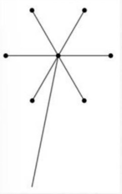

<!-- hyz-paper-id: 01a1af25-d012-7490-b39f-1fae2ae13135 -->

# 排列组合（一）

## Question 240

<!-- hyz-question-id: 01a1af25-d012-7490-b39f-1fbba6d6e609 -->
```yaml
module: 数量关系
category: "加乘原则"
```
### Stem
3个人排成一列，有多少种排法？

### Options


### Answer

### Explanation

## Question 241

<!-- hyz-question-id: 01a1af25-d012-7490-b39f-1fc7e470272f -->
```yaml
module: 数量关系
category: "加乘原则"
```
### Stem
6个人中挑3个人排成一列，有多少种排法？

### Options


### Answer

### Explanation

## Question 242

<!-- hyz-question-id: 01a1af25-d012-7490-b39f-1fdae45f4b72 -->
```yaml
module: 数量关系
category: "加乘原则"
```
### Stem
甲乙丙丁戊5个人排成一列，其中甲乙是朋友，两个人必须排在相邻位置，有多少种排法？

### Options


### Answer

### Explanation

## Question 243

<!-- hyz-question-id: 01a1af25-d012-7490-b39f-1fe7568adc5c -->
```yaml
module: 数量关系
category: "加乘原则"
```
### Stem
还是上面排队问题条件，如果今天老师突然允许甲乙两个人并排排队，他俩直接并排手拉手了，那么这5人在前后位置上的排法（不考虑甲乙的左右顺序）有多少种？

### Options


### Answer

### Explanation

## Question 244

<!-- hyz-question-id: 01a1af25-d012-7490-b39f-1fffcc55a885 -->
```yaml
module: 数量关系
category: "加乘原则"
```
### Stem
将5个不同颜色的锦囊放入4个不同的锦盒里，如果允许锦盒是空的，则所有可能的放置方法有：

### Options
- A. 5种
- B. $4^{5}$种
- C. $5^{4}$种
- D. 120种

### Answer

### Explanation

## Question 245

<!-- hyz-question-id: 01a1af25-d012-7490-b39f-200fd6397a8f -->
```yaml
module: 数量关系
category: "加乘原则"
```
### Stem
一张节目表上原有3个节目，如果保持这3个节目的相对顺序不变，再添进去2个新节目，有多少种安排方法：

### Options
- A. 20
- B. 12
- C. 6
- D. 4

### Answer

### Explanation

## Question 246

<!-- hyz-question-id: 01a1af25-d012-7490-b39f-2012da69d77a -->
```yaml
module: 数量关系
category: "加乘原则"
```
### Stem
小明、小红、小王、小李四位同学应聘某知名企业，企业只计划招录2位同学，有多少种招录可能？

### Options


### Answer

### Explanation

## Question 247

<!-- hyz-question-id: 01a1af25-d012-7490-b39f-20244d7a10f9 -->
```yaml
module: 数量关系
category: "加乘原则"
```
### Stem
小明、小红、小王、小李4位毕业生去甲、乙、丙3个单位报道，每个单位至少1位毕业生，有多少种报道方式

### Options


### Answer

### Explanation

## Question 248

<!-- hyz-question-id: 01a1af25-d012-7490-b39f-20327e731585 -->
```yaml
module: 数量关系
category: "加乘原则"
```
### Stem
小明、小红、小王、小李、小胡5位毕业生去甲、乙、丙3个单位报道，每个单位至少1位毕业生，有多少种报道方式？

### Options


### Answer

### Explanation

## Question 249

<!-- hyz-question-id: 01a1af25-d012-7490-b39f-204e4b19b845 -->
```yaml
module: 数量关系
category: "加乘原则"
```
### Stem
从六本不同的书里分别取两本给小明和小红，共有几种方案？

### Options
- A. 90种
- B. 360种
- C. 180种
- D. 270种

### Answer

### Explanation

## Question 250

<!-- hyz-question-id: 01a1af25-d012-7490-b39f-205b7d1a8799 -->
```yaml
module: 数量关系
category: "加乘原则"
```
### Stem
从六本不同的书里分别取两本给小明和小红用来上午和下午各看一本，共有几种方案？

### Options
- A. 90种
- B. 360种
- C. 180种
- D. 270种

### Answer

### Explanation

## Question 251

<!-- hyz-question-id: 01a1af25-d012-7490-b39f-20665a25a924 -->
```yaml
module: 数量关系
category: "加乘原则"
```
### Stem
从六本不同的书里分别取三本给小明和小红，共有几种方案？

### Options
- A. 10种
- B. 20种
- C. 40种
- D. 30种

### Answer

### Explanation

## Question 252

<!-- hyz-question-id: 01a1af25-d012-7490-b39f-2072ed27082f -->
```yaml
module: 数量关系
category: "正面排列组合"
```
### Stem
厨师要从6种主料中选取2种，8种辅料中选取3种烹制一道菜肴，问最多可以烹制多少种不同的菜肴？（ ）

### Options
- A. 288
- B. 360
- C. 420
- D. 840

### Answer

### Explanation

## Question 253

<!-- hyz-question-id: 01a1af25-d012-7490-b39f-208f086ffdea -->
```yaml
module: 数量关系
category: "正面排列组合"
```
### Stem
某企业最近招聘了5名新员工，女员工比男员工多一名，现随机分配到三个部门学习，每个部门至少分配一名员工，而且最多不能超过两名员工。同一个部门分配到的员工性别不能相同。请问共有（ ）种分配结果。

### Options
- A. 18
- B. 20
- C. 25
- D. 36

### Answer

### Explanation

## Question 254

<!-- hyz-question-id: 01a1af25-d012-7490-b39f-2097a61f3f5c -->
```yaml
module: 数量关系
category: "正面排列组合"
```
### Stem
某交警大队的16名民警中，男性为10人，现要选4人进行夜间巡逻工作，要求男性民警不得少于2名，问有多少种选人方法？

### Options
- A. 1605
- B. 1520
- C. 1071
- D. 930

### Answer

### Explanation

## Question 255

<!-- hyz-question-id: 01a1af25-d012-7490-b39f-20a377e8dfb8 -->
```yaml
module: 数量关系
category: "正面排列组合"
```
### Stem
例题：某单位新来了4名实习生，要将其分配到3个部门，每个部门至少分配1人，则不同的分配方案有（ ）种。

### Options
- A. 24
- B. 36
- C. 64
- D. 72

### Answer

### Explanation

## Question 256

<!-- hyz-question-id: 01a1af25-d012-7490-b39f-20b7796c1604 -->
```yaml
module: 数量关系
category: "正面排列组合"
```
### Stem
甲乙丙丁戊5人负责周一至周三安保，要求每天至少一人不超过两人。每人只参加一天，问共有多少种安排？

### Options
- A. 60种
- B. 90种
- C. 120种
- D. 180种

### Answer

### Explanation

## Question 257

<!-- hyz-question-id: 01a1af25-d012-7490-b39f-20c7ab2263e6 -->
```yaml
module: 数量关系
category: "正面排列组合"
```
### Stem
为了加强某社区消防安全意识，某消防支队对该社区的4栋居民楼开展消防安全检查，该支队6名消防员负责此次安全检查，规定任一栋居民楼保证至少一名消防员前往。若同时开始检查，问共有多少种检查方式？（ ）

### Options
- A. 1560
- B. 3240
- C. 6300
- D. 7200

### Answer

### Explanation

## Question 258

<!-- hyz-question-id: 01a1af25-d012-7490-b39f-20dfe1505fc6 -->
```yaml
module: 数量关系
category: "正面排列组合"
```
### Stem
扶贫攻坚期间，某单位将5户不同贫困程度的贫困户分给3位帮扶干部，要求每名干部最多分到2户，其中老王主动要求结对帮扶最困难的一户，则剩余4户共有多少种不同的分配方案？

### Options
- A. 18种
- B. 24种
- C. 30种
- D. 36种

### Answer

### Explanation

## Question 259

<!-- hyz-question-id: 01a1af25-d012-7490-b39f-20ebd2bfb3b3 -->
```yaml
module: 数量关系
category: "反面排列组合"
```
### Stem
某高校开设A类选修课四门、B类选修课三门。小刘从中选取四门课程，若要求两类课程各至少选一门，则选法有：

### Options
- A. 18种
- B. 22种
- C. 26种
- D. 34种

### Answer

### Explanation

## Question 260

<!-- hyz-question-id: 01a1af25-d012-7490-b39f-20fdd15f93c3 -->
```yaml
module: 数量关系
category: "反面排列组合"
```
### Stem
院长要从4位外科医生和4位内科医生中选出4人去甲医院进行学习交流，要求外科医生和内科医生均至少要选1人，则共有（ ）种不同的选法。（其中没有人既是外科医生又是内科医生）

### Options
- A. 56
- B. 60
- C. 65
- D. 68

### Answer

### Explanation

## Question 261

<!-- hyz-question-id: 01a1af25-d012-7490-b39f-210ddf5f3906 -->
```yaml
module: 数量关系
category: "反面排列组合"
```
### Stem
单位3个科室分别有7名、9名和6名职工。现抽调2名来自不同科室的职工参加调研活动，问有多少种不同的挑选方式？

### Options
- A. 146
- B. 159
- C. 179
- D. 286

### Answer

### Explanation

## Question 262

<!-- hyz-question-id: 01a1af25-d012-7490-b39f-211306508f84 -->
```yaml
module: 数量关系
category: "反面排列组合"
```
### Stem
甲、乙、丙、丁四个班级分别派出两个代表参加羽毛球比赛。要求任意两个人之间比赛一场，并且同一个班级的两个代表之间不比赛，则一共需要安排（ ）场比赛。

### Options
- A. 16
- B. 24
- C. 30
- D. 32

### Answer

### Explanation

## Question 263

<!-- hyz-question-id: 01a1af25-d012-7490-b39f-2129d85a3abb -->
```yaml
module: 数量关系
category: "反面容斥思想"
```
### Stem
某公司推出4款杯子，分别为陶瓷杯、玻璃杯、木质杯和不锈钢杯，现将4个杯子放进展柜排成一排展示，要求玻璃杯不能放在两端，木质杯和不锈钢杯不能相邻，那么可能会出现多少种排列方式？（ ）

### Options
- A. 8
- B. 12
- C. 16
- D. 20

### Answer

### Explanation

## Question 264

<!-- hyz-question-id: 01a1af25-d012-7490-b39f-2135419aebd9 -->
```yaml
module: 数量关系
category: "反面容斥思想"
```
### Stem
某企业从10名高级管理人员中选出3人参加国际会议。在10名高级管理人员中，有一线生产经验的有6人、有研发经验的有5人，另有2人既无一线生产经验也无研发经验。如果要求选出的人中，具备一线生产经验的人和具备研发经验的人都必须有，问有多少种不同的选择方式？

### Options
- A. 96
- B. 100
- C. 106
- D. 112

### Answer

### Explanation

## Question 265

<!-- hyz-question-id: 01a1af25-d012-7490-b39f-2148906c45f6 -->
```yaml
module: 数量关系
category: "反面容斥思想"
```
### Stem
某三甲医院派甲乙丙丁四名医生到ABCD四个社区义诊，每个医生只负责一个社区。已知甲不去A社区，且如果丙去C社区，那么丁去D社区，则不同的派法共有：

### Options
- A. 15种
- B. 18种
- C. 21种
- D. 24种

### Answer

### Explanation

## Question 266

<!-- hyz-question-id: 01a1af25-d012-7490-b39f-2154bf26b215 -->
```yaml
module: 数量关系
category: "环形排列"
```
### Stem
5名公司职员坐在圆桌上吃饭，问共有多少种不同的坐法？

### Options
- A. 24
- B. 48
- C. 60
- D. 120

### Answer

### Explanation

## Question 267

<!-- hyz-question-id: 01a1af25-d012-7490-b39f-216317408a9a -->
```yaml
module: 数量关系
category: "环形排列"
```
### Stem
甲参加公司团建，其中一个项目就是做手工风车，要将材料袋中的七个不同卡通头像贴在如图所示的七个圆点处。则做出来的风车一共的可能性有多少种？


### Options
- A. 7
- B. 140
- C. 840
- D. 5040

### Answer

### Explanation

## Question 268

<!-- hyz-question-id: 01a1af25-d012-7490-b39f-2170fe149f4e -->
```yaml
module: 数量关系
category: "环形排列"
```
### Stem
有8个小朋友需要一起吃午饭，一共有两张桌子，一张圆桌可以坐5个人，一张方桌可以坐3个人。请问坐在圆桌上的小朋友共有多少种坐法？

### Options
- A. 1200
- B. 1344
- C. 3344
- D. 6720

### Answer

### Explanation

## Question 269

<!-- hyz-question-id: 01a1af25-d012-7490-b39f-218b52b0df41 -->
```yaml
module: 数量关系
category: "环形排列"
```
### Stem
有5对夫妇参加一场婚宴，他们被安排在一张10个座位的圆桌就餐，问5对夫妇恰好都被安排在一起相邻而坐的情况有多少种

### Options
- A. 384种
- B. 768种
- C. 3840种
- D. 7680种

### Answer

### Explanation
