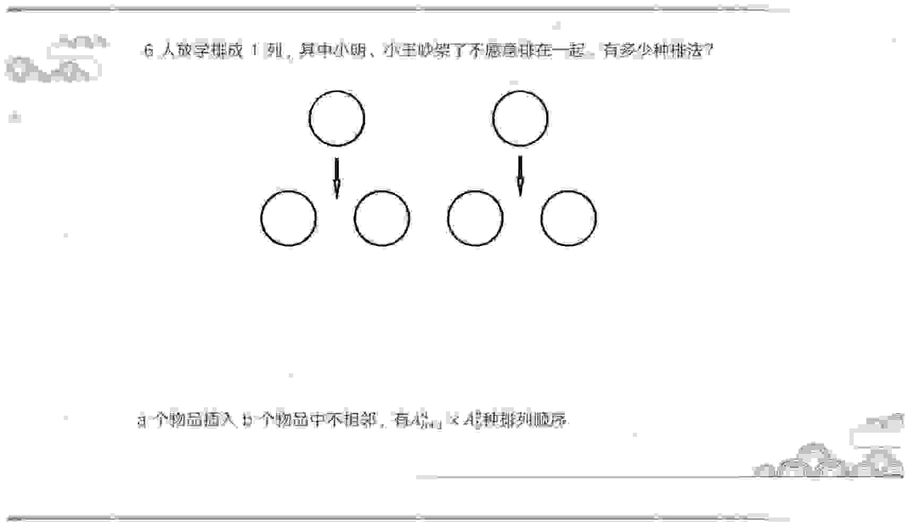

<!-- hyz-paper-id: 01a1af25-d019-7303-b667-eb584bb10f18 -->

# 排列组合（二）

## Question 270

<!-- hyz-question-id: 01a1af25-d019-7303-b667-eb682d82ce26 -->
```yaml
module: 数量关系
category: "插空法——不相邻"
```
### Stem
6人放学排成1列，其中小明、小王吵架了不愿意排在一起，有多少种排法？



### Options


### Answer

### Explanation

## Question 271

<!-- hyz-question-id: 01a1af25-d019-7303-b667-eb7fd70a9c42 -->
```yaml
module: 数量关系
category: "插空法——不相邻"
```
### Stem
在一张节目单中原有6个节目，若保持这些节目的相对顺序不变，再添加进去3个小品，这3个小品为了避免审美疲劳不能相邻，则所有不同的添加方法共有多少种？

### Options


### Answer

### Explanation

## Question 272

<!-- hyz-question-id: 01a1af25-d019-7303-b667-eb8d162c80a9 -->
```yaml
module: 数量关系
category: "插空法——不相邻"
```
### Stem
某学习平台的学习内容由观看视频、阅读文章、收藏分享、论坛交流、考试答题五个部分组成。某学员要先后学完这五个部分，若观看视频和阅读文章不能连续进行，该学员学习顺序的选择有：

### Options
- A. 24种
- B. 72种
- C. 96种
- D. 120种

### Answer

### Explanation

## Question 273

<!-- hyz-question-id: 01a1af25-d019-7303-b667-eb9b692f9c45 -->
```yaml
module: 数量关系
category: "插空法——不相邻"
```
### Stem
有4位老人、2位青年，3位小孩排成一列，老人不能相邻。则有（ ）种排列。

### Options
- A. 54300
- B. 3000
- C. 2880
- D. 43200

### Answer

### Explanation

## Question 274

<!-- hyz-question-id: 01a1af25-d019-7303-b667-eba6001dd2fd -->
```yaml
module: 数量关系
category: "插空法——不相邻"
```
### Stem
某庆典仪式上准备表彰5位先进工作者。5人排成一排依次上台，张洁不能排在最后一个，李豪不能和张洁相邻，问可能有多少种上台顺序？

### Options
- A. 18
- B. 30
- C. 42
- D. 54

### Answer

### Explanation

## Question 275

<!-- hyz-question-id: 01a1af25-d019-7303-b667-ebbc87b3ba4e -->
```yaml
module: 数量关系
category: "插空法——不相邻"
```
### Stem
某篮球队12个人的球衣号码是从4到15的自然数，如从中任意选出3个人参加三对三篮球赛，则选出的人中至少有两人的球衣号码是相邻自然数的情况为多少：

### Options
- A. 90
- B. 100
- C. 120
- D. 130

### Answer

### Explanation

## Question 276

<!-- hyz-question-id: 01a1af25-d019-7303-b667-ebc900aa3ace -->
```yaml
module: 数量关系
category: "插空法——不相邻"
```
### Stem
某条道路一侧共有20盏路灯。为了节约用电，计划只打开其中的10盏。但为了不影响行路安全，要求相邻的两盏路灯中至少有一盏是打开的，则共有（ ）种开灯方案。

### Options
- A. 2
- B. 6
- C. 11
- D. 13

### Answer

### Explanation

## Question 277

<!-- hyz-question-id: 01a1af25-d019-7303-b667-ebd8464ac155 -->
```yaml
module: 数量关系
category: "停车不相邻问题"
```
### Stem
某车库有10个并排的车位，有3辆不同的车要停进这10个车位之中，而且彼此不能相邻，则有多少种不同的停放方法？

### Options
- A. 336
- B. 246
- C. 156
- D. 66

### Answer

### Explanation

## Question 278

<!-- hyz-question-id: 01a1af25-d019-7303-b667-ebe6763b88e4 -->
```yaml
module: 数量关系
category: "停车不相邻问题"
```
### Stem
小区内空着一排相邻的8个车位，现有4辆车随机停进车位，恰好没有连续空位的停车方式共有多少种？

### Options
- A. 48
- B. 120
- C. 360
- D. 1440

### Answer

### Explanation

## Question 279

<!-- hyz-question-id: 01a1af25-d019-7303-b667-ebfef553b79d -->
```yaml
module: 数量关系
category: "不相邻的隔板思想"
```
### Stem
6人放学排成1列，其中小明小王吵架了不愿意排在一起，有多少种排法？

### Options


### Answer

### Explanation

## Question 280

<!-- hyz-question-id: 01a1af25-d019-7303-b667-ec0ab07a9f34 -->
```yaml
module: 数量关系
category: "不相邻的隔板思想"
```
### Stem
如果是10个对象，小明小王中间起码要隔3个对象，有多少种排法？

### Options


### Answer

### Explanation

## Question 281

<!-- hyz-question-id: 01a1af25-d019-7303-b667-ec11024a9ca2 -->
```yaml
module: 数量关系
category: "不相邻的隔板思想"
```
### Stem
甲到飞机场坐飞机，飞机场的十二个登机口排成一条直线，相邻两个登机口之间相距50米。甲在登机口等待时被告知登机口更改了，那么甲走到新登机口的距离不超过200米的概率是：

### Options
- A. $\frac{1}{2}$
- B. $\frac{4}{11}$
- C. $\frac{8}{11}$
- D. $\frac{19}{33}$

### Answer

### Explanation

## Question 282

<!-- hyz-question-id: 01a1af25-d019-7303-b667-ec2c622e249c -->
```yaml
module: 数量关系
category: "不相邻的隔板思想"
```
### Stem
某单位组织员工参加业务培训，小王和小李所在部门员工10人在同一排就坐，一排正好10个座位，假设座位是随机安排的。问小王和小李之间相隔人数小于等于3人的概率为多少？

### Options
- A. $\frac{1}{3}$
- B. $\frac{1}{2}$
- C. $\frac{8}{15}$
- D. $\frac{2}{3}$

### Answer

### Explanation

## Question 283

<!-- hyz-question-id: 01a1af25-d019-7303-b667-ec335e72d5f3 -->
```yaml
module: 数量关系
category: "不相邻的隔板思想"
```
### Stem
办公室8名员工围着一张圆桌就座准备用餐，此时又有3名加完班的员工在已就座的员工中间加座并参加用餐。已知加座后，3名加完班的员工彼此都不相邻，且8名已就座的员工最多与1名加完班的员工相邻。问有多少种不同的加座方式？

### Options
- A. 336
- B. 96
- C. 48
- D. 30

### Answer

### Explanation

## Question 284

<!-- hyz-question-id: 01a1af25-d019-7303-b667-ec4f2630c431 -->
```yaml
module: 数量关系
category: "插空法"
```
### Stem
①10个苹果平均分给4个组，每个组至少1个，有多少种分法？

### Options


### Answer

### Explanation

## Question 285

<!-- hyz-question-id: 01a1af25-d019-7303-b667-ec5e7e0e8771 -->
```yaml
module: 数量关系
category: "插空法"
```
### Stem
②10个苹果平均分给4个组，有多少种分法？

### Options


### Answer

### Explanation

## Question 286

<!-- hyz-question-id: 01a1af25-d019-7303-b667-ec6ad78cf369 -->
```yaml
module: 数量关系
category: "插空法"
```
### Stem
③10个苹果平均分给4个组，每个组至少2个，有多少种分法？

### Options


### Answer

### Explanation

## Question 287

<!-- hyz-question-id: 01a1af25-d019-7303-b667-ec7f8b286563 -->
```yaml
module: 数量关系
category: "插空法"
```
### Stem
某小学三年级有4个班，学校给他们订了6份相同的报纸，把这6份报纸分入这4班、每个班至少分1份报纸的方法有（ ）种。

### Options
- A. 6
- B. 4
- C. 8
- D. 10

### Answer

### Explanation

## Question 288

<!-- hyz-question-id: 01a1af25-d019-7303-b667-ec8bdd076a17 -->
```yaml
module: 数量关系
category: "插空法"
```
### Stem
张阿姨将一个蛋糕平均分成7块，分给4个小朋友，要求每个小朋友至少分得1块小蛋糕，一共有（ ）种分配方法。

### Options
- A. 14
- B. 18
- C. 20
- D. 22

### Answer

### Explanation

## Question 289

<!-- hyz-question-id: 01a1af25-d019-7303-b667-ec97044449bd -->
```yaml
module: 数量关系
category: "插空法"
```
### Stem
某城市一条道路上有4个十字路口，每个十字路口至少有一名交通协管员，现将8个协管员名额分配到这4个路口，则每个路口协管员名额的分配方案有：

### Options
- A. 35种
- B. 70种
- C. 96种
- D. 114种

### Answer

### Explanation

## Question 290

<!-- hyz-question-id: 01a1af25-d019-7303-b667-eca1b41e18ae -->
```yaml
module: 数量关系
category: "插空法"
```
### Stem
单位复印了30份学习资料发放给3个部门，每个部门至少发放9份材料。问：共有多少种不同的发放方法？

### Options
- A. 7
- B. 9
- C. 10
- D. 12

### Answer

### Explanation

## Question 291

<!-- hyz-question-id: 01a1af25-d019-7303-b667-ecb551020b00 -->
```yaml
module: 数量关系
category: "插空法"
```
### Stem
有5个运动员名额，分给4个班，有多少种分配方案？

### Options
- A. 24
- B. 28
- C. 48
- D. 56

### Answer

### Explanation

## Question 292

<!-- hyz-question-id: 01a1af25-d019-7303-b667-eccfa1224021 -->
```yaml
module: 数量关系
category: "插空法"
```
### Stem
某公司从甲、乙、丙部门中评选优秀员工。已知甲部门的优秀员工人数分别是乙、丙部门的2倍和3倍，且乙部门的优秀员工数量比丙部门多2人。若重新分配评优名额，总名额不变且甲部门至少会分得4个名额，则共有多少种分配方法？

### Options
- A. 190
- B. 210
- C. 231
- D. 235

### Answer

### Explanation

## Question 293

<!-- hyz-question-id: 01a1af25-d019-7303-b667-ecdc72bbb8ee -->
```yaml
module: 数量关系
category: "插空法"
```
### Stem
某单位将11本《党员学习手册》分发给甲、乙、丙共3个党支部。已知甲支部至少分得3本，乙支部至少分得2本，丙支部至少分得4本，问一共有多少种不同的分配方式？（ ）

### Options
- A. 3
- B. 4
- C. 5
- D. 6

### Answer

### Explanation

## Question 294

<!-- hyz-question-id: 01a1af25-d019-7303-b667-ece29bf50e01 -->
```yaml
module: 数量关系
category: "插空法"
```
### Stem
某学院由行政教辅和三个不同的教学研究室构成，现引进8台相同教学设备，每个教学研究室至少分2台，行政教辅无要求。问一共有多少种不同分法（ ）。

### Options
- A. 6
- B. 8
- C. 10
- D. 12

### Answer

### Explanation

## Question 295

<!-- hyz-question-id: 01a1af25-d019-7303-b667-ecf8227b7206 -->
```yaml
module: 数量关系
category: "插空法"
```
### Stem
办公室8名员工围着一张圆桌就座准备用餐，此时又有3名加完班的员工在已就座的员工中间加座并参加用餐。已知加座后，3名加完班的员工彼此都不相邻，且8名已就座的员工最多与1名加完班的员工相邻。问有多少种不同的加座方式？

### Options
- A. 336
- B. 96
- C. 48
- D. 30

### Answer

### Explanation

## Question 296

<!-- hyz-question-id: 01a1af25-d019-7303-b667-ed0ddd0a8a52 -->
```yaml
module: 数量关系
category: "反向分堆"
```
### Stem
有20颗苹果，打算全部分发给A、B、C三人，每人最多拿8个，则有（ ）种分发方式。

### Options
- A. 3
- B. 15
- C. 21
- D. 36

### Answer

### Explanation

## Question 297

<!-- hyz-question-id: 01a1af25-d019-7303-b667-ed183b1f1f5a -->
```yaml
module: 数量关系
category: "反向分堆"
```
### Stem
某人有一个保险箱，密码由三位1~9的数组成，某天他忘记了密码是多少，但是他记得各个位数上数字之和为16，则密码有多少种可能？

### Options
- A. 60
- B. 84
- C. 105
- D. 120

### Answer

### Explanation

## Question 298

<!-- hyz-question-id: 01a1af25-d019-7303-b667-ed272a7a96d6 -->
```yaml
module: 数量关系
category: "反向分堆"
```
### Stem
有一批长度分别为3、4、5、6和7厘米的细木条，它们的数量足够多，从中适当选取3根木条作为三角形的三条边，可能围成多少个不同的三角形？

### Options
- A. 25个
- B. 28个
- C. 30个
- D. 32个

### Answer

### Explanation

## Question 299

<!-- hyz-question-id: 01a1af25-d019-7303-b667-ed3bb30af2b5 -->
```yaml
module: 数量关系
category: "定序问题"
```
### Stem
7人排队，其中甲、乙、丙三人顺序固定，这7人有多少种排列可能？

### Options
- A. 420
- B. 840
- C. 1260
- D. 2520

### Answer

### Explanation

## Question 300

<!-- hyz-question-id: 01a1af25-d019-7303-b667-ed48516c52a6 -->
```yaml
module: 数量关系
category: "定序问题"
```
### Stem
10位身高不同的同学分成两排，每排5人，要求每一排由左至右身高依次变高，那么有多少种排列方式？

### Options
- A. 252
- B. 1260
- C. 3150
- D. 6300

### Answer

### Explanation

## Question 301

<!-- hyz-question-id: 01a1af25-d019-7303-b667-ed51f282f10b -->
```yaml
module: 数量关系
category: "定序问题"
```
### Stem
某部门里身高各不相同的8人一起排练合唱节目。合唱要求8人排成两排，前后人员对齐，但要求后排的每个人要比站其前面的那个人高，以不被挡住。则这8人的站位方法有（ ）种。

### Options
- A. 980
- B. 1260
- C. 1860
- D. 2520

### Answer

### Explanation

## Question 302

<!-- hyz-question-id: 01a1af25-d019-7303-b667-ed6586cc65c1 -->
```yaml
module: 数量关系
category: "定序问题"
```
### Stem
712934856是一个包含1至9每个数字恰好一次的九位数，它具有以下特征：数字1至6在其中是从小到大排列的，但是数字1至7不是从小到大排列的。则符合这种特征的九位数共有多少个？

### Options
- A. 12
- B. 336
- C. 432
- D. 504

### Answer

### Explanation
