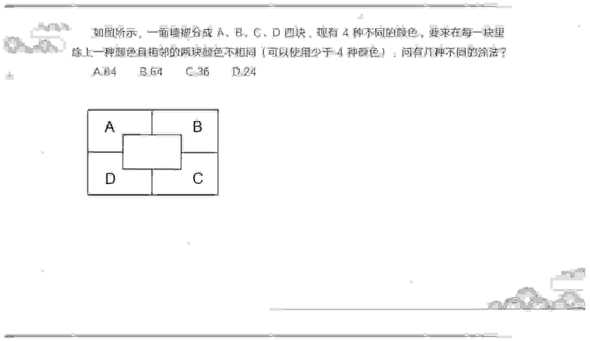
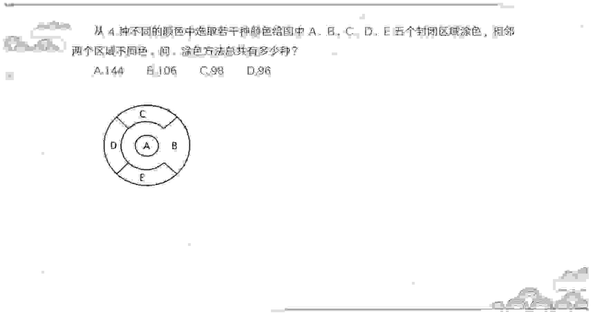
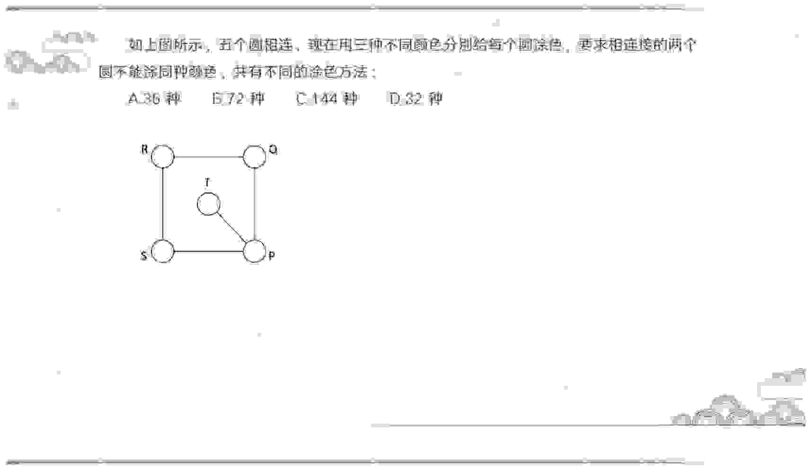
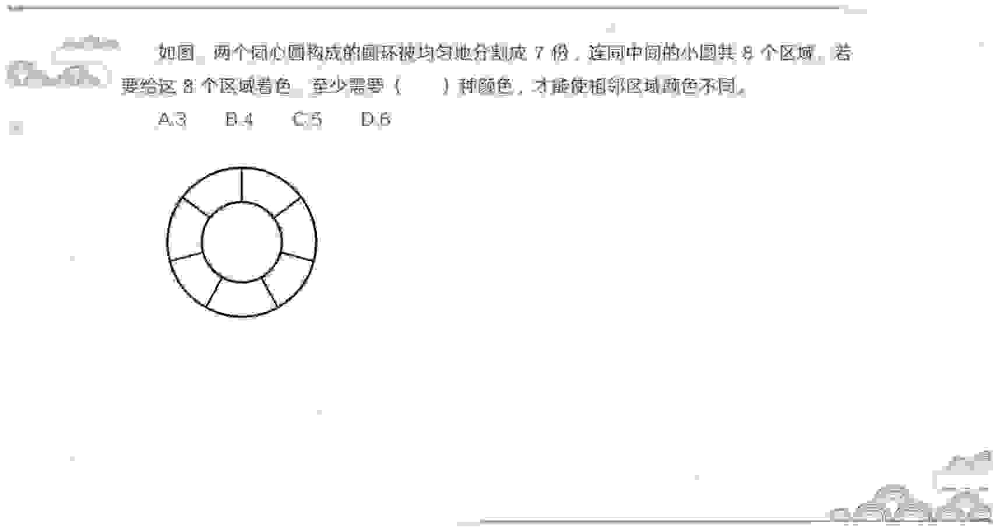
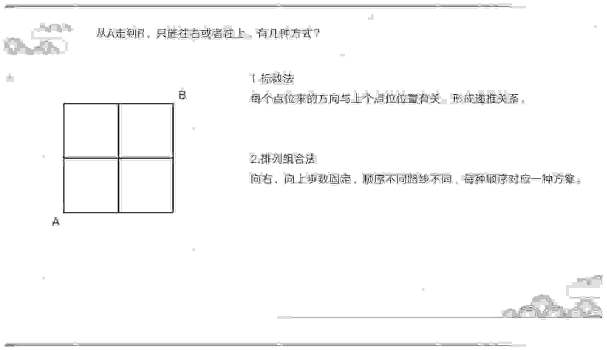
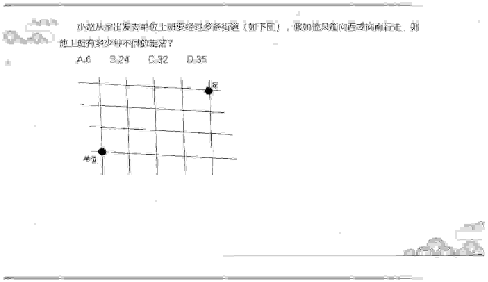
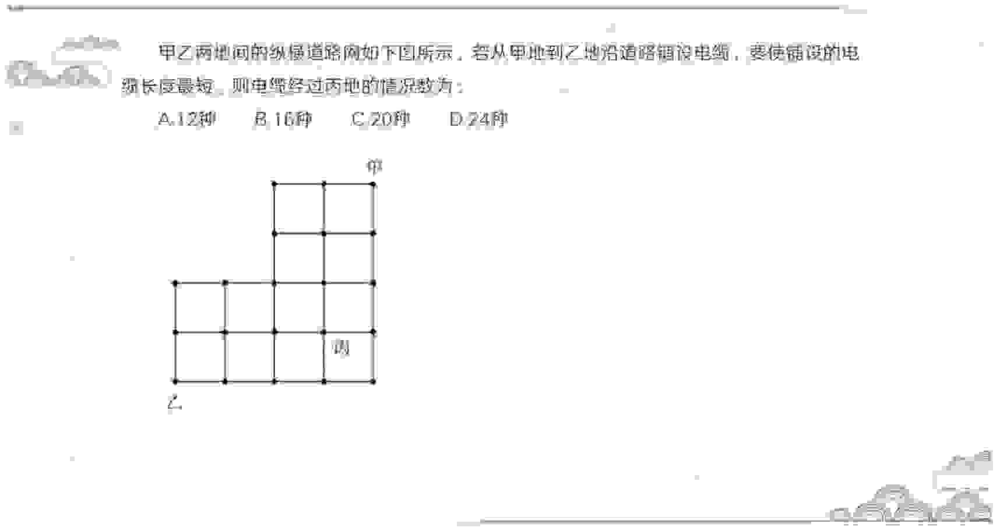
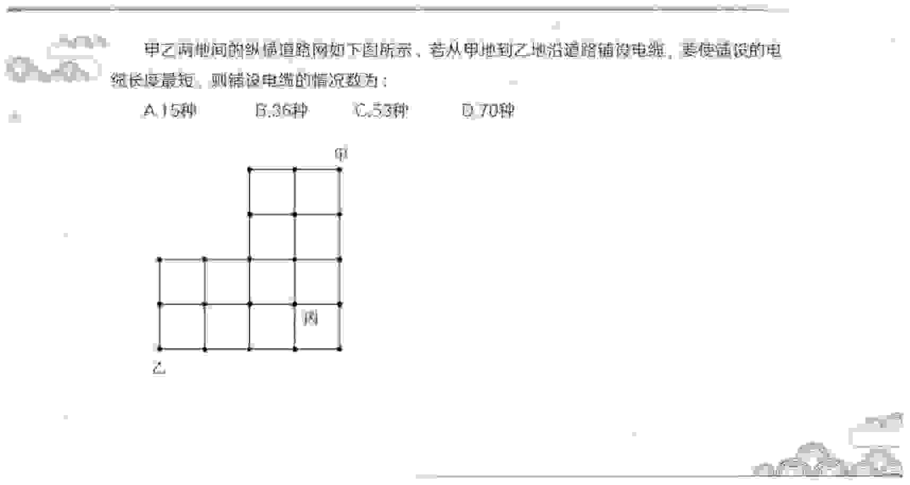

<!-- hyz-paper-id: 01a1af25-d01f-7921-b061-ee653184bd09 -->

# 排列组合（三）

## Question 303

<!-- hyz-question-id: 01a1af25-d01f-7921-b061-ee72437f9c3c -->
```yaml
module: 数量关系
category: "多面手问题"
```
### Stem
某国际会议需要翻译人员服务，现有翻译人员11人，其中5人只会英语，4人只会日语，另外2人不仅会英语也会日语。现从这11人中选4人当英语翻译，再从其余人中选4人当日语翻译，则不同的安排方法共有（ ）种。

### Options
- A. 145
- B. 160
- C. 185
- D. 190

### Answer

### Explanation

## Question 304

<!-- hyz-question-id: 01a1af25-d01f-7921-b061-ee8796be471c -->
```yaml
module: 数量关系
category: "多面手问题"
```
### Stem
某龙舟队有9名队员，其中3人只会划左舷，4人只会划右舷，2人既会划左舷又会划右舷。现要选排划左舷的3人、划右舷的3人共6人去参加比赛，则不同的选派方法共有（ ）

### Options
- A. 56种
- B. 68种
- C. 74种
- D. 92种

### Answer

### Explanation

## Question 305

<!-- hyz-question-id: 01a1af25-d01f-7921-b061-ee99642dd336 -->
```yaml
module: 数量关系
category: "循环赛问题"
```
### Stem
在一次同学聚会中，每两名同学之间都互送了一件礼物，所有同学共送了 90 件礼物，共有（ ）名同学参加了这次聚会。

### Options
- A. 45
- B. 30
- C. 9
- D. 10

### Answer

### Explanation

## Question 306

<!-- hyz-question-id: 01a1af25-d01f-7921-b061-eea0b3288644 -->
```yaml
module: 数量关系
category: "循环赛问题"
```
### Stem
某公司举办新年联欢会，游戏节目上要求所有人排开并围成一个圆，且每人需与其不相邻的人之间彼此握手。若此游戏中共握手 170 次，则参加联欢会的共有（ ）人。

### Options
- A. 17
- B. 20
- C. 34
- D. 40

### Answer

### Explanation

## Question 307

<!-- hyz-question-id: 01a1af25-d01f-7921-b061-eebf91a08c7f -->
```yaml
module: 数量关系
category: "循环赛问题"
```
### Stem
36 名乒乓球运动员参加单打比赛，两两配对进行淘汰赛，要决出冠军，一共要比赛多少场？

### Options
- A. 18
- B. 36
- C. 35
- D. 27

### Answer

### Explanation

## Question 308

<!-- hyz-question-id: 01a1af25-d01f-7921-b061-eecfb1cbd13f -->
```yaml
module: 数量关系
category: "循环赛问题"
```
### Stem
有 5 支足球队进行单循环比赛，每场比赛胜者得 3 分，负者不得分，平局双方各得 1 分。比赛结束后，若 5 支球队的总得分为 25 分，冠军得 12 分，则亚军得

### Options
- A. 5 分
- B. 6 分
- C. 7 分
- D. 8 分

### Answer

### Explanation

## Question 309

<!-- hyz-question-id: 01a1af25-d01f-7921-b061-eede86766c4e -->
```yaml
module: 数量关系
category: "循环赛问题"
```
### Stem

A、B、C、D 四支球队开展篮球比赛，每两个队之间都要比赛 1 场，已知 A 队已比赛了 3 场，B 队已比赛了 2 场，C 队已比赛了 1 场，D 队已比赛了几场？

### Options
- A. 3
- B. 2
- C. 1
- D. 0

### Answer

### Explanation

## Question 310

<!-- hyz-question-id: 01a1af25-d01f-7921-b061-eeed9d467ef9 -->
```yaml
module: 数量关系
category: "最不利问题"
```
### Stem
某单位自建图书馆，有经济类、管理类和期刊三种读物，规定每位员工可以借阅两种不同类型的读物。至少有（ ）位员工来借阅读物，才一定会有两位员工借阅的读物类型相同。

### Options
- A. 3
- B. 7
- C. 9
- D. 15

### Answer

### Explanation

## Question 311

<!-- hyz-question-id: 01a1af25-d01f-7921-b061-eefb41e2f8d8 -->
```yaml
module: 数量关系
category: "最不利问题"
```
### Stem
新年晚会上，老师让每位同学从一个装有许多玻璃球的口袋中摸了两个球，这些球给人的手感相同，只有红、黄、白、蓝、绿五色之分，结果发现总有 2 个人取出的 2 个球颜色组合相同。由此可知，参加取球的至少有多少人？（ ）

### Options
- A. 13
- B. 14
- C. 15
- D. 16

### Answer

### Explanation

## Question 312

<!-- hyz-question-id: 01a1af25-d01f-7921-b061-ef000b9658fb -->
```yaml
module: 数量关系
category: "最不利问题"
```
### Stem
某大学有一批研究生参加面试。面试考生从 5 个面试题中抽取 2 个答题。无论怎么抽题，结果还是有 3 名考生的试题相同。问该大学至少有多少研究生参加面试？

### Options
- A. 14
- B. 21
- C. 31
- D. 41

### Answer

### Explanation

## Question 313

<!-- hyz-question-id: 01a1af25-d01f-7921-b061-ef127e380365 -->
```yaml
module: 数量关系
category: "错位排列"
```
### Stem
四位同学的手机完全相同，他们将四部手机混放在一起再取回，只有一人拿到自己的手机，而其他三人均没有拿到自己的手机。这样的拿法共有多少种？

### Options
- A. 6 种
- B. 8 种
- C. 10 种
- D. 12 种

### Answer

### Explanation

## Question 314

<!-- hyz-question-id: 01a1af25-d01f-7921-b061-ef2e12b04fd0 -->
```yaml
module: 数量关系
category: "错位排列"
```
### Stem
六个瓶子都贴有标签，其中恰好贴错了四个，贴错的可能情况有多少种？

### Options
- A. 15 种
- B. 30 种
- C. 135 种
- D. 270 种

### Answer

### Explanation

## Question 315

<!-- hyz-question-id: 01a1af25-d01f-7921-b061-ef335e3234ea -->
```yaml
module: 数量关系
category: "涂色问题"
```
### Stem
如图所示，一面墙被分成 A、B、C、D 四块，现有 4 种不同的颜色，要求在每一块里涂上一种颜色且相邻的两块颜色不相同（可以使用少于 4 种颜色）。问有几种不同的涂法？



### Options
- A. 84
- B. 64
- C. 36
- D. 24

### Answer

### Explanation

## Question 316

<!-- hyz-question-id: 01a1af25-d01f-7921-b061-ef404960bc7e -->
```yaml
module: 数量关系
category: "涂色问题"
```
### Stem
从 4 种不同的颜色中选取若干种颜色给图中 A、B、C、D、E 五个封闭区域涂色，相邻两个区域不同色。问：涂色方法总共有多少种？



### Options
- A. 144
- B. 106
- C. 98
- D. 96

### Answer

### Explanation

## Question 317

<!-- hyz-question-id: 01a1af25-d01f-7921-b061-ef5082329c77 -->
```yaml
module: 数量关系
category: "涂色问题"
```
### Stem
如上图所示，五个圆相连，现在用三种不同颜色分别给每个圆涂色，要求相连的两个圆不能涂同种颜色，共有不同的涂色方法：



### Options
- A. 36 种
- B. 72 种
- C. 144 种
- D. 32 种

### Answer

### Explanation

## Question 318

<!-- hyz-question-id: 01a1af25-d01f-7921-b061-ef6cb6590c1b -->
```yaml
module: 数量关系
category: "涂色问题"
```
### Stem
如图，两个同心圆构成的圆环被均匀地分割成 7 份，连同中间的小圆共 8 个区域。若要给这 8 个区域着色，至少需要（ ）种颜色，才能使相邻区域颜色不同。



### Options
- A. 3
- B. 4
- C. 5
- D. 6

### Answer

### Explanation

## Question 319

<!-- hyz-question-id: 01a1af25-d01f-7921-b061-ef7ab7aca2d8 -->
```yaml
module: 数量关系
category: "递推问题"
```
### Stem
一个楼梯共有 9 级台阶，每步可以迈一级或二级台阶，问走完这个楼梯共有多少种不同的走法？（ ）

### Options
- A. 13
- B. 32
- C. 55
- D. 86

### Answer

### Explanation

## Question 320

<!-- hyz-question-id: 01a1af25-d01f-7921-b061-ef8bf3fd85db -->
```yaml
module: 数量关系
category: "递推问题"
```
### Stem
某自助餐厅提供羊肉串。小王怕浪费每次最多只拿 3 串。已知他正好吃了 10 串，那么他共有多少种不同的拿法？

### Options
- A. 44
- B. 81
- C. 149
- D. 274

### Answer

### Explanation

## Question 321

<!-- hyz-question-id: 01a1af25-d01f-7921-b061-ef9208894606 -->
```yaml
module: 数量关系
category: "递推问题"
```
### Stem
某路一侧有 8 盏灯，每盏灯都可能开着或者关着。为了行车安全，相邻的两盏灯不能都是关着的。有多少种开灯方案？

### Options
- A. 7
- B. 28
- C. 55
- D. 89

### Answer

### Explanation

## Question 322

<!-- hyz-question-id: 01a1af25-d01f-7921-b061-efa8c625a0fc -->
```yaml
module: 数量关系
category: "最短路径问题"
```
### Stem
从 A 地到 B 地的道路如图所示，所有转弯均为直角，问如果要以最短距离从 A 地到达 B 地，有多少种不同的走法可以选择？



### Options
- A. 14
- B. 15
- C. 18
- D. 21

### Answer

### Explanation

## Question 323

<!-- hyz-question-id: 01a1af25-d01f-7921-b061-efb0f47c1509 -->
```yaml
module: 数量关系
category: "最短路径问题"
```
### Stem
小赵从家出发去单位上班要经过多条街道（如下图），假如他只能向西或向南行走，则他上班有多少种不同的走法？



### Options
- A. 6
- B. 24
- C. 32
- D. 35

### Answer

### Explanation

## Question 324

<!-- hyz-question-id: 01a1af25-d01f-7921-b061-efc87063a179 -->
```yaml
module: 数量关系
category: "最短路径问题"
```
### Stem
甲乙两地间的纵横道路网如下图所示，若从甲地到乙地沿道路铺设电缆，要使铺设的电缆长度最短，则电缆经过丙地的情况数为：



### Options
- A. 12 种
- B. 16 种
- C. 20 种
- D. 24 种

### Answer

### Explanation

## Question 325

<!-- hyz-question-id: 01a1af25-d01f-7921-b061-efd85185c66a -->
```yaml
module: 数量关系
category: "最短路径问题"
```
### Stem
甲乙两地间的纵横道路网如下图所示，若从甲地到乙地沿道路铺设电缆，要使铺设的电缆长度最短，则铺设电缆的情况数为：



### Options
- A. 15 种
- B. 36 种
- C. 53 种
- D. 70 种

### Answer

### Explanation
