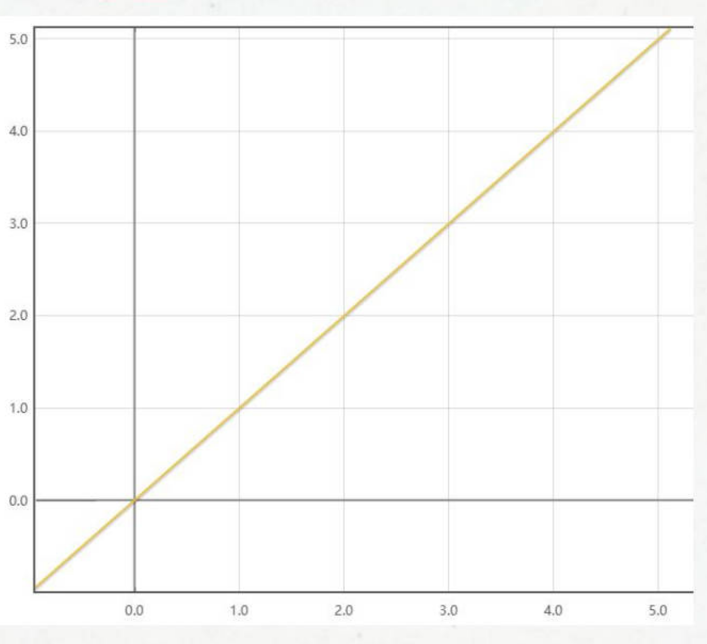

<!-- hyz-paper-id: 01a1af25-d024-70f2-8e01-d200a267530b -->

# 概率问题

## Question 326

<!-- hyz-question-id: 01a1af25-d024-70f2-8e01-d219b64b09ef -->
```yaml
module: 数量关系
category: "简单古典概率"
```
### Stem
小明开学新班级 40 人分座位，两人一桌当同桌，小明被安排在了门口第一个座位上，他的好兄弟小李可以和他坐一起的概率是多少？

### Options


### Answer

### Explanation

## Question 327

<!-- hyz-question-id: 01a1af25-d024-70f2-8e01-d22fec42b2c5 -->
```yaml
module: 数量关系
category: "简单古典概率"
```
### Stem
箱子里放有 10 个球，其中黑球 3 个，白球 3 个，黄球 4 个，从中任取 1 个球。恰好是一个黄球的概率是（ ）。

### Options


### Answer

### Explanation

## Question 328

<!-- hyz-question-id: 01a1af25-d024-70f2-8e01-d2316533c0fe -->
```yaml
module: 数量关系
category: "简单古典概率"
```
### Stem
箱子里放有 10 个球，其中黑球 3 个，白球 3 个，黄球 4 个，从中任取 3 个球。恰好是一个黄球、一个白球、一个黑球的概率是（ ）。

### Options
- A. 1/15
- B. 3/10
- C. 2/5
- D. 7/30

### Answer

### Explanation

## Question 329

<!-- hyz-question-id: 01a1af25-d024-70f2-8e01-d24071af5fa7 -->
```yaml
module: 数量关系
category: "简单古典概率"
```
### Stem
出租车司机李师傅有午睡的习惯，一天他午睡醒来，发现手机没电，手表停了，于是他只能打开收音机等待交通电台整点报时。如果他等待报时时间不超过 15 分钟，则这种可能性的大小为：

### Options
- A. 1/2
- B. 1/3
- C. 1/4
- D. 1/6

### Answer

### Explanation

## Question 330

<!-- hyz-question-id: 01a1af25-d024-70f2-8e01-d25c148bf0a1 -->
```yaml
module: 数量关系
category: "简单古典概率"
```
### Stem
某办公室 5 人中有 2 人精通德语。如从中任意选出 3 人，其中恰有 1 人精通德语的概率是多少？

### Options
- A. 0.5
- B. 0.6
- C. 0.7
- D. 0.75

### Answer

### Explanation

## Question 331

<!-- hyz-question-id: 01a1af25-d024-70f2-8e01-d266020b46a6 -->
```yaml
module: 数量关系
category: "简单古典概率"
```
### Stem
某单位举办年会有 4 个节目，现确定出场顺序为小品、歌曲、舞蹈和相声。现临时增加朗诵和魔术两个节目，在保持原节目相对出场顺序不变的情况下，朗诵和小品相邻的概率有多大？（ ）

### Options
- A. 1/2
- B. 1/3
- C. 1/4
- D. 2/3

### Answer

### Explanation

## Question 332

<!-- hyz-question-id: 01a1af25-d024-70f2-8e01-d27c1948d101 -->
```yaml
module: 数量关系
category: "简单古典概率"
```
### Stem
某小型公司有六名员工，男女各半，从中随机挑选两人外出培训，那么至少有一位女员工参加培训的概率（ ）。

### Options
- A. 1/6
- B. 2/5
- C. 3/5
- D. 4/5

### Answer

### Explanation

## Question 333

<!-- hyz-question-id: 01a1af25-d024-70f2-8e01-d28400b4018b -->
```yaml
module: 数量关系
category: "简单古典概率"
```
### Stem
银行卡的6位数字密码，一天中如被错误输入三次，银行卡将被锁卡。某人忘记密码中的最后一位数，只好随便输入。那么此人今天可以成功使用银行卡的概率约为（ ）。

### Options
- A. 33%
- B. 30%
- C. 27%
- D. 24%

### Answer

### Explanation

## Question 334

<!-- hyz-question-id: 01a1af25-d024-70f2-8e01-d2951304bc72 -->
```yaml
module: 数量关系
category: "简单古典概率"
```
### Stem
放学之前老师让学生抽签决定自己回家需不需要做一套试卷。班上10个人，设置10支签，其中3支写着“做试卷”、7支写着“休息”。
如果抽签完就放回，小明第3个去抽签，他抽中“做试卷”的概率是多少？
如果抽签完不放回呢？（前面人抽签完就拿走签）小明第3个去抽签，他抽中“做试卷”的概率是多少？
如果小明很爱学习，他直接第一个上来抽三次，那他能抽中的概率是多少？

### Options


### Answer

### Explanation

## Question 335

<!-- hyz-question-id: 01a1af25-d024-70f2-8e01-d2a660fe97c4 -->
```yaml
module: 数量关系
category: "简单古典概率"
```
### Stem
某个手机锁屏密码是三位数字，连续输错三次密码手机就会锁定5分钟。若密码的三字不重复，试图解锁的人也知道这一点，问他在五分钟内解锁成功的概率是多少？（ ）

### Options
- A. 1/240
- B. 1/360
- C. 1/480
- D. 1/960

### Answer

### Explanation

## Question 336

<!-- hyz-question-id: 01a1af25-d024-70f2-8e01-d2b0811058ac -->
```yaml
module: 数量关系
category: "条件概率"
```
### Stem
小陈上班要经过3个路口，在每个路口遇到红灯的概率分别是30%、40%、50%，则他上班至少遇到1个红灯的概率是：

### Options
- A. 35%
- B. 56%
- C. 65%
- D. 79%

### Answer

### Explanation

## Question 337

<!-- hyz-question-id: 01a1af25-d024-70f2-8e01-d2cb3121619b -->
```yaml
module: 数量关系
category: "条件概率"
```
### Stem
抛掷红、黄两颗骰子，当红色骰子的点数为4或6时，两颗骰子的点数之积大于20的概率是（ ）。

### Options
- A. 1/4
- B. 1/3
- C. 1/2
- D. 2/5

### Answer

### Explanation

## Question 338

<!-- hyz-question-id: 01a1af25-d024-70f2-8e01-d2d894c66d68 -->
```yaml
module: 数量关系
category: "条件概率"
```
### Stem
某学校举行迎新篝火晚会，100名新生随机围坐在篝火四周，其中，小张与小李是同桌，他俩坐在一起的概率为：

### Options
- A. 2/97
- B. 2/98
- C. 3/99
- D. 2/100

### Answer

### Explanation

## Question 339

<!-- hyz-question-id: 01a1af25-d024-70f2-8e01-d2ecfa2e3c0b -->
```yaml
module: 数量关系
category: "条件概率"
```
### Stem
某单位工会组织桥牌比赛，共有8人报名，随机组成4队，每队2人。那么，小王和小李恰好被分在同一队的概率是：

### Options
- A. 1/7
- B. 1/14
- C. 1/21
- D. 1/28

### Answer

### Explanation

## Question 340

<!-- hyz-question-id: 01a1af25-d024-70f2-8e01-d2f5f92bf930 -->
```yaml
module: 数量关系
category: "条件概率"
```
### Stem
五人排成一列，小明和小李相邻的概率是多少？

### Options
- A. 1/4
- B. 1/5
- C. 2/5
- D. 1/2

### Answer

### Explanation

## Question 341

<!-- hyz-question-id: 01a1af25-d024-70f2-8e01-d30fa10dcc1d -->
```yaml
module: 数量关系
category: "条件概率"
```
### Stem
掷两个骰子，掷出的点数之和为奇数的概率为P1，掷出的点数之和为偶数的概率为P2，问P1和P2的大小关系为？

### Options
- A. P1=P2
- B. P1＞P2
- C. P1＜P2
- D. 无法确定

### Answer

### Explanation

## Question 342

<!-- hyz-question-id: 01a1af25-d024-70f2-8e01-d31c8390a70b -->
```yaml
module: 数量关系
category: "条件概率"
```
### Stem
15瓶酸奶中有5瓶过期了，现在任意拿出2瓶酸奶，发现其中有1瓶是过期的，则这2瓶都是过期的酸奶概率为（ ）。

### Options
- A. 1/6
- B. 1/5
- C. 1/4
- D. 2/7

### Answer

### Explanation

## Question 343

<!-- hyz-question-id: 01a1af25-d024-70f2-8e01-d3203021087d -->
```yaml
module: 数量关系
category: "条件概率"
```
### Stem
遇到一位母亲，她有两个孩子，其中一个是女儿，另外一个也是女儿的概率是？

### Options
- A. 1/3
- B. 1/4
- C. 1/2
- D. 2/3

### Answer

### Explanation

## Question 344

<!-- hyz-question-id: 01a1af25-d024-70f2-8e01-d33a526a9a69 -->
```yaml
module: 数量关系
category: "容斥型概率"
```
### Stem
根据历年气象资料，某地四月份吹东风的概率是9/30，下雨的概率是11/30，既吹东风又下雨的概率是8/30。则在吹东风的条件下下雨的概率是（ ）。

### Options
- A. 9/11
- B. 8/11
- C. 2/5
- D. 8/9

### Answer

### Explanation

## Question 345

<!-- hyz-question-id: 01a1af25-d024-70f2-8e01-d34ecf90769f -->
```yaml
module: 数量关系
category: "容斥型概率"
```
### Stem
财务部推荐本部门员工小王和小李参加公司最佳员工评选。若小王、小李成功入选的概率分别为0.6和0.5，两人都成功入选的概率为0.25，则财务部有员工被评为公司最佳员工的概率为：

### Options
- A. 0.6
- B. 0.75
- C. 0.8
- D. 0.85

### Answer

### Explanation

## Question 346

<!-- hyz-question-id: 01a1af25-d024-70f2-8e01-d3582cc3f51d -->
```yaml
module: 数量关系
category: "容斥型概率"
```
### Stem
某单位要抽调若干人员下乡扶贫，小王、小李、小张都报了名。但因工作需要，若选小李或小张，就不能选小王。已知三人入选的概率都是0.2，但小李、小张同时入选的概率是0.1，则三人中有人入选的概率是：

### Options
- A. 0.3
- B. 0.4
- C. 0.5
- D. 0.6

### Answer

### Explanation

## Question 347

<!-- hyz-question-id: 01a1af25-d024-70f2-8e01-d367d4ebf415 -->
```yaml
module: 数量关系
category: "其他度量概率"
```
### Stem
已知0≤x≤5，0≤y≤5。则x≥y的概率是多少？



### Options


### Answer

### Explanation

## Question 348

<!-- hyz-question-id: 01a1af25-d025-7000-a610-68ecabfdc104 -->
```yaml
module: 数量关系
category: "其他度量概率"
```
### Stem
在一块边长为20米的正方形土地中随机选择1个点，则选中的点与这块土地4个顶点的距离均大于10米的概率在以下哪个范围内？

### Options
- A. 不到0.2
- B. 0.2～0.25之间
- C. 0.25～0.3之间
- D. 超过0.3

### Answer

### Explanation

## Question 349

<!-- hyz-question-id: 01a1af25-d025-7000-a610-68fd280005e5 -->
```yaml
module: 数量关系
category: "其他度量概率"
```
### Stem
某公司职员预约某快递员上午9点30分到10点在公司大楼前取件，假设两人均在这段时间内到达，且在这段时间到达的概率相等。约定先到者等后到者10分钟，过时交易取消。快递员取件成功的概率为：

### Options
- A. 1/4
- B. 2/3
- C. 5/9
- D. 2/9

### Answer

### Explanation

## Question 350

<!-- hyz-question-id: 01a1af25-d025-7000-a610-6900ba883c8e -->
```yaml
module: 数量关系
category: "其他度量概率"
```
### Stem
将一长度为L的线段任意截成三段，设p1为所截的三线段能构成三角形的概率，p2为所截的三线段不能构成三角形的概率，则下列选项正确的是：

### Options
- A. p1＝p2
- B. p1＞p2
- C. p1＜p2
- D. 无法确定p1与p2的大小关系

### Answer

### Explanation

## Question 351

<!-- hyz-question-id: 01a1af25-d025-7000-a610-69122a96c467 -->
```yaml
module: 数量关系
category: "概率与排列组合"
```
### Stem
冬奥会短道速滑比赛，有3个国家4名运动员参加比赛，其中2名中国运动员，已知中国运动员始终处于领滑位置，则运动员的排序共有：

### Options
- A. 12种
- B. 16种
- C. 18种
- D. 20种

### Answer

### Explanation

## Question 352

<!-- hyz-question-id: 01a1af25-d025-7000-a610-69237b2f8171 -->
```yaml
module: 数量关系
category: "概率与排列组合"
```
### Stem
甲、乙、丙、丁、戊5名志愿者到羽毛球、游泳、射击、体操四个场地进行志愿服务，每个志愿者只去一个场地，每个场地至少一名志愿者。若甲去羽毛球场，不同的安排方法共有多少种？

### Options
- A. 16
- B. 24
- C. 36
- D. 60

### Answer

### Explanation

## Question 353

<!-- hyz-question-id: 01a1af25-d025-7000-a610-693ed7d061e0 -->
```yaml
module: 数量关系
category: "概率与排列组合"
```
### Stem
中国空间站主体由天和核心舱、问天实验舱、梦天实验舱构成。某次实验需要5名宇航员同时在三个舱中开展，每个人只能去一个舱，每个舱至少安排1名宇航员，其中甲宇航员只能去问天实验舱和梦天实验舱中的一个，则不同的安排方法有多少种？

### Options
- A. 72
- B. 88
- C. 100
- D. 144

### Answer

### Explanation

## Question 354

<!-- hyz-question-id: 01a1af25-d025-7000-a610-69435137769a -->
```yaml
module: 数量关系
category: "概率与排列组合"
```
### Stem
从1-400的自然数中，不含有数字4的数有多少个？（ ）

### Options
- A. 323
- B. 99
- C. 252
- D. 290

### Answer

### Explanation

## Question 355

<!-- hyz-question-id: 01a1af25-d025-7000-a610-69530cc079ce -->
```yaml
module: 数量关系
category: "概率倒推"
```
### Stem
在一个不透明的布袋中，有红色、黑色、白色的小球共60个。小明通过足够多次摸球试验后发现其中摸到红色球、黑色球的概率分别为15%、40%。那么，口袋中白色球的个数最可能是：

### Options
- A. 25
- B. 26
- C. 27
- D. 29

### Answer

### Explanation

## Question 356

<!-- hyz-question-id: 01a1af25-d025-7000-a610-6968ce9f0662 -->
```yaml
module: 数量关系
category: "概率倒推"
```
### Stem
幼儿园老师设计了一个摸彩球游戏，在一个不透明的盒子里混放着红、黄两种颜色的小球，它们除了颜色不同，形状、大小均一致。已知随机摸取一个小球，摸到红球的概率为三分之一。如果从中先取出3红7黄共10个小球，再随机摸取一个小球，此时摸到红球的概率变为五分之二，那么原来盒中共有红球多少个？

### Options
- A. 5
- B. 10
- C. 15
- D. 20

### Answer

### Explanation

## Question 357

<!-- hyz-question-id: 01a1af25-d025-7000-a610-697730cd9175 -->
```yaml
module: 数量关系
category: "概率倒推"
```
### Stem
某商店促销，购物满足一定金额可进行摸球抽奖，中奖率100%。规则如下：抽奖箱中有大小相同的若干个红球和白球，从中摸出两个球，如果都是红球，获一等奖；如果都是白球，获二等奖；如果是一红一白，获三等奖。假定一、二、三等奖的概率分别为0.1、0.3、0.6，那么抽奖箱中球的个数为：

### Options
- A. 5
- B. 6
- C. 7
- D. 8

### Answer

### Explanation
