<!-- hyz-paper-id: 01a1af25-d031-7ee1-9282-b5f1accbc8b6 -->

# 平面几何（一）

## Question 387

<!-- hyz-question-id: 01a1af25-d031-7ee1-9282-b6018a77b4d1 -->
```yaml
module: 数量关系
category: "基础公式"
```
### Stem
B 地在 A 地正北方向 3 千米处，C 地在 A 地正西方向 4 千米处。直线甲连接 B、C 两地，从 A 地出发的直线乙正好经过直线甲的中点。张某从 C 地出发，直线行走了 2.6 千米后正好到直线乙上的某一点，则他到达的位置与直线甲、乙交点的最短距离为多少千米？

### Options
- A. 0.3
- B. 0.4
- C. 0.5
- D. 0.6

### Answer

### Explanation

## Question 388

<!-- hyz-question-id: 01a1af25-d031-7ee1-9282-b61be72b4713 -->
```yaml
module: 数量关系
category: "距离型问题"
```
### Stem
如下图所示，甲和乙在面积为 54π 的半圆形游泳池内游泳，他们分别从位置 A 和 B 同时出发，沿直线同时游到位置 C。若甲的速度为乙的 2 倍，则原来甲、乙两人相距：
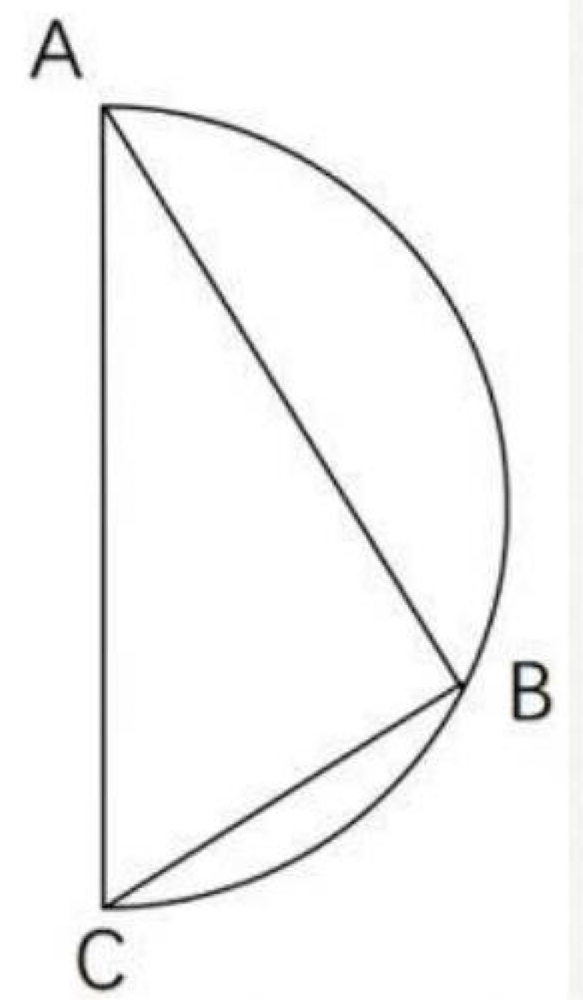

### Options
- A. $9\sqrt{2}$
- B. 15
- C. $9\sqrt{3}$
- D. 18

### Answer

### Explanation

## Question 389

<!-- hyz-question-id: 01a1af25-d031-7ee1-9282-b62f93c46bff -->
```yaml
module: 数量关系
category: "距离型问题"
```
### Stem
一艘非法渔船作业时发现其正右方有海上执法船，于是沿下图所示方向左转后，立即以 15 节（1 节=1 海里/小时）的速度逃跑，同时执法船沿某一直线方向匀速追赶，并正好在某一点追上。已知渔船在被追上前逃跑的距离刚好与其发现执法船时与执法船的距离相同，问执法船的速度为多少节？
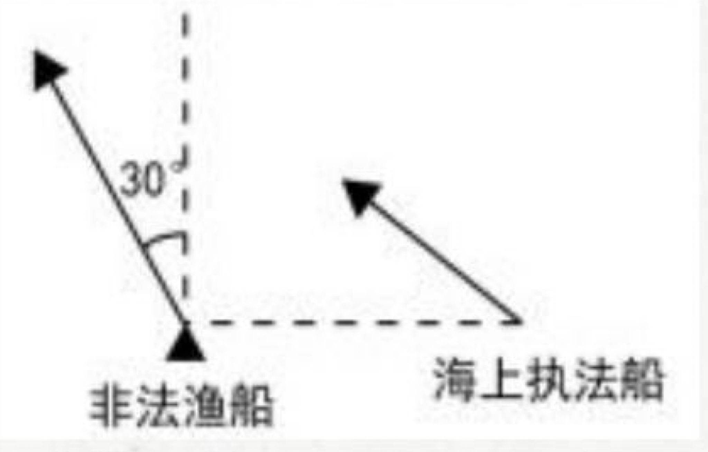

### Options
- A. 20
- B. 30
- C. $10\sqrt{3}$
- D. $15\sqrt{3}$

### Answer

### Explanation

## Question 390

<!-- hyz-question-id: 01a1af25-d031-7ee1-9282-b633a785574e -->
```yaml
module: 数量关系
category: "距离型问题"
```
### Stem
楼道上方有一盏灯，小刘径直走向这盏灯。一开始，他发现自己影子的长度为 3.2 米，前进 1 米后，发现影子缩短为 1.6 米。已知小刘身高为 1.6 米，则这盏灯的高度约为（ ）米。
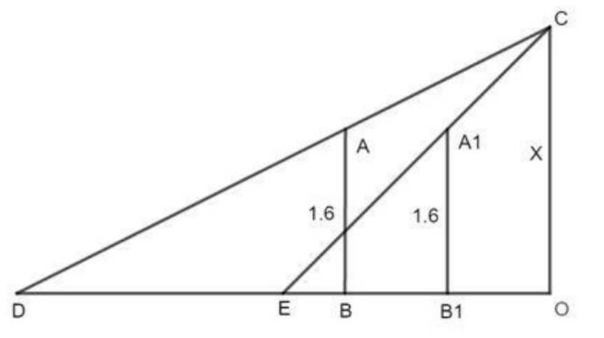

### Options
- A. 2.6
- B. 2.8
- C. 3.2
- D. 3.4

### Answer

### Explanation

## Question 391

<!-- hyz-question-id: 01a1af25-d031-7ee1-9282-b64daf6949b2 -->
```yaml
module: 数量关系
category: "距离型问题"
```
### Stem
如图所示，梯形 ABCD 的两条对角线 AD、BC 相交于 O，EF 平行于两条边且过 O 点。现已知 AB=6，CD=18。问 EF 长为多少？
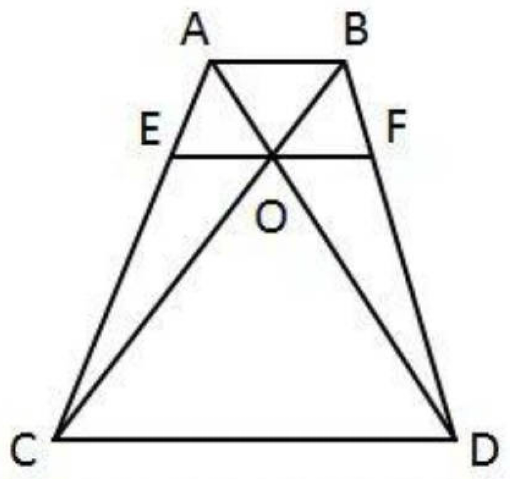

### Options
- A. 8.5
- B. 9
- C. 9.5
- D. 10

### Answer

### Explanation

## Question 392

<!-- hyz-question-id: 01a1af25-d031-7ee1-9282-b65eee4b7416 -->
```yaml
module: 数量关系
category: "距离型问题"
```
### Stem
某社区进行更新改造，要在雨季前完成社区内一条主干道 AC 的维修（见下方示意图）。在 BC 路段设置临时通道分流点 D，BD：DC=2：1；在 AD 路段设置指挥点 E，AE：ED=1：2。若从社区服务中心 B 经指挥点 E 向主干道 AC 引一条物资运输线与 AC 交于 F 点，则 AF 段与 FC 段的长度之比是（ ）。
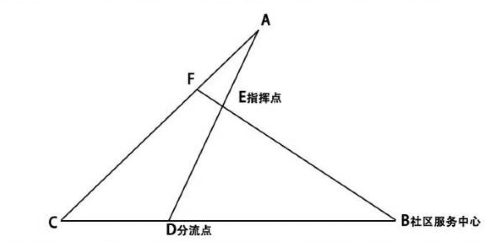

### Options
- A. 1：2
- B. 1：3
- C. 1：4
- D. 1：5

### Answer

### Explanation

## Question 393

<!-- hyz-question-id: 01a1af25-d031-7ee1-9282-b66bcdc5e874 -->
```yaml
module: 数量关系
category: "距离型问题"
```
### Stem
乙地在甲地的正东方 26 千米处，丙地在甲、乙两地连线的北方，且与甲、乙的距离分别为 24 千米和 10 千米。一辆车从甲乙两地中点位置出发向正北方行驶，在经过甲丙连线时，与丙地的距离在以下哪个范围内？

### Options
- A. 不到 8 千米
- B. 8-9 千米
- C. 9-10 千米
- D. 10 千米以上

### Answer

### Explanation

## Question 394

<!-- hyz-question-id: 01a1af25-d031-7ee1-9282-b673c633441e -->
```yaml
module: 数量关系
category: "距离型问题"
```
### Stem
一块长方形土地 ABCD 中绘有 3 条测绘线如图所示。已知 AE 和 CF 垂直于对角线 BD，AE、EF 分别长 8 米和 12 米。问整块土地的面积为多少平方米？
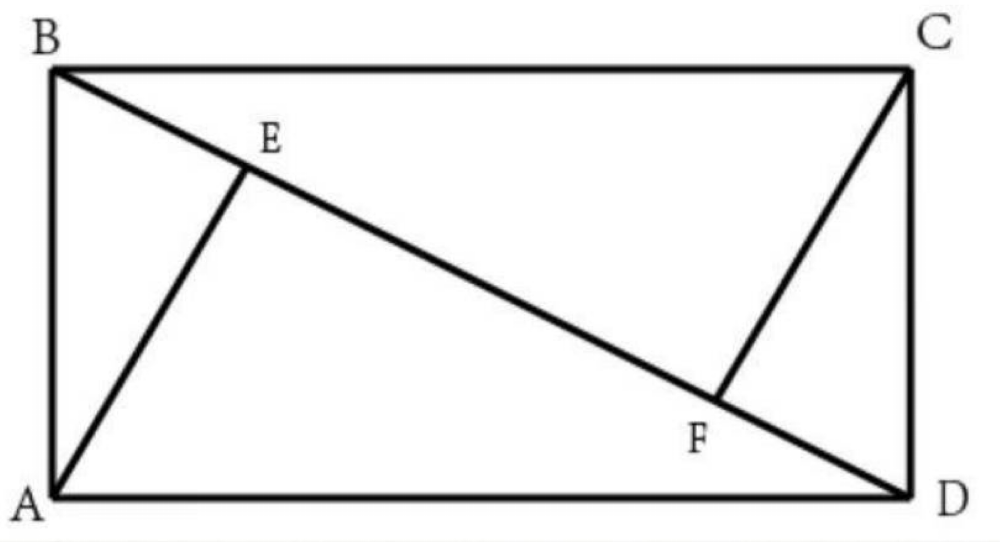

### Options
- A. 96
- B. 156
- C. 160
- D. 240

### Answer

### Explanation

## Question 395

<!-- hyz-question-id: 01a1af25-d031-7ee1-9282-b683bf5bdb63 -->
```yaml
module: 数量关系
category: "将军饮马"
```
### Stem
传说亚历山大城有一位精通数学和物理的学者，名叫海伦。一天，一位罗马将军专程去拜访他，向他请教一个百思不得其解的问题：从 A 地出发到河边饮马，然后再到 B 地，求怎样走使路线最短，并且如何确定饮马的地点。
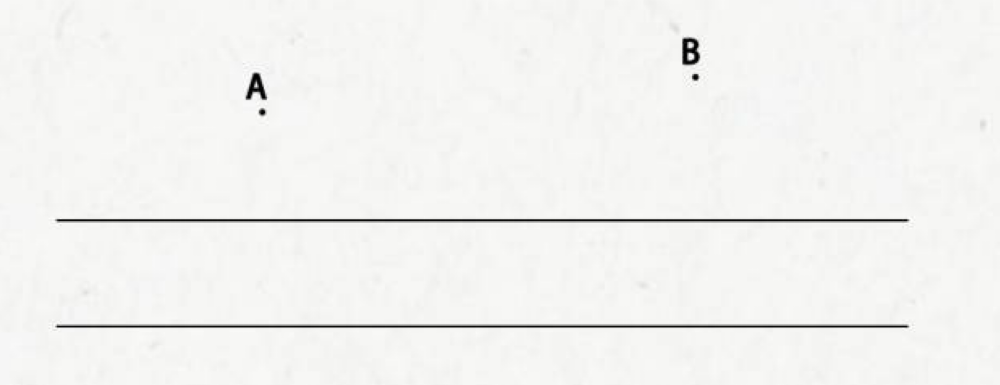

### Options


### Answer

### Explanation

## Question 396

<!-- hyz-question-id: 01a1af25-d031-7ee1-9282-b69833dbab78 -->
```yaml
module: 数量关系
category: "将军饮马"
```
### Stem

A、B 两村在一条笔直公路的同侧，到公路的垂直距离分别是 3 公里和 7 公里，两村相距 8.5 公里。现需在公路边建一个物资集散中心，为节约物资配送成本，集散中心到两个村的直线路程之和应尽可能小。若货车的速度约为 60 公里／小时，那么货车从集散中心出发，到两村送货后返回中心，路途所花费的最少时间为：
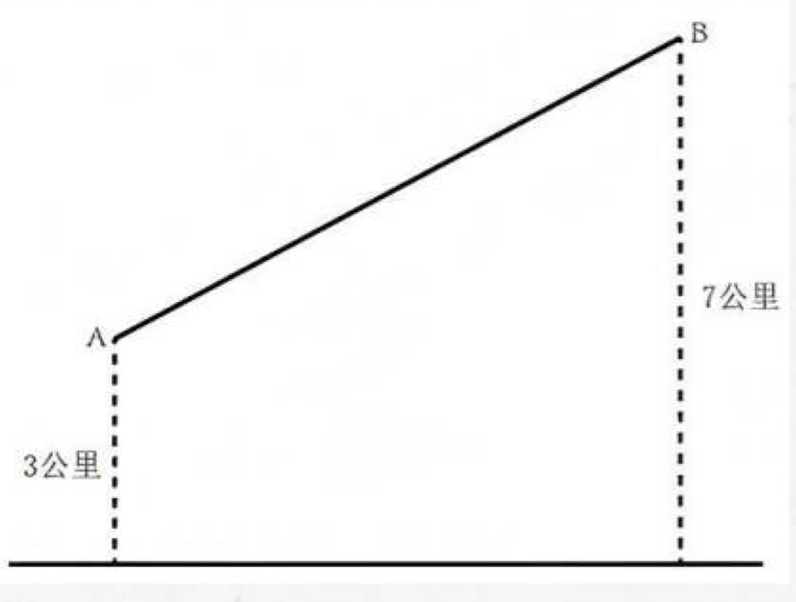

### Options
- A. 18 分钟
- B. 21 分钟
- C. 24 分钟
- D. 27 分钟

### Answer

### Explanation

## Question 397

<!-- hyz-question-id: 01a1af25-d031-7ee1-9282-b6a31294dfa0 -->
```yaml
module: 数量关系
category: "将军饮马"
```
### Stem
一个 300 米×200 米的池塘 ABCD，如下图所示。甲从 A 点划船出发依次经过 CD 边上的一点、AB 边上的一点后，最终到达 C 点。问最短行进距离在以下哪个范围内？
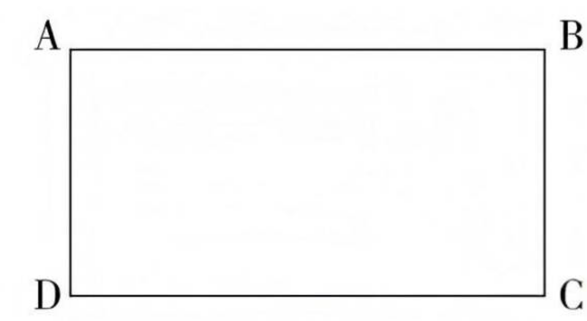

### Options
- A. 不到 690 米
- B. 690-720 米之间
- C. 720-750 米之间
- D. 超过 750 米

### Answer

### Explanation

## Question 398

<!-- hyz-question-id: 01a1af25-d031-7ee1-9282-b6b77c9f79f7 -->
```yaml
module: 数量关系
category: "将军饮马"
```
### Stem

A、B 两个乡镇分布于山谷两侧，山谷间有一条宽为 2km 的河道（如下图所示）。当地政府决定在两个乡镇间修建一条跨河公路促进旅游发展。由于架桥费用高昂，所以要求跨河公路中的桥梁路段长度最短。那么根据图中数据，从 A 镇前往 B 镇的最短距离为：
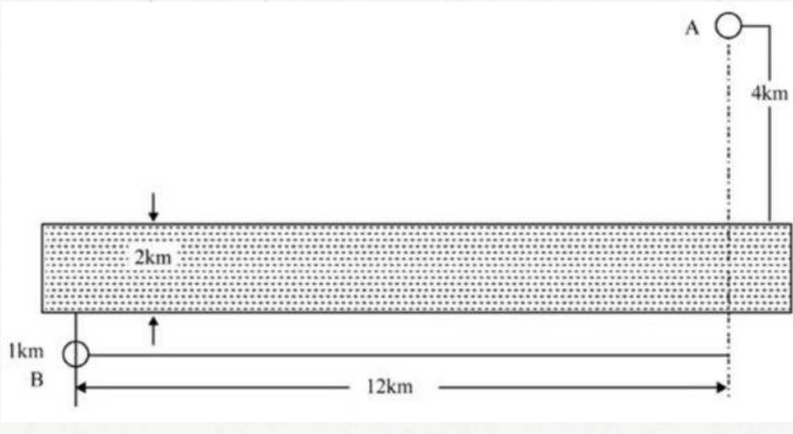

### Options
- A. 17km
- B. 15km
- C. 19km
- D. 20km

### Answer

### Explanation

## Question 399

<!-- hyz-question-id: 01a1af25-d031-7ee1-9282-b6c191dee7d8 -->
```yaml
module: 数量关系
category: "过河问题"
```
### Stem
一只小船打算驶向 200m 宽的河流正对岸的港口，船速 5m/s。但由于水流湍急，水速 3m/s。那么小船需要多久才能抵达正对岸？

### Options
- A. 40 秒
- B. 50 秒
- C. 200/3 秒
- D. 100 秒

### Answer

### Explanation

## Question 400

<!-- hyz-question-id: 01a1af25-d031-7ee1-9282-b6d9c045de18 -->
```yaml
module: 数量关系
category: "过河问题"
```
### Stem
一只小船打算驶向 200m 宽的河流对岸，船速 5m/s，但由于水流湍急，水速 3m/s，那么小船最快需要多久才能抵达对岸？

### Options
- A. 40 秒
- B. 50 秒
- C. 200/3 秒
- D. 100 秒

### Answer

### Explanation

## Question 401

<!-- hyz-question-id: 01a1af25-d031-7ee1-9282-b6e8392618ea -->
```yaml
module: 数量关系
category: "过河问题"
```
### Stem
一只小船打算船头垂直驶向河对面，但由于水流湍急，小船最终以 10 米/秒的速度沿直线斜向行驶。假设两河岸平行，水流速度为 6 米/秒，两岸间的垂直距离为 240 米，小船抵达对岸时实际行驶了（ ）米。

### Options
- A. 300
- B. 320
- C. 400
- D. 460

### Answer

### Explanation

## Question 402

<!-- hyz-question-id: 01a1af25-d031-7ee1-9282-b6fe0669b430 -->
```yaml
module: 数量关系
category: "过河问题"
```
### Stem
大江两岸有两个正面相对的码头，可供客轮往返。如下图所示。根据河流水文情况，“幸福号”客轮星期一沿着河岸 60 度夹角方向前行，刚好到达对岸码头；星期二“幸福号”准备返回时，发现河流水文情况发生变化，船长调整航向，沿河岸 30 度夹角方向返回，顺利到达码头。假设客轮往返速度均是 v 千米/小时，且行驶过程中河水流速是恒定的，问返程时河水流速是去程时的多少倍？
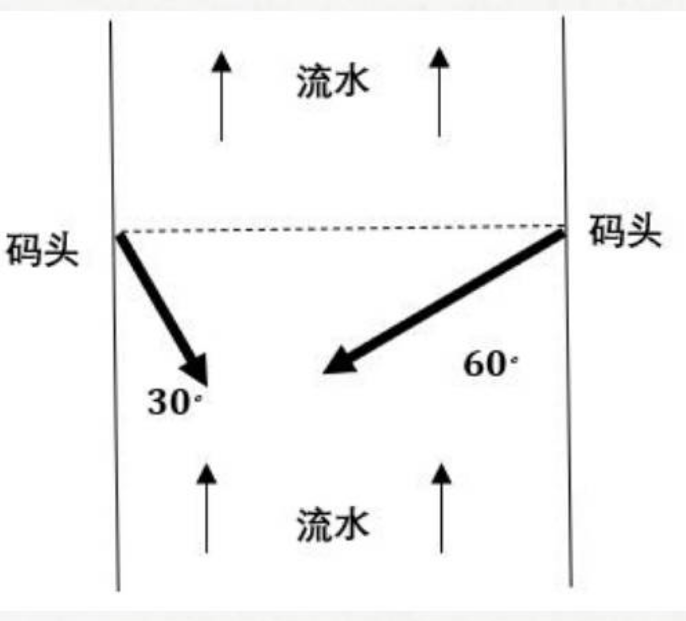

### Options
- A. $\sqrt{3}$
- B. $\frac{\sqrt{3}}{3}$
- C. $\frac{1}{2}$
- D. 2

### Answer

### Explanation

## Question 403

<!-- hyz-question-id: 01a1af25-d031-7ee1-9282-b70652e483a9 -->
```yaml
module: 数量关系
category: "线圆相切"
```
### Stem

A、B 两地分别与某个半径 150 米的圆形池塘边缘相距 100 米，AB 的连线经过池塘的圆心。张某从 A 地出发以 1 米/秒的速度匀速行走。全程除转向 1 次外均保持直线行进。问他从 A 地到 B 地的最短用时在以下哪个范围内？
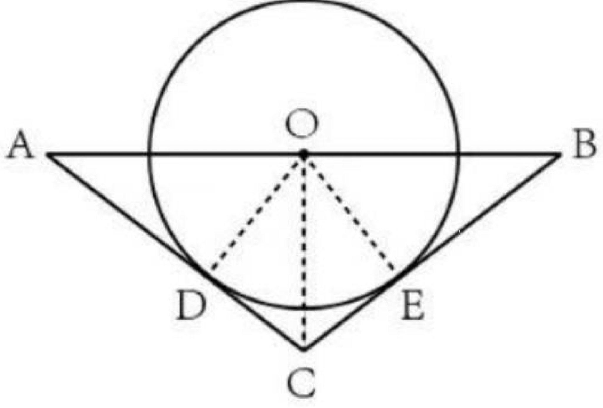

### Options
- A. 不到 9 分 30 秒
- B. 9 分 30 秒~10 分之间
- C. 10 分~10 分 30 秒之间
- D. 10 分 30 秒以上

### Answer

### Explanation

## Question 404

<!-- hyz-question-id: 01a1af25-d031-7ee1-9282-b710bbcd30a2 -->
```yaml
module: 数量关系
category: "线圆相切"
```
### Stem
已知易拉罐的直径为 8cm，现将 7 个易拉罐如图捆扎在一起，那么需要（ ）cm 长的绳子。（仅计算一圈的绳长）
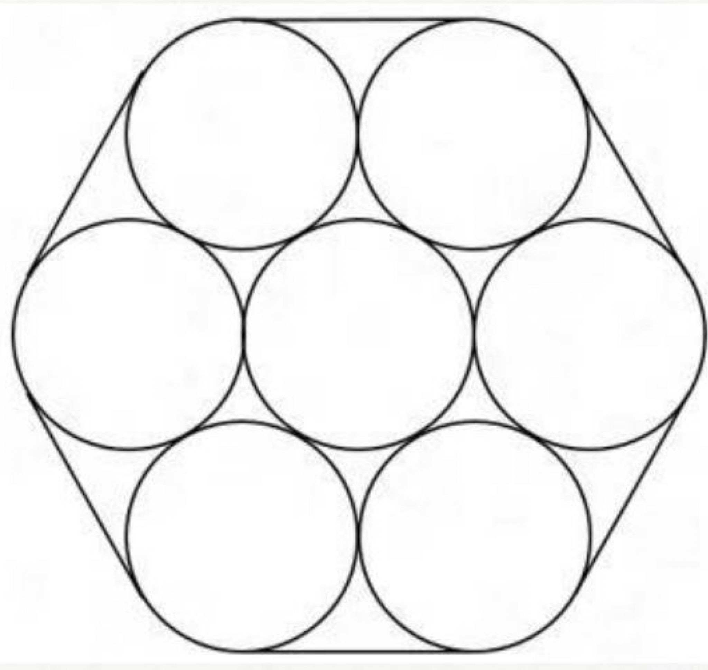

### Options
- A. 4π+24
- B. 4π+48
- C. 8π+24
- D. 8π+48

### Answer

### Explanation

## Question 405

<!-- hyz-question-id: 01a1af25-d031-7ee1-9282-b72fc0902928 -->
```yaml
module: 数量关系
category: "线圆相切"
```
### Stem
一个半径 300 米的圆形湖泊中有一个半径 100 米的圆形人工岛，该人工岛的中心在湖泊中心的正西方 150 米处。甲从湖正北的 A 点开船出发，绕行人工岛西侧到达正南的 B 点。如果保持最短路线行驶，那么行驶多少米后甲到达人工岛的岸边？
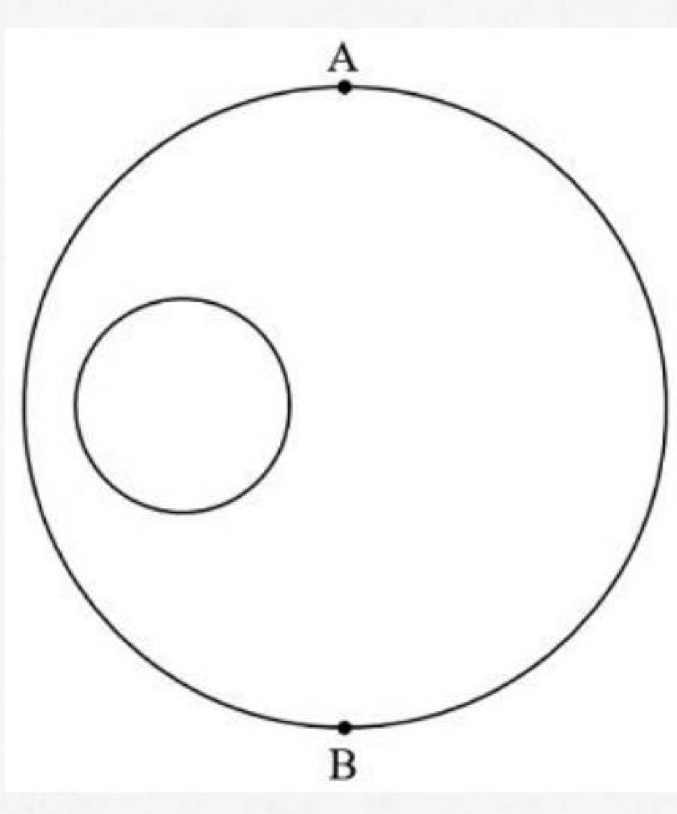

### Options
- A. $150\sqrt{5}$-100
- B. 300
- C. $50\sqrt{41}$
- D. $200\sqrt{3}$

### Answer

### Explanation
