<!-- hyz-paper-id: 01a1af25-d036-7523-9552-d20a4b7ceab3 -->

# 平面几何（二）

## Question 406

<!-- hyz-question-id: 01a1af25-d036-7523-9552-d21e40d3ac3f -->
```yaml
module: 数量关系
category: "面积型问题"
```
### Stem
一根绳子，把它围成一个长度是宽度的两倍的长方形时，面积是 32 平方厘米，如果把它围成一个等边三角形，面积是多少平方厘米。

### Options
- A. 32√3
- B. 24√3
- C. 18√3
- D. 16√3

### Answer

### Explanation

## Question 407

<!-- hyz-question-id: 01a1af25-d036-7523-9552-d228e72e4688 -->
```yaml
module: 数量关系
category: "面积型问题"
```
### Stem
一只闹钟的秒针顶点距离表盘圆心 4 厘米，分针顶点距离表盘圆心 3 厘米。小王烧开一壶水的时间内，秒针顶点累计移动了 40π 厘米。那么这一时间段内，分针顶点与表盘圆心的连线扫过的扇形面积为多少平方厘米？

### Options
- A. 0.5π
- B. 0.75π
- C. π
- D. 1.5π

### Answer

### Explanation

## Question 408

<!-- hyz-question-id: 01a1af25-d036-7523-9552-d23e391180b0 -->
```yaml
module: 数量关系
category: "面积型问题"
```
### Stem
有一个花坛的形状是一个直角扇形，由三个半径分别为 1、2、3 米的圆弧构成，现用两条线段将此扇形圆心角平均分割成三部分。（如图）设计者在阴影部分和空白部分分别种上不同的花卉，那么阴影部分花卉的种植面积为多少平方米？

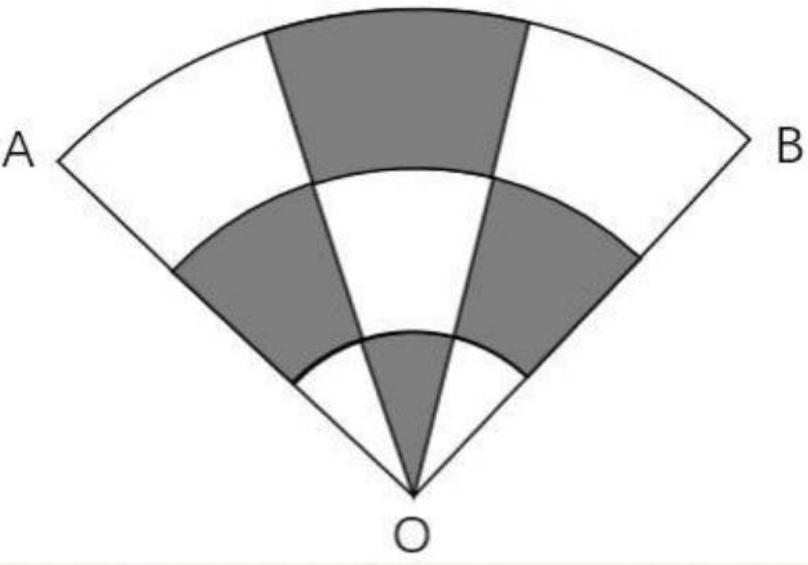

### Options
- A. π/3
- B. π/2
- C. π
- D. 2π

### Answer

### Explanation

## Question 409

<!-- hyz-question-id: 01a1af25-d036-7523-9552-d2490cc30f2a -->
```yaml
module: 数量关系
category: "面积型问题"
```
### Stem
等边三角形边长减少为原来的 50%。面积减少了：

### Options
- A. 75%
- B. 60%
- C. 55%
- D. 50%

### Answer

### Explanation

## Question 410

<!-- hyz-question-id: 01a1af25-d036-7523-9552-d25548e53c0e -->
```yaml
module: 数量关系
category: "面积型问题"
```
### Stem
一个正三角形和一个正六边形周长相等，则正六边形面积为正三角形的：

### Options
- A. √2 倍
- B. 1.5 倍
- C. √3 倍
- D. 2 倍

### Answer

### Explanation

## Question 411

<!-- hyz-question-id: 01a1af25-d036-7523-9552-d26131b6028f -->
```yaml
module: 数量关系
category: "面积型问题"
```
### Stem
如下图所示，在三角形工地 ABC 中 CD=3AD，EC=2BE，阴影部分三角形 ADE 的面积是 15 平方米。三角形工地 ABC 的面积是（）平方米？

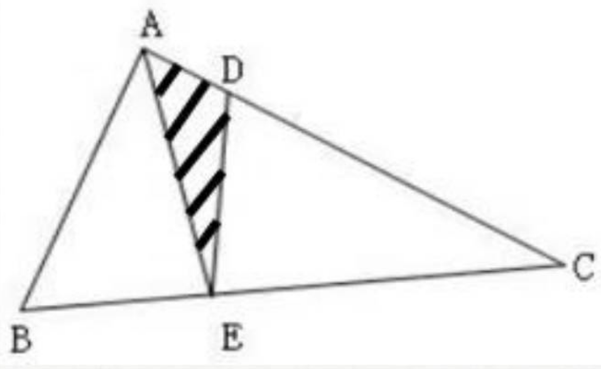

### Options
- A. 90
- B. 70
- C. 60
- D. 45

### Answer

### Explanation

## Question 412

<!-- hyz-question-id: 01a1af25-d036-7523-9552-d270edc2480c -->
```yaml
module: 数量关系
category: "面积型问题"
```
### Stem
如图，一个矩形分割成 4 个不同颜色的三角形。绿色三角形面积占矩形面积的 15%，黄色三角形的面积是 21 平方厘米。问矩形面积是多少平方厘米？

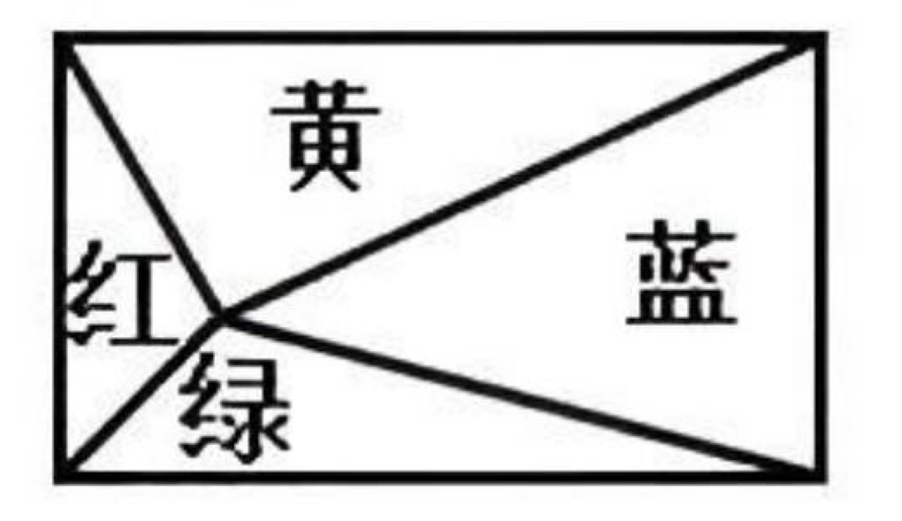

### Options
- A. 56
- B. 60
- C. 70
- D. 140

### Answer

### Explanation

## Question 413

<!-- hyz-question-id: 01a1af25-d036-7523-9552-d28e7f4a670b -->
```yaml
module: 数量关系
category: "面积型问题"
```
### Stem
某矩形农场 ABCD 如图所示，矩形区域 ADEF 为生产区，矩形区域 BCEF 为休闲区。现连接 BD 将两区域打通，与 EF 相交于 O 点。已知 AF 和 FE 的长度分别为 600 米和 400 米，问 COD 围成的三角形阴影区域面积为多少万平方米？

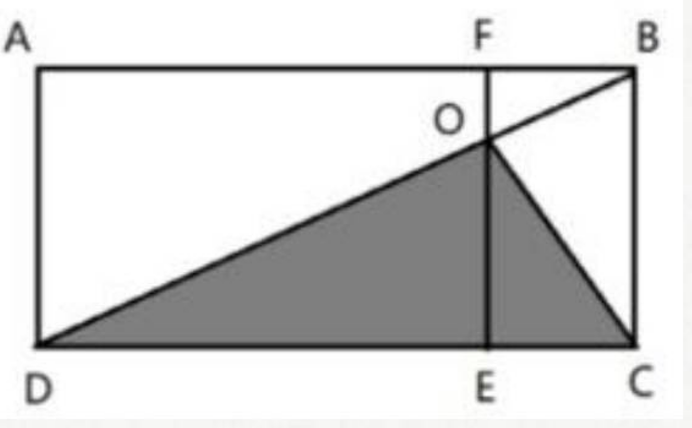

### Options
- A. 12
- B. 15
- C. 16
- D. 18

### Answer

### Explanation

## Question 414

<!-- hyz-question-id: 01a1af25-d036-7523-9552-d29fc3716c81 -->
```yaml
module: 数量关系
category: "面积型问题"
```
### Stem
如图，ABCD、AEFG 是并排正方形，连接 FB 与正方形 ABCD 对角线 AC 交于点 P。已知 △APB 面积为 12，那么 △DFP 面积为？

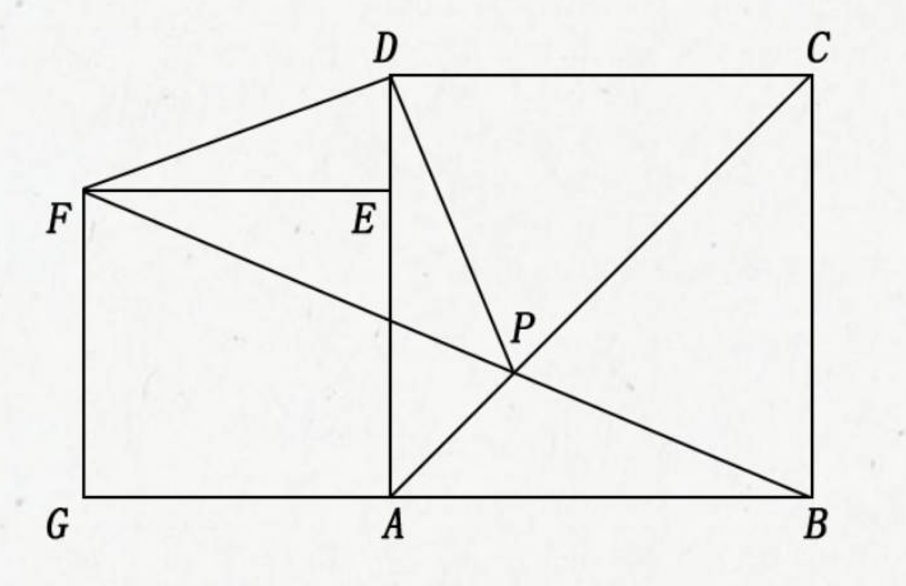

### Options
- A. 12
- B. 18
- C. 24
- D. 30

### Answer

### Explanation

## Question 415

<!-- hyz-question-id: 01a1af25-d036-7523-9552-d2a177c58d7d -->
```yaml
module: 数量关系
category: "面积型问题"
```
### Stem
如下图，某植物园四边形花圃 ABCD 的面积为 90，EC：AE=5：4，则三角形花圃 BCD 的面积是多少？

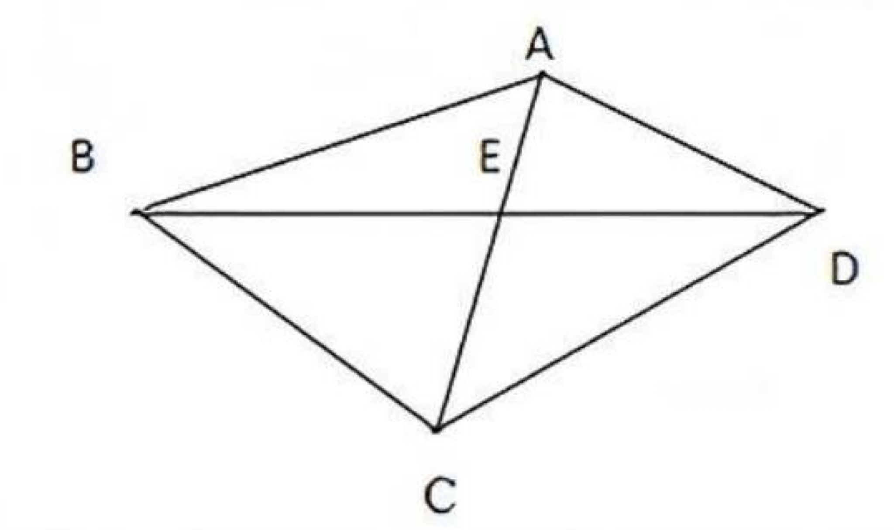

### Options
- A. 40
- B. 50
- C. 60
- D. 65

### Answer

### Explanation

## Question 416

<!-- hyz-question-id: 01a1af25-d036-7523-9552-d2bcac4a1b20 -->
```yaml
module: 数量关系
category: "面积型问题"
```
### Stem
如图 ABCD 是一个梯形，E 是 AD 的中点，直线 CE 把梯形分成甲、乙两部分，其面积之比是 15：7。问上底 AB 与下底 CD 的长度之比是：

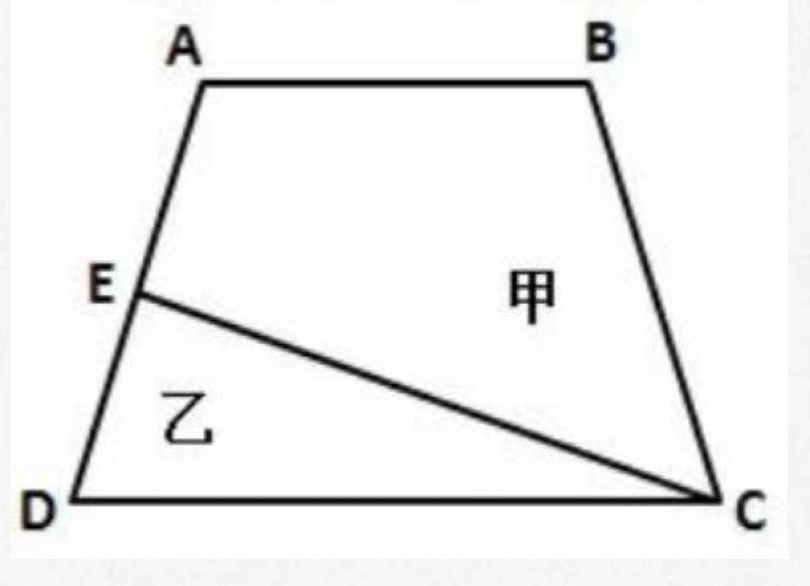

### Options
- A. 5：7
- B. 6：7
- C. 4：7
- D. 3：7

### Answer

### Explanation

## Question 417

<!-- hyz-question-id: 01a1af25-d036-7523-9552-d2cfc87cb97c -->
```yaml
module: 数量关系
category: "面积型问题"
```
### Stem
如下图，把三角形 ABC 的三边分别延长 1、2、3 倍，得到一个新的三角形，则新三角形的面积是原三角形 ABC 面积的几倍？

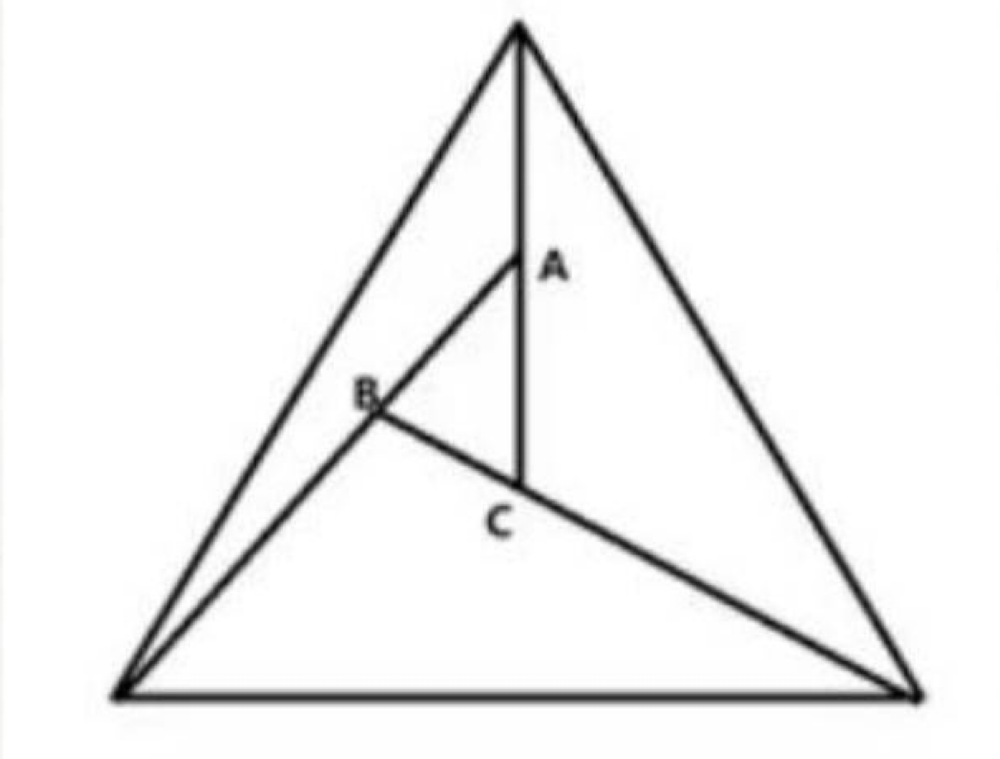

### Options
- A. 15
- B. 16
- C. 17
- D. 18

### Answer

### Explanation

## Question 418

<!-- hyz-question-id: 01a1af25-d036-7523-9552-d2dbf3f24988 -->
```yaml
module: 数量关系
category: "蝴蝶定理"
```
### Stem
一块种植花卉的矩形土地如图所示，AD 边长是 AB 的 2 倍，E 是 CD 的中点，甲、乙、丙、丁、戊区域分别种植白花、红花、黄花、紫花、白花。则种植白花的面积占矩形土地面积的：

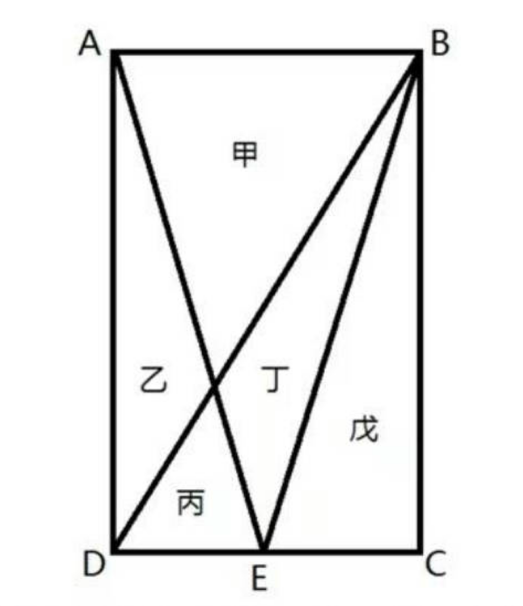

### Options
- A. 3/4
- B. 2/3
- C. 7/12
- D. 1/2

### Answer

### Explanation

## Question 419

<!-- hyz-question-id: 01a1af25-d036-7523-9552-d2ea59348f10 -->
```yaml
module: 数量关系
category: "蝴蝶定理"
```
### Stem
如图所示，在长方形 ABCD 中，E、F 为 AB 的三等分点，G 为 CD 的中点，连接 EC、FG 相交于 O 点。已知四边形 FOCB 的面积为 16 平方米，则五边形 ADGOE 的面积为多少平方米？

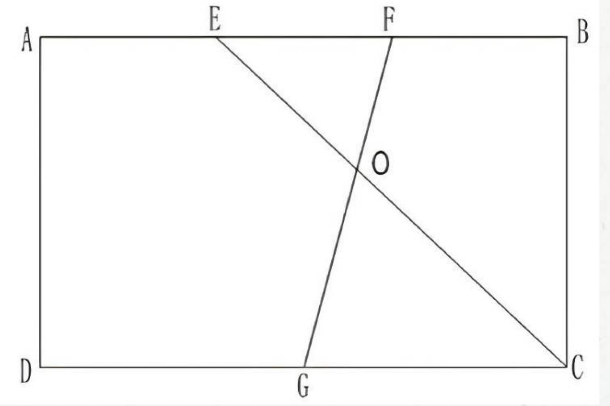

### Options
- A. 20
- B. 29
- C. 31
- D. 60

### Answer

### Explanation

## Question 420

<!-- hyz-question-id: 01a1af25-d036-7523-9552-d2f08134a92e -->
```yaml
module: 数量关系
category: "蝴蝶定理"
```
### Stem
如图三角形中，A、B 分别为两条边的中点，则图中阴影部分面积为三角形总面积的（ ）


### Options
- A. 1/3
- B. 1/4
- C. 2/7
- D. 3/8

### Answer

### Explanation

## Question 421

<!-- hyz-question-id: 01a1af25-d036-7523-9552-d300d3e4a2e6 -->
```yaml
module: 数量关系
category: "蝴蝶定理"
```
### Stem
如图，在 △ABC 中，点 D 是 AC 的中点，点 E 是 BC 的三等分点，连接 AE 和 BD 交于点 F，连接 DE，若 △ABC 面积为 36，则下列说法正确的是（ ）。

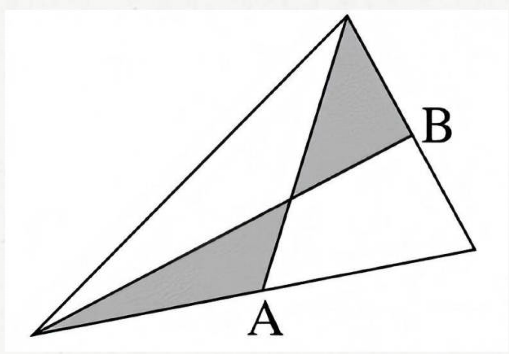

### Options
- A. △DEF 的面积小于 3
- B. △CDE 的面积大于 6
- C. △BAF 的面积等于 △BDE 的面积
- D. △ABF 的面积等于 △ACE 的面积

### Answer

### Explanation

## Question 422

<!-- hyz-question-id: 01a1af25-d036-7523-9552-d31331810a9c -->
```yaml
module: 数量关系
category: "蝴蝶定理"
```
### Stem
如图，一块正方形的花园 ABCD 的面积是 120 平方米，为了种植不同种类的花将其划分成一些小区域，其中，E 是 AB 的中点，F 是 BC 的中点，则四边形区域 BGHF 的面积是（）平方米。

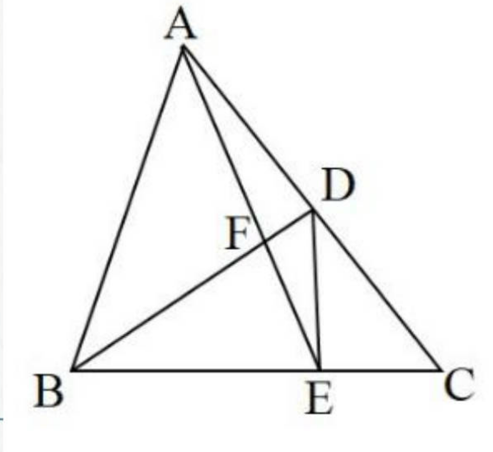

### Options
- A. 14
- B. 16
- C. 18
- D. 20

### Answer

### Explanation

## Question 423

<!-- hyz-question-id: 01a1af25-d036-7523-9552-d32fcf03aa67 -->
```yaml
module: 数量关系
category: "和定积最"
```
### Stem
某健身房准备将一块周长为 100 米的长方形区域划为瑜伽场地，将一块周长为 160 米的长方形区域划为游泳场馆，若瑜伽场地和游泳场馆均是满足周长条件下的最大面积，问两块场地面积之差为多少平方米？

### Options
- A. 625
- B. 845
- C. 975
- D. 1150

### Answer

### Explanation

## Question 424

<!-- hyz-question-id: 01a1af25-d036-7523-9552-d33856eb20fd -->
```yaml
module: 数量关系
category: "和定积最"
```
### Stem
某农家要建造一个新的矩形鸡圈，如图所示，该鸡圈一面靠围墙，另外三面共使用了 200 米长的铁丝网，问如果想让鸡圈的面积最大，鸡圈的长和宽比值应为多少？

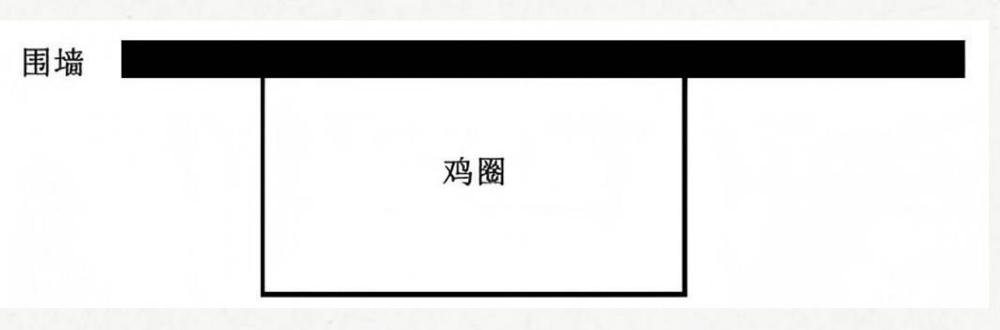

### Options
- A. 1：1
- B. 2：1
- C. 3：2
- D. 7：3

### Answer

### Explanation

## Question 425

<!-- hyz-question-id: 01a1af25-d036-7523-9552-d34d40bb2998 -->
```yaml
module: 数量关系
category: "和定积最"
```
### Stem
某地发生了交通事故，要用总长 90 米的警戒线围成长方形保护现场，要求长和宽都是整数米，请问围成的长方形最大面积是多少？

### Options
- A. 500
- B. 506
- C. 506.25
- D. 2025

### Answer

### Explanation

## Question 426

<!-- hyz-question-id: 01a1af25-d036-7523-9552-d355b48787c3 -->
```yaml
module: 数量关系
category: "面积割补"
```
### Stem
如图所示，一个小区的道路围成了一个五边形，经实地勘测，五边形内有三个角为直角，AD 边、BC 边和 CD 边长度相等，且 OA 边长度为其一半。已知 AD 边长 20 米，问道路围成的五边形面积为多少平方米？

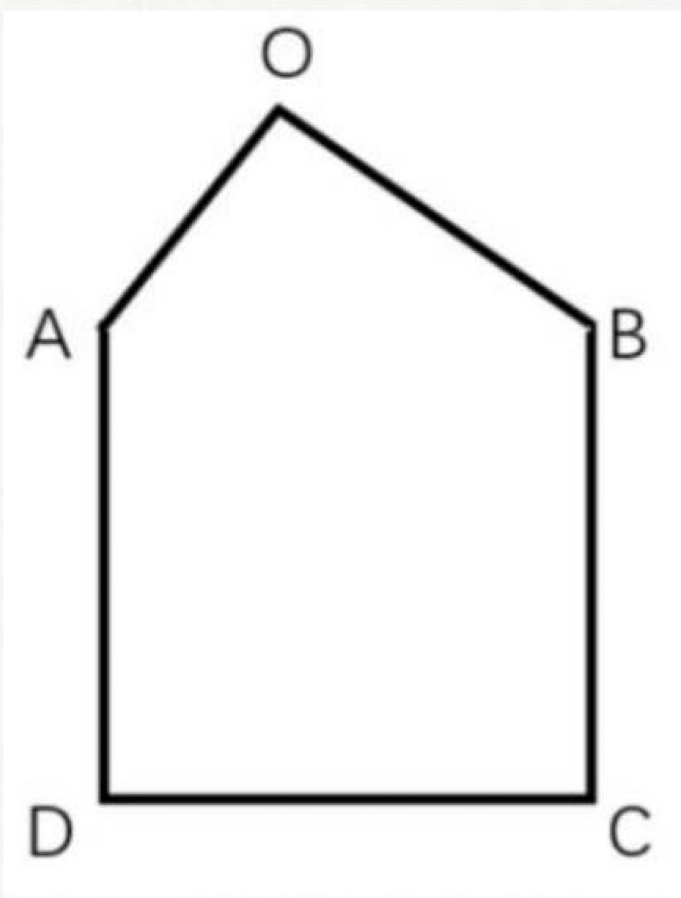

### Options
- A. 50√2 + 200
- B. 50√3 + 200
- C. 50√2 + 400
- D. 50√3 + 400

### Answer

### Explanation

## Question 427

<!-- hyz-question-id: 01a1af25-d036-7523-9552-d36664b85fd2 -->
```yaml
module: 数量关系
category: "面积割补"
```
### Stem
下图中，阴影部分的面积大还是条纹部分的面积大？

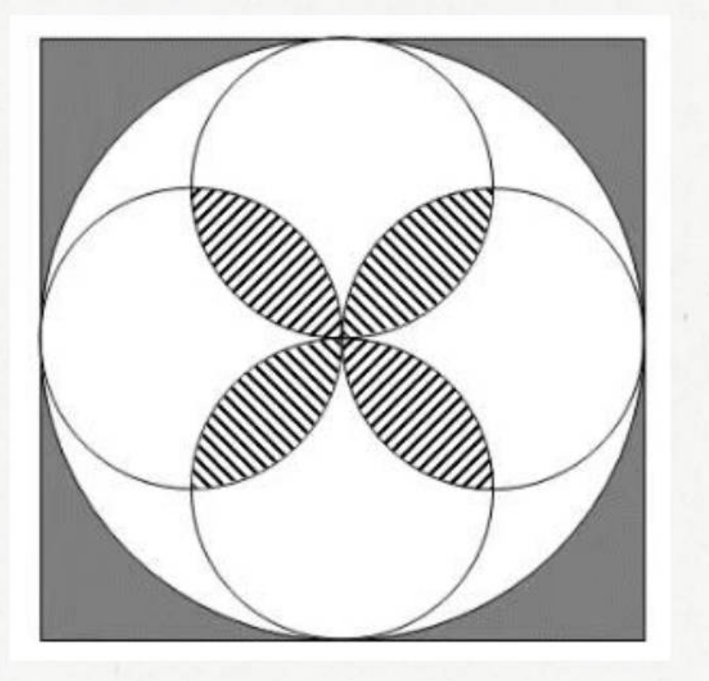

### Options
- A. 阴影部分面积大
- B. 条纹部分面积大
- C. 两个部分一样大
- D. 无法确定

### Answer

### Explanation

## Question 428

<!-- hyz-question-id: 01a1af25-d036-7523-9552-d375949126b8 -->
```yaml
module: 数量关系
category: "面积割补"
```
### Stem
正方形 ABCD，其边长为 4 米，分别以顶点 A、B 为圆心，4 米为半径画圆弧。如图所示，那么下面阴影部分的面积比上面阴影部分多多少平方米？

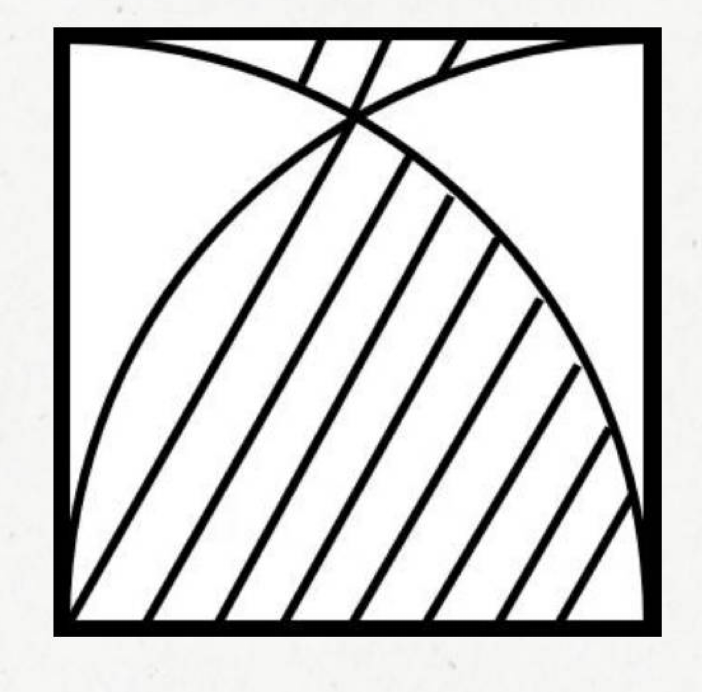

### Options
- A. 16-8π
- B. 16-16π
- C. 8π-16
- D. 16π-16

### Answer

### Explanation

## Question 429

<!-- hyz-question-id: 01a1af25-d036-7523-9552-d38e59cc52dc -->
```yaml
module: 数量关系
category: "面积割补"
```
### Stem
如图，一长方形内切有 5 个完全相同的小圆，且小圆间彼此相切。已知小圆直径为 4，则阴影部分的面积分别为多少？

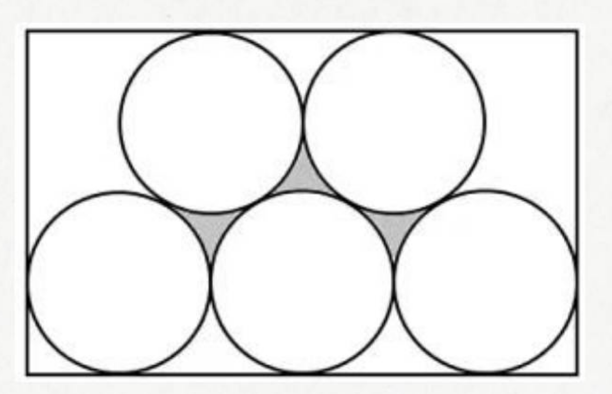

### Options
- A. 12√3-6π
- B. 48√3-24π
- C. 12√3-24π
- D. 48√3-6π

### Answer

### Explanation

## Question 430

<!-- hyz-question-id: 01a1af25-d036-7523-9552-d39ba273a763 -->
```yaml
module: 数量关系
category: "面积割补"
```
### Stem
下面图形阴影部分面积是多少？

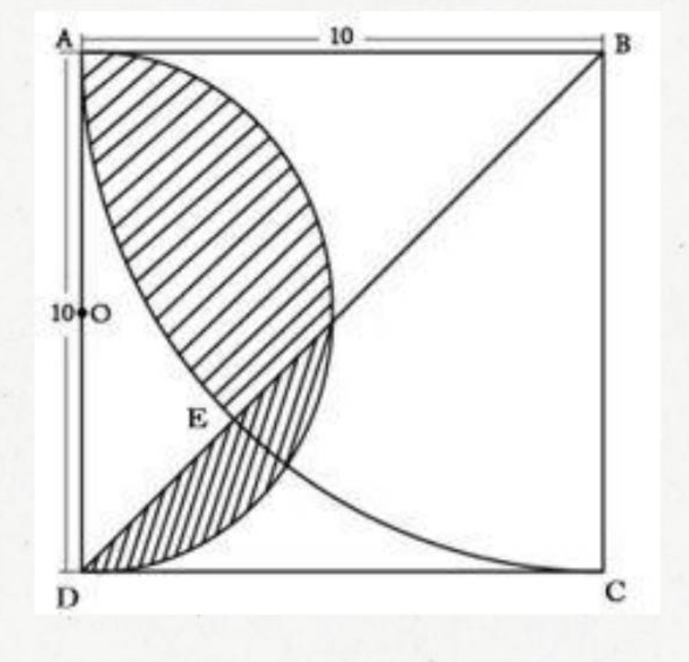

### Options
- A. 12.5π
- B. 25
- C. 50-12.5π
- D. 25π-50

### Answer

### Explanation
