<!-- hyz-paper-id: 01a1af25-d03c-7c21-b1e2-c0e0386ac4e7 -->

# 立体几何

## Question 431

<!-- hyz-question-id: 01a1af25-d03c-7c21-b1e2-c0fd6b2278e1 -->
```yaml
module: 数量关系
category: "基础公式"
```
### Stem
一个体积为 125 立方厘米的正方体，若它的体积减少 98 立方厘米，变成新的正方体，则它的表面积减少了（ ）平方厘米。

### Options
- A. 58
- B. 64
- C. 96
- D. 98

### Answer

### Explanation

## Question 432

<!-- hyz-question-id: 01a1af25-d03c-7c21-b1e2-c106d3459117 -->
```yaml
module: 数量关系
category: "基础公式"
```
### Stem
有一个长方体容器，长 40 厘米，宽 30 厘米，高 10 厘米，里面的水深 6 厘米（最大面为底面）。如果把这个容器盖紧，再竖起来（最小面为底面），里面的水深是多少厘米：

### Options
- A. 15
- B. 18
- C. 24
- D. 30

### Answer

### Explanation

## Question 433

<!-- hyz-question-id: 01a1af25-d03c-7c21-b1e2-c11ce024c766 -->
```yaml
module: 数量关系
category: "基础公式"
```
### Stem
两个圆柱形水井，甲井的水深是乙井的一半，水面直径是乙井的 2 倍，蓄水量为 40 立方米，问乙井的蓄水量为多少立方米？

### Options
- A. 20
- B. 60
- C. 40
- D. 80

### Answer

### Explanation

## Question 434

<!-- hyz-question-id: 01a1af25-d03c-7c21-b1e2-c12d16d207dd -->
```yaml
module: 数量关系
category: "基础公式"
```
### Stem
连接正方体每个面的中心构成一个正八面体（如下图所示）。已知正方体的边长为 6 厘米，问正八面体的体积为多少立方厘米？（ ）

### Options
- A. 18√2
- B. 24√2
- C. 36
- D. 72
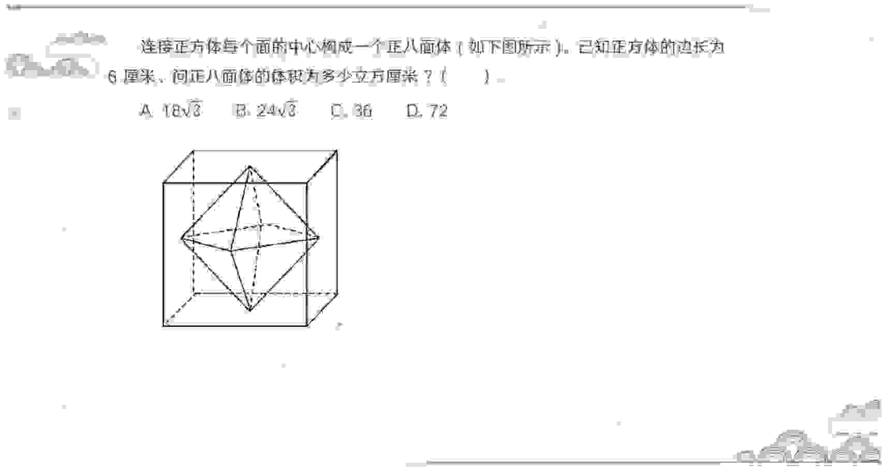

### Answer

### Explanation

## Question 435

<!-- hyz-question-id: 01a1af25-d03c-7c21-b1e2-c1376b305e25 -->
```yaml
module: 数量关系
category: "基础公式"
```
### Stem
有两种容器，一种为半球形（A），一种为圆锥形（B），其开口圆的直径与高的尺寸如图所示（单位：cm）。若 A 容器中装满的实验液需要分装到若干个 B 容器中，则至少需要 B 容器（ ）个。

### Options
- A. 3
- B. 4
- C. 6
- D. 8
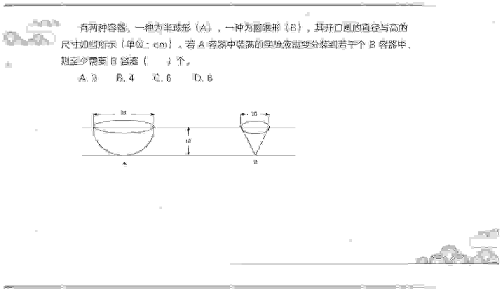

### Answer

### Explanation

## Question 436

<!-- hyz-question-id: 01a1af25-d03c-7c21-b1e2-c1406f6910d4 -->
```yaml
module: 数量关系
category: "基础公式"
```
### Stem
将一个边长为1的木质正方体削去多余部分，使其成为一个最大的木质圆球，则削去部分的体积为：

### Options
- A. π/6
- B. 1-π/6
- C. π²/6
- D. 1-π²/6
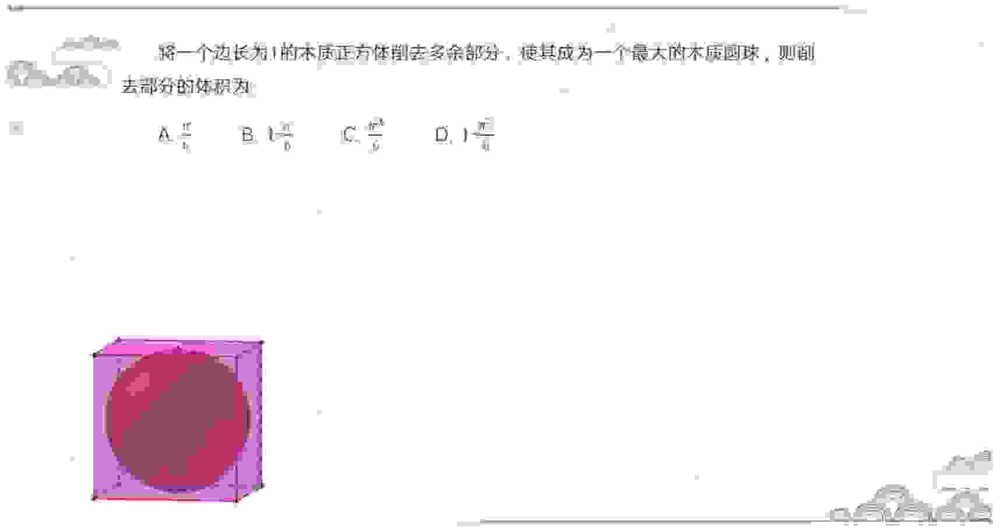

### Answer

### Explanation

## Question 437

<!-- hyz-question-id: 01a1af25-d03c-7c21-b1e2-c1571ed72866 -->
```yaml
module: 数量关系
category: "基础公式"
```
### Stem
用一个木质圆球切出一个最大的正方体，正方体边长为√3，则圆球体积最小为？

### Options
- A. 6π
- B. 9π/2
- C. 5π
- D. 3π
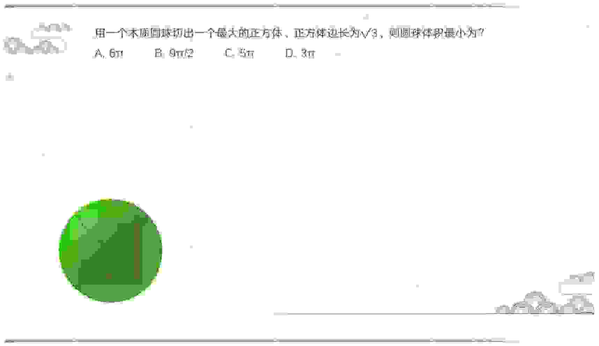

### Answer

### Explanation

## Question 438

<!-- hyz-question-id: 01a1af25-d03c-7c21-b1e2-c16d2edbafb0 -->
```yaml
module: 数量关系
category: "立体相似"
```
### Stem
正六面体的表面积增加 96%，棱长增加多少？

### Options
- A. 20%
- B. 30%
- C. 40%
- D. 50%

### Answer

### Explanation

## Question 439

<!-- hyz-question-id: 01a1af25-d03c-7c21-b1e2-c17fce9f7295 -->
```yaml
module: 数量关系
category: "立体相似"
```
### Stem
某餐馆承诺 25 分钟内上齐一桌菜，若超时则未上的菜品免单。每张餐桌上都有一个装满后正好 25 分钟漏完的圆锥形沙漏（如下图所示）。某位顾客在等待的过程中发现沙漏内上方沙子的高度为原先的一半时还差一道菜未上，则再过多久还未上菜，这位顾客将享受免单服务？

### Options
- A. 不到 3 分钟
- B. 3-4 分钟
- C. 4-5 分钟
- D. 超过 6 分钟
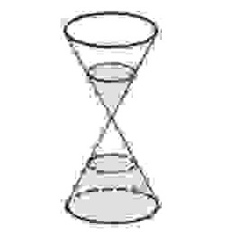

### Answer

### Explanation

## Question 440

<!-- hyz-question-id: 01a1af25-d03c-7c21-b1e2-c185d7f8444e -->
```yaml
module: 数量关系
category: "立体相似"
```
### Stem
某甜品店出售一种规则球形的甜品，该甜品由内部中空的球形面皮（每立方厘米成本 0.4 元），和实心的芝士球（每立方厘米成本 1 元）组成，无论甜品大小规格如何，其中的芝士球半径始终为甜品半径的四分之三，已知制作半径为 1 厘米的该甜品成本约为 2.73 元，那么要制作半径为 2 厘米的该甜品，成本约为：

### Options
- A. 5.46 元
- B. 7.45 元
- C. 14.92 元
- D. 21.84 元

### Answer

### Explanation

## Question 441

<!-- hyz-question-id: 01a1af25-d03c-7c21-b1e2-c19acbfc8112 -->
```yaml
module: 数量关系
category: "立体相似"
```
### Stem
人工湖的湖面上有一个露出水面 3 米的圆锥体人工景观（底面朝下）。如人工湖水深减少 20%，则该景观露出水面部分的体积将增加 61/64。问原来的人工湖水深为多少米？

### Options
- A. 3.5
- B. 3.75
- C. 4.25
- D. 4.5

### Answer

### Explanation

## Question 442

<!-- hyz-question-id: 01a1af25-d03c-7c21-b1e2-c1af34e9ffcc -->
```yaml
module: 数量关系
category: "面积问题"
```
### Stem
在一个正方体木块朝上的一面上竖直挖个贯通的方形通道，已知正方体的边长为 20cm，通道洞口的边长为 10cm，则正方体的表面积增加了（ ）cm2。

### Options
- A. 100
- B. 400
- C. 500
- D. 600

### Answer

### Explanation

## Question 443

<!-- hyz-question-id: 01a1af25-d03c-7c21-b1e2-c1b8b265aaaa -->
```yaml
module: 数量关系
category: "面积问题"
```
### Stem
一个长方体，若高减少 3 厘米，则成为一个正方体。这时表面积比原来减少了 96 平方厘米。原来长方体体积是（ ）立方厘米。

### Options
- A. 384
- B. 480
- C. 704
- D. 4864

### Answer

### Explanation

## Question 444

<!-- hyz-question-id: 01a1af25-d03c-7c21-b1e2-c1c96ba7d5a6 -->
```yaml
module: 数量关系
category: "面积问题"
```
### Stem
将一个表面积为 18 平方厘米的正方体沿对角线切成两块对称的三棱柱（见下图），并将这两块三棱柱重新拼接成一个大的三棱柱。则这个大三棱柱的表面积最大为多少平方厘米？

### Options
- A. 12+2√3
- B. 12+6√2
- C. 15+2√3
- D. 15+6√2
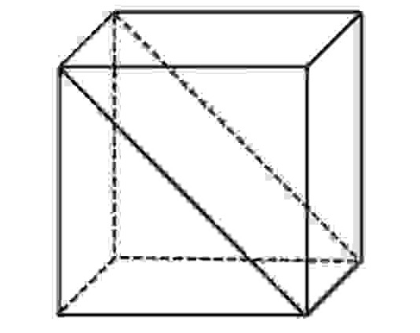

### Answer

### Explanation

## Question 445

<!-- hyz-question-id: 01a1af25-d03c-7c21-b1e2-c1d023e228db -->
```yaml
module: 数量关系
category: "面积问题"
```
### Stem
一实心圆锥体的底面半径为 r，母线长为 2r。若截圆锥体得到两个同样的锥体（如图），则所得两个锥体的表面积之和与原圆锥体表面积的比值是？

### Options
- A. 1/2
- B. (π+4√3)/6
- C. (3π+2√3)/3π
- D. (3π+4)/6π
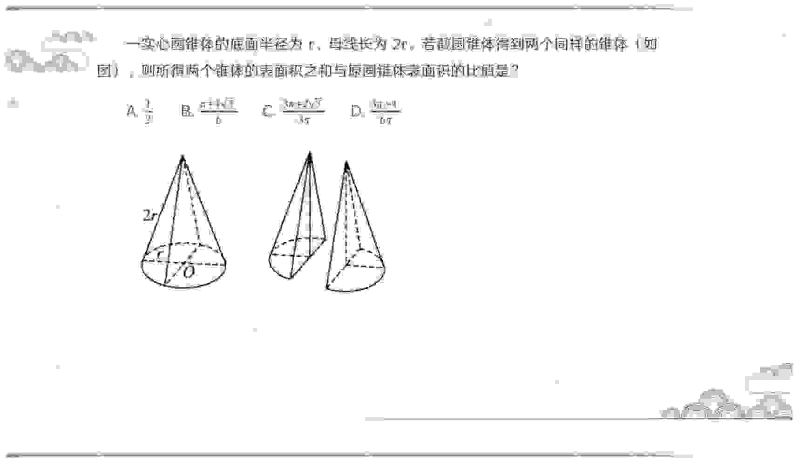

### Answer

### Explanation

## Question 446

<!-- hyz-question-id: 01a1af25-d03c-7c21-b1e2-c1e792d90b4b -->
```yaml
module: 数量关系
category: "面积问题"
```
### Stem
有一正方体模具，边长为 10。如图所示，现要以一个面的内接圆为底面，挖掘一个与正方体等高的圆柱体，则剩余模具的表面积为：

### Options
- A. 100(4-π/4)
- B. 100(4+π/2)
- C. 100(6+π/2)
- D. 600
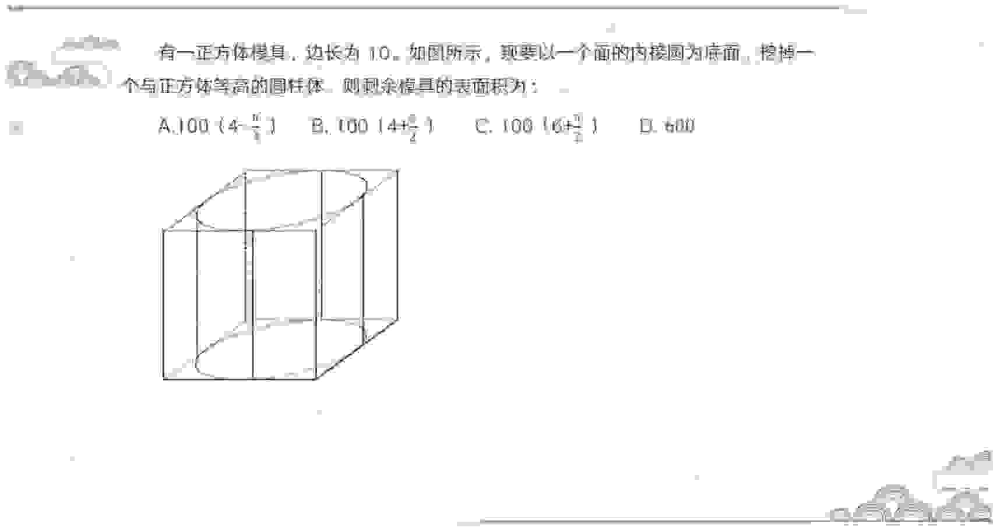

### Answer

### Explanation

## Question 447

<!-- hyz-question-id: 01a1af25-d03c-7c21-b1e2-c1f7789f1780 -->
```yaml
module: 数量关系
category: "面积问题"
```
### Stem
将一个表面积为16π的实心球体切成两半，两个半球的表面积之和为（ ）。

### Options
- A. 16π
- B. 18π
- C. 24π
- D. 32π

### Answer

### Explanation

## Question 448

<!-- hyz-question-id: 01a1af25-d03c-7c21-b1e2-c2007c68ff15 -->
```yaml
module: 数量关系
category: "距离型问题"
```
### Stem
如图，有一个圆柱体，它的高为 20，底面半径为 5。如果一只蚂蚁要从圆柱体下底面的 A 点，沿圆柱表面爬到与 A 相对的上底面 B 点，则蚂蚁爬的最短路线长约为多少（π 取 3）？

### Options
- A. 15 米
- B. 17 米
- C. 21 米
- D. 25 米
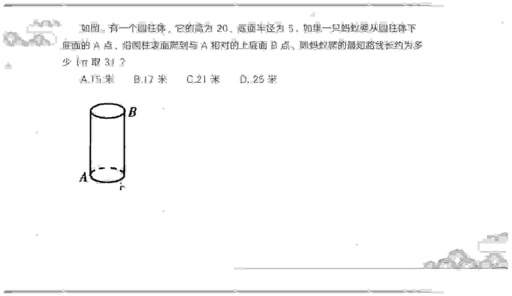

### Answer

### Explanation

## Question 449

<!-- hyz-question-id: 01a1af25-d03c-7c21-b1e2-c2134ba7c0a8 -->
```yaml
module: 数量关系
category: "距离型问题"
```
### Stem
如图，有一个圆柱体，它的高为 20，底面半径为 5。如果一只蚂蚁要从圆柱体下底面的 A 点，沿圆柱表面爬到上底面 B 点（注：绕行，不是直接由 A 到 B），则蚂蚁爬的最短路线长约为______（π 取 3）

### Options
- A. 15√7 米
- B. 25 米
- C. 10√13 米
- D. 40 米
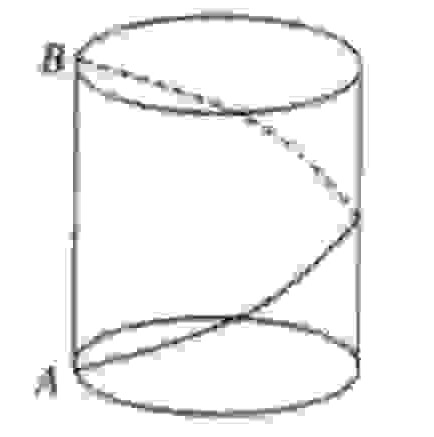

### Answer

### Explanation

## Question 450

<!-- hyz-question-id: 01a1af25-d03c-7c21-b1e2-c22b16d65541 -->
```yaml
module: 数量关系
category: "距离型问题"
```
### Stem
如图，圆锥高6√3厘米，底面半径为 6 厘米，一只蚂蚁从 A 点沿圆锥侧面爬行到 B 点，则最短的距离为（ ）厘米。

### Options
- A. 12
- B. 10√2
- C. 6π
- D. 24
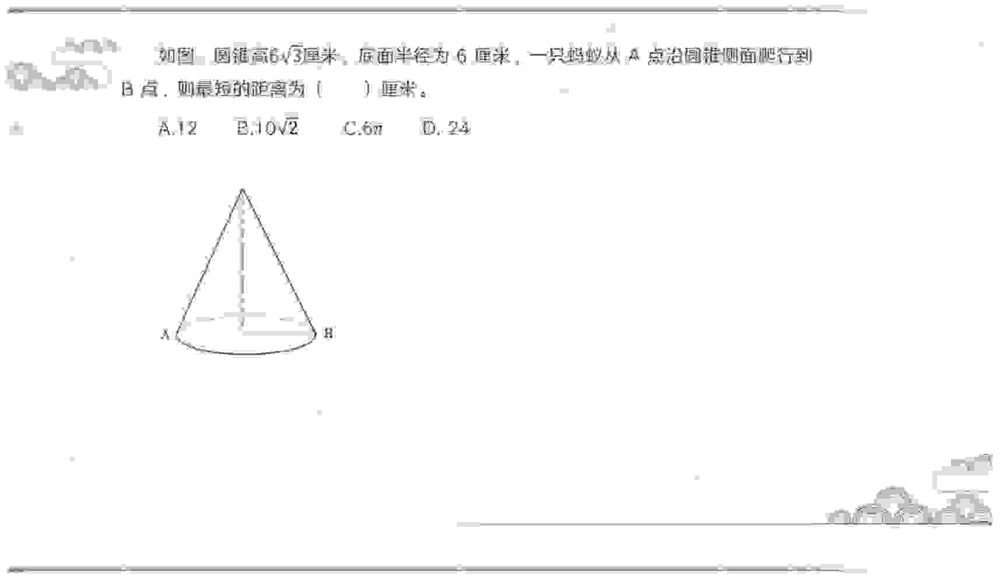

### Answer

### Explanation

## Question 451

<!-- hyz-question-id: 01a1af25-d03c-7c21-b1e2-c23c9c192a09 -->
```yaml
module: 数量关系
category: "距离型问题"
```
### Stem
《九章算术》是我国古代的数学名著，书中有很多生活中的数学模型，如：有一树高 9 尺，其横截面 4 尺，葛藤从树底端绕树 10 周至顶端，那么葛藤最短有多少尺？（ ）

### Options
- A. 41
- B. 45
- C. 49
- D. 53

### Answer

### Explanation

## Question 452

<!-- hyz-question-id: 01a1af25-d03c-7c21-b1e2-c24963a9a5c2 -->
```yaml
module: 数量关系
category: "距离型问题"
```
### Stem
一个长 7 厘米、宽 5 厘米、高 3 厘米的长方体盒子。一只瓢虫从盒子的任意一个顶点，爬到与该顶点在同一体对角线的另一个顶点，则所有情形的爬行路线的最小值是：

### Options
- A. √153
- B. √109
- C. √171
- D. √113

### Answer

### Explanation

## Question 453

<!-- hyz-question-id: 01a1af25-d03c-7c21-b1e2-c2511fc0cfa5 -->
```yaml
module: 数量关系
category: "角度型问题"
```
### Stem
商家门口摆放了一把正四棱锥形（底面为正方形，侧面为四个全等的等腰三角形）的遮阳伞，第一次伞撑开到图 1 所示的位置，伞柄与伞骨成角∠CPQ 为 30°，继续撑开到如图 2 所示的位置，伞柄与伞骨成角∠C'PQ' 变为 60°，那么第二次伞撑开后形成的正方形 A'B'C'D' 是第一次撑开后正方形 ABCD 面积的：

### Options
- A. 3√2 倍
- B. √3 倍
- C. 2 倍
- D. 3 倍
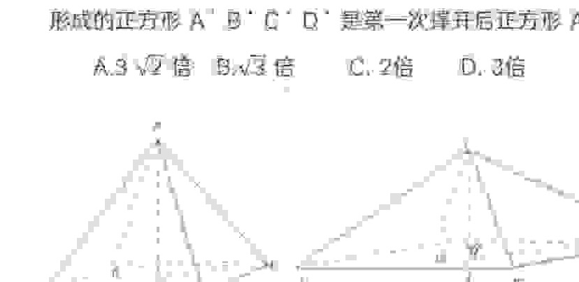

### Answer

### Explanation

## Question 454

<!-- hyz-question-id: 01a1af25-d03c-7c21-b1e2-c2675f932a8a -->
```yaml
module: 数量关系
category: "角度型问题"
```
### Stem
如下图，在半径为 5 厘米的球体上钻一个底面半径是 3 厘米的圆柱形洞，则洞的内壁面积为（ ）平方厘米。

### Options
- A. 36π
- B. 48π
- C. 56π
- D. 72π
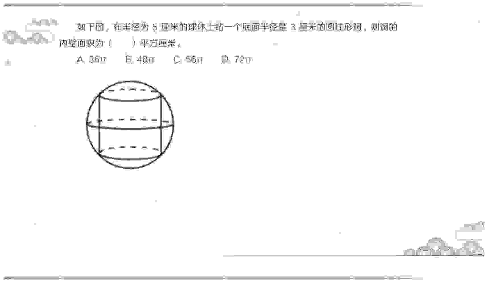

### Answer

### Explanation

## Question 455

<!-- hyz-question-id: 01a1af25-d03c-7c21-b1e2-c273e57880cb -->
```yaml
module: 数量关系
category: "角度型问题"
```
### Stem
某游乐园在一个平地中央挖了一个球形下沉广场，广场直径为 200 米，最深处 50 米，那么这个球形的直径为（ ）米？

### Options
- A. 125
- B. 200
- C. 225
- D. 250

### Answer

### Explanation

## Question 456

<!-- hyz-question-id: 01a1af25-d03c-7c21-b1e2-c280363f19cf -->
```yaml
module: 数量关系
category: "角度型问题"
```
### Stem
球面上两点之间的最短距离，就是经过两点的大圆在这两点间的一段弧长（大圆就是经过球心的平面截球面所得的圆）。我们将这个弧长叫做两点的球面距离。已知在北纬 45° 的纬度圈上有 A、B 两地，A 在东经 14°，B 在东经 104°，设地球（近似看做球体）的半径为 R，则 A、B 两地的球面距离是多少？（ ）

### Options
- A. πR/2
- B. πR/3
- C. πR/4
- D. πR/6
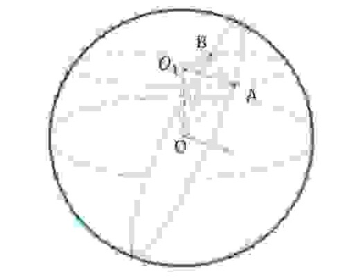

### Answer

### Explanation
