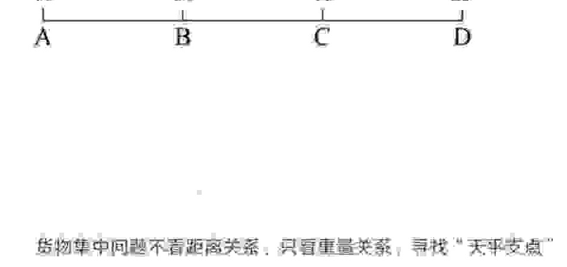
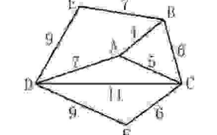
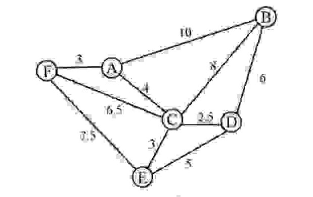

<!-- hyz-paper-id: 01a1af25-d042-7af3-a20c-392acb8c106b -->

# 特殊题型

## Question 457

<!-- hyz-question-id: 01a1af25-d042-7af3-a20c-3936ae8ad0f4 -->
```yaml
module: 数量关系
category: "魔方问题"
```
### Stem
将一个边长为 3 厘米的正方体木块的表面涂成红色，接着将木块锯成 27 个边长为 1 厘米的小正方体木块，问至少要锯多少次？若从 27 个小正方体木块中任取一个，刚好取到只有一面为红色木块的概率是多少？（ ）

### Options
- A. 6 $\frac{6}{27}$
- B. 6 $\frac{8}{27}$
- C. 12 $\frac{6}{27}$
- D. 12 $\frac{8}{27}$

### Answer

### Explanation

## Question 458

<!-- hyz-question-id: 01a1af25-d042-7af3-a20c-394ebb5c36af -->
```yaml
module: 数量关系
category: "魔方问题"
```
### Stem
一个边长为 8 的立方体，由若干个边长为 1 的正立方体组成，现在要将大立方体表面涂上颜色，问被涂上颜色的小立方体有多少个？

### Options
- A. 296
- B. 324
- C. 328
- D. 384

### Answer

### Explanation

## Question 459

<!-- hyz-question-id: 01a1af25-d042-7af3-a20c-3953758a5842 -->
```yaml
module: 数量关系
category: "魔方问题"
```
### Stem
将一个表面染色的正立方体分割成边长为 1 的小正方体，发现未被染色的小正方体的数目与只有一面被染色的小正方体数目相等，则只有两面被染色的小正方体有（ ）个。

### Options
- A. 64
- B. 48
- C. 72
- D. 96

### Answer

### Explanation

## Question 460

<!-- hyz-question-id: 01a1af25-d042-7af3-a20c-3961d4f5a47e -->
```yaml
module: 数量关系
category: "称硬币问题"
```
### Stem
当知道一堆硬币中存在一个相对较重的次品硬币时，需要几次才可以把它找出来？

### Options


### Answer

### Explanation

## Question 461

<!-- hyz-question-id: 01a1af25-d042-7af3-a20c-3976e4c17236 -->
```yaml
module: 数量关系
category: "称硬币问题"
```
### Stem
有 24 个外形完全相同的小零件，其中 23 个是正品，一个是次品，正品重量都相等，次品比正品稍重一些，用天平（无砝码）称，至少称（ ）次可以把次品找出来。

### Options
- A. 3
- B. 4
- C. 12
- D. 23

### Answer

### Explanation

## Question 462

<!-- hyz-question-id: 01a1af25-d042-7af3-a20c-398a38920881 -->
```yaml
module: 数量关系
category: "空瓶换酒问题"
```
### Stem
若 13 个矿泉水空瓶可以免费换 1 瓶矿泉水，现有 196 个矿泉水空瓶，最多可以免费喝（ ）瓶矿泉水。

### Options
- A. 16
- B. 17
- C. 18
- D. 19

### Answer

### Explanation

## Question 463

<!-- hyz-question-id: 01a1af25-d042-7af3-a20c-399f41cfc104 -->
```yaml
module: 数量关系
category: "空瓶换酒问题"
```
### Stem
某超市为了增加收入，开展“8 个空啤酒瓶换 1 瓶啤酒”的促销活动，老李在活动期间共购买了 127 瓶啤酒，期间老李不断用空啤酒瓶去换啤酒，请问老李在活动期间一共喝掉了多少瓶啤酒？

### Options
- A. 140
- B. 142
- C. 143
- D. 145

### Answer

### Explanation

## Question 464

<!-- hyz-question-id: 01a1af25-d042-7af3-a20c-39a2c05bc632 -->
```yaml
module: 数量关系
category: "空瓶换酒问题"
```
### Stem
“红星”啤酒开展“7 个空瓶换 1 瓶啤酒”的优惠促销活动。现在已知张先生在活动促销期间共喝掉 347 瓶“红星”啤酒，问张先生最少用钱买了多少瓶啤酒？

### Options
- A. 296
- B. 298
- C. 300
- D. 302

### Answer

### Explanation

## Question 465

<!-- hyz-question-id: 01a1af25-d042-7af3-a20c-39bbfe236408 -->
```yaml
module: 数量关系
category: "称重问题"
```
### Stem
4 个大小不同的苹果。两两称重，称得的重量分别为 297 克、339 克、375 克、390 克，432 克。其中有两个苹果没有在一起称过，那么这两个苹果中较轻的那个多少克？（ ）

### Options
- A. 156
- B. 198
- C. 216
- D. 222

### Answer

### Explanation

## Question 466

<!-- hyz-question-id: 01a1af25-d042-7af3-a20c-39c5a35cfd44 -->
```yaml
module: 数量关系
category: "称重问题"
```
### Stem
有 4 位同学的体重都是整千克数，他们两两合称体重，共称了 5 次，称得的千克数分别是 99、113、125、130、144，其中有两人没有一起称过。这两个人中体重较重的人的体重是（ ）千克。

### Options
- A. 66
- B. 67
- C. 68
- D. 69

### Answer

### Explanation

## Question 467

<!-- hyz-question-id: 01a1af25-d042-7af3-a20c-39dec6b58aef -->
```yaml
module: 数量关系
category: "称重问题"
```
### Stem
五个互不相同的自然数两两相加，只得到 8 个不同的结果，分别是：15、20、23、25、28、33、38 和 41，那么这些数中最大数与最小数的差是多少？

### Options
- A. 17
- B. 18
- C. 19
- D. 20

### Answer

### Explanation

## Question 468

<!-- hyz-question-id: 01a1af25-d042-7af3-a20c-39eb9715b287 -->
```yaml
module: 数量关系
category: "货物集中问题"
```
### Stem
某电商平台每隔 5 千米有一座仓库，共有 A、B、C、D 四座仓库，图中数字表示各仓库库存货物的吨数。现需要把所有的货物集中存放在其中某一个仓库中，如果每吨货物运输 1 千米需要运费 3 元，要使运费最少，则需将货物集中到哪座仓库？

[图：A、B、C、D 四座仓库从左至右依次排列，上方数字依次为 10、20、15、25]


### Options
- A. 仓库 A
- B. 仓库 B
- C. 仓库 C
- D. 仓库 D

### Answer

### Explanation

## Question 469

<!-- hyz-question-id: 01a1af25-d042-7af3-a20c-39fd08d5d4e7 -->
```yaml
module: 数量关系
category: "货物集中问题"
```
### Stem
某企业有甲、乙、丙三个仓库，且都在一条直线上，之间分别相距 1 千米、3 千米，三个仓库里面分别存放货物 5 吨、4 吨、2 吨。如果把所有的货物集中到一个仓库，每吨货物每千米运费是 90 元，请问把货物放在哪个仓库最省钱：

### Options
- A. 甲
- B. 乙
- C. 丙
- D. 甲或乙

### Answer

### Explanation

## Question 470

<!-- hyz-question-id: 01a1af25-d042-7af3-a20c-3a0a2fecda1f -->
```yaml
module: 数量关系
category: "货物集中问题"
```
### Stem
一条公路沿线顺次有甲、乙、丙、丁、戊 5 个仓库，相邻仓库间隔 100 千米。甲仓库有 10 吨货物，乙仓库有 20 吨货物，戊仓库有 40 吨货物，其余两个仓库无货物。现在准备把所有货物集中到一个仓库里，如果每吨货物运输成本是每千米 1 元运费，那么运费最少是多少元？

### Options
- A. 9000
- B. 10000
- C. 11000
- D. 12000

### Answer

### Explanation

## Question 471

<!-- hyz-question-id: 01a1af25-d042-7af3-a20c-3a19283ab278 -->
```yaml
module: 数量关系
category: "轮流取物必胜问题"
```
### Stem
袋子里有 100 个球，甲乙轮流取，规定每次只能取 1-5 个，取走最后一个球的人获胜，若甲先取，甲第一次需要取出多少个才能保证胜利？

### Options
- A. 1
- B. 2
- C. 3
- D. 4

### Answer

### Explanation

## Question 472

<!-- hyz-question-id: 01a1af25-d042-7af3-a20c-3a21cd1a22fc -->
```yaml
module: 数量关系
category: "轮流取物必胜问题"
```
### Stem
桌子上放有 2018 枚硬币，小芳、小强两人轮流取走其中一些。当小芳取硬币时，只能取 2 枚或 4 枚；当小强取硬币时，只能取 1 枚或 3 枚，取走最后一枚硬币的人即为获胜者，假设两人均使用最佳策略，则（ ）能获胜。

### Options
- A. 先取者
- B. 后取者
- C. 小芳
- D. 小强

### Answer

### Explanation

## Question 473

<!-- hyz-question-id: 01a1af25-d042-7af3-a20c-3a3d944bb488 -->
```yaml
module: 数量关系
category: "联通路径最短"
```
### Stem
某科技园区计划铺设电缆联通 A、B、C、D、E、F 六栋办公楼。可以铺设电缆的线路如下图所示，每条边上的数字表示两栋楼之间线路的长度（单位：10 米），则铺设电缆的总长度最短是（ ）。

[图：六边形顶点依次为 E、B、C、F、D，中心为 A；各边数字为 E-B=7、E-D=9、A-B=4、A-D=7、A-C=5、B-C=6、D-C=11、D-F=9、F-C=6]


### Options
- A. 280 米
- B. 290 米
- C. 310 米
- D. 350 米

### Answer

### Explanation

## Question 474

<!-- hyz-question-id: 01a1af25-d042-7af3-a20c-3a48aee9ef0e -->
```yaml
module: 数量关系
category: "联通路径最短"
```
### Stem
燃气公司欲在某新建楼盘内铺设天然气管道连通所有住宅楼，楼与楼之间可铺设管道的路线如图所示，圆圈表示各住宅楼，线段及线上数字表示路线及其长度（单位：百米），则铺设的管道最短长度是：

[图：节点为 A、B、C、D、E、F；各线段数字为 F-A=3、A-B=10、A-C=4、F-C=6.5、F-E=7.5、C-E=3、C-D=2.5、C-B=8、D-B=6、E-D=5]


### Options
- A. 1800 米
- B. 1850 米
- C. 1950 米
- D. 2000 米

### Answer

### Explanation
