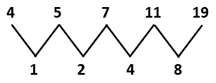

<!-- hyz-paper-id: 01a19c8a-1dc0-7f13-b543-4d030abf3017 -->
# 2008年新疆维吾尔自治区公务员录用考试《行测》题

## Paper Notes

> 候选采集稿。参考答案及解析来自粉笔页面，不代表官方答案或真实高分答卷；来源使用许可与原卷对应关系仍需人工核实。

## 题型与作答说明

数量关系

（14题）

本部分包括数字推理与数学运算两种类型的题目。

言语理解与表达

（12题）

本部分包括理解与表达两方面的内容。请根据题目要求，在四个选项中选出一个最恰当的答案。

判断推理

（9题）

本部分包括定义判断、事件排序与逻辑判断三种类型的题目。注意，正确的答案应与所给的陈述相符合，不需要任何附加说明即可以从陈述中直接推出。

常识判断

（8题）

根据题目要求，在四个选项中选出一个最恰当的答案。

资料分析

（5题）

所给出的图、表、文字或综合性资料均有若干个问题要你回答，你应根据资料提供的信息进行分析、比较、计算和判断处理。

## Material M1


<!-- hyz-material-id: 01a19c8a-1dc0-7f13-b543-4d164e7ec932 -->
我们的祖先使用货币的时代是很早的。在原始的交易场上，凡交易双方愿意接受的物品，都可以作为交换的媒介而具有货币的职能。而在所有的实物货币中，贝币的流通时间是最长的，流通的地域也是最广的。

        在没有成为货币的远古时代，海贝因人们喜爱而成为装饰品。《说文》：“婴，颈饰也。”这正是挂在妇女们颈上的用贝串成的“项链”。可以说，这是人类最古老的项链。

        在相当长的古代社会中，妇女一直是原始贸易的主要参加者，而海贝作为她们佩戴的贵重装饰品，经过她们之手成为交换的一般等价物——货币，那应是很自然的事。因此，贝币的产生和最初使用可能要归功于远古的妇女们。

        在汉字中，与价值有关的字，大都从贝，如财、货、贸、费、赁、赊、赎、贵、赋、赐等等。由此可见贝币的使用在我国历史悠久。

        从出土文物和甲骨文材料中我们知道，我国殷商时代主要的货币就是贝。当时一般是把五个贝串在一起的，两串形成一个标准单位，称为“朋”。甲骨文有“易多女有贝朋”“光取贝二朋”“贝十朋”等的记载。商王将几贝朋送给臣属，便是一件大事，须占卜问祖先看看是否应当送，而收礼者必须铸铜器以示纪念。由此可知贝在当时是很贵重的物品，是财富的代表或结晶。

        周人取代商人而统治中原时，仍然使用贝币。在西周的社会经济中，货物交换发展，贝币的流通量日趋庞大。如殷代甲骨文中不过是“二朋”“十朋”的数量，而周代的金文中，“百朋”甚至“万朋”等数字就很常见了。个人的交往动辄即有百朋之数，社会上的交易之大自然可想而知，由于天然贝的来源有限，于是出现了各种仿制贝，即以贝为模本，用其他材料仿制而成。现已出现的有蚌贝、骨贝、石贝、陶贝、铜贝、金贝等等，其中，最有重大意义的是贝与铜的结合而产生的铜贝。因为它是同后代的金属铸币连在一起的。周代的铜贝可以说是世界上最早的铜造货币。而春秋战国时代的楚国把铜贝发展为一种椭圆形的小铜币，中国的钱币学家称为“鬼脸钱”和“蚁鼻钱”，这是中国古代铜钱的滥觞。

        春秋时期，经济进一步发达起来，各种金属货币进入流通领域，并开始排挤贝币而取得统治地位。但由于传统观念的影响，贝币仍在流通，也仍然作为贵重物品而随达官贵人、富有阶层进入坟墓做殉葬品。

        秦始皇横扫六国，统一天下，采取了法律手段统一全国货币制度，金属货币取代了原来繁多的其他实物货币，贝开始逐步退出流通领域，成为单纯的“器饰宝藏”，从而脱去了“一般等价物”的外衣，返璞归真了。秦始皇的措施，是中国货币史上的一次重大改革，具有划时代的意义。

## Material M2


<!-- hyz-material-id: 01a19c8a-1dc1-7ef1-ba1a-ce7ad3a1f335 -->
美国科学家声称，每人生来有两个脑，即颅脑与肠脑。

        肠脑位于食管、胃脏、小肠与结肠内层组织的鞘中，含有神经细胞、神经传递质、蛋白质和复杂的环行线路。结肠炎、过敏性肠综合症等都与肠脑内产生的问题有关。肠脑中几乎能找到颅脑赖以运转和控制的所有物质，如血清素、多巴胺、谷氨酸、去甲肾上腺素、一氧化氮等。此外，肠脑中还存在多种被称为神经肽的脑蛋白、脑啡肽以及对神经起显著作用的化学物质。

        颅脑面临惊恐时释出的应激激素会冲击胃脏以生痉挛；惊恐又引起交感神经影响肠脑的血清素分泌量。

        应激激素过分刺激还会导致腹泻。当情绪压抑时，食管神经受到高度刺激会感到吞咽困难；颅脑释出的应激激素还会改变胃脏与食管间的神经功能，导致胃灼热。

        最初的脑神经系统起始于管形动物，生存竞争需要更复杂的颅脑，从而发展了中枢神经系统。重要的肠神经系统不能进入头颅与胃肠相联，而为了适应高级动物进食和消化的需要，自然法则就保存了有独立功能的肠神经系统。就人而言，早期胚胎发育中产生的神经脊，一部分进入了中枢神经系统，另一部分变成肠神经系统，通过迷走神经连接两者——颅脑和肠脑。

## Material M3


<!-- hyz-material-id: 01a19c8a-1dc1-7ef1-ba1a-ce82f309e897 -->
据《星期日商报》报道，2月4日，英国航空航天部在对包括通讯卫星在内的一切通讯情报设施进行检测中，忽然发现军用卫星“天网”系统的一颗卫星不是拒绝接受信号，就是反应迟钝。当天，英国航空航天部组织专家研讨，就在这时，忽然来了一封电子邮件，声称他们劫持了“天网”卫星!

        电子邮件称，一个黑客团体已经控制了“天网”卫星。他们是一群由电脑专家、密码专家和航空航天专家组成的团体。他们并不想搞破坏活动，由于经费不足，目前急需资助。他们成功地窃取了一颗“天网”卫星的资料，并对它进行遥控，切除了它和航天部的联系，改变卫星飞行的轨道。英国政府如果要收回卫星的控制权，必须交出赎金，否则他们就要把这颗卫星变成废铁。

        由于英官方并没有公开澄清此事，所以一时间小道消息满天飞。虽然有人强调“天网”系统是封闭的系统，不可能由Internet入侵，但事实上，控制卫星的微波是开放的，截获卫星信号，夺取卫星控制权并非天方夜谭。一套信号发射系统只需要两只手提箱就可以装下，它们可以在任何地点被组装起来。而不间断地截获卫星信号，许多大学里的卫星天线就可以做到。所以单从技术上讲，“俘虏”卫星并非不可能。

        “信息战争”一直被认为是一个“预言”，人们都相信它的可能性，但没有人知道它来得究竟有多快。据报道，1990年海湾战争中，美军曾经利用藏在打印机里的病毒破坏伊拉克的防空系统。俄罗斯卫星专家伊万诺夫·塔里夫说：现在争论“劫持卫星”事件的真实性已经没有意义，这条消息可以提醒各国政府，黑客已经开始对军事设施展开攻击。

## Material M4


<!-- hyz-material-id: 01a19c8a-1dc1-7ef1-ba1a-ce984d1c4299 -->
国家统计局小康研究课题组，对城镇居民生活小康标准5个方面12项指标进行监测显示：1999年我国城镇居民生活水平小康实现程度达到94.3％。在12项小康指标中有10项达到或者基本达到小康初始水平。但是还有两项指标，即文化教育娱乐支出比重和人均绿地面积与小康标准有一定差距。从5个方面来看，经济发展、物质生活和人口素质3个方面小康实现程度已经达到100%；精神生活水平和社会保障水平2个方面指标分别只达到86.7%和75.6%。各地区城市小康实现程度也存在较大差距。三大地带相比，1998年实现程度综合得分仍然差异较大，中、西部比东部分别低7.9个百分点和12.97个百分点。但与1996年相比，东部地区小康实现程度由91.87%下降到91.70%；中、西部实现程度分别由79.8%和74.4%提高到83.80%和78.73%。

## Question 1


<!-- hyz-question-id: 01a19c8a-1dc1-7ef1-ba1a-cea1af7ecab6 -->
```yaml
module: 数量关系
category: null
topics: []
materials: []
passage_source: null
issues:
- order_unverified
```

### Stem

57，22，36，-12，51，( )。

### Options

- A. \-59

- B. 62

- C. \-32

- D. 43

### Answer

A

### Explanation

该数列的规律为：(第n项-第n+1项)+n=第n+2项，即57-22+1=36，22-36+2=-12，36-(-12)+3=51，则原数列的未知项为-12-51+4=-59。

故正确答案为A。

## Question 2


<!-- hyz-question-id: 01a19c8a-1dc1-7ef1-ba1a-ceba32a65a23 -->
```yaml
module: 数量关系
category: null
topics: []
materials: []
passage_source: null
issues:
- order_unverified
```

### Stem

\-1，64，27，343，( )。

### Options

- A. 81

- B. 256

- C. 986

- D. 1000

### Answer

D

### Explanation

原数列各项为立方数，即(-1)^3、4^3、3^3、7^3，底数-1、4、3、7为和数列，则原数列的未知项为(3+7)^3 = 10^3 = 1000。

故正确答案为D。

## Question 3


<!-- hyz-question-id: 01a19c8a-1dc1-7ef1-ba1a-cec81897d6ab -->
```yaml
module: 数量关系
category: null
topics: []
materials: []
passage_source: null
issues:
- order_unverified
```

### Stem

2，3，6，36，( )。

### Options

- A. 1296

- B. 648

- C. 322

- D. 216

### Answer

B

### Explanation

2 × 3 × 1 = 6，3 × 6 × 2 = 36，6 × 36 × 3 = (648)。

故正确答案为B。

备注：此题出得不够严谨，如果按照从第三项开始，各项等于其前面所有项的乘积，则未知项为2 × 3 × 6 × 36 = 1296，也可以选A。

## Question 4


<!-- hyz-question-id: 01a19c8a-1dc1-7ef1-ba1a-cedf8497b9dc -->
```yaml
module: 数量关系
category: null
topics: []
materials: []
passage_source: null
issues:
- order_unverified
```

### Stem

2/3，1/2，2/5，1/3，2/7，( )。

### Options

- A. 1/6

- B. 1/8

- C. 1/4

- D. 1/9

### Answer

C

### Explanation

原数列各项即2/3、2/4、2/5、2/6、2/7，则未知项为2/8=1/4。

故正确答案为C。

## Question 5


<!-- hyz-question-id: 01a19c8a-1dc1-7ef1-ba1a-cee3a0e7545d -->
```yaml
module: 数量关系
category: null
topics: []
materials: []
passage_source: null
issues:
- order_unverified
```

### Stem

4，5，7，11，19，( )。

### Options

- A. 29

- B. 31

- C. 33

- D. 35

### Answer

D

### Explanation



相邻项作差得1、2、4、8，是公比为2的等比数列，则原数列的未知项为8×2+19 = 35。

故正确答案为D。

## Question 6


<!-- hyz-question-id: 01a19c8a-1dc1-7ef1-ba1a-cefb77cdea8f -->
```yaml
module: 数量关系
category: null
topics: []
materials: []
passage_source: null
issues:
- order_unverified
```

### Stem

3，10，15，26，35，( )。

### Options

- A. 40

- B. 50

- C. 60

- D. 70

### Answer

B

### Explanation

原数列各项即为2^2-1、3^2+1、4^2-1、5^2+1、6^2-1，则未知项为7^2+1 = 50。

故正确答案为B。

## Question 7


<!-- hyz-question-id: 01a19c8a-1dc1-7ef1-ba1a-cf051bb5b573 -->
```yaml
module: 数量关系
category: null
topics: []
materials: []
passage_source: null
issues:
- order_unverified
```

### Stem

0.0495×2500＋49.5×2.4+51×4.95的值是：

### Options

- A. 4.95

- B. 49.5

- C. 495

- D. 4950

### Answer

C

### Explanation

原式 = 49.5 × (2.5 + 2.4 + 5.1) = 49.5 × 10 = 495。

故正确答案为C。

## Question 8


<!-- hyz-question-id: 01a19c8a-1dc1-7ef1-ba1a-cf1b409ed7fa -->
```yaml
module: 数量关系
category: null
topics: []
materials: []
passage_source: null
issues:
- order_unverified
```

### Stem

(-2)^2004 - 2^2005 =?

### Options

- A. 2^2004

- B. -2^2004

- C. 2^2005

- D. 1000

### Answer

B

### Explanation

解析1：

原式 = 2^2004 - 2^2005 = 2^2004 × (1 - 2) = -2^2004。

解析2：

先对比(-2)^2004和2^2005的大小，明显后者较大，再仔细观察各项，会发现只有B是负数。

故正确答案为B。

## Question 9


<!-- hyz-question-id: 01a19c8a-1dc1-7ef1-ba1a-cf25076f2a22 -->
```yaml
module: 数量关系
category: 数学运算
topics:
- 普通行程
materials: []
passage_source: null
issues:
- order_unverified
```

### Stem

甲和乙的速度比是7:5，时间比是3:4，问他们的路程比是多少：

### Options

- A. 21:20

- B. 28:15

- C. 10:9

- D. 4:1

### Answer

A

### Explanation

不妨设甲、乙的速度分别为7、5，时间分别为3、4，则两者的路程比为(7 × 3)/(5 × 4) = 21/20。

故正确答案为A。

## Question 10


<!-- hyz-question-id: 01a19c8a-1dc1-7ef1-ba1a-cf3b28000dfc -->
```yaml
module: 数量关系
category: 数学运算
topics:
- 几何公式类-平面图形
- 几何结论类-三角形相关
- 几何结论类-相似图形
materials: []
passage_source: null
issues:
- order_unverified
```

### Stem

有一个球场，地图上量，长是5.2cm，宽是2.8cm，如果地图比例为1:500，则球场面积是多少平方米：

### Options

- A. 254

- B. 532

- C. 364

- D. 728

### Answer

C

### Explanation

地图的比例为1:500，则该球场的长为5.2cm×500=5.2×5m，宽为2.8cm×500=2.8×5m，则该球场的面积为5.2 × 5 × 2.8 × 5 = 26 × 14 = 364m^2。

故正确答案为C。

## Question 11


<!-- hyz-question-id: 01a19c8a-1dc1-7ef1-ba1a-cf4944894530 -->
```yaml
module: 数量关系
category: 数学运算
topics:
- 和差倍比问题
materials: []
passage_source: null
issues:
- order_unverified
```

### Stem

一池鱼，打一网上来200条全部做标记，放回鱼池，又打一网上来100条，其中5条是做标记的，池中一共多少条鱼：

### Options

- A. 3000

- B. 4000

- C. 5000

- D. 6000

### Answer

B

### Explanation

200条做标记的鱼占总量的比例和5条做标记的鱼占这一网鱼的总量的比例相同，则池中鱼的总量为200 × 100 ÷ 5 = 4000条。

故正确答案为B。

## Question 12


<!-- hyz-question-id: 01a19c8a-1dc1-7ef1-ba1a-cf505eedfbb4 -->
```yaml
module: 数量关系
category: 数学运算
topics:
- 几何结论类-三角形相关
materials: []
passage_source: null
issues:
- order_unverified
```

### Stem

三角形的内角和为180度，问六边形的内角和是多少度：

### Options

- A. 540

- B. 360

- C. 450

- D. 720

### Answer

D

### Explanation

解析1：根据多边形内角和公式，n边形内角和 = (n − 2) × 180◇，可知六边形内角和=(6-2)×180°=720◇。

解析2：六边形可看作是四个三角形组合成的，则六边形的内角和为180°×4=720°。

解析3：已知多边形的外角和为360°，六边形的内角外角和为180°×6 = 1080°，所以内角和为1080°−360°=720°。

故正确答案为D。

## Question 13


<!-- hyz-question-id: 01a19c8a-1dc1-7ef1-ba1a-cf6e697a1e04 -->
```yaml
module: 数量关系
category: 数学运算
topics:
- 相遇追及
materials: []
passage_source: null
issues:
- order_unverified
```

### Stem

一个周长300米的环形跑道上，甲和乙同时从起跑线起跑，甲每秒跑6米，乙每秒跑4米，问甲第二次追上乙时甲跑了几圈：

### Options

- A. 6

- B. 8

- C. 4

- D. 5

### Answer

A

### Explanation

甲第二次追上乙时甲比乙多跑了2圈，设甲第二次追上乙时两人用时为t秒，根据两人的距离差列方程得：6t-4t=600，解得t=300，则此时甲跑了300×6米，即6圈。

故正确答案为A。

## Question 14


<!-- hyz-question-id: 01a19c8a-1dc1-7ef1-ba1a-cf7daaf838da -->
```yaml
module: 数量关系
category: 数学运算
topics:
- 经济利润问题
materials: []
passage_source: null
issues:
- order_unverified
```

### Stem

2001年，某公司所销售的计算机台数比上一年度上升了20%，而每台的价格比上一年度下降了20%。如果2000年该公司的计算机销售额为3000万元，那么2001年的计算机销售额大约是多少：

### Options

- A. 2900万元

- B. 3000万元

- C. 3100万元

- D. 3300万元

### Answer

A

### Explanation

解析1：设2000年销售的台数为n，每台价格为m，那么m × n = 3000万元，再根据2001年变化，可知2001年销售额= (1.2×n)×(0.8×m) = 0.96×m×n=0.96×3000=2880万元≈2900万元。

解析2：设2000年销售计算机x台，则2000年计算机的单价为3000/x万元，则2001年销售计算机x(1+20%)=1.2x台，2001年计算机的单价为3000/x × (1 - 20%) = 2400/x。所以2001年的计算机销售额为2400/x×1.2x=2880万元，与A选项最接近。

故正确答案为A。

## Question 15


<!-- hyz-question-id: 01a19c8a-1dc1-7ef1-ba1a-cf88ffe53627 -->
```yaml
module: 言语理解与表达
category: null
topics: []
materials:
- M1
passage_source: null
issues:
- order_unverified
```

### Stem

下面对“贝币的产生和最初使用可能要归功于远古的妇女们”的依据判断错误的一项是：

### Options

- A. 远古时代海贝因人们的喜爱而成为贵重的装饰品

- B. 《说文》：“婴，颈饰也。”

- C. 我国古代原始贸易的主要参加者是妇女

- D. 用海贝串成的“项链”是古代妇女佩戴的贵重装饰品

### Answer

B

### Explanation

此题属于细节判断题。

B项只是说明了《说文解字》中有以海贝项链来做饰品的记载，与“贝币的产生和最初使用可能要归功于远古的妇女们”无关。

故正确答案为B。

## Question 16


<!-- hyz-question-id: 01a19c8a-1dc1-7ef1-ba1a-cf990601f3e1 -->
```yaml
module: 言语理解与表达
category: null
topics: []
materials:
- M1
passage_source: null
issues:
- order_unverified
```

### Stem

下列不符合文意的是：

### Options

- A. 随着商品交易的发展，贝币的流通量日趋庞大

- B. 各种材料的仿制贝应运而生并大量出现，弥补了天然贝数量的不足

- C. “鬼脸钱”和“蚁鼻钱”在楚国的出现是中国古代货币的滥觞

- D. 世界上最早的铜造货币——铜贝的出现为后世的金属铸币开了先河

### Answer

C

### Explanation

原文中指出“鬼脸钱”和“蚁鼻钱”是中国古代铜钱的滥觞，而不是C项中所说的“中国货币的滥觞”，这属于偷换概念，故C错误。

文中第六段提到了货物交换发展，贝币的流通量日趋庞大，故A正确；第六段中提到贝币的流通量日趋庞大，天然贝的来源有限，于是出现了各种仿制贝，即以贝为模本，用其他材料仿制而成，故B正确；第六段同样提到“最有重大意义的是贝与铜的结合而产生的铜贝。因为它是同后代的金属铸币连在一起的。”也正是因为铜贝的出现，开创了金属钱币的先河，因此D项正确。

故正确答案为C。

## Question 17


<!-- hyz-question-id: 01a19c8a-1dc1-7ef1-ba1a-cfa0651cc11a -->
```yaml
module: 言语理解与表达
category: null
topics: []
materials:
- M1
passage_source: null
issues:
- order_unverified
```

### Stem

下列对文章最后两段的内容分析，确切的一项是：

### Options

- A. 春秋时期，贝币在流通领域的统治地位被取代而逐步成为有钱人的殉葬品

- B. 各种金属货币纷纷进入流通领域，促进了经济的进一步发展

- C. 秦始皇用统一货币的法律手段，促使贝币逐步退出流通领域

- D. 金属货币取代实物货币，从而使贝币又重新成为人们的“器饰宝藏”

### Answer

C

### Explanation

此题考查细节判断。

C项表述与原文内容相符。

A项中“逐步成为有钱人的殉葬品”表述错误，原文中是“也仍然作为贵重物品而随达官贵人、富有阶层进入坟墓做殉葬品”，也就是说贝币原来也是可以作为殉葬品的，而不是后来才转变成的；B项属于因果倒置，根据原文“春秋时期，经济进一步发达起来，各种金属货币进入流通领域”可知，是由于春秋时期经济发达起来，各种金属货币才进入流通领域，而并非后者促进了前者，故错误；D项中“重新成为”表述不当，原文中指出“贝币”逐步退出流通领域，成为单纯的“器饰宝藏”，也就是说其实贝币一直都是可以作为“器饰宝藏”的。

故正确答案为C。

## Question 18


<!-- hyz-question-id: 01a19c8a-1dc1-7ef1-ba1a-cfba85fc77e7 -->
```yaml
module: 言语理解与表达
category: null
topics: []
materials:
- M1
passage_source: null
issues:
- order_unverified
```

### Stem

通览全文，对文意把握正确的一项是：

### Options

- A. 贝币是我国出现的时间最早、流通的时间最长、流通的地域最广的古代货币

- B. 在我国货币史上最具有重大意义的几个阶段是：贝币的出现，铜贝的出现，统一的金属币使贝币返璞归真

- C. 汉字中，与价值有关的字都用“贝”作偏旁，说明贝币在我国的使用历史悠久

- D. 我国商代的主要货币是贝币，西周的主要货币是铜币，东周的主要货币是金属货币，而秦以后金属货币就一统天下了

### Answer

B

### Explanation

此题考查中心理解。

总结全文的脉络，通过对贝币、铜贝、铜币、统一金属货币等币种的产生和发展历程，来阐述了中国的货币发展。

因此，结合选项应该选择B，B项表述概况全面，体现了货币的发展历程。

A、C两项都只涉及了贝币的有关内容；D项描述了各种形式的货币与朝代的对应关系，但没有体现出其存在的历史发展。

故正确答案为B。

## Question 19


<!-- hyz-question-id: 01a19c8a-1dc1-7ef1-ba1a-cfce06b94819 -->
```yaml
module: 言语理解与表达
category: null
topics: []
materials:
- M2
passage_source: null
issues:
- order_unverified
```

### Stem

根据文意，肠脑之所以称为“脑”，下列理解不准确的一项是：

### Options

- A. 它是不依赖中枢神经系统而独立活动的神经系统

- B. 它的物质构成中含有神经细胞及对其起显著作用的物质

- C. 它具有同颅脑一样的能够控制肠胃运转的独立功能

- D. 它起源于管形动物的脑神经系统并从中分化出来

### Answer

C

### Explanation

此题属于细节判断题。

C项内容在原文中并没有体现，原文中只是说“肠脑中几乎能够找到颅脑赖以运转和控制的所有物质”，而不是C项中所说的“功能”，故应该选择C。

A项与原文最后一段中“保存了有独立功能的肠神经系统”的表述相符；B项与原文第二段最后一句的表述相符；D项与原文最后一段第一句话的表述相符。

故正确答案为C。

## Question 20


<!-- hyz-question-id: 01a19c8a-1dc1-7ef1-ba1a-cfd4db579fb7 -->
```yaml
module: 言语理解与表达
category: null
topics: []
materials:
- M2
passage_source: null
issues:
- order_unverified
```

### Stem

根据文意，对“肠脑中几乎能够找到颅脑赖以运转和控制的所有物质”一句，理解正确的一项是：

### Options

- A. 颅脑赖以运转和控制的绝大部分物质存在于肠脑之中

- B. 颅脑依赖肠脑中的绝大部分物质进行运转和控制活动

- C. 肠脑中具有与颅脑赖以运转和控制所需相同的绝大部分物质

- D. 肠脑中所有的物质与颅脑赖以运转和控制的物质几乎相同

### Answer

C

### Explanation

此题属于词句理解题。

C项的表述与原句相同。

A、B两项都讲的是颅脑赖以运转和控制所需的绝大部分物质存在于肠脑中，而原文所说的是这些物质在颅脑和肠脑中都存在，所以A、B两项的表述都是错误的；根据原文可知，肠脑中含有绝大部分与颅脑赖以运转和控制所需要的物质相同的物质，此外还含有另外一些其他物质，因此D项所说的“几乎相同”也是错误的。

故正确答案为C。

## Question 21


<!-- hyz-question-id: 01a19c8a-1dc1-7ef1-ba1a-cfed3a602a77 -->
```yaml
module: 言语理解与表达
category: null
topics: []
materials:
- M2
passage_source: null
issues:
- order_unverified
```

### Stem

下列解说，符合原文意思的一项是：

### Options

- A. 应激激素作用于肠脑引起肠神经系统化学物质的改变

- B. 情绪的变化是肠脑和颅脑发生联系的重要渠道

- C. 进食和消化的需要是肠神经系统形成的基础条件

- D. 重要的肠神经系统因不能进入头颅而成为独立系统

### Answer

D

### Explanation

此题属于细节判断题。

D项表述与原文相符。

文章中指出“应激激素还会改变胃脏与食管间的神经功能”，改变的是“神经功能”而非“肠神经系统化学物质”，因此A项错误；情绪的变化会刺激颅脑和肠脑做出反应，但在两者之间起连接作用的是“迷走神经”，而不是情绪的变化，因此B项错误；“自然法则保存了有独立功能的肠神经系统”中的“保存”一词说明肠神经系统是原本就存在的，所以C项中“形成”的表述错误。

故正确答案为D。

## Question 22


<!-- hyz-question-id: 01a19c8a-1dc1-7ef1-ba1a-cff906aafac8 -->
```yaml
module: 言语理解与表达
category: null
topics: []
materials:
- M2
passage_source: null
issues:
- order_unverified
```

### Stem

对本文所提供的信息，理解不正确的一项是：

### Options

- A. 美国某些科学家否定了每人只有颅脑的观点

- B. 美国某些科学家对肠神经的位置和功能提出了新的见解

- C. 美国某些科学家对肠胃疾病的产生补充了新的见解

- D. 美国某些科学家对人类某些器官的发生过程提出新观点

### Answer

B

### Explanation

此题属于细节判断题。

B项中“肠神经的位置和功能”的表述有误，原文主要介绍的是“肠脑”的位置和功能，而非“肠神经”。

美国科学家声称人有两个脑，也即否认了人只有颅脑的观点，所以A项正确；文章中以“惊恐”和“应激激素”的例子来说明肠脑对肠胃疾病的影响，即对肠胃疾病的产生补充了新的见解，所以C项正确；原文最后一段讲述了颅脑和肠脑的形成过程，即对人类某些器官的发生过程提出了新观点，所以D项正确。

故正确答案为B。

## Question 23


<!-- hyz-question-id: 01a19c8a-1dc1-7ef1-ba1a-d0008577f5d3 -->
```yaml
module: 言语理解与表达
category: null
topics: []
materials:
- M3
passage_source: null
issues:
- order_unverified
```

### Stem

前两段的综合要义是：

### Options

- A. 英国航空航天部发现军用“天网”系统的一颗卫星不是拒收信号，就是反应迟钝

- B. 一个黑客团体已经控制了英国“天网”系统中的一颗卫星，并想将它变成废铁

- C. 一个黑客团体想获得赎取经费，已挟持了“天网”系统中的一颗卫星

- D. 英国政府如不交出赎金，“天网”系统中的一颗卫星将会变成废铁

### Answer

C

### Explanation

此题属于中心理解题。

文章前两段的主要内容是英国的“天网”卫星被劫持，黑客声称要政府用赎金来换取控制权。其中的要点包括“劫持”和“赎金”。

因此，结合选项应该选择C，C项的表述概括了前两段文字的主要意思，并且包含了所有关键点，全面准确。

A项只概括了“天网”卫星的反应情况，是一个非常初级的信息，不具有概括性，所以A项错误；B项“想将它变成废铁”只是黑客用来威胁的话语，他们的真正目的在于获取赎金，所以B项错误；D项只表述了黑客所威胁的后果，而没有表述文段中关于“赎金”的关键信息，所以D项错误。

故正确答案为C。

## Question 24


<!-- hyz-question-id: 01a19c8a-1dc1-7ef1-ba1a-d0167f7469c1 -->
```yaml
module: 言语理解与表达
category: null
topics: []
materials:
- M3
passage_source: null
issues:
- order_unverified
```

### Stem

文中提到“劫持卫星”，“劫持”的具体含义应是：

### Options

- A. 使卫星拒收信号，或者是反应迟钝

- B. 一群电脑专家、密码专家和航空航天专家组成的团体，因急需经费资助而挟持了一颗“天网”卫星资料

- C. 窃取卫星资料，并对卫星进行遥控，切断它与航空航天部的联系，并改变卫星的飞行轨道

- D. 英国政府如果要收回卫星的控制权，必须要向黑客集团交出赎金

### Answer

C

### Explanation

此题属于词句理解题。

“劫持”简单来说就是黑客窃取信息掌握了“天网”卫星的控制权。

A项讲的是卫星被劫持后英国方面对此的发现；

B项只是叙述了劫持的事实，而没有具体阐述“劫持”的具体含义；

C项所表述的内容即掌握这种控制权的各种表现；

D项是黑客劫持卫星后开出的赎买条件，而不是其含义。

故正确答案为C。

## Question 25


<!-- hyz-question-id: 01a19c8a-1dc1-7ef1-ba1a-d021d67063b6 -->
```yaml
module: 言语理解与表达
category: null
topics: []
materials:
- M3
passage_source: null
issues:
- order_unverified
```

### Stem

能“劫持”别国卫星，最主要的依据是：

### Options

- A. 因为控制卫星的微波是开放的

- B. 一套卫星发射系统只需两只手提箱就可以装下，且便于组装

- C. 许多大学的卫星天线就可截取卫星信号

- D. 单从技术上讲，“俘虏”卫星并非不可能

### Answer

A

### Explanation

此题属于细节判断题。

由文中原句“但事实上，控制卫星的微波是开放的，截获卫星信号，夺取卫星控制权并非天方夜谭”可知，夺取卫星的一个重要依据是“微波是开放的”，这是一个前提条件。

B、C、D三项中所表述的内容都只是在劫持卫星时的细节性技术问题中的某一个方面，而不是主要依据。

故正确答案为A。

## Question 26


<!-- hyz-question-id: 01a19c8a-1dc1-7ef1-ba1a-d034b43c0414 -->
```yaml
module: 言语理解与表达
category: null
topics: []
materials:
- M3
passage_source: null
issues:
- order_unverified
```

### Stem

末段中“现在争论劫持卫星事件的真实性已经没有意义”，这句话的真正含义是：

### Options

- A. 卫星能被“劫持”是不可能的，争论这个问题没有实际意义

- B. 卫星已经被劫持了，这是不争的事实，再争论它是没有意义的

- C. 劫持卫星事件虽是真实的，但“劫持”它已没有实际意义了

- D. 争论“劫持卫星”有什么意义，这种争论是不真实的，是新闻媒体“炒”起来的

### Answer

B

### Explanation

此题属于词句理解题。

文章最后一句话“黑客已经开始对军事设施展开攻击”中的关键性副词是“已经”，表明俄罗斯卫星专家伊万诺夫•塔里夫对卫星劫持事件真实性的认可。

故正确答案为B。

## Question 27


<!-- hyz-question-id: 01a19c8a-1dc1-7ef1-ba1a-d049827fd3f0 -->
```yaml
module: 判断推理
category: null
topics:
- 常规问法
materials: []
passage_source: null
issues:
- order_unverified
```

### Stem

工作扩大化是指在横向水平上增加工作任务的数目或变化性，使工作多样化。工作丰富化是指从纵向上赋予员工更复杂、更系列化的工作，使员工有更大的控制权。

下列属于工作丰富化的是：

### Options

- A. 自助餐厅的伙计在面食、沙拉、蔬菜、饮品和甜点部轮换工作

- B. 邮政部门的员工从原来只专门负责分捡邮件增加到也负责分送到各邮政部门

- C. 在某传输数据系统公司，员工可以经常提出自己喜欢的工作并随后转入新的岗位

- D. 在一家研究所，一个部门主管告诉他的下属，只要在预算内并且合法，他们就可以做想做的任何研究

### Answer

D

### Explanation

第一步：判断考查的定义。

题目考查“工作丰富化”，所以在题干中仅需阅读“工作丰富化”。

第二步：抓住定义中的关键词。

关键词强调“复杂、系列化、控制权”。

第三步：逐一判断选项。

A项“轮换工作”、B项“增加工作项目”、C项“员工转入新岗位”都是在增加工作任务的数目或变化性，属于工作扩大化；

而D项“可以做想做的任何研究”使员工有更大的控制权，符合工作丰富化的解释。

故正确答案为D。

## Question 28


<!-- hyz-question-id: 01a19c8a-1dc1-7ef1-ba1a-d0581ecb143f -->
```yaml
module: 判断推理
category: null
topics:
- 常规问法
materials: []
passage_source: null
issues:
- order_unverified
```

### Stem

程序化决策是可以确定的、在以前已经做过的决策，它们有客观正确的答案而且可以使用简单的规则、政策、数学计算来解决。非程序化决策则是全新的、复杂的、无章可循的，它们有各种各样的解决方案，而且每个方案都各有优缺点。

下列属于非程序化决策的是：

### Options

- A. 建筑工人施工

- B. 医院接收病人的步骤

- C. 企业中定期记录存货

- D. 制定公司发展战略

### Answer

D

### Explanation

第一步：判断考查定义。

题目考查“非程序化决策”，所以仅需在题干中阅读“非程序化决策”。

第二步：抓住定义中的关键词。

关键词包括“全新的、复杂的、无章可循”、“各种各样的解决方案”。

第三步：逐一判断选项。

A项中建筑工人施工是按照图纸进行的，不是无章可循的，不符合定义；

B项中医院接收病人的步骤都是规定好的，也不是无章可循的，不符合定义；

C项中企业中定期记录存货，都是按照一定的程序进行的，不是全新的、无章可循的，不符合定义；

D项中制定公司发展战略，是全新的、复杂的、无章可循的，并且有很多解决方案，符合定义。

故正确答案为D。

## Question 29


<!-- hyz-question-id: 01a19c8a-1dc1-7ef1-ba1a-d06ce946b935 -->
```yaml
module: 判断推理
category: 定义判断
topics:
- 单定义-其他句式
materials: []
passage_source: null
issues:
- order_unverified
```

### Stem

健康指一个人智力正常，行为合乎情理，能够适应正常工作、社会交往或者学习，能够抵御一般疾病。

根据健康的定义，下列属于健康的是：

### Options

- A. 大学教授老李，虽然50多岁但工作起来仍然精力充沛，在今年春天患流感

- B. 张婶19岁的儿子肖聪，读书11年还是小学二年级水平，但是从小到大没生过什么大病，体力活可以干得很好

- C. 小胡硕士毕业后，工作表现一直很优秀。自一次事故后，当工作压力比较大的时候就会精神失常

- D. 小刘身体很好，工作非常努力，孝敬父母，但是很多同事说他古怪，不愿与其交往

### Answer

A

### Explanation

第一步：抓住定义中的关键词。

关键词强调“适应正常工作、社会交往或者学习”且“能抵御一般疾病”。

第二步：逐一判断选项。

B项，智力不正常不适应学习，不符合定义；

C项，工作压力较大时会精神失常，不符合定义；

D项，同事不愿与其交往，不符合定义关键词中“能适应社会交往”；

A项，老李仅仅是患流感，不属于不健康的范畴。

故正确答案为A。

## Question 30


<!-- hyz-question-id: 01a19c8a-1dc1-7ef1-ba1a-d07f42a5b6f6 -->
```yaml
module: 判断推理
category: null
topics: []
materials: []
passage_source: null
issues:
- order_unverified
```

### Stem

（1）救治无效，家属告状

（2）身患重病，借款购药

（3）企业胜诉，报社致歉

（4）药品鉴定，真伪不同

（5）记者撰文，药厂蒙冤

### Options

- A. 2—4—1—5—3

- B. 5—2—4—1—3

- C. 2—1—5—4—3

- D. 5—4—2—1—3

### Answer

C

### Explanation

第一步：先确定逻辑关系联系紧密的事件顺序。

分析五个事件，事件（3）、（4）、（5）存在较为明显的联系，因为蒙冤才有鉴定，最后胜诉。因此这三件事情的先后顺序应为（5）、（4）、（3）。事件（2）患病购药是起因，应放最前面。

第二步：逐一对照选项并判断正确答案。

符合上述排列顺序的为C。

故正确答案为C。

## Question 31


<!-- hyz-question-id: 01a19c8a-1dc1-7ef1-ba1a-d08a02bafddd -->
```yaml
module: 判断推理
category: null
topics: []
materials: []
passage_source: null
issues:
- order_unverified
```

### Stem

（1）面试

（2）岗前培训

（3）上岗工作

（4）通知录取

（5）申请工作

### Options

- A. 5—1—4—2—3

- B. 5—1—4—3—2

- C. 1—2—3—5—4

- D. 1—3—2—4—5

### Answer

A

### Explanation

题目考查获得工作的流程。

按照正常的逻辑应是申请工作—面试—通知录取—岗前培训—上岗工作。

故正确答案为A。

## Question 32


<!-- hyz-question-id: 01a19c8a-1dc1-7ef1-ba1a-d0904d91c478 -->
```yaml
module: 判断推理
category: 逻辑判断
topics:
- 常规翻译
materials: []
passage_source: null
issues:
- order_unverified
```

### Stem

如果飞行员严格遵守操作规程，并且飞机在起飞前经过严格的例行技术检验，那么，飞机就不会失事，除非出现例如劫机这样的特殊意外。这架波音747在金沙岛上空失事。

如果上述断定是真的，则以下哪项也一定是真的：

### Options

- A. 如果失事时无特殊意外发生，则飞行员一定没有严格遵守操作规程，并且飞机在起飞前没有经过严格的例行技术检验

- B. 如果失事时有特殊意外发生，则飞行员一定严格遵守了操作规程，并且飞机在起飞前经过了严格的例行技术检验

- C. 如果飞行员没有严格遵守操作规程，并且飞机起飞前没有经过严格的例行技术检验，则失事时一定没有特殊意外发生

- D. 如果失事时没有特殊意外发生，则可得出结论：只要飞机失事的原因，不是飞机在起飞前没有经过严格的例行检验，那么一定是飞行员没有严格遵守操作规程

### Answer

D

### Explanation

第一步：翻译原题干。

A代表飞行员严格遵守操作规程；

B代表飞机在起飞前经过严格的例行技术检验；

C代表出现意外；

D代表飞机失事。

题干即为：A∩B∩-C→\-D。

可得出结论：D→\-A∪-B∪C。

第二步：翻译选项并判断。

A项：D∩-C→\-A∩-B错误，应该是D∩-C→\-A∪-B；

B项：D∩C→A∩B错误，D∩C得不出任何关于A、B的确定结论；

C项：D∩-A∩-B→\-C错误，D∩-A∩-B得不出任何关于C的确定结论；

D项：D∩-C∩B→\-A正确。

故正确答案为D。

## Question 33


<!-- hyz-question-id: 01a19c8a-1dc1-7ef1-ba1a-d0a2efa4a488 -->
```yaml
module: 判断推理
category: 逻辑判断
topics:
- 推理形式
materials: []
passage_source: null
issues:
- order_unverified
```

### Stem

真正高明的伪造家制造的钞票从不会被发现，所以一旦他的作品被认出是伪造的，则伪造者不是位高明的伪造者，真正的伪造家从不会被抓到。

下列推理方式与这段话类似的是：

### Options

- A. 小张是一个玩魔术的专家，他的魔术总能掩人耳目，从未被揭穿，所以他是一个高明的魔术师

- B. 小张是一个玩魔术的人，他的魔术一般不会被揭穿，偶尔有一两次被人看穿，但这不妨碍他是一名优秀的魔术师

- C. 小张是一个玩魔术的人，他的魔术一般不会被人揭穿，偶尔有一两次被人看穿，说明他并不是一个高明的魔术师，因为高明的魔术师不会被人看穿

- D. 小张的魔术很好，从不会被揭穿，所以他是个优秀的魔术师

### Answer

C

### Explanation

第一步：翻译题干。

真正的伪造家→被抓到，结论：被抓到→真正的伪造家。

第二步：逐一翻译选项。

A项：－被揭穿，结论：高明的魔术师；

B项：被看穿，结论：优秀的魔术师；

C项：高明的魔术师→被看穿，结论：被看穿→高明的魔术师；

D项：－被揭穿，结论：优秀的魔术师。

将选项与题干对比格式可以看出，C项与题干一致。

故正确答案为C。

## Question 34


<!-- hyz-question-id: 01a19c8a-1dc1-7ef1-ba1a-d0b00fc6f17c -->
```yaml
module: 判断推理
category: null
topics: []
materials: []
passage_source: null
issues:
- order_unverified
```

### Stem

某地有一名热心的理发师，他只给村子里的所有不给自己理发的人理发，而村子里所有不为自己理发的人都来找这位理发师理发，则这位理发师：

### Options

- A. 给自己理发

- B. 叫人为他理发

- C. 从不理发

- D. 不存在这样的人

### Answer

D

### Explanation

代入排除法：

代入A：理发师自己给自己理发，则他就不是“村子所有不给自己理发的人”，但是他“只给村子里所有不给自己理发的人理发”，所以矛盾，排除A项；

代入B：这位理发师叫别人理发，则与“村子里所有不为自己理发的人都来找这位理发师理发”矛盾，排除B项；

代入C：这位理发师从不理发，则同样与“村子里所有不为自己理发的人都来找这位理发师理发”矛盾，排除C项。

故正确答案为D。

## Question 35


<!-- hyz-question-id: 01a19c8a-1dc1-7ef1-ba1a-d0c854f66a49 -->
```yaml
module: 判断推理
category: 逻辑判断
topics:
- 日常结论
materials: []
passage_source: null
issues:
- order_unverified
```

### Stem

下面是济南、郑州、合肥、南京四城市某日的天气预报。已知四城市有三种天气情况，济南和合肥的天气相同，郑州和南京当天没有雨。以下推断不正确的是：

### Options

- A. 济南小雨

- B. 郑州多云

- C. 合肥晴

- D. 南京晴

### Answer

C

### Explanation

第一步：抓住题干主要信息。

（1）四城市有三种天气情况，（2）济南和合肥的天气相同，（3）郑州和南京当天没有雨。

第二步：分析题干信息，并结合选项得出答案。

根据题干信息可知共有小雨、多云和晴三种天气情况，由（3）“郑州和南京当天没有雨”和（2）“济南和合肥的天气相同”可知，济南和合肥必定都为小雨，郑州和南京两者中，一个必定为多云，另一个必定为晴。

通过分析，只有C项说法不符。

故正确答案为C。

## Question 36


<!-- hyz-question-id: 01a19c8a-1dc1-7ef1-ba1a-d0dd13e256e4 -->
```yaml
module: 常识判断
category: 科技常识
topics:
- 生活常识
materials: []
passage_source: null
issues:
- order_unverified
```

### Stem

二氧化碳是不助燃的，当我们把纯净的二氧化碳喷入火炉中，火将：

### Options

- A. 越燃越旺

- B. 渐渐熄灭

- C. 窜得很高

- D. 很均匀地继续燃烧着

### Answer

B

### Explanation

二氧化碳是不助燃的，且密度比空气大，可附着在燃烧物上，阻隔有助燃作用的氧气，所以将纯净的二氧化碳喷入火炉中后，火将渐渐熄灭。日常生活中的消防器材运用的也是这个道理。

故正确答案为B。

## Question 37


<!-- hyz-question-id: 01a19c8a-1dc1-7ef1-ba1a-d0e8f56b3c23 -->
```yaml
module: 常识判断
category: null
topics: []
materials: []
passage_source: null
issues:
- order_unverified
```

### Stem

18世纪末资产阶级反封建革命斗争的著名纲领性文件，并且以后成为法国宪法序言的是：

### Options

- A. 《自由大宪章》

- B. 《权利法案》

- C. 《人权宣言》

- D. 《独立宣言》

### Answer

C

### Explanation

1789年8月26日，法国国民议会通过《人权和公民权利宣言》（《人权宣言》）。该宣言后来被用来作为1791年法国宪法的序言。

故正确答案为C。

**本题相关知识点：**

《自由大宪章》是英国封建专制时期宪法性文件之一，习称《大宪章》，是1215年6月15日英国贵族胁迫约翰王在兰尼米德草原签署的文件。文件共63条，用拉丁文写成。多数条款维护贵族和教士的权利。

《权利法案》是英国资产阶级革命中的重要法律文件，奠定了英国君主立宪政体的理论和法律基础，确立了议会高于王权的原则，具有宪法的性质，标志着君主立宪制开始在英国建立，为英国资本主义的迅速发展扫清了道路。

《独立宣言》为北美洲十三个英属殖民地宣告自大不列颠王国独立，并宣明此举正当性之文告。1776年7月4日，本宣言由第二次大陆会议于费城批准，当日兹后成为美国独立纪念日。宣言之原件由大陆会议出席代表共同签署，并永久展示于美国华盛顿特区之国家档案与文件署。此宣言为美国最重要的立国文书之一。

## Question 38


<!-- hyz-question-id: 01a19c8a-1dc1-7ef1-ba1a-d0f16c2ab259 -->
```yaml
module: 常识判断
category: 地理国情
topics:
- 世界地理
materials: []
passage_source: null
issues:
- order_unverified
```

### Stem

从经度上看，中国、科威特、法国、英国四个国家从东往西的顺序是：

### Options

- A. 中国、科威特、英国、法国

- B. 科威特、中国、法国、英国

- C. 英国、法国、科威特、中国

- D. 中国、科威特、法国、英国

### Answer

D

### Explanation

从地图上各国的地理位置及其所对应的经度来比较，中国位于东经135°05′~东经73°40′，横跨60多个经度，科威特大约在东经50°，法国跨越西经5度到东经9度，英国位于东经2度到西经7度之间。依照经度由东至西可知，依次为中国、科威特、法国、英国。

故正确答案为D。

## Question 39


<!-- hyz-question-id: 01a19c8a-1dc1-7ef1-ba1a-d106d28d4a03 -->
```yaml
module: 常识判断
category: 人文常识
topics:
- 文学常识
materials: []
passage_source: null
issues:
- order_unverified
```

### Stem

为适应市民社会的需要，唐代兴起了：

### Options

- A. 神话小说

- B. 志怪小说

- C. 言情小说

- D. 传奇小说

### Answer

D

### Explanation

传奇小说产生于唐代，从六朝志怪小说发展演变而来，是中国古代文言小说创作的第一个高潮。唐朝统一中国后，社会长期安定，经济繁荣，人口众多，为了适应广大市民和统治阶层文娱生活的需要，在一些大城市中，传奇小说应运而生。唐代传奇小说为后代小说奠下了基础，可以说是唐代文学中重要的一环，同时从传奇小说中表现出了当时社会的习俗、生活方式与流行思想。

故正确答案为D。

## Question 40


<!-- hyz-question-id: 01a19c8a-1dc1-7ef1-ba1a-d11fed0fdc85 -->
```yaml
module: 常识判断
category: 人文常识
topics:
- 文化常识
materials: []
passage_source: null
issues:
- order_unverified
```

### Stem

以出世的精神做入世的事情的思想源自：

### Options

- A. 儒家学派

- B. 法家学派

- C. 老庄学派

- D. 阴阳家学派

### Answer

C

### Explanation

A、B、D项错误，儒家学派强调仁政爱民，法家强调律法制度，阴阳本指事物两种相互对立的方面，阴阳家则把阴阳矛盾作用引起的变化推演至神秘化，“深观阴阳消息，而作怪迂之变”，强调阴阳五行学说。A、B、D三项均强调积极入世，所以排除；

C项正确，“以出世的精神做入世的事情”是指面对现实生活中的问题，要尊重生命、尊重客观规律，既要全力以赴，又要顺其自然，以平和的心态对人，以不苛求完美的心态对事，这与老庄学派的“无为而治”的思想相吻合。

故正确答案为C。

## Question 41


<!-- hyz-question-id: 01a19c8a-1dc1-7ef1-ba1a-d12e8c4513d0 -->
```yaml
module: 常识判断
category: 地理国情
topics:
- 自然地理
materials: []
passage_source: null
issues:
- order_unverified
```

### Stem

太阳系中的小行星带位于：

### Options

- A. 火星轨道和木星轨道之间

- B. 木星轨道和土星轨道之间

- C. 地球轨道和火星轨道之间

- D. 火星轨道和金星轨道之间

### Answer

A

### Explanation

小行星带是太阳系内介于火星和木星轨道之间的小行星密集区域，由已经被编号的120437颗小行星统计得到，98.5%的小行星都在此处被发现。

由于这是小行星最密集的区域，估计为数多达10万颗，这个区域由此被称为主带。通常称为小行星带。

故正确答案为A。

## Question 42


<!-- hyz-question-id: 01a19c8a-1dc1-7ef1-ba1a-d13c1f6dc2cc -->
```yaml
module: 常识判断
category: null
topics: []
materials: []
passage_source: null
issues:
- order_unverified
```

### Stem

台湾和大陆和平统一后，台湾特别行政区可享受比香港、澳门特别行政区更高的自治权利，主要体现在：

### Options

- A. 拥有行政管理权

- B. 可以保留自己的军队

- C. 拥有立法权、独立的司法权和终审权

- D. 可以实行单独的财政预算

### Answer

B

### Explanation

台湾特别行政区是邓小平在1983年6月26日提出的，是邓小平理论中的一部分。针对未来中国大陆和台湾统一以后的政治构想，以特别行政区的方式管理台湾，但比香港和澳门更具有自治权，如军队、司法、政治制度等。

故正确答案为B。

## Question 43


<!-- hyz-question-id: 01a19c8a-1dc1-7ef1-ba1a-d1469135d8e3 -->
```yaml
module: 常识判断
category: 经济常识
topics:
- 市场经济
materials: []
passage_source: null
issues:
- order_unverified
```

### Stem

粗放型的经济增长主要依靠：

### Options

- A. 增加资金和资源的投入量

- B. 科技进步和提高劳动者素质

- C. 提高生产要素的质量和使用效率

- D. 优化结构，合理布局生产力

### Answer

A

### Explanation

B、C、D选项错误，三项的内容都是集约型经济增长方式的表现。粗放型经济增长指的是在生产要素质量、结构、使用效率和技术水平不变的情况下，依靠生产要素的大量投入和扩张来实现的经济增长。

故正确答案为A。

**本题相关知识点：**

粗放型经济增长方式的实质是以数量的增长速度为核心，以这种方式实现经济增长，消耗较高，成本较高，产品质量难以提高，经济效益较低。

在现代，主要的粗放型经济形式有两种：一是迁移农业，二是游牧业。迁移农业主要分布于森林一类的地方，比如在亚马逊热带雨林，土著人就有这种经济形式；游牧业主要分布在草场草地一类的地方，比如我国内蒙古、西藏部分地区。

## Question 44


<!-- hyz-question-id: 01a19c8a-1dc1-7ef1-ba1a-d1579c28c98b -->
```yaml
module: 资料分析
category: 综合分析
topics:
- 文字资料
- 综合分析
materials:
- M4
passage_source: null
issues:
- order_unverified
```

### Stem

下列表述不正确的是：

### Options

- A. 截至1999年，我国城镇居民生活水平小康实现程度达到94.3％

- B. 城市小康各项指标的发展水平不均衡，但均已达到小康标准

- C. 我国小康实现程度存在地区差异

- D. 我国小康实现程度存在指标差异

### Answer

B

### Explanation

由原文可知，1999年我国城镇居民生活水平小康实现程度达到94.3%，没有全部达到小康。

本题为选非题，故正确答案为B。

## Question 45


<!-- hyz-question-id: 01a19c8a-1dc1-7ef1-ba1a-d1610473ca21 -->
```yaml
module: 资料分析
category: 综合分析
topics:
- 文字资料
- 综合分析
materials:
- M4
passage_source: null
issues:
- order_unverified
```

### Stem

从上述资料中，不能推出的是：

### Options

- A. 1996至1998年间，中、西部地区小康实现程度的增幅高于东部

- B. 1996至1998年间，中、西部经济的发展速度快于东部

- C. 1996至1998年间，东部地区小康实现程度略有下降

- D. 1996至1998年间，西部地区小康实现程度增幅高于中部

### Answer

B

### Explanation

文段叙述的是中、西、东部地区的小康实现程度，并没有叙述其经济发展速度，则B项错误。

本题为选非题，故正确答案为B。

## Question 46


<!-- hyz-question-id: 01a19c8a-1dc1-7ef1-ba1a-d1753ffebeb4 -->
```yaml
module: 资料分析
category: 综合分析
topics:
- 文字资料
- 综合分析
materials:
- M4
passage_source: null
issues:
- order_unverified
```

### Stem

从上述资料中，能推出的是：

### Options

- A. 地理环境的差异是小康实现程度差异的原因

- B. 东部地区比中、西部地区小康水平实际增长值低

- C. 东部地区比中、西部地区小康水平实现程度高

- D. 小康标准的5个方面均有3项不同的指标

### Answer

C

### Explanation

材料中没有提及与“地理环境”相关的信息，A选项错误；

材料中只能得出西部和中部小康水平实现程度提高的比例高于东部，但是不能得到实际增长值高于东部，B选项错误；

由文段最后一句话可知，C选项正确；

小康标准5个方面共12个指标，D选项错误。

故正确答案为C。

## Question 47


<!-- hyz-question-id: 01a19c8a-1dc1-7ef1-ba1a-d182e8bbe846 -->
```yaml
module: 资料分析
category: null
topics:
- 文字资料
- 直接找数
materials:
- M4
passage_source: null
issues:
- order_unverified
```

### Stem

城镇居民生活小康标准的五个方面不包括：

### Options

- A. 社会保障水平

- B. 物质生活

- C. 城市环境建设

- D. 人口素质

### Answer

C

### Explanation

由文段可知，这五个方面是经济发展、物质生活、人口素质、精神生活以及社会保障水平。

本题为选非题，故正确答案为C。

## Question 48


<!-- hyz-question-id: 01a19c8a-1dc1-7ef1-ba1a-d19f3bc9bd32 -->
```yaml
module: 资料分析
category: null
topics:
- 文字资料
- 简单加减计算
materials:
- M4
passage_source: null
issues:
- order_unverified
```

### Stem

1996至1998年，中部地区与西部地区小康实现程度的增幅相差多少个百分点：

### Options

- A. 4.57个

- B. 0.33个

- C. 7.65个

- D. 12.22个

### Answer

B

### Explanation

1996年到1998年，中部地区的小康实现程度的增幅为83.80%-79.80%=4%，西部地区的小康实现程度的增幅为78.73%-74.4%=4.33%，两者的增幅相差0.33个百分点。

故正确答案为B。
