<!-- hyz-paper-id: 01a19c8a-1dcf-7960-9bcd-28ec88eaf6d5 -->
# 2010年新疆维吾尔自治区公务员录用考试《行测》题

## Paper Notes

> 候选采集稿。参考答案及解析来自粉笔页面，不代表官方答案或真实高分答卷；来源使用许可与原卷对应关系仍需人工核实。

## 题型与作答说明

常识判断

（1题）

根据题目要求，在四个选项中选出一个正确答案。

数量关系

（7题）

本部分包括数字推理与数学运算两种类型的题目。

判断推理

（10题）

本部分包括图形推理与逻辑判断两种类型的题目。

言语理解与表达

（1题）

根据题目要求，在四个选项中选出一个正确答案。

资料分析

（1题）

本部分题目提供几组资料，或者是图表或者是文字资料。针对每一个图表或每一段文字后面有几个问题需要你回答，请根据资料提供的信息进行分析、比较、计算处理，并选择一个最佳答案。

## Material M1


<!-- hyz-material-id: 01a19c8a-1dcf-7960-9bcd-28f91b43fabf -->
国家统计局小康研究课题组，对城镇居民生活小康标准5个方面12项指标进行监测显示：1999年我国城镇居民生活水平小康实现程度达到94.3％。在12项小康指标中有10项达到或者基本达到小康初始水平。但是还有两项指标，即文化教育娱乐支出比重和人均绿地面积与小康标准有一定差距。从5个方面来看，经济发展、物质生活和人口素质3个方面小康实现程度已经达到100%；精神生活水平和社会保障水平2个方面指标分别只达到86.7%和75.6%。各地区城市小康实现程度也存在较大差距。三大地带相比，1998年实现程度综合得分仍然差异较大，中、西部比东部分别低7.9个百分点和12.97个百分点。但与1996年相比，东部地区小康实现程度由91.87%下降到91.70%；中、西部实现程度分别由79.8%和74.4%提高到83.80%和78.73%。

## Question 1


<!-- hyz-question-id: 01a19c8a-1dcf-7960-9bcd-2902f7ffce76 -->
```yaml
module: 常识判断
category: 科技常识
topics:
- 生活常识
materials: []
passage_source: null
issues:
- order_unverified
```

### Stem

二氧化碳是不助燃的，当我们把纯净的二氧化碳喷入火炉中，火将：

### Options

- A. 越燃越旺

- B. 渐渐熄灭

- C. 窜得很高

- D. 很均匀地继续燃烧着

### Answer

B

### Explanation

二氧化碳是不助燃的，且密度比空气大，可附着在燃烧物上，阻隔有助燃作用的氧气，所以将纯净的二氧化碳喷入火炉中后，火将渐渐熄灭。日常生活中的消防器材运用的也是这个道理。

故正确答案为B。

## Question 2


<!-- hyz-question-id: 01a19c8a-1dcf-7960-9bcd-29175708adea -->
```yaml
module: 数量关系
category: 数学运算
topics:
- 和差倍比问题
materials: []
passage_source: null
issues:
- order_unverified
```

### Stem

若干学生住若干房间，如果每间住4人，则有20人没有地方住；如果每间住8人，则有一间只有4人住。问共有多少学生：

### Options

- A. 30人

- B. 34人

- C. 40人

- D. 44人

### Answer

D

### Explanation

假设共有x个房间。根据学生总人数不变，可列式4x+20=8(x-1)+4，解得x=6。则有学生4×6+20=44人。

故正确答案为D。

## Question 3


<!-- hyz-question-id: 01a19c8a-1dcf-7960-9bcd-29245db268e6 -->
```yaml
module: 数量关系
category: null
topics: []
materials: []
passage_source: null
issues:
- order_unverified
```

### Stem

有一条堤全长500米，从头到尾每隔5米种植白杨树一棵，一共可以种多少棵：

### Options

- A. 100

- B. 101

- C. 99

- D. 102

### Answer

B

### Explanation

根据“从头到尾每隔5米种植白杨树一棵”，可知为两端植树问题。代入公式：棵数 = 总长/间隔距离 + 1，则一共可以种500/5 + 1 = 101棵。

故正确答案为B。

## Question 4


<!-- hyz-question-id: 01a19c8a-1dcf-7960-9bcd-2934fd46f471 -->
```yaml
module: 数量关系
category: 数学运算
topics:
- 星期日期问题
materials: []
passage_source: null
issues:
- order_unverified
```

### Stem

某单位实行五天工作制，即星期一到星期五上班，星期六和星期日休息。现已知某月有31天，且该单位职工小王在家休息了9天（该月没有其他节日），则这个月的6号可能是下列四天中的哪一天：

### Options

- A. 星期五

- B. 星期四

- C. 星期三

- D. 星期一

### Answer

A

### Explanation

该月有31天，即有四周加3天，四周有8个休息日，还有一个休息日，来自多余的三天，将这三天看做在月初，则可知这个月的1日为星期日或者3号为星期六，否则会出现更多的休息日。若这个月的1号为星期日，则可知这个月的6号为星期五；若这个月3号为星期六，则可知这个月的6号为星期二。

故正确答案为A。

## Question 5


<!-- hyz-question-id: 01a19c8a-1dcf-7960-9bcd-294210989638 -->
```yaml
module: 数量关系
category: 数学运算
topics:
- 两集合
- 非典型最值问题
materials: []
passage_source: null
issues:
- order_unverified
```

### Stem

某一学校有500人，其中选修数学的有359人，选修文学的有408人，那么两种课程都选的学生至少有多少人：

### Options

- A. 165人

- B. 203人

- C. 267人

- D. 199人

### Answer

C

### Explanation

根据两集合容斥原理公式：A+B-A∩B=总数-都不，即359+408-两种课程都选=500-两种课程都不选。要想两种课程都选的学生最少，则两种课程都不选的学生应最少，最少为0人，代入公式359+408-两种课程都选=500-0，则两种课程都选=359+408-500=267人，即两种课程都选的至少有267人。

故正确答案为C。

## Question 6


<!-- hyz-question-id: 01a19c8a-1dcf-7960-9bcd-295594ef3189 -->
```yaml
module: 数量关系
category: 数学运算
topics:
- 环形排列问题
materials: []
passage_source: null
issues:
- order_unverified
```

### Stem

5个人手拉手围成一个圆圈，问共有多少种不同的方法：

### Options

- A. 120

- B. 24

- C. 60

- D. 30

### Answer

B

### Explanation

5个人围成一个圆圈，只需要考虑这5个人的相邻关系即可（如ABCDE与BCDEA是同一种方法），则5个人进行环形排列，A_5^5/5=24种方法。

故正确答案为B。

## Question 7


<!-- hyz-question-id: 01a19c8a-1dcf-7960-9bcd-296fa991f25e -->
```yaml
module: 数量关系
category: 数学运算
topics:
- 和差倍比问题
materials: []
passage_source: null
issues:
- order_unverified
```

### Stem

二十几个小朋友围成一圈，按顺时针方向一圈一圈连续报数。如果报2和200的是同一个人，那么共有多少个小朋友：

### Options

- A. 22

- B. 24

- C. 27

- D. 28

### Answer

A

### Explanation

根据“报2和200的是同一个人”，可知200-2=198能被小朋友总数整除，考虑代入排除。代入A项：198÷22=9，满足条件，且继续验证其余选项均不满足。

故正确答案为A。

## Question 8


<!-- hyz-question-id: 01a19c8a-1dcf-7960-9bcd-2979d8a28e06 -->
```yaml
module: 数量关系
category: 数学运算
topics:
- 普通行程
materials: []
passage_source: null
issues:
- order_unverified
```

### Stem

小明和小方各走一段路，小明走的路程比小方多1/5，小方用的时间比小明多1/8。小明和小方的速度比是多少：

### Options

- A. 37:14

- B. 21:4

- C. 24:9

- D. 27:20

### Answer

D

### Explanation

已知小明走的路程比小方多1/5 ，推出小明和小方的路程之比是6：5；又由于小方用的时间比小明多1/8，推出小明和小方的时间之比是8：9。那么小明与小方的速度比为6/8：5/9=54：40=27：20。

故正确答案为D。

## Question 9


<!-- hyz-question-id: 01a19c8a-1dcf-7960-9bcd-298e4c6fe998 -->
```yaml
module: 判断推理
category: 图形推理
topics:
- 属性规律-对称性
materials: []
passage_source: null
issues:
- order_unverified
```

### Stem

从所给的四个选项中，选择最合适的一个填入问号处，使之呈现一定的规律性：

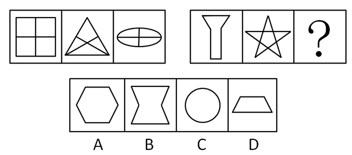

### Options

- A. A

- B. B

- C. C

- D. D

### Answer

D

### Explanation

元素组成不同，优先考虑图形属性规律。

已知第一组图形都是轴对称图形，且对称轴数量依次为4、1、2条，相加和为7；第二组图前两图都为轴对称图形，且对称轴数量依次为1条和5条，故问号处应填入对称轴数量为1的图形，只有D项满足。

故正确答案为D。

## Question 10


<!-- hyz-question-id: 01a19c8a-1dcf-7960-9bcd-29945ca09e7d -->
```yaml
module: 判断推理
category: 图形推理
topics:
- 数量规律-复合
materials: []
passage_source: null
issues:
- order_unverified
```

### Stem

从所给四个选项中，选择最合适的一个填入问号处，使之呈现一定的规律性：

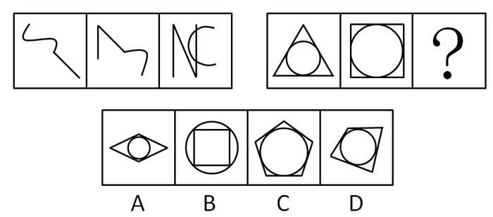

### Options

- A. A

- B. B

- C. C

- D. D

### Answer

C

### Explanation

解析1：

本题考查数曲线和直线的总数。

已知图形第一组图形曲线和直线的总数分别为2、3、4，第二组图形前两个图形曲线和直线的总数分别为4、5，因此第三个图形曲线和直线的总数应该为6。通过分析，A、B、C和D四个选项中图形曲线和直线的总数分别为5、5、6和5，因此只有C项中图形符合。

故正确答案为C。

解析2：

也可以只数直线，那么两组直线数为1、2、3，3、4、（5）才对，选项分别为4、4、5、4。

故正确答案为C。

## Question 11


<!-- hyz-question-id: 01a19c8a-1dcf-7960-9bcd-29a95826e308 -->
```yaml
module: 判断推理
category: 图形推理
topics:
- 数量规律-复合
materials: []
passage_source: null
issues:
- order_unverified
```

### Stem

从所给的四个选项中，选择最合适的一个填入问号处，使之呈现一定的规律性：

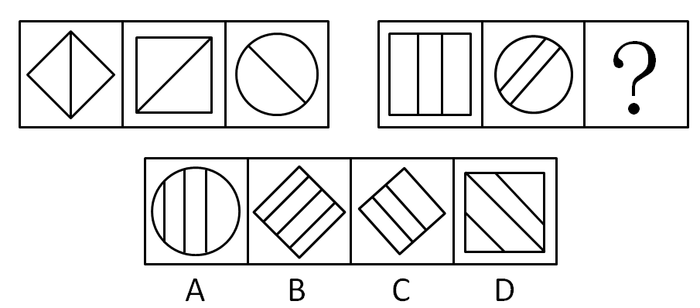

### Options

- A. A

- B. B

- C. C

- D. D

### Answer

C

### Explanation

本题考查图形内部直线方向及数量。

已知图形第一组图形中每个图形内部直线数都为1，且方向分别为竖直、由右上至左下、由左上至右下。第二组图形前两个图形中每个图形内部直线数都为2，因此第三个图形内部直线数也应该为2，并且要使得直线方向分别为竖直、由右上至左下、由左上至右下。通过分析，只有C项中图形符合。

故正确答案为C。

## Question 12


<!-- hyz-question-id: 01a19c8a-1dcf-7960-9bcd-29bcf231da32 -->
```yaml
module: 判断推理
category: 图形推理
topics:
- 数量规律-复合
materials: []
passage_source: null
issues:
- order_unverified
```

### Stem

从所给的四个选项中，选择最合适的一个填入问号处，使之呈现一定的规律性：

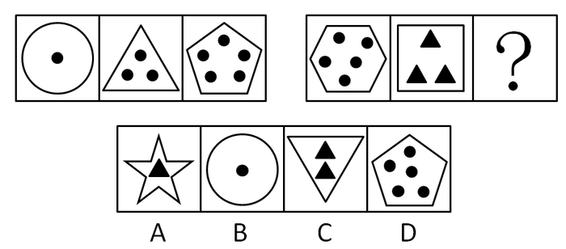

### Options

- A. A

- B. B

- C. C

- D. D

### Answer

C

### Explanation

图形元素组成不同，且无明显属性规律，优先考虑数量规律。观察发现图形由外部边框和内部元素组成，分开考虑外部图形与内部图形。第一组图形内部元素数量分别为1、3、5，外部图形的线条数分别为1、3、5，即内部元素个数与外部图形线条数相等；第二组图形应遵循相同或相似的规律，前两个图形内部元素数量分别为5、3，外部图形线条数分别为6、4，即内部元素个数比外部图形线条数少1，只有C项符合规律。

故正确答案为C。

## Question 13


<!-- hyz-question-id: 01a19c8a-1dcf-7960-9bcd-29cfaa683b8d -->
```yaml
module: 判断推理
category: 图形推理
topics:
- 样式规律-遍历
materials: []
passage_source: null
issues:
- order_unverified
```

### Stem

从所给的四个选项中，选择最合适的一个填入问号处，使之呈现一定的规律性：

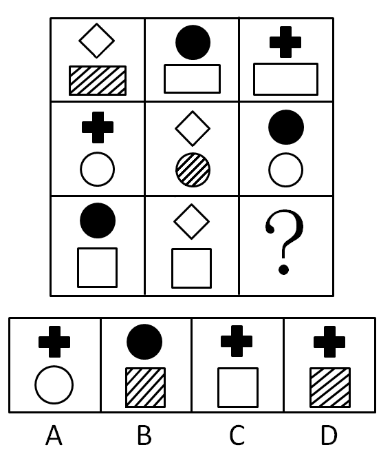

### Options

- A. A

- B. B

- C. C

- D. D

### Answer

D

### Explanation

本题考查元素周遍。

已知图形每一行每个图形下部图形形状相同，且颜色是两个全白与一个阴影，因此第三行第三个图形下部图形应该为阴影正方形，从而排除A和C两项；已知图形每一行每个图形上部图形是全白菱形、全黑圆圈、全黑十字这三种元素的周遍，因此第三行第三个图形上部图形应该为全黑十字，从而排除B项。综上，只有D项中图形符合。

故正确答案为D。

## Question 14


<!-- hyz-question-id: 01a19c8a-1dcf-7960-9bcd-29d6bebf0767 -->
```yaml
module: 判断推理
category: 图形推理
topics:
- 数量规律-线
materials: []
passage_source: null
issues:
- order_unverified
```

### Stem

从所给四个选项中，选择最合适的填入问号处，使之呈现一定的规律性：

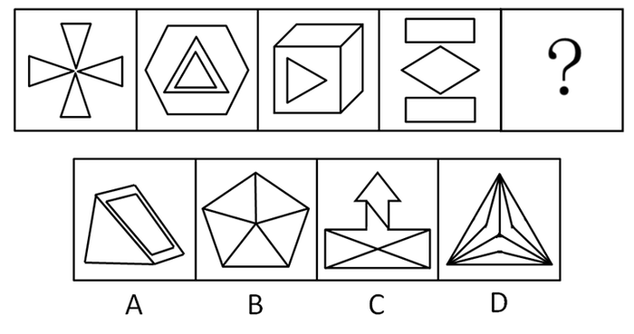

### Options

- A. A

- B. B

- C. C

- D. D

### Answer

D

### Explanation

本题考查数直线。

已知图形每个图形的直线数均为12，因此下一个图形的直线数也应该为12。通过分析A、B、C和D四个选项中图形的直线数分别为10、10、14和12，因此只有D项中图形符合。

故正确答案为D。

## Question 15


<!-- hyz-question-id: 01a19c8a-1dcf-7960-9bcd-29e4cab9e060 -->
```yaml
module: 判断推理
category: 图形推理
topics:
- 数量规律-面
materials: []
passage_source: null
issues:
- order_unverified
```

### Stem

从所给四个选项中，选择最合适的一个填入问号处，使之呈现一定的规律性：

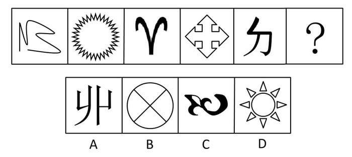

### Options

- A. A

- B. B

- C. C

- D. D

### Answer

B

### Explanation

已知图形中奇数项图形是开放的，偶数项图形是全封闭的，未知的下一项图形是偶数项，所以应该是封闭的。通过分析只有B选项的图形是封闭的。

故正确答案为B。

## Question 16


<!-- hyz-question-id: 01a19c8a-1dcf-7960-9bcd-29fbc3bdea5f -->
```yaml
module: 判断推理
category: null
topics: []
materials: []
passage_source: null
issues:
- order_unverified
```

### Stem

左图可以折叠成：

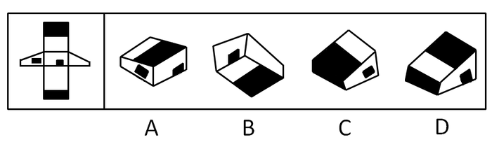

### Options

- A. A

- B. B

- C. C

- D. D

### Answer

C

### Explanation

本题可采用排除法。首先标注各面，特别注意：2和4有一小的短边，所以5和6面应该是两个面，不可看为一个面。如图所示：

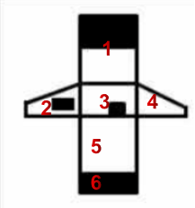

A选项：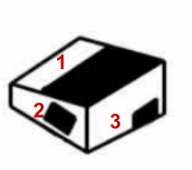对应的1和3的面公共边在1面中应该为白色。黑白方向应相互交换一下才正确，因此排除A项；

B选项：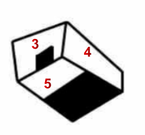当3面小黑色矩形块的矩形处于B项中位置时，公共边应该为5的面，5面应该为全白色图形。因此排除B项；

D选项：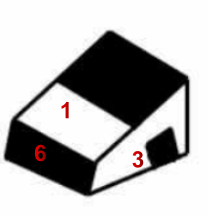1面和6面的公共边应该均为黑色。因此排除D项。

故正确答案为C。

## Question 17


<!-- hyz-question-id: 01a19c8a-1dcf-7960-9bcd-2a04b487a46f -->
```yaml
module: 判断推理
category: 逻辑判断
topics:
- 从确定信息开始推
materials: []
passage_source: null
issues:
- order_unverified
```

### Stem

药监局对6种抗菌素进行了药性比较，得到的结果如下：甲药比乙药有效，丙药的毒副作用比丁药大，戊药的药效最差，乙药与己药的药效相同。

由此可以推出：

### Options

- A. 甲药与丁药的药效相同

- B. 戊药的毒副作用最大

- C. 甲药是最有效的药物

- D. 己药比甲药的药效差

### Answer

D

### Explanation

第一步：分析题干信息。

根据题干信息可得，药性方面排序为：甲＞乙＝己＞戊；毒副作用方面排序：丙＞丁。

第二步：逐一分析并判断选项的正确性。

A项：题干中并未涉及甲和丁药性方面的比较，从而A项无法判断，因此不能推出；

B项：题干中并未涉及戊药的毒副作用，从而B项无法判断，因此不能推出；

C项：题干中并未涉及丙和丁药性方面大小，从而无法判断甲药是否是最有效的药物，因此不能推出；

D项：由第一步中药性方面的排序可知，D项正确。

故正确答案为D。

## Question 18


<!-- hyz-question-id: 01a19c8a-1dcf-7960-9bcd-2a1ba882918e -->
```yaml
module: 判断推理
category: 逻辑判断
topics:
- 日常结论
materials: []
passage_source: null
issues:
- order_unverified
```

### Stem

“一桌子苹果，别人通常挑一两个，挑三四个。毕加索最可气，每个都咬一口，每个苹果上都有他的牙印。”一位中国画家如此评价毕加索。毕加索一生搞过素描、油画、雕塑、版画，担任过舞台设计，还写过小说、剧本和无标点散文诗。

从这段文字中我们可以推论：

### Options

- A. 毕加索吃苹果，每个都只咬一口，中国作家对这种做法不以为然

- B. 很多人都像毕加索一样参与过许多艺术类型的创作

- C. 毕加索在艺术领域的许多方面进行过创作的尝试

- D. 毕加索是个天才式的人物，没有他不涉及的艺术领域

### Answer

C

### Explanation

从提问方式“可以推论”可知此题为逻辑推理题。

A项错误，文段中的“毕加索吃苹果，每个都咬一口”只是中国画家打的一个比喻，并不是真的每个苹果都咬一口；

B项错误，文段没有提到除了毕加索以外的“很多人”，B选项没有依据；

C项正确，文段首句用中国画家“吃苹果”的比喻引出论题，第二句对这个比喻的含义进行阐述，即毕加索在素描、油画等多个艺术领域进行的创作尝试；

D项错误，文段中写到毕加索涉足的多个艺术领域，显然没有穷尽所有的艺术领域，文段没有也不能说“没有不涉及的领域”，“每个都咬一口”只是用比喻来形容毕加索涉足艺术领域之广泛，不是说他每个领域都有涉及，D选项没有依据。

故正确答案为C。

## Question 19


<!-- hyz-question-id: 01a19c8a-1dcf-7960-9bcd-2a250e7ca319 -->
```yaml
module: 言语理解与表达
category: 片段阅读
topics:
- 关联词-因果
materials: []
passage_source: null
issues:
- order_unverified
```

### Stem

自然界是人的生命发展和延续的环境。同时，作为人与自然物质交换过程中介的生产劳动，是人类社会关系形成和发展的起点；人们在加工自然物质的劳动中，才结成了人与人的关系——生产关系，并由此形成民族的、阶级的、家庭的等复杂的社会关系。

这段文字意在说明：

### Options

- A. 人在自然面前只有被动的适应，才能生存发展

- B. 人与人、人与社会的关系，是建立在人与自然的关系的基础之上

- C. 人的社会关系只有其内在的发展规律，可以独立的存在和发展

- D. 人是自然界的一部分，因为人也是动物

### Answer

B

### Explanation

据提问方式可知此题为中心理解题。A项错误，文段中的“人们在加工自然物质的劳动中，才结成了人与人的关系——生产关系”说明人们发挥主观能动性，在加工自然物质的过程中产生了新的关系，A选项说人在自然面前只能被动适应才能生存发展是错误的；

B项正确，“人们在······劳动中，才结成了人与人的关系······并由此形成······社会关系”，而劳动是“人与自然物质交换过程中介”，由此可推出B选项；

C项错误，忽略了“自然界是人的生命发展和延续的环境”，社会关系没法脱离自然界独立存在和发展；

D项错误，忽略了人区别于动物的特点，即“生产劳动”，人是自然界的一部分，但不是动物。

故正确答案为B。

## Question 20


<!-- hyz-question-id: 01a19c8a-1dcf-7960-9bcd-2a320c26362d -->
```yaml
module: 资料分析
category: null
topics:
- 文字资料
- 简单加减计算
materials:
- M1
passage_source: null
issues:
- order_unverified
```

### Stem

1996至1998年，中部地区与西部地区小康实现程度的增幅相差多少个百分点：

### Options

- A. 4.57个

- B. 0.33个

- C. 7.65个

- D. 12.22个

### Answer

B

### Explanation

1996年到1998年，中部地区的小康实现程度的增幅为83.80%-79.80%=4%，西部地区的小康实现程度的增幅为78.73%-74.4%=4.33%，两者的增幅相差0.33个百分点。

故正确答案为B。
