<!-- hyz-paper-id: 01a19c8a-213d-7f81-8fc8-8818533dd449 -->
# 2008年江苏省公务员录用考试《行测》题（A类）

## Paper Notes

> 候选采集稿。参考答案及解析来自粉笔页面，不代表官方答案或真实高分答卷；来源使用许可与原卷对应关系仍需人工核实。

## 题型与作答说明

数量关系

（25题）

本部分包括数字推理与数学运算两种类型的试题。

判断推理

（45题）

本部分包括类比推理、图形推理、逻辑判断与定义判断四种类型的试题。

言语理解与表达

（15题）

本部分包括文字排序与文章阅读两种类型的试题。

资料分析

（20题）

所给出的图表或一段文字均有5个问题要你回答。你应根据资料提供的信息进行分析、计算、处理，然后从备选答案中选择一个最恰当的答案。

## Material M1


<!-- hyz-material-id: 01a19c8a-213d-7f81-8fc8-882bda9ae78a -->
文章阅读（完成以下各题）

        思想一旦离开利益，就会使自己出丑。思想解放更大的阻力，显然来自既得利益。无可否认，过去三十年的改革进程，是一个利益结构越来越不均匀的过程。强势群体拿走了过多的利益，有一些是合理回报，有一些却未必合理，而不过是利用制度缺陷、借助自己的特殊地位获致，还有一些甚至是罪恶得利。新一轮的改革开放同时也是利益格局大调整，这势必大大压缩既得利益的空间。某些改革先行者，后来成了既得利益者，进而成了思想解放的阻力。为什么思想解放容易口号化、标签化，难于落实，难于把自己摆进去的根本原因就在这里。

        人都是趋利避害的。某些既得利益者对思想解放的抵触，应属人之常情。但一个国家的未来，一个民族的命运，不应为个别人的既得利益所累。何况，凡是不公平的都无法长久，本来就是历史的铁律。所以普遍自由和普遍平等，越来越成为人类共有的梦想；分享的意识、人均的意识，越来越成为社会舆论的最大公约数。对公平正义的追求如钱塘之潮沛然东来，其势不能御。

        人不可与潮流为敌。对既得利益的固守，或能持续一时，却不可能持续一世。不该属于自己的终究会守不住，区别只在于是体面的主动让渡，还是不体面地被动失去。这就需要既得利益者有精神内省，有良知。人是要有一点信仰的，得有责任感、使命感，且不说超凡脱俗，至少可以活得更高雅一点，更有尊严一点。这就需要超越的眼光，需要站在历史的高度，尊重社会的普遍感受，尊重社会的普遍需求，重建利益相对均衡的新秩序。大家好你才能好，让每个人都能分享发展的红利，才可能国泰民安，你才可能是安全的。否则，在一个断裂和倾斜的社会中，纵然坐拥金山，坐拥无上权力，终究也不过是流沙上的建筑。

## Material M2


<!-- hyz-material-id: 01a19c8a-213d-7f81-8fc8-883f0a42d961 -->
一、文字资料（完成以下各题）：

        根据土地利用变更调查结果，2005年全国耕地12208.27万公顷（18.31亿亩）；园地1154.90公顷（1.73亿亩）；林地23574.11万公顷（35.36亿亩）；牧草地26214.38万公顷（39.32亿亩）；其他农用地2553.09万公顷（3.83亿亩）；居民点及独立工矿用地2601.51万公顷（3.90亿亩）；交通运输用地230.85万公顷（0.35亿亩）；水利设施用地359.87万公顷（0.54亿亩）；其余为未利用地。与2004年相比，耕地面积减少0.30%，园地面积增加2.31%，林地面积增加0.30%，牧草地面积减少0.21%，居民点及独立工矿用地面积增加1.11%，交通运输用地面积增加3.37%，水利设施用地面积增加0.26%。

        2005年全国耕地净减少36.16万公顷（542.4万亩）。其中，建设占用耕地13.87万公顷（208.1万亩）；另外，查出往年已经建设但未变更上报的建设占用耕地面积7.34万公顷（110.1万亩）；灾毁耕地5.35万公顷（80.2万亩）；生态退耕39.04万公顷（585.5万亩）；因省农业结构调整减少耕地1.23万公顷（18.5万亩）；土地整理复垦开发补充耕地30.67万公顷（460.0万亩），土地整理复垦开发补充耕地面积为建设占用耕地的144.56%。

        全年新增建设用地43.2万公顷。其中，新增独立工矿（包括各类开发区、园区）建设用地15.11万公顷；新增城镇建设用地9.82万公顷；新增村庄建设用地6.66万公顷；新增交通、水利等基础设施建设用地10.76万公顷。

        查明到2004年底，全国城镇规划范围内共有闲置土地7.20万公顷（107.93万亩），空闲土地5.48万公顷（82.24万亩），批而未供土地13.56万公顷（203.44万亩），三类土地总量为26.24万公顷（393.61万亩），占城镇建设用地总量的7.8%。核减建设用地4631.9公顷。

        2005年，全国共出让土地面积16.32万公顷，出让价款5505.15亿元。其中，招拍挂出让面积和出让价款分别为5.72万公顷和3920.09亿元，分别占出让总面积和总价款的35.06%和71.21%。

## Material M3


<!-- hyz-material-id: 01a19c8a-213d-7f81-8fc8-884fd1048705 -->
二、表格资料（完成以下各题）：

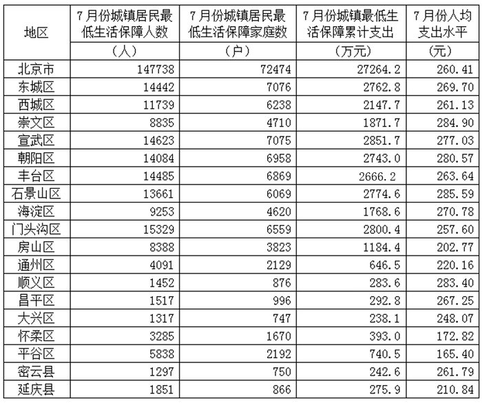

| 地区 | 7月份城镇居民最低生活保障人数 （人） | 7月份城镇居民最低生活保障家庭数 （户） | 7月份城镇最低生活保障累计支出 （万元） | 7月份人均支出水平 （元） |
| --- | ---: | ---: | ---: | ---: |
| 北京市 | 147738 | 72474 | 27264.2 | 260.41 |
| 东城区 | 14442 | 7076 | 2762.8 | 269.70 |
| 西城区 | 11739 | 6238 | 2147.7 | 261.13 |
| 崇文区 | 8835 | 4710 | 1871.7 | 284.90 |
| 宣武区 | 14623 | 7075 | 2851.7 | 277.03 |
| 朝阳区 | 14084 | 6958 | 2743.0 | 280.57 |
| 丰台区 | 14485 | 6869 | 2666.2 | 263.64 |
| 石景山区 | 13661 | 6069 | 2774.6 | 285.59 |
| 海淀区 | 9253 | 4620 | 1768.6 | 270.78 |
| 门头沟区 | 15329 | 6559 | 2800.4 | 257.60 |
| 房山区 | 8388 | 3823 | 1184.4 | 202.77 |
| 通州区 | 4091 | 2129 | 646.5 | 220.16 |
| 顺义区 | 1452 | 876 | 283.6 | 283.40 |
| 昌平区 | 1517 | 996 | 292.8 | 267.25 |
| 大兴区 | 1317 | 747 | 238.1 | 248.07 |
| 怀柔区 | 3285 | 1670 | 393.0 | 172.82 |
| 平谷区 | 5838 | 2192 | 740.5 | 165.40 |
| 密云县 | 1297 | 750 | 242.6 | 261.79 |
| 延庆县 | 1851 | 866 | 275.9 | 210.84 |

## Material M4


<!-- hyz-material-id: 01a19c8a-213d-7f81-8fc8-885159658a85 -->
表格资料（完成以下各题）：

国库券发行之后，可以在证券交易所上市交易（买卖）。请根据下表提供的信息回答下述问题（计算时交易佣金不计。另根据我国银行系统计息方法，不计复息，即每一年所得利息不作为第二年计息的本金）。

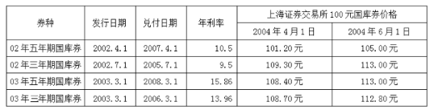

| 券种 | 发行日期 | 兑付日期 | 年利率 | 上海证券交易所100元国库券价格 2004年4月1日 | 上海证券交易所100元国库券价格 2004年6月1日 |
| --- | --- | --- | ---: | ---: | ---: |
| 02年五年期国库券 | 2002.4.1 | 2007.4.1 | 10.5 | 101.20元 | 105.00元 |
| 02年三年期国库券 | 2002.7.1 | 2005.7.1 | 9.5 | 109.30元 | 113.00元 |
| 03年五年期国库券 | 2003.3.1 | 2008.3.1 | 15.86 | 108.40元 | 113.00元 |
| 03年三年期国库券 | 2003.3.1 | 2006.3.1 | 13.96 | 108.70元 | 112.80元 |

## Material M5


<!-- hyz-material-id: 01a19c8a-213d-7f81-8fc8-886220ba7a7c -->
三、图形资料（完成以下各题）：

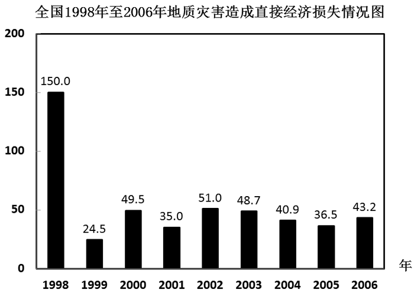

## Question 1


<!-- hyz-question-id: 01a19c8a-213d-7f81-8fc8-8873f6cd7c3f -->
```yaml
module: 数量关系
category: null
topics: []
materials: []
passage_source: null
issues:
- order_unverified
```

### Stem

27，29，33，41，57，（  ）

### Options

- A. 87

- B. 88

- C. 89

- D. 91

### Answer

C

### Explanation

本题为二级作差数列，原数列后项减去前项，可得次生数列2、4、8、16，为等比数列，下一列为32。因此原数列下一项为89。

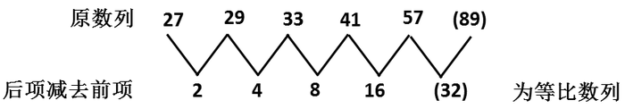

故正确答案为C。

## Question 2


<!-- hyz-question-id: 01a19c8a-213d-7f81-8fc8-8885e6e63e6b -->
```yaml
module: 数量关系
category: null
topics: []
materials: []
passage_source: null
issues:
- order_unverified
```

### Stem

2，7，14，98，（  ）

### Options

- A. 1370

- B. 1372

- C. 1422

- D. 2008

### Answer

B

### Explanation

从第三项开始，前两项的乘积等于下一项。2×7=14，7 × 14 = 98，14 × 98 = 14 × (100 - 2)= 1400 − 28 = 1372。因此未知项为1372。

故正确答案为B。

## Question 3


<!-- hyz-question-id: 01a19c8a-213d-7f81-8fc8-889dd49f6b0a -->
```yaml
module: 数量关系
category: null
topics: []
materials: []
passage_source: null
issues:
- order_unverified
```

### Stem

2000.1.1，2002.3.5，2004.5.9，2006.7.13，（  ）

### Options

- A. 2008.8.8

- B. 2008.18.16

- C. 2008.9.20

- D. 2008.9.17

### Answer

D

### Explanation

机械划分：

2000.|1.|1，2002. |3.|5，2004. |5.|9，2006.|7.|13，（‖）

看做交叉数列：

左侧部分：2000 2002 2004 2006 (2008)为等差数列；

中间部分：1 3 5 7 (9)为等差数列；

右侧部分：1 5 9 13 (17)为等差数列；

因此原数列未知项为2008.9.17。

故正确答案为D。

## Question 4


<!-- hyz-question-id: 01a19c8a-213d-7f81-8fc8-88a29a11602e -->
```yaml
module: 数量关系
category: null
topics: []
materials: []
passage_source: null
issues:
- order_unverified
```

### Stem

5，24，6，20，4，（  ），40，3

### Options

- A. 28

- B. 30

- C. 36

- D. 42

### Answer

B

### Explanation

两两分组：[5, 24] [6, 20] [4, ( )] [40, 3]；

组内求积：120 120 （ ） 120；

各组所得乘积为常数120，故未知项为30。

故正确答案为B。

## Question 5


<!-- hyz-question-id: 01a19c8a-213d-7f81-8fc8-88beb5cfd5c7 -->
```yaml
module: 数量关系
category: null
topics: []
materials: []
passage_source: null
issues:
- order_unverified
```

### Stem

90，30，12，6，4，（  ）

### Options

- A. 4

- B. 2

- C. 6

- D. 7

### Answer

A

### Explanation

两两分组：[90,30] [12,6] [4,( )]；

组内求商：3 2 (1)；

各组内所得商构成等差数列，因此未知项为4。

故正确答案为A。

## Question 6


<!-- hyz-question-id: 01a19c8a-213d-7f81-8fc8-88c534ead70f -->
```yaml
module: 数量关系
category: null
topics: []
materials: []
passage_source: null
issues:
- order_unverified
```

### Stem

1，8，21，40，（  ），96

### Options

- A. 55

- B. 60

- C. 65

- D. 70

### Answer

C

### Explanation

本题为二级作差多级数列，原数列后项减去前项，可得次生数列7、13、19、(25)、(31)，后者为等差数列，因此原数列未知项为65。

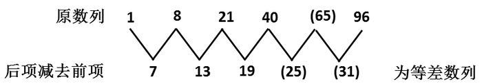

故正确答案为C。

## Question 7


<!-- hyz-question-id: 01a19c8a-213d-7f81-8fc8-88d6223d5638 -->
```yaml
module: 数量关系
category: null
topics: []
materials: []
passage_source: null
issues:
- order_unverified
```

### Stem

448，516，639，347，178，（  ）

### Options

- A. 163

- B. 134

- C. 785

- D. 896

### Answer

B

### Explanation

数列中数据均比较大，且没有明显规律，可以考虑机械分组。观察发现，每一个数的百位数上数字加上十位数上数字等于个位数上数字，结合选项满足该规律的数只有134。

故正确答案为B。

## Question 8


<!-- hyz-question-id: 01a19c8a-213d-7f81-8fc8-88efcb3aa021 -->
```yaml
module: 数量关系
category: null
topics: []
materials: []
passage_source: null
issues:
- order_unverified
```

### Stem

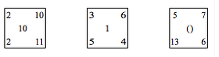

### Options

- A. 8

- B. 9

- C. 10

- D. 11

### Answer

C

### Explanation

左上角数字×右下角数字−(左下角数字+右上角数字)\=中间数字，2 × 11 − (2 + 10) = 10，3×4−(5+6)=1，因此：5 × 6 − (13 + 7) = 10。

故正确答案为C。

## Question 9


<!-- hyz-question-id: 01a19c8a-213d-7f81-8fc8-88f99e6c0af8 -->
```yaml
module: 数量关系
category: null
topics: []
materials: []
passage_source: null
issues:
- order_unverified
```

### Stem

1144，1263，1455，1523，（  ），1966

### Options

- A. 1763

- B. 1857

- C. 1873

- D. 1984

### Answer

B

### Explanation

将各项分为两个两位数来看，千位和个位数字组成一个两位数，百位和十位数字组成一个两位数，那么后者=前者×等差数列，即：14＝1×14，26＝2×13，45＝3×15，52＝4×13，( )，96＝6×16。选项中只有B符合：85＝5×17。

故正确答案为B。

## Question 10


<!-- hyz-question-id: 01a19c8a-213d-7f81-8fc8-890833b12363 -->
```yaml
module: 数量关系
category: null
topics: []
materials: []
passage_source: null
issues:
- order_unverified
```

### Stem

－27，－7，1，3，5，13，（  ）

### Options

- A. 33

- B. 31

- C. 27

- D. 25

### Answer

A

### Explanation

本题为立方数列修正形式。

原数列：-27，-7，1，3，5，13，(  )；

立方数列：(−3)^3 (−2)^3 (−1)^3 0^3 1^3 2^3 3^3；

修正数列：0 1 2 3 4 5 6。

因此原数列下一项为3^3 + 6 = 33。

故正确答案为A。

## Question 11


<!-- hyz-question-id: 01a19c8a-213d-7f81-8fc8-89178777aba0 -->
```yaml
module: 数量关系
category: null
topics: []
materials: []
passage_source: null
issues:
- order_unverified
```

### Stem

1/(3^2-1) + 1/(5^2-1) + 1/(7^2-1)+…+ 1/((2n+1)^2-1) =（ ）

### Options

- A. 1/4

- B. 1

- C. 1/2

- D. 无法计算

### Answer

A

### Explanation

前n项和=1/2×[(1/2 − 1/4) + (1/4 − 1/6)+(1/6 − 1/8) + ... +(1/(2n) − 1/(2n + 2))]=1/2×(1/2−1/(2n+2))= n/(4n + 4)，其极限为1/4。

故正确答案为A。

## Question 12


<!-- hyz-question-id: 01a19c8a-213d-7f81-8fc8-892097fdfb3e -->
```yaml
module: 数量关系
category: null
topics: []
materials: []
passage_source: null
issues:
- order_unverified
```

### Stem

设“\*”的运算法则如下：对任何若a+b≥10，则a\*b=a+b；若a+b&lt;10，则a\*b=ab。则（1\*2）＋（2\*3）＋（3\*4）＋（4\*5）＋（5\*6）＋（6\*7）＋（7\*8）＋（8\*9）＋（9\*10）＝

### Options

- A. 125

- B. 115

- C. 105

- D. 120

### Answer

B

### Explanation

(1*2) (2*3) (3*4) (4*5)都满足a+b&lt;10，所以按a\*b=ab计算，(5 * 6) (6 * 7) (7 * 8) (8 * 9) (9 * 10)都满足a+b≥10，所以按a\*b=a+b计算，即：(1×2) + (2×3) + (3×4) + (4×5)+(5 + 6) + (6 + 7) + (7 + 8)+(8+9)+(9+10)=2+6+12+20+11+13+15+17+19=115。

故正确答案为B。

## Question 13


<!-- hyz-question-id: 01a19c8a-213d-7f81-8fc8-89363114f2d1 -->
```yaml
module: 数量关系
category: 数学运算
topics:
- 数列问题
materials: []
passage_source: null
issues:
- order_unverified
```

### Stem

已知公差为2的正整数等差数列为a_n，则该数列满足不等式7/16＜a_n/5＜398/9的所有项的和为：

### Options

- A. 12320

- B. 12430

- C. 12432

- D. 12543

### Answer

A

### Explanation

公差为2的正整数数列a_n，满足条件的a_n最小为3，最大为221，共有项数为(221 − 3) ÷ 2 + 1 = 110，根据等差数列求和公式得：和为((3 + 221) × 110)/2 = 12320。

公式：等差数列a_1，a_2，92，…，a_n，共n项，则和为S = ((a_1 + a_n) × n)/2。

故正确答案为A。

## Question 14


<!-- hyz-question-id: 01a19c8a-213d-7f81-8fc8-894f36df5639 -->
```yaml
module: 数量关系
category: null
topics: []
materials: []
passage_source: null
issues:
- order_unverified
```

### Stem

一根长200米的绳子对折三次后从中间剪断，最后绳子的段数是：

### Options

- A. 8

- B. 9

- C. 11

- D. 16

### Answer

B

### Explanation

解析1：

对折三次，剪一刀，根据公式，绳子变成2^3 × 1 + 1 = 9段。

公式：一根绳子连续对折N次，剪M刀，则绳子被剪成2^N × M + 1段。

解析2：

绳子对折三次后共八折，从中间剪断，共有八个切口，因此绳子共有9段。

故正确答案为B。

## Question 15


<!-- hyz-question-id: 01a19c8a-213d-7f81-8fc8-895505419840 -->
```yaml
module: 数量关系
category: 数学运算
topics:
- 基础排列组合
materials: []
passage_source: null
issues:
- order_unverified
```

### Stem

在999张牌上分别写上数001，002，003，······，998，999。甲、乙两人分这些纸牌，分配办法是：凡纸牌上写的三位数字的三个数码都不大于5的纸牌属于甲，凡牌上有一个或一个以上的数码大于5的纸牌属于乙。例如，324，501等属于甲，而007，387，923等属于乙，则甲分得牌的张数为：

### Options

- A. 215

- B. 216

- C. 214

- D. 217

### Answer

A

### Explanation

所有三位数字的三个数码都不大于5的纸牌总共有：6×6×6 = 216张，除去000，故甲分得的牌的张数为216－1＝215张。

故正确答案为A。

## Question 16


<!-- hyz-question-id: 01a19c8a-213d-7f81-8fc8-896ec2195e2d -->
```yaml
module: 数量关系
category: 数学运算
topics:
- 几何结论类-相似图形
materials: []
passage_source: null
issues:
- order_unverified
```

### Stem

一个球体的半径增加10%后，它的表面积增长百分之几：

### Options

- A. 10%

- B. 21%

- C. 33.1%

- D. 25%

### Answer

B

### Explanation

半径增长到原来的110%，对应面积增长到121%，即增长了21%。

故正确答案为B。

比例放缩性质：若一个几何图形尺度变为原来的N倍，则长度变为原来的N倍，面积变为原来的N^2倍，体积变为原来的N^3倍。

## Question 17


<!-- hyz-question-id: 01a19c8a-213d-7f81-8fc8-8975b07e0677 -->
```yaml
module: 数量关系
category: 数学运算
topics:
- 最不利构造
materials: []
passage_source: null
issues:
- order_unverified
```

### Stem

将104张桌子分别放到14个办公室，每个人办公室至少放一张桌子，不管怎样分至少有几个办公室的桌子数是一样多：

### Options

- A. 2

- B. 3

- C. 7

- D. 无法确定

### Answer

A

### Explanation

若要让办公室中桌子数不同，可以每个办公室桌子数分别为1、2、3、4、······、13、14张，那么14个房间需要(1+14)×14÷2=105张，因此只能有一个办公室中桌子数减少105－104＝1张，所以最少有2个办公室的桌子数是一样的。

故正确答案为A。

## Question 18


<!-- hyz-question-id: 01a19c8a-213d-7f81-8fc8-898f4583d5a6 -->
```yaml
module: 数量关系
category: 数学运算
topics:
- 流水行船
materials: []
passage_source: null
issues:
- order_unverified
```

### Stem

一条船从甲地到乙地要航行4小时，从乙地到甲地要航行5小时（假定船自身的速度保持不变），今有一木筏从甲地漂流到乙地所需小时为：

### Options

- A. 12

- B. 40

- C. 32

- D. 30

### Answer

B

### Explanation

公式：漂流时间 = 2t_1t_2/(t_1-t_2)，其中t_1、t_2分别为漂浮物逆流和顺流所需时间。

直接代入公式，可得：漂流时间 = (2 × 5 × 4)/(5 − 4) = 40小时。

故正确答案为B。

## Question 19


<!-- hyz-question-id: 01a19c8a-213d-7f81-8fc8-89975bd49438 -->
```yaml
module: 数量关系
category: 数学运算
topics:
- 经济利润问题
materials: []
passage_source: null
issues:
- order_unverified
```

### Stem

某商品原价为30元，第一年提价10%，第二年又降低10%，第三年又提价10%，则第三年该商品的最后价格为：

### Options

- A. 29.7 元

- B. 32.67 元

- C. 30 元

- D. 33 元

### Answer

B

### Explanation

该商品最后的价格为30 × (1+10%) × (1−10%)×(1+10%)=32.67元。

故正确答案为B。

## Question 20


<!-- hyz-question-id: 01a19c8a-213d-7f81-8fc8-89af09a7bfdf -->
```yaml
module: 数量关系
category: 数学运算
topics:
- 公倍数与公约数问题
materials: []
passage_source: null
issues:
- order_unverified
```

### Stem

五个一位正整数之和为30，其中两个数为1和8，而这五个数乘积为2520，则其余三个数为：

### Options

- A. 6，6，9

- B. 4，6，9

- C. 5，7，9

- D. 5，8，8

### Answer

C

### Explanation

直接分解数字2520，已知其中两个因数分别是1和8，据此可知2520 = 1 × 8 × 5 × 7 × 9，因此其余三个数字分别是5、7、9。

故正确答案为C。

## Question 21


<!-- hyz-question-id: 01a19c8a-213d-7f81-8fc8-89b593f3346d -->
```yaml
module: 数量关系
category: 数学运算
topics:
- 给完工时间型
materials: []
passage_source: null
issues:
- order_unverified
```

### Stem

甲、乙、丙三人合修一条公路，甲、乙合修6天修好公路的1/3，乙、丙合修2天修好余下的1/4，剩余的三人又修了5天才完成。共得收入1800元，如果按工作量计酬，则乙可获得收入为：

### Options

- A. 330元

- B. 910元

- C. 560元

- D. 980元

### Answer

B

### Explanation

赋值公路修建总量为180，甲、乙合作6天可完成公路的1/3，则甲、乙合作6天完成了180/3 = 60，甲、乙效率之和为60/6=10；乙、丙合作两天完成了(180−60)/4=30，乙、丙效率之和为30/2=15；剩余180-60-30=90的工作量三人工作了5天，三人效率之和为90/5=18。则丙的效率为18-10=8，乙的效率为15-8=7，乙工作总量为7 × (6 + 2 + 5) = 91，可得报酬91/180×1800=910元。

故正确答案为B。

## Question 22


<!-- hyz-question-id: 01a19c8a-213d-7f81-8fc8-89cab957911e -->
```yaml
module: 数量关系
category: 数学运算
topics:
- 几何公式类-平面图形
- 几何结论类-三角形相关
- 普通行程
materials: []
passage_source: null
issues:
- order_unverified
```

### Stem

台风中心从A地以每小时20公里的速度向东北方向移动，离台风中心30公里内的地区为危险区，城市B在A的正东40公里处。B城处于危险区内的时间为：

### Options

- A. 1.5小时

- B. 1小时

- C. 0.5小时

- D. 2小时

### Answer

B

### Explanation

如图所示：AB=40km，所以BH=20√2km＜ 30 km，所以BC=BD=30km，当台风在C点与D点之间的时候B城处于危险之中，那么CH = √(BC^2 − BH^2) = 10km，同理DH=10km，所以CD=20km，那么B城处于危险的时间为20÷20=1小时。

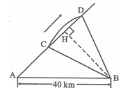

故正确答案为B。

## Question 23


<!-- hyz-question-id: 01a19c8a-213d-7f81-8fc8-89d527a25d44 -->
```yaml
module: 数量关系
category: 数学运算
topics:
- 数列问题
- 星期日期问题
materials: []
passage_source: null
issues:
- order_unverified
```

### Stem

某一天秘书发现办公桌上的台历已经有9天没有翻了，就一次翻了9张，这9天的日期加起来，得数恰好是108，问这一天是几号：

### Options

- A. 14

- B. 13

- C. 17

- D. 19

### Answer

C

### Explanation

9个数之和为108，平均数为108 ÷ 9 = 12，即正中间第5张是12号，则第9张是16号，因此这一天是17号。

故正确答案为C。

注意：得到第9张的日期后要加1才是今天的日期。

## Question 24


<!-- hyz-question-id: 01a19c8a-213d-7f81-8fc8-89e8e94d2f71 -->
```yaml
module: 数量关系
category: 数学运算
topics:
- 和差倍比问题
materials: []
passage_source: null
issues:
- order_unverified
```

### Stem

一个箱子中有若干个玩具，每次拿出其中的一半再收回去一个玩具，这样共拿了5次，箱子里还有5个玩具，箱子原有玩具的个数为：

### Options

- A. 76

- B. 98

- C. 100

- D. 120

### Answer

B

### Explanation

解析1：

我们知道：原题过程是“÷2、+1”重复5次，逆过程就是“-1、×2”重复5次：

5 −1→ 4 ×2→ 8 −1→ 7 ×2→ 14 −1→ 13 ×2→ 26 −1→ 25 ×2→ 50 −1→ 49 ×2→ 98

解析2：

本题还可以根据数字特性来代入排除，明显原有玩具的个数去掉一半再收回一个之后还应该是偶数，满足这个条件的只有B项。

故正确答案为B。

## Question 25


<!-- hyz-question-id: 01a19c8a-213d-7f81-8fc8-89fa077ecce2 -->
```yaml
module: 数量关系
category: 数学运算
topics:
- 非典型最值问题
materials: []
passage_source: null
issues:
- order_unverified
```

### Stem

某企业的净利润y（单位：10万元）与产量x（单位：100万件）之间的关系为：y = −1/3x^3 + x^2 + 11/3，问该企业的净利润的最大值是多少万元：

### Options

- A. 50

- B. 5

- C. 60

- D. 70

### Answer

A

### Explanation

对给出的函数关于x求导，并令其导数为0，即y' = -x^2 + 2x = 0，解得x=0或x=2。将这两个x的值代入原函数，可得y=11/3或y=5，选择后者可知净利润的最大值为50万元。

故正确答案为A。

## Question 26


<!-- hyz-question-id: 01a19c8a-213d-7f81-8fc8-8a00b4806a25 -->
```yaml
module: 判断推理
category: 类比推理
topics:
- 逻辑关系-包容关系
materials: []
passage_source: null
issues:
- order_unverified
```

### Stem

宗教：基督教：新教

### Options

- A. 国家：民族：区域

- B. 政府：机关：机构

- C. 心灵：心情：亲情

- D. 水果：苹果：红富士

### Answer

D

### Explanation

第一步：判断题干词语间逻辑关系。

题干前两词和后两词是包容关系，且是包容关系中的种属关系，“基督教”是“宗教”的一种，“新教”是“基督教”的一种。

第二步：判断选项词语间逻辑关系。

与题干相同逻辑关系的即为D项。A、B、C三项无明显逻辑关系。

故正确答案为D。

## Question 27


<!-- hyz-question-id: 01a19c8a-213d-7f81-8fc8-8a1619247cb2 -->
```yaml
module: 判断推理
category: 类比推理
topics:
- 逻辑关系-对应关系
materials: []
passage_source: null
issues:
- order_unverified
```

### Stem

医生：医院：医疗

### Options

- A. 勇士：勇敢：斗士

- B. 战场：战士：革命

- C. 士兵：军营：军事

- D. 战争：战斗：战场

### Answer

C

### Explanation

第一步：判断题干词语间逻辑关系。

题干三个词是对应关系，且是职业、工作场所、从事的工作的一一对应关系，“医生”在“医院”里从事“医疗”工作。

第二步：判断选项词语间逻辑关系。

A项，没有工作场所；

B项，职业和工作场所位置不对；

C项，“士兵”在“军营”里从事“军事”工作；

D项，没有职业。

故正确答案为C。

## Question 28


<!-- hyz-question-id: 01a19c8a-213d-7f81-8fc8-8a25c230912a -->
```yaml
module: 判断推理
category: 类比推理
topics:
- 逻辑关系-包容关系
- 逻辑关系-对应关系
materials: []
passage_source: null
issues:
- order_unverified
```

### Stem

喜儿：《白毛女》：戏剧

### Options

- A. 孙悟空：《西游记》：传奇

- B. 祥林嫂：《祝福》：小说

- C. 罗贯中：《三国演义》：小说

- D. 林冲：《水浒传》：古典

### Answer

B

### Explanation

第一步：判断题干词语间逻辑关系。

题干三个词是对应关系，且是主人公、作品、体裁的一一对应关系，“喜儿”是《白毛女》中的女主人公，《白毛女》的体裁是戏剧。

第二步：判断选项词语间逻辑关系。

A项，《西游记》的体裁是小说；

B项，“祥林嫂”是《祝福》里的女主人公，《祝福》的体裁是小说；

C项，罗贯中是《三国演义》的作者；

D项，《水浒传》的体裁是小说。

故正确答案为B。

## Question 29


<!-- hyz-question-id: 01a19c8a-213d-7f81-8fc8-8a3d4b54016b -->
```yaml
module: 判断推理
category: 类比推理
topics:
- 语法关系
materials: []
passage_source: null
issues:
- order_unverified
```

### Stem

考古学家：研究：文物

### Options

- A. 图书：分析：课本

- B. 小说家：创作：小说

- C. 督察：罚款：警察局

- D. 工人：劳动：工厂

### Answer

B

### Explanation

第一步：判断题干词语间逻辑关系。

考古学家研究文物，三者为主谓宾的语法关系。

第二步：判断选项词语间逻辑关系。

A项：图书不能作为分析课本的主语，与题干逻辑关系不一致，排除；

B项：小说家创作小说，三者为主谓宾的语法关系，与题干逻辑关系一致，当选；

C项：督察无法罚款警察局，警察局是督察的工作场所，与题干逻辑关系不一致，排除；

D项：工人在工厂劳动，工厂是工人的工作场所，与题干逻辑关系不一致，排除。

故正确答案为B。

## Question 30


<!-- hyz-question-id: 01a19c8a-213d-7f81-8fc8-8a4003d73f80 -->
```yaml
module: 判断推理
category: 类比推理
topics:
- 逻辑关系-包容关系
- 逻辑关系-对应关系
materials: []
passage_source: null
issues:
- order_unverified
```

### Stem

建筑：凝固的音乐：哥特式建筑

### Options

- A. 运动：使人健康的方式：生命

- B. 眼睛：心灵的窗户：丹凤眼

- C. 偶数：能被2整除的数：6

- D. 音乐：流动的符号：钢琴

### Answer

B

### Explanation

第一步：判断题干词语间逻辑关系。

题干第一个和第二个词是对应关系，且前者可以比喻为后者。第一个词和第三个词之间是包容关系，且是包容中的种属关系。将“建筑”比喻为“凝固的音乐”，“哥特式建筑”是形容“建筑”的一种风格。

第二步：判断选项词语间逻辑关系。

A项，运动就是一种使人健康的方式，是种属关系；

B项，将“眼睛”比喻为“心灵的窗户”，“丹凤眼”是形容“眼睛”的一种形态；

C项，“偶数”是“能被2整除的数”，这是一个明确的概念，并不是比喻；

D项，音乐和钢琴不是种属关系。

故正确答案为B。

## Question 31


<!-- hyz-question-id: 01a19c8a-213d-7f81-8fc8-8a5e925d8eee -->
```yaml
module: 判断推理
category: 类比推理
topics:
- 逻辑关系-对应关系
- 逻辑关系-并列关系
materials: []
passage_source: null
issues:
- order_unverified
```

### Stem

春花：秋月：江南

### Options

- A. 报名：考试：人生

- B. 领导：群众：工作

- C. 青山：绿水：古城

- D. 白云：蓝天：快乐

### Answer

C

### Explanation

第一步：判断题干词语间逻辑关系。

题干词语之间是对应关系。春花、秋月都是景色，江南是对应的地点。

第二步：判断选项词语间逻辑关系。

A项，报名、考试与人生之间无明显逻辑关系，排除；

B项，工作不是一个地点，排除；

C项，青山、绿水都是景色，古城是对应的地点，当选；

D项，快乐不是一个地点，排除。

故正确答案为C。

## Question 32


<!-- hyz-question-id: 01a19c8a-213d-7f81-8fc8-8a6bb5b36457 -->
```yaml
module: 判断推理
category: 类比推理
topics:
- 逻辑关系-包容关系
- 逻辑关系-并列关系
materials: []
passage_source: null
issues:
- order_unverified
```

### Stem

小说：诗歌：文学

### Options

- A. 绘画：国画：水彩画

- B. 阿拉伯语：汉语：语言

- C. 音高：音色：音乐

- D. 销售：销售渠道：销售人员

### Answer

B

### Explanation

第一步：判断题干词语间逻辑关系。

题干前两词和第三个词是包容关系，且是包容关系中的必然组成关系，“小说”和“诗歌”都是“文学”的一种体裁。

第二步：判断选项词语间逻辑关系。

A、C、D三项，均不满足这种包容关系；

B项，“阿拉伯语”和“汉语”都是“语言”的一种形态。

故正确答案为B。

## Question 33


<!-- hyz-question-id: 01a19c8a-213d-7f81-8fc8-8a7a1144b917 -->
```yaml
module: 判断推理
category: 类比推理
topics:
- 逻辑关系-对应关系
materials: []
passage_source: null
issues:
- order_unverified
```

### Stem

农民：农具：土地

### Options

- A. 赛道：接力赛：运动场

- B. 实验员：仪器：操作台

- C. 教案：教师：讲台

- D. 的哥：公交：的士

### Answer

B

### Explanation

第一步：判断题干词语间逻辑关系。

题干三个词是对应关系，且是动作主体、工具、工作场所的一一对应关系。

第二步：判断选项词语间逻辑关系。

A项，没有工具；

C项，主体、工具的位置颠倒；

D项，后两个词为并列关系。

故正确答案为B。

## Question 34


<!-- hyz-question-id: 01a19c8a-213d-7f81-8fc8-8a8a66510d30 -->
```yaml
module: 判断推理
category: 类比推理
topics:
- 逻辑关系-并列关系
materials: []
passage_source: null
issues:
- order_unverified
```

### Stem

广播：电视：报纸

### Options

- A. 卫青：霍去病：汉王朝

- B. 清蒸：红烧：油炸

- C. 股票：基金：纸张

- D. 恒星：彗星：哈雷

### Answer

B

### Explanation

第一步：判断题干词语间逻辑关系。

题干三词是并列关系，广播、电视、报纸同为大众传媒方式之一。

第二步：判断选项词语间逻辑关系。

A项，卫青和霍去病同为古人，汉王朝是一个朝代；

B项，清蒸、红烧、油炸同为做菜的一种方式；

C项，股票和基金是证券，与纸张没有逻辑关系；

D项，哈雷是彗星的一种。

故正确答案为B。

## Question 35


<!-- hyz-question-id: 01a19c8a-213d-7f81-8fc8-8a953c230568 -->
```yaml
module: 判断推理
category: 类比推理
topics:
- 语义关系-反义关系
- 语义关系-近义关系
materials: []
passage_source: null
issues:
- order_unverified
```

### Stem

冷漠：冷酷：热情

### Options

- A. 束缚：禁锢：解放

- B. 顽强：强烈：开放

- C. 劳动：薪水：工资

- D. 海水：盐分：氯化钠

### Answer

A

### Explanation

第一步：判断题干词语间逻辑关系。

题干前两个词是近义词，第三个词为前两个词的反义词，属于双重逻辑关系。

第二步：判断选项词语间逻辑关系。

A项，束缚与禁锢都有强力限制的意思，为近义词，解放是前二者反义词，与题干逻辑关系一致，当选；

B项，顽强表示坚强或不屈服，强烈表示力量很大或者程度很高，两项并非近义词，与题干逻辑关系不一致，排除；

C项，工资和薪水是近义词而非反义词，与题干逻辑关系不一致，排除；

D项，海水含有盐分，两者是对应关系，与题干逻辑关系不一致，排除。

故正确答案为A。

## Question 36


<!-- hyz-question-id: 01a19c8a-213d-7f81-8fc8-8aa83dc3b1d4 -->
```yaml
module: 判断推理
category: 类比推理
topics:
- 逻辑关系-包容关系
- 逻辑关系-并列关系
materials: []
passage_source: null
issues:
- order_unverified
```

### Stem

草莓：苹果：水果

### Options

- A. 树叶：树干：树木

- B. 春天：秋天：四季

- C. 打球：跑步：运动

- D. 电灯：日光灯：节能灯

### Answer

C

### Explanation

第一步：判断题干词语间逻辑关系。

题干前两个词和第三个词是包容关系，且是包容关系中的种属关系。

第二步：判断选项词语间逻辑关系。

A、B两项，前两个词和第三个词是包容关系中的必然组成关系；

D项，第一个词和后两个词是包容关系中的种属关系。

故正确答案为C。

## Question 37


<!-- hyz-question-id: 01a19c8a-213d-7f81-8fc8-8ab33979a9f1 -->
```yaml
module: 判断推理
category: 类比推理
topics:
- 逻辑关系-包容关系
- 逻辑关系-对应关系
materials: []
passage_source: null
issues:
- order_unverified
```

### Stem

战争：活动：武器

### Options

- A. 歌曲：歌唱：音乐

- B. 比赛：广播：电台

- C. 学习：过程：书本

- D. 步行：锻炼：骑车

### Answer

C

### Explanation

第一步：判断题干词语间逻辑关系。

题干“战争”与“活动”两个词属于包容关系中的种属关系，战争是一种活动；“武器”与“战争”属于对应关系，战争需要武器。

第二步：判断选项词语间逻辑关系。

A项，“歌曲”与“歌唱”非种属关系，与题干逻辑关系不一致，排除；

B项，“比赛”与“广播”非种属关系，与题干逻辑关系不一致，排除；

C项，“学习”与“过程”是种属关系，与“书本”是对应关系，即学习是一种过程，需要书本，与题干逻辑关系一致，当选；

D项，“步行”与“骑车”非对应关系，是并列关系，与题干逻辑关系不一致，排除。

故正确答案为C。

## Question 38


<!-- hyz-question-id: 01a19c8a-213d-7f81-8fc8-8acc7b18ddb6 -->
```yaml
module: 判断推理
category: 类比推理
topics:
- 逻辑关系-对应关系
materials: []
passage_source: null
issues:
- order_unverified
```

### Stem

爱因斯坦：物理学：相对论

### Options

- A. 达尔文：进化论：生物学

- B. 休谟：哲学：不可知论

- C. 五权分立：政治：孙中山

- D. 美国人：行政学：威尔逊

### Answer

B

### Explanation

第一步：判断题干词语间逻辑关系。

题干三个词语间属于对应关系，其逻辑表现为人物：人物的研究所属学科：人物主要观点。爱因斯坦是历史人物，物理学是他的研究所属的学科，相对论是他提出的观点。

第二步：判断选项词语间逻辑关系。

A项，达尔文是在生物学学科提出了进化论观点，显然中间一项研究所属学科应该是生物学而非进化论，最后一项主要观点为进化论而非生物学，与题干逻辑关系不一致，排除；

B项，休谟是历史人物，哲学是他的研究所属的学科，不可知论是他提出的主要观点，与题干逻辑关系一致，当选；

C项，孙中山在政治领域的提出了五权分立观点，因此第一项应为“孙中山”，第二项为“政治”，第三项应为“五权分立”，与题干逻辑关系不一致，排除；

D项，第一项应该为人物姓名，“美国人”与此不符，最后一项为人物观点，“威尔逊”是人名而非观点，与题干逻辑关系不一致，排除。

故正确答案为B。

## Question 39


<!-- hyz-question-id: 01a19c8a-213d-7f81-8fc8-8ad4331661d6 -->
```yaml
module: 判断推理
category: 类比推理
topics:
- 逻辑关系-对应关系
materials: []
passage_source: null
issues:
- order_unverified
```

### Stem

小鸟：飞翔：天空

### Options

- A. 大地：种植：高粱

- B. 蟋蟀：欢叫：草丛

- C. 蝴蝶：夏荷：飞舞

- D. 山坡：爬山：青藤

### Answer

B

### Explanation

第一步：判断题干词语间逻辑关系。

题干三个词是对应关系，且是动物、活动状态、活动空间的一一对应关系。

第二步：判断选项词语间逻辑关系。

A、D两项，没有动物；

C项，活动状态和活动空间位置颠倒。

故正确答案为B。

## Question 40


<!-- hyz-question-id: 01a19c8a-213d-7f81-8fc8-8aeb7a9198d2 -->
```yaml
module: 判断推理
category: 类比推理
topics:
- 逻辑关系-包容关系
- 逻辑关系-对应关系
materials: []
passage_source: null
issues:
- order_unverified
```

### Stem

水牛：牲畜：乡村

### Options

- A. 小鸟：鸣叫：树林

- B. 生物：鱼虾：湖水

- C. 台灯：书本：书桌

- D. 母鸡：家禽：打谷场

### Answer

D

### Explanation

第一步：判断题干词语间逻辑关系。

题干三个词是对应关系，且是动物、动物所属类型、动物活动的地点的一一对应关系。

第二步：判断选项词语间逻辑关系。

A项，鸣叫并不是小鸟所属的类型；

B、C两项，第一个词都不是动物。

故正确答案为D。

## Question 41


<!-- hyz-question-id: 01a19c8a-213d-7f81-8fc8-8afae9bb0c5e -->
```yaml
module: 判断推理
category: 图形推理
topics:
- 数量规律-角
materials: []
passage_source: null
issues:
- order_unverified
```

### Stem

从所给的四个选项中，选择最合适的一个填入问号处，使之呈现一定的规律性：

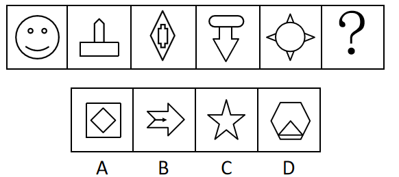

### Options

- A. A

- B. B

- C. C

- D. D

### Answer

C

### Explanation

本题考查数角，题干每个图形包含的锐角个数依次为0，1，2，3，4，（5），观察选项，只有C项图形是五个锐角。

故正确答案为C。

## Question 42


<!-- hyz-question-id: 01a19c8a-213d-7f81-8fc8-8b03649493a3 -->
```yaml
module: 判断推理
category: 图形推理
topics:
- 位置规律-平移
materials: []
passage_source: null
issues:
- order_unverified
```

### Stem

从所给的四个选项中，选择最合适的一个填入问号处，使之呈现一定的规律性：

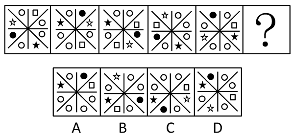

### Options

- A. A

- B. B

- C. C

- D. D

### Answer

B

### Explanation

观察图形发现图形都长得比较相似，只是位置有所不同，判断图形发生了平移，观察各个小图形，发现小图形中黑色的圆平移得比较有规律，规律是黑色的圆按顺时针方向平移，依次平移了3、2、3、2格，推断下一次它很可能平移3格，只有B项符合此规律。

故正确答案为B。

## Question 43


<!-- hyz-question-id: 01a19c8a-213d-7f81-8fc8-8b19fd517764 -->
```yaml
module: 判断推理
category: 图形推理
topics:
- 数量规律-素
materials: []
passage_source: null
issues:
- order_unverified
```

### Stem

从所给的四个选项中，选择最合适的一个填入问号处，使之呈现一定的规律性：

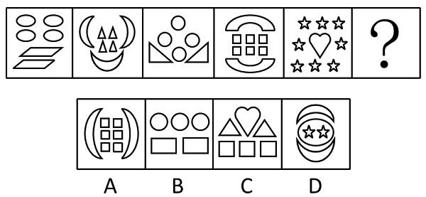

### Options

- A. A

- B. B

- C. C

- D. D

### Answer

A

### Explanation

观察发现题干图形均由两种元素构成，优先考虑元素的种类和数量。题干中每幅图形两种元素的数量分别为（4，2）、（4、3）、（4，2）、（6，2）、（8，1），即每幅图形中两种元素数量之积分别是8，12，8，12，8，依此规律下一个图形中两种元素的乘积应为12，A项为12，B项为6，C、D两项均为三种元素，只有A项符合规律。

故正确答案为A。

## Question 44


<!-- hyz-question-id: 01a19c8a-213d-7f81-8fc8-8b2c1f226d2c -->
```yaml
module: 判断推理
category: 图形推理
topics:
- 数量规律-面
materials: []
passage_source: null
issues:
- order_unverified
```

### Stem

从所给的四个选项中，选择最合适的一个填入问号处，使之呈现一定的规律性：

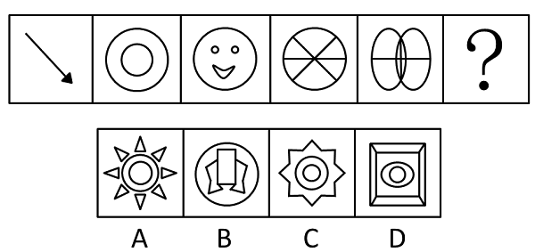

### Options

- A. A

- B. B

- C. C

- D. D

### Answer

A

### Explanation

元素组成不同，且无明显属性规律，考虑数量规律。观察发现，题干中部分图形封闭区域明显，考虑面数量。题干图形的面数量分别为0、2、4、6、8，故“？”处图形的面数量应为10，只有A项符合。

故正确答案为A。

## Question 45


<!-- hyz-question-id: 01a19c8a-213d-7f81-8fc8-8b358e4d6d53 -->
```yaml
module: 判断推理
category: 图形推理
topics:
- 样式规律-加减同异
materials: []
passage_source: null
issues:
- order_unverified
```

### Stem

从所给的四个选项中，选择最合适的一个填入问号处，使之呈现一定的规律性：

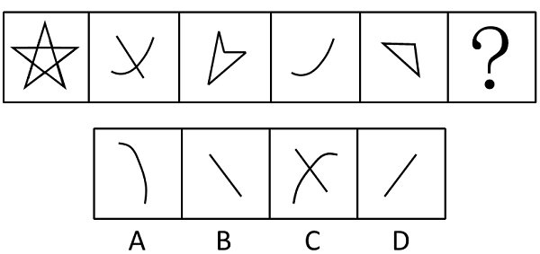

### Options

- A. A

- B. B

- C. C

- D. D

### Answer

B

### Explanation

先整体观察，确定题目奇偶性，元素的叠加运算——去同。第一个图形和第三个图形通过去同后形成第五个图形，所以第二个图形和第四个图形通过去同后形成第六个图形。

故正确答案为B。

## Question 46


<!-- hyz-question-id: 01a19c8a-213d-7f81-8fc8-8b4e1f955d29 -->
```yaml
module: 判断推理
category: 图形推理
topics:
- 数量规律-角
materials: []
passage_source: null
issues:
- order_unverified
```

### Stem

从所给的四个选项中，选择最合适的一个填入问号处，使之呈现一定的规律性：

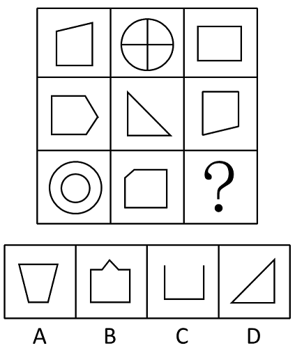

### Options

- A. A

- B. B

- C. C

- D. D

### Answer

C

### Explanation

元素组成不同，且无明显属性规律，考虑数量规律。观察发现，题干出现大量直角，考虑数直角。第一行图形直角数分别为：2、4、4，第二行直角数分别为：2、1、2，第三行直角数分别为：0、3、？，第一行直角数减去第二行直角数等于第三行直角数，因此问号处应为直角数为2的图形，只有C项符合。

故正确答案为C。

## Question 47


<!-- hyz-question-id: 01a19c8a-213d-7f81-8fc8-8b5f327a4af3 -->
```yaml
module: 判断推理
category: 图形推理
topics:
- 数量规律-面
- 文字/字母/数字类
materials: []
passage_source: null
issues:
- order_unverified
```

### Stem

从所给的四个选项中，选择最合适的一个填入问号处，使之呈现一定的规律性：

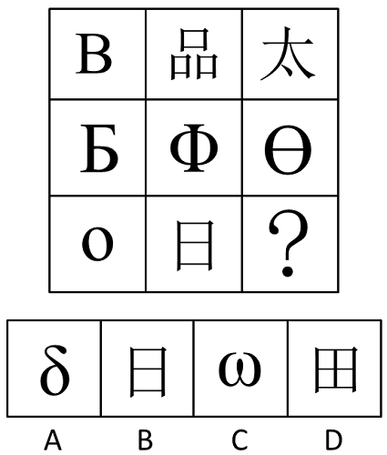

### Options

- A. A

- B. B

- C. C

- D. D

### Answer

B

### Explanation

元素组成凌乱，考查元素数量关系。数面（封闭空间），第一行图形的面数为2、3、0，第二行图形的面数为1、2、2，前两行图形的面数之和均为5，所以第三行图形的面数应为1、2、2。

故正确答案为B。

## Question 48


<!-- hyz-question-id: 01a19c8a-213d-7f81-8fc8-8b6f9378eaf5 -->
```yaml
module: 判断推理
category: 图形推理
topics:
- 样式规律-遍历
materials: []
passage_source: null
issues:
- order_unverified
```

### Stem

从所给的四个选项中，选择最合适的一个填入问号处，使之呈现一定的规律性：

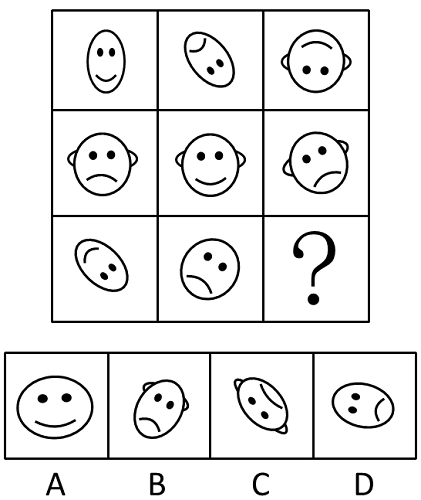

### Options

- A. A

- B. B

- C. C

- D. D

### Answer

A

### Explanation

元素组成相似，部分元素遍历。通过观察可以发现，不论是横行还是竖行，每个表情的相邻表情都是与之不同的，这里用横排说明，第一排是笑哭笑，第二排是哭笑哭，第三排则应该是笑哭笑，故？处图形应该是笑脸。

故正确答案为A。

## Question 49


<!-- hyz-question-id: 01a19c8a-213e-7f83-a5bb-8bd4f2bf566e -->
```yaml
module: 判断推理
category: 图形推理
topics:
- 数量规律-线
materials: []
passage_source: null
issues:
- order_unverified
```

### Stem

从所给的四个选项中，选择最合适的一个填入问号处，使之呈现一定的规律性：

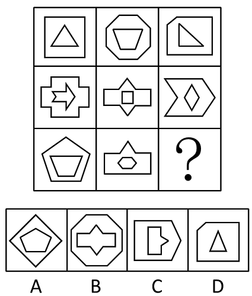

### Options

- A. A

- B. B

- C. C

- D. D

### Answer

D

### Explanation

图形分为内外两部分，分别数两者数量，发现二者间的关系，数直线，各图形中外部图形的线条数多于内部图形的线条数，只有D项满足条件。

故正确答案为D。

## Question 50


<!-- hyz-question-id: 01a19c8a-213e-7f83-a5bb-8be8d51de3f3 -->
```yaml
module: 判断推理
category: 图形推理
topics:
- 样式规律-遍历
materials: []
passage_source: null
issues:
- order_unverified
```

### Stem

从所给的四个选项中，选择最合适的一个填入问号处，使之呈现一定的规律性：

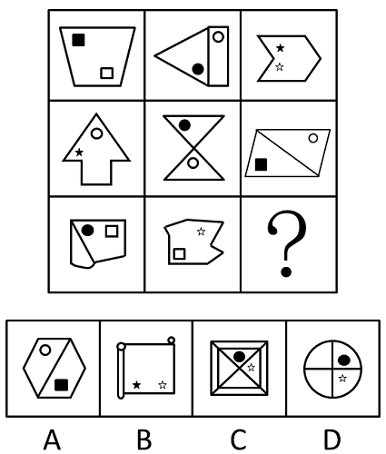

### Options

- A. A

- B. B

- C. C

- D. D

### Answer

A

### Explanation

元素组成相似，优先考虑样式规律。九宫格优先横行看，每行的元素，都是一组在对角处、一组在两个面里、一组在同一个面里，所以第三行缺的图应该是元素分布在两个面里，排除B项；继续观察图形发现，每行中一组元素分布在两个面的图都是仅有两个面，排除B、D两项。

故正确答案为A。

## Question 51


<!-- hyz-question-id: 01a19c8a-213e-7f83-a5bb-8bf9ba56d53c -->
```yaml
module: 判断推理
category: 逻辑判断
topics:
- 集合推理
materials: []
passage_source: null
issues:
- order_unverified
```

### Stem

某大学所有公共管理专业的二年级贫困生都申请到了助学贷款。所有申请到助学贷款的学生都交齐了学费。有些公共管理专业的二年级学生通过课余做家教来积攒学费。只有交齐了学费，该大学才能让学生注册。该大学工商管理专业的学生也有人课余做家教，但也有人没有交齐学费。

据此，下列除了哪项判断其余各项判断都必然为真？

### Options

- A. 该大学所有公共管理专业的二年级贫困生都交齐了学费

- B. 该大学做家教的学生中可能有公共管理专业二年级贫困生

- C. 该大学有人没有注册，他们可能是工商管理专业的学生

- D. 该大学公共管理专业的贫困生都顺利注册

### Answer

D

### Explanation

第一步：翻译题干。

第一句：公共管理专业的二年级贫困生⇒申请到了助学贷款，第二句：申请到了助学贷款→交齐了学费，第三句：有些公共管理专业的二年级学生通过课余做家教来积攒学费，第四句：注册→交齐了学费，第五句：该大学工商管理专业的学生也有人课余做家教，但也有人没有交齐学费，将一、二两个推导关系连起来即为：公共管理专业的二年级贫困生→申请到了助学贷款→交齐了学费。

第二步：逐一分析选项。

A项，公共管理专业的二年级贫困生→交齐了学费，正确；

B项，公共管理专业的二年级贫困生→交齐了学费，有些公共管理专业的二年级学生通过课余做家教来积攒学费，正确；

C项，工商管理专业的学生有人没有交齐学费，根据第四句话的逆否命题，即没有交齐学费就不能注册，正确；

D项，题目中只说该大学所有公共管理专业的二年级贫困生，其他年级的题中并没有讲到，错误。

故正确答案为D。

## Question 52


<!-- hyz-question-id: 01a19c8a-213e-7f83-a5bb-8c0541021692 -->
```yaml
module: 判断推理
category: 逻辑判断
topics:
- 常规翻译
materials: []
passage_source: null
issues:
- order_unverified
```

### Stem

有人对“不到长城非好汉”这句名言的理解是：“如果不到长城，就不是好汉。”假定这种理解为真，则下列哪项判断必然为真？

### Options

- A. 到了长城的人就一定是好汉

- B. 如果是好汉，他一定到过长城

- C. 只有好汉，才到过长城

- D. 不到长城，也会是好汉

### Answer

B

### Explanation

第一步：翻译题干。

不到长城→不是好汉

第二步：逐一分析选项。

A项，到了长城→不是好汉，“到了长城”属否前条件，无法推出绝对表达的结论，排除；

B项，好汉→到过长城，是题干推导关系的逆否规则，当选；

C项，到过长城→好汉，“到了长城”属否前条件，无法推出绝对表达的结论，排除；

D项，不到长城→好汉，明显错误，排除。

故正确答案为B。

## Question 53


<!-- hyz-question-id: 01a19c8a-213e-7f83-a5bb-8c12af323332 -->
```yaml
module: 判断推理
category: null
topics: []
materials: []
passage_source: null
issues:
- order_unverified
```

### Stem

所有的天气预报不可能都是准确无误的。下列哪项判断与上述判断的涵义最为相近？

### Options

- A. 有的天气预报不必然不是准确无误的

- B. 有的天气预报必然不是准确无误的

- C. 有的天气预报不可能不是准确无误的

- D. 所有的天气预报必然是准确无误的

### Answer

B

### Explanation

第一步：翻译题干。

所有的天气预报不可能都是准确无误的，即必然存在有的天气预报不是准确无误的。

第二步：逐一分析选项。

A项，“不必然”即“可能”，该项涵义为“有的天气预报可能不是准确无误的”，与题干不相近；

B项，有的天气预报必然不是准确无误的，与题干相近；

C项，“不可能不”即“必然”，该项涵义为“有的天气预报必然是准确无误的”，与题干不相近；

D项，所有的天气预报必然是准确无误的，与题干相反。

故正确答案为B。

## Question 54


<!-- hyz-question-id: 01a19c8a-213e-7f83-a5bb-8c27cc8dcaba -->
```yaml
module: 判断推理
category: 逻辑判断
topics:
- 搭桥
materials: []
passage_source: null
issues:
- order_unverified
```

### Stem

小张一定想报考某中学。因为所有想报考某中学的小学生都参加了该中学举办的冬令营，而小张参加了该中学举办的冬令营。下列哪项判断能够最好地加强上述论证：

### Options

- A. 所有想参加该中学举办的冬令营的学生都想报考该中学

- B. 有的不想报考该中学的小学生也参加了该中学举办的冬令营

- C. 小张在小学6年学习中成绩一直非常优秀

- D. 小张参加该中学举办的冬令营是因为他父母强烈建议他参加

### Answer

A

### Explanation

第一步：找到论点和论据。

本题论点是小张一定想报考某中学，论据是想报考某中学→参加冬令营，小张参加了该中学举办的冬令营。

第二步：逐一分析选项。

论点强调报考某中学，论据强调冬令营，所以论点与论据间不存在明显因果关系，需加强论证，在论点和论据间搭桥。

第三步：逐一判断选项的作用。

A项，在报考中学和冬令营间搭桥，参加冬令营→想报考某中学，当选；

B项，认为参加冬令营的也有可能不想报考某中学，是削弱项，排除；

C项，说小张成绩优秀，属无关项，排除；

D项，说小张参加冬令营的原因，属无关项，排除。

故正确答案为A。

## Question 55


<!-- hyz-question-id: 01a19c8a-213e-7f83-a5bb-8c30cc5c6c50 -->
```yaml
module: 判断推理
category: 逻辑判断
topics:
- 常规翻译
materials: []
passage_source: null
issues:
- order_unverified
```

### Stem

为了实施最佳配合，在确定某排球赛上场队员的组成时，甲、乙、丙三位教练对小王和小李是否上场表态如下：

甲：“只有小王上场，小李才上场。”

乙：“如果小王上场，则小李上场。”

丙：“或者小王上场，或者小李上场。”

据此，下列哪项判断为不可能推出的结论？

### Options

- A. 三人的话都是真的

- B. 三人的话都是假的

- C. 三人的话两假一真

- D. 三人的话两真一假

### Answer

B

### Explanation

第一步：翻译题干。利用充分必要条件。

甲：小李上场→小王上场；乙：小王上场→小李上场；丙（相容选言）：小王上场∨小李上场。

第二步：采用假设法。

本题中只有小王和小李两人，总共有四种情况：

①两人都不上场：根据逆否规则，甲和乙的逆否命题分别是小王不上场→小李不上场、小李不上场→小王不上场，则甲乙正确，丙的说法错误，则三人的话两真一假；

②两人都上场：则甲乙丙的说法都正确，则三人的话都为真；

③小王上场小李不上场：小王上场→小李不上场，乙的说法错误，根据逆否规则小李上场→小王不上场，甲的说法错误，丙的说法正确，则三人的话两假一真；

④小李上场小王不上场：小李上场→小王不上场，甲的说法错误，根据逆否规则小王上场→小李不上场，乙的说法错误，丙的说法正确，则三人的话两假一真。

综上所述，三人的话不能都是假的。

故正确答案为B。

## Question 56


<!-- hyz-question-id: 01a19c8a-213e-7f83-a5bb-8c4a1298d137 -->
```yaml
module: 判断推理
category: 逻辑判断
topics:
- 削弱-实验类
- 拆桥
materials: []
passage_source: null
issues:
- order_unverified
```

### Stem

目前，中国人的交流方式已经大大改变，人们普遍使用互联网进行思想情感交流，因为有关部门最近在一所高校所做的一项调查表明，学生中经常利用互联网进行思想情感交流的人已占到被调查对象的95%。

下列陈述中哪项判断最能削弱上述观点？

### Options

- A. 大学生追求时尚，对新技术容易适应

- B. 仅有5%的接受调查的大学生正在学习互联网通信技术

- C. 调查的范围太小，恐怕不能反映当前所有中国人的真实情况

- D. 有些大学生仍喜爱传统的书信交流方式

### Answer

C

### Explanation

第一步：找出论点和论据。

论点：中国人的交流方式已经大大改变，人们普遍使用互联网进行思想情感交流。

论据：学生中经常利用互联网进行思想情感交流的人已占到被调查对象的95%。

论据中的“95%”是一个相对数，由抽样调查出来的，但是论点讲的是一个绝对数的问题，并且抽样调查样本的容量大小关系到调查的结果的可靠性。

第二步：逐一分析选项。

A项，题干的论题是中国人的交流方式，与“大学生追求时尚，对新技术容易适应”无关，无法削弱，排除；

B项，“学习互联网通信技术”与利用互联网进行交流是两个不同概念，无法削弱，排除；

C项，该项质疑抽样调查的样本容量过小，即大学生群体不能代表中国人整体，可以削弱，当选；

D项，“有些”过于笼统，不知道具体有多少，且谈论的依旧是大学生群体，无法代表中国人整体，无法削弱，排除。

故正确答案为C。

## Question 57


<!-- hyz-question-id: 01a19c8a-213e-7f83-a5bb-8c5d130c50f6 -->
```yaml
module: 判断推理
category: 逻辑判断
topics:
- 常规翻译
materials: []
passage_source: null
issues:
- order_unverified
```

### Stem

天降大雪，多条高速公路纷纷关闭，有些高速公路管理者认为，如果不关闭高速公路，就会发生重大交通事故，给人民生命财产带来巨大损失。但是，很多司机并不同意这种观点。

据此，下列哪项判断最有可能是这些司机所同意的观点？

### Options

- A. 在积有冰雪的高速公路上高速行车，很容易出车祸

- B. 交通事故在所难免，关闭了高速公路，也有可能在普通公路上发生重大交通事故

- C. 不关闭高速公路，也不会发生重大交通事故

- D. 高速公路越关闭，则冰雪越不容易融化；冰雪不容易融化，则高速公路越要关闭

### Answer

C

### Explanation

第一步：翻译题干。利用充分必要条件。

高速公路管理者的观点：不关闭高速公路→发生重大交通事故，司机并不同意这种观点，说明司机的观点是管理者观点的矛盾命题，则司机的观点是：－（不关闭高速公路→发生重大交通事故），即不关闭高速公路同时不会发生重大交通事故。

第二步：逐一分析选项。

A项：积有冰雪的高速公路上高速行车→容易出车祸，说明不关闭高速公路会发生重大交通事故，与管理者的观点一致，与司机的观点矛盾，排除；

B项：交通事故在所难免，关闭了高速公路，也有可能在普通公路上发生重大交通事故，题干是以不关闭高速公路为前提的，不能推出关闭的情况，排除；

C项：不关闭高速公路，也不会发生重大交通事故，与司机的观点一致，当选；

D项：题干主要是在说交通事故的问题，并没有提到冰雪融化，属于无关选项，排除。

故正确答案为C。

## Question 58


<!-- hyz-question-id: 01a19c8a-213e-7f83-a5bb-8c6adb1e7c85 -->
```yaml
module: 判断推理
category: 逻辑判断
topics:
- 代入法
materials: []
passage_source: null
issues:
- order_unverified
```

### Stem

某公司举行假面舞会。张先生与张女士头戴不同颜色的面具相遇。

“我是一位先生。”戴红色面具的那位说。

“我是一位女士。”戴黄色面具的那位说。

说完后，两人都笑了。因为他们两人中至少有一个人在说谎。

据此，可以推断出下列哪项判断为真？

### Options

- A. 张先生说真话，他戴红色面具

- B. 张先生说假话，他戴黄色面具

- C. 张女士说真话，她戴红色面具

- D. 张女士说假话，她戴黄色面具

### Answer

B

### Explanation

本题逐一验证选项。

假设A项为真，那么张女士说的也是真话，这与题干中“至少有一个人在说谎”相悖，所以A项错误；

假设B项为真，张先生说假话，那么张女士说的也是假话，这与“至少有一个人在说谎”相符，所以B项正确；

假设C项为真，张女士说真话，那么她应该戴黄色面具，所以C项错误；

假设D项为真，张女士说假话，那么她应该戴红色面具，所以D项错误。

故正确答案为B。

## Question 59


<!-- hyz-question-id: 01a19c8a-213e-7f83-a5bb-8c7dc46b0471 -->
```yaml
module: 判断推理
category: 逻辑判断
topics:
- 从最大信息开始推
materials: []
passage_source: null
issues:
- order_unverified
```

### Stem

某机关接待科一日迎来三位访客：老赵、老钱和老孙。会谈后，该科三位同志发现，本科的科长、副科长和科员三人的姓恰好与这三位访客的姓一样。另外，还存在下列情况：

（1）访客老钱的家在无锡；

（2）访客老赵是位老工人，有28年工龄；

（3）副科长家住在南京与无锡之间的某地；

（4）科员与孙姓同志竟然是小学同学；

（5）访客之一是副科长的邻居，他也是一位老工人，工龄按年头算恰好是科长任职时间的3倍；

（6）与副科长同姓的访客家住南京。

根据上述情况，可以推出下列哪项判断为真？

### Options

- A. 科长姓赵，副科长姓钱，科员姓孙

- B. 科长姓钱，副科长姓孙，科员姓赵

- C. 科长姓孙，副科长姓赵，科员姓钱

- D. 科长姓孙，副科长姓钱，科员姓赵

### Answer

C

### Explanation

第一步：找突破口。

本题突破口是信息量的最大对象，即副科长。结合条件（2）“访客老赵有28年工龄”以及条件（5）“副科长的邻居工龄是科长任职时间的3倍”，因为28不是3的倍数，可知老赵不是副科长的邻居；结合条件（1）“老钱家在无锡”和条件（3）“副科长住在南京和无锡之间”，可知副科长的邻居也不能是老钱，所以副科长的邻居是老孙，即老孙住在南京和无锡之间；根据条件（6）“与副科长同姓的访客家住在南京”以及之上推出的两个结论可知，与副科长同姓的只能是老赵；

第二步：抄信息于表中，即将题干和第一步的所有信息放在一个表中。

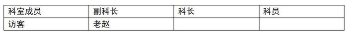

| 科室成员 | 副科长 | 科长 | 科员 |
| --- | --- | --- | --- |
| 访客 | 老赵 |  |  |

第三步：根据条件（4）“科员与孙姓同志是小学同学”可知，科员不姓孙，所以科员只能是老钱。所以剩下的科长就是老孙。将信息填入表格补齐。

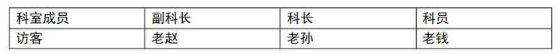

| 科室成员 | 副科长 | 科长 | 科员 |
| --- | --- | --- | --- |
| 访客 | 老赵 | 老孙 | 老钱 |

故正确答案为C。

## Question 60


<!-- hyz-question-id: 01a19c8a-213e-7f83-a5bb-8c8989eca616 -->
```yaml
module: 判断推理
category: 逻辑判断
topics:
- 常规翻译
materials: []
passage_source: null
issues:
- order_unverified
```

### Stem

某机关要从赵一、钱二、孙三、李四、周五、吴六等六位同志中选拔三位同志组成团队出国公干。基于多种原因，在人员组成上，有关领导通过长期工作考察，得出下列判断：

（1）如果不选拔钱二，则选拔李四；

（2）或者不选拔赵一，或者不选拔孙三；

（3）只有不选拔钱二，才不选拔孙三；

（4）如果选拔吴六则不选拔周五，则选拔李四；

（5）选拔赵一和吴六。

据此，下列哪项判断正确表达了领导还要选拔的一位出国人选？

### Options

- A. 钱二

- B. 孙三

- C. 李四

- D. 周五

### Answer

C

### Explanation

第一步：翻译题干。

（1）-钱二→李四；

（2）-赵一 或 -孙三；

（3）-孙三→—钱二

（4）吴六→—周五且李四；

（5）赵一 且 吴六。

第二步：根据题干条件进行推理。

从题干确定信息条件（5）入手，由选拔赵一，结合条件（2），根据否一推一，可知不选拔孙三；根据条件（3），可以推出不选拔钱二；根据条件（1），可以推出选拔李四；由条件（5）选拔吴六，结合条件（4），可以推出不选拔周五，并且选拔李四。因此，除了选拔赵一，还选拔了李四，只有C项符合。

故正确答案为C。

## Question 61


<!-- hyz-question-id: 01a19c8a-213e-7f83-a5bb-8c95fbe2d815 -->
```yaml
module: 判断推理
category: 类比推理
topics:
- 拆词
materials: []
passage_source: null
issues:
- order_unverified
```

### Stem

不正当竞争是指经营者违反《反不正当竞争法》的规定，损害其他经营者的合法权益，扰乱社会经济秩序的行为。所谓经营者是指从事商品经营或营利性服务的法人、其他经济组织和个人。

根据上述定义，下列不属于不正当竞争行为的是：

### Options

- A. 某地下工厂将生产出来的劣质酒贴上名牌酒的商标出售

- B. 某厂采用先进技术，通过降低成本进而降低售价以占据有利的市场地位

- C. 经销商按照本地政府的要求，只销售本地生产的梅花啤酒

- D. 使用与知名商品近似的名称、包装、装潢，造成和他人的知名商品相混淆，使购买者误认为是该知名商品

### Answer

B

### Explanation

第一步：抓住定义中的关键词。

关键词强调“违反《反不正当竞争法》的规定”、“损害其他经营者的合法权益”、“扰乱社会经济秩序”。

第二步：逐一判断选项。

A、C、D三项都存在“损害其他经营者的合法权益”现象，属于不正当竞争行为，排除；

B项采用先进技术来降低售价的做法属于正当竞争行为，当选。

本题为选非题，故正确答案为B。

## Question 62


<!-- hyz-question-id: 01a19c8a-213e-7f83-a5bb-8caf5c8a0e1e -->
```yaml
module: 判断推理
category: 逻辑判断
topics:
- 大前提
materials: []
passage_source: null
issues:
- order_unverified
```

### Stem

占有改定是指物的一种交付方式，在动产物权转让时，双方约定由出让人继续占有该动产，物权自该约定生效时发生效力。

下列属于占有改定情形的是：

### Options

- A. 甲将自己的自行车卖给乙，同时双方约定在甲出国前该车仍由甲使用

- B. 甲和乙约定将其电脑卖给乙，由于交易时该电脑正由甲的妹妹使用，甲请乙到其妹妹处取电脑

- C. 甲将其项链借给乙使用，乙在使用过程中非常喜欢该项链，于是向甲支付了一定金额，将该项链买下

- D. 甲将自己的房屋卖给乙，但双方约定在甲分到新房之前，甲仍在该房屋中居住

### Answer

A

### Explanation

第一步：抓住定义中的关键词。

关键词强调“交付方式”、“双方”、“动产”、“出让人继续占有该动产”。

第二步：逐一判断选项。

A项中的情况符合占有改定定义；

B、C两项中出让人没有继续占有，不符合定义；

D项中的房屋为不动产，不符合定义。

故正确答案为A。

## Question 63


<!-- hyz-question-id: 01a19c8a-213e-7f83-a5bb-8cbaf1f56bc0 -->
```yaml
module: 判断推理
category: 类比推理
topics:
- 拆词
materials: []
passage_source: null
issues:
- order_unverified
```

### Stem

公务员是指依法履行公职，纳入国家行政编制、由国家财政负担工资福利的工作人员。

下列属于公务员的一项是：

### Options

- A. 张先生是一名大学教师，在高校工作已整整三十年

- B. 小王是区司法局临时聘用的司机

- C. 李大姐自从下岗以后就在人事厅做保洁员

- D. 陈先生经过竞聘成为交通厅的副厅长

### Answer

D

### Explanation

第一步：抓住定义中的关键词。

关键词强调“依法履行公职”、“纳入国家行政编制”且“由国家财政负担工资福利”的工作人员。

第二步：逐一判断选项。

题中只有D项能够“依法履行公职”，其他三项都与此无关。

故正确答案为D。

## Question 64


<!-- hyz-question-id: 01a19c8a-213e-7f83-a5bb-8ccdb0e46c17 -->
```yaml
module: 判断推理
category: 逻辑判断
topics:
- 大前提
materials: []
passage_source: null
issues:
- order_unverified
```

### Stem

天气是指某一地区在某瞬时或某一短时间内大气中气象要素（如温度、湿度等）和天气现象（如云、雾等）的综合。

下列不属于天气的一项是：

### Options

- A. 明天南京多云，最高温度2°C，最低温度0°C

- B. 外面正在下雪

- C. 今年冬天的雾日很多

- D. 昨天下霜了

### Answer

C

### Explanation

第一步：抓住定义中的关键词。

关键词强调“某瞬时或某一短时间内”。

第二步：逐一判断选项。

A、B、D三项都符合“某瞬时或某一短时间内”；

C项“今年冬天”是一段较长的时期，不符合“某瞬时或某一短时间内”。

本题为选非题，故正确答案为C。

## Question 65


<!-- hyz-question-id: 01a19c8a-213e-7f83-a5bb-8cd872c84d58 -->
```yaml
module: 判断推理
category: 类比推理
topics:
- 主客体
materials: []
passage_source: null
issues:
- order_unverified
```

### Stem

紧急避险是指为了使公共利益、本人或者他人的人身安全和其他权益免遭正在发生的危险，不得已采取损害第三者合法利益的行为。

下列属于紧急避险的一项是：

### Options

- A. 张女士下夜班，遇蒙面歹徒欲行不轨，张女士奋起反抗将歹徒打成重伤

- B. 小李为了救落水女子迅速跳入湖中，自己随身携带的手机遇水损坏

- C. 集结号货轮突遇海上风暴，船长为了大家的安全，将货主的部分货物扔进大海

- D. 王女士在小区里散步，突然窜出一条狗，王女士慌忙躲避，结果将自己的脚扭伤

### Answer

C

### Explanation

第一步：抓住定义中的关键词。

关键词强调“损害第三者的合法权益”。

第二步：逐一判断选项。

A、B、D三项都没有出现损害第三者合法权益的情况；

C项船长为了大家的安全，将货主的货物扔进大海，损害了货主的利益即第三者的合法权益。

故正确答案为C。

## Question 66


<!-- hyz-question-id: 01a19c8a-213e-7f83-a5bb-8ce0b4ccb664 -->
```yaml
module: 判断推理
category: null
topics:
- 特殊问法
materials: []
passage_source: null
issues:
- order_unverified
```

### Stem

定义：

①社会助长是指个体因他人的在场而增强了行为的水平。

②社会阻抑是指个体因他人的在场而降低了行为的水平。

③从众是指个体在群体的压力下，不由自主地遵从群体中多数人的思想和行为的过程。

典型例证：

（1）由于有女友观战，小王今天作战神勇，上演了帽子戏法，并获得了全场最佳。

（2）张灵一直纳闷，明明会做的题，被老师叫到黑板前，自己却怎么也做不出来。

（3）小李力排众议，做了一个后来被证明为正确的决定。

上述典型例证与定义存在对应关系的数目有：

### Options

- A. 0个

- B. 1个

- C. 2个

- D. 3个

### Answer

C

### Explanation

第一步：抓住每个定义中的关键词。

①社会助长：关键词是“增强了行为的水平”；②社会阻抑：关键词是“降低了行为的水平”；③从众：关键词是“遵从群体中多数人的思想和行为”。

第二步：逐一判断选项。

例证（1）满足社会助长；

例证（2）满足社会阻抑；

例证（3）不满足任何一个定义，小李的行为首先不是从众，他在大家的干扰下遵从了自己的想法，大众的行为没有对他造成影响，所以也不属于社会助长和社会阻抑，所以上述典型例证与定义存在对应关系的有2个。

故正确答案为C。

## Question 67


<!-- hyz-question-id: 01a19c8a-213e-7f83-a5bb-8cf7ed1a7b6a -->
```yaml
module: 判断推理
category: null
topics:
- 特殊问法
materials: []
passage_source: null
issues:
- order_unverified
```

### Stem

定义：

①后像是指刺激物对感受器的作用停止后，感觉现象并不立即消失，而是保留一段短暂的时间。

②闪光融合是指断续的闪光由于频率的增加，人们会得到融合的感觉。

③视觉掩蔽是指在某种条件下，当一个闪光出现在另一个闪光之后，这个闪光能影响到对前一个闪光的觉察。

典型例证：

（1）面对熟悉的场所，小周沉浸在美好的回忆之中，回忆中的情景是那么清晰，就像在眼前一样。

（2）阿姆斯特朗在环法自行车大赛中，骑得飞快，车轮的辐条几乎像消失了一样。

（3）在霞光暮霭之中，火箭腾空而起，逐渐消失在浩瀚的宇宙之中。

上述典型例证与定义存在对应关系的数目有：

### Options

- A. 0个

- B. 1个

- C. 2个

- D. 3个

### Answer

B

### Explanation

第一步：抓住每个定义中的关键词。

①后像：关键词是“保留一段短暂的时间”；②闪光融合：关键词是“频率的增加，人们会得到融合的感觉”；③视觉掩蔽：关键词是“后一个闪光能影响到对前一个闪光的觉察”。

第二步：逐一判断选项。

例证（1）不属于上述任何定义，它是面对熟悉的场所，唤起了内心深处沉淀的回忆，并不是后像；

例证（2）属于闪光融合；

例证（3）不属于上述任何定义，它就是一个客观事实。

所以上述典型例证与定义存在对应关系的有1个。

故正确答案为B。

## Question 68


<!-- hyz-question-id: 01a19c8a-213e-7f83-a5bb-8d089ae0d4e3 -->
```yaml
module: 判断推理
category: null
topics:
- 特殊问法
materials: []
passage_source: null
issues:
- order_unverified
```

### Stem

定义：

①再造想象是指根据言语的描述或图样的示意，在人脑中形成相应的新形象的过程。

②创造想象是指在创造活动中，根据一定的目的、任务，在人脑中独立地创造出新形象的过程。

③幻想是指指向未来，并与个人愿望相联系的想象。

典型例证：

（1）今天早上醒来，小王头脑中依然闪现着昨天电视中的画面。

（2）为了控诉封建礼教对人们的残害，鲁迅先生形象地刻画了祥林嫂这个人物。

（3）有一位精神分裂症患者总是听到有人在诅咒自己。

上述典型例证与定义存在对应关系的数目有：

### Options

- A. 0个

- B. 1个

- C. 2个

- D. 3个

### Answer

B

### Explanation

第一步：找出定义关键词。

再造想象：“根据言语的描述或图样的示意，在人脑中形成相应的新形象”；

创造想象：“根据一定的目的、任务，在人脑中独立地创造出新形象”；

幻想：“指向未来，并与个人愿望相联系的想象”。

第二步：逐一分析。

例证（1）：今天早上醒来，小王头脑中依然闪现着昨天电视中的画面，这属于回忆，而不是想象，没有形成新形象，也不指向未来，不符合上述任何一个定义；

例证（2）：为了控诉封建礼教对人们的残害，鲁迅先生形象地刻画了祥林嫂这个人物，符合“根据一定的目的、任务，在人脑中独立地创造出新形象”，符合创造想象定义；

例证（3）：有一位精神分裂症患者总是听到有人在诅咒自己，患者因疾病原因听到不存在的声音，没有形成新形象，也不指向未来，不符合上述任何一个定义。

综上，上述典型例证与定义存在对应关系的有1个。

故正确答案为B。

## Question 69


<!-- hyz-question-id: 01a19c8a-213e-7f83-a5bb-8d1c804a68a5 -->
```yaml
module: 判断推理
category: null
topics:
- 特殊问法
materials: []
passage_source: null
issues:
- order_unverified
```

### Stem

定义：

①移置是指个体将对某人或某事物的情绪反应（多属消极情绪如愤怒、憎恨等）转移对象，以寻求发泄的过程。

②反向作用是指个人有些隐蔽在潜意识中的欲望不愿显露，除了压抑之外，在行为上采取与欲念相反的方向来表示。

③升华是指改换原来的冲动和欲望，用社会许可的思想和行为方式表达出来。

典型例证：

（1）小何由于一点疏忽被老板狠狠训了一顿，回到家拿儿子撒气，儿子无处发泄，一脚把养的小狗踢出门外。

（2）刘光虽然对老板心存不满，但碍于工作，每天对老板仍然是百依百顺，强装笑脸。

（3）失恋后，本来从不饮酒的小程足足喝了五瓶啤酒。

上述典型例证与定义存在对应关系的数目有：

### Options

- A. 0个

- B. 1个

- C. 2个

- D. 3个

### Answer

C

### Explanation

第一步：抓住每个定义中的关键词。

①移置：关键词是“将情绪反应转移对象”；

②反向作用：关键词是“行为上采取与欲念相反的方向”；

③升华：关键词是“用社会许可的思想和行为方式表达出来”。

第二步：逐一判断选项。

例证（1）满足移置；

例证（2）满足反向作用；

例证（3）不满足任何一个定义，首先小程的行为肯定不是移置，没有他人的存在，他也没有对情绪进行压抑，所以也不是反向作用，而升华的定义中明确提出“用社会许可的思想和行为表达出来”，小程的行为明显不能得到社会认可。

所以上述典型例证与定义存在对应关系的有2个。

故正确答案为C。

## Question 70


<!-- hyz-question-id: 01a19c8a-213e-7f83-a5bb-8d22644b93e2 -->
```yaml
module: 判断推理
category: null
topics:
- 特殊问法
materials: []
passage_source: null
issues:
- order_unverified
```

### Stem

定义：

①心境一致性评价效应是指当人们的心境影响到他们对其他人或物件的评价时所发生的一种现象。

②心境一致性回忆效应是指人们倾向于回忆那些与他们进行回忆时的心境保持情感一致性信息的现象。

③心境信赖性记忆效应是指能够提取何种信息取决于回忆时个体的情感状态与对信息进行编码时个体的情感状态之间一致性的现象。

典型例证：

（1）有些人在他心情好的时候什么事都好商量，但如果心情不好，什么事又都讲不通。

（2）今天是江新和汪蕊金婚纪念日，在亲戚朋友的簇拥下，他们快乐地回忆着结婚以来的幸福时光。

（3）龙文在家里喝闷酒，因为他怎么也想不起自己存折放在了哪里，喝着喝着突然想起在上次喝闷酒的时候误把存折放在沙发座里了。

上述典型例证与定义存在对应关系的数目有：

### Options

- A. 0个

- B. 1个

- C. 2个

- D. 3个

### Answer

C

### Explanation

第一步：抓住每个定义中的关键词。

①心境一致性评价效应：关键词是“影响对其他人或物件的评价”；

②心境一致性回忆效应：关键词是“回忆与他们进行回忆时的心境保持情感一致性的现象”；

③心境信赖性记忆效应：关键词是“回忆时个体的情感状态与对信息进行编码时个体的情感状态之间一致性”。

第二步：逐一判断选项。

例证（1）不满足任何一个定义；

例证（2）满足心境一致性回忆效应；

例证（3）满足心境信赖性记忆效应。

所以上述典型例证与定义存在对应关系的有2个。

故正确答案为C。

## Question 71


<!-- hyz-question-id: 01a19c8a-213e-7f83-a5bb-8d3615c6a6ef -->
```yaml
module: 言语理解与表达
category: 语句表达
topics:
- 确定捆绑
- 确定顺序
- 确定首句-非首句特征
materials: []
passage_source: null
issues:
- order_unverified
```

### Stem

①其中包括他们的肤色、相貌、身材、线条、姿态、气质、风度等许多方面

②这样的美，才是广大女性更加向往、追求和渴望的

③真正的女性美，应该是结实、精干、肌肉强健，具有区别于男子的特有曲线美

④越来越多的人们现在都倾向于认为：现代女性人体美，绝不是苗条、柔软、纤细

⑤当代青年人心目中美的典型，已不再是一个或一种人，而是一个多层次、多因素的复杂模式

⑥既不失女性的妩媚，又足以承担生活竞争的压力，担当起社会责任

排列组合最连贯的是：

### Options

- A. ⑤⑥③②④①

- B. ⑤④⑥②①③

- C. ⑤①④③⑥②

- D. ②⑤①③④⑥

### Answer

C

### Explanation

此题考查语句排序。

根据选项设置，②句或⑤句作开头，②句中开头有代词“这样”，前面一定还有句子，不能作首句；⑤句提出话题：现代美的典型是多层次的、多因素的复杂模式，可以作首句。其后面所接的应该是①句，进一步解释⑤句的复杂模式，⑤①两句紧密捆绑，只有C项符合，当选。

①句接下来就谈女性美，④句是女性美领起句，又根据④句内容“绝不是······”接下来就应点明是什么，所以③⑥两句紧密捆绑，③句在前⑥句在后表达更通顺，验证C项正确。

故正确答案为C。

## Question 72


<!-- hyz-question-id: 01a19c8a-213e-7f83-a5bb-8d4ad816063d -->
```yaml
module: 言语理解与表达
category: 语句表达
topics:
- 确定捆绑
- 确定首句-非首句特征
materials: []
passage_source: 寻医问药《女人抗衰老6个细节》
issues:
- order_unverified
```

### Stem

①因为细胞这种旺盛的生长过程如不加抑制地发展下去，细胞病变生成肿瘤的可能性极大

②当人体处于生长发育期时，体内细胞生长迅速

③但是，衰老程序一旦启动就不可逆转

④但这一细胞迅速生长的过程同时也给人体带来了危险

⑤这一在人类年轻时启动的保护程序，最终发展成了人类的死亡程序

⑥为了避免这种危险，人体就会启动衰老程序。通过一些功能基因降低细胞增殖能力

排列组合最连贯的是：

### Options

- A. ⑤②①⑥③④

- B. ②④①⑥③⑤

- C. ②⑥①④③⑤

- D. ⑤⑥②③①④

### Answer

B

### Explanation

对比选项，确定首句。②句提出了一种现象：人在生长发育期时体内细胞迅速生长。适合做首句，保留B、C两项。⑤句出现“这一在人类年轻时启动的保护程序”，指代不明，不适合做首句，排除A、D两项。

继续观察发现，④句中的“这一细胞迅速生长的过程”指代的是②句中人体生长发育时体内细胞生长迅速的这一过程。故②④构成捆绑，对应B项。⑥句中的“这种危险”指代的是④句中的细胞生长迅速带来的危险，所以应④在⑥前，排除C项。

故正确答案为B。

【文段出处】寻医问药《女人抗衰老6个细节》

## Question 73


<!-- hyz-question-id: 01a19c8a-213e-7f83-a5bb-8d5269cc0553 -->
```yaml
module: 言语理解与表达
category: 语句表达
topics:
- 确定捆绑
- 确定首句-非首句特征
materials: []
passage_source: null
issues:
- order_unverified
```

### Stem

①任何的企业活动，都要接受伦理道德方面的约束和限制

②企业同心合力地珍惜环境品质并不会花费企业太大的成本

③但是，赢利不能是企业的唯一目的，不管它如何的必要

④而对环境的道德责任与义务则更为重要

⑤企业活动是赢利性的

⑥事实上，企业接受环境道德的约束是有利可图的

排列组合最连贯的是：

### Options

- A. ⑤②①⑥④③

- B. ⑤④①③⑥②

- C. ⑥②①④⑤③

- D. ⑤③①④⑥②

### Answer

D

### Explanation

此题属于语句排序题。

首先对比选项，确定首句，不难发现⑤句为发语词，谈到了企业活动的赢利性特点，为了确保话题的连贯性与一致性，接下来应该接着谈赢利性，也就是③句，换言之⑤③两句是捆绑关系。

由此可以排除A、B、C三项。然后继续分析D项是否为正确答案。

既然提到了赢利并非唯一目的，那么下面就应该说到应尽的义务或者受到的限制了，也就是①句，为了保持句子的连贯性，接下来谈的必然是围绕道德方面展开论述的语句内容，即④句，进行了一层递进，强调企业应该具有环保意识。接下来话锋一转，提及企业参与环保也并非无利可图，就是⑥句，最后解释所图何利，即②句，不必花费太大成本。

故正确答案为D。

## Question 74


<!-- hyz-question-id: 01a19c8a-213e-7f83-a5bb-8d6e8f263b1a -->
```yaml
module: 言语理解与表达
category: 语句表达
topics:
- 确定捆绑
- 确定首句-非首句特征
materials: []
passage_source: null
issues:
- order_unverified
```

### Stem

①当人感到不适或生病时，身体可以从自身的“药铺”中找到30至40种“药”来对症治疗

②每天坚持以舒适的姿态闭目养神10至20分钟，将思想集中在愉快的事情上，并多做腹式呼吸有助于提高人体的这种自愈能力

③这种治疗过程是由荷尔蒙、免疫抗体等因素综合发挥作用的

④经研究发现，人体自身有能力治愈60%至70%的不适和疾病

⑤在这一过程中，保持积极向上的精神状态非常重要

⑥科学家目前已经解开了机体自愈的一些秘密

排列组合最连贯的是：

### Options

- A. ⑥④①③⑤②

- B. ⑤④②①③⑥

- C. ④③②①⑥⑤

- D. ②⑤③①④⑥

### Answer

A

### Explanation

此题属于语句排序题。

根据四个选项首位的排列都不同，我们可以用排除法解决此题。通读六个句子，我们初步了解这是一篇介绍人体自愈和如何自愈的短文。

②句中“有助于提高人体的这种自愈能力”中的“这种自愈能力”表明一定是前文有提到过某种自愈能力，所以②句不可能是首句，排除D项；

⑤句中的“在这一过程中”，解释同上，排除B项；

在A、C两项中寻找答案。

①句和③句都提到了“治疗”，可见关系紧密。又通过③句中的“这种治疗”可知③句是①句的承接，这两句排序应为①③，排除C项。

故正确答案为A。

## Question 75


<!-- hyz-question-id: 01a19c8a-213e-7f83-a5bb-8d786d50ae47 -->
```yaml
module: 言语理解与表达
category: 语句表达
topics:
- 确定捆绑
materials: []
passage_source: null
issues:
- order_unverified
```

### Stem

①演化性适应的重要秘诀之一就是多样性

②维持世界秩序并保存文化多元化的问题，这是一个我们面临、但想象不出解决办法的问题

③一旦去除了文化的差异，出现了一个一致的世界文化，虽然若干政治整合的问题得以解决

④去除了人类的多样性可能到最后会付出持续的意想不到的代价

⑤文化的歧异多端是一项极其重要的人类资源

⑥但可能会使人类一切智慧和理想的源泉枯竭

排列组合最连贯的是：

### Options

- A. ⑤④③①②⑥

- B. ②⑤③⑥①④

- C. ②④①⑤⑥③

- D. ⑤⑥②③①④

### Answer

B

### Explanation

此题属于语句排序题。

通读六个句子，我们知道这是一个讲文化多样化的重要性的短文。

②句是一个总领全文的句子，应放在第一句，排除A、D两项；

同时，我们可以看到③句和⑥句中有一对关联词“虽然······，但······”，所以，③⑥两句应是捆绑关系，且③句在前⑥句在后。排除C项，B项当选。

故正确答案为B。

## Question 76


<!-- hyz-question-id: 01a19c8a-213e-7f83-a5bb-8d85a8b961a6 -->
```yaml
module: 言语理解与表达
category: 语句表达
topics:
- 确定捆绑
- 确定首句-非首句特征
- 确定首句-首句特征
materials: []
passage_source: null
issues:
- order_unverified
```

### Stem

①我们以后再看他的时候，就不会像第一次看见他的时候那样不带任何偏见

②而是倾向于寻找那些与我们已经形成的第一印象相符合的信息

③我们也不会去注意所有的信息

④而是有了一定的倾向性

⑤即使碰上与之相矛盾的信息，我们也往往会寻找借口，“自圆其说”

⑥第一印象一经形成，就等于给一个人贴上一个标签

排列组合最连贯的是：

### Options

- A. ①②③④⑤⑥

- B. ⑥⑤③②④①

- C. ⑥③②①④⑤

- D. ⑥①④③②⑤

### Answer

D

### Explanation

此题属于语句排序题。

由于①句中有代词“他”，一般不能出现在句首，所以排除A项。⑥句是总起句，表明这段话描述的是对人的第一印象问题，这句话应放在最前。

再看①②③④四句中同时出现了两个“我们”和两个“而是”，因此断定此处必有一个并列关系的关联句出现，根据前后相关的意思，可以将①④两句和③②两句联结，而①句中描述内容明显为⑥句的连续，因此将①④两句直接放入⑥句后，最后一句为⑤句。

故正确答案为D。

## Question 77


<!-- hyz-question-id: 01a19c8a-213e-7f83-a5bb-8d9a1dcad7d5 -->
```yaml
module: 言语理解与表达
category: 语句表达
topics:
- 确定捆绑
materials: []
passage_source: null
issues:
- order_unverified
```

### Stem

①你的面前有两个门，左门和右门，你必须在它们之间选择

②这里我们不考虑道德因素，你将如何选择

③这时候，屋里突然失火，火势很大，无法扑灭，此时你想逃生

④但问题是，其他人也要争抢这两个门出逃

⑤一天晚上，你参加一个派对，屋里有很多人，你玩得很开心

⑥如果你选择的门是很多人选择的，那么你将因人多拥挤、冲不出去而烧死

⑦相反，如果你选择的是较少人选择的，那么你将逃生

排列组合最连贯的是：

### Options

- A. ①②③④⑦⑤⑥

- B. ⑥⑤③②④①⑦

- C. ⑤③②①④⑥⑦

- D. ⑥①④③②⑤⑦

### Answer

C

### Explanation

此题属于语句排序题。

本题所描述的是一个情景问题呈现后蕴含的道理。根据问题的呈现规律，首先应是描述情景，因此，⑤③两句应是最初的两句，所以排除A、B、D三项。然后再验证C项是否为正确答案。

④句在讲“这两个门”，“这”指代的正是①句中提出的“两个门”，两句衔接较紧密，所以可判断①④两句构成捆绑。⑥⑦两句都有“如果”表示假设，由⑦句中的“相反”可知⑦句应在⑥句后，⑥⑦两句构成捆绑，C项当选。

故正确答案为C。

## Question 78


<!-- hyz-question-id: 01a19c8a-213e-7f83-a5bb-8da88aa01ef4 -->
```yaml
module: 言语理解与表达
category: 语句表达
topics:
- 确定捆绑
- 确定首句-首句特征
materials: []
passage_source: null
issues:
- order_unverified
```

### Stem

①能克服地球引力的火箭是不能“发现”的

②“发现”一词与自然界的规律有关，发现规律就像是在海洋中发现过去人们不知道的海岛

③而“发明”一词，只与我们如何利用和建设这些海岛有关

④火箭只能被构思、设计和制造出来，这是发明

⑤而万有引力定律只能通过观察和实验被发现，发现它的是英国科学家牛顿

⑥人们常常把“发明”混同于“发现”

排列组合最连贯的是：

### Options

- A. ⑥①④⑤②③

- B. ①④②⑤③⑥

- C. ⑥②③⑤①④

- D. ⑥⑤①④③②

### Answer

A

### Explanation

首先对比选项，判断首句，⑥句论述人们对于“发明”和“发现”的错误认识，用以引出话题，①句对“发现”的含义进行具体论述，故⑥句更适合作首句，排除B项。

进一步观察发现，②③两句中都出现了“海岛”，由③句中的转折词“而”可知，③句应排在②句之后，排除D项；①④两句中都出现了“火箭”，通过“是不能······只能······”可知，①句应排在④句前，并且①④两句为捆绑关系；①⑤两句中都出现了“引力”，通过⑤句中的转折词“而”可知，⑤句应排在①句后，对应A项。

故正确答案为A。

## Question 79


<!-- hyz-question-id: 01a19c8a-213e-7f83-a5bb-8dbbfebb0f93 -->
```yaml
module: 言语理解与表达
category: 语句表达
topics:
- 确定尾句
- 确定捆绑
materials: []
passage_source: null
issues:
- order_unverified
```

### Stem

①受荒漠化危害，我国每年粮食减产30多亿公斤

②建国以来，全国共有66.7万公顷耕地变为沙地

③近些年来，我国一些地方乱垦滥挖、毁林毁草开荒、超载放牧、过度樵采等不合理的行为有增无减，使荒漠化程度日益加剧

④每年因此少养羊5000多万只

⑤也是地球上的所有居民面临的十大全球性生态环境问题之一

⑥土地荒漠化不仅仅是我国的问题

⑦有235.3万公顷草地变为沙漠，全国退化草地达1.05亿公顷

排列组合最连贯的是：

### Options

- A. ⑥⑦①④⑤②③

- B. ①④②⑦⑤③⑥

- C. ⑥⑤③①②⑦④

- D. ⑥⑤①④⑦③②

### Answer

C

### Explanation

本题属于语句排序题。

通过关联词“不仅仅是······也是”可判断⑥⑤两句连贯性强，为捆绑关系，所以排除A、B两项。

根据“荒漠化”一词可以将③①两句排序，根据句式一致的原则可知②⑦两句的顺序，④句作为前面荒漠化导致的一个后果置于句末。

故正确答案为C。

## Question 80


<!-- hyz-question-id: 01a19c8a-213e-7f83-a5bb-8dc380673075 -->
```yaml
module: 言语理解与表达
category: 语句表达
topics:
- 确定捆绑
- 确定顺序
materials: []
passage_source: null
issues:
- order_unverified
```

### Stem

①因为，这两个看来完全相同的温度平均值具有不同的意义

②只看平均值，难免以偏概全

③当某个城市某一天的平均气温与全国一年的平均气温完全相同时

④还要了解影响温度变化的各种因素

⑤人们如果要到不同的地方去旅行，所要带的衣物不能以所在城市某一天的气温为依据

⑥要认清后者，不但需要了解某地四季高低温度的差距有多少

排列组合最连贯的是：

### Options

- A. ⑤⑥④①③②

- B. ③⑤①⑥④②

- C. ③⑤⑥②①④

- D. ⑤⑥②①④③

### Answer

B

### Explanation

首先对比选项，判断首句，③⑤两句首句特征不明显，不好判断；进一步观察发现，通过关联词“不但······还······”，可将⑥④两句进行捆绑，排除C、D两项。由于⑥句中有“后者”，③句应该置于⑥句之前，先提出两者分别是什么，才符合逻辑顺序，对应B项。

故正确答案为B。

## Question 81


<!-- hyz-question-id: 01a19c8a-213e-7f83-a5bb-8dd998612c5b -->
```yaml
module: 言语理解与表达
category: null
topics: []
materials:
- M1
passage_source: null
issues:
- order_unverified
```

### Stem

这段文字的主题是：

### Options

- A. 既得利益是思想解放的阻力

- B. 思想一旦离开利益，就会使自己出丑

- C. 人不可与潮流为敌

- D. 人都是趋利避害的

### Answer

A

### Explanation

此题考查表面主旨。

文章第一段就提出思想解放的阻力来自既得利益，然后第二、三段分别从正反两方面来说个体不能为既得利益所累和如何做到不为既得利益所累，也就是思想解放。本文主要探讨的是“既得利益”和“思想解放”的关系。A项表述了他们的关系即“既得利益是思想解放的阻力”，当选。

B、C、D三项都是围绕A项这个问题讨论的，是对A项的支持，排除。

故正确答案为A。

## Question 82


<!-- hyz-question-id: 01a19c8a-213e-7f83-a5bb-8decc7e0a7d7 -->
```yaml
module: 言语理解与表达
category: null
topics: []
materials:
- M1
passage_source: null
issues:
- order_unverified
```

### Stem

下面符合文意的是：

### Options

- A. 维护既得利益是思想解放的前提

- B. 解放思想要适可而止，不能伤及自身

- C. 强势群体应该关注公众利益

- D. 人不为己，天诛地灭

### Answer

C

### Explanation

此题考查细节判断。

文章一开始便提出“思想解放更大的阻力，显然来自既得利益”，排除A项；

文章最后一段“人不可与潮流为敌······”指出，作为既得利益者要有良知，有责任感，使命感，尊重社会的普遍感受与需求，重建利益相对均衡的新秩序，C项恰恰就符合这个意思，当选；

B、D两项在文中均未体现，排除。

故正确答案为C。

## Question 83


<!-- hyz-question-id: 01a19c8a-213e-7f83-a5bb-8dffc97923fe -->
```yaml
module: 言语理解与表达
category: null
topics: []
materials:
- M1
passage_source: null
issues:
- order_unverified
```

### Stem

下面不符合文意的是：

### Options

- A. 打破既得利益是思想解放的前提

- B. 一个民族的命运，不得不为个别人的既得利益所累

- C. 既得利益者要有精神内省，有良知

- D. 改革开放的过程就是利益格局调整的过程

### Answer

B

### Explanation

此题考查细节判断。

第二段指出“一个民族的命运，不应为个别人的既得利益所累”，B项将“不应该”偷换成“不得不”，不符合文意，当选。

A项，根据文意，思想解放的阻力是既得利益，所以要想真正做到思想解放，应该打破既得利益，符合文意，排除；

C项，可从第三段找到相应的表述，排除；

D项，可从第一段“新的一轮改革开放同时也是利益格局大调整”看出，排除。

本题为选非题，故正确答案为B。

## Question 84


<!-- hyz-question-id: 01a19c8a-213e-7f83-a5bb-8e0e58c99975 -->
```yaml
module: 言语理解与表达
category: null
topics: []
materials:
- M1
passage_source: null
issues:
- order_unverified
```

### Stem

“思想一旦离开利益，就会使自己出丑。”在文中的意思是：

### Options

- A. 思想是建立在物质基础之上的

- B. 思想解放的阻力来自既得利益

- C. 既得利益会使思想变坏

- D. 思想离不开既得利益

### Answer

D

### Explanation

此题考查语句理解。

文中第二句话“思想解放更大的阻力，显然来自既得利益。”是本文主题，按照这个意思，可以理解为利益实际上指既得利益，而“思想一旦离开利益，就会使自己出丑。”说明思想离不开既得利益。

选项A是这句话的本意，但并非文中的意思。D选项更加准确，贴近文中意思。

故正确答案为D。

## Question 85


<!-- hyz-question-id: 01a19c8a-213e-7f83-a5bb-8e14a64d3376 -->
```yaml
module: 言语理解与表达
category: null
topics: []
materials:
- M1
passage_source: null
issues:
- order_unverified
```

### Stem

文中认为“思想解放容易口号化、标签化”的根本原因是：

### Options

- A. 放弃既得利益，尊重社会的普遍需求，重建利益均衡

- B. 对公平正义的追求是人类自古以来的追求

- C. 既得利益者的精神内省和良知

- D. 某些改革先行者，后来成了既得利益者，进而成了思想解放的阻力

### Answer

D

### Explanation

此题考查细节判断的原因分析。

文中第一段后两句话点明了本题的原因所在，“某些改革先行者，后来成了既得利益者，进而成了思想解放的阻力。为什么思想解放容易口号化、标签化，难于落实，难于把自己摆进去的根本原因就在这里”，所以D项最符合其根本原因。

如果利用排除法，A、B、C三项显然是正确对待思想解放的做法，并非解释其原因，唯有D项是解释原因的。

故正确答案为D。

## Question 86


<!-- hyz-question-id: 01a19c8a-213e-7f83-a5bb-8e2bd6250092 -->
```yaml
module: 资料分析
category: null
topics: []
materials:
- M2
passage_source: null
issues:
- order_unverified
```

### Stem

2004年全国园地约为（  ）。

### Options

- A. 1.69亿亩

- B. 1.28亿亩

- C. 1.55亿亩

- D. 1.75亿亩

### Answer

A

### Explanation

2004年全国园地约为1.73/(1 + 2.31%) ≈ 1.7/1 = 1.7，与A项最接近。

故正确答案为A。

## Question 87


<!-- hyz-question-id: 01a19c8a-213e-7f83-a5bb-8e34b1172c11 -->
```yaml
module: 资料分析
category: null
topics: []
materials:
- M2
passage_source: null
issues:
- order_unverified
```

### Stem

到2004年底，批而未供土地占城镇建设用地总量的比例为：

### Options

- A. 2.58%

- B. 4.03%

- C. 0.53%

- D. 3.05%

### Answer

B

### Explanation

批而未供土地占城镇建设用地总量的比例为13.56/26.24 × 7.8%≈13/26×8%=4%，与B项最接近。

故正确答案为B。

## Question 88


<!-- hyz-question-id: 01a19c8a-213e-7f83-a5bb-8e40d88c9784 -->
```yaml
module: 资料分析
category: null
topics: []
materials:
- M2
passage_source: null
issues:
- order_unverified
```

### Stem

2005年，全国总出让土地平均价款是招拍挂出让土地平均价款的：

### Options

- A. 33.26%

- B. 28.79%

- C. 203.16%

- D. 49.22%

### Answer

D

### Explanation

全国总出让土地平均价款是招拍挂出让土地平均价款的5505.15/16.32 ÷ 3920.09/5.72 = 5505.15/16.32 × 5.72/3920.09 ≈(5000×6)/(15×4000)=30000/60000=50%，与D项最接近。

故正确答案为D。

## Question 89


<!-- hyz-question-id: 01a19c8a-213e-7f83-a5bb-8e5d7c56b445 -->
```yaml
module: 资料分析
category: null
topics: []
materials:
- M2
passage_source: null
issues:
- order_unverified
```

### Stem

2005年，新增城镇、村庄建设用地分别占全年新增建设用地总量的比例相差：

### Options

- A. 3.81%

- B. 38.12%

- C. 11.56%

- D. 7.31%

### Answer

D

### Explanation

(9.82−6.66)/43.2=3.16/43.2，用直除法，可得首位为7。

故正确答案为D。

## Question 90


<!-- hyz-question-id: 01a19c8a-213e-7f83-a5bb-8e67fb2e5e55 -->
```yaml
module: 资料分析
category: null
topics: []
materials:
- M2
passage_source: null
issues:
- order_unverified
```

### Stem

2005年土地整理复垦开发补充耕地面积与当年实际减少的耕地面积之比为：

### Options

- A. 84.82%

- B. 56.35%

- C. 51.55%

- D. 102.35%

### Answer

A

### Explanation

二者之比为：30.67/36.16 ≈ 30/36 = 5/6 ≈ 83.3%，与A项最接近。

故正确答案为A。

## Question 91


<!-- hyz-question-id: 01a19c8a-213e-7f83-a5bb-8e768344fd2b -->
```yaml
module: 资料分析
category: null
topics: []
materials:
- M3
passage_source: null
issues:
- order_unverified
```

### Stem

2007年7月份北京市下列各区县中城镇居民最低生活保障人数最少的是：

### Options

- A. 顺义区

- B. 密云县

- C. 大兴区

- D. 昌平区

### Answer

B

### Explanation

观察表格第2列，显然密云县1297人为最少。

故正确答案为B。

## Question 92


<!-- hyz-question-id: 01a19c8a-213e-7f83-a5bb-8e85f4145a63 -->
```yaml
module: 资料分析
category: null
topics: []
materials:
- M3
passage_source: null
issues:
- order_unverified
```

### Stem

2007年7月份北京市各区县低保人均支出低于全市平均数的区县有：

### Options

- A. 8个

- B. 11个

- C. 7个

- D. 5个

### Answer

C

### Explanation

观察表格第5列，可知门头沟区、房山区、通州区、大兴区、怀柔区、平谷区、延庆县这7个区县低保人均支出低于全市平均数。

故正确答案为C。

## Question 93


<!-- hyz-question-id: 01a19c8a-213e-7f83-a5bb-8e9f5c767448 -->
```yaml
module: 资料分析
category: null
topics: []
materials:
- M3
passage_source: null
issues:
- order_unverified
```

### Stem

2007年7月份北京市各区县中最低生活保障家庭数占全市最低生活保障家庭总数的最大比例和最小比例相差：

### Options

- A. 8.73%

- B. 3.25%

- C. 7.28%

- D. 4.35%

### Answer

A

### Explanation

大兴最低生活保障家庭数最少为747，东城区最低生活保障家庭数最多为7076，故相差：(7076 − 747)/72474 ≈ (7000 − 700)/72000 = 630/72 × 1/100。直除可得商的首位为8。

故正确答案为A。

## Question 94


<!-- hyz-question-id: 01a19c8a-213e-7f83-a5bb-8ea6b933661c -->
```yaml
module: 资料分析
category: null
topics: []
materials:
- M3
passage_source: null
issues:
- order_unverified
```

### Stem

由表中数据可以看出，下列四区中2007年7月份户均最低生活保障累计支出最少的是：

### Options

- A. 门头沟区

- B. 宣武区

- C. 石景山区

- D. 大兴区

### Answer

D

### Explanation

由表中第三、四列信息得四个选项对应的户均最低生活保障累计支出分别为：2800.4/6559、2851.7/7075、2774.6/6069、238.1/747 = 2381/7470。易知四个分数量级相当，依次直除，可得其首位数字分别是4、4、4、3。因此首位最小的238.1/747所对应的大兴区即为答案。

故正确答案为D。

## Question 95


<!-- hyz-question-id: 01a19c8a-213e-7f83-a5bb-8ebf5f5aaecf -->
```yaml
module: 资料分析
category: null
topics: []
materials:
- M3
passage_source: null
issues:
- order_unverified
```

### Stem

2007年7月份北京市各区县城镇居民最低生活保障人数占该区县人口总数的百分比最低的是：

### Options

- A. 东城区

- B. 房山区

- C. 崇文区

- D. 无法判断

### Answer

D

### Explanation

因不知道各区县人口总数，故无法判断。

故正确答案为D。

## Question 96


<!-- hyz-question-id: 01a19c8a-213e-7f83-a5bb-8ec548687dd1 -->
```yaml
module: 资料分析
category: null
topics: []
materials:
- M4
passage_source: null
issues:
- order_unverified
```

### Stem

如果2003年3月1日买入2003年三年期国库券100元，到2006年3月1日兑付，本息合计可得多少元：

### Options

- A. 128.5

- B. 141.88

- C. 152.5

- D. 179.3

### Answer

B

### Explanation

国库券的利率为单利，故3年的本息为100 × (1 + 13.96% × 3) ≈100 × (1 + 0.14 × 3) = 142元。

故正确答案为B。

单利计算公式：本息和 = 本金 × (1 + 利率 × 时间)。

## Question 97


<!-- hyz-question-id: 01a19c8a-213e-7f83-a5bb-8eda3f261287 -->
```yaml
module: 资料分析
category: null
topics: []
materials:
- M4
passage_source: null
issues:
- order_unverified
```

### Stem

如果2004年4月1日在上海证交所按当日价格买入2002年三年期国库券2万元，到期2005年7月1日兑付时，可得利润多少元：

### Options

- A. 3840

- B. 1860

- C. 3720

- D. 3800

### Answer

A

### Explanation

2万元国库券本金为2 × 109.30 ÷ 100 ≈2×109÷100=2.18万元，3年后本息合计2 × (1 + 9.5% × 3) = 2.57万元，因此可得利润2.57－2.18＝0.39万元＝3900元，与选项A最接近。

故正确答案为A。

注意：要区分2万元国库券的本金及计算利润用的本金。

## Question 98


<!-- hyz-question-id: 01a19c8a-213e-7f83-a5bb-8ee84d460e14 -->
```yaml
module: 资料分析
category: null
topics: []
materials:
- M4
passage_source: null
issues:
- order_unverified
```

### Stem

如果2004年4月1日在上海证交所买入2002年五年期国库券1万元，又于2004年6月1日在上海证交所全部卖出，这笔投资所得到的收益率是多少：

### Options

- A. 1.9%

- B. 3.75%

- C. 1.810

- D. 1.458

### Answer

B

### Explanation

收益率为：(10000/101.2×105-10000)/10000 = 105/101.2-1 ≈(105-101)/101 = 4/101 ≈ 4%，与选项B最接近。

故正确答案为B。

## Question 99


<!-- hyz-question-id: 01a19c8a-213e-7f83-a5bb-8efc17e0d116 -->
```yaml
module: 资料分析
category: null
topics: []
materials:
- M4
passage_source: null
issues:
- order_unverified
```

### Stem

如果2004年4月1日在上海证交所买入2002年五年期国库券1000元，持券到2007年4月1日兑付，这笔投资所得到的利润是多少元：

### Options

- A. 450

- B. 476.2

- C. 498

- D. 513

### Answer

D

### Explanation

本金为1000×101.20÷100=1012元，到期后本息合计1000 + 1000 × 10.5% × 5 = 1525元，故利润为1525－1012＝513元。

故正确答案为D。

注意：购买国库券的本金与计算利润的本金的区别。

## Question 100


<!-- hyz-question-id: 01a19c8a-213e-7f83-a5bb-8f0d38d61302 -->
```yaml
module: 资料分析
category: null
topics: []
materials:
- M4
passage_source: null
issues:
- order_unverified
```

### Stem

如果2003年3月1日买入2003年五年期国库券12500元，并于2004年4月1日在上海证交所卖出，用所得全部利润于2004年6月1日在上海证交所购买2002年五年期国库券，可买下多少元：

### Options

- A. 1000

- B. 1050

- C. 1150

- D. 1200

### Answer

A

### Explanation

第一次交易的利润为(108.40 - 100)/100 × 12500=8.4×1/8×1000=1050元，可在第二次交易中购入国库券1050 ÷ 105 × 100 = 1000元。

故正确答案为A。

## Question 101


<!-- hyz-question-id: 01a19c8a-213e-7f83-a5bb-8f14988856b5 -->
```yaml
module: 资料分析
category: null
topics: []
materials:
- M5
passage_source: null
issues:
- order_unverified
```

### Stem

1998年至2006年期间，地质灾害造成直接经济损失额的中位数（中位数是指由大到小顺序排列居于中间位置的变量值）比损失最小年份的损失额：

### Options

- A. 高76.3%

- B. 低76.3%

- C. 高31.4%

- D. 低31.4%

### Answer

A

### Explanation

中位数大于最小数，所以B、D两项排除。中位数为2006年的43.2，最小的损失额为1999年的24.5，故中位数比最小额高= (43.2-24.5)/24.5 ≈ (43-24)/24 ＞ 18/24 = 75%。

故正确答案为A。

## Question 102


<!-- hyz-question-id: 01a19c8a-213e-7f83-a5bb-8f2e08c692ed -->
```yaml
module: 资料分析
category: null
topics: []
materials:
- M5
passage_source: null
issues:
- order_unverified
```

### Stem

1999年至2006年期间，地质灾害造成的最大直接经济损失比最小直接经济损失多：

### Options

- A. 105%

- B. 108%

- C. 95%

- D. 110%

### Answer

B

### Explanation

1999年至2006年期间地质灾害造成的最大直接经济损失为2002年的51.0，最小损失为1999年的24.5，故多(51.0-24.5)/24.5 = 26.5/24.5 = 265/245 = 1又20/245，排除C项。1/20=12.5/250＜20/245＜24.5/245=1/10。

故正确答案为B。

## Question 103


<!-- hyz-question-id: 01a19c8a-213e-7f83-a5bb-8f370f6ece2a -->
```yaml
module: 资料分析
category: null
topics: []
materials:
- M5
passage_source: null
issues:
- order_unverified
```

### Stem

1999年至2006年期间，地质灾害造成的年平均直接经济损失是1998年直接经济损失的：

### Options

- A. 15.18%

- B. 72.56%

- C. 23.14%

- D. 27.44%

### Answer

D

### Explanation

1999年至2006年期间，地质灾害造成的年平均直接经济损失是(24.5+49.5+35.0+51.0+48.7+40.9+36.5+43.2)÷8≈(25 + 50 + 35 + 51 + 49 + 41 + 37+43)÷8=331÷8≈41，是1998年的41 ÷ 150 ≈ 27%。

故正确答案为D。

## Question 104


<!-- hyz-question-id: 01a19c8a-213e-7f83-a5bb-8f4b0d9822a0 -->
```yaml
module: 资料分析
category: null
topics: []
materials:
- M5
passage_source: null
issues:
- order_unverified
```

### Stem

1999年至2004年期间，地质灾害造成的直接经济损失高于该期间年平均直接经济损失的年份有：

### Options

- A. 1个

- B. 2个

- C. 3个

- D. 4个

### Answer

C

### Explanation

1999年至2004年期间平均值为(24.5+49.5+35.0+51.0+48.7+40.9)÷6≈(25+50+35+51 + 49 + 41) ÷ 6= 251 ÷ 6 ≈ 42，故高于该期间年平均直接经济损失的年份有2000年、2002年、2003年3个。

故正确答案为C。

## Question 105


<!-- hyz-question-id: 01a19c8a-213e-7f83-a5bb-8f5ac92e0ef3 -->
```yaml
module: 资料分析
category: null
topics: []
materials:
- M5
passage_source: null
issues:
- order_unverified
```

### Stem

与上一年相比，下列年份中地质灾害造成直接经济损失增长率最高的年份是：

### Options

- A. 2000年

- B. 2003年

- C. 2002年

- D. 2006年

### Answer

A

### Explanation

四个选项的年份增长率分别为：

2000年：(49.5−24.5)/24.5 = 25/24.5 ＞ 1；

2002年：(51.0 − 35.0)/35.0 ＜ 1；

2003年：(48.7 − 51.0)/51.0 ＜ 0；

2006年：(43.2−36.5)/36.5＜1。

故正确答案为A。
