<!-- hyz-paper-id: 01a19c8a-21e7-70c0-a5b9-3c3460954eb2 -->

# 2009年江苏省公务员录用考试《行测》题（B类）

## Paper Notes

> 候选采集稿。参考答案及解析来自粉笔页面，不代表官方答案或真实高分答卷；来源使用许可与原卷对应关系仍需人工核实。

## 题型与作答说明

知觉速度与准确性

（60题）

本部分包括三种类型的试题。1~35题为同符查找，35~50题为数字区间定位，51~60题为字符替换。

数量关系

（20题）

本部分包括数字推理与数学运算两种类型的试题。

判断推理

（40题）

本部分包括类比推理、图形推理、逻辑判断与定义判断四种类型的试题。

言语理解与表达

（15题）

本部分包括片段阅读、文章阅读两种类型的试题。

资科分析

（20题）

下列给出的文字、表格、图形资料均有5个问题要你回答，你应根据资料提供的信息进行分析、计算、处理，然后以备选答案中选择一个最恰当的答案。

## Material M1

<!-- hyz-material-id: 01a19c8a-21e7-70c0-a5b9-3c4210c73bca -->

一般来说，癌细胞进行转移会分为几个阶段：一是侵犯，此时癌上皮细胞会松开癌细胞之间的连接，使之“重获自由”而能移动到其他地方；二是“内渗”，此时癌细胞穿过血管或淋巴管的内皮进入循环系统；三是“外渗”，此时经过循环系统之旅洗礼的幸存者会穿过微血管的内皮细胞到达其他组织；最后就是这些癌细胞的“新大陆移民”，在其他组织当中繁衍形成转移的恶性肿瘤。

        此前这方面的研究都是将癌细胞注射入循环系统中，如此便缺少了与侵犯和内渗作用相关的基因研究。最近，美国一家研究所发表了与癌症转移早期相关的研究结果。

        首先他们使用目前技术领先的微阵列技术对会转移的老鼠乳癌细胞的基因表现进行分析，从中找到了一个重要的转录因子Twist。这个转录因子在胚胎发育的某些过程中，肩负着引发细胞移动以及组织重组的任务，而类似的细胞移动以及组织重塑情形在肿瘤转移的时候也会发生。

        他们发现，Twist会使由钙黏附素E所调控的细胞黏附作用失效，产生上皮细胞的上皮——间质转化；被阻断了Twist表现的癌细胞的转移程度会降低，在循环系统中的癌细胞数目也有减少的现象。另外，人类乳癌之一的侵犯性小叶癌当中也观察到Twist抑制了钙黏附素E的表现。

        研究人员推测，癌细胞之所以能够进行转移，可能是由于唤醒了身体中沉睡已久的、负责胚胎早期形态发育的基因，导致相关程序的启动，从而获得可怕的转移能力。

        未来在临床上也许能开发药物以抑制Twist这类基因的表现，避免肿瘤转移；或者可以借由筛检这些基因，及早发现肿瘤的未来走向，并给予适当的化疗。

## Material M2

<!-- hyz-material-id: 01a19c8a-21e7-70c0-a5b9-3c579ecc0c84 -->

2008年末，全国共有艺术表演团体2575个，文化馆3171个，公共图书馆2825个，博物馆1798个。广播电台257座，电视台277座，广播电视台2069座，教育台45个。有线电视用户16342万户，有线数字电视用户4503万户。年末广播节目综合人口覆盖率为96.0%；电视节目综合人口覆盖率为97.0％。全年生产故事影片406部，科教、纪录、动画和特种影片73部。出版各类报纸445亿份，各类期刊30亿册，图书69亿册（张）。年末全国共有档案馆3987个，已开放各类档案7267万卷（件）。

        2008年末，全国共有卫生机构30.0万个，其中医院、卫生院6.0万个，社区卫生服务中心（站）2.8万个，妇幼保健院（所、站）3020个，专科疾病防治院（所、站）1344个，疾病预防控制中心（防疫站）3560个，卫生监督所（中心）2591个。卫生技术人员492万人，其中执业医师和执业助理医师205万人，注册护士162万人。医院和卫生院床位369万张。乡镇卫生院3.9万个，床位82万张，卫生技术人员87.4万人。全年甲、乙类法定报告传染病发病人数354.1万例。报告死亡12433人；报告传染病发病率268.01/10万，死亡率0.94/10万。

        2008年，全年运动健儿在24个项目中共获得了120个世界冠军，11人2队16次创16项世界纪录。在北京奥运会上，我国运动员共获得51枚金牌，21枚银牌，28枚铜牌，奖牌总数100枚，位列奥运会金牌榜第一，奖牌榜第二。在北京残奥会上，我国运动员共获得89枚金牌，70枚银牌，52枚铜牌，蝉联金牌榜和奖牌榜的第一位，群众体育运动蓬勃开展。

## Material M3

<!-- hyz-material-id: 01a19c8a-21e7-70c0-a5b9-3c67ed24388d -->

**2007年江苏省各类教育招生、在校和毕业生情况**

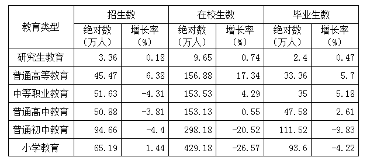

| 教育类型 | 招生数 绝对数（万人） | 招生数 增长率（%） | 在校生数 绝对数（万人） | 在校生数 增长率（%） | 毕业生数 绝对数（万人） | 毕业生数 增长率（%） |
| --- | ---: | ---: | ---: | ---: | ---: | ---: |
| 研究生教育 | 3.36 | 0.18 | 9.65 | 0.74 | 2.4 | 0.47 |
| 普通高等教育 | 45.47 | 6.38 | 156.88 | 17.34 | 33.36 | 5.7 |
| 中等职业教育 | 51.63 | −4.31 | 153.53 | 4.29 | 35 | 5.18 |
| 普通高中教育 | 50.88 | −3.81 | 153.13 | 0.55 | 47.58 | 2.61 |
| 普通初中教育 | 94.66 | −4.4 | 298.18 | −20.52 | 111.52 | −9.83 |
| 小学教育 | 65.19 | 1.44 | 429.18 | −26.57 | 93.6 | −4.22 |

## Material M4

<!-- hyz-material-id: 01a19c8a-21e7-70c0-a5b9-3c7bbcd7fa0c -->

**2008年我国居民消费价格涨跌幅度单位：％**

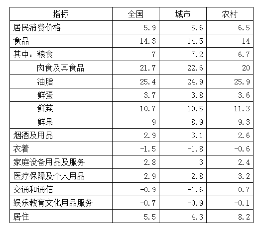

## Material M5

<!-- hyz-material-id: 01a19c8a-21e7-70c0-a5b9-3c8e37170557 -->

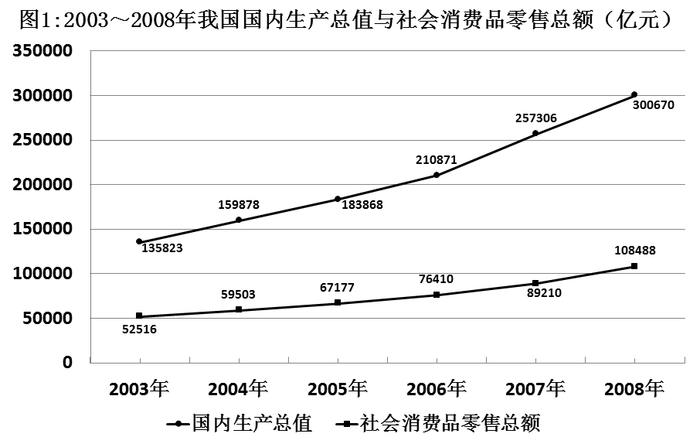

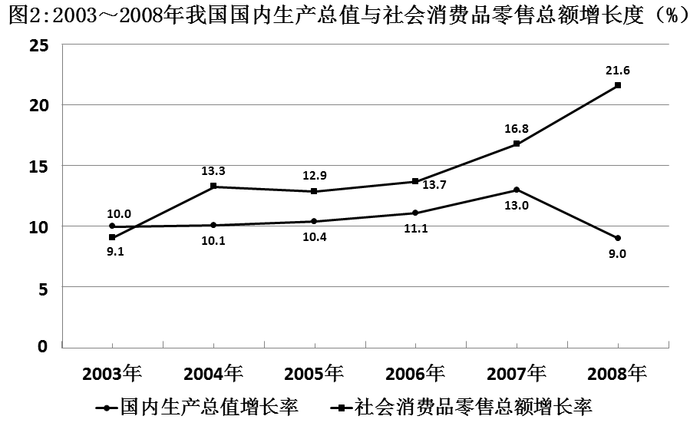

## Question 1

<!-- hyz-question-id: 01a19c8a-21e7-70c0-a5b9-3c9bd193d115 -->

```yaml
module: 知觉速度与准确性
category: null
topics: []
materials: []
passage_source: null
issues:
- order_unverified
```

### Stem

江畔何人初见月    江月何年初照人

### Options

- A. 3

- B. 4

- C. 5

- D. 6

### Answer

C

### Explanation

题干给出的两个字符组中重复的字符为江、何、人、初、月，共5个。

故正确答案为C。

## Question 2

<!-- hyz-question-id: 01a19c8a-21e7-70c0-a5b9-3ca82375a1b1 -->

```yaml
module: 知觉速度与准确性
category: null
topics: []
materials: []
passage_source: null
issues:
- order_unverified
```

### Stem


### Options

- A. 3

- B. 4

- C. 5

- D. 6

### Answer

D

### Explanation

题干给出的两个字符组中重复的字符为，共6个。

故正确答案为D。

## Question 3

<!-- hyz-question-id: 01a19c8a-21e7-70c0-a5b9-3cbfca9245f8 -->

```yaml
module: 知觉速度与准确性
category: null
topics: []
materials: []
passage_source: null
issues:
- order_unverified
```

### Stem


### Options

- A. 3

- B. 2

- C. 1

- D. 0

### Answer

A

### Explanation

题干给出的两个字符组中重复字符为□、▲、△，共3个。

故正确答案为A。

## Question 4

<!-- hyz-question-id: 01a19c8a-21e7-70c0-a5b9-3cc50285f8d7 -->

```yaml
module: 知觉速度与准确性
category: null
topics: []
materials: []
passage_source: null
issues:
- order_unverified
```

### Stem


### Options

- A. 6

- B. 7

- C. 8

- D. 9

### Answer

C

### Explanation

题干给出的两个字符组中重复的字符为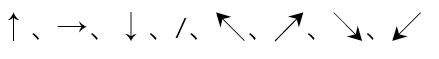，共8个。

故正确答案为C。

## Question 5

<!-- hyz-question-id: 01a19c8a-21e7-70c0-a5b9-3cde36fd3c98 -->

```yaml
module: 知觉速度与准确性
category: null
topics: []
materials: []
passage_source: null
issues:
- order_unverified
```

### Stem

《钢铁是怎样炼成的》    《桨声灯影里的秦淮河》

### Options

- A. 3

- B. 2

- C. 1

- D. 0

### Answer

A

### Explanation

题干给出的两个字符组中相同的符号为《、》、的，共3个。

故正确答案为A。

## Question 6

<!-- hyz-question-id: 01a19c8a-21e7-70c0-a5b9-3ce1786f5722 -->

```yaml
module: 知觉速度与准确性
category: null
topics: []
materials: []
passage_source: null
issues:
- order_unverified
```

### Stem

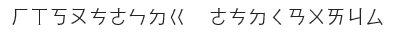

### Options

- A. 1

- B. 2

- C. 3

- D. 4

### Answer

C

### Explanation

题干给出的两个字符组中重复的字符为ち、さ、カ、共3个。

故正确答案为C。

## Question 7

<!-- hyz-question-id: 01a19c8a-21e7-70c0-a5b9-3cfb5cf44abb -->

```yaml
module: 知觉速度与准确性
category: null
topics: []
materials: []
passage_source: null
issues:
- order_unverified
```

### Stem


### Options

- A. 0

- B. 1

- C. 2

- D. 3

### Answer

C

### Explanation

题干给出的两个字符组中重复的字符为ξ、♂，共2个。

故正确答案为C。

## Question 8

<!-- hyz-question-id: 01a19c8a-21e7-70c0-a5b9-3d066bb660b7 -->

```yaml
module: 知觉速度与准确性
category: null
topics: []
materials: []
passage_source: null
issues:
- order_unverified
```

### Stem


### Options

- A. 1

- B. 2

- C. 3

- D. 4

### Answer

D

### Explanation

题干给出的两个字符组中重复字符为，共4个。

故正确答案为D。

## Question 9

<!-- hyz-question-id: 01a19c8a-21e7-70c0-a5b9-3d18a382716f -->

```yaml
module: 知觉速度与准确性
category: null
topics: []
materials: []
passage_source: null
issues:
- order_unverified
```

### Stem

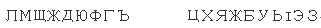

### Options

- A. 0

- B. 1

- C. 2

- D. 3

### Answer

B

### Explanation

题干给出的两个字符组中重复的字符为Ж，共1个。

故正确答案为B。

## Question 10

<!-- hyz-question-id: 01a19c8a-21e7-70c0-a5b9-3d2755b597c3 -->

```yaml
module: 知觉速度与准确性
category: null
topics: []
materials: []
passage_source: null
issues:
- order_unverified
```

### Stem

于亏于亏云亓互亣亢  亡交亢京仄今亼亣予

### Options

- A. 0

- B. 1

- C. 2

- D. 3

### Answer

C

### Explanation

题干给出的两个字符组中重复的字符为亣、亢，共2个。

故正确答案为C。

## Question 11

<!-- hyz-question-id: 01a19c8a-21e7-70c0-a5b9-3d35f5a2eefd -->

```yaml
module: 知觉速度与准确性
category: null
topics: []
materials: []
passage_source: null
issues:
- order_unverified
```

### Stem

NQAZSDFE    OLKMFJUN

### Options

- A. 0

- B. 1

- C. 2

- D. 3

### Answer

C

### Explanation

题干给出的两个字符组中重复的字符为N、F，共2个。

故正确答案为C。

## Question 12

<!-- hyz-question-id: 01a19c8a-21e7-70c0-a5b9-3d4b28ae6277 -->

```yaml
module: 知觉速度与准确性
category: null
topics: []
materials: []
passage_source: null
issues:
- order_unverified
```

### Stem

S3KWOEP4I9    UYAIbl30VQ

### Options

- A. 5

- B. 4

- C. 3

- D. 2

### Answer

D

### Explanation

题干给出的两个字符组中重复的字符为3、I，共2个。

故正确答案为D。

## Question 13

<!-- hyz-question-id: 01a19c8a-21e7-70c0-a5b9-3d500a9e1381 -->

```yaml
module: 知觉速度与准确性
category: null
topics: []
materials: []
passage_source: null
issues:
- order_unverified
```

### Stem

G5ahYN4lUbn    klOP2wEHcz0

### Options

- A. 4

- B. 3

- C. 2

- D. 1

### Answer

D

### Explanation

题干给出的两个字符组中重复的字符为l，共1个。

故正确答案为D。

## Question 14

<!-- hyz-question-id: 01a19c8a-21e7-70c0-a5b9-3d6c04bdaf5f -->

```yaml
module: 知觉速度与准确性
category: null
topics: []
materials: []
passage_source: null
issues:
- order_unverified
```

### Stem


### Options

- A. 0

- B. 1

- C. 2

- D. 3

### Answer

B

### Explanation

题干给出的两个字符组中重复的字符为✳，共1个。

故正确答案为B。

## Question 15

<!-- hyz-question-id: 01a19c8a-21e7-70c0-a5b9-3d7e90623f3e -->

```yaml
module: 知觉速度与准确性
category: null
topics: []
materials: []
passage_source: null
issues:
- order_unverified
```

### Stem

∈⊕≈≧∨:∞⌒∝ ∞⊥≅⊙∵∩∞∧≦

### Options

- A. 1

- B. 2

- C. 3

- D. 4

### Answer

A

### Explanation

题干给出的两个字符组中重复的字符为∞，共1个。

故正确答案为A。

## Question 16

<!-- hyz-question-id: 01a19c8a-21e7-70c0-a5b9-3d89183e8b1b -->

```yaml
module: 知觉速度与准确性
category: null
topics: []
materials: []
passage_source: null
issues:
- order_unverified
```

### Stem

7Q8DPIY4          RVL0BT6N1

### Options

- A. 1

- B. 2

- C. 3

- D. 0

### Answer

D

### Explanation

题干给出的两个字符组中没有重复的字符。

故正确答案为D。

## Question 17

<!-- hyz-question-id: 01a19c8a-21e7-70c0-a5b9-3d9bd04f68db -->

```yaml
module: 知觉速度与准确性
category: null
topics: []
materials: []
passage_source: null
issues:
- order_unverified
```

### Stem

鑫色科湖视留镜稀晢    江逻格停色贡咖稀另

### Options

- A. 1

- B. 2

- C. 3

- D. 4

### Answer

B

### Explanation

题干给出的两个字符组中重复的字符为色、稀，共2个。

故正确答案为B。

## Question 18

<!-- hyz-question-id: 01a19c8a-21e7-70c0-a5b9-3da3178ff6f2 -->

```yaml
module: 知觉速度与准确性
category: null
topics: []
materials: []
passage_source: null
issues:
- order_unverified
```

### Stem

8C75日46是2M3    17F9曰54早3K8

### Options

- A. 3

- B. 4

- C. 5

- D. 6

### Answer

C

### Explanation

题干给出的两个字符组中重复的字符为8、7、5、4、3，共5个。

故正确答案为C。

## Question 19

<!-- hyz-question-id: 01a19c8a-21e7-70c0-a5b9-3db7bc437012 -->

```yaml
module: 知觉速度与准确性
category: null
topics: []
materials: []
passage_source: null
issues:
- order_unverified
```

### Stem

于Ol590牛VM士    土vnl98千3E生

### Options

- A. 1

- B. 2

- C. 3

- D. 0

### Answer

B

### Explanation

题干给出的两个字符组中重复的字符为l、9，共2个。

故正确答案为B。

## Question 20

<!-- hyz-question-id: 01a19c8a-21e7-70c0-a5b9-3dcadf950eac -->

```yaml
module: 知觉速度与准确性
category: null
topics: []
materials: []
passage_source: null
issues:
- order_unverified
```

### Stem

X74大MY末L  Ψ太Pξ末93n

### Options

- A. 0

- B. 1

- C. 2

- D. 3

### Answer

B

### Explanation

题干给出的两个字符组中重复的字符为末，共1个。

故正确答案为B。

## Question 21

<!-- hyz-question-id: 01a19c8a-21e7-70c0-a5b9-3dd237971d4b -->

```yaml
module: 知觉速度与准确性
category: null
topics: []
materials: []
passage_source: null
issues:
- order_unverified
```

### Stem

X经W商O务C情b    和I平V5务D产3

### Options

- A. 1

- B. 2

- C. 3

- D. 4

### Answer

A

### Explanation

题干给出的两个字符组中重复的字符为务，共1个。

故正确答案为A。

## Question 22

<!-- hyz-question-id: 01a19c8a-21e7-70c0-a5b9-3de0e6c56504 -->

```yaml
module: 知觉速度与准确性
category: null
topics: []
materials: []
passage_source: null
issues:
- order_unverified
```

### Stem

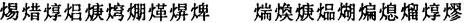

### Options

- A. 0

- B. 1

- C. 2

- D. 3

### Answer

C

### Explanation

题干给出的两个字符组中重复的字符为焞、焿，共2个。

故正确答案为C。

## Question 23

<!-- hyz-question-id: 01a19c8a-21e7-70c0-a5b9-3df08f96b366 -->

```yaml
module: 知觉速度与准确性
category: null
topics: []
materials: []
passage_source: null
issues:
- order_unverified
```

### Stem


### Options

- A. 3

- B. 2

- C. 1

- D. 0

### Answer

B

### Explanation

题干给出的两个字符组中重复的字符为ぞ、ぬ，共2个。

故正确答案为B。

## Question 24

<!-- hyz-question-id: 01a19c8a-21e7-70c0-a5b9-3e08a2438dec -->

```yaml
module: 知觉速度与准确性
category: null
topics: []
materials: []
passage_source: null
issues:
- order_unverified
```

### Stem

女士问：“这是为什么呢？”    先生答：“不知道为什么。”

### Options

- A. 3

- B. 4

- C. 5

- D. 6

### Answer

D

### Explanation

题干给出的两个字符组中重复的字符为：、“、为、什、么、”，共6个。

故正确答案为D。

## Question 25

<!-- hyz-question-id: 01a19c8a-21e7-70c0-a5b9-3e1d7093abad -->

```yaml
module: 知觉速度与准确性
category: null
topics: []
materials: []
passage_source: null
issues:
- order_unverified
```

### Stem


### Options

- A. 1

- B. 2

- C. 3

- D. 4

### Answer

B

### Explanation

题干给出的两个字符组中重复的字符为↖、↓，共2个。

故正确答案为B。

## Question 26

<!-- hyz-question-id: 01a19c8a-21e7-70c0-a5b9-3e2f6bcfec74 -->

```yaml
module: 知觉速度与准确性
category: null
topics: []
materials: []
passage_source: null
issues:
- order_unverified
```

### Stem


### Options

- A. 1

- B. 2

- C. 3

- D. 0

### Answer

A

### Explanation

题干给出的三个字符组中重复的字符为¥，共1个。

故正确答案为A。

## Question 27

<!-- hyz-question-id: 01a19c8a-21e7-70c0-a5b9-3e343015ddde -->

```yaml
module: 知觉速度与准确性
category: null
topics: []
materials: []
passage_source: null
issues:
- order_unverified
```

### Stem

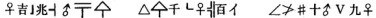

### Options

- A. 1

- B. 2

- C. 3

- D. 0

### Answer

A

### Explanation

题干给出的三个字符组中重复的字符为♀，共1个。

故正确答案为A。

## Question 28

<!-- hyz-question-id: 01a19c8a-21e7-70c0-a5b9-3e4af2fec89a -->

```yaml
module: 知觉速度与准确性
category: null
topics: []
materials: []
passage_source: null
issues:
- order_unverified
```

### Stem


### Options

- A. 0

- B. 1

- C. 2

- D. 3

### Answer

B

### Explanation

题干给出的三个字符组中重复的字符为80，共1个。

故正确答案为B。

## Question 29

<!-- hyz-question-id: 01a19c8a-21e7-70c0-a5b9-3e552c0a102b -->

```yaml
module: 知觉速度与准确性
category: null
topics: []
materials: []
passage_source: null
issues:
- order_unverified
```

### Stem

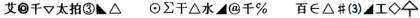

### Options

- A. 1

- B. 2

- C. 3

- D. 0

### Answer

A

### Explanation

题干给出的三个字符组中重复的字符为△，共1个。

故正确答案为A。

## Question 30

<!-- hyz-question-id: 01a19c8a-21e7-70c0-a5b9-3e646f3b8ac1 -->

```yaml
module: 知觉速度与准确性
category: null
topics: []
materials: []
passage_source: null
issues:
- order_unverified
```

### Stem


### Options

- A. 1

- B. 2

- C. 3

- D. 4

### Answer

B

### Explanation

题干给出的三个字符组中重复的字符为∽、∝，共2个。

故正确答案为B。

## Question 31

<!-- hyz-question-id: 01a19c8a-21e7-70c0-a5b9-3e7f75022a23 -->

```yaml
module: 知觉速度与准确性
category: null
topics: []
materials: []
passage_source: null
issues:
- order_unverified
```

### Stem


### Options

- A. 1

- B. 2

- C. 3

- D. 4

### Answer

B

### Explanation

题干给出的三个字符组中重复的字符为VI、 IX，共2个。

故正确答案为B。

## Question 32

<!-- hyz-question-id: 01a19c8a-21e7-70c0-a5b9-3e8a66f0d952 -->

```yaml
module: 知觉速度与准确性
category: null
topics: []
materials: []
passage_source: null
issues:
- order_unverified
```

### Stem

δθЯЭEξστψ ЭδξJΠOλΦδΩ βαδωξσψJΠθ

### Options

- A. 0

- B. 1

- C. 2

- D. 3

### Answer

C

### Explanation

题干给出的三个字符组中重复的字符为ξ、δ，共2个。

故正确答案为C。

## Question 33

<!-- hyz-question-id: 01a19c8a-21e7-70c0-a5b9-3e920a3d9445 -->

```yaml
module: 知觉速度与准确性
category: null
topics: []
materials: []
passage_source: null
issues:
- order_unverified
```

### Stem


### Options

- A. 0

- B. 1

- C. 2

- D. 3

### Answer

D

### Explanation

题干给出的三个字符组中重复的字符为，共3个。

故正确答案为D。

## Question 34

<!-- hyz-question-id: 01a19c8a-21e7-70c0-a5b9-3ea03ffa1398 -->

```yaml
module: 知觉速度与准确性
category: null
topics: []
materials: []
passage_source: null
issues:
- order_unverified
```

### Stem

白日依山尽黄河入海流  江流天地外山色有无中  明月出天山苍茫云海间

### Options

- A. 0

- B. 1

- C. 2

- D. 3

### Answer

B

### Explanation

题干给出的三个字符组中重复的字符为山 ，共1个。

故正确答案为B。

## Question 35

<!-- hyz-question-id: 01a19c8a-21e7-70c0-a5b9-3eb6bbab5eb2 -->

```yaml
module: 知觉速度与准确性
category: null
topics: []
materials: []
passage_source: null
issues:
- order_unverified
```

### Stem


### Options

- A. 3

- B. 2

- C. 1

- D. 0

### Answer

A

### Explanation

题干给出的三个字符组中重复的字符为⊢、4、B，共3个。

故正确答案为A。

## Question 36

<!-- hyz-question-id: 01a19c8a-21e7-70c0-a5b9-3ec501deb5da -->

```yaml
module: 知觉速度与准确性
category: null
topics: []
materials: []
passage_source: null
issues:
- order_unverified
```

### Stem

5610

### Options

- A. 1569～4865 14473～33584

- B. 4359～7983 32679～121002

- C. 9573～15018 34398～785763

- D. 5611～12476 156939～946503

### Answer

B

### Explanation

数字5610位于区间4359～7983。

故正确答案为B。

## Question 37

<!-- hyz-question-id: 01a19c8a-21e7-70c0-a5b9-3ed6844f91ee -->

```yaml
module: 知觉速度与准确性
category: null
topics: []
materials: []
passage_source: null
issues:
- order_unverified
```

### Stem

4230

### Options

- A. 1569～4865 14473～33584

- B. 4359～7983 32679～121002

- C. 9573～15018 34398～785763

- D. 5611～12476 156939～946503

### Answer

A

### Explanation

数字4230位于区间1569～4865。

故正确答案为A。

## Question 38

<!-- hyz-question-id: 01a19c8a-21e7-70c0-a5b9-3ee8c2108665 -->

```yaml
module: 知觉速度与准确性
category: null
topics: []
materials: []
passage_source: null
issues:
- order_unverified
```

### Stem

7994

### Options

- A. 1569～4865 14473～33584

- B. 4359～7983 32679～121002

- C. 9573～15018 34398～785763

- D. 5611～12476 156939～946503

### Answer

D

### Explanation

数字7994位于区间5611～12476。

故正确答案为D。

## Question 39

<!-- hyz-question-id: 01a19c8a-21e7-70c0-a5b9-3efbe10f2dfd -->

```yaml
module: 知觉速度与准确性
category: null
topics: []
materials: []
passage_source: null
issues:
- order_unverified
```

### Stem

5317

### Options

- A. 1569～4865 14473～33584

- B. 4359～7983 32679～121002

- C. 9573～15018 34398～785763

- D. 5611～12476 156939～946503

### Answer

B

### Explanation

数字5317位于区间4359～7983。

故正确答案为B。

## Question 40

<!-- hyz-question-id: 01a19c8a-21e7-70c0-a5b9-3f0ed16203fd -->

```yaml
module: 知觉速度与准确性
category: null
topics: []
materials: []
passage_source: null
issues:
- order_unverified
```

### Stem

13581

### Options

- A. 1569～4865 14473～33584

- B. 4359～7983 32679～121002

- C. 9573～15018 34398～785763

- D. 5611～12476 156939～946503

### Answer

C

### Explanation

数字13581位于区间9573～15018。

故正确答案为C。

## Question 41

<!-- hyz-question-id: 01a19c8a-21e7-70c0-a5b9-3f104a1b714d -->

```yaml
module: 知觉速度与准确性
category: null
topics: []
materials: []
passage_source: null
issues:
- order_unverified
```

### Stem

14373

### Options

- A. 1569～4865 14473～33584

- B. 4359～7983 32679～121002

- C. 9573～15018 34398～785763

- D. 5611～12476 156939～946503

### Answer

C

### Explanation

数字14373位于区间9573～15018。

故正确答案为C。

## Question 42

<!-- hyz-question-id: 01a19c8a-21e7-70c0-a5b9-3f2533226371 -->

```yaml
module: 知觉速度与准确性
category: null
topics: []
materials: []
passage_source: null
issues:
- order_unverified
```

### Stem

4983

### Options

- A. 1569～4865 14473～33584

- B. 4359～7983 32679～121002

- C. 9573～15018 34398～785763

- D. 5611～12476 156939～946503

### Answer

B

### Explanation

数字4983位于区间4359～7983。

故正确答案为B。

## Question 43

<!-- hyz-question-id: 01a19c8a-21e7-70c0-a5b9-3f3575525b3a -->

```yaml
module: 知觉速度与准确性
category: null
topics: []
materials: []
passage_source: null
issues:
- order_unverified
```

### Stem

8976

### Options

- A. 1569～4865 14473～33584

- B. 4359～7983 32679～121002

- C. 9573～15018 34398～785763

- D. 5611～12476 156939～946503

### Answer

D

### Explanation

数字8976位于区间5611～12476。

故正确答案为D。

## Question 44

<!-- hyz-question-id: 01a19c8a-21e7-70c0-a5b9-3f421028109a -->

```yaml
module: 知觉速度与准确性
category: null
topics: []
materials: []
passage_source: null
issues:
- order_unverified
```

### Stem

17314

### Options

- A. 1569～4865 14473～33584

- B. 4359～7983 32679～121002

- C. 9573～15018 34398～785763

- D. 5611～12476 156939～946503

### Answer

A

### Explanation

数字17314位于区间14473～33584。

故正确答案为A。

## Question 45

<!-- hyz-question-id: 01a19c8a-21e7-70c0-a5b9-3f5103c8956a -->

```yaml
module: 知觉速度与准确性
category: null
topics: []
materials: []
passage_source: null
issues:
- order_unverified
```

### Stem

34294

### Options

- A. 1569～4865 14473～33584

- B. 4359～7983 32679～121002

- C. 9573～15018 34398～785763

- D. 5611～12476 156939～946503

### Answer

B

### Explanation

数字34294位于区间32679～121002。

故正确答案为B。

## Question 46

<!-- hyz-question-id: 01a19c8a-21e7-70c0-a5b9-3f6b926087d4 -->

```yaml
module: 知觉速度与准确性
category: null
topics: []
materials: []
passage_source: null
issues:
- order_unverified
```

### Stem

13539

### Options

- A. 1569～4865 14473～33584

- B. 4359～7983 32679～121002

- C. 9573～15018 34398～785763

- D. 5611～12476 156939～946503

### Answer

C

### Explanation

数字13539位于区间9573～15018。

故正确答案为C。

## Question 47

<!-- hyz-question-id: 01a19c8a-21e7-70c0-a5b9-3f75fa0217a2 -->

```yaml
module: 知觉速度与准确性
category: null
topics: []
materials: []
passage_source: null
issues:
- order_unverified
```

### Stem

832109

### Options

- A. 1569～4865 14473～33584

- B. 4359～7983 32679～121002

- C. 9573～15018 34398～785763

- D. 5611～12476 156939～946503

### Answer

D

### Explanation

数字832109位于区间156939～946503。

故正确答案为D。

## Question 48

<!-- hyz-question-id: 01a19c8a-21e7-70c0-a5b9-3f81c8cdcbc1 -->

```yaml
module: 知觉速度与准确性
category: null
topics: []
materials: []
passage_source: null
issues:
- order_unverified
```

### Stem

20934

### Options

- A. 1569～4865 14473～33584

- B. 4359～7983 32679～121002

- C. 9573～15018 34398～785763

- D. 5611～12476 156939～946503

### Answer

A

### Explanation

数字20934位于区间14473～33584。

故正确答案为A。

## Question 49

<!-- hyz-question-id: 01a19c8a-21e7-70c0-a5b9-3f9d6df26ae9 -->

```yaml
module: 知觉速度与准确性
category: null
topics: []
materials: []
passage_source: null
issues:
- order_unverified
```

### Stem

156745

### Options

- A. 1569～4865 14473～33584

- B. 4359～7983 32679～121002

- C. 9573～15018 34398～785763

- D. 5611～12476 156939～946503

### Answer

C

### Explanation

数字156745位于区间34398～785763。

故正确答案为C。

## Question 50

<!-- hyz-question-id: 01a19c8a-21e7-70c0-a5b9-3fab03738ee3 -->

```yaml
module: 知觉速度与准确性
category: null
topics: []
materials: []
passage_source: null
issues:
- order_unverified
```

### Stem

25387

### Options

- A. 1569～4865 14473～33584

- B. 4359～7983 32679～121002

- C. 9573～15018 34398～785763

- D. 5611～12476 156939～946503

### Answer

A

### Explanation

数字25387位于区间14473～33584。

故正确答案为A。

## Question 51

<!-- hyz-question-id: 01a19c8a-21e7-70c0-a5b9-3fb92f28117a -->

```yaml
module: 知觉速度与准确性
category: null
topics: []
materials: []
passage_source: null
issues:
- order_unverified
```

### Stem

图例：

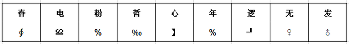

| 春 | 电 | 粉 | 哲 | 心 | 年 | 逻 | 无 | 发 |
| --- | --- | --- | --- | --- | --- | --- | --- | --- |
| ∮ | ≌ | % | ‰ | 〕 | % | ┚ | ♀ | ♂ |

年逻电春

### Options

- A. %%≌∮

- B. %┚≌∮

- C. %♀]↑○

- D. %┘≅∮

### Answer

B

### Explanation

由对应表可知“年”对应的符号为%，“逻”对应的符号为┚，“电”对应的符号为≌，“春”对应的符号为∮，A、C、D三项均不符合。

故正确答案为B。

## Question 52

<!-- hyz-question-id: 01a19c8a-21e7-70c0-a5b9-3fce7d72ae03 -->

```yaml
module: 知觉速度与准确性
category: null
topics: []
materials: []
passage_source: null
issues:
- order_unverified
```

### Stem

图例：


| 春 | 电 | 粉 | 哲 | 心 | 年 | 逻 | 无 | 发 |
| --- | --- | --- | --- | --- | --- | --- | --- | --- |
| ∮ | ≌ | % | ‰ | 〕 | % | ┚ | ♀ | ♂ |

春无发粉

### Options

- A. ♀∮%]

- B. ∮♂♀%

- C. ∮%♀♂

- D. ∮♀↥%

### Answer

D

### Explanation

由对应表可知，“春”对应的符号为∮，“无”对应的符号为♀，“发”对应的符号为♂，“粉”对应的符号为**%**，A、B、C三项均不符合。

故正确答案为D。

## Question 53

<!-- hyz-question-id: 01a19c8a-21e7-70c0-a5b9-3fd117b028b5 -->

```yaml
module: 知觉速度与准确性
category: null
topics: []
materials: []
passage_source: null
issues:
- order_unverified
```

### Stem

图例：


| 春 | 电 | 粉 | 哲 | 心 | 年 | 逻 | 无 | 发 |
| --- | --- | --- | --- | --- | --- | --- | --- | --- |
| ∮ | ≌ | % | ‰ | 〕 | % | ┚ | ♀ | ♂ |

哲逻电心

### Options

- A. ‰┘]∮

- B. %≌┚]

- C. %⌐≋]

- D. %⌐∮]⌐

### Answer

C

### Explanation

由对应表可知，“哲”对应的符号为‰，“逻”对应的符号为┚，“电”对应的符号为≌，“心”对应的符号为】，A、B、D三项均不符合。

故正确答案为C。

## Question 54

<!-- hyz-question-id: 01a19c8a-21e8-7470-8f0f-f560aacb3500 -->

```yaml
module: 知觉速度与准确性
category: null
topics: []
materials: []
passage_source: null
issues:
- order_unverified
```

### Stem

图例：


| 春 | 电 | 粉 | 哲 | 心 | 年 | 逻 | 无 | 发 |
| --- | --- | --- | --- | --- | --- | --- | --- | --- |
| ∮ | ≌ | % | ‰ | 〕 | % | ┚ | ♀ | ♂ |

心无春发

### Options

- A. 】♀∮♂

- B. 】♂∮♀

- C. 

- D. ∮♂】≅

### Answer

A

### Explanation

由对应表可知，“心”对应的符号为】，“无”对应的符号为♀，“春”对应的符号为∮，“发”对应的符号为♂，B、C、D三项均不符合。

故正确答案为A。

## Question 55

<!-- hyz-question-id: 01a19c8a-21e8-7470-8f0f-f57e70f4fb21 -->

```yaml
module: 知觉速度与准确性
category: null
topics: []
materials: []
passage_source: null
issues:
- order_unverified
```

### Stem

图例：


| 春 | 电 | 粉 | 哲 | 心 | 年 | 逻 | 无 | 发 |
| --- | --- | --- | --- | --- | --- | --- | --- | --- |
| ∮ | ≌ | % | ‰ | 〕 | % | ┚ | ♀ | ♂ |

粉年无逻

### Options

- A. %‰♀┘

- B. %】┘♂

- C. %♀♂┘

- D. %%♀┘

### Answer

D

### Explanation

由对应表可知，“粉”对应的符号为％，“年”对应的符号为％，“无”对应的符号为♀，“逻”对应的符号为┚，A、B、C三项均不符合。

故正确答案为D。

## Question 56

<!-- hyz-question-id: 01a19c8a-21e8-7470-8f0f-f585f1cd4629 -->

```yaml
module: 知觉速度与准确性
category: null
topics: []
materials: []
passage_source: null
issues:
- order_unverified
```

### Stem

图例：


| 春 | 电 | 粉 | 哲 | 心 | 年 | 逻 | 无 | 发 |
| --- | --- | --- | --- | --- | --- | --- | --- | --- |
| ∮ | ≌ | % | ‰ | 〕 | % | ┚ | ♀ | ♂ |

电发哲春

### Options

- A. ≌♂‰∮

- B. ≌♀‰∮

- C. ≅♂%∮

- D. ∮≌♂‰

### Answer

A

### Explanation

由对应表可知，“电”对应的符号为≅，“发”对应的符号为♂，“哲”对应的符号为‰，“春”对应的符号为∮，B、C、D三项均不符合。

故正确答案为A。

## Question 57

<!-- hyz-question-id: 01a19c8a-21e8-7470-8f0f-f598c3f5a540 -->

```yaml
module: 知觉速度与准确性
category: null
topics: []
materials: []
passage_source: null
issues:
- order_unverified
```

### Stem

图例：


| 春 | 电 | 粉 | 哲 | 心 | 年 | 逻 | 无 | 发 |
| --- | --- | --- | --- | --- | --- | --- | --- | --- |
| ∮ | ≌ | % | ‰ | 〕 | % | ┚ | ♀ | ♂ |

年心粉电

### Options

- A. %】‰≅

- B. %】┘≅

- C. %】%≅

- D. ‰♀┘∮

### Answer

C

### Explanation

由对应表可知，“年”对应的符号为%，“心”对应的符号为】，“粉”对应的符号为%，“电”对应的符号为≅，A、B、D三项均不符合。

故正确答案为C。

## Question 58

<!-- hyz-question-id: 01a19c8a-21e8-7470-8f0f-f5ac21df860d -->

```yaml
module: 知觉速度与准确性
category: null
topics: []
materials: []
passage_source: null
issues:
- order_unverified
```

### Stem

图例：


| 春 | 电 | 粉 | 哲 | 心 | 年 | 逻 | 无 | 发 |
| --- | --- | --- | --- | --- | --- | --- | --- | --- |
| ∮ | ≌ | % | ‰ | 〕 | % | ┚ | ♀ | ♂ |

逻电春发

### Options

- A. 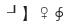

- B. ┚≌∮♂

- C. 】≅%♂

- D. 】%♂┘

### Answer

B

### Explanation

由对应表可知，“逻”对应的符号为┚，“电”对应的符号为≌，“春”对应的符号为∮，“发”对应的符号为♂，A、C、D三项均不符合。

故正确答案为B。

## Question 59

<!-- hyz-question-id: 01a19c8a-21e8-7470-8f0f-f5b3850b06d4 -->

```yaml
module: 知觉速度与准确性
category: null
topics: []
materials: []
passage_source: null
issues:
- order_unverified
```

### Stem

图例：


| 春 | 电 | 粉 | 哲 | 心 | 年 | 逻 | 无 | 发 |
| --- | --- | --- | --- | --- | --- | --- | --- | --- |
| ∮ | ≌ | % | ‰ | 〕 | % | ┚ | ♀ | ♂ |

无粉电哲

### Options

- A. ♀‰≅%

- B. ♂‰┘≅

- C. ♀%≅‰

- D. ♂%≌‰

### Answer

C

### Explanation

由对应表可知，“无”对应的符号为♀，“粉”对应的符号为％，“电”对应的符号为≅，“哲”对应的符号为‰，A、B、D三项均不符合。

故正确答案为C。

## Question 60

<!-- hyz-question-id: 01a19c8a-21e8-7470-8f0f-f5caf1703ceb -->

```yaml
module: 知觉速度与准确性
category: null
topics: []
materials: []
passage_source: null
issues:
- order_unverified
```

### Stem

图例：


| 春 | 电 | 粉 | 哲 | 心 | 年 | 逻 | 无 | 发 |
| --- | --- | --- | --- | --- | --- | --- | --- | --- |
| ∮ | ≌ | % | ‰ | 〕 | % | ┚ | ♀ | ♂ |

发哲年心

### Options

- A. ♂%】%

- B. ♂‰%】

- C. ♀‰┘】

- D. ♀%」】

### Answer

B

### Explanation

由对应表可知，“发”对应的符号为♂，“哲”对应的符号为‰，“年”对应的符号为％，“心”对应的符号为】，A、C、D三项均不符合。

故正确答案为B。

## Question 61

<!-- hyz-question-id: 01a19c8a-21e8-7470-8f0f-f5de58c2246e -->

```yaml
module: 数量关系
category: null
topics: []
materials: []
passage_source: null
issues:
- order_unverified
```

### Stem

2，7，23，47，119，（　　）

### Options

- A. 125

- B. 167

- C. 168

- D. 170

### Answer

B

### Explanation

数列依次递增，且都是幂次数周围的数，考虑幂次修正数列。观察发现：2 = 2^2 − 2，7 = 3^2 − 2，23 = 5^2 − 2，47=7^2-2，119=11^2-2，底数为质数数列，指数均为2，修正项均为-2，故所求项= 13^2 − 2 = 167。

故正确答案为B。

## Question 62

<!-- hyz-question-id: 01a19c8a-21e8-7470-8f0f-f5efff14343b -->

```yaml
module: 数量关系
category: null
topics: []
materials: []
passage_source: null
issues:
- order_unverified
```

### Stem

7，8，8，10，11，（　　）

### Options

- A. 12

- B. 13

- C. 14

- D. 16

### Answer

C

### Explanation

观察数列无明显特征，考虑多级数列。作差无规律，考虑作和，前一项加后一项，得到15、16、18、21，（    ），新数列作差之后是1、2、3，（    ），是公差为1的等差数列，下一项为3+1=4，新数列下一项是21+4=25，故所求项是25-11=14。

故正确答案为C。

## Question 63

<!-- hyz-question-id: 01a19c8a-21e8-7470-8f0f-f5fa2ee56f5e -->

```yaml
module: 数量关系
category: null
topics: []
materials: []
passage_source: null
issues:
- order_unverified
```

### Stem

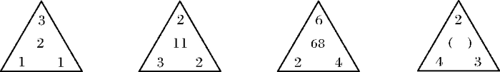

### Options

- A. 11

- B. 16

- C. 18

- D. 19

### Answer

D

### Explanation

图形数阵，有中间数字，优先考虑由周围数字推出中间数字。观察发现：

第一个数阵中：1^3+1=2；

第二个数阵中：3^2 + 2 = 11；

第三个数阵中：2^6+4=68；

即左下角数字^最上面数字 + 右下角数字=中间的数字，故第四个数阵中：4^2+3=19。

故正确答案为D。

## Question 64

<!-- hyz-question-id: 01a19c8a-21e8-7470-8f0f-f60e73baae0b -->

```yaml
module: 数量关系
category: null
topics: []
materials: []
passage_source: null
issues:
- order_unverified
```

### Stem

36，125，256，243，64，（　　）

### Options

- A. 100

- B. 1

- C. 0.5

- D. 121

### Answer

B

### Explanation

数列起伏较大，且存在特征数字，考虑幂次规律。观察发现：36=6^2，125=5^3，256=4^4，243=3^5，64=2^6，底数是公差为-1的等差数列，指数是公差为1的等差数列，故所求项=1^7=1。

故正确答案为B。

## Question 65

<!-- hyz-question-id: 01a19c8a-21e8-7470-8f0f-f61d2fd6313e -->

```yaml
module: 数量关系
category: null
topics: []
materials: []
passage_source: null
issues:
- order_unverified
```

### Stem

20，202，2020，（　　），202020，2020202

### Options

- A. 20200

- B. 20202

- C. 202002

- D. 20222

### Answer

B

### Explanation

数列之间倍数关系较明显，且作差无规律，考虑递推。观察可得：202=20×10+2，2020=202×10+0，2020202=202020×10+2，即前一项×10+修正项=后一项，修正项为2、0的周期数列，则所求项=2020×10+2=20202。

故正确答案为B。

## Question 66

<!-- hyz-question-id: 01a19c8a-21e8-7470-8f0f-f62f31d98ceb -->

```yaml
module: 数量关系
category: null
topics: []
materials: []
passage_source: null
issues:
- order_unverified
```

### Stem

1，3，5，11，21，（　　）

### Options

- A. 25

- B. 32

- C. 43

- D. 46

### Answer

C

### Explanation

方法一：数列变化幅度较小，作差无规律，考虑作和。前一项加后一项，所得新数列为4，8，16，32，（    ），是公比为2的等比数列，则新数列下一项是64，所求项=64-21=43。

方法二：观察数列无明显规律，作差无规律，考虑递推。观察发现：3=1×2+1，5=3×2-1，11=5×2+1，21=11×2-1，即前一项×2+修正项=后一项，修正项为+1、-1的周期数列，则所求项=21×2+1=43。

方法三：观察数列无明显规律，作差无规律，考虑递推。观察发现：1×2+3=5，3×2+5=11，5×2+11=21，即第一项×2+第二项=第三项，则所求项=11×2+21=43。

故正确答案为C。

## Question 67

<!-- hyz-question-id: 01a19c8a-21e8-7470-8f0f-f63452841b16 -->

```yaml
module: 数量关系
category: null
topics: []
materials: []
passage_source: null
issues:
- order_unverified
```

### Stem

100，10，12 1/2，16 2/3，()，50

### Options

- A. 20

- B. 35

- C. 15

- D. 25

### Answer

D

### Explanation

原数列可转化为：100，10，25/2，50/3，（    ），50，观察发现从第二项开始，每一项都与第一项的倍数关系明显，则每一项除以第一项后得到的新数列是：1/10，1/8，1/6，（    ），1/2，分母是公差为-2的等差数列，分子均为1，则新数列中所求项是1/4，所求项=1/4×100=25。

故正确答案为D。

## Question 68

<!-- hyz-question-id: 01a19c8a-21e8-7470-8f0f-f64e84641633 -->

```yaml
module: 数量关系
category: null
topics: []
materials: []
passage_source: null
issues:
- order_unverified
```

### Stem

1/2，1，7/8，5/8，13/32，()

### Options

- A. 1/4

- B. 15/64

- C. 11/64

- D. 7/64

### Answer

A

### Explanation

分数数列，变化趋势不单调，优先考虑反约分得到新数列：1/2，4/4，7/8， 10/16， 13/32，（    ），再分别观察分子和分母，分子是公差为3的等差数列，则下一项是13+3=16；分母是公比为2的等比数列，则下一项是32×2=64。故所求项是16/64=1/4。

故正确答案为A。

## Question 69

<!-- hyz-question-id: 01a19c8a-21e8-7470-8f0f-f65c13cbcaf0 -->

```yaml
module: 数量关系
category: null
topics: []
materials: []
passage_source: null
issues:
- order_unverified
```

### Stem

4635，3728，3225，2621，2219，（　　）

### Options

- A. 1565

- B. 1433

- C. 1916

- D. 1413

### Answer

D

### Explanation

数列均为多位数，考虑机械划分。将数列中的每一个数字从中间划分为前后两个两位数列，得到的新数列为46，35；37，28；32，25；26，21；22，19。观察发现每组数列的前一项减去后一项得到的数列为：11，9，7，5，3，是公差为-2的等差数列，则该数列的下一项是1，故划分后的新数列前一项减去后一项的差为1，只有D项符合。

故正确答案为D。

## Question 70

<!-- hyz-question-id: 01a19c8a-21e8-7470-8f0f-f6612ab001af -->

```yaml
module: 数量关系
category: null
topics: []
materials: []
passage_source: null
issues:
- order_unverified
```

### Stem

0，7/3，22/5，45/7，76/9，()

### Options

- A. 12

- B. 13

- C. 103/11

- D. 115/11

### Answer

D

### Explanation

分数数列。原数列可转化为：0/1， 7/3， 22/5， 45/7，76/9，分别观察分子分母规律，分母为1、3、5、7、9，是公差为2的等差数列，则下一项是11；分子是0、7、22、45、76，作差后得到新数列是7、15、23、31，是公差为8的等差数列，新数列下一项是31+8=39，则分母的下一项是76+39=115。则所求项是115/11

故正确答案为D。

## Question 71

<!-- hyz-question-id: 01a19c8a-21e8-7470-8f0f-f67175595eb2 -->

```yaml
module: 数量关系
category: null
topics: []
materials: []
passage_source: null
issues:
- order_unverified
```

### Stem

对于任意实数a、b、c，定义运算a*b*c=a^b−b^c+c^a，若1\*x\*2=2，则x=()

### Options

- A. 2

- B. \-2

- C. 0

- D. ±1

### Answer

D

### Explanation

根据a × b × c =a^b - b^c + c^a，可得1 × x × 2 =1^x − x^2 + 2^1 = 2，化简得1-x^2=0，解得x=±1。

故正确答案为D。

## Question 72

<!-- hyz-question-id: 01a19c8a-21e8-7470-8f0f-f68ddd2de6a5 -->

```yaml
module: 数量关系
category: null
topics: []
materials: []
passage_source: null
issues:
- order_unverified
```

### Stem

1/(1×2) + 1/(2×3) + … + 1/(n×(n+1)) + … =（ ）

### Options

- A. 0

- B. 0.5

- C. 1

- D. 2

### Answer

C

### Explanation

1/(1×2)=1/1−1/2；1/(2 × 3) = 1/2 − 1/3；。则1/(1×2) + 1/(2×3) + …… + 1/(n×(n+1))+...... = 1/1 − 1/2 + 1/2 − 1/3。

故正确答案为C。

## Question 73

<!-- hyz-question-id: 01a19c8a-21e8-7470-8f0f-f6992ad8729e -->

```yaml
module: 数量关系
category: null
topics:
- 几何公式类-立体图形
- 几何结论类-相似图形
materials: []
passage_source: null
issues:
- order_unverified
```

### Stem

正四面体的棱长增加20％，则表面积增加：

### Options

- A. 20％

- B. 15％

- C. 44％

- D. 40％

### Answer

C

### Explanation

假设正四面体的棱长为a，则表面积是√3a^2，棱长增加20%之后是（1+20%）a=1.2a，则增加后的表面积是√3 × (1.2a)^2 =√3a^2 × 1.44，故表面积增加了(√3a^2 × 1.44 - √3a^2)/√3a^2 = 44%。

故正确答案为C。

## Question 74

<!-- hyz-question-id: 01a19c8a-21e8-7470-8f0f-f6ab4ba0fc4b -->

```yaml
module: 数量关系
category: null
topics: []
materials: []
passage_source: null
issues:
- order_unverified
```

### Stem

有一列士兵排成若干层的中空方阵，外层共有68人，中间一层共有44人，则该方阵士兵的总人数是：

### Options

- A. 296人

- B. 308人

- C. 324人

- D. 348人

### Answer

B

### Explanation

方阵问题。相邻两层人数相差为8。最外层与中间层相差68-44=24人，即最外层与中间层相隔两层，如图：

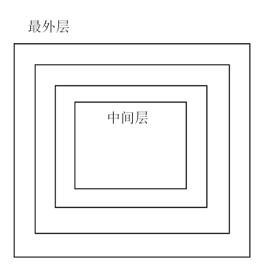

则一共有7层，方阵是公差为8的等差数列，根据等差数列求和公式：S_n=项数×中位数=7×44=308人。即方阵总人数是308人。

故正确答案为B。

## Question 75

<!-- hyz-question-id: 01a19c8a-21e8-7470-8f0f-f6bbb4ed858e -->

```yaml
module: 数量关系
category: null
topics: []
materials: []
passage_source: null
issues:
- order_unverified
```

### Stem

整数15具有被它的十位数字和个位数字同时整除的性质，则在12和50之间具有这种性质的整数的个数是：

### Options

- A. 8个

- B. 10个

- C. 12个

- D. 14个

### Answer

A

### Explanation

采用列举法：

十位数字为1的数有：12、15；

十位数字为2的数有：22、24；

十位数字为3的数有：33、36；

十位数字为4的数有：44、48。

则在12和50之间具有这种性质的整数的个数有8个。

故正确答案为A。

## Question 76

<!-- hyz-question-id: 01a19c8a-21e8-7470-8f0f-f6c41827e9e4 -->

```yaml
module: 数量关系
category: null
topics:
- 经济利润问题
materials: []
passage_source: null
issues:
- order_unverified
```

### Stem

甲乙两家商店购进同种商品，甲店进价比乙店便宜10％。甲店按20％的利润定价，乙店按15％的利润定价，乙店定价比甲店高28元，则甲店进价是：

### Options

- A. 320元

- B. 360元

- C. 370元

- D. 400元

### Answer

B

### Explanation

设乙店进价是x元，则甲店进价是0.9x元。甲店售价是（1+20%）×0.9x=1.08x元，乙店售价是（1+15%）x=1.15x元。根据题意可列方程：1.15x-1.08x=28，解得x=400元。则甲店进价=0.9x=400×0.9=360元。

故正确答案为B。

## Question 77

<!-- hyz-question-id: 01a19c8a-21e8-7470-8f0f-f6d331bb470e -->

```yaml
module: 数量关系
category: null
topics: []
materials: []
passage_source: null
issues:
- order_unverified
```

### Stem

有271位游客欲乘大、小两种客车旅游，已知大客车有37个座位，小客车有20个座位。为保证每位乘客均有座位，且车上没有空座，则需大客车的辆数是：

### Options

- A. 1辆

- B. 3辆

- C. 2辆

- D. 4辆

### Answer

B

### Explanation

设大客车有x辆，小客车有y辆。根据题意可列方程：37x+20y=271。20y的尾数一定是0，则37x的尾数必须是1，结合选项，只有x=3才满足条件。

故正确答案为B。

## Question 78

<!-- hyz-question-id: 01a19c8a-21e8-7470-8f0f-f6eaf2d2f503 -->

```yaml
module: 数量关系
category: null
topics: []
materials: []
passage_source: null
issues:
- order_unverified
```

### Stem

有一池泉水，泉底均匀不断涌出泉水。如果用8台抽水机10小时能把全池水抽干或用12台抽水机6小时能把全池水抽干。如果用14台抽水机把全池水抽干，则需要的时间是：

### Options

- A. 5小时

- B. 4小时

- C. 3小时

- D. 5.5小时

### Answer

A

### Explanation

假设原有水量为x，单位时间进水量为y，根据题意可得：x = (8-y) × 10，x = (12-y)×6，解得x=60，y=2。由此假设需要用时为t，则可得：60 = (14 - 2) × t，解得t=5小时。

故正确答案为A。

## Question 79

<!-- hyz-question-id: 01a19c8a-21e8-7470-8f0f-f6f787ac8e77 -->

```yaml
module: 数量关系
category: null
topics:
- 基础排列组合
- 给情况求概率
materials: []
passage_source: null
issues:
- order_unverified
```

### Stem

某商店搞店庆，购物满200元可以抽奖一次。一个袋中装有编号为0到9的十个完全相同的球。满足抽奖条件的顾客在袋中摸球，一共摸两次，每次摸出一个球（球放回），如果第一次摸出球的数字比第二次大，则可获奖，则某抽奖顾客获奖概率是：

### Options

- A. 5%

- B. 25%

- C. 45%

- D. 85%

### Answer

C

### Explanation

概率= 符合情况数/总情况数。总情况数=C_10^1 × C_10^1 = 100种。符合情况数分情况看：

第一次摸到编号为1的球，则第二次摸到编号为0的球可获奖，共1种；

第一次摸到编号为2的球，则第二次摸到编号为0、1的球可获奖，共2种；

第一次摸到编号为3的球，则第二次摸到编号为0、1、2的球可获奖，共3种；

第一次摸到编号为4的球，则第二次摸到编号为0、1、2、3的球可获奖，共4种；

依次类推······

第一次摸到编号为9的球，则第二次摸到编号0-8的球可获奖，共9种。

故符合情况数一共有1+2+3+4+……+9=45种，则抽奖顾客获奖概率=45/100=45%。

故正确答案为C。

## Question 80

<!-- hyz-question-id: 01a19c8a-21e8-7470-8f0f-f702b57502aa -->

```yaml
module: 数量关系
category: null
topics:
- 和差倍比问题
materials: []
passage_source: null
issues:
- order_unverified
```

### Stem

某大学军训，军训部将学员编成8个小组，如果每组人数比预定人数多1人，那么学员总数将超过100人，如果每组人数比预定人数少1人，那么学员总数将不到90人。由此可知，预定的每组学员人数是：

### Options

- A. 10人

- B. 11人

- C. 13人

- D. 12人

### Answer

D

### Explanation

设预定每组有x人，由题意可列式为：8(x+1)>100，8(x-1)&lt;90，解得11.5&lt;x&lt;12.25，人数需为整数，可知x=12。

故正确答案为D。

## Question 81

<!-- hyz-question-id: 01a19c8a-21e8-7470-8f0f-f714c0e60b53 -->

```yaml
module: 判断推理
category: null
topics:
- 语法关系
materials: []
passage_source: null
issues:
- order_unverified
```

### Stem

奇妙︰深刻︰体验

### Options

- A. 一鸣︰惊讶︰惊人

- B. 最终︰崇高︰理想

- C. 深思︰成熟︰熟虑

- D. 海底︰海狮︰海洋

### Answer

B

### Explanation

第一步：判断题干词语间逻辑关系。

题干中“奇妙”和“深刻”都可与“体验”搭配，构成“奇妙的体验”、“深刻的体验”，即题干逻辑为，前两项均可以和第三项搭配，构成定语和中心词的对应关系。

第二步：判断选项词语间逻辑关系。

A、C、D三个选项中，第三项无法成为前两项的中心词，故排除；

B项中，“最终”和“崇高”都可以修饰“理想”，符合题干逻辑。

故正确答案为B。

## Question 82

<!-- hyz-question-id: 01a19c8a-21e8-7470-8f0f-f729980dd635 -->

```yaml
module: 判断推理
category: null
topics:
- 逻辑关系-并列关系
materials: []
passage_source: null
issues:
- order_unverified
```

### Stem

斯大林︰罗斯福︰丘吉尔

### Options

- A. 水星︰金星︰火星

- B. 地球︰国家︰地区

- C. 总统︰总理︰官员

- D. 道德︰伦理︰品德

### Answer

A

### Explanation

第一步：判断题干词语间逻辑关系。

“斯大林”、“罗斯福”、“丘吉尔”曾分别为苏联、美国和英国的最高领导人，即题干逻辑为，三项构成同一级别的具有共同属性的并列关系。

第二步：判断选项词语间逻辑关系。

A项中，“水星”、“金星”、“火星”均为太阳系中的行星，构成同一级别的具有相同属性的并列关系，符合题干逻辑；

B项为包容关系，“国家”分布在“地球”上，“国家”可分为不同“地区”，与题干逻辑不符；

C项也是包容关系，“总统”和“总理”都是“官员”，与题干逻辑不符；

D项中，“道德”是伦理学的研究对象。“道德”和“品德”在本质上有别，“道德”是人们行为的规范和准则，是社会现象；“品德”是社会道德规范在一个人身上的具体体现，是个体现象。“道德”和“品德”的关系与题干逻辑不符。

故正确答案为A。

## Question 83

<!-- hyz-question-id: 01a19c8a-21e8-7470-8f0f-f73c3f33c2a8 -->

```yaml
module: 判断推理
category: null
topics:
- 逻辑关系-包容关系
- 逻辑关系-并列关系
materials: []
passage_source: null
issues:
- order_unverified
```

### Stem

公民︰教师︰公务员

### Options

- A. 工人︰民工︰农村

- B. 企业家︰商人︰商场

- C. 电器︰冰箱︰彩电

- D. 民工︰农民︰农村

### Answer

C

### Explanation

第一步：判断题干词语间逻辑。

“教师”和“公务员”都是“公民”，即题干逻辑为，后两项为并列关系，且都与第一项构成种属关系。

第二步：判断选项词语间逻辑。

A、B、D三个选项中，后两项之间都不构成并列关系，不符合题干逻辑；

C项，“冰箱”和“彩电”都属于“电器”，符合题干逻辑。

故正确答案为C。

## Question 84

<!-- hyz-question-id: 01a19c8a-21e8-7470-8f0f-f747013a6e3e -->

```yaml
module: 判断推理
category: null
topics:
- 语义关系-反义关系
- 语义关系-近义关系
materials: []
passage_source: null
issues:
- order_unverified
```

### Stem

失败︰成功︰功成名就

### Options

- A. 忧伤︰喜悦︰喜气洋洋

- B. 上岗︰下岗︰艰苦奋斗

- C. 报纸︰广告︰广泛宣传

- D. 失业︰就业：兴高采烈

### Answer

A

### Explanation

第一步：判断题干词语间逻辑。

“失败”和“成功”是反义词，“成功”和“功成名就”是近义词，即题干逻辑为，第一项和第二项为反义词，第二项和第三项为近义词。

第二步：判断选项词语间逻辑。

A项，“忧伤”和“喜悦”是反义词，“喜悦”和“喜气洋洋”是近义词，符合题干逻辑；

B、D两个选项中，第一项和第二项为反义词，但第二项和第三项不是近义词，故排除；

C项中，“报纸”和“广告”不是反义词，不符合题干逻辑，亦排除。

故正确答案为A。

## Question 85

<!-- hyz-question-id: 01a19c8a-21e8-7470-8f0f-f75c7825903b -->

```yaml
module: 判断推理
category: null
topics:
- 语义关系-比喻象征义
- 逻辑关系-包容关系
materials: []
passage_source: null
issues:
- order_unverified
```

### Stem

植物︰玫瑰︰爱情

### Options

- A. 傍晚︰黑暗︰光明

- B. 富强︰牡丹︰富贵

- C. 石头︰珠宝︰价值

- D. 动物︰仙鹤︰长寿

### Answer

D

### Explanation

第一步：判断题干词语间逻辑。

“玫瑰”是一种“植物”，“玫瑰”象征“爱情”，即题干逻辑关系为，第一项和第二项构成种属关系，第二项和第三项构成象征的对应关系。

第二步：判断选项词语间逻辑关系。

A、B两个选项中，第一项和第二项不构成种属关系，不符合题干逻辑；

C选项中，“价值”不是“珠宝”的象征意义，不符合题干逻辑；

D选项中，“仙鹤”是一种“动物”，“仙鹤”象征“长寿”，符合题干逻辑。

故正确答案为D。

## Question 86

<!-- hyz-question-id: 01a19c8a-21e8-7470-8f0f-f766103ca4e7 -->

```yaml
module: 判断推理
category: null
topics:
- 逻辑关系-对应关系
materials: []
passage_source: null
issues:
- order_unverified
```

### Stem

刘备︰刘玄德︰桃园结义

### Options

- A. 曹操︰曹植︰一代枭雄

- B. 诸葛亮︰孔明︰草船借箭

- C. 警察︰公安︰智勇双全

- D. 侦查员︰侦察兵︰胆大心细

### Answer

B

### Explanation

第一步：判断题干词语间逻辑关系。

刘备，字玄德，是桃园结义这一典故中的主要人物。三个词之间形成相互对应关系。

第二步：判断选项词语间逻辑关系。

A项中“曹植”是“曹操”的儿子，“一代枭雄”是对曹操的评价，不符合题干逻辑；

B项，诸葛亮，字孔明，是草船借箭这一典故中的主要人物，符合题干逻辑；

C、D两项的逻辑关系也明显与题干逻辑不符。

故正确答案为B。

## Question 87

<!-- hyz-question-id: 01a19c8a-21e8-7470-8f0f-f774a8e5f19f -->

```yaml
module: 判断推理
category: null
topics:
- 逻辑关系-对应关系
- 逻辑关系-并列关系
materials: []
passage_source: null
issues:
- order_unverified
```

### Stem

手机︰座机︰联络

### Options

- A. 飞船︰火箭︰导弹

- B. 空调︰冰箱︰温度

- C. 广告：标语︰宣传

- D. 原子弹：氢弹︰科学家

### Answer

C

### Explanation

第一步：判断题干词语间逻辑关系。

手机和座机都是联络的工具，即题干逻辑为，前两项为并列关系的同类事物，第三项是前两项提及事物的用途。

第二步：判断选项词语间逻辑关系。

A项中，“导弹”不是“飞船”和“火箭”的用途，不符合题干逻辑；

B项中，“空调”的主要用途是调节“温度”，但“冰箱”是借助低温来保鲜事物，不符合题干逻辑；

C项“广告”和“标语”都是“宣传”的工具，符合题干逻辑；

D项“原子弹”和“氢弹”都是“科学家”发明的，虽然前两项为并列关系的同类事物，但第三项并非其用途，不符合题干逻辑。

故正确答案为C。

## Question 88

<!-- hyz-question-id: 01a19c8a-21e8-7470-8f0f-f78aec3a5d01 -->

```yaml
module: 判断推理
category: null
topics:
- 逻辑关系-包容关系
- 逻辑关系-对应关系
materials: []
passage_source: null
issues:
- order_unverified
```

### Stem

中国︰北京︰奥运会

### Options

- A. 江苏︰南京︰全运会

- B. 美国︰国务卿︰赖斯

- C. 北京︰电影院︰电影

- D. 伦敦︰巴黎︰牛津

### Answer

A

### Explanation

第一步：判断题干词语间逻辑关系。

中国的首都北京主办奥运会，即题干逻辑为，第一项和第二项构成组成关系，第三项和第二项构成“发生地——事件”的对应关系。

第二步：判断选项词语间逻辑关系。

A项，江苏的省会南京主办全运会，符合题干逻辑；

B项，“国务卿”和“赖斯”不构成“发生地——事件”的对应关系，不符合题干逻辑；

C项，“北京”和“电影院”不符合题干前两项的组成关系；

D项的三个词语构成并列关系，不符合题干逻辑。

故正确答案为A。

## Question 89

<!-- hyz-question-id: 01a19c8a-21e8-7470-8f0f-f79dfe70f396 -->

```yaml
module: 判断推理
category: null
topics:
- 语义关系-近义关系
materials: []
passage_source: null
issues:
- order_unverified
```

### Stem

表扬︰赞扬︰颂扬

### Options

- A. 军事︰军队︰军人

- B. 地图︰图表︰图像

- C. 特点︰特征︰特殊

- D. 计划︰谋划︰筹谋

### Answer

D

### Explanation

第一步，判断题干词语间逻辑关系。

“表扬”、“赞扬”、“颂扬”是一组近义词，且程度逐渐加深，即题干逻辑为，三个词语为近义词，且在程度上有变化。

第二步，判断选项词语间逻辑关系。

A、B两个选项中出现的词语不是近义词，不符合题干逻辑；

C选项中，“特点”和“特征”虽为近义词，但“特殊”不是它们的近义词，不符合题干逻辑；

D选项中，“计划”、“谋划”、“筹谋”是近义词，本质上都指制定方案，只不过计划适用于较微观的事物，谋划、筹划适用于比较系统的、宏观的事物。

故正确答案为D。

## Question 90

<!-- hyz-question-id: 01a19c8a-21e8-7470-8f0f-f7ae09064d4e -->

```yaml
module: 判断推理
category: null
topics:
- 语义关系-比喻象征义
- 逻辑关系-包容关系
materials: []
passage_source: null
issues:
- order_unverified
```

### Stem

火︰热情︰态度

### Options

- A. 水︰急速︰速度

- B. 木︰温柔︰女性

- C. 土︰肥沃︰贫瘠

- D. 松︰高洁︰品质

### Answer

D

### Explanation

第一步：判断题干词语间逻辑关系。

“火”象征“热情”，“热情”是一种“态度”，即题干逻辑为，第二项是第一项的象征意义，第二项与第三项构成属性关系。

第二步：判断选项词语间逻辑关系。

A项中，“急速”是“水”的一种流动状态，不是象征意义，不符合题干逻辑；

B项中，“木”和“温柔”不构成象征意义的逻辑关系，不符合题干逻辑；

C项中，“肥沃”是“土”的一种属性，不是象征意义，不符合题干逻辑；

D项中，“松”象征“高洁”，“高洁”是一种“品质”，符合题干逻辑。

故正确答案为D。

## Question 91

<!-- hyz-question-id: 01a19c8a-21e8-7470-8f0f-f7bc64c367f7 -->

```yaml
module: 判断推理
category: null
topics:
- 数量规律-面
materials: []
passage_source: null
issues:
- order_unverified
```

### Stem

请从所给的四个选项中，选择最合适的一个填在问号处，使之呈现一定的规律性：

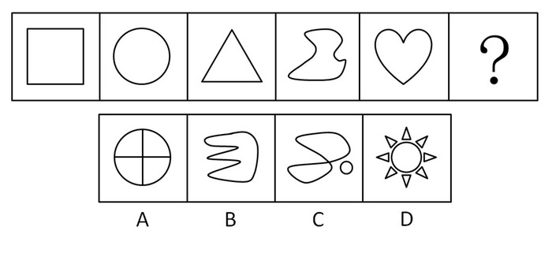

### Options

- A. A

- B. B

- C. C

- D. D

### Answer

B

### Explanation

已知图形的元素组成凌乱，考虑属性或者数量。

观察发现，五个图形均为一个的封闭空间， 即一个面组成，四个选项中只有B项符合此规律。

故正确答案为B。

## Question 92

<!-- hyz-question-id: 01a19c8a-21e8-7470-8f0f-f7cdcaa57f73 -->

```yaml
module: 判断推理
category: null
topics:
- 属性规律-曲直性
materials: []
passage_source: null
issues:
- order_unverified
```

### Stem

请从所给的四个选项中，选择最合适的一个填在问号处，使之呈现一定的规律性：

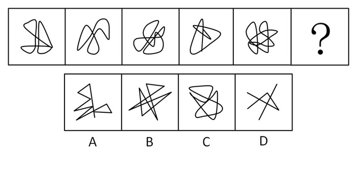

### Options

- A. A

- B. B

- C. C

- D. D

### Answer

C

### Explanation

已知图形的元素组成凌乱，可能考属性，也可能考数量。观察可发现，五个图形均由曲线构成，考属性。四个选项中只有C项中的图形由曲线构成，其他选项中的图形均由直线构成。

故正确答案为C。

## Question 93

<!-- hyz-question-id: 01a19c8a-21e8-7470-8f0f-f7da2f063c02 -->

```yaml
module: 判断推理
category: null
topics:
- 属性规律-开闭性
materials: []
passage_source: null
issues:
- order_unverified
```

### Stem

请从所给的四个选项中，选择最合适的一个填在问号处，使之呈现一定的规律性：

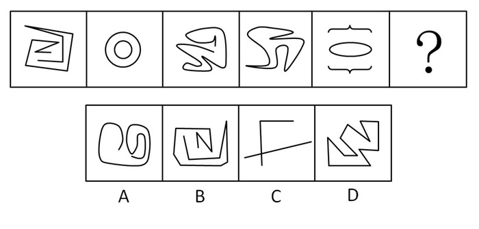

### Options

- A. A

- B. B

- C. C

- D. D

### Answer

D

### Explanation

已知图形的元素组成凌乱，可能考属性也可能考数量。

观察可发现，题干图形依次为开放图形、封闭图形、开放图形、封闭图形、开放图形，可推测下一个图形应为封闭图形。A、B、C三个选项中的图形均为开放图形，D项为封闭图形，符合规律。

故正确答案为D。

## Question 94

<!-- hyz-question-id: 01a19c8a-21e8-7470-8f0f-f7ee1a4d7d45 -->

```yaml
module: 判断推理
category: null
topics:
- 数量规律-素
materials: []
passage_source: null
issues:
- order_unverified
```

### Stem

请从所给的四个选项中，选择最合适的一个填在问号处，使之呈现一定的规律性：

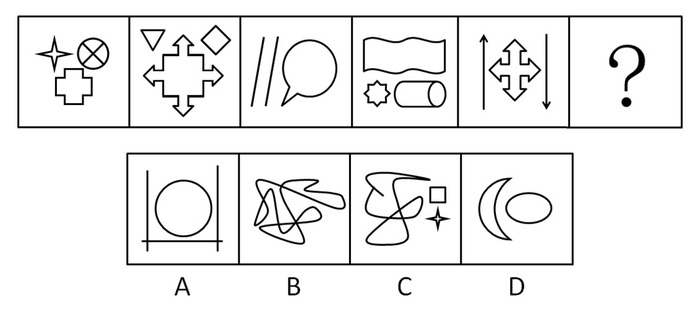

### Options

- A. A

- B. B

- C. C

- D. D

### Answer

C

### Explanation

已知图形的元素组成凌乱，可能考属性也可能考数量。

观察题干图形中的每组图案，发现各组图案均由三个独立的部分构成，符合这种规律的只有C项；A、D项的图案只有两部分；B项只有一部分。

故正确答案为C。

## Question 95

<!-- hyz-question-id: 01a19c8a-21e8-7470-8f0f-f7f1ddbe75c9 -->

```yaml
module: 判断推理
category: null
topics:
- 数量规律-素
materials: []
passage_source: null
issues:
- order_unverified
```

### Stem

请从所给的四个选项中，选择最合适的一个填在问号处，使之呈现一定的规律性：

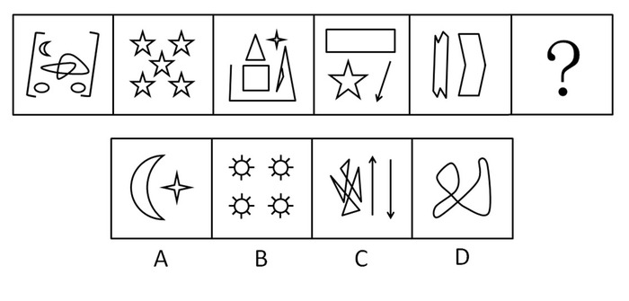

### Options

- A. A

- B. B

- C. C

- D. D

### Answer

D

### Explanation

已知图形的元素组成凌乱，可能考属性也可能考数量。

观察可发现，题干图形从左到右依次由6、5、4、3、2个相互独立的部分组成，可推测下一个图形只有一个独立的部分。四个选项中A项由2个部分组成、B项由4个部分组成、C项由3个部分组成，D项由1个部分组成。

故正确答案为D。

## Question 96

<!-- hyz-question-id: 01a19c8a-21e8-7470-8f0f-f80fbfa41185 -->

```yaml
module: 判断推理
category: null
topics: []
materials: []
passage_source: null
issues:
- order_unverified
```

### Stem

选项四个图形中，只有一个是由题干的四个图形拼合而成的，请把它找出来。

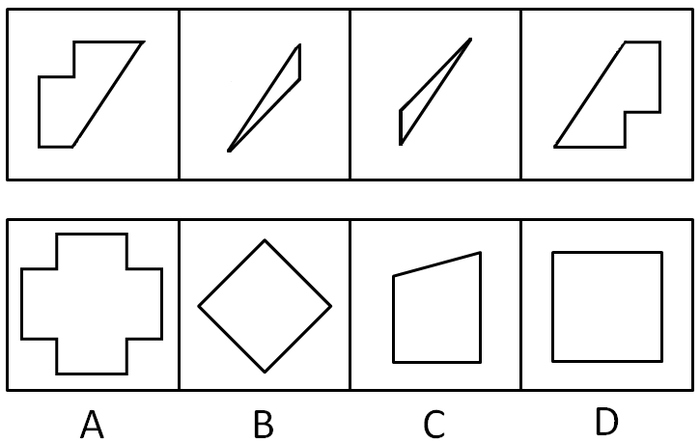

### Options

- A. A

- B. B

- C. C

- D. D

### Answer

A

### Explanation

本题考查拼图。

题目给出的四个图形中，第一个图形构成A项图形的左上部分，第四个图形构成右下部分，第二、三个图形拼接构成了左上部分和左下部分之间的平行四边形。

故正确答案为A。

## Question 97

<!-- hyz-question-id: 01a19c8a-21e8-7470-8f0f-f81e77831f5c -->

```yaml
module: 判断推理
category: null
topics: []
materials: []
passage_source: null
issues:
- order_unverified
```

### Stem

选项四个图形中，只有一个是由题干的四个图形拼合而成的，请把它找出来。

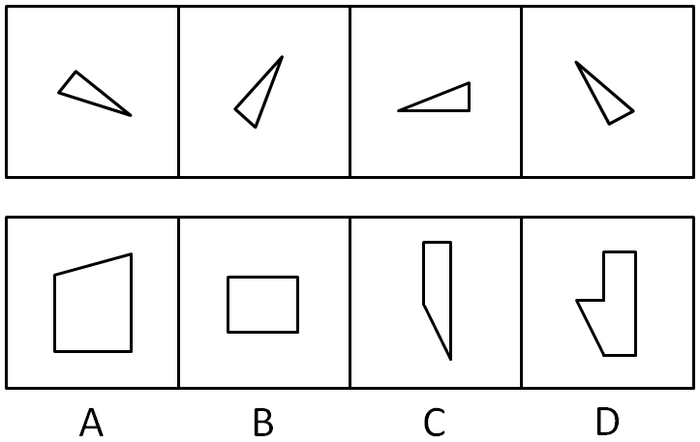

### Options

- A. A

- B. B

- C. C

- D. D

### Answer

B

### Explanation

本题考查拼图。

题目给出的四个图形中，第一个图形和第二个图形构成一个小矩形，第三个图形和第四个图形也构成另一个大小相同的矩形，两个矩形相加，构成B项的图形。

故正确答案为B。

## Question 98

<!-- hyz-question-id: 01a19c8a-21e8-7470-8f0f-f82e94d5b331 -->

```yaml
module: 判断推理
category: null
topics: []
materials: []
passage_source: null
issues:
- order_unverified
```

### Stem

选项四个图形中，只有一个是由题干的四个图形拼合而成的，请把它找出来。

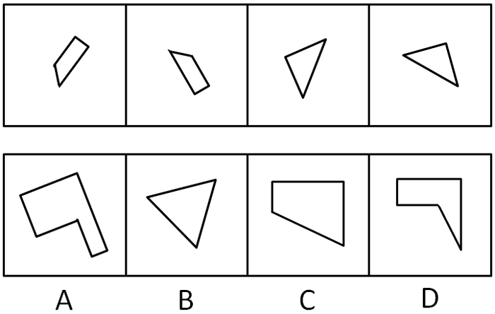

### Options

- A. A

- B. B

- C. C

- D. D

### Answer

A

### Explanation

本题考查拼图。

题目给出的四个图形中，前两个图形的形状一致，大小一致，可构成一个细长的矩形，后两个图形也是大小一致的等边直角三角形，可构成一个正方形。矩形和正方形结合，构成A选项中的图形。

故正确答案为A。

## Question 99

<!-- hyz-question-id: 01a19c8a-21e8-7470-8f0f-f83dd4e336a6 -->

```yaml
module: 判断推理
category: null
topics: []
materials: []
passage_source: null
issues:
- order_unverified
```

### Stem

选项四个图形中，只有一个是由题干的四个图形拼合（只能通过上、下、左、右平移）而成的，请把它找出来。

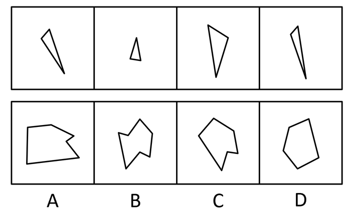

### Options

- A. A

- B. B

- C. C

- D. D

### Answer

C

### Explanation

本题考查拼图。

题目给出的四个图形中，第一、三、四个图形片段组成C项图形中的主干部分，第二个小三角形构成了C项图形右下方的一角。

故正确答案为C。

## Question 100

<!-- hyz-question-id: 01a19c8a-21e8-7470-8f0f-f8429f1083c2 -->

```yaml
module: 判断推理
category: null
topics: []
materials: []
passage_source: null
issues:
- order_unverified
```

### Stem

选项四个图形中，只有一个是由题干的四个图形拼合而成的，请把它找出来。

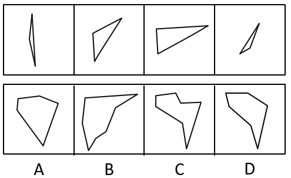

### Options

- A. A

- B. B

- C. C

- D. D

### Answer

B

### Explanation

本题考查平面拼合，可采用平行且等长相消的方式解题。消去平行且等长的线段后进行组合，即可得到轮廓图，即为B选项。平行且等长相消的方式如下图所示：

 

故正确答案为B。

注：本题年份较早，提问方式中没有限制“只能上、下、左、右平移”，故可以凭借旋转和翻转的形式拼合。

## Question 101

<!-- hyz-question-id: 01a19c8a-21e8-7470-8f0f-f85edf18693f -->

```yaml
module: 判断推理
category: null
topics: []
materials: []
passage_source: null
issues:
- order_unverified
```

### Stem

不可能所有的考生都不能通过考试。

据此，可推出：

### Options

- A. 可能有的考生不能通过考试

- B. 必然有的考生能通过考试

- C. 必然所有的考生都能通过考试

- D. 必然所有的考生都不能通过考试

### Answer

B

### Explanation

第一步：翻译题干。利用模态命题的转化规则。

“不可能=必然不”，题干命题等值于“必然不是所有考生都不能通过考试”；

“不是所有=有的不是”，命题等值于“必然有的考生不是不能通过考试”，即“必然有的考生能通过考试”。

第二步：逐一判断选项。

A、C、D三项的说法均无法从题干推出。

故正确答案为B。

## Question 102

<!-- hyz-question-id: 01a19c8a-21e8-7470-8f0f-f860b39f9801 -->

```yaml
module: 判断推理
category: null
topics:
- 日常结论
materials: []
passage_source: null
issues:
- order_unverified
```

### Stem

少数人虽然口头上主张一切人都是平等的，但在实际生活中仍努力追求特权。

据此，可推出：

### Options

- A. 一切人都是平等的

- B. 一切人应是平等的

- C. 有些人在实际生活中努力追求平等

- D. 有些人的言谈与实际行为并不一致

### Answer

D

### Explanation

第一步：抓住题干主要信息。

这句话中的前半句说的是少数人口头上主张一切人都是平等的，后半句说的是这一部分少数人在实际生活中追求特权，即没有追求平等，前、后半句构成反对关系。

第二步：判断整体关系。

少数人口头上的主张和实际生活中的行动不一致。

第三步：逐一判断选项。

A、B两项的说法显然无法在题干中找到依据，排除；

C项，根据题干，“少数人······在实际生活中仍努力追求特权”并不代表“其他大多数人在实际生活中努力追求平等”，不能确定；

故正确答案为D。

## Question 103

<!-- hyz-question-id: 01a19c8a-21e8-7470-8f0f-f8765eec4404 -->

```yaml
module: 判断推理
category: null
topics:
- 常规翻译
materials: []
passage_source: null
issues:
- order_unverified
```

### Stem

企业应事先征询气象预报。因为如果不这样，企业就不会生产出适销对路的产品。

 据此，可推出：

### Options

- A. 如果企业事先征询气象预报，就会生产出适销对路的产品

- B. 企业只有事先征询气象预报，才会生产出适销对路的产品

- C. 企业事先征询气象预报，一定会提高经济效益和社会效益

- D. 因人类认识的局限，目前气象预报的准确率还未达到较高水平

### Answer

B

### Explanation

第一步：翻译题干。根据充分必要条件。

第一句：企业：应事先征询气象预报。

第二句：-事先征询气象预报⇒-生产适销对路的产品。

第二步：逐一翻译选项并判断正确选项，利用逆否规则。

A项，事先征询气象预报⇒生产适销对路的产品，“事先征询”属于否定前件，推理无效；

B项，生产适销对路的产品⇒事先征询气象预报，符合逆否规则；

C项，“提高经济效益和社会效益”与题干论述无关，属于无关选项；

D项，“气象预报的准确率”同样与题干论述无关，属于无关选项。

故正确答案为B。

## Question 104

<!-- hyz-question-id: 01a19c8a-21e8-7470-8f0f-f882d5284211 -->

```yaml
module: 判断推理
category: null
topics:
- 从最大信息开始推
materials: []
passage_source: null
issues:
- order_unverified
```

### Stem

某部队从1、2、3班各抽一名战士举行军事技术比赛。比赛结束后得知：战士甲的成绩比2班战士的成绩好；3班战士的成绩比战士乙的成绩差；战士丙称赞3班战士发挥得好。

据此，可以推出甲、乙、丙3位战士的成绩按从高到低依次排列为：

### Options

- A. 甲、乙、丙

- B. 乙、丙、甲

- C. 丙、甲、乙

- D. 乙、甲、丙

### Answer

D

### Explanation

第一步：找突破口。

本题突破口是信息量最大的对象，即3班战士。由题干“3班战士的成绩比战士乙的成绩差”、“战士丙称赞3班战士发挥得好”可知，3班战士既不是乙也不是丙，因此，3班战士是甲。

第二步：抄信息于表中，即将题干和第一步的所有信息放在一个表中。

人：  甲           乙

      &lt;            &lt;

班级：2班           3班

第三步：填空，即填上每一个集合的空格。

人：（丙）             甲           乙

                      &lt;             &lt;

班级：2班             3班        （1班）

即甲、乙、丙3位战士的成绩按从高到低依次排列为乙、甲、丙。

故正确答案为D。

## Question 105

<!-- hyz-question-id: 01a19c8a-21e8-7470-8f0f-f89be1a253b4 -->

```yaml
module: 判断推理
category: null
topics:
- 常规翻译
materials: []
passage_source: null
issues:
- order_unverified
```

### Stem

如果今年的旱情仍在持续且人们抗旱不力，那么今年的农作物就会减产，并且农民的收入会降低。但是，多项证据表明今年农民的收入不但不会降低，反而会有所提高。

据此，可以推出：

### Options

- A. 今年的旱情仍在持续，且人们抗旱不力

- B. 今年的旱情仍在持续，或人们抗旱不力

- C. 今年的旱情没有持续，或人们抗旱有力

- D. 今年的旱情没有持续，且人们抗旱有力

### Answer

C

### Explanation

第一步：翻译题干。利用充分必要条件。

（旱情仍在持续∧抗旱不力）⇒（农作物减产∧农民收入降低）。

事实信息：－农民收入降低。

第二步：从事实信息开始推导，得出答案。

题干的后件是一个联言命题，只要有一个联言支为假，整个联言命题就为假。已知“－农民收入降低”，可推知“－（农作物减产∧农民收入降低）”，利用逆否规则和摩根规则，可得出“－（农作物减产∧农民收入降低）⇒－（旱情仍在持续∧抗旱不力）⇒－旱情仍在持续∨－抗旱不力”，即旱情没有持续，或人们抗旱有力。

故正确答案为C。

## Question 106

<!-- hyz-question-id: 01a19c8a-21e8-7470-8f0f-f8a1d66092ab -->

```yaml
module: 判断推理
category: null
topics:
- 常规翻译
materials: []
passage_source: null
issues:
- order_unverified
```

### Stem

甲、乙、丙、丁等4人中有一人在最近一次摸彩活动中中了特等奖。现在知道，甲只有在A投注站摸彩，才能中特等奖；如果在A投注站摸彩，那么彩票号码是随机的；如果乙中了特等奖，那么摸彩活动一定是在上午10点后进行的；这次摸彩活动是在上午8点30开始的，只进行了20分钟，并且彩票号码是自编的。

据此，可以推出：

### Options

- A. 甲或乙中了特等奖

- B. 甲和乙中了特等奖

- C. 丙或丁中了特等奖

- D. 丙和丁中了特等奖

### Answer

C

### Explanation

第一步：翻译题干。利用充分必要条件。

① 甲中特等奖⇒在A投注站摸彩；

② 在A投注站摸彩⇒彩票号码是随机的；

③ 乙中特等奖⇒摸彩活动在上午10点后进行；

④ －摸彩活动在上午10点后举行；

⑤ －彩票号码是随机的；

⑥ 有一人中奖

第二步：找突破口。

本题突破口在于题干给出的事实信息。

④为事实信息，根据逆否规则，由③和④可知，乙没有中特等奖；

⑤为事实信息，根据逆否规则，由②和⑤可推知，此次摸彩活动不在A投注站进行，又知①，同样根据逆否规则可得出，甲没有中特等奖；

⑥为事实信息，由上述推论可知，甲、乙都没有中特等奖，又因为只有一人中奖，故中奖者可能是丙、也可能是丁，但不可能是两人都中奖。

故正确答案为C。

## Question 107

<!-- hyz-question-id: 01a19c8a-21e8-7470-8f0f-f8b400223ce0 -->

```yaml
module: 判断推理
category: null
topics:
- 只有一真/一假
materials: []
passage_source: null
issues:
- order_unverified
```

### Stem

某县举行“文明乡镇”评比。4位评委对参评的青莲乡、夏荷乡和芙蓉镇获得“文明乡镇”称号的可能性进行了预测。

评委甲说：“如果青莲乡能获‘文明乡镇’称号，那么夏荷乡和芙蓉镇也能获此称号。”

评委乙说：“如果青莲乡和夏荷乡能获‘文明乡镇’称号，则芙蓉镇肯定不能获此称号。”

评委丙说“不管青莲乡能否获‘文明乡镇’称号，夏荷乡和芙蓉镇都能获此称号是不可能的。”

评委丁说：“我看青莲乡能获‘文明乡镇’称号；但是，如果夏荷乡能获此称号，则芙蓉镇不可能获此称号。”

评比结果揭晓后发现，4位评委中只有一人的预测成立。

据此，可以推出：

### Options

- A. 三个乡镇都能获“文明乡镇”称号

- B. 三个乡镇都不能获“文明乡镇”称号

- C. 青莲乡能获“文明乡镇”称号，夏荷乡和芙蓉镇不能获此称号

- D. 青莲乡不能获“文明乡镇”称号，夏荷乡和芙蓉镇能获此称号

### Answer

A

### Explanation

第一步：翻译题干。

甲：青莲⇒夏荷∧芙蓉；乙：青莲∧夏荷⇒－芙蓉；丙：－夏荷∨－芙蓉；丁：青莲∧（夏荷⇒－芙蓉）。

第二步：找突破口。

甲的矛盾命题：青莲∧\[（—夏荷乡）∨（—芙蓉镇）\]。

丁的等价命题：青莲∧\[（—夏荷乡）∨（—芙蓉镇）\]。

甲的矛盾命题和丁的等价命题一致，所以甲、丁两人的预测存在矛盾，必有一真一假。

第三步：看其他的话。

由于只有一人的预测成立，所以乙、丙的预测为假。由乙的预测“青莲∧夏荷⇒－芙蓉”为假，可知其矛盾命题为真。乙的矛盾命题为“青莲∧夏荷∧芙蓉”，即三个乡镇都能获奖。

故正确答案为A。

## Question 108

<!-- hyz-question-id: 01a19c8a-21e8-7470-8f0f-f8c59382fae1 -->

```yaml
module: 判断推理
category: null
topics:
- 常规翻译
materials: []
passage_source: null
issues:
- order_unverified
```

### Stem

某大学将在赵、钱、孙、李、周、吴6位同学中选拔几位参加全国大学生数学建模竞赛。通过一段时间的训练考查．老师们对这6位同学形成如下共识：

（1）不选拔赵；

（2）或者选拔孙，或者不选拔钱；

（3）如果选拔李，则不选拔周；

（4）赵、钱、周都有可能被选拔出来；

（5）如果不选拔赵，则一定要选拔李；

（6）选拔孙，或者选拔吴。

 据此，可以推出：

### Options

- A. 选拔赵、钱、孙

- B. 选拔钱、孙、李

- C. 选拔孙、李、吴

- D. 选拔李、周、吴

### Answer

B

### Explanation

第一步：翻译题干。

（1）－赵；

（2）孙∨－钱；

（3）李⇒－周；

（4）赵∨钱∨周；

（5）－赵⇒李；

（6）孙∨吴。

第二步：展开推导。

（1）是事实信息，为本题突破口。再根据（5）可推出，李；再由（3），因此可得到－周；根据 －赵 ，－周 和（4）的选言关系可得  钱；又根据（2）知 孙。最后的结论有－赵，李，－周，钱，孙，吴无法判断。

故正确答案为B。

## Question 109

<!-- hyz-question-id: 01a19c8a-21e8-7470-8f0f-f8de17393eca -->

```yaml
module: 判断推理
category: null
topics:
- 排除法
materials: []
passage_source: null
issues:
- order_unverified
```

### Stem

在夏夜星空的某一区域，有7颗明亮的星星：A星、B星、C星、D星、E星、F星、G星，它们由北至南排列成一条直线，同时发现：

    （1）C星与E星相邻；

    （2）B星与F星相邻；

    （3）F星与C星相邻；

    （4）A星在F星的北侧某个位置。

据此，7颗星由北至南的顺序不可能的是：

### Options

- A. A星、B星、F星、C星、E星、D星、G星

- B. A星、B星、F星、C星、E星、G星、D星

- C. A星、E星、C星、B星、F星、D星、G星

- D. A星、E星、C星、F星，B星、G星、D星

### Answer

C

### Explanation

本题选项是每项均给出完整排列组合，所以可用排除法。

根据题干“F星与C星相邻”可以直接找到最不可能的排列顺序是C项。

故正确答案为C。

## Question 110

<!-- hyz-question-id: 01a19c8a-21e8-7470-8f0f-f8ec2c323e98 -->

```yaml
module: 判断推理
category: null
topics:
- 从最大信息开始推
materials: []
passage_source: null
issues:
- order_unverified
```

### Stem

在夏夜星空的某一区域，有7颗明亮的星星：A星、B星、C星、D星、E星、F星、G星，它们由北至南排列成一条直线，同时发现：

    （1）C星与E星相邻；

    （2）B星与F星相邻；

    （3）F星与C星相邻；

    （4）A星在F星的北侧某个位置。

假定G不与B相邻但与最南侧的某星相邻，可以推出位于正中的星是：

### Options

- A. B星

- B. C星

- C. E星

- D. F星

### Answer

B

### Explanation

第一步，找突破口。

本题突破口是信息量最大对象，F星。

由“B星与F星相邻”、“F星与C星相邻”可知，这三颗星的排列顺序为B、F、C或者C、F、B；

由“C星与E星相邻”，可推知这四颗星的排列顺序为B、F、C、E或E、C、F、B；

第二步：根据其他信息推出7颗星的排列顺序。

由“A星在F星的北侧某个位置”可知，A在北侧；

由“G不与B相邻但与最南侧的某星相邻”，可知B、C、E、F四颗星从北到南的排列位置只能是B、F、C、E，才能保证G与B不相邻，又因为G与最南侧的某星相邻，故G位于南侧倒数第二位，某星为D星，位于最南侧。

由此可知，七颗星的排列顺序从北到南依次为A、B、F、C、E、G、D，位于正中的是C星。

故正确答案为B。

## Question 111

<!-- hyz-question-id: 01a19c8a-21e8-7470-8f0f-f8fba97f1a40 -->

```yaml
module: 判断推理
category: null
topics:
- 单定义-其他句式
materials: []
passage_source: null
issues:
- order_unverified
```

### Stem

人才链：指同一种才能的人才连续出现的现象。人才链分为两种，一种叫师徒型人才链，一种叫血缘型（又称家庭型）人才链。

下列属于人才链的是：

### Options

- A. 调查发现，某公司的关键岗位配备的都是公司高层的亲属，他们中的有些人并不具备专业才能

- B. 某集团的用人标准是“志存高远，坚韧踏实”，该集团已经延揽了一批不同类型的优秀人才

- C. 某企业今年招聘软件专业研究生，到目前为止，已经有70余名潜力大的青年才俊先后加入了公司

- D. 江南大族张氏家风严谨，连续几代都出现了著名的文学家

### Answer

D

### Explanation

第一步：抓住定义中的关键词。

定义中的关键词为“同一种才能”，“连续出现”，且人才链分为两种类型，“师徒型”和“血缘型（又称家庭型）”。

第二步：逐一判断选项。

A项中，“他们中有些人并不具备专业才能”，不符合定义；

B项中，集团延揽的是“一批不同类型的优秀人才”，不符合定义；

C项中，加入公司的70余名青年才俊虽然都是同一专业的研究生，但他们是公司今年招聘的，不是“连续出现”的，不符合定义；

D项中，张氏一家连续几代出现著名文学家，属于血缘型人才链。

故正确答案为D。

## Question 112

<!-- hyz-question-id: 01a19c8a-21e8-7470-8f0f-f904f26ff47f -->

```yaml
module: 判断推理
category: null
topics:
- 方式目的
materials: []
passage_source: null
issues:
- order_unverified
```

### Stem

再造工程：指为了改善成本、质量、服务、速度等现代企业的重大运营基准，对工作流程进行根本性重新思考并彻底改革，重新设计企业的管理和运营方式。

下列属于再造工程的是：

### Options

- A. 随着生活水平的不断提高，顾客对企业的产品和服务有了更高的要求

- B. 越来越多的跨国公司越出国界，在走向一体化的全球市场上展开各种形式的竞争

- C. 某企业将现在的数项业务合并调整，提出多个流程改进方案，要求从成本、效益、技术条件和风险程度等方面进行评估，给予职工参与决策的权力

- D. 市场需求日趋多变，产品寿命周期的单位已由“年”趋于“月”，技术进步使企业的生产、服务系统经常变化

### Answer

C

### Explanation

第一步：抓住定义中的关键词。

定义中的关键词为“为了改善成本、质量、服务、速度等”重大运营基准，重新思考并彻底改革“工作流程”，重新设计“管理和运营方式”。注意该定义中的主体是“企业”。

第二步：逐一判断选项。

A项的主体是“顾客”，显然不符合定义；

B项指的是公司展开各种形式的竞争，没有谈及“工作流程”及“管理和运营方式”等内容，不符合定义；

C项，某企业“从成本、效益、技术条件和风险程度等方面进行评估”，“提出流程改进方案”，给予职工决策权，符合定义；

D项中，企业变化的是生产、服务系统，变化原因是技术进步，与定义不符。

故正确答案为C。

## Question 113

<!-- hyz-question-id: 01a19c8a-21e8-7470-8f0f-f91a8b5b0dac -->

```yaml
module: 判断推理
category: null
topics:
- 拆词
materials: []
passage_source: null
issues:
- order_unverified
```

### Stem

边塞诗：指以军旅生活或边塞生活经历为题材，主要表现边塞风光、边疆战士艰苦生活、将士杀敌报国和建功立业的抱负、边疆将士思乡情思等主题。

下列不属于边塞诗的是：

### Options

- A. 闻道黄龙戍，频年不解兵。可怜闺里月，长照汉家营。少妇今春意．良人昨夜情。谁能将旗鼓，一为取龙城。——沈佺期《杂诗》

- B. 折戟沉沙铁未销，自将磨洗认前朝。东风不与周郎便，铜雀春深锁二乔。——杜牧《赤壁》

- C. 回乐峰前沙似雪，受降城外月如霜。不知何处吹芦管，一夜征人尽望乡。——李益《夜上受降城闻笛》

- D. 火山五月行人少，看君马去疾如鸟。都护行营太白西，角声一动胡天晓。一一岑参《武威送刘判官赴碛西行军》

### Answer

B

### Explanation

第一步：判断定义中的关键词。

边塞诗的题材为“军旅生活或边塞生活”、表现的主题包括“边塞风光”、“边疆战士艰苦生活”、“将士杀敌报国和建功立业的抱负”、“边疆将士思乡情思”等。

第二步：逐一判断选项。

A、C、D三项中均有明显的字眼表明该诗为边塞诗：A项，“频年不解兵”、“汉家营”、“将旗鼓”、“取龙城”；C项，“受降城外”、“一夜征人尽望乡”；D项，“都护行营”、“角声”、“胡”；

B项，杜牧的《赤壁》是以赤壁之战为题材，抒发了诗人对历史变迁的感叹，属于怀古诗而非边塞诗。

故正确答案为B。

## Question 114

<!-- hyz-question-id: 01a19c8a-21e8-7470-8f0f-f9224aa804e7 -->

```yaml
module: 判断推理
category: null
topics:
- 方式目的
materials: []
passage_source: null
issues:
- order_unverified
```

### Stem

同伴教育：指利用年龄相仿、知识背景和兴趣爱好相近的同伴、朋友的意见和建议容易被采纳的特点来进行相关教育的手段。

下列属于同伴教育的是：

### Options

- A. 有着四年吸毒史的小王，在成功戒毒后被聘为戒毒中心的义务辅导员

- B. 这次晚会在大学校园举行，主办方特地请来了很多青年人喜欢的年轻艺人

- C. 韩寒的书在校园中销量非常好

- D. “粉丝”对偶像言听计从

### Answer

A

### Explanation

第一步：抓住定义中的关键词。

同伴教育首先是一种“教育手段”，这种教育手段利用的是“年龄相仿、知识背景和兴趣爱好相近的同伴、朋友的意见和建议”。

第二步：逐一判断选项。

A项，小王有过吸毒和成功戒毒经历，这种经历能够让其他在戒毒中心戒毒的人接受他给的意见或建议，所以把他聘为戒毒中心的义务辅导员来教育其他戒毒者，符合定义；

B项是举行晚会，跟“进行相关教育”无关，不符合定义；

C项说的是韩寒的书的销量好这一事实，跟“教育手段”无关，不符合定义；

D项中“粉丝”对偶像言听计从，同样跟教育无关，不符合定义。

故正确答案为A。

## Question 115

<!-- hyz-question-id: 01a19c8a-21e8-7470-8f0f-f93657b3337d -->

```yaml
module: 判断推理
category: null
topics:
- 主客体
materials: []
passage_source: null
issues:
- order_unverified
```

### Stem

集体谈判：指贷方代表和员工代表就工资、劳动时间以及劳动条件等进行的面对面的谈判。

下列属于集体谈判的是：

### Options

- A. 2008年，法国地铁司机举行罢工游行，要求增加工资和休息时间

- B. 某纺织工厂的领导听取工会主席的建议，决定定期向职工提供体检服务

- C. 某皮革厂选出工人代表就改善工作条件等问题与工厂老板进行面谈

- D. 小区住户联名写信要求物业公司降低物业管理费

### Answer

C

### Explanation

第一步：抓住定义中的关键词。

集体谈判的方式是“面对面的谈判”，谈判的参与者是“贷方代表和员工代表”，谈判的内容是“工资、劳动时间以及劳动条件等”。

第二步：逐一判断选项。

A项是通过罢工游行的方式来要求增加工资和休息时间，不是“面对面的谈判”，不符合定义；

B项的参与者是“工厂的领导”和“工会主席”，而非“员工代表”，双方并非谈判，而是领导听取建议，涉及的内容跟“工资、劳动时间以及劳动条件等”无关，不符合定义；

C项中的参与者是“工人代表”和“工人老板”，谈判方式是“面谈”，面谈的内容是“改善工作条件”，符合定义；

D项中涉及的参与者、参与方式跟谈判内容均不符合定义。

故正确答案为C。

## Question 116

<!-- hyz-question-id: 01a19c8a-21e8-7470-8f0f-f94fa4cd97ac -->

```yaml
module: 判断推理
category: null
topics:
- 特殊问法
materials: []
passage_source: null
issues:
- order_unverified
```

### Stem

定义:

 ①流转课税：指以流转额为课税对象的税类。

 ②所得课税：指以所得额为课税对象的税类。

 ③财产课税：指以法人和自然人拥有和归其支配的财产为课税对象的税类。

典型例证：

（1）王女士自购了一套别墅，她每月需要支付每平方米5元的物业管理费。

（2）刘先生抽奖中了一台汽车，但他必须缴纳2.5万元的税费之后才能获得这辆车。

（3）服务行业销售货物的增值税起征点将由5000元提高到1万元。

上述典型例证与定义存在对应关系的数目有：

### Options

- A. 0个

- B. 1个

- C. 2个

- D. 3个

### Answer

C

### Explanation

第一步：判断每个定义中的关键词。

流转课税：课税对象为“流转额”；

所得课税：课税对象为“所得额”；

财产课税：课税对象为“以法人和自然人拥有的和归其支配的财产”。

第二步：逐一判断例证。

例证（1）：王女士支付的物业管理费不属于流转额、所得额或个人财产，不符合任一定义；

例证（2）：刘先生抽中的汽车属于自然人拥有的和归其支配的财产，他缴纳的2.5万元税费与财产课税的定义对应；

例证（3）：服务行业销售货物需要缴纳的增值税属于流转税类，与流转课税的定义对应。

综上所述，有2个典型例证与定义存在对应关系。

故正确答案为C。

## Question 117

<!-- hyz-question-id: 01a19c8a-21e8-7470-8f0f-f950d6eb9121 -->

```yaml
module: 判断推理
category: null
topics:
- 特殊问法
materials: []
passage_source: null
issues:
- order_unverified
```

### Stem

定义：

①抽象：指从许多事物中，舍弃个别的、非本质的属性，抽出共同的、本质的属性的过程。

②限制：指从属概念过渡到种概念的过程．表现为内涵增加，外延减少。

③概括：指从种概念过渡到属概念的过程，表现为内涵减少，外延增加。

典型例证：

（1）苹果、香蕉、黄梨、葡萄、桃子等，都含有丰富的维生素。

（2）做人难，做女人更难，做单身的名女人难上加难。

（3）鲸尽管生活在水里，并且体形似鱼，但是它属于哺乳动物。

上述典型例证与定义存在对应关系的数目有：

### Options

- A. 0个

- B. 1个

- C. 2个

- D. 3个

### Answer

D

### Explanation

第一步：抓住每个定义中的关键词。

抽象：从多个事物中抽出“共同的、本质的属性”的过程；

限制：概念内涵增加；

概括：概念外延增加。

第二步：逐一判断例证。

例证（1）：苹果、香蕉、黄梨、葡萄、桃子是不同的水果，但它们具有共同的特点，都“含有丰富的维生素”，与“抽象”的定义对应；

例证（2）：从“人”到“女人”到“单身的名女人”，这几个概念的内涵在不断增加，与“限制”的定义对应；

例证（3）：鲸体形似鱼，但它属于哺乳动物。从“鱼”到“哺乳动物”，概念的外延增加，与“概括”的定义对应。

故正确答案为D。

## Question 118

<!-- hyz-question-id: 01a19c8a-21e8-7470-8f0f-f96aeddbd36a -->

```yaml
module: 判断推理
category: null
topics:
- 特殊问法
materials: []
passage_source: null
issues:
- order_unverified
```

### Stem

定义：

①感动：思想感情受外界事物的影响而激动。

②感叹：有所感触而叹息。

③意会：指个体不需明说而领会某种意思。

典型例证：

（1）国歌声响起，所有的观众都神情激动地跟着音乐大声地唱起来。

（2）忽如一夜春风来，千树万树梨花开。

（3）老师郑重地对我说：做人一定要诚实。

上述典型例证与定义存在对应关系的数目有：

### Options

- A. 0个

- B. 1个

- C. 2个

- D. 3个

### Answer

C

### Explanation

第一步：找出定义关键词。

感动：“思想感情受外界事物的影响而激动”；

感叹：“有所感触而叹息”；

意会：“不需明说而领会某种意思”。

第二步：逐一分析选项。

例证（1）：国歌响起后，观众受其影响，神情激动地跟着音乐一起唱，符合“思想感情受外界事物的影响而激动”，符合“感动”的定义；

例证（2）：“忽如一夜春风来，千树万树梨花开”出自唐代诗人岑参所写的《白雪歌送武判官归京》，是作者看到塞外大雪后发出的感慨，符合“有所感触而叹息”，符合“感叹”的定义；

例证（3）：“老师郑重地对我说：做人一定要诚实”是直接的言语告诫，表达明确，属于“明说”，不符合“不需明说而领会某种意思”，不符合“意会”的定义；这句话本身是教育性陈述，并未体现听者或说话人因外界事物影响而产生激动的情绪，也并未流露出感慨或叹息的情感色彩，不符合“思想感情受外界事物的影响而激动”，也不符合“有所感触而叹息”，不符合“感动”和“感叹”的定义。

综上，上述典型例证与定义存在对应关系的数目有2个。

故正确答案为C。

## Question 119

<!-- hyz-question-id: 01a19c8a-21e8-7470-8f0f-f97cfec56a81 -->

```yaml
module: 判断推理
category: null
topics:
- 特殊问法
materials: []
passage_source: null
issues:
- order_unverified
```

### Stem

定义：

①级差地租：指租佃较好土地的生产者向土地所有者缴纳的超额利润。

②绝对地租：指由于土地私有权的存在，租种任何土地都必须缴纳的地租，即土地所有者凭借土地私有权的垄断所取得的地租。

③垄断地租：级差地租和绝对地租以外的一种特殊的地租形态。它只存在于少量自然条件特别有利的土地上。

典型例证：

（1）即使是自己承包土地中的稀有矿产资源也归国家所有。

（2）即使是土地肥力相同、产量相同的地块，由于距市场远近不同，其租赁费用也会有所差异。

（3）土地所有者对于他的土地，不论是优等地还是劣等地，总要取得一定的地租，否则，他宁愿让土地长期闲置，也不肯让别人无偿使用。

上述典型例证与定义存在对应关系的数目有：

### Options

- A. 0个

- B. 1个

- C. 2个

- D. 3个

### Answer

C

### Explanation

第一步：抓住每个定义中的关键词。

级差地租：租佃的是“较好土地”，生产者向土地所有者缴纳“超额利润”；

绝对地租：“必须缴纳的地租”；

垄断地租：“一种特殊的地租形态”，“只存在于少量自然条件特别有利的土地上”。

第二步：逐一判断例证。

例证（1）：所谈内容与地租无关，不符合任一定义；

例证（2）：土地“租赁费用”会因为“市场远近不同”而存在“差异”，与“级差地租”的定义对应；

例证（3）：无论土地是“优等地还是劣等地”，总要收取“一定的地租”，和“绝对地租”的定义对应。

故正确答案为C。

## Question 120

<!-- hyz-question-id: 01a19c8a-21e8-7470-8f0f-f98d355bc667 -->

```yaml
module: 判断推理
category: null
topics:
- 特殊问法
materials: []
passage_source: null
issues:
- order_unverified
```

### Stem

定义：

①爬山法：指经过评价当前的问题状态后，限于条件，不是去缩小，而是去增加这一状态与目标状态的差异，经过迂回前进，最终达到解决问题的总目标。

②降维法：指在解决问题过程中，根据问题需要，利用特定观察角度降低维数，化繁为简，化面为点，从而使研究的对象更为直观、求解过程更为简捷的方法。

③陡度法：指在解决问题过程中，选好几个点，分别找准特点，然后对差异悬殊的进行比照，看看哪一个最“陡”，从而使研究对象的特点更为显著的方法。

典型例证：

（1）以前，小张天天游泳，他的颈椎病没有好，后来，他天天爬山，结果颈椎病好了。

（2）某公司以前实行过程管理，现在该公司实行目标管理。

（3）某化工厂为解决问题，先选了一个角度做了两个实验，随后立刻转到相关的另一个角度又做了两个实验。发现第二次的一个实验特好，而第一次的一个实验特差。在这种情况下再把特好、特差的合起来做了一个试验，结果终于发现了问题的症结所在。

上述典型例证与定义存在对应关系的数目有：

### Options

- A. 0个

- B. 1个

- C. 2个

- D. 3个

### Answer

C

### Explanation

第一步：抓住每个定义中的关键词。

爬山法：通过“增加当前状态和目标状态的差异”，“迂回”解决问题；

降维法：通过“降低维数”、“化繁为简”、“化面为点”的方式解决问题；

陡度法：通过“选点”、比照“差异悬殊的点”、“使研究对象的特点更为显著”的方法解决问题。

第二步：逐一判断例证。

例证（1）：小张从“天天游泳”改为“天天爬山”，治好颈椎病，这个过程不涉及增加差异、降低维度或比照差异点，无法与上述任一定义对应；

例证（2）：从以注重“过程”的过程管理方式转变成以“目标”为导向的目标管理方式，降低了管理过程中的维数，与“降维法”的定义对应；

例证（3）：化工厂“先选一个角度”、随后转到相关的“另一个角度”，对这两个角度进行对比找到问题的症结，与“陡度法”的定义对应。

故正确答案为C。

## Question 121

<!-- hyz-question-id: 01a19c8a-21e8-7470-8f0f-f9965e017791 -->

```yaml
module: 言语理解与表达
category: null
topics:
- 分述句特征-其他
materials: []
passage_source: null
issues:
- order_unverified
```

### Stem

科学精神就是怀疑、批判和不断自我扬弃的精神。科学思维方式的长处也许就在于其具有内在的纠错机制。人类的认识史不仅是不断推进未知到已知的过程，也是不断试错纠错的过程；它不仅需要丰富知识宝库的劳作，而且需要清除库存赝品的智慧和勇气。

下列说法概括主旨最准确的是：

### Options

- A. 科学精神的内涵

- B. 人类认识史的发展规律

- C. 内在纠错机制的产生过程

- D. 人类不断推进未知到已知

### Answer

A

### Explanation

据提问“概括主旨”可以判断出本题属于中心理解题。

阅读可知，材料整体上为总—分结构。句首“科学精神就是怀疑······”已点题，后面“科学的思维方式”、“人类认知史”都是针对科学精神的进一步阐述。

B项提到的“发展规律”也是为了阐述科学精神的表现。

选项中C、D都过于片面。

故正确答案为A。

## Question 122

<!-- hyz-question-id: 01a19c8a-21e8-7470-8f0f-f9a276d12ba6 -->

```yaml
module: 言语理解与表达
category: null
topics:
- 关联词-并列
materials: []
passage_source: null
issues:
- order_unverified
```

### Stem

不同利益群体的特定体制中所受束缚与保护的程度是不同的，相对而言，束缚少而保障多的群体会觉得体制公平，反之会觉得不公平进而要求变革。转轨过程的情况与此类似，某个群体摆脱的束缚多于失去的保障，甚至是只摆脱束缚而不失去保障，他们会拥护改革并认为它公平；相反，摆脱束缚少而失去保障多的，他们就会认为不公平而有可能反对改革。

下列说法概括主旨最准确的是：

### Options

- A. 改革有时会造成对某些群体的不公平

- B. 改革应该对所有群体公平一致

- C. 不同的利益群体不可能全都支持改革

- D. 是否支持改革与不同的利益群体相关

### Answer

C

### Explanation

据提问知本题属于中心理解题。

在两个并列结构中（不同利益群体受束缚与保护程度以及转轨过程）都出现了并列关联词“反之”、“相反”。在每一个结构中都明确阐述了束缚与保障的程度不同导致群体对改革的态度（是否公平进而是否支持）不同。

这就是在说明“改革不可能满足所有群体的利益”，即C项正确。

A项表述片面；B项在材料中没有体现；D项“相关”过于模糊，予以排除。

故正确答案为C。

## Question 123

<!-- hyz-question-id: 01a19c8a-21e8-7470-8f0f-f9b1eac36f1c -->

```yaml
module: 言语理解与表达
category: null
topics:
- 分述句特征-引入铺垫
materials: []
passage_source: null
issues:
- order_unverified
```

### Stem

人类的未知领域并非一个闭合的圆圈，而可能是在许多维度上呈开放型的无限空间。人类知识的积累，实际上是在这个无限空间里不断向更广阔更深邃处延伸的过程。无论对人类全体还是对每个个体而言，知识的增长都意味着所知更多、面临的未知领域更大。

这段话主要想说明的是：

### Options

- A. 人类永远面临知识贫乏的困境

- B. 人类应该努力丰富知识宝库

- C. 人类永远面对探索未知的挑战

- D. 人类应该更加敬畏求知领域

### Answer

C

### Explanation

据“主要想说明”判断本文属于中心理解题。前两句都在描述人类认知过程的规律或者状态，最后总结出“人类所知更多未知更大”这个结论。

这个分总结构明显说明“人类将永远面对未知”，C项正确。

A项、D项中“困境”和“敬畏”的意思题目中并未涉及；B项知识宝库的丰富是自然的，而不是“建议”，重要的还是探讨“未知领域”如何面对。

故正确答案为C。

## Question 124

<!-- hyz-question-id: 01a19c8a-21e8-7470-8f0f-f9cb0619e410 -->

```yaml
module: 言语理解与表达
category: null
topics:
- 细节判断题
materials: []
passage_source: null
issues:
- order_unverified
```

### Stem

韩国一生物学研究小组发现，激活在动脉血管细胞中发现的Ref一1蛋白质，能够阻止引发内膜增生和动脉硬化的活性氧的形成。内膜增生是指动脉血管内壁的增生和变厚，这不仅会影响正常的血液流动，严重的甚至会危及生命。据说，这是研究人员第一次发现Ref一1蛋白质和动脉硬化之间的联系。

关于“Ref一1蛋白质”，目前已知的是：

### Options

- A. 为韩国科研人员首次发现

- B. 被动脉血管细胞所激活

- C. 可以阻断动脉内膜的增生

- D. 将有助于治疗动脉硬化

### Answer

C

### Explanation

据提问知本题属于细节判断题。

题干中陈述了对于Ref一1蛋白质与动脉硬化之间的关系。

已知确定性的结论通过文段中“能够阻止引发内膜增生和动脉硬化的活性氧的形成”一句，可以得知C项表述正确。

A项“首次发现”题目中并未提及；B项“被激活”主体错误，Ref一1蛋白质在动脉血管细胞内部，是人为激活而非动脉血管激活；D项“有助治疗”证据并不充分，题目仅是发现了二者的联系，还没有谈到治疗。

故正确答案为C。

## Question 125

<!-- hyz-question-id: 01a19c8a-21e8-7470-8f0f-f9d547261f63 -->

```yaml
module: 言语理解与表达
category: null
topics:
- 关联词-并列
materials: []
passage_source: null
issues:
- order_unverified
```

### Stem

所谓“建筑艺术”指的只是建筑的“艺术性”，单纯就此而言，与绘画、雕塑、音乐、舞蹈等纯艺术的“艺术性”相较，有时并不在其下，甚至还可能超过而且不可替代。但除了纪念碑、纪念塔、凯旋门等极个别者几乎可以视同为雕塑那样的纯艺术以外，建筑多具有实用功能，不能与其他纯艺术作品简单混同。

这段话主要阐明的是：

### Options

- A. 建筑艺术与纯艺术有差异

- B. 建筑兼具艺术性和实用性

- C. 建筑中只有部分是纯艺术

- D. 建筑艺术具有不可替代性

### Answer

B

### Explanation

第一句首先明确了“建筑具有艺术性”，其后的转折词“但”表达了建筑还具有实用功能。整个文段都在围绕“建筑”进行论述，主要说明建筑既有“艺术性”又有“实用性”，B项符合文意。A、D两项主体为建筑艺术，与文段不符；C项，文段重点并非分析哪些建筑是纯艺术。

故正确答案为B。

## Question 126

<!-- hyz-question-id: 01a19c8a-21e8-7470-8f0f-f9e212e2060e -->

```yaml
module: 言语理解与表达
category: null
topics:
- 细节判断题
materials: []
passage_source: null
issues:
- order_unverified
```

### Stem

居民点用地不同于一般的自然土地，具有很大的使用价值和级差收益。一般来说，工业用地的价值为农业用地的100倍，商业用地的价值又为工业用地的100倍。我国城市建成区面积为12900平方公里，占国土面积的0.134％，据估计平均每平方公里城市土地提供产值70万元。

下列说法符合文意的是（    ）

### Options

- A. 我国城市建成区占国土面积不足千分之一

- B. 商业用地的价值约为农业用地的一万倍

- C. 城市居民点用地价值超过工业用地

- D. 每平方公里城市土地的价值为70万元

### Answer

B

### Explanation

本题属于细节判断题。需要代入原文，逐一比对。

A项，对应“我国城市建成区面积为12900平方公里，占国土面积的0.134％”，0.134％已经超过了千分之一，故A项错误。

B项，对应由“一般来说，工业用地的价值为农业用地的100倍，商业用地的价值又为工业用地的100倍”，所以“商业用地的价值约为农业用地的一万倍”表述正确。故B项正确。

C项，属于无中生有，文段并没有比较城市居民点用地价值和工业用地，故C项错误。

D项，偷换概念，“据估计平均每平方公里城市土地提供产值70万元”是“产值”而非“价值”，故D项错误。

故正确答案为B。

## Question 127

<!-- hyz-question-id: 01a19c8a-21e8-7470-8f0f-f9f79f4ffb74 -->

```yaml
module: 言语理解与表达
category: null
topics:
- 实词
materials: []
passage_source: null
issues:
- order_unverified
```

### Stem

在一个给定时刻，每个国家的资本、劳动力和资源等禀赋是给定的。发展中国家和发达国家的禀赋有着本质上的差异，发达国家的资本和人力资本积累了数百年，劳动力相对稀缺，所以适合发展资本和技术密集型产业。发展中国家的富裕要素是劳动力和土地，所以有竞争力的产业应该是劳动密集型和土地密集型的。

文中所谓“禀赋”，指的是：

### Options

- A. 劳动力的才能

- B. 劳动力的素质

- C. 一国的资本和自然资源

- D. 一国发展经济的先天条件

### Answer

D

### Explanation

据提问方式可知本题为词语理解题。

文段中将发达国家与发展中国家不同的发展情况进行了对比，提出适合发展什么产业与劳动力和土地的情况密切相关，而劳动力和土地的情况是国家先天形成的，应该是“禀赋”的题中之义。

本题应该选D项。

A项、B项劳动力的素质和才能题干并未涉及；C项自然资源题干也并未提及，予以排除。

故正确答案为D。

## Question 128

<!-- hyz-question-id: 01a19c8a-21e8-7470-8f0f-fa08e141a140 -->

```yaml
module: 言语理解与表达
category: null
topics:
- 关联词-转折
materials: []
passage_source: null
issues:
- order_unverified
```

### Stem

旱情如此严重的元凶固然是气候，但这也足以说明当前灌溉能力之脆弱。影响气候可能尚非人力所及，以灌溉为主的抗旱能力却是可以增强的。比如以色列，由于政府的重视和支持，在沙漠和荒丘为主的土地上实现了粮食基本自给，还出口大量的农副产品。

这段话主要说明的是：

### Options

- A. 干旱的原因主要不是气候恶劣

- B. 旱情严重不能完全归咎于气候

- C. 以色列农业灌溉能力非常强

- D. 提高抗旱能力依靠政府重视扶持

### Answer

B

### Explanation

本题据“主要说明”可知属于中心理解题。

句首提到“气候是元凶”，转折词“但”表明抗旱能力弱也是导致旱情的因素。后面两句,特别是以色列政府的例子意在表明人为措施也是可以影响旱情的。这表明旱情并不能完全归咎于气候。

B项是正确答案。

C项、D项提到的都是事例而非主旨；A项曲解文意，文中明确说到“旱情的元凶就是气候”。

故正确答案为B。

## Question 129

<!-- hyz-question-id: 01a19c8a-21e8-7470-8f0f-fa174dd687de -->

```yaml
module: 言语理解与表达
category: null
topics:
- 细节判断题
materials: []
passage_source: null
issues:
- order_unverified
```

### Stem

古代汉语单音节词占优势，现代汉语的双音节词则要丰富得多。根据对使用频率最高的8000个现代汉语常用词的统计，其中双音节词占71％，单音节词占26%，三个音节以上的词占3％。不过，就日常口语而言，单音节词的使用频率仍然大大高于双音节词，前者的使用频率为61％，后者只有37％。

下列说法符合文意的是：

### Options

- A. 双音节词只是出现在现代汉语中

- B. 日常口语使用的词不是常用词

- C. 汉语词从古到今都是以单音节词为主

- D. 现代口语使用仍以单音节词为主

### Answer

D

### Explanation

据提问可知此题属于细节判断题。

本题要注意关键词“不过”，转折后“就日常口语而言，单音节词的使用频率仍然大大高于双音节词”说明单音节词主要在口语中使用。

符合D项的表述。

A项“只是出现在现代汉语”与题目中“古代汉语单音节占优势”矛盾；B项表述在材料中并未体现；C项与题目现代汉语“双音节词占71%”矛盾。

故正确答案为D。

## Question 130

<!-- hyz-question-id: 01a19c8a-21e8-7470-8f0f-fa2ce8086660 -->

```yaml
module: 言语理解与表达
category: null
topics:
- 细节判断题
materials: []
passage_source: null
issues:
- order_unverified
```

### Stem

研究人员发现，海鞘可以根据所在群体环境的性别比例改变生殖细胞的特性，当雌海鞘发现周围有过多的雄海鞘时，它排出的卵细胞会变得很小，这样的卵子被海鞘精子发现的几率就大为下降，因为假如过多精子与同一个卵子结合就会导致卵子死亡。

雌海鞘的“卵细胞变得很小”，其目的是：

### Options

- A. 使海鞘精子无法发现

- B. 改变生殖细胞的特征

- C. 借以保护受精卵存活

- D. 改变环境的性别比例

### Answer

C

### Explanation

据提问知此题属于细节判断题。前提条件是“卵细胞变得很小”，导致的结果可以从最后一句推断出如下因果关系：卵细胞小——被精子发现几率小——多精子与一个卵子结合容易死亡。这就是说卵细胞小，受精卵存活几率大。

所以C为正确答案。

D项表述错误，改变的是生殖细胞特性而非环境性别；B项“改变生殖细胞特性”本身就是指“卵细胞变小”；A项“无法发现”文中也没有提及。

故正确答案为C。

## Question 131

<!-- hyz-question-id: 01a19c8a-21e8-7470-8f0f-fa3a8666d4fc -->

```yaml
module: 言语理解与表达
category: null
topics: []
materials:
- M1
passage_source: null
issues:
- order_unverified
```

### Stem

研究人员主要研究的是：

### Options

- A. 癌症转移的侵犯内渗阶段

- B. 癌症转移的繁衍阶段

- C. 癌症转移的外渗循环阶段

- D. 癌症转移的形成阶段

### Answer

A

### Explanation

此题为中心理解题。

文章主要讨论关于癌症转移机制的问题，即发现了Twist基因，阐述了其转移的生物学原理。材料中第二段“此前这方面的研究都是将癌细胞注射入循环系统中，如此便缺少了与侵犯和内渗作用相关的基因研究”，“缺少”表明新的研究补齐了此前的欠缺，即对“侵犯”和“内渗”作用的研究。

A项正确。

B项“繁衍”、C项“外渗“、D项“形成”均不是“早期相关的研究”，予以排除。

故正确答案为A。

## Question 132

<!-- hyz-question-id: 01a19c8a-21e8-7470-8f0f-fa4b6230a2d1 -->

```yaml
module: 言语理解与表达
category: null
topics: []
materials:
- M1
passage_source: null
issues:
- order_unverified
```

### Stem

关于Twist，下列说法不符合文意的是：

### Options

- A. 引发细胞移动及组织重组

- B. 抑制某种细胞黏附作用

- C. 降低癌细胞的转移能力

- D. 引起上皮细胞的上皮—间质转化

### Answer

C

### Explanation

此题属于细节判断题。

C项表述有误，Twist的作用是提高癌细胞的转移能力，而并非降低。

关键词Twist在第三段中提及“肩负着引发细胞移动以及组织重组的任务”。故A项表述符合文意；由第四段“Twist会使由钙黏附素E所调控的细胞黏附作用失效，产生上皮细胞的上皮——间质转化”一句可知B项、D项表述也符合文意。

本题为选非题，故正确答案为C。

## Question 133

<!-- hyz-question-id: 01a19c8a-21e8-7470-8f0f-fa545a0facaf -->

```yaml
module: 言语理解与表达
category: null
topics: []
materials:
- M1
passage_source: null
issues:
- order_unverified
```

### Stem

所谓“经过循环系统之旅洗礼的幸存者”，指的是：

### Options

- A. 完成了“内渗”的残存癌细胞

- B. 抑制了癌细胞“内渗”的淋巴组织

- C. 阻挡了癌细胞“外渗”的血管组织

- D. 完成了“外渗”的多余癌细胞

### Answer

A

### Explanation

此题属于词句理解题。

第一自然段就提到了通过内渗之后的癌细胞会继续外渗，也就是完成了“内渗”的残存癌细胞的意思，A项正确。

B项表述有误，并非是一种淋巴组织；C项表述有误，并非是血管组织；D项表述有误，并非完成“外渗”，而是完成“内渗”之后的癌细胞参与“外渗”的过程。

故正确答案为A。

## Question 134

<!-- hyz-question-id: 01a19c8a-21e8-7470-8f0f-fa6fa364289d -->

```yaml
module: 言语理解与表达
category: null
topics: []
materials:
- M1
passage_source: null
issues:
- order_unverified
```

### Stem

下列说法符合文意的是：

### Options

- A. 与胚胎发育相关的转录因子引起癌转移

- B. 科研人员找到了可以阻止癌症转移的基因

- C. Twist在胚胎发育和癌细胞转移中表现相似

- D. 筛检人体基因可及早发现癌症

### Answer

D

### Explanation

此题为细节判断题。

D项表述正确，通过文中最后一段“或者可以借由筛检这些基因，及早发现肿瘤的未来走向”一句得出。

文中第五自然段中“可能是由于唤醒了身体中沉睡已久的、负责胚胎早期形态发育的基因”一句，可知这一推断仅仅是“一种可能性”，并非确定性结论，因此A项表述过于肯定和绝对，不符合文意；B项也是同样的错误，由文中最后一段“也许能开发药物以抑制Twist这类基因的表现”一句可知B项表述过于绝对，并非已经找到的意思，也不符合文意；C项表述有误，文中并没有相对应的语句，因此属于无中生有。

故正确答案为D。

## Question 135

<!-- hyz-question-id: 01a19c8a-21e8-7470-8f0f-fa788b9320de -->

```yaml
module: 言语理解与表达
category: null
topics: []
materials:
- M1
passage_source: null
issues:
- order_unverified
```

### Stem

文章内容可以概括为：

### Options

- A. 科研人员的最新研究成果

- B. 如何阻断癌症转移的路径

- C. 癌症转移可在早期就被发现

- D. 发现与癌症转移相关的转录因子

### Answer

D

### Explanation

此题为中心理解题。

文中一直围绕与癌症转移相关的转录因子Twist进行论述。

因此正确答案应该是D项。

A项表述过于泛化而没有针对性；B项表述在文中并无具体论述，没有讨论如何阻断癌症转移的路径；C项表述也不妥，并非重点讨论癌症是否能够在早期被发现的问题。

故正确答案为D。

## Question 136

<!-- hyz-question-id: 01a19c8a-21e8-7470-8f0f-fa82b67b8f54 -->

```yaml
module: 资科分析
category: null
topics: []
materials:
- M2
passage_source: null
issues:
- order_unverified
```

### Stem

2008年末我国有线数字电视用户数与有线电视用户数之比是：

### Options

- A. 27.55％

- B. 28.45％

- C. 28.78％

- D. 29.02％

### Answer

A

### Explanation

根据题干“2008年末······之比是”，可判定本题为比值计算问题。定位材料第一段：“（2008年末）有线电视用户16342万户，有线数字电视用户4503万户”。则2008年末我国有线数字电视用户数与有线电视用户数之比是4503/16342 ≈ 27.55%。

故正确答案为A。

## Question 137

<!-- hyz-question-id: 01a19c8a-21e8-7470-8f0f-fa979d7983e1 -->

```yaml
module: 资科分析
category: null
topics: []
materials:
- M2
passage_source: null
issues:
- order_unverified
```

### Stem

2008年我国故事片的产量比科教、记录、动画和特种影片的总产量多：

### Options

- A. 246.2％

- B. 369.2％

- C. 456.2％

- D. 556.2％

### Answer

C

### Explanation

根据题干“2008年······比······多”，结合选项都是百分数，可判定本题为一般增长率问题。定位材料第一段：“（2008年）全年生产故事影片406部，科教、纪录、动画和特种影片73部”。根据增长率= 333/73 ≈ 4^+，只有C项符合。

故正确答案为C。

## Question 138

<!-- hyz-question-id: 01a19c8a-21e8-7470-8f0f-faaed54de592 -->

```yaml
module: 资科分析
category: null
topics: []
materials:
- M2
passage_source: null
issues:
- order_unverified
```

### Stem

2008年我国平均每天出版各类期刊的册数是：

### Options

- A. 786.56万册

- B. 819.67万册

- C. 887.28万册

- D. 912.69万册

### Answer

B

### Explanation

根据“2008年······平均每天······”，结合材料时间为2008年，可判定本题为现期平均数问题。定位材料第一段：“（2008年）出版各类报纸445亿份，各类期刊30亿册，图书69亿册（张）”。平均数= 总册数/天数，2008年为366天，则平均每天出版各类期刊的册数= 30亿/366 = 300000万/366 ≈ 50000万/60 ≈ 833万，与B项最接近。

故正确答案为B。

## Question 139

<!-- hyz-question-id: 01a19c8a-21e8-7470-8f0f-fab072d7ef9b -->

```yaml
module: 资科分析
category: null
topics: []
materials:
- M2
passage_source: null
issues:
- order_unverified
```

### Stem

下列说法正确的有：

（1）2008年末我国拥有文化馆、公共图书馆和博物馆的数量分别是3171个、2825个和1789个。

（2）2008年末我国电视节目综合人口覆盖率为97.0％。

（3）2008年末我国平均每个乡镇卫生院拥有床位21张。

（4）2008年末我国乡镇卫生院卫生技术人员占全国卫生机构卫生技术人员数的比重为19.76％。

### Options

- A. 1项

- B. 2项

- C. 3项

- D. 4项

### Answer

B

### Explanation

（1）定位材料第一段：“2008年末，全国共有艺术表演团体2575个，文化馆3171个，公共图书馆2825个，博物馆1798个”。博物馆是1798个，不是1789个，错误；

（2）定位材料第一段：“（2008）年末广播节目综合人口覆盖率为96.0%；电视节目综合人口覆盖率为97.0%”。即2008年末我国电视节目综合人口覆盖率为97%，正确；

（3）定位材料第二段：“（2008年）乡镇卫生院3.9万个，床位82万张”。平均数= 总床位数/卫生院数 = 82万/3.9万 ≈ 82/4=21张，正确；

（4）定位材料第二段：“2008年末······卫生技术人员492万人······乡镇卫生院3.9万个，床位82万张，卫生技术人员87.4万人”。比重=部分/整体=87.4/492≈87/490≈17.8%，并非19.76%，错误。

因此说法正确的有2个。

故正确答案为B。

## Question 140

<!-- hyz-question-id: 01a19c8a-21e8-7470-8f0f-faceb63d73da -->

```yaml
module: 资科分析
category: null
topics: []
materials:
- M2
passage_source: null
issues:
- order_unverified
```

### Stem

我国运动健儿在北京奥运会、北京残奥会上获得的奖牌总数是：

### Options

- A. 100枚

- B. 140枚

- C. 211枚

- D. 311枚

### Answer

D

### Explanation

定位材料第三段：“在北京奥运会上，我国······奖牌总数100枚······在北京残奥会上，我国运动员共获得89枚金牌，70枚银牌，52枚铜牌”。则奥运会和残奥会的奖牌总数为100+89+70+52=311枚。

故正确答案为D。

## Question 141

<!-- hyz-question-id: 01a19c8a-21e8-7470-8f0f-fad8ee8f2963 -->

```yaml
module: 资科分析
category: null
topics: []
materials:
- M3
passage_source: null
issues:
- order_unverified
```

### Stem

2006年江苏省招生数最多的两个教育类型的招生数之差是：

### Options

- A. 29.47万人

- B. 34.75万人

- C. 39.55万人

- D. 40.25万人

### Answer

B

### Explanation

根据“2006年······招生数之差是”，结合材料时间为2007年，可判定本题为基期和差问题。定位表格材料可知：2007年各类型招生数的增速相差不大，则判断2006年招生数最多的两个类型可直接比较2007年的现期值。2007年招生数最多的两个类型是普通初中教育和小学教育，分别为94.66万人、65.19万人，增速分别是-4.4%、1.44%。由基期=现期/(1+r)，可得2006年江苏省招生数最多的两个教育类型的招生数之差== 94.66/(1-4.4%) - 65.19/(1+1.44%) ≈95/0.96−65/1≈100-65 = 35万人，与B项最接近。

故正确答案为B。

## Question 142

<!-- hyz-question-id: 01a19c8a-21e8-7470-8f0f-faeaac20c12c -->

```yaml
module: 资科分析
category: null
topics: []
materials:
- M3
passage_source: null
issues:
- order_unverified
```

### Stem

2007年江苏省各类教育中，招生数、在校生数、毕业生数均比上年减少的是：

### Options

- A. 中等职业教育

- B. 普通高中教育

- C. 普通初中教育

- D. 小学教育

### Answer

C

### Explanation

定位表格材料可知：2007年普通初中教育招生数、在校生数、毕业生数的增长率均为负数，即均比上一年减少。

故正确答案为C。

## Question 143

<!-- hyz-question-id: 01a19c8a-21e8-7470-8f0f-faf9e627fce3 -->

```yaml
module: 资科分析
category: null
topics: []
materials:
- M3
passage_source: null
issues:
- order_unverified
```

### Stem

2007年江苏省各类教育之间，增长率差异最小的指标是：

### Options

- A. 招生数

- B. 在校生数

- C. 毕业生数

- D. 在校生数和毕业生数

### Answer

A

### Explanation

定位表格材料可知：2007年招生数增长率最大的是6.38%，最小的是-4.40%，相差6.38%-（-4.40%）=10.78%；2007年在校生数增长率最大的17.34%，最小的是-26.57%，相差17.34%-（-26.57%）=43.91%；2007年毕业生数增长率最大的是5.7%，最小是-9.83%，相差5.7%-（-9.83%）=15.53%；在校生数和毕业生数中增长率差异=5.70%-（-26.57%）=32.27%。故差异最小的是招生数。

故正确答案为A。

## Question 144

<!-- hyz-question-id: 01a19c8a-21e8-7470-8f0f-fb0732e48e66 -->

```yaml
module: 资科分析
category: null
topics: []
materials:
- M3
passage_source: null
issues:
- order_unverified
```

### Stem

2007年江苏省各类教育中，招生数与毕业生数差额最大的是：

### Options

- A. 普通高等教育

- B. 中等职业教育

- C. 普通初中教育

- D. 小学教育

### Answer

D

### Explanation

定位表格材料可知，2007年江苏省各类教育中，各选项招生数和毕业生数的差额分别是：

普通高等教育：45.47 − 33.36 ≈ 45.5 − 33.4 = 12.1；

中等职业教育：51.63 - 35.00 ≈ 51.7 - 35 = 16.7；

普通初中教育：111.52-94.66 ≈ 111.5-94.7 = 16.8；

小学教育：93.60−65.19≈93.6−65.2=28.4。

所以差异最大的为小学教育。

故正确答案为D。

## Question 145

<!-- hyz-question-id: 01a19c8a-21e8-7470-8f0f-fb1b0d2a3658 -->

```yaml
module: 资科分析
category: null
topics: []
materials:
- M3
passage_source: null
issues:
- order_unverified
```

### Stem

2007年江苏省各类教育中，毕业生数与在校生数的比值最接近的是：

### Options

- A. 研究生教育和中等职业教育

- B. 普通高等教育和普通高中教育

- C. 研究生教育和小学教育

- D. 普通高等教育和小学教育

### Answer

D

### Explanation

根据“······与······比值最接近的是”，可判定本题为比值比较问题。定位表格材料可知各选项毕业生数与在校生数的比值分别是：

研究生教育：2.4/9.65 ≈ 25%；

中等职业教育：35/153.53 ≈ 22.8%；

普通高等教育：33.36/156.88 ≈ 21.2%；

普通高中教育：47.58/153.13 ≈ 31.1%；

小学教育：93.6/429.18≈21.8%。

比值最接近的是普通高等教育和小学教育。

故正确答案为D。

## Question 146

<!-- hyz-question-id: 01a19c8a-21e8-7470-8f0f-fb2b632230ed -->

```yaml
module: 资科分析
category: null
topics: []
materials:
- M4
passage_source: null
issues:
- order_unverified
```

### Stem

2008我国食品价格涨跌幅与衣着价格涨跌幅之差是：

### Options

- A. 16.2％

- B. 15.8％

- C. 13.6％

- D. 12.8％

### Answer

B

### Explanation

定位统计表，2008年食品消费价格涨跌幅度和衣着消费价格涨跌幅度分别为14.3%、-1.5%，故2008年我国食品消费价格涨跌幅度与衣着之差为：|14.3%-(-1.5%)|=15.8%。

故正确答案为B。

备注：由于题目年份较早，故表述存在一点问题。实际上两个百分数相减后的结果应用百分点表示，本题答案应为15.8个百分点。

## Question 147

<!-- hyz-question-id: 01a19c8a-21e8-7470-8f0f-fb33bffa97b8 -->

```yaml
module: 资科分析
category: null
topics: []
materials:
- M4
passage_source: null
issues:
- order_unverified
```

### Stem

表中显示，2008年城市、农村价格变动方向相反的居民消费项目是：

### Options

- A. 食品

- B. 衣着

- C. 交通和通信

- D. 居住

### Answer

C

### Explanation

定位统计表可得，2008年城市与农村食品消费价格涨跌幅度分别为：14.5%、14%；城市与农村衣着消费价格涨跌幅度分别为：-1.8%、-0.6%；城市与农村交通与通信消费价格涨跌幅度分别为：-1.6%、0.7%；城市与农村居住消费价格涨跌幅度分别为：4.3%、8.2%，观察可知只有交通与通信变化方向相反。

故正确答案为C。

## Question 148

<!-- hyz-question-id: 01a19c8a-21e8-7470-8f0f-fb4469d92bc2 -->

```yaml
module: 资科分析
category: null
topics: []
materials:
- M4
passage_source: null
issues:
- order_unverified
```

### Stem

下列关于2008年我国城市、农村娱乐教育文化用品及服务消费量的说法正确的是：

### Options

- A. 城市高于农村

- B. 城市低于农村

- C. 城市与农村相等

- D. 无法比较

### Answer

A

### Explanation

根据题干“2008年我国城市、农村······消费量······”，结合统计表数据给的是全国、城市和农村的消费价格涨跌幅度，可判定本题为混合增长率问题。定位统计表可知，2008年全国、城市和农村的娱乐教育文化用品服务消费价格涨跌幅度分别为：-0.7%、-0.9%和-0.1%，设2007年我国城市和农村的教育文化用品服务消费量分别为x、y，根据混合增长率“量与距离成反比”可知，，可推出x/y=3/1，则2008年城市娱乐教育文化用品服务消费量= x × (1 − 0.9%)=3y×(1−0.9%)=2.973y，2008年农村娱乐教育文化用品服务消费量= y × (1−0.1%)=0.999y，2.973y＞0.999y，由此可知2008年城市娱乐教育文化用品服务消费量高于农村。

故正确答案为A。

## Question 149

<!-- hyz-question-id: 01a19c8a-21e8-7470-8f0f-fb5da3a4e59f -->

```yaml
module: 资科分析
category: null
topics: []
materials:
- M4
passage_source: null
issues:
- order_unverified
```

### Stem

烟酒及用品、家庭设备用品及服务、医疗保障及个人用品、居住四种居民消费中，2008年在我国城市、农村价格涨跌幅度差距最大的是：

### Options

- A. 烟酒及用品

- B. 家庭设备用品及服务

- C. 医疗保障及个人用品

- D. 居住

### Answer

D

### Explanation

根据题干“2008年在我国城市、农村价格涨跌幅度差距最大的是”，可判定本题为一般增长率问题。定位统计表可知，2008年城镇与农村烟酒及用品消费价格涨跌幅度差距=|3.1%-2.6%|=0.5个百分点； 城镇与农村家庭设备用品及服务消费价格涨跌幅度差距=|3.0%-2.4%|=0.6个百分点；城镇与农村医疗保障及个人用品消费价格涨跌幅度差距=|2.8%-3.2%|=0.4个百分点；城镇与农村居住消费价格涨跌幅度差距=|4.3%-8.2%|=3.9个百分点，故价格涨跌幅度差距最大的是居住消费。

故正确答案为D。

## Question 150

<!-- hyz-question-id: 01a19c8a-21e8-7470-8f0f-fb6d263ab2d2 -->

```yaml
module: 资科分析
category: null
topics: []
materials:
- M4
passage_source: null
issues:
- order_unverified
```

### Stem

在食品、烟酒及用品、衣着等居民消费大类中，2008年全国价格涨跌幅度最大的是：

### Options

- A. 食品

- B. 油脂

- C. 烟酒及用品

- D. 居住

### Answer

A

### Explanation

定位统计表可知，2008年全国食品消费价格涨跌幅度为14.3%；全国烟酒及用品消费价格涨跌幅度为2.9%；全国居住消费价格涨跌幅度为5.5%，故涨跌幅度最大的是食品消费。

故正确答案为A。

备注：本题是限定型陷阱，油脂不是一个消费大类。

## Question 151

<!-- hyz-question-id: 01a19c8a-21e8-7470-8f0f-fb754bfae2c6 -->

```yaml
module: 资科分析
category: null
topics: []
materials:
- M5
passage_source: null
issues:
- order_unverified
```

### Stem

2004～2008年我国国内生产总值的年平均增长量是：

### Options

- A. 36581亿元

- B. 32969亿元

- C. 30521亿元

- D. 27138亿元

### Answer

B

### Explanation

根据“······年平均增长量······”可判定本题为年均增长量问题。定位图1，2003年我国国内生产总值为135823亿元，2008年我国国内生产总值为300670亿元。根据公式，年均增长量= (现期量 − 基期量)/年份差 =(300670 − 135823)/5 ≈165000/5=33000亿元，B项最为接近。

故正确答案为B。

## Question 152

<!-- hyz-question-id: 01a19c8a-21e8-7470-8f0f-fb8ddcc582b0 -->

```yaml
module: 资科分析
category: null
topics: []
materials:
- M5
passage_source: null
issues:
- order_unverified
```

### Stem

2004～2008年我国社会消费品零售总额的总增长速度是：

### Options

- A. 53.6%

- B. 78.3%

- C. 106.6%

- D. 206.6%

### Answer

C

### Explanation

根据“······总增长速度······”可判定本题为一般增长率问题。定位图1，2003年我国社会消费品零售总额为52516亿元，2008年我国社会消费品零售总额为108488亿元。根据公式，增长率= (现期量 − 基期量)/基期量 =(108488 − 52516)/52516 =55972/52516≈55972/53000，首位商是1，仅有C项符合。

故正确答案为C。

备注：按照统计术语，一般增长率对应的基期和现期时间就是题干中所表述的。本题若采用2004年为基期，2008年为现期，计算后选项中无答案。结合江苏的命题习惯，类似时间段一般是年均增长类的问法，计算时基期年份都往前推一年，而本题以2003年为基期计算结果刚好是C项，故解析中以2003年为基期。

## Question 153

<!-- hyz-question-id: 01a19c8a-21e8-7470-8f0f-fb93d8cf8117 -->

```yaml
module: 资科分析
category: null
topics: []
materials:
- M5
passage_source: null
issues:
- order_unverified
```

### Stem

2003～2008年中，社会消费品零售总额与国内生产总值之比最大的年份是：

### Options

- A. 2003年

- B. 2004年

- C. 2006年

- D. 2007年

### Answer

A

### Explanation

根据“······之比最大”，可判定本题为比值比较问题。定位图1，分别计算四个年份：2003年：52516/135823≈52516/136000≈0.39，2004年：59503/159878 ≈ 59503/160000 ≈ 0.37，2006年：76410/210871≈76410/211000≈0.36，2007年：89210/257306 ≈ 89210/257000 ≈ 0.35。其中比值最大的年份为2003年。

故正确答案为A。

## Question 154

<!-- hyz-question-id: 01a19c8a-21e8-7470-8f0f-fbaf6cc2dd2d -->

```yaml
module: 资科分析
category: null
topics: []
materials:
- M5
passage_source: null
issues:
- order_unverified
```

### Stem

2003～2008年国内生产总值的总和是：

### Options

- A. 95万亿元

- B. 105万亿元

- C. 115万亿元

- D. 125万亿元

### Answer

D

### Explanation

定位图1，2003~2008年，国内生产总值的总和为135823+159878+183868+210871+257306+300670≈136000+160000+184000+211000+257000+301000=1249000亿元≈125万亿元。

故正确答案为D。

## Question 155

<!-- hyz-question-id: 01a19c8a-21e8-7470-8f0f-fbbe524da598 -->

```yaml
module: 资科分析
category: null
topics: []
materials:
- M5
passage_source: null
issues:
- order_unverified
```

### Stem

下列说法中，正确的有：

（1）2004～2008年我国国内生产总值呈逐年递增态势。

（2）2004～2008年我国国内生产总值的年增长率呈逐年递增态势。

（3）2004～2008年我国社会消费品零售总额呈逐年递增态势。

（4）2004～2008年我国社会消费品零售总额的年增长率呈逐年递增态势。

### Options

- A. 4项

- B. 3项

- C. 2项

- D. 1项

### Answer

C

### Explanation

（1）定位统计图1，2004～2008年我国国内生产总值逐年增大，正确；

（2）定位统计图2，2008年我国国内生产总值的年增长率（9.0%）＜2007年我国国内生产总值的年增长率（13.0%），并非逐年递增，错误；

（3）定位统计图1，2004～2008年我国社会消费品零售总额逐年增大，正确；

（4）定位统计图2，2005年我国社会消费品零售总额的年增长率（12.9%）＜2014年我国社会消费品零售总额的年增长率（13.3%），并非逐年递增，错误；

因此（1）、（3）说法正确，而（2）、（4）说法错误。正确的有2项。

故正确答案为C。
