<!-- hyz-paper-id: 01a19c8a-2401-7291-a530-8bc04ceea6bc -->

# 2013年江苏省公务员录用考试《行测》题（C类）

## Paper Notes

> 候选采集稿。参考答案及解析来自粉笔页面，不代表官方答案或真实高分答卷；来源使用许可与原卷对应关系仍需人工核实。

## 题型与作答说明

言语理解与表达

（15题）

本部分包括片段阅读、文章阅读与逻辑填空三种类型的试题。

数量关系

（20题）

本部分包括数字推理与数学运算两种类型的试题。

判断推理

（40题）

本部分包括类比推理、图形推理、逻辑判断与定义判断四种类型的试题。

资料分析

（25题）

所给出的图表或一段文字均有5个问题要你回答，你应根据资料提供的信息进行分析、计算、处理.然后从备选答案中选择一个最恰当的答案。

## Material M1

<!-- hyz-material-id: 01a19c8a-2401-7291-a530-8bd78d59c31a -->

人体血管内的血液昼夜奔流不息。然而一旦血管出现小破口，流出的血液便会在短时间内凝固（coagulation），以阻止更多的血液流出。这种神奇的保护机制涉及一大串连锁反应，已知参与其中的物质多达数十种。如同多米诺骨牌一样，参与凝血反应的因子＿＿＿＿＿，层层递进，经过一系列级联和放大效应最终使得纤维蛋白原转化为纤维蛋白，正是由于后者的出现，液态的血液才慢慢转变为胶冻状并不再流动。

        参与凝血反应的因子多数为蛋白质，它们在肝脏合成、降解和失活，因而肝脏功能的好坏将直接影响人体的凝血功能，肝功能差的患者常常会出现皮下淤血。除此之外，肝脏合成某些凝血因子还少不了一种营养素的帮助——这就是维生素K。

        维生素K的促凝血作用是在1934年被一位名叫达姆（Henrik Carl Peter Dam）的丹麦科学家发现的。1929年，达姆在一项针对小鸡的实验中注意到了某种异常：当食物中长期缺乏脂类时，小鸡开始有自发出血的现象。达姆采集了鸡的血液，发现鸡血的凝固时间大大延长了。这说明脂类食物中可能存在未知的促进血液凝固的物质。5年之后，达姆确认麻籽中富含这种止血物质，并将这种物质命名为“凝血维生素”或维生素K。

        维生素K参与凝血因子Ⅱ，Ⅶ，Ⅸ，Ⅹ的合成。作为谷氨酸γ羧化反应的辅因子，维生素K能够确保肝脏产生足够的正常凝血因子，继而保证凝血反应正常进行。天然维生素K（K1和K2）不溶于水，因而需要从富含脂类的食物（如动物肝脏）中摄取。但是正常情况下人体并不会缺乏维生素K，因为还有部分维生素K（K2）可经肠道细菌合成。维生素K的吸收依赖胆汁，因此当胆汁流动的管道（胆管）被结石或肿瘤阻塞时，患者常常会发生维生素K缺乏，继而产生凝血障碍。新生儿肠道菌群尚未完全建立，维生素K的合成能力不足，容易缺乏维生素K而产生出血症状。针对上述人群的出血，补充维生素K会取得很好的止血效果。

## Material M2

<!-- hyz-material-id: 01a19c8a-2401-7291-a530-8beb26914a18 -->

2012年全国国内生产总值519322亿元，按可比价格计算，比上年增长7.8%。其中，第一产业增加值52377亿元，比上年增长4.5%；第二产业增加值235319亿元，增长8.1%；第三产业增加值231626亿元，增长8.1%。

        全年规模以上工业增加值按可比价格计算比上年增长10.0%，增速比上年回落3.9个百分点。分经济类型看，国有及国有控股企业增加值比上年增长6.4%，集体企业增长7.1%，股份制企业增长11.8%，外商及港澳台商投资企业增长6.3%。分行业看，41个工业大类行业增加值全部实现比上年增长。分产品看，全年471种工业产品中有345种产品产量比上年增长。其中，发电量增长4.7%，粗钢增长3.1%，钢材增长7.7%，水泥增长7.4%，十种有色金属增长9.3%，焦炭增长5.2%，硫酸（折100%）增长4.8%，烧碱（折100%）增长3.8%，化学纤维增长11.8%，微型计算机设备增长11.7%，集成电路增长9.3%，汽车增长6.3%（其中，轿车增长8.3%）。乙烯下降2.5%，平板玻璃下降3.2%。全国规模以上工业企业产销率达到98.0% ，比上年下降0.5个百分点。12月份，规模以上工业增加值同比增长10.3%，环比增长0.9%。

## Material M3

<!-- hyz-material-id: 01a19c8a-2401-7291-a530-8bfce2aacbc9 -->

2003年以来，全国农业现代物质技术装备水平不断改善，农业生产水平持续提高。2011年全国农用机械总动力97735万千瓦，比2002年增长68.7%，年均增长6.0%；大中型拖拉机441万台，比2002年增长3.8倍，年均增长19.1%；小型拖拉机1811万台，比2002年增长35.2%，年均增长3.4%；联合收割机111万台，比2002年增长2.6倍，年均增长15.3%。

        2011年全国农作物耕种收综合机械化率达到54.5%，比2005年提高18.6个百分点。2011年全国粮食产量57121万吨，人均粮食产量为425公斤，超过国家粮食安全标准25公斤，比2002年增长19.1%，年均增长2.0%；人均棉花、油料和糖料产量分别为5公斤、25公斤和93公斤，比2002增长了27.7%，8.8%和15.9%，年均分别增长2.8%，0.9%和1.7%；人均猪牛羊肉、禽蛋、牛奶和水产品分别为45公斤、21公斤、27公斤和42公斤，比2002年分别增长17.8%、18.2%、166.8%和35.0%，年均分别增长1.8%、1.9%、11.5%和3.4%。2011年平均每亩粮食产量达到344公斤，比2002年提高了51公斤，增长17.4%，其中，稻谷亩产量为446公斤，提高33公斤，增长8.0%；小麦322公斤，提高71公斤，增长28.1%；玉米383公斤，增长16.7%。2011年平均每个农业劳动力的粮食产量为2148公斤，比2002年增长72.2%，年均增幅为6.2%。

## Material M4

<!-- hyz-material-id: 01a19c8a-2401-7291-a530-8c0c2a67fe85 -->

**2010年江苏省各市人口分布情况**

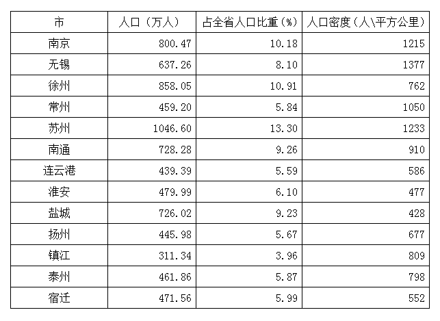

## Material M5

<!-- hyz-material-id: 01a19c8a-2401-7291-a530-8c1fa8471778 -->

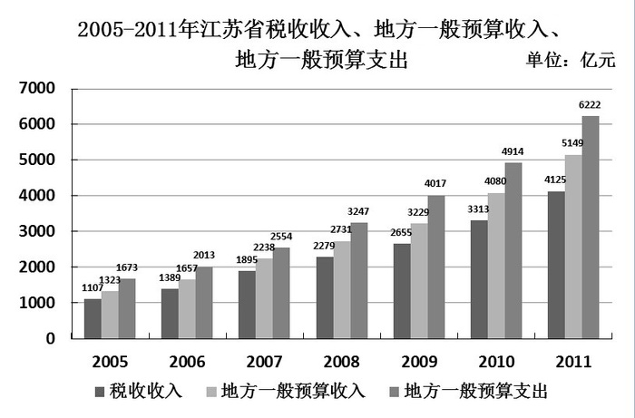

## Material M6

<!-- hyz-material-id: 01a19c8a-2401-7291-a530-8c2e874b3ad5 -->

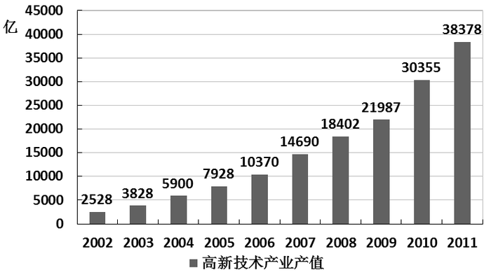

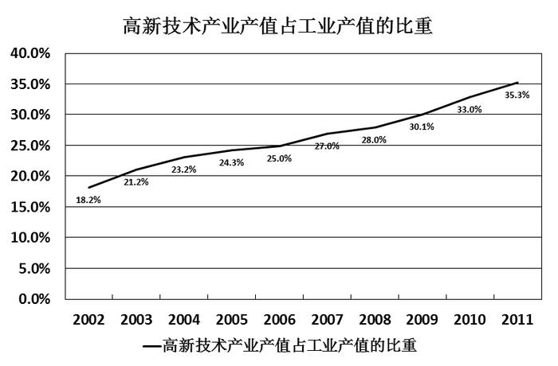

## Question 1

<!-- hyz-question-id: 01a19c8a-2401-7291-a530-8c3f0f3fa98c -->

```yaml
module: 言语理解与表达
category: null
topics:
- 关联词-并列
materials: []
passage_source: null
issues:
- order_unverified
```

### Stem

一是要逐步建设完整的居民收入和住房信息统计系统，为准入与退出机制的设计与运行提供基础数据支撑；二是要加强保障性住房申请、公示、分配等环节的透明度，并实行动态调整和持续跟踪；三是要逐步构建政府监督与社会监督、新闻媒体监督互补、互动的良好局面，确保分配公平。

上述三项措施主要针对的问题是：

### Options

- A. 如何建设完整的住房信息系统

- B. 如何加强保障性住房建设的透明度

- C. 如何完善保障性住房建设的监督机制

- D. 如何确保保障性住房的分配公平

### Answer

D

### Explanation

本题为中心理解题。通览材料，可以发现整个文段用“一、二、三”及两个分号串联起来进行分点论述，构成分—分结构，故需要对三个分句进行总结概括。第一个分句强调建立完善的住房信息系统，第二个分句强调加强保障性住房建设的透明度，第三个分句强调构建保障性住房建设的监督机制，这三个分句都围绕同一话题，即如何确保保障性住房的分配公平，D项是文段的主旨所在。A、B、C三项都只能对应其中一个分句，不够全面。

故正确答案为D。

## Question 2

<!-- hyz-question-id: 01a19c8a-2401-7291-a530-8c4329b599d9 -->

```yaml
module: 言语理解与表达
category: null
topics:
- 关联词-对策
materials: []
passage_source: null
issues:
- order_unverified
```

### Stem

互联网经常被称为虚拟空间，但活跃其中的，依然是现实世界中的人，有人的地方就应当有规则和秩序，这早已是人类社会的共识，现实世界如此，虚拟空间也是如此，互联网的无限开放性，使得它比现实世界更容易出现无序。

作者通过以上文字试图引出的论点是：

### Options

- A. 现实世界离不开规则和秩序

- B. 互联网世界也要建立和完善规则和秩序

- C. 人类社会离不开规则和秩序

- D. 互联网空间与人类现实世界有共同之处

### Answer

B

### Explanation

由提问可知本题为中心理解题。

文段中主要描述虚拟空间如同现实空间一样会出现无序，而有人的地方就需要规则和秩序，也就意味着网络也需要规则和秩序，对应B项。

故正确答案为B。

## Question 3

<!-- hyz-question-id: 01a19c8a-2401-7291-a530-8c5d1f7dbe25 -->

```yaml
module: 言语理解与表达
category: null
topics:
- 细节判断题
materials: []
passage_source: null
issues:
- order_unverified
```

### Stem

一项涉及67个国家的调查材料显示，在19个国家里，每4个人就有1个以上的人死于饥饿，而且情况至今没有改善，甚至变得更糟，21个国家的饥饿率在上升，饥饿人口虽然在20世纪90年代减少了将近2000万，但是如果不算中国，饥饿人口的数量增加了，南亚和撒哈拉沙漠以南是非洲饥饿人群最集中的地方。

下列不符合文意的是：

### Options

- A. 20世纪90年代中国饥饿人口数量减少了

- B. 20世纪90年代全球饥饿人口数量增加了

- C. 很多国家的饥饿率仍在上升

- D. 全球饥饿问题至今仍未被解决

### Answer

B

### Explanation

根据提问可知本题为细节判断题。

由“饥饿人口虽然在20世纪90年代减少了将近2000万，但是如果不算中国，饥饿人口的数量增加了”可知，全球饥饿人口下降，中国饥饿人口也是下降的，而且降幅大于全球饥饿人口的降幅，B说法不符合文意。

本题为选非题，故正确答案为B。

## Question 4

<!-- hyz-question-id: 01a19c8a-2401-7291-a530-8c6134351ad3 -->

```yaml
module: 言语理解与表达
category: null
topics:
- 关联词-转折
materials: []
passage_source: null
issues:
- order_unverified
```

### Stem

历史叙事中的这一“场景再现”技巧，显然不能单独担当起史学方法变革的重任，却有可能妨碍一些历史问题的讨论，太过琐细的描写弄不好会使读者流连于局部的场景而忘却了历史展开的复杂逻辑。

关于历史叙事中的“场景再现”技巧，作者认为：

### Options

- A. 方法值得怀疑

- B. 轻视历史叙事的展开

- C. 不应过分依赖

- D. 不属于史学方法变革

### Answer

C

### Explanation

作者没有直接否定这一技巧，只是认为“不能单独担起重任”，“却”后详细说明了其负面影响。作者的态度为，“场景再现”这一技巧单独使用可能会有一些缺点，故可知C项正确。A项，作者并非怀疑方法本身，只是不建议单独使用；B项表述有误，并不是“技巧”本身轻视历史叙事的展开；D项表述有误，文段只是说“不能单独担当起史学方法变革的重任”。

故正确答案为C。

## Question 5

<!-- hyz-question-id: 01a19c8a-2401-7291-a530-8c7ff23ec378 -->

```yaml
module: 言语理解与表达
category: null
topics:
- 关联词-并列
materials: []
passage_source: null
issues:
- order_unverified
```

### Stem

在当前单一的评价体系中，学校很难认识到将学生分为“优生”、“差生”这种做法所存在的问题，因为目前的评价体系，就是要把学生分出高低，学校的做法不过是顺应这种体系。很多时候，学校老师还认为只给学生发奖状、证书不够，因而以徽章等来强化学生对优生、差生的印象，而对于学校的做法，在很长一段时间内，也没有人认为有什么问题。

对学校将学生区分为优生、差生这样的做法，作者的态度是：

### Options

- A. 有所质疑

- B. 完全否定

- C. 不置可否

- D. 基本赞同

### Answer

A

### Explanation

文段中，第一句主要强调学校很难认识到将学生分为“优生”“差生”这种做法所存在的问题，第二句强调，学校老师没有意识到问题的存在。可见作者认为这种做法存在问题，但是存在问题不代表一无是处。

故正确答案为A。

## Question 6

<!-- hyz-question-id: 01a19c8a-2401-7291-a530-8c8fda101179 -->

```yaml
module: 言语理解与表达
category: null
topics: []
materials:
- M1
passage_source: null
issues:
- order_unverified
```

### Stem

填入文章第一段划横线处最恰当的一项是：

### Options

- A. 相互依存

- B. 紧紧相连

- C. 环环相扣

- D. 彼此交集

### Answer

C

### Explanation

根据文意，横线词语修饰“因子”，且与“层层递进”构成并列关系，故排除A项“相互依存”和D项“彼此交集”。对比B、C两项，根据前文“如同多米诺骨牌一样”可知，因子的特征符合多米诺骨牌的特征，对应C项“环环相扣”，B项“紧紧相连”不符合文意，排除。

故正确答案为C。

## Question 7

<!-- hyz-question-id: 01a19c8a-2401-7291-a530-8c944618a746 -->

```yaml
module: 言语理解与表达
category: null
topics: []
materials:
- M1
passage_source: null
issues:
- order_unverified
```

### Stem

下列有关“维生素K”的说法正确的是：

### Options

- A. 只在人的肝脏合成

- B. 存在至今不足百年

- C. 血管破裂时起作用

- D. 保障凝血因子的合成

### Answer

D

### Explanation

A项，“维生素K”也可从食物中摄取，表述错误；

B项，“维生素K”一直存在，而发现时间不足百年，表述错误；

C项，“维生素K”可促进凝血因子的合成，血管破裂时起作用的是凝血因子，表述错误；

由C项分析可知，D项说法正确。

故正确答案为D。

## Question 8

<!-- hyz-question-id: 01a19c8a-2401-7291-a530-8cae347cdf31 -->

```yaml
module: 言语理解与表达
category: null
topics: []
materials:
- M1
passage_source: null
issues:
- order_unverified
```

### Stem

文章最后一段提到的“上述人群”不包括：

### Options

- A. 新生儿

- B. 肝病患者

- C. 胆管结石患者

- D. 胆管肿瘤患者

### Answer

B

### Explanation

根据就近原则，可知“上述人群”对应前面两句，包括新生儿、胆管结石和胆管肿瘤患者。

本题为选非题，故正确答案为B。

## Question 9

<!-- hyz-question-id: 01a19c8a-2401-7291-a530-8cb696c41dd7 -->

```yaml
module: 言语理解与表达
category: null
topics: []
materials:
- M1
passage_source: null
issues:
- order_unverified
```

### Stem

普通人并不需要补充“维生素K”的主要原因在于：

### Options

- A. 可由食物获取或由肠道生成

- B. 这种维生素不能与水相融

- C. 一般很少发生血管破裂现象

- D. 人体肠道内菌群非常丰富

### Answer

A

### Explanation

由“但是正常情况下人体并不会缺乏维生素K，因为还有部分维生素K（K2）可经肠道细菌合成”可知，A说法正确。

故正确答案为A。

## Question 10

<!-- hyz-question-id: 01a19c8a-2401-7291-a530-8cc229187bb8 -->

```yaml
module: 言语理解与表达
category: null
topics: []
materials:
- M1
passage_source: null
issues:
- order_unverified
```

### Stem

下列作为这篇短文的标题最恰当的是：

### Options

- A. 维生素K的凝血作用

- B. 维生素K的发现

- C. 人体自身的凝血功能

- D. 一种参与凝血的因子

### Answer

C

### Explanation

A项，具有凝血作用的是凝血因子而非维生素K，偷换概念，排除；B项，只是对第3段的概括，不全面，排除；D项，文段论述的是凝血因子与维生素K共同作用帮助人体实现凝血功能，D项只涉及凝血因子，未提及维生素K，无法将人体的凝血功能概括全面，排除。

故正确答案为C。

## Question 11

<!-- hyz-question-id: 01a19c8a-2401-7291-a530-8cd59621b26d -->

```yaml
module: 言语理解与表达
category: null
topics:
- 关联关系-因果关系
materials:
- M1
passage_source: null
issues:
- order_unverified
```

### Stem

美国的“龙”飞船未能接近国际空间站，＿＿＿＿＿＿发射升空后不久，其四组推进器＿＿＿＿＿＿有三组出现故障，而美国航空局的飞行规章要求，＿＿＿＿＿＿有三组推进器在运行，“龙”飞船才能获准接近空间站。

### Options

- A. 因为 就 至少

- B. 由于 果然 必须

- C. 尽管 已 必须

- D. 虽然 突然 至少

### Answer

A

### Explanation

分析句意可知，第一空应表因果，排除C、D；

填入“果然”，表示事先就猜测推进器会出故障，而文段并无这层意思，排除B。

故正确答案为A。

## Question 12

<!-- hyz-question-id: 01a19c8a-2401-7291-a530-8ce7b8ad7904 -->

```yaml
module: 言语理解与表达
category: null
topics:
- 对应关系-前后呼应
- 成语填空
- 词的辨析-词义侧重
materials:
- M1
passage_source: null
issues:
- order_unverified
```

### Stem

“正人心而后正天下”这是南宋学者陈亮上书孝宗皇帝时所言，时隔八百多年，今天读来，依然＿＿＿＿＿＿。

### Options

- A. 石破天惊

- B. 振聋发聩

- C. 醍醐灌顶

- D. 警钟长鸣

### Answer

B

### Explanation

文段重在强调这句名言哪怕经过如此长的时间，仍然能让人们感受到它的正确性。B项“振聋发聩”比喻用语言文字来唤醒糊涂麻木的人，侧重强调说的话非常正确，能对大家产生影响，符合语境，当选。A项“石破天惊”原形容箜篌的声音，忽而高亢，忽而低沉，有难以形容的奇境。后多比喻文章议论新奇惊人，与文意不符，排除；C项“醍醐灌顶”比喻听了高明的意见使人受到很大启发，侧重个人主观感受，不符合语境，排除；D项“警钟长鸣”是要人时刻保持警惕，“正人心”“正天下”与警惕无关，排除。

故正确答案为B。

## Question 13

<!-- hyz-question-id: 01a19c8a-2401-7291-a530-8cf0135c7114 -->

```yaml
module: 言语理解与表达
category: null
topics:
- 对应关系-前后呼应
- 混搭填空
- 词的辨析-搭配对象
materials:
- M1
passage_source: null
issues:
- order_unverified
```

### Stem

如果要在中国艺术里寻找一种雅俗交融的代表，那么戏曲应该是＿＿＿＿＿＿的，中国戏曲漫长的发生、发展过程中，始终存在着“雅”和“俗”的一种良性＿＿＿＿＿＿，他们共同＿＿＿＿＿＿了中国戏曲的文化品格。

### Options

- A. 当之无愧 互动 铸就

- B. 名不副实 影响 孕育

- C. 受之无愧 推动 造就

- D. 名副其实 交流 培育

### Answer

A

### Explanation

本题考查成语和实词的混合搭配。

直接从第二空入手，雅俗为相对的两方面，且为良性的关系，用“互动”最为恰当。

故正确答案为A。

## Question 14

<!-- hyz-question-id: 01a19c8a-2401-7291-a530-8d0d872e3183 -->

```yaml
module: 言语理解与表达
category: null
topics:
- 对应关系-前后呼应
- 成语填空
- 词的辨析-程度轻重
materials:
- M1
passage_source: null
issues:
- order_unverified
```

### Stem

如今在地铁或公交汽车上，人们手持智能手机或者电子阅读器等终端设备＿＿＿＿＿看小说的情景已＿＿＿＿＿，其中最流行的莫过于玄幻、仙侠以及女生言情小说。

### Options

- A. 屏气凝神 司空见惯

- B. 目不转睛 层出不穷

- C. 专心致志 多如牛毛

- D. 全神贯注 屡见不鲜

### Answer

D

### Explanation

本题考查成语的应用。

直接从第二空入手，“层出不穷”表示接连不断地出现，没有穷尽，显然不符合文意，而“多如牛毛”表示极多，同样不适合第二空，因此B、C选项均不符合。

“司空见惯”与“屡见不鲜”均适合用于第二空，为此比较A、D的第一空，“屏气凝神”过于夸张，用于形容阅读小说并不合适，A项排除。

故正确答案为D。

## Question 15

<!-- hyz-question-id: 01a19c8a-2401-7291-a530-8d1afa27e900 -->

```yaml
module: 言语理解与表达
category: null
topics:
- 对应关系-前后呼应
- 混搭填空
- 词的辨析-词义侧重
materials:
- M1
passage_source: null
issues:
- order_unverified
```

### Stem

质疑和否定是人类文化最积极活泼的精神，它不断触发新生力量去打破＿＿＿＿＿平衡，建立新平衡，从自然、社会、群体到个人，从宏观世界到微观世界，轮回交替，＿＿＿＿＿，每一种存在形态，都是对旧秩序的反抗和否定，从而形成的一种崭新的相对平衡。

下列词语，依次填入画横线处，最恰当的一项是（    ）。

### Options

- A. 传统 代代相继

- B. 原有 滚滚而来

- C. 既有 生生不息

- D. 古老 绵绵不断

### Answer

C

### Explanation

第一空，根据文意可知，强调的是新生力量把之前、原来的平衡打破了，D项“古老”强调距离现在时间久远，文段并非强调时间久远，与文意不符，排除。

第二空，根据“每一种存在形态，都是对旧秩序的反抗和否定，从而形成的一种崭新的相对平衡”可知，横线处所填成语应表达打破原有平衡，形成新的平衡，这种状态一直持续下去的语义，C项“生生不息”指出现新事物或新变化，符合文意，当选。A项“代代相继”强调的是一代一代的继承下去，“继承”体现的是不变性，与文意不符，排除；B项“滚滚而来”指接连不断的到来，文段说的是“轮回交替”，即有来有去，排除。

故正确答案为C。

## Question 16

<!-- hyz-question-id: 01a19c8a-2401-7291-a530-8d2cca38e835 -->

```yaml
module: 数量关系
category: null
topics: []
materials: []
passage_source: null
issues:
- order_unverified
```

### Stem

3，7，13，21，31，（  ）

### Options

- A. 38

- B. 41

- C. 43

- D. 49

### Answer

C

### Explanation

数列中后项减去前项构成新数列：4、6、8、10、(12)，为等差数列，所以未知项为31＋12＝43。

故正确答案为C。

## Question 17

<!-- hyz-question-id: 01a19c8a-2401-7291-a530-8d3371fd68a6 -->

```yaml
module: 数量关系
category: null
topics: []
materials: []
passage_source: null
issues:
- order_unverified
```

### Stem

2，4，0，－16，－50，（  ）

### Options

- A. －104

- B. －108

- C. －125

- D. －128

### Answer

B

### Explanation

后项减去前项得到2、-4、-16、-34、（x）；再次后项减去前项得到-6、-12、-18、(-24)，构成等差数列，故x的数值为x-（-34）=-24，得x=-58；所以未知项为-50-58=-108。

故正确答案为B。

## Question 18

<!-- hyz-question-id: 01a19c8a-2401-7291-a530-8d438bea15b6 -->

```yaml
module: 数量关系
category: null
topics: []
materials: []
passage_source: null
issues:
- order_unverified
```

### Stem

5，6，9，18，45，（  ）

### Options

- A. 96

- B. 106

- C. 116

- D. 126

### Answer

D

### Explanation

后项减去前项得到1、3、9、27、(81)，为等比数列，所以未知项为45+81=126。

故正确答案为D。

## Question 19

<!-- hyz-question-id: 01a19c8a-2401-7291-a530-8d5cf9ee0eac -->

```yaml
module: 数量关系
category: null
topics: []
materials: []
passage_source: null
issues:
- order_unverified
```

### Stem

－2，－2，0，4，10，（  ）

### Options

- A. 18

- B. 16

- C. 15

- D. 12

### Answer

A

### Explanation

后项减去前项得到0、2、4、6、(8)，为等差数列，所以未知项为10+8=18。

故正确答案为A。

## Question 20

<!-- hyz-question-id: 01a19c8a-2401-7291-a530-8d60d8738ac1 -->

```yaml
module: 数量关系
category: null
topics: []
materials: []
passage_source: null
issues:
- order_unverified
```

### Stem

0.5，2，4.5，8，（  ）

### Options

- A. 10.5

- B. 11

- C. 12.5

- D. 14

### Answer

C

### Explanation

后项减去前项得到1.5、2.5、3.5、(4.5)，为等差数列，所以未知项为8＋4.5＝12.5。

故正确答案为C。

## Question 21

<!-- hyz-question-id: 01a19c8a-2401-7291-a530-8d748bf5864e -->

```yaml
module: 数量关系
category: null
topics: []
materials: []
passage_source: null
issues:
- order_unverified
```

### Stem

√2，√2，2，2√3，4√3，（  ）

### Options

- A. 6√5

- B. 4√15

- C. 6√3

- D. 7√15

### Answer

B

### Explanation

倍数关系明显，考虑作商，后项除以前项得到新数列：√1，√2，√3，√4，√5， 被开方数成等差数列，所以未知项为4√3×√5=4√15。

故正确答案为B。

## Question 22

<!-- hyz-question-id: 01a19c8a-2401-7291-a530-8d8a667a2c2e -->

```yaml
module: 数量关系
category: null
topics: []
materials: []
passage_source: null
issues:
- order_unverified
```

### Stem

1，1，4/3，2，16/5，（    ）

### Options

- A. 23/7

- B. 16/7

- C. 32/3

- D. 16/3

### Answer

D

### Explanation

原数列变形：1/1、2/2、4/3、8/4、16/5、( )；

分子项：1、2、4、8、16、(32)，成等比数列；

分母项：1、2、3、4、5、(6)，成等差数列。

所以未知项为32/6=16/3。

故正确答案为D。

## Question 23

<!-- hyz-question-id: 01a19c8a-2401-7291-a530-8d956148de9c -->

```yaml
module: 数量关系
category: null
topics: []
materials: []
passage_source: null
issues:
- order_unverified
```

### Stem

1， 3， 12， 60， 360，（  ）

### Options

- A. 1080

- B. 2160

- C. 2165

- D. 2520

### Answer

D

### Explanation

后项除以前项得到新数列：3、4、5、6、(7)，为等差数列，所以未知项为360×7＝2520。

故正确答案为D。

## Question 24

<!-- hyz-question-id: 01a19c8a-2401-7291-a530-8dacf5aa2363 -->

```yaml
module: 数量关系
category: null
topics: []
materials: []
passage_source: null
issues:
- order_unverified
```

### Stem

1，2，3，7，22，（  ）

### Options

- A. 100

- B. 133

- C. 155

- D. 165

### Answer

C

### Explanation

数列中相邻两项之积加1等于下一项，所以未知项为7×22＋1＝155。

故正确答案为C。

## Question 25

<!-- hyz-question-id: 01a19c8a-2401-7291-a530-8dbba6570ca6 -->

```yaml
module: 数量关系
category: null
topics: []
materials: []
passage_source: null
issues:
- order_unverified
```

### Stem

110， 484， 231， 352， 143，（  ）

### Options

- A. 572

- B. 429

- C. 512

- D. 139

### Answer

A

### Explanation

数列中各项，个位+百位=十位，只有A项符合。

故正确答案为A。

## Question 26

<!-- hyz-question-id: 01a19c8a-2401-7291-a530-8dc50afe5737 -->

```yaml
module: 数量关系
category: null
topics: []
materials: []
passage_source: null
issues:
- order_unverified
```

### Stem

甲、乙两种笔的单价分别为7元、3元，某小学用60元钱买这两种笔作为学科竞赛一、二等奖奖品。钱恰好用完，则这两种笔最多可买的支数是：

### Options

- A. 12

- B. 13

- C. 16

- D. 18

### Answer

C

### Explanation

设甲买x支，乙买y支，则有7x＋3y＝60，7x = 3×(20-y)，3和7互质，则x必为3的倍数，20－y必为7的倍数；所以y＝6、13，对应x＝6、3，显然13＋3＝16最大。

故正确答案为C。

## Question 27

<!-- hyz-question-id: 01a19c8a-2401-7291-a530-8ddd7b766eb5 -->

```yaml
module: 数量关系
category: null
topics: []
materials: []
passage_source: null
issues:
- order_unverified
```

### Stem

x⊗y=x²+y²，3⊗1⊗3=( )

### Options

- A. 109

- B. 110

- C. 120

- D. 160

### Answer

A

### Explanation

原式=(3^2+1^2)^2+3^2=109。

故正确答案为A。

## Question 28

<!-- hyz-question-id: 01a19c8a-2401-7291-a530-8dea1374f730 -->

```yaml
module: 数量关系
category: null
topics: []
materials: []
passage_source: null
issues:
- order_unverified
```

### Stem

将40千克浓度16%的溶液蒸发一部分水，化为20%的溶液。应去水多少千克：

### Options

- A. 8

- B. 9

- C. 10

- D. 11

### Answer

A

### Explanation

由题意可得现在溶液质量为40×16％÷20％＝32千克，则应去水40-32=8千克。

故正确答案为A。

## Question 29

<!-- hyz-question-id: 01a19c8a-2401-7291-a530-8df03c9ef562 -->

```yaml
module: 数量关系
category: null
topics:
- 给完工时间型
materials: []
passage_source: null
issues:
- order_unverified
```

### Stem

一项工程，甲、乙合作16天完成，乙、丙合作12天完成，丙、丁合作16天完成，如果甲、丁合作完成这项工程需要多少天：

### Options

- A. 21

- B. 24

- C. 26

- D. 27

### Answer

B

### Explanation

赋值工程总量为48，则甲乙的效率和为48/16=3；乙丙的效率和为48/12=4；丙丁的效率和为48/16=3。甲与丁的效率和为甲+乙+丙+丁-（乙+丙）=3+3-4=2，甲丁二人合作需要时间48/2=24天。

故正确答案为B。

## Question 30

<!-- hyz-question-id: 01a19c8a-2401-7291-a530-8e0add4de946 -->

```yaml
module: 数量关系
category: null
topics:
- 经济利润问题
materials: []
passage_source: null
issues:
- order_unverified
```

### Stem

某人购买A、B两种调料的单价分别为20元/千克、30元/千克。假设购买这两种调料所花费的钱数额一样，则由A、B两种调料混合后的新调料每千克的成本是：

### Options

- A. 23元

- B. 24元

- C. 25元

- D. 26元

### Answer

B

### Explanation

本题实际考查调和平均数问题。设A买了30克，B买了20克，可得混合后成本为2×20×30÷(20+30) = 24元。

故正确答案为B。

## Question 31

<!-- hyz-question-id: 01a19c8a-2401-7291-a530-8e12122de821 -->

```yaml
module: 数量关系
category: null
topics:
- 构造数列
materials: []
passage_source: null
issues:
- order_unverified
```

### Stem

8名学生参加某项竞赛总得分是131分，已知最高分21分，每个人得分各不相同。则得分最低的最少得多少分？

### Options

- A. 1

- B. 2

- C. 3

- D. 5

### Answer

D

### Explanation

要使最低分最低，则其他人得分尽可能高。而最高为21分，且各不相同，则有分数依次为21、20、19、18、17、16、15、n，(21+15)÷2×7+n = 131，解得n＝5。

故正确答案为D。

## Question 32

<!-- hyz-question-id: 01a19c8a-2401-7291-a530-8e2c2fed8b8b -->

```yaml
module: 数量关系
category: null
topics: []
materials: []
passage_source: null
issues:
- order_unverified
```

### Stem

若T=1/(1/2002+1/2003+···+1/2012)，则T的整数部分是：

### Options

- A. 180

- B. 181

- C. 182

- D. 183

### Answer

C

### Explanation

由题意可得，2002/11 ＜ T ＜ 2012/11，182 ＜ T ＜ 2013/11 = 183，所以T整数部分为182。

故正确答案为C。

## Question 33

<!-- hyz-question-id: 01a19c8a-2401-7291-a530-8e38ad074c66 -->

```yaml
module: 数量关系
category: null
topics:
- 相遇追及
materials: []
passage_source: null
issues:
- order_unverified
```

### Stem

甲、乙两人分别从A、B两地同时出发，相向而行，匀速前进。以原速度前进，4小时相遇；如果各自每小时比原计划少走1千米，5小时相遇。则甲乙两地的距离是：

### Options

- A. 40千米

- B. 20千米

- C. 30千米

- D. 10千米

### Answer

A

### Explanation

设二者相对速度为v，则有4v=5×(v−2)，解得v＝10，则甲乙两地距离为10×4＝40千米。

故正确答案为A。

## Question 34

<!-- hyz-question-id: 01a19c8a-2401-7291-a530-8e41645c5b94 -->

```yaml
module: 数量关系
category: null
topics:
- 统筹规划问题
materials: []
passage_source: null
issues:
- order_unverified
```

### Stem

局长找甲、乙、丙三位处长谈话，计划与甲交谈10分钟，与乙交谈12分钟，与丙交谈8分钟。办公室助理通过合理调整三人交谈的顺序，使得三人交谈和等待的总时间最少。请问调整后的总时间为多少：

### Options

- A. 46分钟

- B. 48分钟

- C. 50分钟

- D. 56分钟

### Answer

D

### Explanation

谈话时间固定，要使总时间最短，那么等待时间要尽可能短，所以谈话时间短的在前，谈话时间长的在后，则顺序为丙、甲、乙。此时总时间为8+(8+10)+(8+10+12)=56分钟。

故正确答案为D。

## Question 35

<!-- hyz-question-id: 01a19c8a-2401-7291-a530-8e58752fc66a -->

```yaml
module: 数量关系
category: null
topics:
- 经济利润问题
materials: []
passage_source: null
issues:
- order_unverified
```

### Stem

某单位向商店订购定价为100元商品80件，单位订货员向商店经理提出：“如果商店肯降价，那么每降价1元，单位多订购4件。”商店经理算了一下，若降价5%，由于订货员多订货，获得的利润反而比原来利润多100元，则该商品每件成本是：

### Options

- A. 71元

- B. 70元

- C. 68元

- D. 67元

### Answer

B

### Explanation

设每件成本为n。降价5%，即5元，多订购20件，则有(95 − n) × (80 + 20) −(100−n) × 80 = 100，解得n＝70。

故正确答案为B。

## Question 36

<!-- hyz-question-id: 01a19c8a-2401-7291-a530-8e6dba735ca5 -->

```yaml
module: 判断推理
category: null
topics:
- 逻辑关系-对应关系
materials: []
passage_source: null
issues:
- order_unverified
```

### Stem

春天：开垦

### Options

- A. 绿叶：花朵

- B. 秋天：收获

- C. 冰融：冬眠

- D. 播种：成就

### Answer

B

### Explanation

第一步：判断题干词语间逻辑关系。

题干两词为对应关系，春天是开垦的季节，与之关系相同的是B项，秋天是收获的季节。

第二步：判断选项词语间逻辑关系。

A项绿叶和花朵都是植物，为并列关系，排除；C项冰融与冬眠、D项播种与成就，均不存在明显的逻辑关系，排除。

故正确答案为B。

## Question 37

<!-- hyz-question-id: 01a19c8a-2401-7291-a530-8e768392e455 -->

```yaml
module: 判断推理
category: null
topics:
- 逻辑关系-对应关系
materials: []
passage_source: null
issues:
- order_unverified
```

### Stem

空气：人类

### Options

- A. 雾霾：风暴

- B. 自由：思想

- C. 明月：人脑

- D. 真空：灵活

### Answer

B

### Explanation

第一步：判断题干词语间的逻辑关系。

空气是人类生存的必要条件，二者为条件对应关系。

第二步：判断选项词语间的逻辑关系。

A项：雾霾会影响风暴，二者不是条件对应关系，与题干逻辑关系不一致，排除；

B项：自由是思想产生的必要条件，二者为条件对应关系，与题干逻辑关系一致，当选；

C项：明月和人脑之间无明显的逻辑关系，与题干逻辑关系不一致，排除；

D项：真空和灵活之间无明显的逻辑关系，与题干逻辑关系不一致，排除。

故正确答案为B。

## Question 38

<!-- hyz-question-id: 01a19c8a-2401-7291-a530-8e87fef4ca12 -->

```yaml
module: 判断推理
category: null
topics:
- 拆分思维
- 语法关系
materials: []
passage_source: null
issues:
- order_unverified
```

### Stem

银河落九天

### Options

- A. 举头望明月

- B. 长江天际流

- C. 众鸟高飞尽

- D. 瀑布挂前川

### Answer

D

### Explanation

第一步：判断题干词语的逻辑关系。

题干短语“银河落九天”为主谓宾结构，“银河”为主语，“落”为谓语，“九天”为宾语；与之关系相同的是D项，"瀑布挂前川”，“瀑布”为主语，“挂”为谓语，“前川”为宾语，当选。

第二步：逐一判断其他选项。

A项“举头望明月”是状谓宾结构，“举头”是状语，“望”是谓语，“明月”是宾语，故排除；

B项“长江天际流”是主谓结构，“长江”是主语，“天际流”是谓语，故排除；

C项“众鸟高飞尽”是主谓结构，“众鸟”是主语，“高飞尽”是谓语，故排除。

故正确答案为D。

## Question 39

<!-- hyz-question-id: 01a19c8a-2401-7291-a530-8e91426d7002 -->

```yaml
module: 判断推理
category: null
topics:
- 语义关系-比喻象征义
materials: []
passage_source: null
issues:
- order_unverified
```

### Stem

摸着石头过河

### Options

- A. 改革决不能含糊

- B. 改革需要和平环境

- C. 改革要在探索中前进

- D. 改革不可能一帆风顺

### Answer

C

### Explanation

“摸着石头过河”比喻办事谨慎，边干边摸索经验。显然“改革要在探索中前进”与之意思相近。

故正确答案为C。

## Question 40

<!-- hyz-question-id: 01a19c8a-2401-7291-a530-8ea4b8528b6b -->

```yaml
module: 判断推理
category: null
topics:
- 逻辑关系-对应关系
materials: []
passage_source: null
issues:
- order_unverified
```

### Stem

扫描仪 之于 （  ） 相当于 飞行器 之于 （  ）

### Options

- A. 仪器 速度

- B. 速度 空间

- C. 测绘 驾驶

- D. 扫描 飞行

### Answer

D

### Explanation

逐一代入选项。

A项：扫描仪是一种仪器，构成种属关系，飞行器和速度没有明显的逻辑关系，前后逻辑关系不一致，排除；

B项：扫描仪与速度没有明显的逻辑关系，飞行器在空间中飞行，构成对应关系，前后逻辑关系不一致，排除；

C项：扫描仪与测绘没有明显的逻辑关系，驾驶员驾驶飞行器，构成对应关系，前后逻辑关系不一致，排除；

D项：扫描仪用来扫描，飞行器用来飞行，均是功能的对应，前后逻辑关系一致，当选。

故正确答案为D。

## Question 41

<!-- hyz-question-id: 01a19c8a-2401-7291-a530-8ebcca0b9095 -->

```yaml
module: 判断推理
category: null
topics:
- 逻辑关系-对应关系
materials: []
passage_source: null
issues:
- order_unverified
```

### Stem

蚕丝 之于 （  ） 相当于 棉花 之于 （  ）

### Options

- A. 珍贵——采摘

- B. 村庄——盛开

- C. 丝绸——棉被

- D. 春蚕——城池

### Answer

C

### Explanation

逐一代入选项。

A项：有的蚕丝是珍贵的，二者为属性对应关系；采摘是棉花的一个生产环节，前后逻辑关系不一致，排除；

B项：村庄和蚕丝无明显关系，盛开是棉花的一种状态，前后逻辑关系不一致，排除；

C项：蚕丝是制作丝绸的原材料，棉花是制作棉被的原材料，前后逻辑关系一致，当选；

D项：蚕丝由春蚕产出，棉花和城池无明显关系，前后逻辑关系不一致，排除。

故正确答案为C。

## Question 42

<!-- hyz-question-id: 01a19c8a-2401-7291-a530-8ec937ea81e8 -->

```yaml
module: 判断推理
category: null
topics:
- 逻辑关系-对应关系
materials: []
passage_source: null
issues:
- order_unverified
```

### Stem

河床 之于 （  ） 相当于 天空 之于 （  ）

### Options

- A. 河流——广大

- B. 河岸——天际

- C. 河面——天然

- D. 海底——朝霞

### Answer

B

### Explanation

第一步：判断题干词语间逻辑关系。

题干构成对应关系，河岸是河床与地面的交界，天际是天空与地面的交界。

第二步：逐一判断其他选项。

A项河床和河流是并列关系，都跟河有关，广大是天空的一种属性；

C项河床和河面是并列关系，天空和天然没有明显的逻辑关系；

D项河床和海底没有明显的逻辑关系，天空和朝霞是方位与事物的对应关系。

故正确答案为B。

## Question 43

<!-- hyz-question-id: 01a19c8a-2401-7291-a530-8ed7dbe5149e -->

```yaml
module: 判断推理
category: null
topics: []
materials: []
passage_source: null
issues:
- order_unverified
```

### Stem

请从四个选项中选出正确的一项，其特征或规律与题干给出的一串符号的特征或规律最为相似。

Q5QQ55

### Options

- A. 4GG99G

- B. 2HHBBH

- C. 5M55MM

- D. A22AA2

### Answer

C

### Explanation

题干中字符串的规律为：第一、三、四个符号相同，第二、五、六个符号相同。只有C项与题干规律一致。

故正确答案为C。

## Question 44

<!-- hyz-question-id: 01a19c8a-2401-7291-a530-8ee46b63c912 -->

```yaml
module: 判断推理
category: null
topics: []
materials: []
passage_source: null
issues:
- order_unverified
```

### Stem

请从四个选项中选出正确的一项，其特征或规律与题干给出的一串符号的特征或规律最为相似。


### Options

- A. 

- B. ＞P×≦＞×≦

- C. 

- D. #HΔ≠∴≠Δ

### Answer

B

### Explanation

题干中字符串的规律为：第一个和第五个符号相同，第三个和第六个符号相同，第四个和第七个符号相同，第二个符号与其他符号均不相同。只有B项与题干规律一致。

故正确答案为B。

## Question 45

<!-- hyz-question-id: 01a19c8a-2401-7291-a530-8ef5ed17c7d8 -->

```yaml
module: 判断推理
category: null
topics: []
materials: []
passage_source: null
issues:
- order_unverified
```

### Stem

请从四个选项中选出正确的一项，其特征或规律与题干给出的一串符号的特征或规律最为相似：

SWWSWG

### Options

- A. WSSWSP

- B. GVVGEV

- C. AUUACU

- D. FHFHHT

### Answer

A

### Explanation

题干中第1个和第4个字母相同，第2个、第3个和第5个字母相同。

A选项与题干规律一致；

B、C选项第5个字母与第2个字母不同，与题干规律不一致；

D选项第2个字母和第3个字母不同，与题干规律不一致。

故正确答案为A。

## Question 46

<!-- hyz-question-id: 01a19c8a-2401-7291-a530-8f00828181af -->

```yaml
module: 判断推理
category: null
topics: []
materials: []
passage_source: null
issues:
- order_unverified
```

### Stem

请从所给的四个选项中，选择唯一的一个答案，使之呈现一定的规律性：

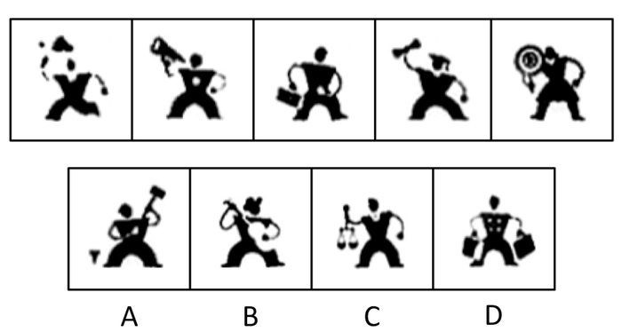

### Options

- A. A

- B. B

- C. C

- D. D

### Answer

C

### Explanation

本题考查人物的动作特征。

已知题干图形中的人物都是单手持物，只有C项符合；A、B、D三项中的人物都是双手持物。

故正确答案为C。

## Question 47

<!-- hyz-question-id: 01a19c8a-2401-7291-a530-8f14fb3bf221 -->

```yaml
module: 判断推理
category: null
topics:
- 数量规律-面
materials: []
passage_source: null
issues:
- order_unverified
```

### Stem

请从所给的四个选项中，选择唯一的一个答案，使之呈现一定的规律性：

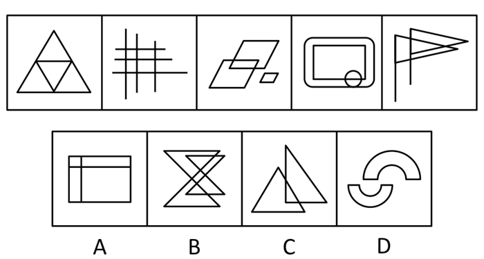

### Options

- A. A

- B. B

- C. C

- D. D

### Answer

A

### Explanation

本题元素组成凌乱，考数数。本题数封闭空间的数量，已知题干图形的封闭空间均为4个。A项的封闭空间为4个，B项为7个，C项为3个，D项为2个。

故正确答案为A。

## Question 48

<!-- hyz-question-id: 01a19c8a-2401-7291-a530-8f21eb7d00fb -->

```yaml
module: 判断推理
category: null
topics: []
materials: []
passage_source: null
issues:
- order_unverified
```

### Stem

下边四个图形中，只有一个是由上边的四个图形拼合（只能通过上、下、左、右平移）而成的，请把它找出来。

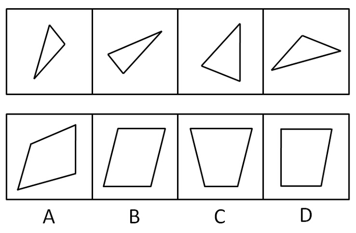

### Options

- A. A

- B. B

- C. C

- D. D

### Answer

A

### Explanation

本题考查拼图。题干中一、四图形上下叠放，二、三图形上下叠放，然后组合可得A。如图所示：


故正确答案为A。

## Question 49

<!-- hyz-question-id: 01a19c8a-2401-7291-a530-8f33b816cad2 -->

```yaml
module: 判断推理
category: null
topics: []
materials: []
passage_source: null
issues:
- order_unverified
```

### Stem

下边的四个图形中，只有一个是由上边的四个图形拼合（只能通过上、下、左、右平移）而成的，请把它找出来：

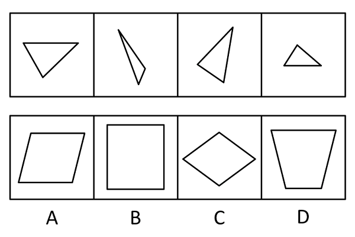

### Options

- A. A

- B. B

- C. C

- D. D

### Answer

D

### Explanation

本题考查拼图。将上边各部分拼起来，形成的图形如下图所示。


故正确答案为D。

## Question 50

<!-- hyz-question-id: 01a19c8a-2401-7291-a530-8f4b1f8d925d -->

```yaml
module: 判断推理
category: null
topics: []
materials: []
passage_source: null
issues:
- order_unverified
```

### Stem

选项的四个图形中，只有一个是由题干中的四个图形拼合（只能上、下、左、右平移）而成的，请把它找出来：

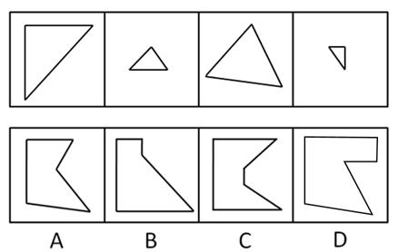

### Options

- A. A

- B. B

- C. C

- D. D

### Answer

D

### Explanation

本题考查拼图，根据各部分大小，可确定为D项，如图所示：

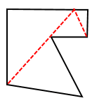

故正确答案为D。

## Question 51

<!-- hyz-question-id: 01a19c8a-2401-7291-a530-8f50d5c4366d -->

```yaml
module: 判断推理
category: null
topics: []
materials: []
passage_source: null
issues:
- order_unverified
```

### Stem

右边图形哪一个是由左边图形折叠而来：

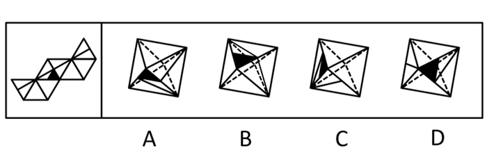

### Options

- A. A

- B. B

- C. C

- D. D

### Answer

B

### Explanation

本题考查空间重构能力，通常采用排除的思维。观察展开图可发现，含阴影三角形的面中的直线与相邻面的直线相接，因此在折成的立体图形中，与含阴影三角形的面中的直线应与其中一个相邻面中的直线相接，可迅速排除A、C、D。

B项可由展开图折成。

故正确答案为B。

## Question 52

<!-- hyz-question-id: 01a19c8a-2401-7291-a530-8f6794976ed1 -->

```yaml
module: 判断推理
category: null
topics:
- 空间类-空间重构-六面体
materials: []
passage_source: null
issues:
- order_unverified
```

### Stem

左边给定的是正方体的外表面展开图，右边哪一项能由它折叠而成？

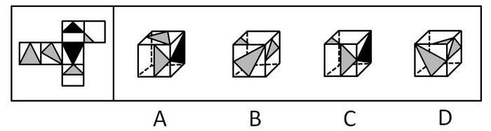

### Options

- A. A

- B. B

- C. C

- D. D

### Answer

A

### Explanation

本题考查空间重构能力，通常采用排除的思想。A项可以由左侧图形折成。如下图所示，第1面和第5面为相对面，根据相对面不相邻的原则，排除B、D。C项错误，假设左侧面和右侧面是对的，那么顶面应该是第5面而非第1面。

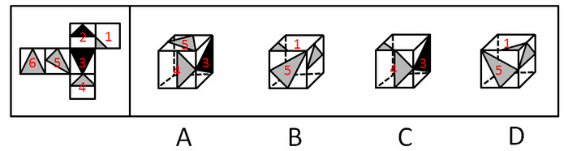

故正确答案为A。

## Question 53

<!-- hyz-question-id: 01a19c8a-2401-7291-a530-8f7b2e579182 -->

```yaml
module: 判断推理
category: null
topics: []
materials: []
passage_source: null
issues:
- order_unverified
```

### Stem

左边给定的是三棱锥的外表面展开图，右边哪一项能由它折叠而成？

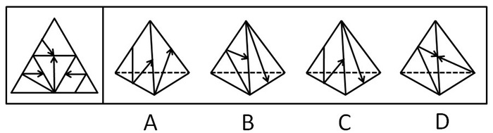

### Options

- A. A

- B. B

- C. C

- D. D

### Answer

C

### Explanation

将题干展开图标上序号，如下图所示，逐一分析选项。

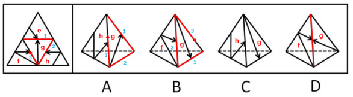

A项：选项由面h和面g构成，如图所示，以面g中箭头指向的边为起始边，对面g进行顺时针画边。题干展开图中边2挨着面h，而选项中边3挨着面h，选项与题干不一致，排除；

B项：选项由面f和面g构成，如图所示，以面g中箭头指向的边为起始边，对面g进行顺时针画边。题干展开图中边3挨着面f，而选项中边2挨着面f，选项与题干不一致，排除；

C项：选项由面h和面g构成，选项与题干一致，当选；

D项：选项由面f和面g构成，如图所示，题干展开图面g中的箭头指向面e，而选项面g中的箭头指向面f，选项与题干不一致，排除。

故正确答案为C。

## Question 54

<!-- hyz-question-id: 01a19c8a-2402-7e90-8df3-fe41ca935f87 -->

```yaml
module: 判断推理
category: null
topics: []
materials: []
passage_source: null
issues:
- order_unverified
```

### Stem

左边给定的是纸盒外表面的展开图，右边哪一项能由它折叠而成？请把它找出来：

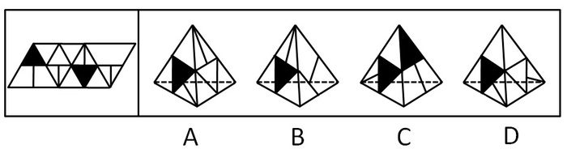

### Options

- A. A

- B. B

- C. C

- D. D

### Answer

A

### Explanation

将题干展开图中的面依次标注为面e、f、g、h，如下图：

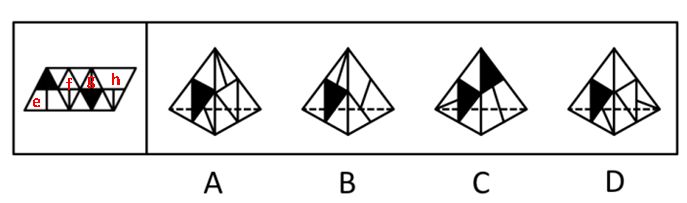

A项：选项由面f、g构成，与题干一致，当选；

B项：右侧的面是无中生有的面，与题干不一致，排除；

C项：选项由面e、g构成，展开图中面g中黑色三角形与面e中的竖线正对，选项中面g中黑色三角形与面e中的竖线不正对，与题干不一致，排除；

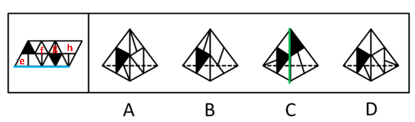

D项：选项由面f、g构成，题干展开图中面f和面g的公共边挨着面f的直角三角形的斜边，而选项中面f和面g的公共边没有挨着面f的直角三角形的斜边，与题干不一致，排除。

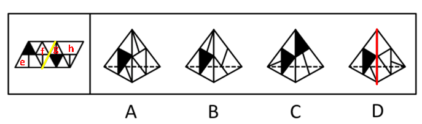

故正确答案为A。

## Question 55

<!-- hyz-question-id: 01a19c8a-2402-7e90-8df3-fe5727df3ada -->

```yaml
module: 判断推理
category: null
topics:
- 空间类-空间重构-六面体
materials: []
passage_source: null
issues:
- order_unverified
```

### Stem

右边图形哪一个是由左边图形折叠而来：

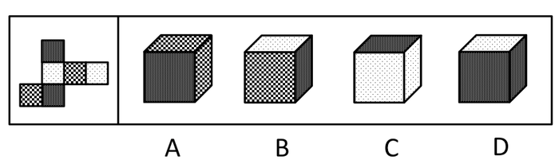

### Options

- A. A

- B. B

- C. C

- D. D

### Answer

B

### Explanation

本题考查空间重构能力，通常采用排除的思想。由平面展开图可知，相同图案的两面是相对面，根据相对面不相邻的原则，可迅速排除A、C、D三项。

故正确答案为B。

## Question 56

<!-- hyz-question-id: 01a19c8a-2402-7e90-8df3-fe69e559f602 -->

```yaml
module: 判断推理
category: null
topics:
- 日常结论
materials: []
passage_source: null
issues:
- order_unverified
```

### Stem

海豚是体型较小的鲸类，共有62种,分布于世界各大洋。海豚一般体长1.2~10米，体重45~9000千克，主要以小鱼、乌贼、虾、蟹为食。海豚喜欢过“集体”生活，少则几条，多则几百条。海豚是一种本领超群、聪明伶俐的海中哺乳动物，经过训练，海豚能打乒乓球、跳火圈等。

根据以上陈述，可以得出以下哪项？

### Options

- A. 海豚是一种体型较小的哺乳动物

- B. 有些聪明的哺乳动物生活在海里

- C. 海洋中的哺乳动物至少有62类

- D. 海豚善解人意，能模仿人的动作

### Answer

B

### Explanation

第一步：抓住题干主要信息。

第一句介绍海豚是体型较小的鲸类，共有62种；第四句介绍海豚是一种本领超群、聪明伶俐的海中哺乳动物。

第二步：逐一分析选项。

A项：由题干第一句可知，海豚是体型较小的鲸类，而非体型较小的哺乳动物，排除；

B项：由第四句海豚是一种聪明伶俐的海中哺乳动物可推出，海洋中有一些哺乳动物是聪明伶俐的，即有些聪明伶俐的哺乳动物生活在海洋中，可以得出，当选；

C项：第一句只说明海豚有62种，并没有说明海洋中的哺乳动物的种类，无法得出，排除；

D项：题干没有提及海豚是否善解人意，无法得出，排除。

故正确答案为B。

## Question 57

<!-- hyz-question-id: 01a19c8a-2402-7e90-8df3-fe72ed447557 -->

```yaml
module: 判断推理
category: null
topics:
- 削弱论点
materials: []
passage_source: null
issues:
- order_unverified
```

### Stem

自行车轮又在中国转起来了。如今，在中国的年轻人中间，正在流行着骑自行车的生活时尚。这种时尚打动了国外很多国际知名的自行车制造商，他们十分看好中国市场，纷纷来中国开店销售他们的自行车。

以下哪项如果为真，最能质疑这些国外知名自行车制造商的看法？

### Options

- A. 一般来说，自行车比汽车便宜，中国的绝大部分人都买得起自行车

- B. 中国自行车保有量已占世界的一半左右——至少有4.7亿辆

- C. 随着人们“绿色”意识的增强，低碳环保的自行车运动将成为更多人的生活选择

- D. 国外知名品牌自行车在华售价昂贵，超过了一般中国人的承受能力

### Answer

D

### Explanation

本题为削弱题型。

第一步：找出论点论据。

论点：国际知名的自行车制造商十分看好中国市场，纷纷来中国开店销售他们的自行车。

论据：在中国的年轻人中间，正在流行着骑自行车的生活时尚。

第二步：逐一分析选项。

A项对比的是自行车和汽车的价格，跟国外知名品牌自行车无关，无法质疑国外知名自行车制造商看好中国市场的看法，属于无关选项。

B项自行车的保有量，跟国外知名品牌自行车无关，无法质疑国外知名自行车制造商看好中国市场的看法，属于无关选项。

C项自行车成为更多人的生活选择，跟国外知名品牌自行车无关，无法质疑国外知名自行车制造商看好中国市场的看法，属于无关选项。

D项说明国外知名品牌自行车因售价太高，一般中国人承受不起，即便中国年轻人流行骑自行车，也不会购买过于昂贵的国外自行车，直接否定了国外知名自行车制造商看好中国市场的看法，是答案。

故正确答案为D。

## Question 58

<!-- hyz-question-id: 01a19c8a-2402-7e90-8df3-fe80892764f5 -->

```yaml
module: 判断推理
category: null
topics:
- 补充论据
materials: []
passage_source: null
issues:
- order_unverified
```

### Stem

PM2.5是指大气中直径在2.5微米以下（不到头发丝1/20）的微小颗粒，它们的尺寸使其能深入到人体的肺部，对人的呼吸健康造成严重伤害。近年，我国中东部地区多次出现大范围和长时间的雾霾天气，多地PM2.5指数直线上升。对此，某城市推出了车辆单双号限行等措施以应对大气污染。但该市有专家不赞成这种车辆限行的措施，认为这种做法对本市PM2.5指数的下降影响不大，无法从根本上改变该市大气污染的状况。

以下哪项如果为真，最能支持上述专家的观点：

### Options

- A. 车辆尾气是造成本市大气污染的重要原因之一

- B. 相对于工业污染来说，车辆尾气对大气污染的影响是少量的

- C. 本市PM2.5指数升高主要是由其他区域大气污染的影响造成的

- D. 该市市民强烈呼吁政府要加强对雾霾天气的治理

### Answer

C

### Explanation

第一步，找到论点论据。

论点：车辆单双号限行的措施对本市PM2.5指数的下降影响不大，无法从根本上改变该市大气污染的状况。

没有明显的论据。

第二步，逐一分析选项。

A项：说明车辆限行能够改善该市大气污染的状况，削弱论点，排除；

B项：讨论工业污染与汽车尾气对大气污染的影响的大小关系，汽车尾气污染占该市大气污染的比重是多少不明确，为不明确选项，排除；

C项：说明该市PM2.5指数升高的真正原因与汽车尾气无关，车辆限行对PM2.5指数的下降影响不大，支持论点，当选；

D项：呼吁加强雾霾天气的治理与汽车尾气和大气污染无关，为无关选项，排除。

故正确答案为C。

## Question 59

<!-- hyz-question-id: 01a19c8a-2402-7e90-8df3-fe9dfde12217 -->

```yaml
module: 判断推理
category: null
topics:
- 常规翻译
materials: []
passage_source: null
issues:
- order_unverified
```

### Stem

中国作家莫言的文学作品让隐蔽的中国乡土受到世界读者的关注，得到国际文坛的承认，再一次证明了这一判断：只有民族的，才是世界的。根据这一判断，可以推出（    ）。

### Options

- A. 越是民族的，越是世界的

- B. 不是民族的，就不是世界的

- C. 只要民族的，就是世界的

- D. 只有世界的，才是民族的

### Answer

B

### Explanation

第一步：翻译题干。

世界的→民族的。

第二步：推理。

A项，越是民族的，越是世界的，不在题干推导关系中，无法推出。

B项，-民族的→-世界的，是题干推导关系的逆否规则，可从题干推出，为本题答案。

C项，民族的→世界的，“民族的”是肯定题干推导关系的后件，肯后件无法推出肯前件，C无法推出。

D项，民族的→世界的，“民族的”是肯后件，无法推出。

第三步：再次标注答案。

故正确答案为B。

## Question 60

<!-- hyz-question-id: 01a19c8a-2402-7e90-8df3-feaed58884b5 -->

```yaml
module: 判断推理
category: null
topics:
- 常规翻译
materials: []
passage_source: null
issues:
- order_unverified
```

### Stem

如果小李乘坐火车或飞机去云南旅行，小张就会跟他一起去，只要小李不乘坐火车去云南，小王就会跟他一起旅行。实际上，小张最近一直躲在江南某小镇写作，闭门不出也不想外出。

根据以上陈述，可以得出以下哪项：

### Options

- A. 小李跟小张一起旅行

- B. 小李跟小王一起旅行

- C. 小李乘坐火车去云南

- D. 小李乘坐飞机去云南

### Answer

B

### Explanation

本题为关联词推导题型。

第一步：翻译题干。

①小李坐火车去云南∨坐飞机去云南⇒小张去云南；

②-小李坐火车去云南⇒小王跟小李一起旅行；

③-小张去云南（此为事实信息）。

第二步：从事实信息开始推导，得出结论。

从题干事实信息可知，小张不去云南。“-小张去云南”是否定①中的后件，根据逆否规则，可得出“-（小李坐火车去云南∨坐飞机去云南）”；

再由摩根规则，可知“-小李坐火车去云南且-坐飞机去云南”，即小李不坐火车去云南，也不坐飞机去云南。又知②，可推出小王和小李一起旅行，B项正确。

A、C、D均错误，故正确答案为B。

## Question 61

<!-- hyz-question-id: 01a19c8a-2402-7e90-8df3-feb3b57b33cb -->

```yaml
module: 判断推理
category: null
topics:
- 日常结论
materials: []
passage_source: null
issues:
- order_unverified
```

### Stem

在自己最愤怒的时候，不让自己做出后悔事情的方法是先让自己忍住3秒钟，然后再想想对方为什么会这样，然后想自己的错误，如果还有余怒的话，一时找不出倾诉的人，就拿笔写下来，这样一个过程你也慢慢冷静了，忍得一口气，能免百日忧。

根据以上陈述，可以得出以下哪项：

### Options

- A. 在自己最愤怒的时候，应先反省自己的过失，然后再思考对方行为的原因

- B. 在自己最愤怒的时候，应先让自己忍住3秒钟，反思自己可能有的错误

- C. 在自己还有余怒的时候，如果能够习惯向别人倾诉，就能保持一生快乐

- D. 在自己还有余怒的时候，如果想使自己慢慢冷静下来，可能需要写作倾诉

### Answer

D

### Explanation

本题为日常结论题型。

第一步：抓住题干主要信息。

题干前半句：在自己最愤怒的时候，先让自己忍住3秒钟，再想想对方为什么会这样，再想自己的错误；

题干后半句：在自己还有余怒的时候，拿笔写下来可以让自己慢慢冷静。

第二步：逐一分析选项。

A项错误，应该先忍住3秒钟；

B项错误，忍住3秒钟后，应该先想想对方为什么会那样，再反省自己可能有的错误；

C项错误，与题意不符；

D项正确，可从题干后半句话推出，是答案。

故正确答案为D。

## Question 62

<!-- hyz-question-id: 01a19c8a-2402-7e90-8df3-feccb212f265 -->

```yaml
module: 判断推理
category: null
topics:
- 假设
materials: []
passage_source: null
issues:
- order_unverified
```

### Stem

经过努力，甲、乙、丙、丁4位品学兼优的中学生考上了北京大学、清华大学、南京大学、东南大学4所名校。9月初，甲、丙与乙、丁分别奔赴两座不同的城市去上学了。已知：

（1）甲没有上北京大学

（2）乙没有上清华大学

（3）丙没有上南京大学

（4）丁没有上东南大学

根据以上陈述，可以得出以下哪项：

### Options

- A. 甲没有上清华大学

- B. 乙没有上北京大学

- C. 丙没有上东南大学

- D. 丁没有上北京大学

### Answer

D

### Explanation

本题为排列组合题型。

本题根据题干已知信息难以推理，故采用假设法。

根据“甲、丙与乙、丁分别奔赴两座不同的城市”，假设甲、丙分别去了清华大学和北京大学，则乙、丁分别去了南京大学和东南大学。

由（1）知，甲去清华大学，丙去北京大学；

由（4）知，丁去南京大学，乙去东南大学，与题干已知信息不矛盾。

假设甲、丙分别去了南京大学和东南大学，则乙、丁分别去了清华大学和北京大学。

由（3）知，丙去了东南大学，甲去了南京大学；

由（2）知，乙去了北京大学，丁去了清华大学，也与题干信息没有矛盾。因此这两种情况都可能存在。

若是第一种情况，则A项错误；

若是第二种情况，则B、C两项均错误；

两种情况下丁都没有去北京大学，D项正确。

故正确答案为D。

## Question 63

<!-- hyz-question-id: 01a19c8a-2402-7e90-8df3-fedae517ddb9 -->

```yaml
module: 判断推理
category: null
topics:
- 日常结论
materials: []
passage_source: null
issues:
- order_unverified
```

### Stem

某林场入口处的标语牌上清晰地写着“禁止破坏森林！违者罚款！”有一天，附近村民杨某到林场里面砍了一棵树，正待运下山时被林场护林员张某发现，张某不仅批评了杨某，而且要对杨某实施罚款，杨某不服，双方展开了激烈的论辩。杨某说道，我砍的是一棵树又不是森林，你不应该罚我的款。

以下哪项是张某最合乎逻辑的反驳：

### Options

- A. 破坏森林的都要罚款，你砍的一棵树也是森林

- B. 砍一棵树就是破坏森林，破坏森林的都要罚款

- C. 我是护林员，谁不保护森林我就要罚谁的款

- D. 破坏森林重在教育，罚款其实不是我们的目的

### Answer

B

### Explanation

第一步：找到论点和论据。

论点：我砍的是一棵树又不是森林，你不应该罚我的款。

论据：无明显论据。

第二步：逐一分析选项。

A项：“你砍的一棵树也是森林”，意思是说砍的这棵树本身就是森林，但是砍一棵树是不是破坏森林，并没有明确说，是一个不明确的表述，因此不能反驳论点，排除；

B项：砍树就是破坏森林，破坏森林要罚款，对论点进行削弱，当选；

C项：选项只是说谁破坏森林就罚款，但是没有在砍一棵树和破坏森林之间搭关系，属于无关选项，排除；

D项：选项说的是罚款的目的，同样没有在砍一棵树和破坏森林之间搭关系，属于无关选项，排除。

故正确答案为B。

## Question 64

<!-- hyz-question-id: 01a19c8a-2402-7e90-8df3-fee6e238a6a9 -->

```yaml
module: 判断推理
category: null
topics:
- 常规翻译
materials: []
passage_source: null
issues:
- order_unverified
```

### Stem

因工作需要，某单位决定从本单位的3位女性（小王、小李、小孙）和5位男性（小张、小金、小吴、小孟，小余）中选出4人组建谈判小组参与一次重要谈判，选择条件如下：

（1） 小组成员既要有女性，也要有男性

（2） 小张与小王不能都入选

（3） 小李与小孙不能都入选

（4） 如果选小金，则不选小吴

如果小张一定要入选，可以得出以下哪项：

### Options

- A. 如果选小吴，则选小余

- B. 如果选小金，则选小孟

- C. 要么选小余，要么选小孟

- D. 要么选小李，要么选小孙

### Answer

D

### Explanation

第一步：翻译题干。

（1）既要有女性（小王、小李、小孙），也要有男性（小张、小金、小吴、小孟，小余）；

（2）-（小张 且 小王）=-小张 或 -小王；

（3）-（小李 且 小孙）=-小李 或 -小孙；

（4）小金→ -小吴；

（5）小张一定入选（事实信息）。

第二步：从事实信息开始推导并得出结论。

根据事实信息“小张一定入选”，由（2）可知，小王不入选；再由（1）可知，小李和小孙至少有一人入选；再由（3）可知，小李和小孙不能都入选，可推出要么选小李，要么选小孙，D项当选。

第三步：分析其他选项。

A项，题干已知小张入选，由（3）可知，小孙、小李只能入选一个人，小组还需要两个人，且都是男性，男性中（金吴孟余）四个人谁去是不确定的，无法推出，排除；

B项，同A项，小组还需要两个人，且都是男性，男性中（金吴孟余）四个人谁去是不确定的，无法推出，排除；

C项，要么小余，要么小孟，二者只能进一人；题干已知小张入选，由（3）可知，小孙、小李只能入选一个人，小组还需要两个人，且都是男性（金吴孟余），小余和小孟均为男性，可以同时入选，无法推出，排除。

故正确答案为D。

## Question 65

<!-- hyz-question-id: 01a19c8a-2402-7e90-8df3-fefc7d635818 -->

```yaml
module: 判断推理
category: null
topics:
- 常规翻译
materials: []
passage_source: null
issues:
- order_unverified
```

### Stem

因工作需要，某单位决定从本单位的3位女性（小王、小李、小孙）和5位男性（小张、小金、小吴、小孟，小余）中选出4人组建谈判小组参与一次重要谈判，选择条件如下：

（1）小组成员既要有女性，也要有男性

（2）小张与小王不能都入选

（3）小李与小孙不能都入选

（4）如果选小金，则不选小吴

如果小王和小吴都入选，可以得出以下哪项？

### Options

- A. 或者选小余，或者选小孟

- B. 或者选小李，或者选小孙

- C. 如果选小李，那么选小张

- D. 如果选小孙，那么选小金

### Answer

A

### Explanation

本题为关联词推导题型。

第一步：翻译题干。

（1）既要有女性（小王、小李、小孙），也要有男性（小张、小金、小吴、小孟，小余）；（2）-小张 或 -小王；（3）-小李 或 -小孙；（4）小金→\-小吴；（5）小王，小吴（事实信息）。

第二步：从事实信息开始推导并得出结论。

根据事实信息小王入选，由（2）可知，小张不入选；根据事实信息小吴入选，由（4）的逆否规则可知，小金不入选；因为参加谈判的总共有4人，又知（3）小李和小孙不能同时入选，要确保两人不同时入选，则需要从小余和小孟中选出一人，或者选小余，或者选小孟，A项当选。

第三步：分析其他选项。

B项：根据条件（3）“小李与小孙不能都入选”，即可以小李和小孙二选一、也可以两者都不入选，而B项无“两者都不入选”的情况，无法推出，排除；

C、D项由第二步推论可知，小张不入选，小金不入选，C项和D项均排除。

故正确答案为A。

## Question 66

<!-- hyz-question-id: 01a19c8a-2402-7e90-8df3-ff031a71cb11 -->

```yaml
module: 判断推理
category: null
topics:
- 方式目的
materials: []
passage_source: null
issues:
- order_unverified
```

### Stem

碎片式学习：指学习者通过一点一滴的方式积累或获取知识和信息。

下列不属于碎片式学习的是：

### Options

- A. 妈妈开车送小敏上学时，小敏常常悄悄看小人书

- B. 小马严格执行自己的学习计划，每天记5个成语典故，读一篇时文

- C. 某品牌手机刚上市，小刘到专卖店连夜排队，一边排队一边翻阅莫言的《蛙》

- D. 小顾为了完成一篇论文，每天晚上花数小时查阅相关文献

### Answer

D

### Explanation

第一步：找到定义关键词。

“通过一点一滴的方式积累或获取”。

第二步：逐一分析选项。

A项小敏是在妈妈开车送其上学的途中看的小人书；

B项每天记5个成语典故，读一篇时文；

C项边排队边读书，都属于“通过一点一滴的方式”；

D项小顾每晚花数小时查阅相关文献，不满足关键词“通过一点一滴的方式”，是本题答案。

本题为选非题，故正确答案为D。

## Question 67

<!-- hyz-question-id: 01a19c8a-2402-7e90-8df3-ff116dacc156 -->

```yaml
module: 判断推理
category: null
topics:
- 单定义-其他句式
materials: []
passage_source: null
issues:
- order_unverified
```

### Stem

双核家庭：指夫妻双方婚前都曾是各自家庭中的“核心”（独生子女），婚后都不知道该以“非核心”的方式行为处事，于是家里就出现了两个“核心”。

下列属于双核家庭的是：

### Options

- A. 新婚的小王与小刘仍都带着独生子女时的逞强个性，互不相让

- B. 逢年过节，老周夫妇都把各自的兄弟姐妹请到家中团聚，其乐融融

- C. 小王与小李都是独生子女，两人组建家庭后，夫唱妇随，相敬如宾

- D. 小许对娇妻的事事好强感到有些压抑与不快，新婚的甜蜜日渐淡化

### Answer

A

### Explanation

第一步：抓住定义关键词。

夫妻双方婚前都曾是各自家庭中的“核心”，婚后家里出现了两个“核心”。

第二步：逐一分析选项。

A项小王与小刘婚前都是独生子女，婚后逞强个性，互不相让，满足“婚后家里出现两个‘核心’”，是答案；

B项说的是老周夫妇与兄弟姐妹的关系，没有涉及夫妻双方婚前婚后的情况，不符合定义；

C项小王与小李婚后夫唱妇随，不满足“家里出现了两个‘核心’”；

D项小许对娇妻的事事好强感到压抑与不快，可见小许是以妻子为核心，不满足关键词“两个‘核心’”。

故正确答案为A。

## Question 68

<!-- hyz-question-id: 01a19c8a-2402-7e90-8df3-ff2fa1fc7c45 -->

```yaml
module: 判断推理
category: null
topics:
- 方式目的
materials: []
passage_source: null
issues:
- order_unverified
```

### Stem

化归法：指在解决问题的过程中，不是直接解决原问题，而是对问题进行变形、转化，直至把它化归为某个（些）已经解决的问题，或容易解决的问题，再返回去求得原问题的解答。

下列不属于化归法的是：

### Options

- A. 小张通过把多边形分解为若干个三角形，求得多边形内角和

- B. 小吴和小文闹别扭，小吴想道歉又放不下面子，于是把前因后果告诉了小蔡，请小蔡向小文解释，小蔡解释后，小吴主动招呼小文，两人和好如初

- C. 小李与小江解决同一类问题方法截然不同，小李先研究特殊情况，最终解决了一般问题；而小江先解决了一般问题，然后再研究特殊情形

- D. 小赵采用先易后难的原则，很快完成了老师布置的一大堆物理作业

### Answer

D

### Explanation

第一步：找到定义关键词。

在解决问题的过程中不是直接的，对问题进行变形、转化。

第二步：逐一分析选项。

A项分解为若干个三角形，满足对问题进行变形、转化；

B项是请小蔡向小文解释，满足“不是直接的”；

C项是小李和小江在解决问题的过程中都对问题进行不同方式的转化，非直接求解，满足定义关键词；

D项小赵采用先易后难的原则，没有对问题进行变形、转化，不满足定义关键词，是答案。

本题为选非题，故正确答案为D。

## Question 69

<!-- hyz-question-id: 01a19c8a-2402-7e90-8df3-ff3ff88d8792 -->

```yaml
module: 判断推理
category: null
topics:
- 大前提
materials: []
passage_source: null
issues:
- order_unverified
```

### Stem

人才柔性引进：指适应人才社会化要求，打破国籍、户籍、身份、人事关系等人才流动中的制约，在不改变和影响人才与所属单位人事关系的前提下，适应市场经济和人才社会化发展要求的政府引导、市场调节、契约管理的非本地户籍人才的人才引进方式。

下列属于人才柔性引进的是：

### Options

- A. 某高校为进一步提高建设水平和实力，聘请北京大学陈教授为兼职教授，陈教授将每学期来该高校授课

- B. 张教授是某大学的专家，该校计算机学院申报国家级实验基地项目时，也引进了教授的研究成果

- C. 李教授是国内外知名专家，某校花大力气引进了李教授，不仅安排了其家属的工作，而且解决了其孩子的工作问题

- D. 2008年金融风暴，孙先生放弃了美国的工作，回到北京，成为某百货集团的一名高管

### Answer

A

### Explanation

第一步：找到定义关键词。

“不改变和影响人才与所属单位人事关系”、“人才引进方式”。

第二步：逐一分析选项。

A项某高校聘请陈教授为兼职教授，没有改变陈教授与所属单位北京大学的关系，满足定义关键词，是答案；

B项引进的是张教授的研究成果，不满足“人才引进方式”；

C项引进了李教授，但改变了李教授与所属单位的人事关系，不满足关键词；

D项孙先生是主动放弃美国的工作回京当高管，不满足关键词。

故正确答案为A。

## Question 70

<!-- hyz-question-id: 01a19c8a-2402-7e90-8df3-ff48ac506aba -->

```yaml
module: 判断推理
category: null
topics:
- 原因结果
materials: []
passage_source: null
issues:
- order_unverified
```

### Stem

自然污染物：指由于天然原因造成的环境污染物，与人工污染物相对。自然污染物超过一定的数量也可能造成环境的污染。

下列不属于自然污染物的是：

### Options

- A. 森林中的落叶等经过细菌的分解释放出大量二氧化碳

- B. 大雾天气造成能见度下降，再加上地面焚烧秸秆，导致雾霾天气长时间维持

- C. 13000年前一场持续1小时的太空彗星雹暴袭击地球，严重污染了地球空气并导致地球进入微型冰河时期

- D. 堪察加半岛的火山喷发对大气造成严重污染，火山灰借助北风穿越蒙古进入我国上空

### Answer

B

### Explanation

第一步：找到定义关键词。

“由于天然原因造成的”。

第二步：逐一分析选项。

B项雾霾天气长时间维持的一部分原因在于地面焚烧秸秆，不满足“由于天然原因造成的”，是答案。

A项落叶经过细菌分解，C项太空彗星雹暴袭击地球，D项火山喷发都是由于天然原因造成的，满足关键词。

本题为选非题，故正确答案为B。

## Question 71

<!-- hyz-question-id: 01a19c8a-2402-7e90-8df3-ff561ad5fa8a -->

```yaml
module: 判断推理
category: null
topics:
- 方式目的
materials: []
passage_source: null
issues:
- order_unverified
```

### Stem

孝心消费：指子女或晚辈为表达自己对父母或长辈的关爱而进行的消费。

下列不属于孝心消费的是：

### Options

- A. 小赵特地取出存折里的钱给爷爷买了寿险，爷爷很高兴

- B. 小刘解囊为年过八旬奶奶雇保姆，每月付给保姆酬金1400元

- C. 教师节这天，同学小顾特地到花店买了一束鲜花送给语文老师

- D. 每逢父母结婚纪念日，小王都要给父母送一份礼品表示祝贺

### Answer

C

### Explanation

第一步：找到定义关键词。

“子女或晚辈为表达自己对父母或长辈的关爱”。

第二步：逐一分析选项。

C项小顾同学在教师节买花送给语文老师作为礼物，是表达对老师的感谢，不属于子女或晚辈为表达自己对父母或长辈的关爱而进行的消费，是答案。

A项小赵为爷爷买保险，B项小刘为奶奶雇保姆，D项小王给父母送礼品，都满足定义关键词。

本题为选非题，故正确答案为C。

## Question 72

<!-- hyz-question-id: 01a19c8a-2402-7e90-8df3-ff6030b980c6 -->

```yaml
module: 判断推理
category: null
topics:
- 方式目的
materials: []
passage_source: null
issues:
- order_unverified
```

### Stem

创造性劳动：指产生前所未有的、需运用劳动者创造力的劳动方式，与再现性劳动（指只需要按照一定的程序和方法进行的劳动）相对。

下列属于创造性劳动的是：

### Options

- A. 妈妈吩咐上高中的儿子再次到门口超市去买一袋食盐

- B. 曹雪芹在人生的最后阶段，以坚韧不拔的毅力，历经十年完成了巨著《红楼梦》

- C. 小吴按照老师教的方法一口气将十道加法算式题全部完成了

- D. 工作人员按规定将东西装入箱子后，把箱子送到2米外的机器封箱

### Answer

B

### Explanation

第一步：找到定义关键词。

“需运用劳动者创造力”。

第二步：逐一分析选项。

B项曹雪芹完成巨著《红楼梦》需要发挥其创造力，符合定义关键词，是答案。

A项儿子再次去门口超市买盐，C项按老师教的方法解题，D项工作人员按规定装箱封箱，都是按照一定的程序和方法进行，属于再现性劳动，非创造性劳动。

故正确答案为B。

## Question 73

<!-- hyz-question-id: 01a19c8a-2402-7e90-8df3-ff7865c18641 -->

```yaml
module: 判断推理
category: null
topics:
- 大前提
materials: []
passage_source: null
issues:
- order_unverified
```

### Stem

白化现象是指在正常环境下，植物由于某些内在因素不能形成叶绿素的现象。

下列属于白化现象的是：

### Options

- A. 某地是世代玉米主产区，每年都发现一些玉米的叶子因遗传而出现局部白斑

- B. 某地农民发现当地向日葵的叶子变白了，这在化工厂未建时从没有发现过

- C. 某地污染几年后，人民在当地不时会发现一种污染前从未出现过的白蛇

- D. 某人十多年前得了一种病至今未愈，皮肤、头发，甚至眉毛全都变白了

### Answer

A

### Explanation

第一步：找到定义关键词。

“正常环境下”、“植物”、“内在因素”。

第二步：逐一分析选项。

A项“某地是世代玉米主产区，每年都发现”说明是正常环境下，“玉米”是植物，“遗传”是内在因素，满足定义关键词，当选。

B项向日葵叶子变白是建化工厂之后发现的，C项白蛇不是植物，D项某人不是植物，B、C、D三项均不满足定义关键词，排除。

故正确答案为A。

## Question 74

<!-- hyz-question-id: 01a19c8a-2402-7e90-8df3-ff8acdb98617 -->

```yaml
module: 判断推理
category: null
topics:
- 拆词
materials: []
passage_source: null
issues:
- order_unverified
```

### Stem

微突发事件：指发生在小范围的一个事件，经当事人或他人在网络等传媒上披露后，产生比较大的社会反响。

下列不属于微突发事件的是：

### Options

- A. 某官员在参加一工程剪彩活动时，其佩戴名贵手表的照片被网友发到微博上，引起社会广泛关注

- B. 2010年5月，某大学生上传一段动画片时说“这就是天竺吗？不给力啊老湿！”，“给力”一词旋即风靡网络。当年11月10日，“给力”一词出现在《人民日报》头版标题中

- C. 2012年底，乞丐周某在某商场附近举着失物招领牌子，寻找钱包失主。路人俞某发现后，拍下一张照片并发到微博上。该微博被迅速转发，大家都对周某的行为表示赞赏

- D. 2012年11月25日，歼-15舰载机在我国首艘航母“辽宁舰”上顺利实现起降，引发世界各大媒体热议

### Answer

D

### Explanation

第一步：找到定义关键词。

“小范围”、“传媒”、“较大社会反响”。

第二步：逐一分析选项。

D项，航母舰载机顺利实现起降是一个公共事件，并非小范围，不符合定义要件。是答案。

A、B、C项的叙述结构均对应三个定义要件，符合定义。

本题为选非题，故正确答案为D。

## Question 75

<!-- hyz-question-id: 01a19c8a-2402-7e90-8df3-ff9208cf6e35 -->

```yaml
module: 判断推理
category: null
topics:
- 方式目的
materials: []
passage_source: null
issues:
- order_unverified
```

### Stem

无影灯效应：指通过诸多要素互相作用而形成的一种整体性机制，可把某问题的不完全或缺点部分减到最低限度，甚至消失，并最终使这一问题得到很好解决。

下列不属于无影灯效应的是：

### Options

- A. 某省为了杜绝医生吃医药回扣致使患者看病贵的问题，加大医药采购监督力度，开设了专门的患者热线，在各家医院的咨询服务台公布了卫生部门的举报电话

- B. 某城市为了形成大力发展绿色生态文明的有效机制，充分集中民众智慧，成立了公民监督委员会和环境保护组织等，让广大民众更好地建言献策并发挥监督作用

- C. 2012年中国网民数量突破5亿，越来越多的人利用互联网媒体充分获取和传播信息，信息和民意也得到广泛的立体传播，中国正在形成透明的信息空间和舆论力量

- D. 某地方政府为治理公车私用顽症，特聘多名义务监督员，并配有数码相机，监督员可随时抓拍发现的疑车并将照片发送到相关网络，被拍者须对此作出合理的解释

### Answer

C

### Explanation

第一步：找到关键词。

诸多要素互相作用、整体性机制、不完全或缺点部分减到最低限度、甚至消失、问题最终得到解决。

第二步：逐一分析选项。

A项：回扣、看病贵体现了“缺点”，加大监督力度、开设热线、公布举报电话等措施体现了“诸多要素互相作用”、“整体性机制”；

B项：发展绿色生态文明体现了现有环境状况不佳的“缺点”，集中智慧、成立监督委员会和环境保护组织等体现了“诸多要素互相作用”、“整体性机制”；

C项：并没有体现出缺点、问题得到解决。文字只是对中国网民情况进行了介绍，并没有提出问题。本选项为正确答案；

D项：公车私用体现了“缺点”，监督员、抓拍、网络、解释等反映了“诸多要素互相作用”、“整体性机制”。

虽然A、B、C三项都没有体现出“问题最终得到解决”，但是相比较C项，A、B两项更符合定义。

本题为选非题，故正确答案为C。

## Question 76

<!-- hyz-question-id: 01a19c8a-2402-7e90-8df3-ffaa511cc45c -->

```yaml
module: 资料分析
category: null
topics: []
materials:
- M2
passage_source: null
issues:
- order_unverified
```

### Stem

2012年产业增加值增长幅度高于全国规模以上工业增加值的经济类型是：

### Options

- A. 外商及港澳台商投资企业

- B. 集体企业

- C. 国有及国有控股企业

- D. 股份制企业

### Answer

D

### Explanation

定位文字材料第二段可得：“2012年规模以上工业增加值按可比价格计算比上年增长10.0%，……分经济类型看，国有及国有控股企业增加值比上年增长6.4%，集体企业增长7.1%，股份制企业增长11.8%，外商及港澳台商投资企业增长6.3%”，显然只有股份制企业增加值增长幅度高于全国规模以上工业增加值。

故正确答案为D。

## Question 77

<!-- hyz-question-id: 01a19c8a-2402-7e90-8df3-ffb2ca68bff5 -->

```yaml
module: 资料分析
category: null
topics: []
materials:
- M2
passage_source: null
issues:
- order_unverified
```

### Stem

用V_1、V_2、V_3分别表示2012年全国钢材、集成电路、汽车产量的增长率，则下列关系式正确的是：

### Options

- A. V2 ＞ V1 ＞ V3

- B. V_3 ＞ V_2 ＞ V_1

- C. V2＞V3＞V1

- D. V_3＞V_1＞V_2

### Answer

A

### Explanation

定位文字材料第二段可得：2012年钢材增长7.7%，集成电路增长9.3%，汽车增长6.3%，故集成电路>钢材>汽车对应V2 ＞ V1 ＞ V3。

故正确答案为A。

## Question 78

<!-- hyz-question-id: 01a19c8a-2402-7e90-8df3-ffcd0b3ad07a -->

```yaml
module: 资料分析
category: null
topics: []
materials:
- M2
passage_source: null
issues:
- order_unverified
```

### Stem

2012年全国国内生产总值中，第一产业增加值与第二产业增加值的比值是：

### Options

- A. 0.20

- B. 0.21

- C. 0.22

- D. 0.24

### Answer

C

### Explanation

根据题干“……与……的比值是”，可判定本题为比值计算问题。定位文字材料第一段可得：“第一产业增加值52377亿元，第二产业增加值235319亿元”，故第一产业增加值与第二产业增加值的比值=52377/235319≈52377/235000≈0.22。

故正确答案为C。

## Question 79

<!-- hyz-question-id: 01a19c8a-2402-7e90-8df3-ffd3c0f471e5 -->

```yaml
module: 资料分析
category: null
topics: []
materials:
- M2
passage_source: null
issues:
- order_unverified
```

### Stem

设某公司2011年、2012年产品产量相同，其产品产销率均与当年全国规模以上工业企业相同，则该公司2012年与2011年的产品销售量之比是：

### Options

- A. 99/98

- B. 196/197

- C. 98/99

- D. 197/196

### Answer

B

### Explanation

根据题干“……与……之比是”，可判定本题为比值计算问题。定位文字材料第二段可得：“2012年全国规模以上工业企业产销率达到98.0%，比上年下降0.5个百分点”。结合题干“某公司2011年、2012年产品产量相同”，即2012年产量=2011年产量，则根据产销率=销量/产量，公式可变形为销量=产量×产销率，故2012年与2011年的产品销售量之比= 2012年销量/2011年销量 = (2012年产量×2012年产销率)/(2011年产量×2011年产销率)=2012年产销率/2011年产销率=98.0%/(98.0%+0.5%)=196/197。

故正确答案为B。

## Question 80

<!-- hyz-question-id: 01a19c8a-2402-7e90-8df3-ffea1711e470 -->

```yaml
module: 资料分析
category: null
topics: []
materials:
- M2
passage_source: null
issues:
- order_unverified
```

### Stem

下列判断正确的有：

（1）2012年12月全国规模以上工业增加值同比增长10.0%

（2）2012年全国第三产业增加值为235319亿元

（3）2012年全国471种工业产品中产量下降幅度最大的产品是平板玻璃

### Options

- A. 0个

- B. 1个

- C. 2个

- D. 3个

### Answer

A

### Explanation

①定位文字材料第二段可得：“ 12月份，规模以上工业增加值同比增长10.3%”，错误；

②定位文字材料第一段可得：“第三产业增加值231626亿元”，错误；

③定位文字材料第二段可知，资料中并没有提到全部工业产品的种类，故不能确定平板玻璃为最低，错误。

综上，没有正确的说法。

故正确答案为A。

## Question 81

<!-- hyz-question-id: 01a19c8a-2402-7e90-8df3-fff1203bac97 -->

```yaml
module: 资料分析
category: null
topics: []
materials:
- M3
passage_source: null
issues:
- order_unverified
```

### Stem

与2002年相比，全国农用机械数量增加最多的是：

### Options

- A. 中型拖拉机

- B. 小型拖拉机

- C. 联合收割机

- D. 大型拖拉机

### Answer

B

### Explanation

根据题干“······增加最多”，可判定本题为增长量比较问题。定位文字材料第一段可得：“大中型拖拉机441万台，比2002年增长3.8倍；小型拖拉机1811万台，比2002年增长35.2%；联合收割机111万台，比2002年增长2.6倍”，故与2002年相比，全国农用机械数量增长量分别为：

小型拖拉机：1811/(1+35.2%) × 35.2% ≈ 1811/(1+1/3) × 1/3 = 1811/4 ≈ 450万台；

联合收割机：111/(1+2.6) × 2.6 ≈ 100/4 × 3 = 75万台；

大中型拖拉机=大型拖拉机+中型拖拉机，

因为大型拖拉机和中型拖拉机2002年台数均不可能为负值，所以大型拖拉机和中型拖拉机的增长量均不可能超过441万台，所以大型拖拉机和中型拖拉机增长量均小于小型拖拉机增长量。

故与2002年相比，全国农用机械数量增加最多的是小型拖拉机。

故正确答案为B。

## Question 82

<!-- hyz-question-id: 01a19c8a-2402-7e90-8df4-000b186fae19 -->

```yaml
module: 资料分析
category: null
topics: []
materials:
- M3
passage_source: null
issues:
- order_unverified
```

### Stem

2002年全国玉米亩产量是：

### Options

- A. 413公斤

- B. 328公斤

- C. 293公斤

- D. 259公斤

### Answer

B

### Explanation

根据题干“2002年······是”，结合材料给出2011年数据，可判定本题为基期计算问题。定位文字材料第二段可得：“2011年玉米亩产383公斤，比2002年增长16.7%”。故2002年全国玉米亩产量=383/(1+16.7%)=383/1.167≈320公斤，与B选项最接近。

故正确答案为B。

## Question 83

<!-- hyz-question-id: 01a19c8a-2402-7e90-8df4-0013d5ea8794 -->

```yaml
module: 资料分析
category: null
topics: []
materials:
- M3
passage_source: null
issues:
- order_unverified
```

### Stem

假设2012-2015年四年全国农作物耕种收综合机械化率年平均提高的百分点与2006-2011年六年年平均提高的百分点相同，则2015年全国农作物耕种收综合机械化率将达到：

### Options

- A. 65.5%

- B. 63.7%

- C. 69.1%

- D. 66.9%

### Answer

D

### Explanation

根据题干“2015年······将达到”，结合材料给出2005年和2011年相关数据，可判定本题为现期计算问题。定位文字材料第二段可得：“2011年全国农作物耕种收综合机械化率达到54.5%，比2005年提高18.6个百分点”，根据2012-2015年年均提高百分点=2006-2011年年均提高百分点=18.6%÷6=3.1%，则2015年全国农作物耕种收综合机械化率54.5% + 3.1% × 4 = 66.9%。

故正确答案为D。

## Question 84

<!-- hyz-question-id: 01a19c8a-2402-7e90-8df4-0027b6eba48d -->

```yaml
module: 资料分析
category: null
topics: []
materials:
- M3
passage_source: null
issues:
- order_unverified
```

### Stem

与2002年相比，2011年全国下列产品中人均产量增幅最大的是：

### Options

- A. 牛奶

- B. 棉花

- C. 水产品

- D. 油料

### Answer

A

### Explanation

定位文字材料第二段可得：与2002年相比，2011年牛奶、棉花、水产品、油料人均产量增幅分别为166.8%、27.7%、35.0%、8.8%，牛奶增幅最高。

故正确答案为A。

## Question 85

<!-- hyz-question-id: 01a19c8a-2402-7e90-8df4-0037d1c73bef -->

```yaml
module: 资料分析
category: null
topics: []
materials:
- M3
passage_source: null
issues:
- order_unverified
```

### Stem

下列说法错误的是：

### Options

- A. 2002年全国稻谷亩产量约为小麦的1.6倍

- B. 2011年执行的国家粮食安全标准是人均粮食产量400公斤

- C. 2002年，全国平均每个农业劳动力的粮食产量不足1200公斤

- D. 2011年末全国总人口约为13.44亿人

### Answer

C

### Explanation

A项，定位文字材料第二段可得：“稻谷亩产量为446公斤，提高33公斤，增长8.0%；小麦322公斤，提高71公斤，增长28.1%”，则2002年全国稻谷亩产量与小麦的倍数关系 = (446 − 33)/(322 − 71)= 413/251 ≈ 410/250 = 410 × 0.004 = 1.64倍，约为1.6倍，正确；

B项，定位文字材料第二段可得：“2011年，人均粮食产量为425公斤，超过国家粮食安全标准25公斤”，故国家粮食安全标准人均粮食产量=425-25=400公斤，正确；

C项，定位文字材料第二段可得：“2011年平均每个农业劳动力的粮食产量为2148公斤，比2002年增长72.2%”，故2002年全国平均每个农业劳动力的粮食产量=现期/(1+r)=2148/(1+72.2%)≈1250公斤＞1200公斤，与选项相悖，错误；

D项，定位文字材料第二段可得：“2011年全国粮食产量57121万吨，人均粮食产量为425公斤”，故2011年末全国总人口 = (57121 × 10^4 × 10^3)/425 ≈ 13.44亿人，正确。

本题为选非题，故正确答案为C。

## Question 86

<!-- hyz-question-id: 01a19c8a-2402-7e90-8df4-0042af49ea41 -->

```yaml
module: 资料分析
category: null
topics: []
materials:
- M4
passage_source: null
issues:
- order_unverified
```

### Stem

2010年末江苏省每平方公里人口少于700人的市有：

### Options

- A. 3个

- B. 4个

- C. 5个

- D. 6个

### Answer

C

### Explanation

定位表格材料人口密度一栏，观察可知每平方公里人口少于700人的市有连云港、淮安、盐城、扬州、宿迁，共5个城市。

故正确答案为C。

## Question 87

<!-- hyz-question-id: 01a19c8a-2402-7e90-8df4-0050e32d2c9f -->

```yaml
module: 资料分析
category: null
topics: []
materials:
- M4
passage_source: null
issues:
- order_unverified
```

### Stem

江苏省面积最大的市是：

### Options

- A. 宿迁

- B. 淮安

- C. 盐城

- D. 徐州

### Answer

C

### Explanation

根据题干“······面积最大······”，结合材料给出2010年各市人口和人口密度数据，可判定本题为现期平均数问题。定位表格材料可得，面积 = 人口/人口密度，故四个选项各市面积分别为：

宿迁：471.56/552 ＜ 1；

淮安：479.99/477≈1；

盐城：726.02/428 ≈ 730/430 ≈ 1.7；

徐州：858.05/762≈860/760≈1.1。

江苏省盐城市面积最大。

故正确答案为C。

## Question 88

<!-- hyz-question-id: 01a19c8a-2402-7e90-8df4-006c38acfeae -->

```yaml
module: 资料分析
category: null
topics: []
materials:
- M4
passage_source: null
issues:
- order_unverified
```

### Stem

2010年末江苏省总人口是：

### Options

- A. 7866.00万人

- B. 7855.00万人

- C. 7870.00万人

- D. 7875.00万人

### Answer

A

### Explanation

定位表格材料人口一栏，故2010年末江苏省总人口=800.47+637.26+858.05+459.20+1046.60+728.28+439.39+479.99+726.02+445.98+311.34 + 461.86 + 471.56≈ 800 + 637 + 858 + 459 + 1047 + 728+439+480+726+446+311+462+472=7865万人，与A选项最接近。

故正确答案为A。

## Question 89

<!-- hyz-question-id: 01a19c8a-2402-7e90-8df4-007dab3245e7 -->

```yaml
module: 资料分析
category: null
topics: []
materials:
- M4
passage_source: null
issues:
- order_unverified
```

### Stem

2010年末人口之和占江苏省总人口34.39%的三个市是（   ）。

### Options

- A. 南京、苏州、无锡

- B. 苏州、徐州、南通

- C. 徐州、南京、南通

- D. 苏州、徐州、南京

### Answer

D

### Explanation

方法一：

定位表格材料占全省人口比重一栏，则选项中三个市人口之和占江苏省总人口比重分别为：

南京、苏州、无锡：10.18%+13.30%+8.10%=31.58%；

苏州、徐州、南通：13.30%+10.91%+9.26%=33.47%；

徐州、南京、南通：10.91%+10.18%+9.26%=30.35%；

苏州、徐州、南京：13.30%+10.91%+10.18%=34.39%。

符合要求的为D选项。

方法二：

三个市人口之和占江苏省总人口比重为34.39%，则三市平均比重为34.39%÷3≈11.46%，所以三个市中一定要有高于11.46%的值，也有低于11.46%的值，而选项中只有苏州13.30%高于该值，显然应包括苏州，排除C选项；其他两个城市比重为34.39%-13.30%=21.09%，剩下两市平均比重为21.09%÷2≈10.5%，同理，应该包括徐州，排除A选项；则第三个城市比重为21.09%-10.91%=10.18%，恰好为南京的占比。

故正确答案为D。

## Question 90

<!-- hyz-question-id: 01a19c8a-2402-7e90-8df4-0088f0b7ef5f -->

```yaml
module: 资料分析
category: null
topics: []
materials:
- M4
passage_source: null
issues:
- order_unverified
```

### Stem

下列判断正确有：

（1）2010年末江苏省人口最少的是镇江

（2）常州市面积约为3800平方公里

（3）2010年末江苏省人口密度最大的市是苏州

### Options

- A. 0个

- B. 1个

- C. 2个

- D. 3个

### Answer

B

### Explanation

（1）定位表格材料人口一栏，观察可知镇江人口最少，正确；

（2）定位表格材料人口和人口密度栏可得：常州市面积 = 人口/人口密度 = 459.20×10^4/1050 ≈ 460×10^4/1100 ≈ 4200＞3800平方公里，错误；

（3）定位材料表格人口密度一栏，观察可知无锡人口密度最大，错误。

只有（1）正确。

故正确答案为B。

## Question 91

<!-- hyz-question-id: 01a19c8a-2402-7e90-8df4-009ce2fa3d4e -->

```yaml
module: 资料分析
category: null
topics: []
materials:
- M5
passage_source: null
issues:
- order_unverified
```

### Stem

2005-2011年七年，江苏省地方一般预算收入与一般预算支出缺口最小的年份是：

### Options

- A. 2005年

- B. 2006年

- C. 2007年

- D. 2008年

### Answer

C

### Explanation

定位统计图可知，江苏省地方一般预算收入与一般预算支出缺口分别为：

2005年：1673-1323=350亿元；

2006年：2013-1657=356亿元；

2007年：2554-2238=316亿元；

2008年：3247-2731=516亿元。

显然2007年一般预算收入与一般预算支出缺口最小。

故正确答案为C。

## Question 92

<!-- hyz-question-id: 01a19c8a-2402-7e90-8df4-00a66ba81a7e -->

```yaml
module: 资料分析
category: null
topics: []
materials:
- M5
passage_source: null
issues:
- order_unverified
```

### Stem

如果十二五时期江苏省税收收入与十一五期间（2006-2010年）的年均增长率保持一致，则十二五末的税收收入预计有多少亿元：

### Options

- A. 5075

- B. 7902

- C. 9915

- D. 12246

### Answer

C

### Explanation

根据题干“十二五末的税收收入···”，材料给出2006-2010年相关数据，可判定本题为现期计算问题。根据题干“十二五时期江苏省税收收入与十一五期间年均增长率保持一致”，则(2010年税收收入)/(2005年税收收入)=(2015年税收收入)/(2010年税收收入)=(1+r)^5，故十二五末即2015年的税收收入 = (2010年税收收入 × 2010年税收收入)/2005年税收收入= (3313×3313)/1107 ≈ (3300×3300)/1100 = 9900亿元，与C选项最接近。

故正确答案为C。

## Question 93

<!-- hyz-question-id: 01a19c8a-2402-7e90-8df4-00b294a825d0 -->

```yaml
module: 资料分析
category: null
topics: []
materials:
- M5
passage_source: null
issues:
- order_unverified
```

### Stem

2005-2011年七年，江苏省税收收入占地方一般预算收入比重最大的年份是：

### Options

- A. 2007年

- B. 2008年

- C. 2009年

- D. 2010年

### Answer

A

### Explanation

根据题干“2005-2011年七年，······占······比重”，结合材料给出2005-2011年相关数据，可判定本题为现期比重问题。则选项年份江苏省税收收入占地方一般预算收入比重分别为：

2007年：1895/2238 ≈ 0.85；

2008年：2279/2731 ≈ 0.83；

2009年：2655/3229 ≈ 0.82；

2010年：3313/4080≈0.81。

显然2007年占比最大。

故正确答案为A。

## Question 94

<!-- hyz-question-id: 01a19c8a-2402-7e90-8df4-00c894921359 -->

```yaml
module: 资料分析
category: null
topics: []
materials:
- M5
passage_source: null
issues:
- order_unverified
```

### Stem

2006-2011年六年，江苏税收收入、地方一般预算收入、地方一般预算支出的年均增长率分别用V_税收收入、V_预算收入、V_预算支出表示，则下列表示正确的是：

### Options

- A. V_税收收入＜V_预算收入＜V_预算支出

- B. V_预算收入＜V_预算支出＜V_税收收入

- C. V税收收入＜V预算支出＜V预算收入

- D. V_预算支出 ＜ V_税收收入 ＜ V_预算收入

### Answer

D

### Explanation

根据题干“······年均增长率”，结合选项为各类年均增长率的排序，可判断本题为年均增长率的比较问题。根据年均增长率公式(1+r)^n=现期/基期，当年份差n相同时，直接比较现期/基期即可。即只需要比较三个数据的现期2011年与基期2005年的比值，定位统计图可得2011年税收收入、一般预算收入、一般预算支出分别为4125、5149、6222亿元；2005年三者数据分别为1107、1323、1673亿元。故三者的现期/基期分别为：税收收入：4125/1107，一般预算收入：5149/1323，一般预算支出：6222/1673。直除得到前两位依次为37、38、37，V_预算收入最大，排除A、B两项；由于税收收入和一般预算支出的现期/基期值非常接近，所以需要精确计算。税收收入的 = 4125/1107 ≈ 3.72^+，一般预算支出的 = 6222/1673 ≈ 3.71^+，故V_预算支出 ＜ V_税收收入 ＜ V_预算收入。

故正确答案为D。

## Question 95

<!-- hyz-question-id: 01a19c8a-2402-7e90-8df4-00dff7730d56 -->

```yaml
module: 资料分析
category: null
topics: []
materials:
- M5
passage_source: null
issues:
- order_unverified
```

### Stem

下列判断正确的有：

（1）2011年江苏省一般预算支出与一般预算收入的缺口比2005年的3倍还大。

（2）2006年-2011年六年，江苏省一般预算收入、一般预算支出、税收收入三者保持相同的变动趋势。

（3）“十一五”时期江苏省一般预算支出的年平均增量比税收收入的年平均增量多207亿元

### Options

- A. 0个

- B. 1个

- C. 2个

- D. 3个

### Answer

D

### Explanation

（1）定位统计图可得：2011年缺口为6222-5149=1073亿元，2005年缺口为1673-1323=350亿元，1073 ÷ 350 = 3^+，即大于3倍，正确；

（2）定位统计图，观察可知，三者均为递增趋势，正确；

（3）定位统计图可得，“十一五”时期年平均增量中，现期=2010年，基期=2005年。故一般预算支出平均增量为(4914 − 1673)/5 = 3241/5，税收收入平均增量为(3313-1107)/5 = 2206/5，相差(3241 − 2206)/5 = 1035/5 = 207亿元，正确。

故正确答案为D。

## Question 96

<!-- hyz-question-id: 01a19c8a-2402-7e90-8df4-00e2d928ada8 -->

```yaml
module: 资料分析
category: null
topics: []
materials:
- M6
passage_source: null
issues:
- order_unverified
```

### Stem

2003-2011年九年，江苏高新技术产业产值年增加量最多的年份是：

### Options

- A. 2007年

- B. 2008年

- C. 2010年

- D. 2011年

### Answer

C

### Explanation

根据题干“······增加量最多”，可判定本题为增长量比较问题。定位统计图一，江苏高新技术产业产值年增加量分别为：

2007年：14690−10370≈14700−10400=4300亿；

2008年：18402 - 14690 ≈ 18400 - 14700 = 3700亿；

2010年：30355 − 21987 ≈ 30400 − 22000 = 8400亿；

2011年：38378 − 30355 ≈ 38400 − 30400 = 8000亿。

故2010年增加量最多。

故正确答案为C。

## Question 97

<!-- hyz-question-id: 01a19c8a-2402-7e90-8df4-00f28f8ebd09 -->

```yaml
module: 资料分析
category: null
topics: []
materials:
- M6
passage_source: null
issues:
- order_unverified
```

### Stem

2008年江苏高新技术产业产值比工业产值中非高新技术产业产值少：

### Options

- A. 28917亿元

- B. 41013亿元

- C. 38829亿元

- D. 47319亿元

### Answer

A

### Explanation

根据题干“高新技术产业产值比······非高新技术产业产值少”，结合材料给出2008年高新技术产业产值占工业产值的比重和高新技术产业产值的数据，可判定本题为比值计算问题。定位统计图一可得：2008年高新技术产业产值为18402亿；定位统计图二可得：2008年高新技术产业产值占工业产值的比重为28.0%。故江苏高新技术产业产值比工业产值中非高新技术产业产值少18402/28.0%×(1−28.0%)−18402=(18402×(1−28.0%−28.0%))/28.0%= 18402×44%/28.0% = 18402×11/7 = (184020+18402)/7 = 202422/7，首位商2，只有A选项符合。

故正确答案为A。

## Question 98

<!-- hyz-question-id: 01a19c8a-2402-7e90-8df4-010bb709daae -->

```yaml
module: 资料分析
category: null
topics: []
materials:
- M6
passage_source: null
issues:
- order_unverified
```

### Stem

2003-2011年九年，江苏高新技术产业产值平均增量是：

### Options

- A. 3983亿元

- B. 3538亿元

- C. 3839亿元

- D. 3455亿元

### Answer

A

### Explanation

根据题干“······平均增量”，结合选项带单位，可判定本题为增长量计算问题。定位统计图一可得：2011年江苏高新技术产业产值为38378亿，2002年为2528亿。故2003-2011年九年，江苏高新技术产业产值平均增量 = (现期−基期)/n=(38378−2528)/9=35850/9=36000/9−150/9≈4000−17=3983亿元。

故正确答案为A。

## Question 99

<!-- hyz-question-id: 01a19c8a-2402-7e90-8df4-0115bafae78e -->

```yaml
module: 资料分析
category: null
topics: []
materials:
- M6
passage_source: null
issues:
- order_unverified
```

### Stem

2006年江苏工业产值是：

### Options

- A. 39906亿元

- B. 41480亿元

- C. 38266亿元

- D. 45321亿元

### Answer

B

### Explanation

根据题干“2006年江苏工业产值”，结合材料给出2006年高新技术产业产值占工业产值的比重和高新技术产业产值的数据，可判定本题为现期比重问题。定位统计图一可得：2006年高新技术产业产值为10370亿；定位统计图二可得：2006年高新技术产业产值占工业产值的比重为25.0%。故2006年江苏工业产值 = 10370/25.0% = 10370×4 = 41480亿。

故正确答案为B。

## Question 100

<!-- hyz-question-id: 01a19c8a-2402-7e90-8df4-0126136f7561 -->

```yaml
module: 资料分析
category: null
topics: []
materials:
- M6
passage_source: null
issues:
- order_unverified
```

### Stem

下列判断正确的有：

（1）与2002年相比，2011年江苏高新技术产业产值占工业产值的比重上升了17.1个百分点

（2）2003-2011年九年，江苏非高新技术产业产值占工业产值的比重逐年降低

（3）2003-2011年九年，江苏高新技术产业产值占工业产值的比重提高最快的年份是2010年

### Options

- A. 0个

- B. 1个

- C. 2个

- D. 3个

### Answer

C

### Explanation

（1）定位统计图二可得，2011年江苏高新技术产业产值占工业产值的比重35.3%，2002年为18.2%，故与2002年相比，2011年的比重上升了35.3%-18.2%=17.1%，即17.1个百分点，正确；

（2）定位统计图二，观察可知2003-2011年九年，江苏高新技术产业产值占工业产值的比重逐年增加，故非高新技术产业产值占工业产值的比重逐年降低，正确；

（3）定位统计图二，观察可知2010年比重增加33.0%-30.1%=2.9个百分点，2003年增加21.2%-18.2%=3个百分点，快于2010年，错误。

只有（1）和（2）正确。

故正确答案为C。
