<!-- hyz-paper-id: 01a19c8a-40ae-7040-9fd0-c8d63f9abd79 -->
# 2012年深圳市公务员录用考试《行测》题（上半年）

## Paper Notes

> 候选采集稿。参考答案及解析来自粉笔页面，不代表官方答案或真实高分答卷；来源使用许可与原卷对应关系仍需人工核实。

## 题型与作答说明

常识判断

（15题）

根据题目要求，在四个选项中选出一个正确答案。

判断推理

（25题）

本部分包括图形推理、事件排序、判断与推理三种类型的试题。

数量关系

（15题）

本部分包括数字推理与数学运算两种类型的题目。

言语理解与表达

（25题）

每道题给出一段文字，从四个选项中选出一个最恰当的答案。

资料分析

（10题）

针对下列图、表或文字回答问题。你应该根据资料提供的信息进行分析、比较、计算、处理。

## Material M1


<!-- hyz-material-id: 01a19c8a-40ae-7040-9fd0-c8eb614f46ce -->
阅读下列文段，回答67-69题。

        所谓热污染，是指现代工业生产和生活中排放的废热所造成的环境污染。热污染可以污染大气和水体。火力发电厂、核电站和钢铁厂的冷却系统排出的热水，以及石油、化工、造纸等工厂排出的生产性废水中均含有大量废热。这些废热排入地面水体之后，能使水温升高。在工业发达的美国，每天所排放的冷却用水达4.5亿立方米，接近全国用水量的1/3；废热水含热量约2500亿千卡，足够2.5亿立方米的水温升高10°C。

        热污染首当其冲的受害者是水生物，由于水温升高使水中溶解氧减少，水体处于缺氧状态，同时又使水生生物代谢率增高而需要更多的氧，造成一些水生生物在热效力作用下发育受阻或死亡，从而影响环境和生态平衡。此外，河水水温上升给一些致病微生物造成一个人工温床，使它们得以滋生、泛滥，引起疾病流行，危害人类健康。1965年澳大利亚曾流行过一种脑膜炎，后经科学家证实，其祸根是一种变形原虫，由于发电厂排出的热水使河水温度增高，这种变形原虫在温水中大量孳生，造成水源污染而引起了这次脑膜炎的流行。

        随着人口和耗能量的增长，城市排入大气的热量日益增多。按照热力学定律，人类使用的全部能量终将转化为热，传入大气，逸向太空。这样，使地面反射太阳热能的反射率增高，吸收太阳辐射热减少，沿地面空气的热减少，上升气流减弱，阻碍云雨形成，造成局部地区干旱，影响农作物生长。近一个世纪以来，地球大气中的二氧化碳不断增加，气候变暖，冰川积雪融化，使海水水位上升，一些原本十分炎热的城市，变得更热。专家们预测，如按现在的能源消耗的速度计算，每10年全球温度会升高0.1℃-0.26℃；一个世纪后即为1.0℃−2.6℃，而两极温度将上升3℃-7℃，对全球气候会有重大影响。

        造成热污染最根本的原因是能源未能被最有效、最合理地利用。随着现代工业的发展和人口的不断增长，环境热污染将日趋严重。然而，人们尚未有用一个量值来规定其污染程度，这表明人们并未对热污染有足够重视。为此，科学家呼吁应尽快制订环境热污染的控制标准，采取行之有效的措施防治热污染。

## Material M2


<!-- hyz-material-id: 01a19c8a-40ae-7040-9fd0-c8f50878d342 -->
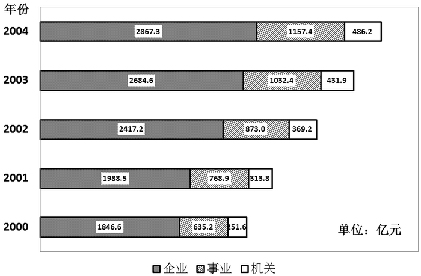

2000—2004年我国企业、事业、机关单位退休、离职、退职费用一览。

## Material M3


<!-- hyz-material-id: 01a19c8a-40ae-7040-9fd0-c902131cfcbe -->
5月份，全国房地产开发景气指数（简称“国房景气指数”）为105.07，比4月份回落0.59点，比去年同期提高9.13点。从分类指数看：房地产开发投资分类指数为105.56，比4月份提高0.62点，比去年同期提高12.43点；本年资金来源分类指数为116.69，比4月份回落1.46点，比去年同期提高20.07点；土地开发面积分类指数为90.15，比4月份提高1.70点，比去年同期回落2.40点；商品房空置面积分类指数为103.48，比4月份提高1.70点，比去年同期提高14.43点；房屋施工面积分类指数为111.36，比4月份回落0.49点，比去年同期提高17.43点。

        国家统计局今日发布数据显示，2010年5月份，全国70个大中城市房屋销售价格同比上涨12.4%，涨幅比4月份缩小0.4个百分点；环比上涨0.2%，涨幅比4月份缩小1.2个百分点。

        新建住宅销售价格同比上涨15.1%，涨幅比4月份缩小0.3个百分点；环比上涨0.4%，涨幅比4月份缩小1.0个百分点。

        1—5月，全国房地产开发投资13917亿元，同比增长38.2%。其中，商品住宅投资9643亿元，同比增长35.7%，占房地产开发投资的比重为69.3%。5月份当月房地产开发完成投资3985亿元，比上月增加648亿元，增长19.4%。

        1—5月，全国房地产开发企业房屋施工面积28.51亿平方米，同比增长30.5%；房屋新开工面积6.15亿平方米，同比增长72.4%；房屋竣工面积1.92亿平方米，同比增长18.1%，其中，住宅竣工面积1.53亿平方米，增长14.8%。

        1—5月，全国房地产开发企业完成土地购置面积12943万平方米，同比增长31.1%，土地购置费2931亿元，同比增长89.7%。

        1—5月，全国商品房销售面积3.02亿平方米，比去年同期增长22.5%，增幅比1—4月回落10.3个百分点。其中，商品住宅销售面积增长19.9%，办公楼增长74.5%，商业营业用房增长45.7%。1—5月，商品房销售额1.58万亿元，同比增长38.4%，增幅比1—4月回落17.0个百分点。其中，商品住宅销售额增长33.6%，办公楼和商业营业用房分别增长112.5%和64.4%。

        5月份当月，商品房销售面积6777万平方米，比上月减少1274万平方米，下降15.8%；商品房销售额3335亿元，比上月减少1113亿元，下降25.0%。

        1—5月，房地产开发企业本年资金来源27288亿元，同比增长57.2%。其中，国内贷款5550亿元，增长43.6%；利用外资169亿元，下降24.8%；企业自筹资金9541亿元，增长54.3%；其他资金12029亿元，增长69.8%。在其他资金中，定金及预收款6697亿元，增长61.1%；个人按揭贷款3744亿元，增长88.8%。

        房屋销售价格同比继续上涨，但涨幅回落。2010年5月份，全国70个大中城市房屋销售价格同比上涨12.4%，涨幅比4月份缩小0.4个百分点；环比上涨0.2%，涨幅比4月份缩小1.2个百分点。

        新建住宅销售价格同比上涨15.1%，涨幅比4月份缩小0.3个百分点；环比上涨0.4%，涨幅比4月份缩小1.0个百分点。

        分类型看，与去年同月相比，经济适用房销售价格上涨1.4%；商品住宅销售价格上涨16.9%，其中普通住宅销售价格上涨16.3%，高档住宅销售价格上涨19.1%。与上月相比，经济适用房销售价格上涨0.1%；商品住宅销售价格上涨0.4%，其中普通住宅销售价格上涨0.5%，高档住宅销售价格上涨0.2%。

        二手住宅销售价格同比上涨9.2%，涨幅比4月份缩小1.3个百分点；环比下降0.4%，比4月份涨幅低2.1个百分点。

## Question 1


<!-- hyz-question-id: 01a19c8a-40ae-7040-9fd0-c91597993cda -->
```yaml
module: 常识判断
category: 法律常识
topics:
- 法理学
materials: []
passage_source: null
issues:
- order_unverified
```

### Stem

按法律关系所体现的社会内容的性质，可将其分为：

### Options

- A. 绝对法律关系和相对法律关系

- B. 平权型法律关系和隶属型法律关系

- C. 基本法律关系、普通法律关系和诉讼法律关系

- D. 成文法律关系和习惯法律关系

### Answer

C

### Explanation

A项错误，是依据义务人的范围不同进行的分类；

B项错误，是按照法律关系各主体之间的法律地位是否平等进行的分类；

C项正确，按法律关系所体现的社会内容的性质，法律关系分为基本法律关系、普通法律关系和诉讼法律关系；

D项错误，是按照法律制定程序不同进行的分类。

故正确答案为C。

## Question 2


<!-- hyz-question-id: 01a19c8a-40ae-7040-9fd0-c92d076cbdd8 -->
```yaml
module: 常识判断
category: 法律常识
topics:
- 行政法
materials: []
passage_source: null
issues:
- order_unverified
```

### Stem

当行政行为违法时，下列选项中，除哪个单位外，都拥有撤销权：

### Options

- A. 人民法院

- B. 人民检察院

- C. 国务院

- D. 作出行政行为的机关

### Answer

B

### Explanation

A项错误，人民法院拥有撤销权。《行政诉讼法》第五十四条规定：“人民法院经过审理，根据不同情况，分别作出以下判决：······（二）具体行政行为有下列情形之一的，判决撤销或者部分撤销，并可以判决被告重新作出具体行政行为······”；

B项正确，人民检察院不拥有任何撤销权；

C项错误，国务院拥有撤销权。《宪法》第八十九条规定：“国务院行使下列职权：······（十三）改变或者撤销各部、各委员会发布的不适当的命令、指示和规章；（十四）改变或者撤销地方各级国家行政机关的不适当的决定和命令。······”；

D项错误，作出行政行为的机关拥有撤销权。《行政诉讼法》第五十一条规定：“人民法院对行政案件宣告判决或裁定前，原告申请撤诉的，或者被告改变其所作的具体行政行为，原告同意并申请撤诉的，是否准许，由人民法院裁定。”该条规定说明，行政机关发现自己作出的行政行为有错可以依法自行撤销或改变行政行为。

故正确答案为B。

## Question 3


<!-- hyz-question-id: 01a19c8a-40ae-7040-9fd0-c93b0b266978 -->
```yaml
module: 常识判断
category: 法律常识
topics:
- 行政法
materials: []
passage_source: null
issues:
- order_unverified
```

### Stem

行政执法与行政权不可分离，这是由行政权的特点决定的。下列不属于行政执法特点的是：

### Options

- A. 自由裁量

- B. 不可放弃

- C. 不告不理

- D. 主体特定

### Answer

C

### Explanation

A、B、D三项正确，三者均为行政执法的特征。行政执法是指建立在近代国家权利的立法、执法、司法三分立的基础上的国家行政机关和法律委托的组织及其公职人员依照法定职权和程序行使行政管理权，贯彻实施国家立法机关所制定的法律的活动。行政执法具有以下特征：执法主体的法定性和国家代表性（即主体特定）、执法具有主动性和单方意志性（即不可放弃）、执法具有极大的自由裁量性（即自由裁量）；

C项错误，不告不理是刑事诉讼和民事诉讼的原则，不是行政执法的特征。

本题为选非题，故正确答案为C。

## Question 4


<!-- hyz-question-id: 01a19c8a-40ae-7040-9fd0-c94bb9336bd1 -->
```yaml
module: 常识判断
category: null
topics: []
materials: []
passage_source: null
issues:
- order_unverified
```

### Stem

下列不属于规范性文件的是：

### Options

- A. 条例

- B. 规定

- C. 办法

- D. 公报

### Answer

D

### Explanation

规范性文件是各级机关、团体、组织制发的各类文件中最主要的一类，因其内容具有约束和规范人们行为的性质，故名称为规范性文件。规范性文件包括条例、规定、通告、办法、决定五种。

A、B、C三项正确，均属于规范性文件，排除；

D项错误，不属于规范性文件，当选。

本题为选非题，故正确答案为D。

## Question 5


<!-- hyz-question-id: 01a19c8a-40ae-7040-9fd0-c959717d9532 -->
```yaml
module: 常识判断
category: null
topics: []
materials: []
passage_source: null
issues:
- order_unverified
```

### Stem

不同的行政公文，按照不同的标准可以有不同的分类｡从行政公文行文关系的划分来说，下列行政公文中可以作为平行文的有：

### Options

- A. 命令（令）

- B. 通报

- C. 函

- D. 会议纪要

### Answer

CD

### Explanation

上行文，是指下级机关向所属上级机关和上级业务主管部门报送的公文，如请示、报告等；下行文，是指上级机关向其所属下级机关制发的公文，包括上级机关对下级机关的行文和上级业务主管部门对下级业务部门实施业务指导责任的行文，如命令（令）、决定、决议、公报、公告、通报、批复等；平行文，是指向同级机关以及不相隶属机关之间相互发送的公文，如函、会议纪要等。

A项命令和B项通报均为下行文。

备注：本题为12年真题，但自12年《党政机关公文处理条例》实施以后，将会议纪要的说法改为纪要，其文种本质不变，仍为泛行文，即可做上行文、平行文和下行文用。因此CD项均正确。

故正确答案为CD。

## Question 6


<!-- hyz-question-id: 01a19c8a-40ae-7040-9fd0-c964e79d4b8e -->
```yaml
module: 常识判断
category: null
topics: []
materials: []
passage_source: null
issues:
- order_unverified
```

### Stem

指示不具有的特点是：

### Options

- A. 内容广泛，具有普发性质

- B. 具有较强的时效性，强调及时快捷

- C. 作者广泛，不限制发权限

- D. 具有强制约束作用

### Answer

B

### Explanation

指示是对下级机关布置工作，阐明工作活动的指导原则时使用的一种公文。指示具有指导作用和依据作用。指示的特点有：作者广泛，不限制发权限；内容广泛，具有普发性质；具有一定的强制约束力，要求下级单位必须遵照执行。

A、C、D三项正确，均为指示的特点；

B项错误，具有较强的时效性、强调及时快捷是通报的特点。

本题为选非题，故正确答案为B。

（注：2012年，中共中央办公厅、国务院办公厅印发《党政机关公文处理工作条例》（中办发〔2012〕14号）。该《条例》第42条决定，停止执行1996年5月3日中共中央办公厅发布的《中国共产党机关公文处理条例》和2000年8月24日国务院发布的《国家行政机关公文处理办法》。故此题已不具备参考价值。）

## Question 7


<!-- hyz-question-id: 01a19c8a-40ae-7040-9fd0-c97e6df4d017 -->
```yaml
module: 常识判断
category: 经济常识
topics:
- 宏观经济与调控政策
materials: []
passage_source: null
issues:
- order_unverified
```

### Stem

一般来说，在发生通货膨胀时，靠固定工资生活的人：

### Options

- A. 生活水平会下降

- B. 生活水平会提高

- C. 没有变化

- D. 幸福感会增强

### Answer

A

### Explanation

通货膨胀指在货币流通的条件下，纸币的发行量超过了流通中实际需要的数量，多余的部分继续在流通中流转，导致货币贬值而引起的一段时间内物价持续而普遍上涨的现象。通货膨胀时，靠固定工资生活的人由于工资不变，生活水平随物价上涨而下降。

故正确答案为A。

## Question 8


<!-- hyz-question-id: 01a19c8a-40ae-7040-9fd0-c98a8a67eb07 -->
```yaml
module: 常识判断
category: 法律常识
topics:
- 民法典
materials: []
passage_source: null
issues:
- order_unverified
```

### Stem

我国法律规定社会组织取得企业法人资格应当具备的条件不包括：

### Options

- A. 有自己的名称

- B. 拥有规范的组织章程

- C. 有自己的组织机构和营业场所

- D. 注册资金

### Answer

B

### Explanation

本题考查法律常识。

A、C、D三项正确，属于社会组织取得法人资格应具备的条件，均排除；

B项错误，《中华人民共和国民法典》第五十八条规定：“法人应当依法成立。法人应当有自己的名称、组织机构、住所、财产或者经费。法人成立的具体条件和程序，依照法律、行政法规的规定。设立法人，法律、行政法规规定须经有关机关批准的，依照其规定。”

B项有一定的干扰性，它实际上是全民所有制企业、集体所有制企业取得法人资格应具备的条件，而非社会组织。

本题为选非题，故正确答案为B。

**本题相关知识点：**

法人是具有民事权利能力和民事行为能力，依法独立享有民事权利和承担民事义务的组织。法人的民事权利能力和民事行为能力，从法人成立时产生，到法人终止时消灭。

## Question 9


<!-- hyz-question-id: 01a19c8a-40ae-7040-9fd0-c9972d471c19 -->
```yaml
module: 常识判断
category: null
topics: []
materials: []
passage_source: null
issues:
- order_unverified
```

### Stem

在社会主义市场经济条件下，属于政府职能的有：

### Options

- A. 企业人事管理

- B. 企业注册登记

- C. 企业生产经营管理

- D. 企业财务管理

### Answer

B

### Explanation

在社会主义市场经济条件下，政府职能主要体现在经济调节、市场监管、社会管理和公共服务四个方面。

A、C、D三项错误，均为企业内部事务，与政府职能无直接关系；

B项正确，企业注册登记属于行政许可，政府通过行政许可实现市场监管职能。

故正确答案为B。

## Question 10


<!-- hyz-question-id: 01a19c8a-40ae-7040-9fd0-c9aadc51a082 -->
```yaml
module: 常识判断
category: 法律常识
topics:
- 宪法
materials: []
passage_source: null
issues:
- order_unverified
```

### Stem

根据我国宪法规定，法律和其他议案由全国人民代表大会全体代表的多少通过：

### Options

- A. 三分之一以上多数

- B. 过半数

- C. 三分之二以上多数

- D. 四分之三以上多数

### Answer

B

### Explanation

《宪法》第六十四条规定：“宪法的修改由全国人大常委会或者五分之一以上的全国人大代表提议，并由全国人大以全体代表的三分之二以上的多数通过。法律和其他议案由全国人民代表大会以全体代表的过半数通过。”

故正确答案为B。

## Question 11


<!-- hyz-question-id: 01a19c8a-40ae-7040-9fd0-c9b5a4c482f7 -->
```yaml
module: 常识判断
category: null
topics: []
materials: []
passage_source: null
issues:
- order_unverified
```

### Stem

我党的根本领导方法和工作方法是：

### Options

- A. 一切为了群众，一切依靠群众

- B. 从群众中来，到群众中去

- C. 独立自主，自力更生

- D. 解放思想，实事求是

### Answer

B

### Explanation

A项错误，B项正确，唯物史观关于人民群众是历史创造者的原理，是无产阶级政党的群众观点和群众路线的理论基础。群众观点是无产阶级政党的根本观点。群众路线是无产阶级政党的根本路线，也是党的根本领导方法和工作方法。群众路线基本内容为“一切为了群众，一切依靠群众，从群众中来，到群众中去”，其中，“一切为了群众，一切依靠群众”是群众路线的核心内容，“一切为了群众”是目的，是党的根本宗旨，是党一切工作的根本出发点。“一切依靠群众”，是要解决手段问题。“从群众中来，到群众中去”，是党最基本的领导方法和工作方法；

C项错误，“独立自主，自力更生”是我国革命、建设和改革开放的基本经验和重要原则；

D项错误，“解放思想，实事求是”是邓小平理论的精髓。

故正确答案为B。

## Question 12


<!-- hyz-question-id: 01a19c8a-40ae-7040-9fd0-c9c58f614430 -->
```yaml
module: 常识判断
category: 经济常识
topics:
- 市场经济
materials: []
passage_source: null
issues:
- order_unverified
```

### Stem

市场是什么基本范畴：

### Options

- A. 货币经济

- B. 商品经济

- C. 供求经济

- D. 实物经济

### Answer

B

### Explanation

A项错误，货币经济是资本主义发展到全球垄断主义的经济形态，货币经济的本质特征是货币是作为价值尺度和流通手段发挥作用的；

B项正确，商品经济是直接以市场交换为目的的经济形式，它包括商品生产和商品流通，市场是商品经济的基本范畴；

C项错误，不存在供求经济的说法；

D项错误，实物经济是指物质的、精神的产品和服务的生产、流通等经济活动。

故正确答案为B。

## Question 13


<!-- hyz-question-id: 01a19c8a-40ae-7040-9fd0-c9d25bd89ad6 -->
```yaml
module: 常识判断
category: 法律常识
topics:
- 行政法
materials: []
passage_source: null
issues:
- order_unverified
```

### Stem

下列选项中，属于公务员应当具备的条件是：

### Options

- A. 具有身份证、军民证或护照

- B. 年满20周岁，且无犯罪记录

- C. 男性身高170cm以上，女性身高165cm以上

- D. 具有良好的品行

### Answer

D

### Explanation

根据《公务员法》第十三条的规定：“公务员应当具备下列条件：（一）具有中华人民共和国国籍；（二）年满十八周岁；（三）拥护中华人民共和国宪法，拥护中国共产党领导和社会主义制度；（四）具有良好的政治素质和道德品行；（五）具有正常履行职责的身体条件和心理素质；（六）具有符合职位要求的文化程度和工作能力；（七）法律规定的其他条件。”

故正确答案为D。

## Question 14


<!-- hyz-question-id: 01a19c8a-40ae-7040-9fd0-c9ec5d368450 -->
```yaml
module: 常识判断
category: 法律常识
topics:
- 行政法
materials: []
passage_source: null
issues:
- order_unverified
```

### Stem

机关对全体公务员进行的更新知识、提高工作能力的培训是：

### Options

- A. 业务培训

- B. 在职培训

- C. 任职培训

- D. 技术培训

### Answer

B

### Explanation

新《公务员法》第六十七条第一款规定：“机关对新录用人员应当在试用期内进行初任培训；对晋升领导职务的公务员应当在任职前或者任职后一年内进行任职培训；对从事专项工作的公务员应当进行专门业务培训；对全体公务员应当进行提高政治素质和工作能力、更新知识的在职培训，其中对专业技术类公务员应当进行专业技术培训。”

故正确答案为B。

## Question 15


<!-- hyz-question-id: 01a19c8a-40af-7982-92a0-a42a96c4fcdf -->
```yaml
module: 常识判断
category: null
topics: []
materials: []
passage_source: null
issues:
- order_unverified
```

### Stem

通报的表达方式侧重于：

### Options

- A. 叙事

- B. 说理

- C. 说明

- D. 议论

### Answer

A

### Explanation

通报是行政机关的公文种类之一，适用于表彰先进，批评错误，传达重要精神或者情况。通报以事实为前提，告知正反面典型或传递重要的精神或情况，主要是交流、了解情况，起教育宣传作用。通报的表达侧重于叙事。

故正确答案为A。

## Question 16


<!-- hyz-question-id: 01a19c8a-40af-7982-92a0-a433dee8927f -->
```yaml
module: 判断推理
category: null
topics: []
materials: []
passage_source: null
issues:
- order_unverified
```

### Stem

①挪动凳子

②屋子变亮

③脚绊了一下

④灯被打开

⑤妹妹走进房间

### Options

- A. 5—2—4—3—1

- B. 1—4—3—2—5

- C. 5—3—4—2—1

- D. 4—3—5—2—1

### Answer

C

### Explanation

观察5个事件，发现是事件发生的先后顺序。

根据选项首先对5、1、4进行比较，“妹妹走进房间”是整个事件的开端，整个事情的发展就很清晰了，妹妹走进房间时，脚被绊了一下，然后才开灯，开灯后，屋子变亮，最后还需要把绊脚的凳子挪开。

故正确答案为C。

## Question 17


<!-- hyz-question-id: 01a19c8a-40af-7982-92a0-a44bcc05116f -->
```yaml
module: 判断推理
category: null
topics: []
materials: []
passage_source: null
issues:
- order_unverified
```

### Stem

①到国外学习手术支架生产技术

②寻求创业初始资金

③回国创业

④为国家节省开支数十亿元

⑤国产支架市场占有率大幅提高

### Options

- A. 5—4—1—3—2

- B. 1—3—2—5—4

- C. 3—2—5—4—1

- D. 1—3—2—4—5

### Answer

B

### Explanation

第一步：给出解题思路。

本题表述的是出国学习对支架产业的作用过程，应按照时间先后、事件因果等顺序进行排列。

第二步：逐一判断选项。

A项，国产支架市场占有率大幅提高是创业导致的结果，故③肯定在⑤前，该项逻辑错误；

B项，正确的逻辑顺序是，“国外学成技术”然后“回国创业”，创业自然需要资本，创业成功后，市场占有率就高了，最后为国家节约了大量的开支。按照因果关系和事件正常的发展顺序排序，因此，该项逻辑正确；

C项，先到国外学习才能回国创业，故①肯定在③前，该项逻辑错误；

D项，国产支架市场占有率提高，然后才能为国家节省开支，故⑤肯定在④之前，该项逻辑错误。

故正确答案为B。

## Question 18


<!-- hyz-question-id: 01a19c8a-40af-7982-92a0-a458ab8f4f4f -->
```yaml
module: 判断推理
category: null
topics: []
materials: []
passage_source: null
issues:
- order_unverified
```

### Stem

①中年妇女被救醒

②小区警察在小区巡逻值班

③一个中年妇女跌倒在地上

④小区表彰值班警察

⑤拨打120急救电话

### Options

- A. 2—3—5—1—4

- B. 3—4—5—1—2

- C. 4—3—2—1—5

- D. 4—5—2—3—1

### Answer

A

### Explanation

首尾句确定原则。观察5个条件，可以知道事情的起因是妇女跌倒，事件的经过是被值班警察所救，最后妇女被救醒，警察得到表彰的故事，脉络非常清晰，④为尾句。只有A项符合，验证A项的事件顺序：警察在巡逻时，发现中年妇女跌倒，急忙拨打120急救电话，最后中年妇女被救，而警察被表彰。

故正确答案为A。

## Question 19


<!-- hyz-question-id: 01a19c8a-40af-7982-92a0-a46c72dc2773 -->
```yaml
module: 判断推理
category: null
topics: []
materials: []
passage_source: null
issues:
- order_unverified
```

### Stem

①同学们希望听名师讲京剧

②同学们对京剧戏曲有更进一步了解

③某高校开放了一门京剧课程

④引起同学们极大的兴趣

⑤学校邀请著名京剧表演艺术大家来学校开办讲座

### Options

- A. 3—4—1—5—2

- B. 2—5—4—1—3

- C. 2—4—5—1—3

- D. 3—2—4—1—5

### Answer

A

### Explanation

根据选项，我们可以先观察②句和③句，明显③句为首句。

再接着比较A项和D项的尾句，⑤句在②句前，得到A为答案。梳理A项顺序是，高校开放京剧课程，引起同学兴趣，同学们进而提出要听名师讲解京剧，学校满足了同学们的要求，最后，同学们对京剧有了更深的了解。

故正确答案为A。

## Question 20


<!-- hyz-question-id: 01a19c8a-40af-7982-92a0-a473e8992356 -->
```yaml
module: 判断推理
category: null
topics: []
materials: []
passage_source: null
issues:
- order_unverified
```

### Stem

①砍大鳌腿支撑天地，从此天地就永久牢固了

②盘古开天用四根“不周山”大柱子支撑天地

③共工与颛顼争夺帝位将“不周山”撞倒

④天地裂开了一条大缝

⑤女娲炼石补天

### Options

- A. 1—2—3—4—5

- B. 2—3—4—5—1

- C. 3—2—4—1—5

- D. 4—2—3—5—1

### Answer

B

### Explanation

根据选项，尾句在①、⑤间比较，①“天地就永久牢固了”是最后的结果，答案就在B、D两项中。比较B、D两项，其实就是比较②和④的先后，②在先，本题为事件排序题。通过略读题干可知一开始天地是稳固的，后来经过一些变故，天地裂开一道缝，后几经周折，天地又恢复常态。

故正确答案为B。

## Question 21


<!-- hyz-question-id: 01a19c8a-40af-7982-92a0-a48059f45501 -->
```yaml
module: 判断推理
category: 图形推理
topics:
- 数量规律-线
materials: []
passage_source: null
issues:
- order_unverified
```

### Stem

从所给四个选项中，选择最合适的一个填入问号处，使之呈现一定的规律性：

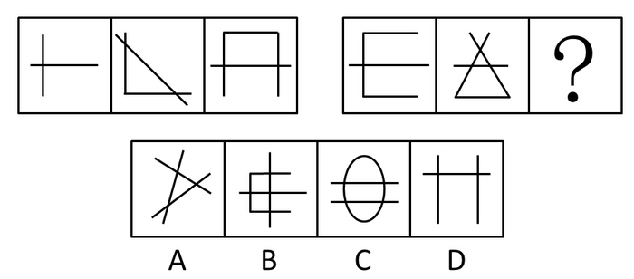

### Options

- A. A

- B. B

- C. C

- D. D

### Answer

C

### Explanation

元素组成不同，且无明显属性规律，考虑数量规律。观察发现，题干图形出现很多出头端点，优先考虑笔画数，发现第一组图均是两笔画图形，第二组图前两幅图均是两笔画图形，因此？处也选择一个两笔画图形，只有C选项符合。

故正确答案为C。

## Question 22


<!-- hyz-question-id: 01a19c8a-40af-7982-92a0-a4922ac60e4b -->
```yaml
module: 判断推理
category: 图形推理
topics:
- 数量规律-线
materials: []
passage_source: null
issues:
- order_unverified
```

### Stem

从所给四个选项中，选择最合适的一个填入问号处，使之呈现一定的规律性：

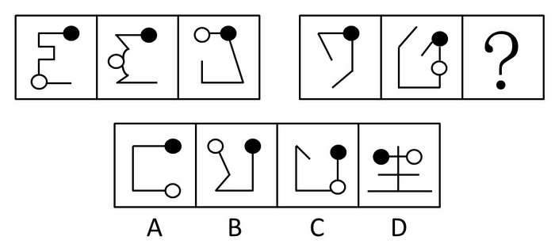

### Options

- A. A

- B. B

- C. C

- D. D

### Answer

A

### Explanation

题目考点较难，考查黑白点间相对位置的变化。

第一组图黑球不动，白球距离黑球越来越近，黑球和白球间的线段数分别为6、3、1，二级等差为3、2；第二组图黑球不动，白球距离黑球越来越远，黑球和白球间的线段数分别为0、1、？，其二级等差也应该为1、2，故？=3。

故正确答案为A。

## Question 23


<!-- hyz-question-id: 01a19c8a-40af-7982-92a0-a4ab8d473f55 -->
```yaml
module: 判断推理
category: 图形推理
topics:
- 数量规律-素
materials: []
passage_source: null
issues:
- order_unverified
```

### Stem

从所给四个选项中，选择最合适的一个填入问号处，使之呈现一定的规律性：

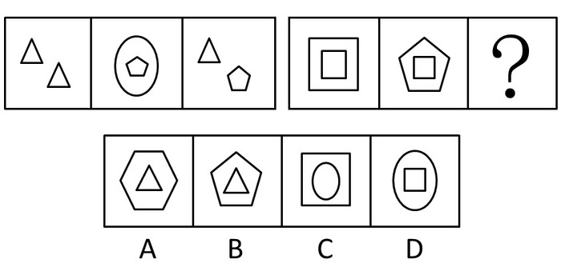

### Options

- A. A

- B. B

- C. C

- D. D

### Answer

B

### Explanation

元素组成相似，整体数元素的个数。

第一组，三角形的个数为3，五边形的个数为2，圆形的个数为1，也就是说三个不同的元素个数成等差；第二组已知正方形个数为3，五边形为1，那么选项或者为2个相同的元素，或者补一个五边形再加一个其他元素，选项中只有B符合。

故正确答案为B。

## Question 24


<!-- hyz-question-id: 01a19c8a-40af-7982-92a0-a4b7ee367e2c -->
```yaml
module: 判断推理
category: 图形推理
topics:
- 样式规律-加减同异
- 样式规律-黑白运算
materials: []
passage_source: null
issues:
- order_unverified
```

### Stem

从所给四个选项中，选择最合适的一个填入问号处，使之呈现一定的规律性：

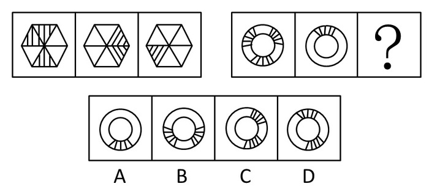

### Options

- A. A

- B. B

- C. C

- D. D

### Answer

B

### Explanation

元素组成相似，考虑元素的叠加-阴影部分叠加。

第一组图形中，所有的阴影部分位置保持不变，叠加在一起就是整个六边形图形；第二组图形也有此规律，把所有阴影部分叠加在一起就是整个环图形。

故正确答案为B。

## Question 25


<!-- hyz-question-id: 01a19c8a-40af-7982-92a0-a4ca8cfb2b73 -->
```yaml
module: 判断推理
category: 图形推理
topics:
- 属性规律-对称性
materials: []
passage_source: null
issues:
- order_unverified
```

### Stem

从所给四个选项中，选择最合适的一个填入问号处，使之呈现一定的规律性：

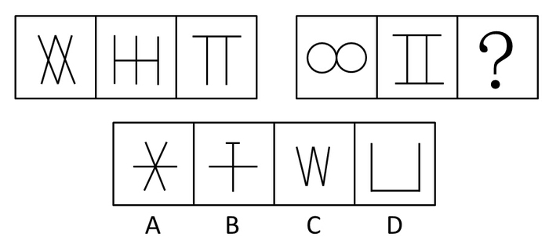

### Options

- A. A

- B. B

- C. C

- D. D

### Answer

C

### Explanation

元素组成凌乱，先看属性，满足对称。

第一组是轴对称，同时图形元素都是由字母构成的，第一组图形为2个X、2个H、2个T；第二组同样为字母，2个O、2个I。

选项B、C、D都是字母，但B、D两项字母位置相对，排除；C项两个V并列而成，当选。

故正确答案为C。

## Question 26


<!-- hyz-question-id: 01a19c8a-40af-7982-92a0-a4d8840c25d8 -->
```yaml
module: 判断推理
category: 图形推理
topics:
- 样式规律-加减同异
materials: []
passage_source: null
issues:
- order_unverified
```

### Stem

请从所给的四个选项中，选择最合适的一项填在问号处，使之呈现一定的规律性：

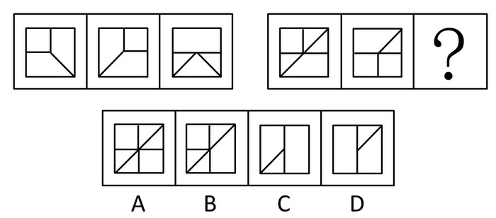

### Options

- A. A

- B. B

- C. C

- D. D

### Answer

C

### Explanation

元素组成相似，元素叠加-去同存异。

第一组，外框保持不变，内部线条去同存异；第二组同样规律，得到图形C。

故正确答案为C。

## Question 27


<!-- hyz-question-id: 01a19c8a-40af-7982-92a0-a4e2abbbf291 -->
```yaml
module: 判断推理
category: 图形推理
topics:
- 属性规律-曲直性
- 文字/字母/数字类
materials: []
passage_source: null
issues:
- order_unverified
```

### Stem

请从所给的四个选项中，选择最合适的一项填在问号处，使之呈现一定的规律性：

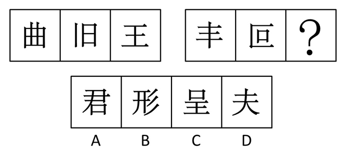

### Options

- A. A

- B. B

- C. C

- D. D

### Answer

C

### Explanation

汉字元素组成，排除数笔画，也无其他数量规律，看属性。都是直线构成，只有C项的汉字“呈”都是直线笔画。

故正确答案为C。

## Question 28


<!-- hyz-question-id: 01a19c8a-40af-7982-92a0-a4fc07a12385 -->
```yaml
module: 判断推理
category: 图形推理
topics:
- 属性规律-对称性
materials: []
passage_source: null
issues:
- order_unverified
```

### Stem

请从所给的四个选项中，选择最合适的一项填在问号处，使之呈现一定的规律性。 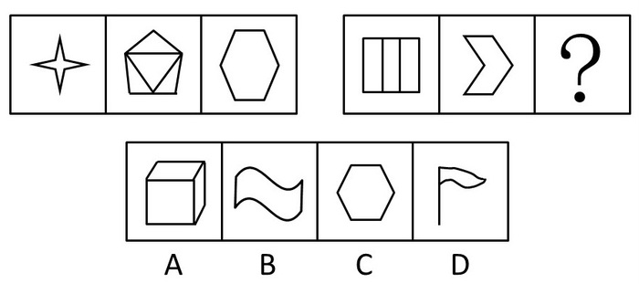

### Options

- A. A

- B. B

- C. C

- D. D

### Answer

C

### Explanation

元素组成凌乱，看属性。

第一组图形都满足对称性，轴对称；第二组也满足轴对称。

选项中只有C项满足轴对称。

故正确答案为C。

## Question 29


<!-- hyz-question-id: 01a19c8a-40af-7982-92a0-a504f724efd4 -->
```yaml
module: 判断推理
category: 图形推理
topics:
- 位置规律-旋转
materials: []
passage_source: null
issues:
- order_unverified
```

### Stem

请从所给的四个选项中，选择最合适的一项填在问号处，使之呈现一定的规律性。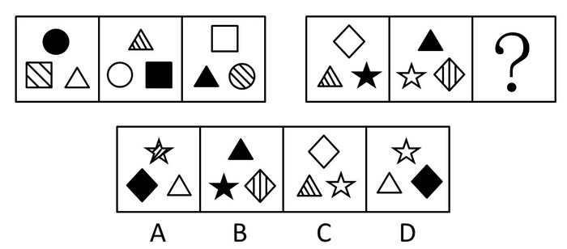

### Options

- A. A

- B. B

- C. C

- D. D

### Answer

A

### Explanation

元素组成相同，元素位置-旋转。

每组图形中图形本身位置在旋转，同时，不同颜色的阴影也在朝着相反的方向旋转。第二组是图形在顺时针旋转，阴影则是逆时针旋转。

故正确答案为A。

## Question 30


<!-- hyz-question-id: 01a19c8a-40af-7982-92a0-a51090e6ce7c -->
```yaml
module: 判断推理
category: 图形推理
topics:
- 样式规律-加减同异
- 样式规律-黑白运算
materials: []
passage_source: null
issues:
- order_unverified
```

### Stem

请从所给的四个选项中，选择最合适的一项填在问号处，使之呈现一定的规律性： 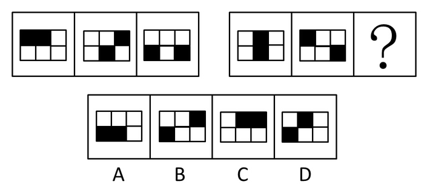

### Options

- A. A

- B. B

- C. C

- D. D

### Answer

B

### Explanation

黑白块无明显位置规律，优先考虑黑白块运算。

第一组的阴影部分位置保持不变叠加，组成一个矩形的阴影；第二组，同样的规律，要想组成一个大的矩形阴影部分，就要补充前两个叠加所缺少的部分。

故正确答案为B。

## Question 31


<!-- hyz-question-id: 01a19c8a-40af-7982-92a0-a5227f6b134e -->
```yaml
module: 判断推理
category: 逻辑判断
topics:
- 集合推理
materials: []
passage_source: null
issues:
- order_unverified
```

### Stem

北京市某公司发现有年收入在12万元以上的人员未申报缴纳个人所得税。

如果上述断定为真，则以下哪项不能确定真假：

Ⅰ.北京市某公司所有年收入在12万元以上的人员都未申报缴纳个人所得税。

Ⅱ.北京市某公司所有年收入在12万元以上的人员都申报缴纳了个人所得税。

Ⅲ.北京市某公司有年收入在12万元以上的人员申报缴纳了个人所得税。

Ⅳ.北京市某公司年收入在12万元以上的小李申报缴纳了个人所得税。

### Options

- A. Ⅰ、Ⅱ、Ⅲ和Ⅳ

- B. Ⅰ、Ⅲ、Ⅳ

- C. Ⅰ和Ⅲ

- D. Ⅰ和Ⅳ

### Answer

B

### Explanation

第一步：分析题干。

“有的”能推出的是有的，不能推出全部，不能推出有的不。

已知条件：有年收入在12万元以上的人员未申报缴纳个人所得税。

第二步：逐一判断几个结论。

根据有的不能推出所有，所以Ⅰ是可能，不能确定的；Ⅱ所有都申报，与题干有的未申报矛盾，故确定为假；Ⅲ有的未申报，不能推出有的申报，是不确定的；Ⅳ有的不能推出个人，不能确定。

故正确答案为B。

## Question 32


<!-- hyz-question-id: 01a19c8a-40af-7982-92a0-a531a6c03e71 -->
```yaml
module: 判断推理
category: null
topics: []
materials: []
passage_source: null
issues:
- order_unverified
```

### Stem

最近一段时期，有关要发生地震的传言很多，小明问在院里乘凉的爷爷：“爷爷，他们都说明天要地震了。”爷爷说：“根据我的观察，明天不必然地震。”小明说：“那您的意思是明天肯定不会地震了？”爷爷说不对，小明陷入迷惑。

以下哪句话与爷爷的意思最为接近？

### Options

- A. 明天必然不地震

- B. 明天可能地震

- C. 明天可能不地震

- D. 明天不可能地震

### Answer

C

### Explanation

首先分析题干。本题考的模态命题，模态命题需要记住的矛盾关系式：不必然等于可能不。

这道题重点理解“明天不必然地震”，“不必然”就是否定“必然”，“必然”的否命题是“可能不”，因此答案为“明天可能不会地震”。

故正确答案为C。

## Question 33


<!-- hyz-question-id: 01a19c8a-40af-7982-92a0-a54d503e2c5c -->
```yaml
module: 判断推理
category: 逻辑判断
topics:
- 日常结论
materials: []
passage_source: null
issues:
- order_unverified
```

### Stem

在20世纪30年代，人们已经发现了一种有绿色和褐色纤维的棉花。但是，直到最近培育出一种可以机纺的长纤维品种后，它们才具有了商业上的价值。由于这种棉花不需要染色，加工企业就省去了染色的开销，并且避免了由染色工艺流程带来的环境污染。

从题干可推出以下哪项结论：

Ⅰ.只能手纺的绿色或褐色棉花不具有商业价值。

Ⅱ.短纤维的绿色或褐色棉花只能手纺。

Ⅲ.在棉花加工中如果省去了染色工艺流程就可以避免造成环境污染。

### Options

- A. Ⅰ和Ⅱ

- B. Ⅰ和Ⅲ

- C. Ⅱ和Ⅲ

- D. 只有Ⅰ

### Answer

D

### Explanation

根据“直到最近培育出一种可以机纺的长纤维品种后，它们才具有了商业上的价值”可知“只能手纺的绿色或褐色棉花不具有商业价值。”Ⅰ正确。

“短纤维的绿色或褐色棉花只能手纺”无法推出，不确定是否有别的方式，Ⅱ错误。

“在棉花加工中如果省去了染色工艺流程就可以避免造成环境污染”过于绝对，无法确定棉花加工过程中是否有其他污染产生，Ⅲ错误。因此只有Ⅰ是正确的。

故正确答案为D。

## Question 34


<!-- hyz-question-id: 01a19c8a-40af-7982-92a0-a551ec01ff5e -->
```yaml
module: 判断推理
category: 逻辑判断
topics:
- 真假推理-其他
materials: []
passage_source: null
issues:
- order_unverified
```

### Stem

田径场上正在进行100米决赛。参加决赛的是A、B、C、D、E、F六个人。赛前，小李、小张、小王对谁会取得冠军谈了自己的看法：小张认为，冠军不是A就是B；小王坚信，冠军绝不是C；小李则认为，D、F都不可能取得冠军。比赛结束后，人们发现三个人中只有一个人的看法是正确的。

由此推断，谁是100米决赛的冠军：

### Options

- A. A

- B. B

- C. C

- D. E

### Answer

C

### Explanation

第一步：首先分析题干，一真题型。

进而发现没有明显的矛盾和反对关系。条件给的对象很多，这个时候用代入法会更合适。

第二步：逐一代入选项。

若冠军是A，三个人的话都是对的，不符合；

若冠军是B，三个人的话都是对的，不符合；

若冠军是C，则小李正确，小张、小王错误，符合题干，即C项满足题意。

故正确答案为C。

## Question 35


<!-- hyz-question-id: 01a19c8a-40af-7982-92a0-a567da076615 -->
```yaml
module: 判断推理
category: 逻辑判断
topics:
- 日常结论
materials: []
passage_source: null
issues:
- order_unverified
```

### Stem

随着心脏病成为人类的第一杀手，人体血液中的胆固醇含量越来越引起人们的重视。一个人血液中的胆固醇含量越高，患致命的心脏病的风险也就越大。至少有三个因素会影响人的血液中胆固醇的含量，它们是抽烟、饮酒和运动。

如果上述断定为真，则以下哪项一定为真：

Ⅰ.某些生活方式的改变，会影响一个人患心脏病的风险。

Ⅱ.如果一个人的血液中的胆固醇含量不高，那么他患致命的心脏病的风险也不高。

Ⅲ.血液中的胆固醇高含量是造成当今人类死亡的主要原因。

### Options

- A. 只有Ⅰ

- B. 只有Ⅱ

- C. 只有Ⅲ

- D. Ⅰ和Ⅲ

### Answer

A

### Explanation

第一步：首先分析题干。

题干可简化为：胆固醇高→患心脏病风险大，同时抽烟、饮酒、运动会影响胆固醇含量的高低。

第二步：逐一分析选项。

Ⅰ项，抽烟、饮酒、运动均属于生活方式，而且得到的是风险大，符合题目表达，正确；

Ⅱ项，否前不一定能推出否后，故该项错误，排除；

Ⅲ项说胆固醇含量高是人类死亡的主要原因，题干中讲的是心脏病，而不是胆固醇，偷换概念，排除。

故只有Ⅰ是正确的。

故正确答案为A。

## Question 36


<!-- hyz-question-id: 01a19c8a-40af-7982-92a0-a579350f1610 -->
```yaml
module: 判断推理
category: 逻辑判断
topics:
- 原因解释
materials: []
passage_source: null
issues:
- order_unverified
```

### Stem

对A市居民参加体育锻炼的情况进行的调查表明，经常参加体育锻炼的居民数近两年来不断上升，而某健身中心的顾客数略有下降。

以下各项除了哪一项，都有助于解释上述矛盾？

### Options

- A. 该健身中心对顾客的统计不仔细，统计的准确性值得怀疑

- B. 为节省开支，许多居民改为到公园参加锻炼

- C. A市调查中抽取的样本较多，所以调查具有较高的准确性

- D. 近两年A市新开办了许多健身中心

### Answer

C

### Explanation

第一步：分析题干。

题干可简化为：锻炼的人多了，去健身中心的人少了，寻找能解决这两者间矛盾的选项。

第二步：逐一分析选项。

A项说明统计不仔细的原因造成了矛盾，可以解释健身中心为什么人少；

B项是去公园参加锻炼所以没去健身中心，可以解释；

C项肯定样本的正确性，加剧了矛盾，无法解释；

D项开健身中心的多了，锻炼的人分流了，可以解释。

本题为选非题，故正确答案为C。

## Question 37


<!-- hyz-question-id: 01a19c8a-40af-7982-92a0-a580e17b85c0 -->
```yaml
module: 判断推理
category: 逻辑判断
topics:
- 日常结论
materials: []
passage_source: null
issues:
- order_unverified
```

### Stem

诗歌可以被描述成将诸多的想法凝聚于少数语言的形式。但是，诗人通常不会接受这样一个关于诗歌的定义。因此：

### Options

- A. 诗人通常拒绝对他的作品加以解释

- B. 诗是很难写的

- C. 世界可以被凝聚在诗歌中

- D. 即使是最精练的描述，也不一定就是定义

### Answer

D

### Explanation

第一步：分析题干。

本题讨论的话题：诗歌可以被描述成将诸多的想法凝聚于少数语言的形式。但是，诗人通常不会接受这样一个关于诗歌的定义。

第二步：逐一分析选项。

A项诗人通常拒绝解释是题干中未涉及的，无关；

B项难写也没有提到，排除；

C项无关；

D项通过诗人不认同对诗歌的普适定义这一点可以得到，只有D项是对题干信息的总结。

故正确答案为D。

## Question 38


<!-- hyz-question-id: 01a19c8a-40af-7982-92a0-a59fc529ceb2 -->
```yaml
module: 判断推理
category: 逻辑判断
topics:
- 必要条件
materials: []
passage_source: null
issues:
- order_unverified
```

### Stem

体内不产生P450物质的人与产生P450物质的人比较，前者患帕金森式综合征（一种影响脑部的疾病）的可能性三倍于后者。因为P450物质可保护脑部组织不受有毒化学物质的侵害。因此，有毒化学物质可能导致帕金森式综合征。

下列哪项如果为真，将最有力地支持以上论证？

### Options

- A. 除了保护脑部不受有毒化学物质的侵害，P450对脑部无其他作用

- B. 体内不能产生P450物质的人，也缺乏产生某些其他物质的能力

- C. 一些帕金森式综合征病人有自然产生P450的能力

- D. 当用多己胺——一种脑部自然产生的化学物质治疗帕金森式综合征病人时，病人的症状减轻

### Answer

A

### Explanation

第一步：找到论点和论据。

论点：得出结论“有毒化学物质可能导致帕金森综合症”。

论据：题干由“体内产生P450的人患帕金森综合症的可能性低，而P450可以保护脑部组织不受有毒化学物质的侵害”。

第二步：逐一分析选项。

A项证明P450无其他作用，通过排除他因来加强论点和论据的联系。否则可能是其他作用影响其得帕金森式综合症，不一定能得出题干结论；

B项其他物质能力对论点无作用，无关选项；

C项产生P450与导致帕金森综合症无关；

D项多己胺均与致病无关。

故正确答案为A。

## Question 39


<!-- hyz-question-id: 01a19c8a-40af-7982-92a0-a5af6097c6b9 -->
```yaml
module: 判断推理
category: 逻辑判断
topics:
- 两真两假
materials: []
passage_source: null
issues:
- order_unverified
```

### Stem

张飞和李柏今年都报考了MBA，关于他们的考试有如下四个断言：（1）他们两人至少有一个考上；（2）张飞并不必然考上；（3）李柏确实考上了；（4）并非张飞可能没考上。最后录取结果表明：这四个断言中有两个是真的，两个是假的。

下面哪一个结果可以从上述条件推出？

### Options

- A. 张飞考上了，李柏没考上

- B. 张飞和李柏都考上了

- C. 张飞和李柏都没考上

- D. 李柏考上了，张飞没考上

### Answer

A

### Explanation

第一步：分析题干。

题干可以翻译：（1）张飞或者李柏；（2）张飞非必然；（3）李柏；（4）张飞非可能不。

第二步：逐一分析选项。

根据模态知识，“必然”跟“可能不”是矛盾关系，即（2）、（4）必有一真、必有一假。根据两真两假，这意味着（1）和（3）也必有一真、必有一假。（3）和（1）的关系为包容关系，即假如（3）为真，那么（1）肯定为真，跟题干相冲突了，这意味（3）为真假设不成立，得到为假。根据（3）为假，（1）为真，我们可以推出张飞考上了、李柏没考上。

故正确答案为A。

## Question 40


<!-- hyz-question-id: 01a19c8a-40af-7982-92a0-a5b314a805f4 -->
```yaml
module: 判断推理
category: 逻辑判断
topics:
- 搭桥
materials: []
passage_source: null
issues:
- order_unverified
```

### Stem

罗斯镇修缮其所有的道路需花费100万美元，但是在这些道路修缮完成之后的1年内，罗斯镇可以因此而避免承担300万美元的损失，因为这个数目是现在罗斯镇每年对没有修缮的道路造成的汽车损害的赔偿额。

下列哪项如果正确，对以上结论提供了最强有力的支持？

### Options

- A. 与罗斯镇毗邻的地区同样对他们的道路所造成的汽车损害给予赔偿

- B. 罗斯镇所有的道路都得到修缮后，几年内不会出现道路损害汽车的情况

- C. 如果罗斯镇要在1年内花费100万美元用于道路修缮，它就需要提高附加税

- D. 恶劣的气候给罗斯镇的道路带来的损害程度隔年之间相差很大

### Answer

B

### Explanation

第一步：找到论点和论据。

论点：罗斯镇可以通过修缮道路花费100万美元避免承担300万美元的损失。

论据：罗斯镇每年对没有修缮的道路造成的汽车损害的赔偿额为300万美元。

第二步：逐一分析选项。

A项谈的是毗邻地区，无关；

B项如果成立，要罗斯镇所有的道路都得到修缮后，几年内不会出现道路损害汽车的情况，就能够在论点和论据间搭设桥梁，因此，B项符合题意；

C项附加税为无关选项；

D项气候带来的损害为无关项。

故正确答案为B。

## Question 41


<!-- hyz-question-id: 01a19c8a-40af-7982-92a0-a5c7658459f6 -->
```yaml
module: 数量关系
category: null
topics: []
materials: []
passage_source: null
issues:
- order_unverified
```

### Stem

\-2，-1，2，-2，( )，8

### Options

- A. 1

- B. \-1

- C. 4

- D. \-4

### Answer

D

### Explanation

相邻两项之间的关系为：-2×(-1)=2，−1×2=−2，即相邻两项之积等于第三项，故所求项为：2 × (−2) = −4，验证：−2×(−4) = 8，符合题干。

故正确答案为D。

## Question 42


<!-- hyz-question-id: 01a19c8a-40af-7982-92a0-a5df62bb29e3 -->
```yaml
module: 数量关系
category: null
topics: []
materials: []
passage_source: null
issues:
- order_unverified
```

### Stem

2246，3164，5180，6215，( )

### Options

- A. 5711

- B. 7132

- C. 8591

- D. 9125

### Answer

A

### Explanation

在作差不能发现规律的情况下，观察题干数字特性，数字较大且变化毫无规律，考虑机械划分。观察可以发现，数列中各项数字的数位之和都为14，2+2+4+6=14；3+1+6+4=14；5+1+8+0=14；6+2+1+5=14；故所求项各数位之和也应为14。

故正确答案为A。

## Question 43


<!-- hyz-question-id: 01a19c8a-40af-7982-92a0-a5e87560f53b -->
```yaml
module: 数量关系
category: null
topics: []
materials: []
passage_source: null
issues:
- order_unverified
```

### Stem

13/48，14/59，17/81，32/125，( )

### Options

- A. 49/213

- B. 50/219

- C. 50/239

- D. 49/239

### Answer

A

### Explanation

分子分母均为逐步递增趋势，故不需反约分转化；观察各项分母之间：48、59、81、125、(    )，相邻两项作差得到：11、22、44、(    )，为公比为2的等比数列，故下一项为88，所求项分母即为125+88=213，只有A项符合。

故正确答案为A。

## Question 44


<!-- hyz-question-id: 01a19c8a-40af-7982-92a0-a5f186f50d1d -->
```yaml
module: 数量关系
category: null
topics: []
materials: []
passage_source: null
issues:
- order_unverified
```

### Stem

11，14，12，20，13，30，( )，44，15，( )

### Options

- A. 15、55

- B. 14、60

- C. 14、62

- D. 15、60

### Answer

C

### Explanation

数列项数较多且出现两个括号，优先考虑交叉。其奇数项为：11、12、13、(    )、15，为连续自然数列，故括号内为14；其偶数项为：14、20、30、44、(    )，相邻两项作差可得：6、10、14、(    )，为公差为4的等差数列，故后面括号内为18，所求项为44+18=62。

故正确答案为C。

## Question 45


<!-- hyz-question-id: 01a19c8a-40af-7982-92a0-a605b8f32e62 -->
```yaml
module: 数量关系
category: null
topics: []
materials: []
passage_source: null
issues:
- order_unverified
```

### Stem

226，197，170，( )，122

### Options

- A. 100

- B. 145

- C. 125

- D. 123

### Answer

B

### Explanation

数列各项呈平稳递减趋势，优先考虑作差，而所求项在中间，一般采取数列试验的方式进行验证解题。相邻两项作差后得：29、27、(    )、(    )，猜测为公差为2的等差数列，则括号内分别为25、23，则所求项即为170-25=145。验证：145-23=122，与最后一项相符，满足。

故正确答案为B。

## Question 46


<!-- hyz-question-id: 01a19c8a-40af-7982-92a0-a61657b91212 -->
```yaml
module: 数量关系
category: 数学运算
topics:
- 普通行程
materials: []
passage_source: null
issues:
- order_unverified
```

### Stem

小强从学校出发赶往首都机场乘坐飞机回老家，若坐平均速度40千米/小时的机场大巴，则飞机起飞时他距机场还有12公里；如果坐出租车，车速50千米/小时，他能够先于起飞时间24分钟到达，则学校距离机场多少公里：

### Options

- A. 100

- B. 132

- C. 140

- D. 160

### Answer

C

### Explanation

若赶往机场的速度为40km/h时，则在飞机起飞时还有12公里的路程才能到达；若赶往机场的速度为50km/h时，能够在飞机起飞24分钟前到达，即在飞机起飞时可以超过机场24/60 × 50 = 20公里的路程；根据盈亏思想，则可求得距离飞机起飞的时间= (20 + 12) ÷ (50 − 40) = 32 ÷ 10 = 3.2小时。故学校距离机场的路程= 40 × 3.2 + 12 = 128 + 12 = 140公里。可另列方程解题。

故正确答案为C。

## Question 47


<!-- hyz-question-id: 01a19c8a-40af-7982-92a0-a624fa8079e4 -->
```yaml
module: 数量关系
category: 数学运算
topics:
- 和差倍比问题
materials: []
passage_source: null
issues:
- order_unverified
```

### Stem

某单位组织员工外出活动，所有员工刚好坐满10辆客车。已知大客车每辆乘坐50人，小客车每辆车坐30人，大客车比小客车一共多坐了260人。则大客车有多少辆：

### Options

- A. 3

- B. 4

- C. 6

- D. 7

### Answer

D

### Explanation

根据题意，设大车有x辆，则小车有(10-x)辆，可列方程为：50x-30(10-x)=260，解得x=7。

故正确答案为D。

## Question 48


<!-- hyz-question-id: 01a19c8a-40af-7982-92a0-a63104b178f2 -->
```yaml
module: 数量关系
category: 数学运算
topics:
- 给效率比例型
materials: []
passage_source: null
issues:
- order_unverified
```

### Stem

工程队计划150天完成建筑，现计划30天后新增设备，提高20%工作效率，可以提前几天完成：

### Options

- A. 20

- B. 25

- C. 30

- D. 45

### Answer

A

### Explanation

设工程总量为150，则原工作效率为1，提高20%后的工作效率为1.2。按原工作效率工作30天时，工程总量还剩150-30=120，故提高工作效率后还要用120 ÷ 1.2 = 100天可以完成，总用时100+30=130天，比原计划少150-130=20天。

故正确答案为A。

## Question 49


<!-- hyz-question-id: 01a19c8a-40af-7982-92a0-a6434d08e4b0 -->
```yaml
module: 数量关系
category: 数学运算
topics:
- 几何结论类-相似图形
materials: []
passage_source: null
issues:
- order_unverified
```

### Stem

在一个正方形内画中、小两个正方形，使三个正方形具有公共顶点，这样大正方形被分割成了正方形区域甲和L形区域乙、丙。已知三块区域甲、乙、丙的周长之比为4:5:7，并且区域丙的面积为48，求大正方形的面积：

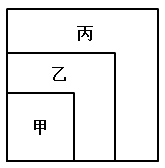

### Options

- A. 96

- B. 98

- C. 200

- D. 102

### Answer

B

### Explanation

因乙、丙为不规则图形，直线平移周长不变，故乙的周长与中正方形的周长相等，丙的周长与大正方形的周长相等；甲、乙、丙三图形的周长比为4:5:7，即小、中、大正方形的周长比为4:5:7，则小、中、大正方形的面积比为16:25:49；设小、中、大正方形的面积分别为16x、25x、49x，则丙的面积=大正方形-中正方形=49x-25x=48，则x=2，大正方形的面积为49 × 2 = 98。

故正确答案为B。

## Question 50


<!-- hyz-question-id: 01a19c8a-40af-7982-92a0-a65a5547e9f4 -->
```yaml
module: 数量关系
category: 数学运算
topics:
- 几何公式类-平面图形
materials: []
passage_source: null
issues:
- order_unverified
```

### Stem

一个长方形周长130厘米，如果它的宽增加1/5，长减少1/8，就得到一个相同周长的新长方形，则原长方形的面积为多少平方厘米：

### Options

- A. 1000

- B. 900

- C. 850

- D. 840

### Answer

A

### Explanation

设原长方形长、宽分别为x、y，宽增加1/5、长减少1/8、周长不变，故可列式为7/8 x + 6/5 y = x + y，化简得x:y=8:5。根据题意长方形的周长为130，则长、宽分别为：130 × 8/26 = 40、130 × 5/26 = 25，则长方形的面积为40×25=1000。

故正确答案为A。

## Question 51


<!-- hyz-question-id: 01a19c8a-40af-7982-92a0-a6680ec91aa3 -->
```yaml
module: 数量关系
category: 数学运算
topics:
- 和差倍比问题
materials: []
passage_source: null
issues:
- order_unverified
```

### Stem

举办排球比赛，选男员工的1/11和12名女员工，剩余男员工是剩余女员工的2倍，总员工人数156人，男员工有多少人：

### Options

- A. 100

- B. 99

- C. 111

- D. 121

### Answer

B

### Explanation

由题干“选男员工的1/11”，可得男员工数量为11的倍数，排除A、C两项；代入B项99验证，得选出的男员工9名，剩余90名；女员工数量为156–99=57人，选出12名，还剩57–12=45名。剩下男员工为女员工的2倍，符合题干要求。

故正确答案为B。

## Question 52


<!-- hyz-question-id: 01a19c8a-40af-7982-92a0-a6703367564b -->
```yaml
module: 数量关系
category: 数学运算
topics:
- 给完工时间型
materials: []
passage_source: null
issues:
- order_unverified
```

### Stem

如果甲、乙、丙三个水管同时向一个空水池灌水，1小时可以灌满。甲、乙两个水管一起灌水，1小时20分钟灌满。丙单独灌满这一池的水需要多少小时：

### Options

- A. 3

- B. 4

- C. 5

- D. 6

### Answer

B

### Explanation

甲、乙、丙三人共同灌水需60分钟，甲、乙二人灌水需80分钟，设总工程量为240，则甲、乙、丙三人的工作效率总和为240÷60=4；甲、乙二人的工作效率和为240÷80=3。故丙的工作效率为4-3=1，单独灌满池水需= 240 ÷ 1 = 240分钟 = 4小时。

故正确答案为B。

## Question 53


<!-- hyz-question-id: 01a19c8a-40af-7982-92a0-a68d6294de13 -->
```yaml
module: 数量关系
category: 数学运算
topics:
- 几何结论类-几何小题型
materials: []
passage_source: null
issues:
- order_unverified
```

### Stem

1000个体积为1立方厘米的小正方体合在一起成为一个边长为10厘米的大正方体，大正方体表面涂油漆后，再分开为原来的小正方体，这些小正方体至少有一面被油漆涂过的数目是多少个：

### Options

- A. 490

- B. 488

- C. 484

- D. 480

### Answer

B

### Explanation

整体考虑，被涂抹的大正方体分别包括三面被涂的小正方体、两面被涂的小正方体，和一面被涂的小正方体；其中三面被涂的小正方体有8个（分别为大正方体的8个顶点）；两面被涂的小正方体分布在大正方体的12条棱上，每条棱包含10-2=8个，故两面被涂的小正方体共12 × 8 = 96个；1面被涂的小正方体分布在大正方体的6个面上，每面共有8×8=64个，则一面被涂的小正方体共6×64=384个。因此至少一面被涂的小正方体共有8+96+384=488个。

故正确答案为B。

## Question 54


<!-- hyz-question-id: 01a19c8a-40af-7982-92a0-a69a689085a8 -->
```yaml
module: 数量关系
category: 数学运算
topics:
- 相遇追及
materials: []
passage_source: null
issues:
- order_unverified
```

### Stem

A、B两地有一座桥，甲、乙两人分别从A、B两地同时出发，3小时在桥中间相遇，如果甲加快速度，每小时多行2千米，而乙提前0.5小时出发，则仍旧在桥中间相遇；如果甲延迟0.5小时出发，乙每小时少走2千米，还会在桥中间相遇，则A、B两地相距多少千米：

### Options

- A. 60

- B. 64

- C. 72

- D. 80

### Answer

C

### Explanation

设甲开始时速度x，乙开始时速度y。相遇时，甲走了3x，乙走了3y。

乙先走0.5小时后，再走到桥中间，所用时间：3-0.5=2.5小时，得3x = 2.5×(x+2)，解出x=10，即A到桥中间距离为3×10=30千米；

甲晚走0.5小时，则乙到桥中间所用时间：3+0.5=3.5小时，得3y=3.5(y-2)，解出y=14，即B到桥中间距离为3 × 14 = 42千米；

则AB距离：30+42=72千米。

故正确答案为C。

## Question 55


<!-- hyz-question-id: 01a19c8a-40af-7982-92a0-a6a1edb39bb6 -->
```yaml
module: 数量关系
category: null
topics: []
materials: []
passage_source: null
issues:
- order_unverified
```

### Stem

有一个三位数，其百位数是个位数的2倍，十位数等于百位数和个位数之和，那么这三位数是：

### Options

- A. 211

- B. 432

- C. 693

- D. 824

### Answer

C

### Explanation

多位数问题，考虑代入排除法。百位数是个位数的2倍，选项均符合；十位数等于百位数和个位数之和，只有C项693符合。

故正确答案为C。

## Question 56


<!-- hyz-question-id: 01a19c8a-40af-7982-92a0-a6b983a64269 -->
```yaml
module: 言语理解与表达
category: 逻辑填空
topics:
- 实词填空
- 词的辨析-感情色彩
- 词的辨析-搭配对象
materials: []
passage_source: null
issues:
- order_unverified
```

### Stem

这件事情基本符合正常情况，可以按照＿＿＿＿程序处理。

填入划横线部分最恰当的一项是：

### Options

- A. 陈规

- B. 常见

- C. 特殊

- D. 常规

### Answer

D

### Explanation

本题为实词辨析。

“陈规”指过时的、不再适用的制度、规矩或办法，含贬义色彩，与题干语境不符，排除；“常见”指经常见到，与“程序”搭配不恰当，排除；根据语义，事情基本符合正常状况，故使用常规程序处理即可，不需特殊对待，排除；“常规”指通常的规则，一般的规则，与题干语义衔接恰当。

故正确答案为D。

## Question 57


<!-- hyz-question-id: 01a19c8a-40af-7982-92a0-a6c609a5f33e -->
```yaml
module: 言语理解与表达
category: 逻辑填空
topics:
- 关联关系-因果关系
- 关联关系-转折关系
materials: []
passage_source: null
issues:
- order_unverified
```

### Stem

考试范围和教学内容涉及的范围必须一样，＿＿＿＿，考试依据《教学大纲》无疑是正确的。＿＿＿＿考试和教学又有所不同。教学是使学生从不知＿＿＿＿知之较少到知＿＿＿＿知之较多，从能力较低到能力较高的过程，而考试则是检验学生的学习成果，《教学大纲》规定如何教学，《考试说明》＿＿＿＿规定考试的性质、内容、形式等。

依次填入划横线部分最恰当的一项是：

### Options

- A. 因此 但是 或 或 则

- B. 当然 但是 和 和 只

- C. 因此 因此 或 或 只

- D. 当然 因此 和 和 则

### Answer

A

### Explanation

第一空，前后句之间构成因果关系，因为考试范围和教学内容必须一致，所以考试需根据教学大纲进行，故应选择“因此”，而“当然”为弱转折关系，排除B、D两项。

第二空，后面的句子“考试和教学又有所不同”与前面句意“必须一样”相反，故应选择表示转折关系的关联词“但是”，排除C项。

分别代入A项后三空“或、或、则”，语句通顺语义恰当。

故正确答案为A。

## Question 58


<!-- hyz-question-id: 01a19c8a-40af-7982-92a0-a6d5006265f2 -->
```yaml
module: 言语理解与表达
category: null
topics: []
materials: []
passage_source: null
issues:
- order_unverified
```

### Stem

“加强党的思想建设，根本的是<u>坚定不移</u>地用邓小平理论武装全党，充分发挥党的思想政治优势。”

对划横线的词可用下面哪一个词语代替：

### Options

- A. 坚持不懈

- B. 毫不动摇

- C. 不折不扣

- D. 不屈不挠

### Answer

B

### Explanation

据提问知该题属于词语替换题。

“坚定不移”的意思是稳定坚强，毫不动摇，在材料中强调的是对信念的坚定性。

B项“毫不动摇”的意思是丝毫也不改变，一点都不动摇，和坚定不移相近，可以构成同义替换，所以B项正确。

A项“坚持不懈”的意思是坚持到底，一点不松懈，形容做事持之以恒；

C项“不折不扣”的意思是一点不打折扣，表示完全的、十足的；

D项有两个意思，一是形容顽强斗争，在敌人或困难面前不屈服，不低头，一是不愿改变目的或意见。A、C、D三项都没有强调对于信念的坚定性。

故正确答案为B。

## Question 59


<!-- hyz-question-id: 01a19c8a-40af-7982-92a0-a6e4c8c5fb57 -->
```yaml
module: 言语理解与表达
category: 逻辑填空
topics:
- 实词填空
- 词的辨析-词义侧重
materials: []
passage_source: null
issues:
- order_unverified
```

### Stem

依次填入下列各句横线处的词语，最恰当的一组是：

①出现失误就互相＿＿＿＿的做法是十分错误的。

②出发前个人要准备好生活＿＿＿＿品。

③今天，学校的壁报栏下出现了一张招领＿＿＿＿。

### Options

- A. 推诿 必需 启事

- B. 推诿 必需 启示

- C. 推托 必须 启事

- D. 推托 必须 启示

### Answer

A

### Explanation

本题考查实词含义。第一空，“推诿”指把该办的事情或责任推给别人；“推托”指借故拒绝或推辞，文段意为在出现失误时就相互推脱，不愿承担责任，故第一空应选择“推诿”，排除C、D两项。第三空，“启示”指从启发提示中领悟的道理，与句中“招领”语境不合；“启事”为一种应用文体，是为了说明某事而公开发表的文字，与句意相符。

故正确答案为A。

## Question 60


<!-- hyz-question-id: 01a19c8a-40af-7982-92a0-a6f2a5e6e75e -->
```yaml
module: 言语理解与表达
category: 逻辑填空
topics:
- 实词填空
- 词的辨析-搭配对象
materials: []
passage_source: null
issues:
- order_unverified
```

### Stem

我在农村\_\_\_\_\_\_\_\_了我的童年。

填入划横线部分最恰当的一项是：

### Options

- A. 度过

- B. 渡过

- C. 经历

- D. 回顾

### Answer

A

### Explanation

本题考查实词含义。

“度过童年”为固定搭配。此题主要考查“度过”与“渡过”的区别。“度过”多用于表示与时间有关的对象，如“光阴”、“童年”等；“渡过”指经过与水有关的江、河、湖、海等，也指经过困难、危机等。文中指我的童年，表述为时间过程，所以应选择“度过”。

故正确答案为A。

释义：

“经历”指亲身见过、做过或遭遇过的事。

“回顾”指回想过去，思考过去发生的事件。

“度过”主要是带时间性的经过。

“渡过”主要指的是由此岸到彼岸，是空间的经过。

## Question 61


<!-- hyz-question-id: 01a19c8a-40af-7982-92a0-a70eb404fe15 -->
```yaml
module: 言语理解与表达
category: null
topics: []
materials: []
passage_source: null
issues:
- order_unverified
```

### Stem

下列语句中有语病的一句是：

### Options

- A. 好的作品是经得起反复阅读、反复评论的，包括否定性的批评

- B. 希腊人使他们的神和人一样，而基督教却要使人和神一样

- C. 庄子是老子的得意门生，正如孟子是孔子的得意门生一样，两人的生存年月和他们的老师隔了差不多100年

- D. 一个热忱的、悠游自在的、无恐惧的人，是最能够享受人生的理想性格

### Answer

D

### Explanation

本题考查病句辨析。

D项错误为句子成分搭配不当。句子压缩后得到“人是性格”，主宾搭配错误，可改为“一个热忱的、悠游自在的、无恐惧的人，是最能够享受人生的”。

故正确答案为D。

## Question 62


<!-- hyz-question-id: 01a19c8a-40af-7982-92a0-a71aa71dee69 -->
```yaml
module: 言语理解与表达
category: null
topics: []
materials: []
passage_source: null
issues:
- order_unverified
```

### Stem

下列各句中，没有语病的一项是：

### Options

- A. 对家庭盆栽植物的摆放，专家提出如下建议：五松针、文竹、吊兰之类最好摆在茶几、书桌上比较合适，而橡皮树、丁香、腊梅等最好放在阳台上

- B. 在新形势下，我们应该树立新的文化发展观，推进和挖掘文化体制创新和特色文化内涵，着力开发富有时代精神和湖南特色的文化产品

- C. 联合国设立“国际家庭日”的目的，是为了促使各国政府和民众更加关注家庭问题，提高家庭问题的警觉性，促进家庭的和睦与幸福

- D. 近年来，我省各级政府将群众生活水平是否得到提高和群众利益是否得到维护，作为衡量工作得失的主要标准，干部重经济增长、轻群众生活的观念开始改变

### Answer

D

### Explanation

本题考查病句辨析。

A项错误在于用词不当，“最好摆在茶几、书桌上比较合适”中“最好”与“比较合适”相互矛盾，可删除其一；

B项错误在于成分搭配不当，“推进和挖掘”不能同时修饰“文化体制创新和特色文化内涵”，可改为“推进文化体制创新、挖掘特色文化内涵”；

C项错误在于语义重复，“的目的”与“为了”二者重复，可删除其一；

D项不存在语法错误。

故正确答案为D。

## Question 63


<!-- hyz-question-id: 01a19c8a-40af-7982-92a0-a72022f46613 -->
```yaml
module: 言语理解与表达
category: null
topics: []
materials: []
passage_source: null
issues:
- order_unverified
```

### Stem

下列各句中，没有语病的一项是：

### Options

- A. 由于计算机应用技术的提高和普及，为各级各类学校开展多媒体教学工作提供了良好的条件

- B. 采取各种办法，大力提高和培养工作的现代技术水平，是加快制造业发展的一件迫在眉睫的大事

- C. 这家乒乓球馆设施齐全，可为乒乓球爱好者提供不同档次的球台、球拍、球衣、球鞋等乒乓器材

- D. 政治体制能不能和日益市场化的经济体制相适应，是当今中国能否实现社会和谐的关键问题

### Answer

D

### Explanation

A项，句子成分残缺，缺少主语，可去掉“由于”，如此“计算机应用技术的提高和普及”成为句子主语；

B项，“培养”与“现代技术水平”搭配不当，；

C项，分类不当，“球台、球拍”属于乒乓器材，而“球衣、球鞋”则不归属于乒乓器材，；

D项，语句通顺，语义恰当，没有语病。

故正确答案为D。

## Question 64


<!-- hyz-question-id: 01a19c8a-40af-7982-92a0-a734c43208b8 -->
```yaml
module: 言语理解与表达
category: null
topics: []
materials: []
passage_source: null
issues:
- order_unverified
```

### Stem

下列各句中，没有语病的一句是：

### Options

- A. 有人认为，不少电影剧本浮在生活表面，对题材挖掘不够深，这是阻碍中国电影在国际影坛上走得更远、不能获得更多国际大奖的最大障碍

- B. 某大学工商管理学院在课程设置上除了专业课、外语课、政治理论课，还包括演讲与口才、基础写作等课程，以进一步提高说写方面的技能

- C. 专业人士告诫说，18岁以前是孩子长高的重要时期，请家长们在起居、饮食、运动及心理等方面应该为孩子们健康成长做好相应的准备

- D. 有的人喜欢把成功的希望寄托在诸如命运和星座这些东西和其他人身上，有的人则懂得什么东西都要靠自己，积极地寻找机会并努力工作

### Answer

D

### Explanation

本题考查病句辨析。

A项错误在于逻辑矛盾，“这是阻碍中国电影在国际影坛上走得更远，不能获得更多国际大奖的最大障碍”，其中“阻碍”与“不能”语义冲突，可去掉“不能”；

B项错误在于语句成分残缺，缺少谓语，在语句中“在课程设置上除了”为状语，可在其后加上“设置有”，补充谓语成分，语句才能通顺完整；

C项错误在于句式杂糅，“请家长们在起居、饮食、运动及心理等方面应该为孩子们健康成长做好相应的准备”，其中“请”与“应该”构成句式杂糅，可删除其一；

D项语句通顺语义恰当，没有语病。

故正确答案为D。

## Question 65


<!-- hyz-question-id: 01a19c8a-40af-7982-92a0-a7436fd248b7 -->
```yaml
module: 言语理解与表达
category: 语句表达
topics:
- 确定顺序
- 确定首句-非首句特征
materials: []
passage_source: null
issues:
- order_unverified
```

### Stem

把下面几个句子组成语意连贯的一段文字，排序正确的一项是：

（1）当阳光洒在身上时，它更坚定了心中的信念——要开出，一朵鲜艳的花。

（2）不久，它从泥土里探出了小脑袋，渐渐地，种子变成了嫩芽。

（3）从此，它变得沉默，只有它知道它在努力，它在默默地汲取土壤中的养料。

（4）虽然它经受着黑暗的恐惧，暴雨的侵袭，但是它依然努力地生长着。

（5）种子在这块土地上的生活并不那么顺利，周围的各种杂草都嘲笑它，排挤它，认为它只是一粒平凡的种子。

### Options

- A. （1）—（5）—（2）—（3）—（4）

- B. （1）—（3）—（2）—（5）—（4）

- C. （5）—（3）—（4）—（2）—（1）

- D. （5）—（4）—（2）—（3）—（1）

### Answer

C

### Explanation

本题考查语句排序。

从选项入手，首先比较①⑤两句，①句中出现了代词“它”，代词或指代类表述一般不做发语词或首句，且前面并未出现被指代的对象，故⑤句做为首句更为合适，排除A、B两项；其次观察②③④三句的顺序，由常识逻辑可知，只有经历一番风雨和磨练，才能发出成功的芽儿，因此发芽应在汲取养料与暴雨侵袭之后，即②句应在③④两句之后，由此排除D项。

故正确答案为C。

## Question 66


<!-- hyz-question-id: 01a19c8a-40af-7982-92a0-a75dbbf18f37 -->
```yaml
module: 言语理解与表达
category: 语句表达
topics:
- 确定顺序
- 语句排序题
- 语句填空题混合题型
materials: []
passage_source: null
issues:
- order_unverified
```

### Stem

填入下列横线的几句话，正确的排序应该是：

第一天到达一个小村的小旅店过夜。＿＿＿＿＿＿＿＿＿＿。“鸡声茅店月”——这诗的意境在我的心上留下了永不磨灭的印记。（1）月色窥窗（2）天将破晓时（3）周围死般沉静（4）醒来听到鸡鸣（5）似乎在致黎明的问候。

### Options

- A. （2）—（3）—（1）—（4）—（5）

- B. （2）—（4）—（1）—（3）—（5）

- C. （2）—（3）—（4）—（1）—（5）

- D. （2）—（4）—（3）—（1）—（5）

### Answer

D

### Explanation

本题考查语句排序。

由选项可知②句为首句、⑤句为尾句，首先需要辨别③④两句的顺序，③句说明作者对周围环境的认识或体验，④句说明作者的状态“醒来”，由常识逻辑可知，人需要先有状态“醒来”，然后才会有对周围环境的感官体验，故④句应在③句之前，排除A、C两项；其次辨别①③两句的顺序，⑤句“似乎在致黎明的问候”采用拟人的手法，前一句需要一个主体补充完整，对比①③两句，①句中“月色窥窗”恰为⑤句前者的补充，故⑤句之前应为①句。

故正确答案为D。

## Question 67


<!-- hyz-question-id: 01a19c8a-40af-7982-92a0-a760bf55970a -->
```yaml
module: 言语理解与表达
category: null
topics: []
materials:
- M1
passage_source: null
issues:
- order_unverified
```

### Stem

下列对于“热污染”的理解不正确的一项是：

### Options

- A. “热污染”是一种可以污染大气和水体的环境污染

- B. “热污染”的热量来源是工业生产和生活排放的废热，愈是工业发达的国家，“热污染”愈严重

- C. 地面水温升高是废热对水体污染的直接表现

- D. “热污染”是由于对能源的利用缺乏先进的技术造成的

### Answer

B

### Explanation

原文仅指出美国的冷却用水排放量大，并没有指出也不能推出“愈是工业发达的国家，热污染愈严重”，属于无中生有。

由文段第一句话“所谓热污染，是指现代工业生产和生活中排放的废热所造成的环境污染。热污染可以污染大气和水体”可知A项正确；由文中“火力发电厂、核电站和钢铁厂的冷却系统排出的热水，以及石油、化工、造纸等工厂排出的生产性废水中均含有大量废热。这些废热排入地面水体之后，能使水温升高”可知“地面水温升高是废热对水体污染的直接表现”，C项正确；由文段最后一段“造成热污染最根本的原因是能源未能被最有效、最合理地利用”“科学家呼吁应尽快制订环境热污染的控制标准，采取行之有效的措施防治热污染”可知，目前尚缺乏对能源合理利用的先进技术，是导致“热污染”的原因之一，D项正确。

本题为选非题，故正确答案为B。

## Question 68


<!-- hyz-question-id: 01a19c8a-40af-7982-92a0-a7702cb71355 -->
```yaml
module: 言语理解与表达
category: null
topics: []
materials:
- M1
passage_source: null
issues:
- order_unverified
```

### Stem

下列表述不符合原文第三段意思的一项是：

### Options

- A. 在现代工业的发展和人类历史的发展过程中，人类消耗的能量，最终只能转化成热，传入大气，逸向天空

- B. 由于地表对太阳热能的反射率增高，吸收太阳辐射热减少，使空气流动减弱，从而阻碍了云雨的形成

- C. 气候变暖和冰川积雪融化使海水水位上升，原本炎热的城市变得更炎热，造成这些状况的直接原因是由于地球大气中的二氧化碳不断增加

- D. 按照现在的能源消耗状况，一个世纪后，城市的温度变化要比农村更明显

### Answer

D

### Explanation

文段仅提到两极温度与全球温度的比较，并未涉及“城市与农村”的比较，属于无中生有。

A项，由“按照热力学定律，人类使用的全部能量终将转化为热，传入大气，逸向太空”，可知A项正确；B项，由“使地面反射太阳热能的反射率增高，吸收太阳辐射热减少，沿地面空气的热减少，上升气流减弱，阻碍云雨形成，造成局部地区干旱，影响农作物生长”，可知B项正确；C项，由“近一个世纪以来，地球大气中的二氧化碳不断增加，气候变暖，冰川积雪融化，使海水水位上升，一些原本十分炎热的城市，变得更热”，可知C项正确。

本题为选非题，故正确答案为D。

## Question 69


<!-- hyz-question-id: 01a19c8a-40af-7982-92a0-a78ec214089b -->
```yaml
module: 言语理解与表达
category: null
topics: []
materials:
- M1
passage_source: null
issues:
- order_unverified
```

### Stem

根据对文章的理解，本文最适合的标题是：

### Options

- A. 城市热污染

- B. 不容忽视的热污染

- C. 热污染的灾难说

- D. 热污染的温室效应

### Answer

B

### Explanation

文章首先介绍热污染的概念及其危害，其次具体讲述了热污染对生物生态的危害，第三段讲述了热污染的发展趋势及其他影响，第四段论述原因并呼吁重视防治，可以得出，文章主题为“热污染”。

A项“城市热污染”偷换概念；C项主语为“灾害说”与文章主题存在偏差，文章还介绍了热污染的概念、原因及防治措施；D项“温室效应”，并非文章主题。

故正确答案为B。

## Question 70


<!-- hyz-question-id: 01a19c8a-40af-7982-92a0-a79cc8d099b1 -->
```yaml
module: 言语理解与表达
category: 片段阅读
topics:
- 细节判断题
materials:
- M1
passage_source: null
issues:
- order_unverified
```

### Stem

转基因作物同普通植物的区别只是多了能使它产生额外特性的基因。早在1983年，生物学家就已经知道了怎样通过生物工程技术将外来基因移植到某种植物的脱氧核糖核酸中去，以便使它产生靠杂交方式根本无法获得的某种新的特性：抗除莠剂的特性、抗植物病毒的特性、抗某种害虫的特性等。用以移植的基因可来自任何生命体：细菌、病毒、昆虫等。

根据文意，对“转基因作物”理解正确的一项是：

### Options

- A. 因环境影响脱氧核糖核酸的变化而产生额外特性的作物

- B. 能够产生抗除莠剂、抗植物病毒等额外特性基因的作物

- C. 一种利用移植其他生命体基因而形成的新的杂交作物

- D. 移植了其他生命体基因从而产生额外特性的作物

### Answer

D

### Explanation

D项为对原文的同义替换，表述正确。

因此，结合选项应该选择D。

由“通过生物工程技术将外来基因移植到某种植物的脱氧核糖核酸中去，以便使它产生靠杂交方式根本无法获得的某种新的特性”可知，并非“环境影响脱氧核糖核酸的变化而产生额外特性”，A项错误；题干中“抗除莠剂的特性、抗植物病毒的特性”仅为“某种植物”的具体案例，并非为所有转基因作物所具有，属于偷换概念，B项错误；由题干中“以便使它产生靠杂交方式根本无法获得的某种新的特性”一句可知，转基因作物并非杂交作物，C项错误。

故正确答案为D。

## Question 71


<!-- hyz-question-id: 01a19c8a-40af-7982-92a0-a7aca1d1226c -->
```yaml
module: 言语理解与表达
category: 逻辑填空
topics:
- 关联词-对策
materials:
- M1
passage_source: null
issues:
- order_unverified
```

### Stem

在当今国际体系中，民族国家不再是唯一的国际行为体，需要塑造新的认同，而非倡导什么温和、理性和开放的“新民族主义”，而应该超越民族主义本身。在当今以主权国家而非民族国家为国际社会的基本单元时，应该以爱国主义代替民族主义，为国家自豪，为未来鼓舞。

这段文字的观点是：

### Options

- A. 国际体系中的民族国家越来越多

- B. 爱国主义是对民族主义的一种超越

- C. 主权国家在国际社会中取代民族国家

- D. 国际体系应该向温和、理性和开放的方向发展

### Answer

B

### Explanation

通读文段，首先阐述背景，提出观点：应超越民族主义本身；随后重申观点，在“当今以主权国家而非民族国家为国际社会的基本单元”的大背景下，应以爱国主义代替民族主义，此句为文段核心观点，B项“爱国主义是对民族主义的一种超越”为核心观点的同义替换。

故正确答案为B。

## Question 72


<!-- hyz-question-id: 01a19c8a-40af-7982-92a0-a7b76c336659 -->
```yaml
module: 言语理解与表达
category: 片段阅读
topics:
- 分述句特征-其他
materials:
- M1
passage_source: null
issues:
- order_unverified
```

### Stem

“实际上，理论之所以区别于实践，就在于它从实践中提炼出某一原核性范畴后，就可以用人们业已形成的思维手段和业已通过验证的思维规则对这个原核性范围进行理论加工，从而产生区别于客观存在的第二存在。”

这句话强调的重点是：

### Options

- A. 理论与实践的关系

- B. 理论与实际的联系

- C. 理论与实践的区别

- D. 理论对实践的提炼

### Answer

C

### Explanation

通读文段，首句“实际上，理论之所以区别于实践”为总括句，以下内容都是对首句的进一步阐释。故可知这句话强调的重点为“理论与实践的区别”。

“关系”“联系”二词过于宽泛，不能明确表达文段重点，排除A、B两项；D项所述并非文段重点，排除。

故正确答案为C。

## Question 73


<!-- hyz-question-id: 01a19c8a-40af-7982-92a0-a7c38bf9d4f2 -->
```yaml
module: 言语理解与表达
category: null
topics:
- 特殊问法
materials:
- M1
passage_source: null
issues:
- order_unverified
```

### Stem

著名学者专家通过论证，证明了很多人对水利工程技术人员提出的关于在长江三峡修建大型水力发电站的可行性报告进行论证后得出的不同意见是不科学的。请问：著名学者专家认为在长江三峡修建大型水力发电站是可行的，还是不可行的：

### Options

- A. 可行

- B. 不可行

- C. 与行不行无关

- D. 没有结论

### Answer

A

### Explanation

长句理解题，理清主谓宾，可分解为短句解题。题干可分解为：水利工程技术人员提出可行性报告；很多人对这一报告论证后得出不同意见；著名学者专家通过论证，认为这些不同意见是不科学的。由此可知，水利工程技术人员提出可行；很多人持不同意见，即为不可行；而著名专家学者论证认为不可行是不科学的，即著名专家学者认为在长江三峡修建大型水力发电站是可行的。

故正确答案为A。

## Question 74


<!-- hyz-question-id: 01a19c8a-40af-7982-92a0-a7dcceaf3066 -->
```yaml
module: 言语理解与表达
category: 片段阅读
topics:
- 句子
materials:
- M1
passage_source: null
issues:
- order_unverified
```

### Stem

“中国的家庭教育是，父母千方百计把自己的孩子培养成和他们一样的人，遗憾的是，他们成功了。”

问：说话人认为中国的家庭教育到底成功了吗？

### Options

- A. 成功

- B. 不成功

- C. 对成功与不成功不置可否

- D. 无关紧要

### Answer

B

### Explanation

句中“遗憾的是”具有消极语气，可以推出是说话人对中国家庭教育的一个反讽，故说话人认为中国的家庭教育是不成功的。

故正确答案为B。

## Question 75


<!-- hyz-question-id: 01a19c8a-40af-7982-92a0-a7eee4e4fa89 -->
```yaml
module: 言语理解与表达
category: 片段阅读
topics:
- 句子
materials:
- M1
passage_source: null
issues:
- order_unverified
```

### Stem

“王刚不认为上星期六晚上不去看音乐剧而去看他喜爱的足球队的比赛是非常不明智的行为。”

上面这个长句意思是：

### Options

- A. 王刚上星期去看了足球比赛

- B. 王刚认为去看足球赛是明智的

- C. 王刚认为看音乐剧是明智的

- D. 王刚认为选择足球赛而不是音乐剧是不明智的

### Answer

B

### Explanation

长句采用了双重否定的表达手法，首先将其转化为肯定句为：王刚认为上星期六晚上不去看音乐剧而去看他喜爱的足球队的比赛是非常明智的行为。将其转化为短句为：星期六晚上不去看音乐剧而去看他喜爱的足球队的比赛，王刚认为是非常明智的。只有B项符合语义。

因此，结合选项应该选择B。

A项，题目问的是长句的意思，即王刚的想法，而非长句的具体内容，A项排除。

故正确答案为B。

## Question 76


<!-- hyz-question-id: 01a19c8a-40af-7982-92a0-a7ffd52d17cb -->
```yaml
module: 言语理解与表达
category: 片段阅读
topics:
- 横线在中间
materials:
- M1
passage_source: null
issues:
- order_unverified
```

### Stem

如果我们只把过去的一些文件逐句照抄一通，＿＿＿＿＿＿＿＿＿＿＿＿，更谈不到正确地解决什么问题。那样即使我们口头上大讲拥护毛泽东思想，实际上也只能是违反毛泽东思想。

填入横线上最恰当的是：

### Options

- A. 那就连一般问题也解决不了

- B. 那就不能解决什么问题

- C. 那就不能解决任何问题

- D. 那就不是解决问题的办法

### Answer

B

### Explanation

本题考查语句填空的问题。

后句由“更”引导了递进的语境，“不能解决什么问题”与“不能正确解决什么问题”句式相似，内容构成递进关系，所以B项正确。

A项，“一般问题”与“正确解决问题”不构成递进关系，“一般问题”应与“特殊问题”相对应，文段中没有任何体现，排除；

C项，“如果我们只把过去的一些文件逐句照抄一通，就不能解决‘任何问题’”，否定整体，太过绝对，也不符合生活实际，且与后边的“正确”无法形成衔接，排除；

D项，从语法结构上来说，与后边无法构成递进关系。

故正确答案为B。

## Question 77


<!-- hyz-question-id: 01a19c8a-40af-7982-92a0-a80667e17319 -->
```yaml
module: 言语理解与表达
category: null
topics:
- 关联词-对策
- 分述句特征-其他
materials:
- M1
passage_source: null
issues:
- order_unverified
```

### Stem

应该提倡甘于寂寞，寂寞给予人的不仅是真实，而且也是一种锤炼，一种感情与思想的升华。有时，经受寂寞起到了决定性的作用。在一定意义上，可以说，大凡能有成就的人，往往倒不是最有才华的人，而是最耐得住寂寞的人。

这段话的中心意思是：

### Options

- A. 一个人不聪明不要紧，但要耐得住寂寞

- B. 在人的一生中少不了寂寞

- C. 应该提倡甘于寂寞

- D. 耐得住寂寞的人就有成就

### Answer

C

### Explanation

文段为总分结构，首句“应该提倡甘于寂寞”为总括句，后面句子都为对总括句的进一步阐述。因此，首句“应该提倡甘于寂寞，寂寞给予人的不仅是真实，而且也是一种锤炼，一种感情与思想的升华”为主题句。

因此，结合选项应该选择C项。

A项“聪明”在文段中没有涉及；B项并非文段重点，文段重点在于一种观点“应提倡甘于寂寞”；D项“耐得住寂寞的人就有成就”说法过于绝对，曲解文意。

故正确答案为C。

## Question 78


<!-- hyz-question-id: 01a19c8a-40af-7982-92a0-a8169be58e25 -->
```yaml
module: 言语理解与表达
category: 片段阅读
topics:
- 细节判断题
materials:
- M1
passage_source: null
issues:
- order_unverified
```

### Stem

最近，国外生物工程专家提出了一个绝妙的设想：用人工方法将知识“拷贝”到大脑中去，也就是说，使一个知识不多的人很快获得更多知识，变得聪明起来。这种设想看起来似乎异想天开，但确有可能使其成为现实。

对这段文字提出的设想理解不正确的是：

### Options

- A. 大脑可以“拷贝”知识

- B. 用拍摄电影底片并洗印而成胶片的方法将“知识”移植到大脑中去

- C. 使一个知识不多的人很快获得更多的知识

- D. 将知识制成“拷贝”，映入到人的大脑中

### Answer

B

### Explanation

文段中并没有说明采取何种方法将知识移植到大脑中，B项“用拍摄电影底片并洗印而成胶片的方法将知识移植到大脑中去”属于无中生有，是对设想的过度引申。结合题干要求，应该选择B项。

由文段可知，A、C、D三项说法均正确，是对设想的正确理解。

本题为选非题，故正确答案为B。

## Question 79


<!-- hyz-question-id: 01a19c8a-40af-7982-92a0-a822cc89b202 -->
```yaml
module: 言语理解与表达
category: 片段阅读
topics:
- 分述句特征-多角度论述
materials:
- M1
passage_source: null
issues:
- order_unverified
```

### Stem

确实，在世界上，要办成几件事，没有实干的精神是不行的，古今中外，凡有建树的人物，大都踏踏实实埋头苦干。无数事实证明：只有实干，才能改变社会落后的现状，只有实干，才能发掘科学的宝藏。千百年来，人们就是依靠这种实干精神，促进科学的发展，推动社会的进步。

这段文字的中心意思是：

### Options

- A. 在世界上，要办成几件事，没有实干的精神是不行的

- B. 实干精神能促进科学的发展，推动社会的进步

- C. 实干能改变社会落后的现状，发掘科学的宝藏

- D. 有所建树的人都能踏踏实实埋头苦干

### Answer

A

### Explanation

文段采取总分结构，首先总括句提出论点“要办成几件事，没有实干的精神是不行的”，随后采取理论论证，证明论点的正确性。

因此，结合选项应该选择A项。

B、C两项均为论据内容，并非文段主旨，排除；D项说法过于绝对，文段中为“大都”埋头苦干，排除。

故正确答案为A。

## Question 80


<!-- hyz-question-id: 01a19c8a-40af-7982-92a0-a83d3e91cfe8 -->
```yaml
module: 言语理解与表达
category: 片段阅读
topics:
- 分述句特征-其他
materials:
- M1
passage_source: null
issues:
- order_unverified
```

### Stem

所谓知识经济，是指建立在知识和信息的生产、分配和使用上的经济，是以智力资源的占有、配置以及知识的生产、分配和使用为最重要因素的经济。

这段话主要是讲：

### Options

- A. 知识经济的来源

- B. 知识经济的含义

- C. 知识经济的形式

- D. 知识经济的特点

### Answer

B

### Explanation

由文段“所谓知识经济，是指······”可知，文段是对知识经济概念的规范解释，主要讲述知识经济的含义。A项“来源”文段并未涉及；C、D两项“形式”“特点”，文段也未明确点明，非文段重点。故排除A、C、D三项。

故正确答案为B。

## Question 81


<!-- hyz-question-id: 01a19c8a-40af-7982-92a0-a849b82d7a1c -->
```yaml
module: 资料分析
category: null
topics:
- 直接找数
- 统计图
materials:
- M2
passage_source: null
issues:
- order_unverified
```

### Stem

事业单位退休、离职、退职费用首次超过1000亿（2000~2004年期间）的是：

### Options

- A. 2001年

- B. 2002年

- C. 2003年

- D. 2004年

### Answer

C

### Explanation

定位柱状图，事业单位退休、离职、退职费用首次超过1000亿的年份为2003年。

故正确答案为C。

## Question 82


<!-- hyz-question-id: 01a19c8a-40af-7982-92a0-a853d3f71a20 -->
```yaml
module: 资料分析
category: 比重
topics:
- 现期比重
- 统计图
materials:
- M2
passage_source: null
issues:
- order_unverified
```

### Stem

2000年，企业费用占总费用的多少：

### Options

- A. 60.4%

- B. 63.2%

- C. 67.6%

- D. 70.2%

### Answer

C

### Explanation

根据“企业费用占总费用的······”，且时间与图形材料时间一致，可判定此题为现期比重问题。定位图形数据，2000年企业费用为1846.6亿元，总费用约为1846.6+635.2+251.6≈1850+640+250=2740亿元。故企业费用占总费用的比重为略小于68%，与C选项最接近。

故正确答案为C。

## Question 83


<!-- hyz-question-id: 01a19c8a-40af-7982-92a0-a868b50c698e -->
```yaml
module: 资料分析
category: 增长
topics:
- 增长量计算
- 统计图
materials:
- M2
passage_source: null
issues:
- order_unverified
```

### Stem

2003年比2002年总费用多：

### Options

- A. 489.5亿元

- B. 499.5亿元

- C. 569.5亿元

- D. 578.9亿元

### Answer

A

### Explanation

根据“2003年比2002年总费用多······”，结合选项单位“亿元”，可判定此题为增长量计算问题。定位图形数据，可得：2003年总费用为：2684.6+1032.4+431.9；

2002年总费用为：2417.2+873+369.2。

故增长量=现期量-基期量=(2684.6-2417.2)+(1032.4-873.0)+(431.9-369.2)≈267+159+62=488，与A项最接近。

故正确答案为A。

## Question 84


<!-- hyz-question-id: 01a19c8a-40af-7982-92a0-a8770d665e17 -->
```yaml
module: 资料分析
category: 增长
topics:
- 年均增长率
- 统计图
materials:
- M2
passage_source: null
issues:
- order_unverified
```

### Stem

2002~2004年间，总费用平均增长率为：

### Options

- A. 9%

- B. 11%

- C. 15%

- D. 20%

### Answer

B

### Explanation

根据“2002~2004年间，总费用平均增长率为······”，可判定此题为年均增长率问题。定位图形数据，2002年总费用为2417.2+873+369.2=3659.4亿元；2004年总费用为2867.3+1157.4+486.2=4510.9亿元。由年均增长率公式(1+r)^n = 末期值/初期值，代入数据可得(1+r)^2 = 4510.9/3659.4 ≈ 451/366 ≈ 1.23，已知1.1^2=1.21略小于1.23，则(1+r)^2＞1.21，r略大于10%，与B项最接近。

故正确答案为B。

## Question 85


<!-- hyz-question-id: 01a19c8a-40af-7982-92a0-a886ef0bd0c5 -->
```yaml
module: 资料分析
category: 增长
topics:
- 一般增长率
- 统计图
materials:
- M2
passage_source: null
issues:
- order_unverified
```

### Stem

2001~2004年间机关总费用比上年增长率最多的是：

### Options

- A. 2001

- B. 2002

- C. 2003

- D. 2004

### Answer

A

### Explanation

根据“2001~2004年间，······比上年增长率最多的是······”,可判定此题为增长率比较问题。由增长率 = 增长量/基期量，定位图形数据，可得：

2001年增长率：(313.8 − 251.6)/251.6 ≈ 62/251.6；

2002年增长率：(369.2 − 313.8)/313.8 ≈ 55/313.8；

2003年增长率：(431.9 − 369.2)/369.2 ≈ 63/369.2；

2004年增长率：(486.2 − 431.9)/431.9 ≈ 54/431.9。

观察发现，2001年与2003年分子近似相等，且大于2002年和2004年，但2001年分母最小，故增长率最大的为2001年。

故正确答案为A。

## Question 86


<!-- hyz-question-id: 01a19c8a-40af-7982-92a0-a89d4b9af125 -->
```yaml
module: 资料分析
category: null
topics:
- 排序类
- 文字资料
materials:
- M3
passage_source: null
issues:
- order_unverified
```

### Stem

下列排列正确的是：

### Options

- A. 房地产开发投资分类指数＞土地开发面积分类指数＞商品房空置面积分类指数＞房屋施工面积分类指数

- B. 房屋施工面积分类指数＞房地产开发投资分类指数＞商品房空置面积分类指数＞土地开发面积分类指数

- C. 房地产开发投资分类指数＞土地开发面积分类指数＞房屋施工面积分类指数＞商品房空置面积分类指数

- D. 房屋施工面积分类指数＞房地产开发投资分类指数＞土地开发面积分类指数＞商品房空置面积分类指数

### Answer

B

### Explanation

定位材料第一段，可得房地产开发投资分类指数为105.56，土地开发面积分类指数90.15，商品房空置面积分类指数103.48，房屋施工面积分类指数111.36。故其大小排列应为：房屋施工面积分类指数＞房地产开发投资分类指数＞商品房空置面积分类指数＞土地开发面积分类指数。

故正确答案为B。

## Question 87


<!-- hyz-question-id: 01a19c8a-40af-7982-92a0-a8a66c14099e -->
```yaml
module: 资料分析
category: 增长
topics:
- 基期计算
- 文字资料
materials:
- M3
passage_source: null
issues:
- order_unverified
```

### Stem

2009年5月房屋销售面积是多少亿平方米？

### Options

- A. 2.47

- B. 1.32

- C. 1.14

- D. 0.97

### Answer

D

### Explanation

根据“2009年5月房屋销售面积······亿平方米”，结合材料时间2010年，可判断此题为基期计算问题。由基期=现期/(1+增长率)，定位材料第7段，可得：

2009年1-5月房屋销售面积为：3.02/(1+22.5%) ≈ 3/(1+2/9) = 3 × 9/11 = 27/11 ≈ 2.45亿平方米；

2009年1-4月房屋销售面积为：(3.02−0.6777)/(1+(22.5%+10.3%)) ≈ 2.34/1.328 ≈ 1.77亿平方米。

故2009年5月房屋销售面积为2.45-1.77=0.68，与D项最接近。

故正确答案为D。

【注意】本题为争议题，只根据材料给出的数据，本题计算出来的结果大约是0.7左右，与四个选项的差距都较大，严格来说是没有正确答案的。如果一定要选择一个答案的话，D项0.97相对差距较小，选D较为合适。

本题之所以会出现这个问题，原因可能是因为早期真题收集不全，材料可能有遗漏，导致数据不全。我们使用的3.02亿平方米、6777万平方米等数据，都是商品房销售面积，而本题题干问的是房屋销售面积，商品房显然只是房屋的一部分，两者并不等价，所以导致本题没有最佳选项。

## Question 88


<!-- hyz-question-id: 01a19c8a-40af-7982-92a0-a8be1c50e97f -->
```yaml
module: 资料分析
category: null
topics:
- 文字资料
- 简单加减计算
materials:
- M3
passage_source: null
issues:
- order_unverified
```

### Stem

下列哪项数值2010年5月比4月多？

### Options

- A. 房屋施工面积

- B. 商品房空置面积

- C. 房地产开发投资额

- D. 土地开发面积

### Answer

C

### Explanation

定位材料第四段，可知5月份房地产开发完成投资3985亿元，比上月增加648亿元，故2010年5月房地产开发完成投资额比4月多。房屋施工面积，商品房空置面积和土地开发面积，材料中均未提到其5月份和4月份数据的比较，故排除。

故正确答案为C。

## Question 89


<!-- hyz-question-id: 01a19c8a-40af-7982-92a0-a8caaeb363b9 -->
```yaml
module: 资料分析
category: null
topics:
- 文字资料
- 直接找数
materials:
- M3
passage_source: null
issues:
- order_unverified
```

### Stem

2010年1~5月比2009年哪个方面增幅最大：

### Options

- A. 开发投资

- B. 新开工面积

- C. 土地购置面积

- D. 住宅竣工面积

### Answer

B

### Explanation

定位材料第四至六段，可得2010年1—5月开发投资的增幅为38.2%，新开工面积的增幅为72.4%，土地置购面积的增幅为31.1%，住宅竣工面积的增幅为14.8%，对比可知新开工面积增幅最大。

故正确答案为B。

## Question 90


<!-- hyz-question-id: 01a19c8a-40af-7982-92a0-a8d27693a0d6 -->
```yaml
module: 资料分析
category: 平均数
topics:
- 文字资料
- 现期平均数
materials:
- M3
passage_source: null
issues:
- order_unverified
```

### Stem

2010年4月房屋销售平均价格多少元/平方米？

### Options

- A. 4921

- B. 5187

- C. 5368

- D. 5525

### Answer

D

### Explanation

根据“2010年4月房屋销售平均价格······”，且时间与材料一致，可判断此题为现期平均数问题。定位材料第八段，“2010年5月商品房销售面积6777万平方米，比上月减少1274万平方米”，则2010年4月商品房销售面积为6777+1274=8051万平方米；“商品房销售额3335亿元，比上月减少1113亿元”，则2010年4月商品房销售额为3335+1113=4448亿元。故2010年4月房屋销售平均价格 = 销售额/销售面积= (4448×10000)/8051 ≈ 44500/8 ≈ 5500元/平方米，与D项最接近。

故正确答案为D。
